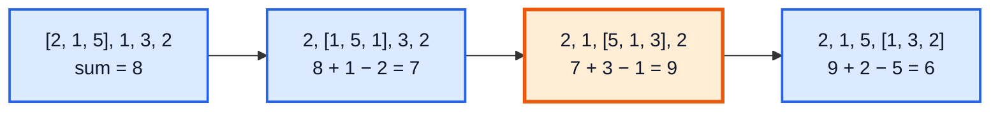
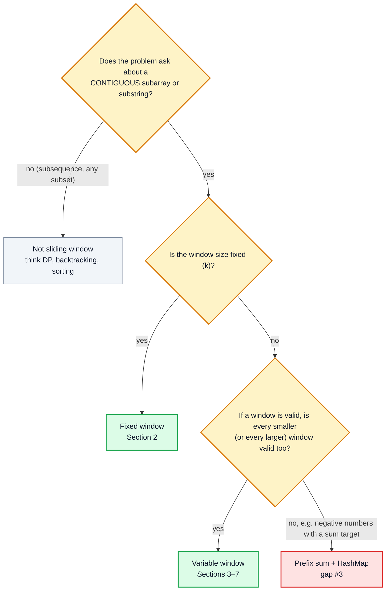
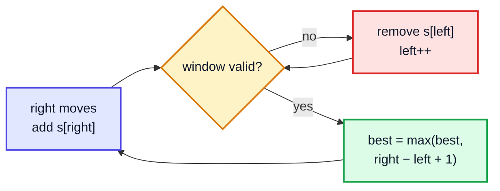

# Sliding Window — Complete In-Depth Guide

**DSA gap pattern #1 of 16** · Priority 🔴 · from [topics_not_covered.md](../topics_not_covered.md)

The playlist never teaches the sliding window, yet it's one of the most-asked patterns for array and string questions. A **window** is a contiguous range `[left, right]` that moves across the input. Instead of recomputing everything for each subarray, you **add the element that enters on the right and remove the one that leaves on the left**, turning many O(n²) or O(n·k) brute-force solutions into O(n).

> [!NOTE]
> This pattern isn't in the playlist, so there are no video timestamps. All code targets **Java 21**. You need arrays ([video 12](../kunal-java-notes-claude/java_12_video_arrays_arraylist.md)), strings ([video 21](../kunal-java-notes-claude/java_21_video_strings_stringbuilder.md)) and the `HashMap` API ([video 57, section 4](../kunal-java-notes-claude/java_57_video_hashmap_hashtable.md#4-hashmaps-in-java-10623)). The [study roadmap](../java_dsa_study_roadmap.md) suggests learning [Two Pointers (gap #2)](dsa_gap_02_two_pointers.md) just before this file, since a window is two pointers moving in the same direction.

---

## Table of Contents

| # | Topic (anchor link) | Level |
|---|---|---|
| 0 | [What a Sliding Window Is](#0-what-a-sliding-window-is) | Basics |
| 1 | [When to Use It](#1-when-to-use-it) | Basics |
| 2 | [Fixed-Size Window](#2-fixed-size-window) | Core |
| 3 | [Variable Window: Longest Valid](#3-variable-window-longest-valid) | Core |
| 4 | [Variable Window: Shortest Valid](#4-variable-window-shortest-valid) | Core |
| 5 | [Windows with Frequency Counts](#5-windows-with-frequency-counts) | In depth |
| 6 | [Minimum Window Substring](#6-minimum-window-substring) | In depth |
| 7 | [Counting Subarrays: the At-Most-K Trick](#7-counting-subarrays-the-at-most-k-trick) | In depth |
| 8 | [When Sliding Window Fails](#8-when-sliding-window-fails) | In depth |
| 9 | [Templates, Pitfalls and Problem List](#9-templates-pitfalls-and-problem-list) | Interview |

---

## 0. What a Sliding Window Is

**Problem:** find the maximum sum of any 3 consecutive elements in `[2, 1, 5, 1, 3, 2]`.

**Brute force:** for every start, add up 3 elements → O(n·k).

**Sliding window:** keep the sum of the current window. Moving one step right means **+ new element, − old element**: O(1) per step, O(n) total.



| Approach | Work per window | Total |
|---|---|---|
| Brute force | k additions | O(n·k) |
| Sliding window | 1 addition + 1 subtraction | **O(n)** |

The window is described by two indices, `left` and `right`. Both only ever move **forward**, so each element enters the window once and leaves at most once. That "each element is touched at most twice" argument is why every sliding window solution is O(n), even when there's a `while` loop inside the `for` loop.

---

## 1. When to Use It



### Clue words

| Clue in the question | Pattern |
|---|---|
| "subarray / substring of size k" | Fixed window |
| "longest substring with at most / without …" | Variable window, longest valid |
| "smallest subarray with sum ≥ target" | Variable window, shortest valid |
| "contains all characters of …", "anagram / permutation of …" | Window + frequency counts |
| "number of subarrays with exactly k …" | At-most-K trick |
| "maximum in every window of size k" | Monotonic deque (LC 239, a later pattern) |

> [!IMPORTANT]
> The key property for a **variable** window is **monotonicity**: shrinking a valid window keeps it valid (or growing an invalid one keeps it invalid). With only non-negative numbers, adding an element can only increase the sum, so the window can move greedily. With negative numbers that breaks; see Section 8.

---

## 2. Fixed-Size Window

### Template

```java
// window = nums[i - k + 1 .. i]
for (int i = 0; i < n; i++) {
    add(nums[i]);                      // element enters on the right
    if (i >= k) remove(nums[i - k]);   // element leaves on the left
    if (i >= k - 1) record answer;     // window is full
}
```

### Maximum sum subarray of size k

```java
public class MaxSumSizeK {
    static int maxSum(int[] nums, int k) {
        int sum = 0, best = Integer.MIN_VALUE;
        for (int i = 0; i < nums.length; i++) {
            sum += nums[i];
            if (i >= k) sum -= nums[i - k];
            if (i >= k - 1) best = Math.max(best, sum);
        }
        return best;
    }

    public static void main(String[] args) {
        System.out.println(maxSum(new int[]{2, 1, 5, 1, 3, 2}, 3));   // 9
        System.out.println(maxSum(new int[]{-1, -2, -3}, 2));         // -3
    }
}
```

**Dry run** on `[2, 1, 5, 1, 3, 2]`, k = 3:

| i | nums[i] | enters | leaves | sum | window | best |
|---|---|---|---|---|---|---|
| 0 | 2 | 2 | — | 2 | not full | MIN |
| 1 | 1 | 1 | — | 3 | not full | MIN |
| 2 | 5 | 5 | — | 8 | [2,1,5] | 8 |
| 3 | 1 | 1 | 2 | 7 | [1,5,1] | 8 |
| 4 | 3 | 3 | 1 | 9 | [5,1,3] | **9** |
| 5 | 2 | 2 | 5 | 6 | [1,3,2] | 9 |

**Time** O(n), **space** O(1).

> [!WARNING]
> Starting `best` at `0` is a classic bug: with all-negative input the answer is negative. Start at `Integer.MIN_VALUE` (or at the first full window's sum).

### Maximum Average Subarray I (LC 643)

Same thing, divide at the end: `return (double) maxSum(nums, k) / k;`

### Maximum Number of Vowels in a Substring of Given Length (LC 1456)

The "value" of the window is a count instead of a sum.

```java
public class MaxVowels {
    static boolean isVowel(char c) { return "aeiou".indexOf(c) >= 0; }

    static int maxVowels(String s, int k) {
        int count = 0, best = 0;
        for (int i = 0; i < s.length(); i++) {
            if (isVowel(s.charAt(i))) count++;
            if (i >= k && isVowel(s.charAt(i - k))) count--;
            best = Math.max(best, count);       // safe before the window is full: count only grows
        }
        return best;
    }

    public static void main(String[] args) {
        System.out.println(maxVowels("abciiidef", 3));   // 3  ("iii")
        System.out.println(maxVowels("leetcode", 3));    // 2
    }
}
```

---

## 3. Variable Window: Longest Valid

### Template

```java
int left = 0, best = 0;
for (int right = 0; right < n; right++) {
    add(s[right]);                       // 1. expand: always take the new element
    while (window is invalid) {          // 2. shrink until valid again
        remove(s[left]);
        left++;
    }
    best = Math.max(best, right - left + 1);   // 3. window is valid: record
}
```



### Longest Substring Without Repeating Characters (LC 3)

**Valid** = no character appears twice.

**Version 1: a set (direct use of the template)**

```java
import java.util.*;

public class LongestUniqueSet {
    static int lengthOfLongestSubstring(String s) {
        Set<Character> window = new HashSet<>();
        int left = 0, best = 0;
        for (int right = 0; right < s.length(); right++) {
            char c = s.charAt(right);
            while (window.contains(c)) {          // invalid: c is already inside
                window.remove(s.charAt(left));
                left++;
            }
            window.add(c);
            best = Math.max(best, right - left + 1);
        }
        return best;
    }

    public static void main(String[] args) {
        System.out.println(lengthOfLongestSubstring("abcabcbb"));   // 3
        System.out.println(lengthOfLongestSubstring("bbbbb"));      // 1
        System.out.println(lengthOfLongestSubstring("pwwkew"));     // 3
        System.out.println(lengthOfLongestSubstring(""));           // 0
    }
}
```

**Version 2: jump `left` directly** using the last index where each character was seen.

```java
import java.util.*;

public class LongestUniqueJump {
    static int lengthOfLongestSubstring(String s) {
        int[] last = new int[128];                 // last index + 1 of each ASCII char; 0 = not seen
        int left = 0, best = 0;
        for (int right = 0; right < s.length(); right++) {
            char c = s.charAt(right);
            left = Math.max(left, last[c]);        // jump past the previous c (never move left backwards)
            last[c] = right + 1;
            best = Math.max(best, right - left + 1);
        }
        return best;
    }

    public static void main(String[] args) {
        System.out.println(lengthOfLongestSubstring("abcabcbb"));   // 3
        System.out.println(lengthOfLongestSubstring("abba"));       // 2
    }
}
```

**Dry run** of version 2 on `"abcabcbb"`:

| right | char | `last[c]` before | left | window | best |
|---|---|---|---|---|---|
| 0 | a | 0 | 0 | a | 1 |
| 1 | b | 0 | 0 | ab | 2 |
| 2 | c | 0 | 0 | abc | **3** |
| 3 | a | 1 | 1 | bca | 3 |
| 4 | b | 2 | 2 | cab | 3 |
| 5 | c | 3 | 3 | abc | 3 |
| 6 | b | 5 | 5 | cb | 3 |
| 7 | b | 7 | 7 | b | 3 |

> [!CAUTION]
> The `Math.max(left, ...)` matters. In `"abba"`, at the final `a` its last index (1) is **behind** `left` (2). Without `max`, `left` would jump backwards and the answer would wrongly be 3.

| Version | Time | Space |
|---|---|---|
| Set + shrinking loop | O(n) (each char added/removed once) | O(min(n, alphabet)) |
| Last-index jump | O(n), fewer steps | O(alphabet) |

### Longest Substring with At Most K Distinct Characters / Fruit Into Baskets (LC 904)

LC 904 is "longest subarray with at most **2** distinct values". **Valid** = map size ≤ k.

```java
import java.util.*;

public class AtMostKDistinct {
    static int longestAtMostK(int[] a, int k) {
        Map<Integer, Integer> freq = new HashMap<>();
        int left = 0, best = 0;
        for (int right = 0; right < a.length; right++) {
            freq.merge(a[right], 1, Integer::sum);
            while (freq.size() > k) {
                if (freq.merge(a[left], -1, Integer::sum) == 0) freq.remove(a[left]);
                left++;
            }
            best = Math.max(best, right - left + 1);
        }
        return best;
    }

    public static void main(String[] args) {
        System.out.println(longestAtMostK(new int[]{1, 2, 1}, 2));          // 3
        System.out.println(longestAtMostK(new int[]{0, 1, 2, 2}, 2));       // 3
        System.out.println(longestAtMostK(new int[]{1, 2, 3, 2, 2}, 2));    // 4
    }
}
```

> [!TIP]
> `freq.merge(x, -1, Integer::sum)` returns the new count. Remove the key when it hits 0, otherwise `freq.size()` counts characters that are no longer in the window.

---

## 4. Variable Window: Shortest Valid

For "shortest", record the answer **inside** the shrinking loop, while the window is still valid.

```java
for (int right = 0; right < n; right++) {
    add(s[right]);
    while (window is valid) {                    // shrink as long as it stays valid
        best = Math.min(best, right - left + 1);
        remove(s[left]);
        left++;
    }
}
```

| | Longest valid | Shortest valid |
|---|---|---|
| Loop condition | `while (invalid)` shrink | `while (valid)` shrink |
| Where to record | **after** the while loop | **inside** the while loop |
| Initial `best` | `0` | `Integer.MAX_VALUE` (then map "never found" to 0 or "") |

### Minimum Size Subarray Sum (LC 209)

Smallest length of a subarray with sum ≥ target. All numbers are positive, so the window is monotonic.

```java
public class MinSubarrayLen {
    static int minSubArrayLen(int target, int[] nums) {
        int left = 0, sum = 0, best = Integer.MAX_VALUE;
        for (int right = 0; right < nums.length; right++) {
            sum += nums[right];
            while (sum >= target) {
                best = Math.min(best, right - left + 1);
                sum -= nums[left++];
            }
        }
        return best == Integer.MAX_VALUE ? 0 : best;
    }

    public static void main(String[] args) {
        System.out.println(minSubArrayLen(7, new int[]{2, 3, 1, 2, 4, 3}));     // 2  ([4, 3])
        System.out.println(minSubArrayLen(11, new int[]{1, 1, 1, 1}));          // 0
    }
}
```

**Dry run**, target 7, `[2, 3, 1, 2, 4, 3]`:

| right | add | sum | shrink steps (record → remove) | left after | best |
|---|---|---|---|---|---|
| 0 | 2 | 2 | — | 0 | ∞ |
| 1 | 3 | 5 | — | 0 | ∞ |
| 2 | 1 | 6 | — | 0 | ∞ |
| 3 | 2 | 8 | len 4 → remove 2 → sum 6 | 1 | 4 |
| 4 | 4 | 10 | len 4 → remove 3 → 7; len 3 → remove 1 → 6 | 3 | 3 |
| 5 | 3 | 9 | len 3 → remove 2 → 7; len **2** → remove 4 → 3 | 5 | **2** |

**Time** O(n), **space** O(1). (Alternative: prefix sums + binary search, O(n log n).)

---

## 5. Windows with Frequency Counts

Many string problems compare the window's character counts with a target's counts. For lowercase letters, an `int[26]` is faster and simpler than a `HashMap`.

### Longest Repeating Character Replacement (LC 424)

Longest substring that can be made of one repeated letter by changing at most k characters. **Valid** = `windowLength − countOfMostFrequentChar ≤ k`.

```java
public class CharacterReplacement {
    static int characterReplacement(String s, int k) {
        int[] count = new int[26];
        int left = 0, maxFreq = 0, best = 0;
        for (int right = 0; right < s.length(); right++) {
            maxFreq = Math.max(maxFreq, ++count[s.charAt(right) - 'A']);
            while (right - left + 1 - maxFreq > k) {      // too many letters to replace
                count[s.charAt(left) - 'A']--;
                left++;
            }
            best = Math.max(best, right - left + 1);
        }
        return best;
    }

    public static void main(String[] args) {
        System.out.println(characterReplacement("ABAB", 2));      // 4
        System.out.println(characterReplacement("AABABBA", 1));   // 4
    }
}
```

> [!NOTE]
> `maxFreq` is never decreased when the window shrinks, so it can be stale (too high). That's fine: a stale `maxFreq` can only make the window *look* valid at a length we've already achieved, so `best` is never overstated. The answer only grows when a genuinely higher `maxFreq` appears. This trick keeps the solution O(n) instead of O(26·n).

### Permutation in String (LC 567) — fixed window + counts

Is some permutation of `p` a substring of `s`? A window of size `p.length()` whose counts equal `p`'s counts.

```java
import java.util.*;

public class PermutationInString {
    static boolean checkInclusion(String p, String s) {
        if (p.length() > s.length()) return false;
        int[] need = new int[26], have = new int[26];
        for (char c : p.toCharArray()) need[c - 'a']++;
        int k = p.length();
        for (int i = 0; i < s.length(); i++) {
            have[s.charAt(i) - 'a']++;
            if (i >= k) have[s.charAt(i - k) - 'a']--;
            if (i >= k - 1 && Arrays.equals(need, have)) return true;   // 26 comparisons: O(1)
        }
        return false;
    }

    public static void main(String[] args) {
        System.out.println(checkInclusion("ab", "eidbaooo"));   // true  ("ba")
        System.out.println(checkInclusion("ab", "eidboaoo"));   // false
    }
}
```

### Find All Anagrams in a String (LC 438)

The same loop, but collect every start index `i - k + 1` instead of returning `true`. Instead of comparing 26 counts each time, you can track how many letters currently match:

```java
import java.util.*;

public class FindAnagrams {
    static List<Integer> findAnagrams(String s, String p) {
        List<Integer> res = new ArrayList<>();
        if (p.length() > s.length()) return res;
        int[] diff = new int[26];                        // need − have for each letter
        for (char c : p.toCharArray()) diff[c - 'a']++;
        int k = p.length(), mismatched = 0;
        for (int d : diff) if (d != 0) mismatched++;

        for (int i = 0; i < s.length(); i++) {
            int in = s.charAt(i) - 'a';
            if (diff[in] == 0) mismatched++;             // was balanced, now won't be
            if (--diff[in] == 0) mismatched--;
            if (i >= k) {
                int out = s.charAt(i - k) - 'a';
                if (diff[out] == 0) mismatched++;
                if (++diff[out] == 0) mismatched--;
            }
            if (i >= k - 1 && mismatched == 0) res.add(i - k + 1);
        }
        return res;
    }

    public static void main(String[] args) {
        System.out.println(findAnagrams("cbaebabacd", "abc"));   // [0, 6]
        System.out.println(findAnagrams("abab", "ab"));          // [0, 1, 2]
    }
}
```

---

## 6. Minimum Window Substring

**LC 76 (Hard):** the smallest substring of `s` containing every character of `t` (with multiplicity). It combines Sections 4 and 5: a **shortest valid** window where "valid" is checked with counts.

**Idea:** keep `need[c]` = how many more of `c` the window still needs, and `missing` = total characters still needed. The window is valid when `missing == 0`.

```java
public class MinWindowSubstring {
    static String minWindow(String s, String t) {
        if (t.isEmpty() || s.length() < t.length()) return "";
        int[] need = new int[128];
        for (char c : t.toCharArray()) need[c]++;
        int missing = t.length(), left = 0, bestLen = Integer.MAX_VALUE, bestStart = 0;

        for (int right = 0; right < s.length(); right++) {
            if (need[s.charAt(right)]-- > 0) missing--;          // this char was actually needed
            while (missing == 0) {                                // valid: try to shrink
                if (right - left + 1 < bestLen) { bestLen = right - left + 1; bestStart = left; }
                if (++need[s.charAt(left)] > 0) missing++;        // removing a needed char breaks it
                left++;
            }
        }
        return bestLen == Integer.MAX_VALUE ? "" : s.substring(bestStart, bestStart + bestLen);
    }

    public static void main(String[] args) {
        System.out.println(minWindow("ADOBECODEBANC", "ABC"));   // BANC
        System.out.println(minWindow("a", "aa"));                // "" (empty)
        System.out.println(minWindow("aa", "aa"));               // aa
    }
}
```

> [!NOTE]
> Characters not in `t` go negative in `need` when they enter (they're "extra"), and come back towards 0 when they leave. Only a count rising **above 0** means the window lost something it truly needed.

**Key steps** on `s = "ADOBECODEBANC"`, `t = "ABC"`:

| Event | Window | missing | Best so far |
|---|---|---|---|
| right reaches index 5 (`C`) | `ADOBEC` | 0 | `ADOBEC` (6) |
| shrink: drop `A` | `DOBEC` | 1 | — |
| right reaches index 10 (`A`) | `DOBECODEBA` | 0 | — |
| shrink to `CODEBA` (length 6, not shorter), then drop `C` | `ODEBA` | 1 | still `ADOBEC` (6) |
| right reaches index 12 (`C`) | `ODEBANC` | 0 | — |
| shrink to `BANC`, then drop `B` | `ANC` | 1 | **`BANC` (4)** |

**Time** O(|s| + |t|), **space** O(alphabet).

---

## 7. Counting Subarrays: the At-Most-K Trick

"How many subarrays have **exactly** K distinct values?" is hard to slide directly: growing a window can turn "exactly K" into "K+1", and shrinking can turn it into "K−1", so it isn't monotonic. But "**at most** K" is monotonic, and:

> **exactly(K) = atMost(K) − atMost(K − 1)**

For each `right`, every subarray ending at `right` and starting anywhere in `[left, right]` is valid, so there are `right − left + 1` of them.

```java
import java.util.*;

public class SubarraysKDistinct {
    static int atMost(int[] a, int k) {
        Map<Integer, Integer> freq = new HashMap<>();
        int left = 0, count = 0;
        for (int right = 0; right < a.length; right++) {
            freq.merge(a[right], 1, Integer::sum);
            while (freq.size() > k) {
                if (freq.merge(a[left], -1, Integer::sum) == 0) freq.remove(a[left]);
                left++;
            }
            count += right - left + 1;         // subarrays ending at right
        }
        return count;
    }

    static int subarraysWithKDistinct(int[] a, int k) {       // LC 992
        return atMost(a, k) - atMost(a, k - 1);
    }

    public static void main(String[] args) {
        System.out.println(subarraysWithKDistinct(new int[]{1, 2, 1, 2, 3}, 2));   // 7
        System.out.println(subarraysWithKDistinct(new int[]{1, 2, 1, 3, 4}, 3));   // 3
    }
}
```

| Problem | "At most" form |
|---|---|
| LC 992 Subarrays with K Different Integers | at most K distinct |
| LC 1248 Count Number of Nice Subarrays | at most K odd numbers |
| LC 930 Binary Subarrays With Sum | at most `goal` sum (0/1 values) |

---

## 8. When Sliding Window Fails

### Negative numbers with a sum target

"Count subarrays with sum exactly k" (LC 560) with `[1, -1, 1]`, k = 1: the answer is 3 (`[1]`, `[1]`, `[1, -1, 1]`). A window can't decide when to shrink, because removing an element may *increase* the sum. Use **prefix sum + HashMap** instead: [gap #3](dsa_gap_03_prefix_sum_difference_array.md).

### Maximum (or minimum) of every window

Keeping a sum is O(1), but keeping a **max** when elements leave isn't: if the max leaves, which is the next one? Options:

| Approach | Time |
|---|---|
| Rescan each window | O(n·k) |
| `TreeMap` of counts (sorted multiset) | O(n log k) |
| **Monotonic deque** (LC 239) | **O(n)** — gap pattern "Monotonic Deque" |

### Non-contiguous problems

"Longest **subsequence**…" or "any subset…" is not a window problem: elements don't have to be next to each other. Those are DP or backtracking.

---

## 9. Templates, Pitfalls and Problem List

### The three templates

| Type | Shrink condition | Record answer |
|---|---|---|
| Fixed size k | Remove `a[i-k]` when `i >= k` | When `i >= k - 1` |
| Longest valid | `while (invalid)` | After the loop |
| Shortest valid | `while (valid)` | Inside the loop |
| Count subarrays (at most) | `while (invalid)` | `count += right - left + 1` |

### Pitfalls

| Pitfall | Fix |
|---|---|
| `best = 0` with negative values | Start at `Integer.MIN_VALUE` |
| Forgetting to remove zero-count keys from the map | `if (merge(x, -1, ...) == 0) remove(x)` |
| `left` jumping backwards (last-index version) | `left = Math.max(left, last[c])` |
| Off-by-one in window length | Length is `right - left + 1` |
| Using a window when values can be negative | Prefix sum + HashMap |
| `char - 'a'` on uppercase or non-letters | Use `int[128]` for ASCII, or a `HashMap` |
| Sum overflow on large inputs | Use `long` |

### Problem list (in order)

| # | Problem | Type | Difficulty |
|---|---|---|---|
| 1 | LC 643 Maximum Average Subarray I | Fixed | Easy |
| 2 | LC 1456 Max Vowels in a Substring of Given Length | Fixed | Medium |
| 3 | LC 3 Longest Substring Without Repeating Characters | Longest | Medium |
| 4 | LC 209 Minimum Size Subarray Sum | Shortest | Medium |
| 5 | LC 904 Fruit Into Baskets | Longest, at most 2 | Medium |
| 6 | LC 1004 Max Consecutive Ones III | Longest, at most k zeros | Medium |
| 7 | LC 424 Longest Repeating Character Replacement | Longest + counts | Medium |
| 8 | LC 567 Permutation in String | Fixed + counts | Medium |
| 9 | LC 438 Find All Anagrams in a String | Fixed + counts | Medium |
| 10 | LC 992 Subarrays with K Different Integers | At-most trick | Hard |
| 11 | LC 76 Minimum Window Substring | Shortest + counts | Hard |
| 12 | LC 239 Sliding Window Maximum | Monotonic deque | Hard |

### Interview Q&A

| Question | Short answer |
|---|---|
| Why is a sliding window O(n) with a nested while loop? | `left` and `right` each move at most n times in total. |
| Fixed vs variable window? | Fixed: size given. Variable: grow/shrink based on a validity condition. |
| When can't you use a variable window? | When validity isn't monotonic, e.g. sums with negative numbers. |
| How do you count subarrays with "exactly K"? | atMost(K) − atMost(K−1). |
| Array or HashMap for counts? | `int[26]`/`int[128]` for small alphabets (faster), `HashMap` otherwise. |

---

## 🧩 Complete Example: Everything Together

One program running the fixed, longest, shortest, frequency-count, minimum-window and at-most-K windows from this file, plus a brute-force cross-check that the O(n) versions agree with O(n²) ones on random input.

```java
import java.util.*;

public class SlidingWindowShowcase {

    // Fixed: max sum of size k
    static long maxSumK(int[] a, int k) {
        long sum = 0, best = Long.MIN_VALUE;
        for (int i = 0; i < a.length; i++) {
            sum += a[i];
            if (i >= k) sum -= a[i - k];
            if (i >= k - 1) best = Math.max(best, sum);
        }
        return best;
    }

    // Longest: no repeating characters (LC 3)
    static int longestUnique(String s) {
        int[] last = new int[128];
        int left = 0, best = 0;
        for (int r = 0; r < s.length(); r++) {
            left = Math.max(left, last[s.charAt(r)]);
            last[s.charAt(r)] = r + 1;
            best = Math.max(best, r - left + 1);
        }
        return best;
    }

    // Shortest: sum >= target (LC 209)
    static int minLen(int target, int[] a) {
        int left = 0, sum = 0, best = Integer.MAX_VALUE;
        for (int r = 0; r < a.length; r++) {
            sum += a[r];
            while (sum >= target) { best = Math.min(best, r - left + 1); sum -= a[left++]; }
        }
        return best == Integer.MAX_VALUE ? 0 : best;
    }

    // Counts: longest repeating character replacement (LC 424)
    static int replaceK(String s, int k) {
        int[] cnt = new int[26];
        int left = 0, maxF = 0, best = 0;
        for (int r = 0; r < s.length(); r++) {
            maxF = Math.max(maxF, ++cnt[s.charAt(r) - 'A']);
            while (r - left + 1 - maxF > k) cnt[s.charAt(left++) - 'A']--;
            best = Math.max(best, r - left + 1);
        }
        return best;
    }

    // Fixed + counts: all anagram start indices (LC 438)
    static List<Integer> anagrams(String s, String p) {
        List<Integer> res = new ArrayList<>();
        int[] need = new int[26], have = new int[26];
        for (char c : p.toCharArray()) need[c - 'a']++;
        int k = p.length();
        for (int i = 0; i < s.length(); i++) {
            have[s.charAt(i) - 'a']++;
            if (i >= k) have[s.charAt(i - k) - 'a']--;
            if (i >= k - 1 && Arrays.equals(need, have)) res.add(i - k + 1);
        }
        return res;
    }

    // Shortest + counts: minimum window substring (LC 76)
    static String minWindow(String s, String t) {
        int[] need = new int[128];
        for (char c : t.toCharArray()) need[c]++;
        int missing = t.length(), left = 0, bestLen = Integer.MAX_VALUE, start = 0;
        for (int r = 0; r < s.length(); r++) {
            if (need[s.charAt(r)]-- > 0) missing--;
            while (missing == 0) {
                if (r - left + 1 < bestLen) { bestLen = r - left + 1; start = left; }
                if (++need[s.charAt(left++)] > 0) missing++;
            }
        }
        return bestLen == Integer.MAX_VALUE ? "" : s.substring(start, start + bestLen);
    }

    // At most K distinct → exactly K (LC 992)
    static int atMost(int[] a, int k) {
        Map<Integer, Integer> f = new HashMap<>();
        int left = 0, count = 0;
        for (int r = 0; r < a.length; r++) {
            f.merge(a[r], 1, Integer::sum);
            while (f.size() > k) { if (f.merge(a[left], -1, Integer::sum) == 0) f.remove(a[left]); left++; }
            count += r - left + 1;
        }
        return count;
    }
    static int exactlyK(int[] a, int k) { return atMost(a, k) - atMost(a, k - 1); }

    // Brute-force versions for cross-checking
    static int bruteLongestUnique(String s) {
        int best = 0;
        for (int i = 0; i < s.length(); i++) {
            Set<Character> seen = new HashSet<>();
            for (int j = i; j < s.length() && seen.add(s.charAt(j)); j++) best = Math.max(best, j - i + 1);
        }
        return best;
    }
    static int bruteMinLen(int target, int[] a) {
        int best = Integer.MAX_VALUE;
        for (int i = 0; i < a.length; i++) {
            int sum = 0;
            for (int j = i; j < a.length; j++) { sum += a[j]; if (sum >= target) { best = Math.min(best, j - i + 1); break; } }
        }
        return best == Integer.MAX_VALUE ? 0 : best;
    }
    static int bruteExactlyK(int[] a, int k) {
        int count = 0;
        for (int i = 0; i < a.length; i++) {
            Set<Integer> d = new HashSet<>();
            for (int j = i; j < a.length; j++) { d.add(a[j]); if (d.size() == k) count++; }
        }
        return count;
    }

    public static void main(String[] args) {
        System.out.println("Fixed window   max sum k=3 of [2,1,5,1,3,2]   = " + maxSumK(new int[]{2, 1, 5, 1, 3, 2}, 3));
        System.out.println("Longest        unique substring of abcabcbb   = " + longestUnique("abcabcbb"));
        System.out.println("Shortest       sum >= 7 in [2,3,1,2,4,3]      = " + minLen(7, new int[]{2, 3, 1, 2, 4, 3}));
        System.out.println("Counts         AABABBA with k=1               = " + replaceK("AABABBA", 1));
        System.out.println("Anagrams       of abc in cbaebabacd           = " + anagrams("cbaebabacd", "abc"));
        System.out.println("Min window     of ABC in ADOBECODEBANC        = " + minWindow("ADOBECODEBANC", "ABC"));
        System.out.println("Exactly K      2 distinct in [1,2,1,2,3]      = " + exactlyK(new int[]{1, 2, 1, 2, 3}, 2));

        // Random cross-check: O(n) answers must equal the O(n^2) answers
        Random rnd = new Random(42);
        int checks = 0, mismatches = 0;
        for (int t = 0; t < 300; t++) {
            int n = 1 + rnd.nextInt(30);
            StringBuilder sb = new StringBuilder();
            int[] pos = new int[n], small = new int[n];
            for (int i = 0; i < n; i++) {
                sb.append((char) ('a' + rnd.nextInt(5)));
                pos[i] = 1 + rnd.nextInt(10);
                small[i] = rnd.nextInt(4);
            }
            int target = 1 + rnd.nextInt(40), k = 1 + rnd.nextInt(3);
            if (longestUnique(sb.toString()) != bruteLongestUnique(sb.toString())) mismatches++;
            if (minLen(target, pos) != bruteMinLen(target, pos)) mismatches++;
            if (exactlyK(small, k) != bruteExactlyK(small, k)) mismatches++;
            checks += 3;
        }
        System.out.println("Random cross-checks: " + checks + ", mismatches: " + mismatches);
    }
}
```

**Expected Output:**
```
Fixed window   max sum k=3 of [2,1,5,1,3,2]   = 9
Longest        unique substring of abcabcbb   = 3
Shortest       sum >= 7 in [2,3,1,2,4,3]      = 2
Counts         AABABBA with k=1               = 4
Anagrams       of abc in cbaebabacd           = [0, 6]
Min window     of ABC in ADOBECODEBANC        = BANC
Exactly K      2 distinct in [1,2,1,2,3]      = 7
Random cross-checks: 900, mismatches: 0
```

---

## Quick Reference Cheat Sheet

| Concept | One-Line Summary |
|---|---|
| **Sliding window** | Contiguous range `[left, right]`; add on the right, remove on the left |
| **Why O(n)** | Each pointer only moves forward, at most n steps each |
| **Use when** | Contiguous subarray/substring + an incrementally updatable value |
| **Fixed window** | Add `a[i]`; remove `a[i-k]` once `i >= k`; record once `i >= k-1` |
| **Longest valid** | Expand; `while (invalid)` shrink; record after |
| **Shortest valid** | Expand; `while (valid)` record then shrink |
| **Counts** | `int[26]` / `int[128]` or `HashMap`; remove zero counts |
| **LC 3 trick** | `left = max(left, lastSeen[c])` |
| **LC 424 trick** | Valid if `len − maxFreq ≤ k`; stale `maxFreq` is OK |
| **LC 76 trick** | `need[]` + `missing` counter; shrink while `missing == 0` |
| **Exactly K** | `atMost(K) − atMost(K−1)`; count `right − left + 1` per step |
| **Fails when** | Negatives with a sum target → prefix sum + HashMap |
| **Window max** | Monotonic deque (LC 239) |
