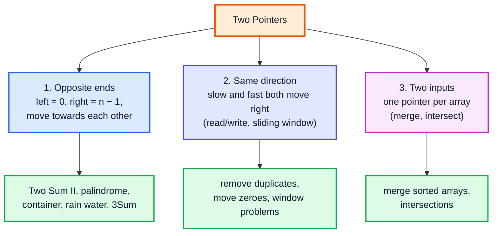
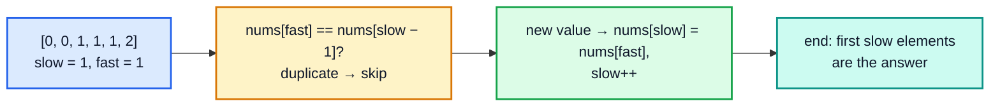
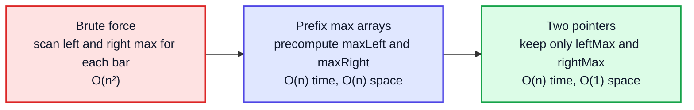
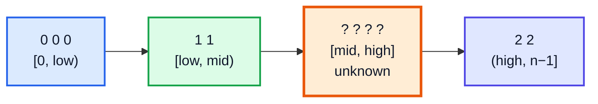
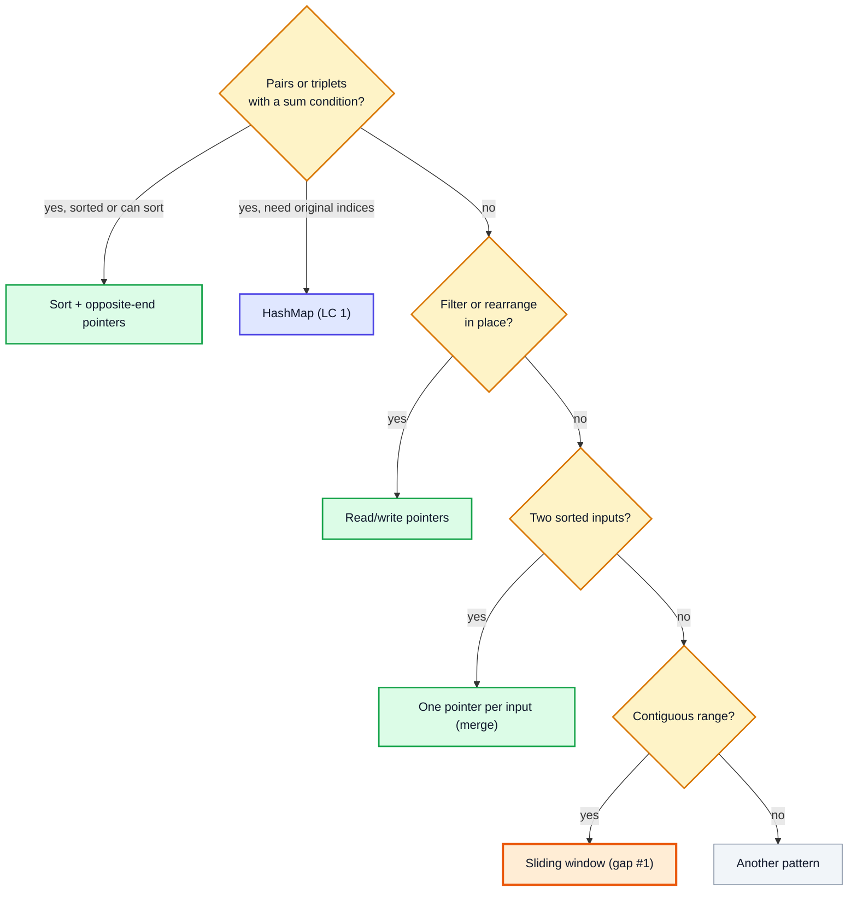

# Two Pointers on Arrays — Complete In-Depth Guide

**DSA gap pattern #2 of 16** · Priority 🔴 · from [topics_not_covered.md](../topics_not_covered.md)

The playlist uses two pointers inside other topics — `start`/`end` in binary search ([video 14](../kunal-java-notes-claude/java_14_video_binary_search.md)) and fast/slow pointers on linked lists ([video 45](../kunal-java-notes-claude/java_45_video_linkedlist_interview_questions.md)) — but never teaches it as a pattern for arrays. With two indices moving through an array in a planned way, many O(n²) "check every pair" problems become **O(n)**. These notes cover the three shapes of the pattern, the proofs of *why* they work, and the classic problems: Two Sum II, 3Sum, Container With Most Water, Trapping Rain Water, Sort Colors and more.

> [!NOTE]
> This pattern isn't in the playlist, so there are no video timestamps. All code targets **Java 21**. You need arrays ([video 12](../kunal-java-notes-claude/java_12_video_arrays_arraylist.md)) and sorting (videos 17–19). The [Sliding Window (gap #1)](dsa_gap_01_sliding_window.md) is a special case of the "same direction" shape below.

---

## Table of Contents

| # | Topic (anchor link) | Level |
|---|---|---|
| 0 | [The Idea and the Three Shapes](#0-the-idea-and-the-three-shapes) | Basics |
| 1 | [Opposite Ends: Pair Sum in a Sorted Array](#1-opposite-ends-pair-sum-in-a-sorted-array) | Core |
| 2 | [Opposite Ends: Reversing and Palindromes](#2-opposite-ends-reversing-and-palindromes) | Core |
| 3 | [Same Direction: Read and Write Pointers](#3-same-direction-read-and-write-pointers) | Core |
| 4 | [Two Arrays: Merging and Intersecting](#4-two-arrays-merging-and-intersecting) | Core |
| 5 | [3Sum and k-Sum](#5-3sum-and-k-sum) | In depth |
| 6 | [Container With Most Water](#6-container-with-most-water) | In depth |
| 7 | [Trapping Rain Water](#7-trapping-rain-water) | In depth |
| 8 | [Three Pointers: Sort Colors](#8-three-pointers-sort-colors) | In depth |
| 9 | [Squares of a Sorted Array](#9-squares-of-a-sorted-array) | In depth |
| 10 | [Choosing the Technique and Problem List](#10-choosing-the-technique-and-problem-list) | Interview |

---

## 0. The Idea and the Three Shapes

Brute force on pairs is two nested loops: O(n²). Two pointers replace the inner loop with a pointer that **never moves backwards**, so the total work is O(n).



| Shape | Start | Moves | Typical requirement |
|---|---|---|---|
| Opposite ends | `l = 0`, `r = n - 1` | `l++` or `r--` until they meet | Sorted array, or a symmetric property |
| Same direction | `slow = 0`, `fast = 0` | `fast` every step, `slow` sometimes | In-place filtering, windows |
| Two inputs | `i = 0` in A, `j = 0` in B | advance the smaller one | Both inputs sorted |

> [!IMPORTANT]
> Two pointers need a reason why it's safe to **discard** an element when you move past it. In a sorted array that reason is the ordering. Every correct two-pointer solution has a one-sentence argument like "if the sum is too small, no pair using `nums[l]` can work, so `l++`". If you can't state that sentence, the approach is probably wrong.

---

## 1. Opposite Ends: Pair Sum in a Sorted Array

### Two Sum II — Input Array Is Sorted (LC 167)

Find indices (1-based) of two numbers adding up to `target`.

```java
import java.util.*;

public class TwoSumSorted {
    static int[] twoSum(int[] nums, int target) {
        int l = 0, r = nums.length - 1;
        while (l < r) {
            int sum = nums[l] + nums[r];
            if (sum == target) return new int[]{l + 1, r + 1};
            if (sum < target) l++;        // need a bigger sum
            else r--;                     // need a smaller sum
        }
        return new int[]{-1, -1};
    }

    public static void main(String[] args) {
        System.out.println(Arrays.toString(twoSum(new int[]{2, 7, 11, 15}, 9)));     // [1, 2]
        System.out.println(Arrays.toString(twoSum(new int[]{1, 3, 4, 6, 8, 11}, 10))); // [3, 4]
        System.out.println(Arrays.toString(twoSum(new int[]{-1, 0}, -1)));           // [1, 2]
    }
}
```

**Dry run**, `[1, 3, 4, 6, 8, 11]`, target 10:

| l | r | nums[l] + nums[r] | Decision |
|---|---|---|---|
| 0 | 5 | 1 + 11 = 12 | too big → `r--` |
| 0 | 4 | 1 + 8 = 9 | too small → `l++` |
| 1 | 4 | 3 + 8 = 11 | too big → `r--` |
| 1 | 3 | 3 + 6 = 9 | too small → `l++` |
| 2 | 3 | 4 + 6 = **10** | found → `[3, 4]` |

### Why it never misses the answer

- If `nums[l] + nums[r] < target`: `nums[r]` is the **largest** value still available, so `nums[l]` plus *anything* left is also too small. `nums[l]` can't be in the answer → discard it (`l++`).
- If the sum is `> target`: symmetrically, `nums[r]` plus the smallest remaining value is too big → discard `nums[r]` (`r--`).

Each step removes one element that can't be part of any answer, so after at most n − 1 steps we've either found the pair or proved there is none.

| Approach | Time | Space | Needs sorted? |
|---|---|---|---|
| Brute force pairs | O(n²) | O(1) | No |
| Binary search for `target − x` | O(n log n) | O(1) | Yes |
| **Two pointers** | **O(n)** | O(1) | Yes |
| HashMap (LC 1, unsorted) | O(n) | O(n) | No |

> [!TIP]
> For the original **Two Sum (LC 1)** on an *unsorted* array that asks for indices, use a `HashMap` (value → index). Sorting would lose the original indices.

---

## 2. Opposite Ends: Reversing and Palindromes

```java
public class Palindromes {
    // LC 344: reverse in place
    static void reverse(char[] s) {
        for (int l = 0, r = s.length - 1; l < r; l++, r--) {
            char t = s[l]; s[l] = s[r]; s[r] = t;
        }
    }

    // LC 125: ignore non-alphanumeric characters and case
    static boolean isPalindrome(String s) {
        int l = 0, r = s.length() - 1;
        while (l < r) {
            while (l < r && !Character.isLetterOrDigit(s.charAt(l))) l++;
            while (l < r && !Character.isLetterOrDigit(s.charAt(r))) r--;
            if (Character.toLowerCase(s.charAt(l)) != Character.toLowerCase(s.charAt(r))) return false;
            l++; r--;
        }
        return true;
    }

    // LC 680: palindrome after deleting at most one character
    static boolean validPalindrome(String s) {
        int l = 0, r = s.length() - 1;
        while (l < r) {
            if (s.charAt(l) != s.charAt(r)) return isPal(s, l + 1, r) || isPal(s, l, r - 1);   // try both deletions
            l++; r--;
        }
        return true;
    }
    static boolean isPal(String s, int l, int r) {
        while (l < r) if (s.charAt(l++) != s.charAt(r--)) return false;
        return true;
    }

    public static void main(String[] args) {
        char[] word = "hello".toCharArray();
        reverse(word);
        System.out.println(new String(word));                                  // olleh
        System.out.println(isPalindrome("A man, a plan, a canal: Panama"));    // true
        System.out.println(isPalindrome("race a car"));                        // false
        System.out.println(validPalindrome("abca"));                           // true  (delete 'c' or 'b')
        System.out.println(validPalindrome("abc"));                            // false
    }
}
```

> [!NOTE]
> The inner `while (l < r && ...)` loops still keep the total O(n): `l` and `r` together move at most n steps.

---

## 3. Same Direction: Read and Write Pointers

`fast` (read) scans every element; `slow` (write) marks where the next kept element goes. Everything before `slow` is the answer so far. This filters an array **in place** with O(1) extra space.



```java
import java.util.*;

public class ReadWrite {
    // LC 26: remove duplicates from a sorted array, return the new length
    static int removeDuplicates(int[] nums) {
        if (nums.length == 0) return 0;
        int slow = 1;
        for (int fast = 1; fast < nums.length; fast++) {
            if (nums[fast] != nums[slow - 1]) nums[slow++] = nums[fast];
        }
        return slow;
    }

    // LC 80: allow each value at most twice (generalises to "at most k")
    static int removeDuplicatesKeep2(int[] nums) {
        int slow = 0;
        for (int x : nums) {
            if (slow < 2 || x != nums[slow - 2]) nums[slow++] = x;
        }
        return slow;
    }

    // LC 27: remove every occurrence of val
    static int removeElement(int[] nums, int val) {
        int slow = 0;
        for (int fast = 0; fast < nums.length; fast++) if (nums[fast] != val) nums[slow++] = nums[fast];
        return slow;
    }

    // LC 283: move zeroes to the end, keeping the order of the others
    static void moveZeroes(int[] nums) {
        int slow = 0;
        for (int fast = 0; fast < nums.length; fast++) {
            if (nums[fast] != 0) {
                int t = nums[slow]; nums[slow] = nums[fast]; nums[fast] = t;   // swap keeps zeroes behind
                slow++;
            }
        }
    }

    public static void main(String[] args) {
        int[] a = {0, 0, 1, 1, 1, 2, 2, 3, 3, 4};
        int k = removeDuplicates(a);
        System.out.println(k + " " + Arrays.toString(Arrays.copyOf(a, k)));     // 5 [0, 1, 2, 3, 4]

        int[] b = {1, 1, 1, 2, 2, 3};
        int k2 = removeDuplicatesKeep2(b);
        System.out.println(k2 + " " + Arrays.toString(Arrays.copyOf(b, k2)));   // 5 [1, 1, 2, 2, 3]

        int[] c = {3, 2, 2, 3};
        int k3 = removeElement(c, 3);
        System.out.println(k3 + " " + Arrays.toString(Arrays.copyOf(c, k3)));   // 2 [2, 2]

        int[] d = {0, 1, 0, 3, 12};
        moveZeroes(d);
        System.out.println(Arrays.toString(d));                                  // [1, 3, 12, 0, 0]
    }
}
```

**Dry run** of `removeDuplicates` on `[0, 0, 1, 1, 1, 2]`:

| fast | nums[fast] | nums[slow − 1] | Action | slow | Array prefix |
|---|---|---|---|---|---|
| 1 | 0 | 0 | skip | 1 | [0] |
| 2 | 1 | 0 | write at 1 | 2 | [0, 1] |
| 3 | 1 | 1 | skip | 2 | [0, 1] |
| 4 | 1 | 1 | skip | 2 | [0, 1] |
| 5 | 2 | 1 | write at 2 | 3 | [0, 1, 2] |

The same "fast and slow" idea on a **linked list** gives cycle detection and the middle node ([video 45](../kunal-java-notes-claude/java_45_video_linkedlist_interview_questions.md)).

---

## 4. Two Arrays: Merging and Intersecting

### Merge Sorted Array (LC 88) — fill from the back

`nums1` has room for `m + n` elements. Merging from the front would overwrite values we still need; merging from the **back** writes only into free space.

```java
import java.util.*;

public class MergeSortedArray {
    static void merge(int[] nums1, int m, int[] nums2, int n) {
        int i = m - 1, j = n - 1, w = m + n - 1;
        while (j >= 0) {                                  // when nums2 is used up, nums1 is already in place
            if (i >= 0 && nums1[i] > nums2[j]) nums1[w--] = nums1[i--];
            else nums1[w--] = nums2[j--];
        }
    }

    // Intersection of two sorted arrays, keeping duplicates (like LC 350 after sorting)
    static List<Integer> intersect(int[] a, int[] b) {
        List<Integer> res = new ArrayList<>();
        int i = 0, j = 0;
        while (i < a.length && j < b.length) {
            if (a[i] == b[j]) { res.add(a[i]); i++; j++; }
            else if (a[i] < b[j]) i++;                    // advance the smaller one
            else j++;
        }
        return res;
    }

    public static void main(String[] args) {
        int[] nums1 = {1, 2, 3, 0, 0, 0};
        merge(nums1, 3, new int[]{2, 5, 6}, 3);
        System.out.println(Arrays.toString(nums1));                                  // [1, 2, 2, 3, 5, 6]
        System.out.println(intersect(new int[]{1, 2, 2, 3, 5}, new int[]{2, 2, 4, 5}));   // [2, 2, 5]
    }
}
```

This is exactly the **merge** step of merge sort ([video 30](../kunal-java-notes-claude/java_30_video_merge_sort.md)).

| Problem | Time | Space |
|---|---|---|
| Merge two sorted arrays | O(m + n) | O(1) extra (LC 88) |
| Intersection of two sorted arrays | O(m + n) | O(output) |
| Same on unsorted arrays | sort first: O(m log m + n log n), or a `HashMap`: O(m + n) time, O(m) space | |

---

## 5. 3Sum and k-Sum

### 3Sum (LC 15)

Find all **unique** triplets that sum to 0.

**Approach:** sort, fix the first number `nums[i]`, then run Two Sum II on the rest for target `-nums[i]`. Skip equal values to avoid duplicate triplets.

```java
import java.util.*;

public class ThreeSum {
    static List<List<Integer>> threeSum(int[] nums) {
        Arrays.sort(nums);
        List<List<Integer>> res = new ArrayList<>();
        for (int i = 0; i < nums.length - 2; i++) {
            if (i > 0 && nums[i] == nums[i - 1]) continue;      // skip duplicate first numbers
            if (nums[i] > 0) break;                             // smallest is positive → no more zeros possible
            int l = i + 1, r = nums.length - 1;
            while (l < r) {
                int sum = nums[i] + nums[l] + nums[r];
                if (sum < 0) l++;
                else if (sum > 0) r--;
                else {
                    res.add(List.of(nums[i], nums[l], nums[r]));
                    l++; r--;
                    while (l < r && nums[l] == nums[l - 1]) l++;     // skip duplicate second numbers
                    while (l < r && nums[r] == nums[r + 1]) r--;     // skip duplicate third numbers
                }
            }
        }
        return res;
    }

    public static void main(String[] args) {
        System.out.println(threeSum(new int[]{-1, 0, 1, 2, -1, -4}));   // [[-1, -1, 2], [-1, 0, 1]]
        System.out.println(threeSum(new int[]{0, 0, 0, 0}));            // [[0, 0, 0]]
        System.out.println(threeSum(new int[]{1, 2, -2, -1}));          // []
    }
}
```

**Dry run** after sorting: `[-4, -1, -1, 0, 1, 2]`

| i (value) | l, r | Sum | Action |
|---|---|---|---|
| 0 (−4) | 1, 5 | −4 −1 +2 = −3 | `l++` |
| | 2, 5 | −3 | `l++` |
| | 3, 5 | −2 | `l++` |
| | 4, 5 | −1 | `l++` → l == r, stop |
| 1 (−1) | 2, 5 | −1 −1 +2 = **0** | add [−1, −1, 2]; l=3, r=4 |
| | 3, 4 | −1 +0 +1 = **0** | add [−1, 0, 1]; l=4, r=3, stop |
| 2 (−1) | — | — | same as previous `i` → skip |
| 3 (0) | 4, 5 | 0 +1 +2 = 3 | `r--` → stop |

**Time** O(n²) (sorting is O(n log n), dominated by n two-pointer passes), **space** O(1) besides the output (sorting may use O(log n)).

### Variations

| Problem | Change |
|---|---|
| **3Sum Closest (LC 16)** | Track `best` by `Math.abs(sum - target)`; no duplicate skipping needed |
| **3Sum Smaller** | When `sum < target`, all `r - l` pairs with this `l` work: `count += r - l; l++` |
| **4Sum (LC 18)** | Two outer loops + two pointers: O(n³). Use `long` for the sum (values up to 10⁹) |
| **k-Sum** | Recursion down to 2Sum: O(n^(k−1)) |

```java
import java.util.*;

public class ThreeSumClosest {
    static int threeSumClosest(int[] nums, int target) {
        Arrays.sort(nums);
        int best = nums[0] + nums[1] + nums[2];
        for (int i = 0; i < nums.length - 2; i++) {
            int l = i + 1, r = nums.length - 1;
            while (l < r) {
                int sum = nums[i] + nums[l] + nums[r];
                if (Math.abs(sum - target) < Math.abs(best - target)) best = sum;
                if (sum < target) l++;
                else if (sum > target) r--;
                else return sum;                          // can't get closer than exact
            }
        }
        return best;
    }

    public static void main(String[] args) {
        System.out.println(threeSumClosest(new int[]{-1, 2, 1, -4}, 1));   // 2
        System.out.println(threeSumClosest(new int[]{0, 0, 0}, 1));        // 0
    }
}
```

---

## 6. Container With Most Water

**LC 11:** pick two lines to hold the most water. Area = `(r − l) × min(height[l], height[r])`.

**Key insight:** start with the widest container. Moving the **taller** line inward can never help: the width shrinks and the height is still capped by the shorter line. So always move the **shorter** line.

```java
public class ContainerMostWater {
    static int maxArea(int[] h) {
        int l = 0, r = h.length - 1, best = 0;
        while (l < r) {
            best = Math.max(best, (r - l) * Math.min(h[l], h[r]));
            if (h[l] < h[r]) l++;
            else r--;
        }
        return best;
    }

    public static void main(String[] args) {
        System.out.println(maxArea(new int[]{1, 8, 6, 2, 5, 4, 8, 3, 7}));   // 49
        System.out.println(maxArea(new int[]{1, 1}));                        // 1
    }
}
```

**Dry run** on `[1, 8, 6, 2, 5, 4, 8, 3, 7]`:

| l (h) | r (h) | Width | Area | Move |
|---|---|---|---|---|
| 0 (1) | 8 (7) | 8 | 8 | left is shorter → `l++` |
| 1 (8) | 8 (7) | 7 | **49** | right is shorter → `r--` |
| 1 (8) | 7 (3) | 6 | 18 | `r--` |
| 1 (8) | 6 (8) | 5 | 40 | equal → `r--` |
| 1 (8) | 5 (4) | 4 | 16 | `r--` |
| 1 (8) | 4 (5) | 3 | 15 | `r--` |
| 1 (8) | 3 (2) | 2 | 4 | `r--` |
| 1 (8) | 2 (6) | 1 | 6 | `r--` → stop |

**Time** O(n), **space** O(1).

---

## 7. Trapping Rain Water

**LC 42 (Hard):** water above bar `i` = `min(maxLeft[i], maxRight[i]) − height[i]`.



**Two-pointer insight:** if `height[l] < height[r]`, then the water at `l` is decided by `leftMax` alone: there's a bar at least as tall as `height[l]` on the right (namely `height[r]`), so the right side isn't the limit. Process `l` and move it. Otherwise process `r` symmetrically.

```java
public class TrappingRainWater {
    // O(n) time, O(n) space: prefix and suffix maxima
    static int trapArrays(int[] h) {
        int n = h.length;
        if (n == 0) return 0;
        int[] left = new int[n], right = new int[n];
        left[0] = h[0];
        for (int i = 1; i < n; i++) left[i] = Math.max(left[i - 1], h[i]);
        right[n - 1] = h[n - 1];
        for (int i = n - 2; i >= 0; i--) right[i] = Math.max(right[i + 1], h[i]);
        int water = 0;
        for (int i = 0; i < n; i++) water += Math.min(left[i], right[i]) - h[i];
        return water;
    }

    // O(n) time, O(1) space: two pointers
    static int trap(int[] h) {
        int l = 0, r = h.length - 1, leftMax = 0, rightMax = 0, water = 0;
        while (l < r) {
            if (h[l] < h[r]) {
                leftMax = Math.max(leftMax, h[l]);
                water += leftMax - h[l];
                l++;
            } else {
                rightMax = Math.max(rightMax, h[r]);
                water += rightMax - h[r];
                r--;
            }
        }
        return water;
    }

    public static void main(String[] args) {
        int[] h = {0, 1, 0, 2, 1, 0, 1, 3, 2, 1, 2, 1};
        System.out.println(trapArrays(h) + " " + trap(h));                // 6 6
        System.out.println(trap(new int[]{4, 2, 0, 3, 2, 5}));            // 9
    }
}
```

**Dry run** of the two-pointer version on `[0, 1, 0, 2, 1, 0, 1, 3, 2, 1, 2, 1]`:

| l (h) | r (h) | Side processed | leftMax | rightMax | Water added | Total |
|---|---|---|---|---|---|---|
| 0 (0) | 11 (1) | left | 0 | 0 | 0 | 0 |
| 1 (1) | 11 (1) | right (not `<`) | 0 | 1 | 0 | 0 |
| 1 (1) | 10 (2) | left | 1 | 1 | 0 | 0 |
| 2 (0) | 10 (2) | left | 1 | 1 | 1 | 1 |
| 3 (2) | 10 (2) | right | 1 | 2 | 0 | 1 |
| 3 (2) | 9 (1) | right | 1 | 2 | 1 | 2 |
| 3 (2) | 8 (2) | right | 1 | 2 | 0 | 2 |
| 3 (2) | 7 (3) | left | 2 | 2 | 0 | 2 |
| 4 (1) | 7 (3) | left | 2 | 2 | 1 | 3 |
| 5 (0) | 7 (3) | left | 2 | 2 | 2 | 5 |
| 6 (1) | 7 (3) | left | 2 | 2 | 1 | **6** |

> [!TIP]
> There's a third solution with a **monotonic stack** (fill water layer by layer between bars), which connects to the stack problems of [video 47](../kunal-java-notes-claude/java_47_video_stack_queue_questions.md). Two pointers is the one interviewers usually want.

---

## 8. Three Pointers: Sort Colors

**LC 75 (Dutch National Flag, by Dijkstra):** sort an array of 0s, 1s and 2s in one pass, in place.

Three regions: `[0, low)` are 0s, `[low, mid)` are 1s, `(high, n−1]` are 2s, and `[mid, high]` is unknown.



```java
import java.util.*;

public class SortColors {
    static void sortColors(int[] a) {
        int low = 0, mid = 0, high = a.length - 1;
        while (mid <= high) {
            if (a[mid] == 0) swap(a, low++, mid++);
            else if (a[mid] == 1) mid++;
            else swap(a, mid, high--);        // don't move mid: the swapped-in value is still unknown
        }
    }
    static void swap(int[] a, int i, int j) { int t = a[i]; a[i] = a[j]; a[j] = t; }

    public static void main(String[] args) {
        int[] a = {2, 0, 2, 1, 1, 0};
        sortColors(a);
        System.out.println(Arrays.toString(a));    // [0, 0, 1, 1, 2, 2]
    }
}
```

| a[mid] | Action | Why |
|---|---|---|
| 0 | swap with `low`, `low++`, `mid++` | The value coming from `low` is a known 1 (or it's the same element), so `mid` can move |
| 1 | `mid++` | Already in the 1s region |
| 2 | swap with `high`, `high--` | The value coming from `high` hasn't been examined yet, so `mid` stays |

This is also the **3-way partition** that makes quick sort ([video 31](../kunal-java-notes-claude/java_31_video_quick_sort.md)) fast on arrays with many duplicates.

---

## 9. Squares of a Sorted Array

**LC 977:** the input is sorted but may contain negatives, so the squares aren't sorted. The **largest** square is at one of the two ends, so fill the result from the back.

```java
import java.util.*;

public class SortedSquares {
    static int[] sortedSquares(int[] a) {
        int n = a.length, l = 0, r = n - 1;
        int[] res = new int[n];
        for (int w = n - 1; w >= 0; w--) {
            if (Math.abs(a[l]) > Math.abs(a[r])) { res[w] = a[l] * a[l]; l++; }
            else { res[w] = a[r] * a[r]; r--; }
        }
        return res;
    }

    public static void main(String[] args) {
        System.out.println(Arrays.toString(sortedSquares(new int[]{-4, -1, 0, 3, 10})));   // [0, 1, 9, 16, 100]
        System.out.println(Arrays.toString(sortedSquares(new int[]{-7, -3, 2, 3, 11})));   // [4, 9, 9, 49, 121]
    }
}
```

**Time** O(n) vs O(n log n) for "square then sort".

---

## 10. Choosing the Technique and Problem List



### Pitfalls

| Pitfall | Fix |
|---|---|
| Using two pointers on an unsorted array for a sum | Sort first (if indices don't matter) or use a `HashMap` |
| Duplicate triplets in 3Sum | Skip equal `nums[i]`, and equal `l`/`r` after a match |
| `while (l <= r)` in pair problems | Use `l < r`: an element can't pair with itself |
| Overflow in 4Sum | Add as `long` |
| Moving `mid` after swapping with `high` in Sort Colors | Don't: the new `a[mid]` is unexamined |
| Merging from the front in LC 88 | Merge from the back |

### Problem list (in order)

| # | Problem | Shape | Difficulty |
|---|---|---|---|
| 1 | LC 344 Reverse String | Opposite | Easy |
| 2 | LC 125 Valid Palindrome | Opposite | Easy |
| 3 | LC 26 Remove Duplicates from Sorted Array | Read/write | Easy |
| 4 | LC 283 Move Zeroes | Read/write | Easy |
| 5 | LC 977 Squares of a Sorted Array | Opposite | Easy |
| 6 | LC 88 Merge Sorted Array | Two inputs | Easy |
| 7 | LC 167 Two Sum II | Opposite | Medium |
| 8 | LC 680 Valid Palindrome II | Opposite | Easy |
| 9 | LC 80 Remove Duplicates II | Read/write | Medium |
| 10 | LC 75 Sort Colors | Three pointers | Medium |
| 11 | LC 11 Container With Most Water | Opposite | Medium |
| 12 | LC 15 3Sum | Sort + opposite | Medium |
| 13 | LC 16 3Sum Closest | Sort + opposite | Medium |
| 14 | LC 881 Boats to Save People | Sort + opposite (greedy) | Medium |
| 15 | LC 18 4Sum | Sort + opposite | Medium |
| 16 | LC 42 Trapping Rain Water | Opposite | Hard |

### Interview Q&A

| Question | Short answer |
|---|---|
| Why does Two Sum II work? | Each move discards an element that can't be in any valid pair, thanks to sorting. |
| Why move the shorter line in Container With Most Water? | Moving the taller one can only reduce width without raising the height limit. |
| Time of 3Sum? | O(n²): n choices of the first element × an O(n) two-pointer pass. |
| Two pointers vs sliding window? | A sliding window is same-direction two pointers that maintain an aggregate over the range between them. |
| When is a HashMap better? | Unsorted input where you need original indices, or when sorting is too expensive. |

---

## 🧩 Complete Example: Everything Together

Every technique from this file in one program, plus a brute-force cross-check of 3Sum, Container With Most Water and Trapping Rain Water on random arrays.

```java
import java.util.*;

public class TwoPointersShowcase {

    static int[] twoSumSorted(int[] a, int target) {
        int l = 0, r = a.length - 1;
        while (l < r) {
            int s = a[l] + a[r];
            if (s == target) return new int[]{l, r};
            if (s < target) l++; else r--;
        }
        return null;
    }

    static boolean isPalindrome(String s) {
        int l = 0, r = s.length() - 1;
        while (l < r) {
            while (l < r && !Character.isLetterOrDigit(s.charAt(l))) l++;
            while (l < r && !Character.isLetterOrDigit(s.charAt(r))) r--;
            if (Character.toLowerCase(s.charAt(l++)) != Character.toLowerCase(s.charAt(r--))) return false;
        }
        return true;
    }

    static int removeDuplicates(int[] a) {
        if (a.length == 0) return 0;
        int slow = 1;
        for (int fast = 1; fast < a.length; fast++) if (a[fast] != a[slow - 1]) a[slow++] = a[fast];
        return slow;
    }

    static int[] mergeSorted(int[] a, int[] b) {
        int[] out = new int[a.length + b.length];
        int i = 0, j = 0, w = 0;
        while (i < a.length && j < b.length) out[w++] = a[i] <= b[j] ? a[i++] : b[j++];
        while (i < a.length) out[w++] = a[i++];
        while (j < b.length) out[w++] = b[j++];
        return out;
    }

    static List<List<Integer>> threeSum(int[] input) {
        int[] a = input.clone();
        Arrays.sort(a);
        List<List<Integer>> res = new ArrayList<>();
        for (int i = 0; i < a.length - 2; i++) {
            if (i > 0 && a[i] == a[i - 1]) continue;
            int l = i + 1, r = a.length - 1;
            while (l < r) {
                int s = a[i] + a[l] + a[r];
                if (s < 0) l++;
                else if (s > 0) r--;
                else {
                    res.add(List.of(a[i], a[l], a[r]));
                    l++; r--;
                    while (l < r && a[l] == a[l - 1]) l++;
                    while (l < r && a[r] == a[r + 1]) r--;
                }
            }
        }
        return res;
    }

    static int maxArea(int[] h) {
        int l = 0, r = h.length - 1, best = 0;
        while (l < r) {
            best = Math.max(best, (r - l) * Math.min(h[l], h[r]));
            if (h[l] < h[r]) l++; else r--;
        }
        return best;
    }

    static int trap(int[] h) {
        int l = 0, r = h.length - 1, lm = 0, rm = 0, w = 0;
        while (l < r) {
            if (h[l] < h[r]) { lm = Math.max(lm, h[l]); w += lm - h[l++]; }
            else { rm = Math.max(rm, h[r]); w += rm - h[r--]; }
        }
        return w;
    }

    static void sortColors(int[] a) {
        int lo = 0, mid = 0, hi = a.length - 1;
        while (mid <= hi) {
            if (a[mid] == 0) { int t = a[lo]; a[lo++] = a[mid]; a[mid++] = t; }
            else if (a[mid] == 1) mid++;
            else { int t = a[hi]; a[hi--] = a[mid]; a[mid] = t; }
        }
    }

    // ---- brute force for cross-checking ----
    static Set<List<Integer>> bruteThreeSum(int[] a) {
        Set<List<Integer>> set = new HashSet<>();
        for (int i = 0; i < a.length; i++)
            for (int j = i + 1; j < a.length; j++)
                for (int k = j + 1; k < a.length; k++)
                    if (a[i] + a[j] + a[k] == 0) {
                        int[] t = {a[i], a[j], a[k]};
                        Arrays.sort(t);
                        set.add(List.of(t[0], t[1], t[2]));
                    }
        return set;
    }
    static int bruteArea(int[] h) {
        int best = 0;
        for (int i = 0; i < h.length; i++) for (int j = i + 1; j < h.length; j++) best = Math.max(best, (j - i) * Math.min(h[i], h[j]));
        return best;
    }
    static int bruteTrap(int[] h) {
        int w = 0;
        for (int i = 0; i < h.length; i++) {
            int lm = 0, rm = 0;
            for (int j = 0; j <= i; j++) lm = Math.max(lm, h[j]);
            for (int j = i; j < h.length; j++) rm = Math.max(rm, h[j]);
            w += Math.min(lm, rm) - h[i];
        }
        return w;
    }

    public static void main(String[] args) {
        System.out.println("Two Sum II [1,3,4,6,8,11] -> 10 : indices " + Arrays.toString(twoSumSorted(new int[]{1, 3, 4, 6, 8, 11}, 10)));
        System.out.println("Palindrome 'Was it a car or a cat I saw?' : " + isPalindrome("Was it a car or a cat I saw?"));

        int[] dup = {1, 1, 2, 3, 3, 3, 4};
        int k = removeDuplicates(dup);
        System.out.println("Remove duplicates : " + Arrays.toString(Arrays.copyOf(dup, k)));
        System.out.println("Merge [1,4,7] + [2,3,8,9] : " + Arrays.toString(mergeSorted(new int[]{1, 4, 7}, new int[]{2, 3, 8, 9})));
        System.out.println("3Sum [-1,0,1,2,-1,-4] : " + threeSum(new int[]{-1, 0, 1, 2, -1, -4}));
        System.out.println("Container [1,8,6,2,5,4,8,3,7] : " + maxArea(new int[]{1, 8, 6, 2, 5, 4, 8, 3, 7}));
        System.out.println("Rain water [0,1,0,2,1,0,1,3,2,1,2,1] : " + trap(new int[]{0, 1, 0, 2, 1, 0, 1, 3, 2, 1, 2, 1}));

        int[] colors = {2, 0, 1, 2, 1, 0, 0};
        sortColors(colors);
        System.out.println("Sort colors : " + Arrays.toString(colors));

        Random rnd = new Random(7);
        int checks = 0, mismatches = 0;
        for (int t = 0; t < 300; t++) {
            int n = 3 + rnd.nextInt(15);
            int[] a = new int[n], h = new int[n];
            for (int i = 0; i < n; i++) { a[i] = rnd.nextInt(11) - 5; h[i] = rnd.nextInt(8); }
            if (!new HashSet<>(threeSum(a)).equals(bruteThreeSum(a)) || threeSum(a).size() != bruteThreeSum(a).size()) mismatches++;
            if (maxArea(h) != bruteArea(h)) mismatches++;
            if (trap(h) != bruteTrap(h)) mismatches++;
            checks += 3;
        }
        System.out.println("Random cross-checks: " + checks + ", mismatches: " + mismatches);
    }
}
```

**Expected Output:**
```
Two Sum II [1,3,4,6,8,11] -> 10 : indices [2, 3]
Palindrome 'Was it a car or a cat I saw?' : true
Remove duplicates : [1, 2, 3, 4]
Merge [1,4,7] + [2,3,8,9] : [1, 2, 3, 4, 7, 8, 9]
3Sum [-1,0,1,2,-1,-4] : [[-1, -1, 2], [-1, 0, 1]]
Container [1,8,6,2,5,4,8,3,7] : 49
Rain water [0,1,0,2,1,0,1,3,2,1,2,1] : 6
Sort colors : [0, 0, 0, 1, 1, 2, 2]
Random cross-checks: 900, mismatches: 0
```

---

## Quick Reference Cheat Sheet

| Concept | One-Line Summary |
|---|---|
| **Two pointers** | Two indices that only move forward/inward, replacing a nested loop: O(n²) → O(n) |
| **Opposite ends** | `l = 0, r = n−1`; move one inward based on a comparison |
| **Same direction** | `fast` reads every element, `slow` writes kept ones |
| **Two inputs** | One pointer per sorted array; advance the smaller |
| **Correctness rule** | Each move must discard an element that can't be in any answer |
| **Two Sum II** | Sum too small → `l++`; too big → `r--` |
| **3Sum** | Sort, fix `i`, Two Sum II on the rest; skip duplicates; O(n²) |
| **Container** | Always move the shorter line |
| **Rain water** | Process the side with the smaller height using its running max |
| **Sort Colors** | `low`/`mid`/`high`; don't advance `mid` after swapping with `high` |
| **Merge in place** | Fill from the back (LC 88) |
| **Unsorted + indices** | Use a `HashMap` instead |
