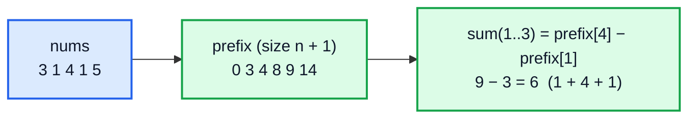
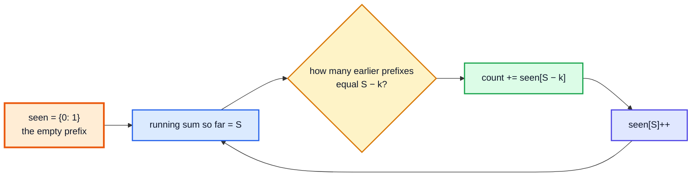
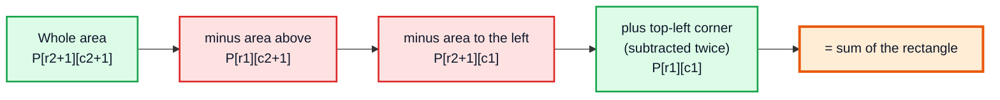
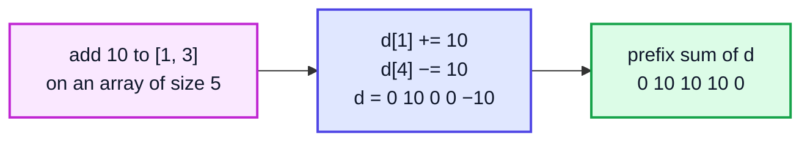

# Prefix Sum & Difference Array — Complete In-Depth Guide

**DSA gap pattern #3 of 16** · Priority 🔴 · from [topics_not_covered.md](../topics_not_covered.md)

A **prefix sum** array stores running totals so that the sum of *any* range is one subtraction: O(1) per query after O(n) setup. Combined with a `HashMap`, it counts subarrays with a given sum even when numbers are negative — the case where a [sliding window (gap #1)](dsa_gap_01_sliding_window.md) fails. Its mirror image, the **difference array**, applies many range *updates* in O(1) each. These notes cover 1D and 2D prefix sums, prefix + HashMap, prefix products, prefix XOR, and difference arrays, with the LeetCode problems that use each.

> [!NOTE]
> This pattern isn't in the playlist, so there are no video timestamps. All code targets **Java 21**. You need arrays ([video 12](../kunal-java-notes-claude/java_12_video_arrays_arraylist.md)), the `HashMap` API ([video 57, section 4](../kunal-java-notes-claude/java_57_video_hashmap_hashtable.md#4-hashmaps-in-java-10623)), modulo rules ([video 26](../kunal-java-notes-claude/java_26_video_maths_for_dsa.md)) and XOR ([video 25](../kunal-java-notes-claude/java_25_video_bitwise_number_systems.md)).

---

## Table of Contents

| # | Topic (anchor link) | Level |
|---|---|---|
| 0 | [The Idea](#0-the-idea) | Basics |
| 1 | [Building a Prefix Sum Array](#1-building-a-prefix-sum-array) | Basics |
| 2 | [Range Sum Queries](#2-range-sum-queries) | Core |
| 3 | [Balance Points: Pivot Index](#3-balance-points-pivot-index) | Core |
| 4 | [Prefix Sum plus HashMap](#4-prefix-sum-plus-hashmap) | Core |
| 5 | [More HashMap Variants](#5-more-hashmap-variants) | In depth |
| 6 | [Prefix and Suffix Products](#6-prefix-and-suffix-products) | In depth |
| 7 | [2D Prefix Sums](#7-2d-prefix-sums) | In depth |
| 8 | [Difference Arrays for Range Updates](#8-difference-arrays-for-range-updates) | In depth |
| 9 | [Prefix XOR](#9-prefix-xor) | In depth |
| 10 | [Pitfalls and Problem List](#10-pitfalls-and-problem-list) | Interview |

---

## 0. The Idea

"Sum of `nums[l..r]`" asked once is a loop. Asked 10⁵ times on an array of 10⁵ elements, loops cost 10¹⁰ operations: far too slow. Precompute running totals once, then every query is a subtraction.



| Operation | Plain array | With prefix sums |
|---|---|---|
| Build | — | O(n) |
| Range sum query | O(n) | **O(1)** |
| Point update | O(1) | O(n) (rebuild) — use a Fenwick or segment tree if you need both |

> [!TIP]
> Prefix sums are for **static** arrays with many range **queries**. If values change between queries, use a Fenwick tree or a segment tree ([video 51](../kunal-java-notes-claude/java_51_video_segment_trees.md)). If there are many range **updates** and you read the result at the end, use a difference array (Section 8).

---

## 1. Building a Prefix Sum Array

Use a prefix array of size **n + 1** with `prefix[0] = 0`. Then `prefix[i]` = sum of the first `i` elements, and no special case is needed for ranges that start at 0.

```java
import java.util.*;

public class BuildPrefix {
    static long[] prefix(int[] nums) {
        long[] p = new long[nums.length + 1];             // long: avoids overflow on big sums
        for (int i = 0; i < nums.length; i++) p[i + 1] = p[i] + nums[i];
        return p;
    }

    static long rangeSum(long[] p, int l, int r) {         // inclusive l..r
        return p[r + 1] - p[l];
    }

    public static void main(String[] args) {
        int[] nums = {3, 1, 4, 1, 5};
        long[] p = prefix(nums);
        System.out.println(Arrays.toString(p));            // [0, 3, 4, 8, 9, 14]
        System.out.println(rangeSum(p, 1, 3));             // 6
        System.out.println(rangeSum(p, 0, 4));             // 14
        System.out.println(rangeSum(p, 2, 2));             // 4
    }
}
```

| i | nums[i] | prefix[i + 1] = prefix[i] + nums[i] |
|---|---|---|
| — | — | prefix[0] = 0 |
| 0 | 3 | 0 + 3 = 3 |
| 1 | 1 | 3 + 1 = 4 |
| 2 | 4 | 4 + 4 = 8 |
| 3 | 1 | 8 + 1 = 9 |
| 4 | 5 | 9 + 5 = 14 |

**Why `p[r + 1] − p[l]`?** `p[r + 1]` is the sum of `nums[0..r]`; `p[l]` is the sum of `nums[0..l−1]`. Subtracting removes everything before `l`.

| Convention | Range sum `l..r` | Watch out for |
|---|---|---|
| Size n + 1, `p[0] = 0` (recommended) | `p[r + 1] − p[l]` | — |
| Size n, `p[i] = nums[0..i]` | `p[r] − (l > 0 ? p[l − 1] : 0)` | The `l == 0` special case |

---

## 2. Range Sum Queries

### Range Sum Query — Immutable (LC 303)

```java
public class NumArray {
    private final int[] p;

    public NumArray(int[] nums) {
        p = new int[nums.length + 1];
        for (int i = 0; i < nums.length; i++) p[i + 1] = p[i] + nums[i];
    }

    public int sumRange(int left, int right) {
        return p[right + 1] - p[left];
    }

    public static void main(String[] args) {
        NumArray na = new NumArray(new int[]{-2, 0, 3, -5, 2, -1});
        System.out.println(na.sumRange(0, 2));   // 1
        System.out.println(na.sumRange(2, 5));   // -1
        System.out.println(na.sumRange(0, 5));   // -3
    }
}
```

**Time:** O(n) constructor, O(1) per query. **Space:** O(n).

### Running Sum of 1D Array (LC 1480)

Just the prefix array in place: `for (i = 1; i < n; i++) nums[i] += nums[i - 1];`

---

## 3. Balance Points: Pivot Index

**LC 724 / LC 1991:** the first index where the sum of everything to the left equals the sum of everything to the right. With the total known, `right = total − left − nums[i]`, so no array is needed.

```java
public class PivotIndex {
    static int pivotIndex(int[] nums) {
        int total = 0;
        for (int x : nums) total += x;
        int left = 0;
        for (int i = 0; i < nums.length; i++) {
            if (left == total - left - nums[i]) return i;
            left += nums[i];
        }
        return -1;
    }

    public static void main(String[] args) {
        System.out.println(pivotIndex(new int[]{1, 7, 3, 6, 5, 6}));   // 3
        System.out.println(pivotIndex(new int[]{1, 2, 3}));            // -1
        System.out.println(pivotIndex(new int[]{2, 1, -1}));           // 0
    }
}
```

| i | nums[i] | left | right = 28 − left − nums[i] | Equal? |
|---|---|---|---|---|
| 0 | 1 | 0 | 27 | no |
| 1 | 7 | 1 | 20 | no |
| 2 | 3 | 8 | 17 | no |
| 3 | 6 | 11 | 11 | **yes → 3** |

---

## 4. Prefix Sum plus HashMap

### Subarray Sum Equals K (LC 560)

Count subarrays whose sum is exactly `k`. Numbers **can be negative**, so a sliding window doesn't work.

**Key identity:** the subarray `(j, i]` sums to `k` exactly when `prefix[i] − prefix[j] = k`, i.e. `prefix[j] = prefix[i] − k`. So while scanning, count how many earlier prefixes equal `current − k`.



```java
import java.util.*;

public class SubarraySumK {
    static int subarraySum(int[] nums, int k) {
        Map<Integer, Integer> seen = new HashMap<>();
        seen.put(0, 1);                                   // empty prefix: subarrays starting at index 0
        int sum = 0, count = 0;
        for (int x : nums) {
            sum += x;
            count += seen.getOrDefault(sum - k, 0);       // look up BEFORE adding the current prefix
            seen.merge(sum, 1, Integer::sum);
        }
        return count;
    }

    public static void main(String[] args) {
        System.out.println(subarraySum(new int[]{1, 1, 1}, 2));      // 2
        System.out.println(subarraySum(new int[]{1, 2, 3}, 3));      // 2  ([1,2] and [3])
        System.out.println(subarraySum(new int[]{1, -1, 1}, 1));     // 3
        System.out.println(subarraySum(new int[]{3, 4, 7, 2, -3, 1, 4, 2}, 7));   // 4
    }
}
```

**Dry run** on `[1, −1, 1]`, k = 1:

| i | x | sum | look for sum − k | seen before update | count | seen after |
|---|---|---|---|---|---|---|
| — | — | 0 | — | — | 0 | {0: 1} |
| 0 | 1 | 1 | 0 | {0: 1} | 1 | {0: 1, 1: 1} |
| 1 | −1 | 0 | −1 | {0: 1, 1: 1} | 1 | {0: 2, 1: 1} |
| 2 | 1 | 1 | 0 | {0: 2, 1: 1} | **3** | {0: 2, 1: 2} |

The three subarrays are `[1]` (index 0), `[1]` (index 2) and `[1, −1, 1]`.

| Approach | Time | Space | Works with negatives? |
|---|---|---|---|
| All subarrays | O(n²) | O(1) | Yes |
| Sliding window | O(n) | O(1) | **No** |
| **Prefix sum + HashMap** | **O(n)** | O(n) | **Yes** |

> [!IMPORTANT]
> Two details make or break this solution:
> 1. **`seen.put(0, 1)` first.** Without it you miss every subarray that starts at index 0.
> 2. **Look up before you insert.** Inserting first would let a prefix pair with itself, counting an empty subarray when `k == 0`.

---

## 5. More HashMap Variants

The same "store something about each prefix in a map" idea solves a family of problems. Only **what you store** changes.

| Problem | Store in the map | Look up |
|---|---|---|
| LC 560 Subarray Sum Equals K (count) | prefix → **count** | `sum − k` |
| LC 325 Max Size Subarray Sum Equals k (longest) | prefix → **first index** | `sum − k`; length `i − index` |
| LC 525 Contiguous Array (equal 0s and 1s) | treat 0 as −1; prefix → first index | same prefix again → sum 0 |
| LC 974 Subarray Sums Divisible by K | `prefix mod k` → count | same remainder |
| LC 523 Continuous Subarray Sum (multiple of k, length ≥ 2) | `prefix mod k` → first index | same remainder, `i − index ≥ 2` |

### Contiguous Array (LC 525)

Longest subarray with equally many 0s and 1s. Replace each 0 by −1; then "equal counts" means "sum is 0", i.e. the same prefix sum appears twice. Keep the **first** index of each prefix to maximise length.

```java
import java.util.*;

public class ContiguousArray {
    static int findMaxLength(int[] nums) {
        Map<Integer, Integer> first = new HashMap<>();
        first.put(0, -1);                                   // prefix 0 "seen" before index 0
        int sum = 0, best = 0;
        for (int i = 0; i < nums.length; i++) {
            sum += nums[i] == 0 ? -1 : 1;
            Integer j = first.putIfAbsent(sum, i);          // keeps the earliest index
            if (j != null) best = Math.max(best, i - j);
        }
        return best;
    }

    public static void main(String[] args) {
        System.out.println(findMaxLength(new int[]{0, 1}));                      // 2
        System.out.println(findMaxLength(new int[]{0, 1, 0}));                   // 2
        System.out.println(findMaxLength(new int[]{0, 1, 1, 1, 1, 1, 0, 0, 0})); // 6
    }
}
```

### Subarray Sums Divisible by K (LC 974)

If two prefixes have the same remainder mod k, the subarray between them is divisible by k.

```java
public class SubarraysDivByK {
    static int subarraysDivByK(int[] nums, int k) {
        int[] countByMod = new int[k];
        countByMod[0] = 1;
        int sum = 0, count = 0;
        for (int x : nums) {
            sum += x;
            int mod = ((sum % k) + k) % k;           // Java's % can be negative: normalise to 0..k-1
            count += countByMod[mod];
            countByMod[mod]++;
        }
        return count;
    }

    public static void main(String[] args) {
        System.out.println(subarraysDivByK(new int[]{4, 5, 0, -2, -3, 1}, 5));   // 7
        System.out.println(subarraysDivByK(new int[]{5}, 9));                    // 0
        System.out.println(subarraysDivByK(new int[]{-1, 2, 9}, 2));             // 2
    }
}
```

> [!CAUTION]
> In Java, `-7 % 5` is `-2`, not `3`. Two prefixes with remainders `-2` and `3` are really the same class mod 5, so without `((sum % k) + k) % k` the counts are wrong whenever negatives appear. (Video 26 covers modulo properties.)

---

## 6. Prefix and Suffix Products

### Product of Array Except Self (LC 238)

`answer[i]` = product of all elements except `nums[i]`, **without division**, in O(n).

`answer[i] = (product of everything left of i) × (product of everything right of i)`

```java
import java.util.*;

public class ProductExceptSelf {
    static int[] productExceptSelf(int[] nums) {
        int n = nums.length;
        int[] ans = new int[n];
        ans[0] = 1;
        for (int i = 1; i < n; i++) ans[i] = ans[i - 1] * nums[i - 1];   // prefix products
        int right = 1;
        for (int i = n - 1; i >= 0; i--) {                              // multiply in suffix products
            ans[i] *= right;
            right *= nums[i];
        }
        return ans;
    }

    public static void main(String[] args) {
        System.out.println(Arrays.toString(productExceptSelf(new int[]{1, 2, 3, 4})));      // [24, 12, 8, 6]
        System.out.println(Arrays.toString(productExceptSelf(new int[]{-1, 1, 0, -3, 3}))); // [0, 0, 9, 0, 0]
    }
}
```

**Dry run** on `[1, 2, 3, 4]`:

| i | Left product (pass 1) | Right product (pass 2) | ans[i] |
|---|---|---|---|
| 0 | 1 | 2·3·4 = 24 | 24 |
| 1 | 1 | 3·4 = 12 | 12 |
| 2 | 1·2 = 2 | 4 | 8 |
| 3 | 1·2·3 = 6 | 1 | 6 |

**Time** O(n), **space** O(1) extra (the output array doesn't count).

> [!NOTE]
> Why not "total product ÷ nums[i]"? The problem forbids division, and it breaks with zeros (one zero makes the total 0; division by zero crashes).

The same left/right idea gives **Trapping Rain Water** with prefix-max and suffix-max arrays ([gap #2, section 7](dsa_gap_02_two_pointers.md#7-trapping-rain-water)).

---

## 7. 2D Prefix Sums

`P[r][c]` = sum of the rectangle from `(0, 0)` to `(r − 1, c − 1)` (again with an extra row and column of zeros).

**Build:** `P[r+1][c+1] = M[r][c] + P[r][c+1] + P[r+1][c] − P[r][c]` (the top-left part is added twice, so subtract it once).

**Query** rectangle `(r1, c1)`–`(r2, c2)`:
`P[r2+1][c2+1] − P[r1][c2+1] − P[r2+1][c1] + P[r1][c1]`



### Range Sum Query 2D — Immutable (LC 304)

```java
public class NumMatrix {
    private final int[][] P;

    public NumMatrix(int[][] m) {
        int R = m.length, C = m[0].length;
        P = new int[R + 1][C + 1];
        for (int r = 0; r < R; r++)
            for (int c = 0; c < C; c++)
                P[r + 1][c + 1] = m[r][c] + P[r][c + 1] + P[r + 1][c] - P[r][c];
    }

    public int sumRegion(int r1, int c1, int r2, int c2) {
        return P[r2 + 1][c2 + 1] - P[r1][c2 + 1] - P[r2 + 1][c1] + P[r1][c1];
    }

    public static void main(String[] args) {
        NumMatrix nm = new NumMatrix(new int[][]{
                {3, 0, 1, 4, 2},
                {5, 6, 3, 2, 1},
                {1, 2, 0, 1, 5},
                {4, 1, 0, 1, 7},
                {1, 0, 3, 0, 5}});
        System.out.println(nm.sumRegion(2, 1, 4, 3));   // 8
        System.out.println(nm.sumRegion(1, 1, 2, 2));   // 11
        System.out.println(nm.sumRegion(1, 2, 2, 4));   // 12
    }
}
```

**Time:** O(R·C) build, O(1) per query. Related problems: LC 1314 Matrix Block Sum, LC 221 Maximal Square (DP), LC 1074 Number of Submatrices That Sum to Target (2D prefix + the LC 560 HashMap trick on each row pair).

---

## 8. Difference Arrays for Range Updates

The **reverse** problem: many operations "add `v` to every element in `[l, r]`", then read the final array.

**Difference array** `d`: `d[i] = a[i] − a[i − 1]`. Adding `v` to `a[l..r]` changes only two entries of `d`:

- `d[l] += v` (the jump up at `l`)
- `d[r + 1] -= v` (the jump back down after `r`)

At the end, the **prefix sum of `d`** rebuilds `a`.



| | Naive | Difference array |
|---|---|---|
| One range update | O(r − l + 1) | **O(1)** |
| q updates on n elements | O(q·n) | **O(q + n)** |
| Read a value mid-way | O(1) | O(n) (needs the prefix sum) |

### Corporate Flight Bookings (LC 1109)

```java
import java.util.*;

public class FlightBookings {
    static int[] corpFlightBookings(int[][] bookings, int n) {
        int[] d = new int[n + 1];                         // one extra slot so r + 1 never overflows
        for (int[] b : bookings) {
            d[b[0] - 1] += b[2];                          // flights are 1-indexed
            d[b[1]] -= b[2];                              // (b[1] − 1) + 1
        }
        int[] ans = new int[n];
        int run = 0;
        for (int i = 0; i < n; i++) ans[i] = run += d[i];
        return ans;
    }

    public static void main(String[] args) {
        int[][] bookings = {{1, 2, 10}, {2, 3, 20}, {2, 5, 25}};
        System.out.println(Arrays.toString(corpFlightBookings(bookings, 5)));   // [10, 55, 45, 25, 25]
    }
}
```

| Booking | d after (indices 0..5) |
|---|---|
| start | 0 0 0 0 0 0 |
| [1, 2, 10] | 10 0 −10 0 0 0 |
| [2, 3, 20] | 10 20 −10 −20 0 0 |
| [2, 5, 25] | 10 45 −10 −20 0 −25 |
| prefix sum | **10 55 45 25 25** |

### Car Pooling (LC 1094)

Passengers get on at `from` and off at `to`. Is the car ever over capacity? Same trick: `+p` at `from`, `−p` at `to` (they're already off at `to`), then check the running sum.

```java
public class CarPooling {
    static boolean carPooling(int[][] trips, int capacity) {
        int[] d = new int[1001];                          // stops are 0..1000
        for (int[] t : trips) { d[t[1]] += t[0]; d[t[2]] -= t[0]; }
        int onBoard = 0;
        for (int x : d) if ((onBoard += x) > capacity) return false;
        return true;
    }

    public static void main(String[] args) {
        int[][] trips = {{2, 1, 5}, {3, 3, 7}};
        System.out.println(carPooling(trips, 4));   // false (5 people between stops 3 and 5)
        System.out.println(carPooling(trips, 5));   // true
    }
}
```

> [!TIP]
> When coordinates are huge (up to 10⁹), you can't allocate an array of that size. Store only the change points in a `TreeMap<Integer, Integer>` and sweep its keys in order: the **sweep line** technique used in the [merge intervals notes (gap #5)](dsa_gap_05_merge_intervals.md).

**2D difference arrays** work the same way with four corner updates, followed by a 2D prefix sum (LC 2536 Increment Submatrices by One).

---

## 9. Prefix XOR

XOR is its own inverse (`a ^ a = 0`), so `xor(l..r) = px[r + 1] ^ px[l]`, exactly like sums.

### XOR Queries of a Subarray (LC 1310)

```java
import java.util.*;

public class XorQueries {
    static int[] xorQueries(int[] arr, int[][] queries) {
        int[] px = new int[arr.length + 1];
        for (int i = 0; i < arr.length; i++) px[i + 1] = px[i] ^ arr[i];
        int[] ans = new int[queries.length];
        for (int q = 0; q < queries.length; q++) ans[q] = px[queries[q][1] + 1] ^ px[queries[q][0]];
        return ans;
    }

    public static void main(String[] args) {
        int[] arr = {1, 3, 4, 8};
        int[][] queries = {{0, 1}, {1, 2}, {0, 3}, {3, 3}};
        System.out.println(Arrays.toString(xorQueries(arr, queries)));   // [2, 7, 14, 8]
    }
}
```

The HashMap trick works too: "count subarrays with XOR equal to k" stores prefix XOR → count and looks up `currentXor ^ k`.

| Operation | Works with prefix + subtraction? | Why |
|---|---|---|
| Sum | ✅ | Subtraction undoes addition |
| XOR | ✅ | XOR undoes XOR |
| Product | ⚠️ only without zeros | Division undoes multiplication (but not by 0) |
| Max / min | ❌ | Can't "remove" a max; use a sparse table or segment tree |

---

## 10. Pitfalls and Problem List

### Pitfalls

| Pitfall | Fix |
|---|---|
| Off-by-one with a size-n prefix array | Use size n + 1 with `p[0] = 0`; sum = `p[r+1] − p[l]` |
| Overflow on big sums | Use `long` for the prefix array |
| Missing `seen.put(0, 1)` in LC 560 | Always seed the empty prefix |
| Updating the map before the lookup | Look up, then insert |
| Negative `%` in Java | `((x % k) + k) % k` |
| Using a sliding window with negatives | Use prefix sum + HashMap |
| `d[r + 1]` out of bounds in a difference array | Allocate size n + 1 |
| Prefix sums when values change between queries | Fenwick tree / segment tree |

### Problem list (in order)

| # | Problem | Technique | Difficulty |
|---|---|---|---|
| 1 | LC 1480 Running Sum of 1D Array | Build prefix | Easy |
| 2 | LC 303 Range Sum Query — Immutable | Range query | Easy |
| 3 | LC 724 Find Pivot Index | Left vs right sums | Easy |
| 4 | LC 238 Product of Array Except Self | Prefix/suffix products | Medium |
| 5 | LC 560 Subarray Sum Equals K | Prefix + HashMap (count) | Medium |
| 6 | LC 525 Contiguous Array | Prefix + HashMap (first index) | Medium |
| 7 | LC 974 Subarray Sums Divisible by K | Prefix mod + counts | Medium |
| 8 | LC 523 Continuous Subarray Sum | Prefix mod + first index | Medium |
| 9 | LC 304 Range Sum Query 2D | 2D prefix | Medium |
| 10 | LC 1109 Corporate Flight Bookings | Difference array | Medium |
| 11 | LC 1094 Car Pooling | Difference array | Medium |
| 12 | LC 1310 XOR Queries of a Subarray | Prefix XOR | Medium |
| 13 | LC 1074 Number of Submatrices That Sum to Target | 2D prefix + HashMap | Hard |

### Interview Q&A

| Question | Short answer |
|---|---|
| What's a prefix sum? | `p[i]` = sum of the first `i` elements; any range sum is `p[r+1] − p[l]`. |
| Why size n + 1? | `p[0] = 0` removes the special case for ranges starting at 0. |
| How do you count subarrays with sum k in O(n)? | Running sum + HashMap of prefix counts; add `count[sum − k]` at each step. |
| Why not a sliding window for LC 560? | With negatives, the window sum isn't monotonic. |
| What's a difference array? | Stores adjacent differences so a range update is two O(1) changes; prefix-sum it to read values. |
| Prefix sum vs segment tree? | Prefix sum: static data, O(1) query. Segment tree: updates and queries both O(log n). |

---

## 🧩 Complete Example: Everything Together

Range queries, pivot index, LC 560 / 525 / 974, product except self, 2D prefix sums, a difference array and prefix XOR in one program, plus random cross-checks against brute force.

```java
import java.util.*;

public class PrefixSumShowcase {

    static long[] prefix(int[] a) {
        long[] p = new long[a.length + 1];
        for (int i = 0; i < a.length; i++) p[i + 1] = p[i] + a[i];
        return p;
    }

    static int pivot(int[] a) {
        long total = 0, left = 0;
        for (int x : a) total += x;
        for (int i = 0; i < a.length; i++) {
            if (left == total - left - a[i]) return i;
            left += a[i];
        }
        return -1;
    }

    static int countSumK(int[] a, int k) {
        Map<Long, Integer> seen = new HashMap<>();
        seen.put(0L, 1);
        long sum = 0;
        int count = 0;
        for (int x : a) {
            sum += x;
            count += seen.getOrDefault(sum - k, 0);
            seen.merge(sum, 1, Integer::sum);
        }
        return count;
    }

    static int longestBalanced(int[] bits) {
        Map<Integer, Integer> first = new HashMap<>();
        first.put(0, -1);
        int sum = 0, best = 0;
        for (int i = 0; i < bits.length; i++) {
            sum += bits[i] == 0 ? -1 : 1;
            Integer j = first.putIfAbsent(sum, i);
            if (j != null) best = Math.max(best, i - j);
        }
        return best;
    }

    static int countDivK(int[] a, int k) {
        int[] byMod = new int[k];
        byMod[0] = 1;
        int sum = 0, count = 0;
        for (int x : a) {
            sum += x;
            int m = ((sum % k) + k) % k;
            count += byMod[m]++;
        }
        return count;
    }

    static int[] productExceptSelf(int[] a) {
        int n = a.length;
        int[] ans = new int[n];
        ans[0] = 1;
        for (int i = 1; i < n; i++) ans[i] = ans[i - 1] * a[i - 1];
        for (int i = n - 1, right = 1; i >= 0; right *= a[i], i--) ans[i] *= right;
        return ans;
    }

    static int[][] prefix2D(int[][] m) {
        int R = m.length, C = m[0].length;
        int[][] P = new int[R + 1][C + 1];
        for (int r = 0; r < R; r++)
            for (int c = 0; c < C; c++) P[r + 1][c + 1] = m[r][c] + P[r][c + 1] + P[r + 1][c] - P[r][c];
        return P;
    }
    static int region(int[][] P, int r1, int c1, int r2, int c2) {
        return P[r2 + 1][c2 + 1] - P[r1][c2 + 1] - P[r2 + 1][c1] + P[r1][c1];
    }

    static int[] applyUpdates(int n, int[][] updates) {        // each update: {l, r, value}, 0-indexed
        int[] d = new int[n + 1];
        for (int[] u : updates) { d[u[0]] += u[2]; d[u[1] + 1] -= u[2]; }
        int[] a = new int[n];
        for (int i = 0, run = 0; i < n; i++) a[i] = run += d[i];
        return a;
    }

    static int rangeXor(int[] a, int l, int r) {
        int[] px = new int[a.length + 1];
        for (int i = 0; i < a.length; i++) px[i + 1] = px[i] ^ a[i];
        return px[r + 1] ^ px[l];
    }

    // brute-force versions
    static int bruteSumK(int[] a, int k) {
        int c = 0;
        for (int i = 0; i < a.length; i++) { long s = 0; for (int j = i; j < a.length; j++) if ((s += a[j]) == k) c++; }
        return c;
    }
    static int bruteDivK(int[] a, int k) {
        int c = 0;
        for (int i = 0; i < a.length; i++) { int s = 0; for (int j = i; j < a.length; j++) if ((s += a[j]) % k == 0) c++; }
        return c;
    }
    static int bruteRegion(int[][] m, int r1, int c1, int r2, int c2) {
        int s = 0;
        for (int r = r1; r <= r2; r++) for (int c = c1; c <= c2; c++) s += m[r][c];
        return s;
    }

    public static void main(String[] args) {
        int[] nums = {3, 1, 4, 1, 5, 9, 2, 6};
        long[] p = prefix(nums);
        System.out.println("1. Sum of nums[2..5] = " + (p[6] - p[2]) + ", whole array = " + p[nums.length]);
        System.out.println("2. Pivot index of [1,7,3,6,5,6] = " + pivot(new int[]{1, 7, 3, 6, 5, 6}));
        System.out.println("3. Subarrays with sum 7 in [3,4,7,2,-3,1,4,2] = " + countSumK(new int[]{3, 4, 7, 2, -3, 1, 4, 2}, 7));
        System.out.println("4. Longest balanced 0/1 run in [0,1,1,1,1,1,0,0,0] = " + longestBalanced(new int[]{0, 1, 1, 1, 1, 1, 0, 0, 0}));
        System.out.println("5. Subarrays divisible by 5 in [4,5,0,-2,-3,1] = " + countDivK(new int[]{4, 5, 0, -2, -3, 1}, 5));
        System.out.println("6. Product except self [1,2,3,4] = " + Arrays.toString(productExceptSelf(new int[]{1, 2, 3, 4})));

        int[][] grid = {{3, 0, 1, 4, 2}, {5, 6, 3, 2, 1}, {1, 2, 0, 1, 5}, {4, 1, 0, 1, 7}, {1, 0, 3, 0, 5}};
        int[][] P = prefix2D(grid);
        System.out.println("7. Rectangle (2,1)-(4,3) = " + region(P, 2, 1, 4, 3) + ", (1,1)-(2,2) = " + region(P, 1, 1, 2, 2));
        System.out.println("8. After range updates = " + Arrays.toString(applyUpdates(6, new int[][]{{0, 2, 5}, {1, 4, 3}, {3, 5, -2}})));
        System.out.println("9. XOR of [1,3,4,8][1..3] = " + rangeXor(new int[]{1, 3, 4, 8}, 1, 3));

        Random rnd = new Random(2024);
        int checks = 0, mismatches = 0;
        for (int t = 0; t < 300; t++) {
            int n = 1 + rnd.nextInt(25);
            int[] a = new int[n];
            for (int i = 0; i < n; i++) a[i] = rnd.nextInt(11) - 5;          // includes negatives
            int k = rnd.nextInt(7) - 3, div = 2 + rnd.nextInt(5);
            if (countSumK(a, k) != bruteSumK(a, k)) mismatches++;
            if (countDivK(a, div) != bruteDivK(a, div)) mismatches++;
            int R = 1 + rnd.nextInt(5), C = 1 + rnd.nextInt(5);
            int[][] m = new int[R][C];
            for (int[] row : m) for (int c = 0; c < C; c++) row[c] = rnd.nextInt(10);
            int r1 = rnd.nextInt(R), r2 = r1 + rnd.nextInt(R - r1), c1 = rnd.nextInt(C), c2 = c1 + rnd.nextInt(C - c1);
            if (region(prefix2D(m), r1, c1, r2, c2) != bruteRegion(m, r1, c1, r2, c2)) mismatches++;
            checks += 3;
        }
        System.out.println("Random cross-checks: " + checks + ", mismatches: " + mismatches);
    }
}
```

**Expected Output:**
```
1. Sum of nums[2..5] = 19, whole array = 31
2. Pivot index of [1,7,3,6,5,6] = 3
3. Subarrays with sum 7 in [3,4,7,2,-3,1,4,2] = 4
4. Longest balanced 0/1 run in [0,1,1,1,1,1,0,0,0] = 6
5. Subarrays divisible by 5 in [4,5,0,-2,-3,1] = 7
6. Product except self [1,2,3,4] = [24, 12, 8, 6]
7. Rectangle (2,1)-(4,3) = 8, (1,1)-(2,2) = 11
8. After range updates = [5, 8, 8, 1, 1, -2]
9. XOR of [1,3,4,8][1..3] = 15
Random cross-checks: 900, mismatches: 0
```

---

## Quick Reference Cheat Sheet

| Concept | One-Line Summary |
|---|---|
| **Prefix sum** | `p[i+1] = p[i] + a[i]`, size n + 1, `p[0] = 0` |
| **Range sum** | `sum(l..r) = p[r+1] − p[l]`, O(1) |
| **Pivot index** | `left == total − left − a[i]` |
| **Count sum = k** | Map prefix → count, seed `{0: 1}`, add `map[sum − k]`, then insert |
| **Longest sum = k** | Map prefix → first index, seed `{0: −1}` |
| **Equal 0s and 1s** | Treat 0 as −1; longest subarray with sum 0 |
| **Divisible by k** | Count prefixes by `((sum % k) + k) % k` |
| **Product except self** | Left products pass, then multiply by right products |
| **2D prefix** | Build with +up +left −diag; query with −top −left +corner |
| **Difference array** | `d[l] += v; d[r+1] −= v`; prefix-sum at the end |
| **Prefix XOR** | `xor(l..r) = px[r+1] ^ px[l]` |
| **Use long** | Prefix sums overflow `int` quickly |
| **Changing data** | Fenwick / segment tree instead |
