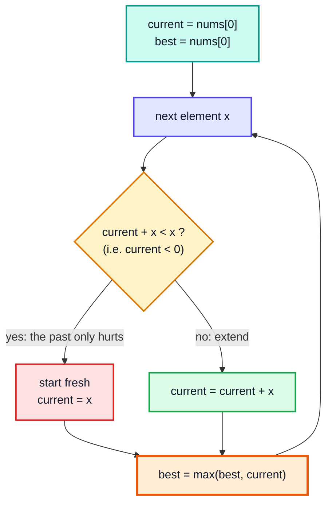
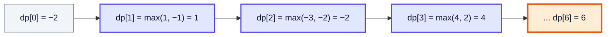
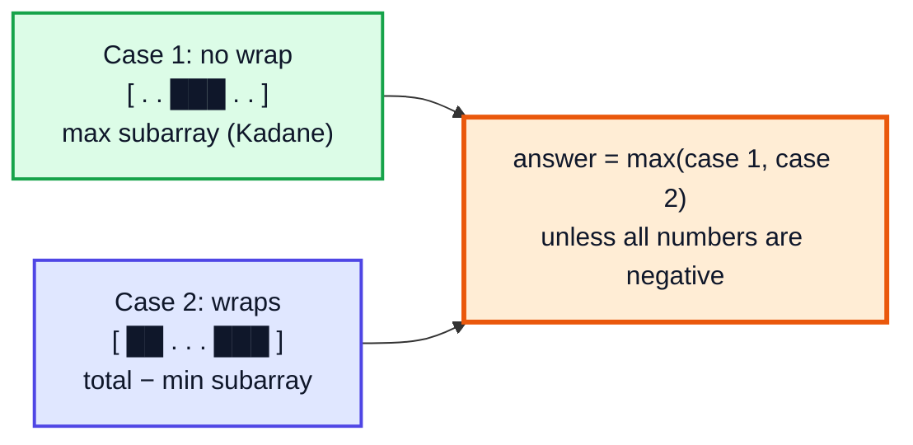
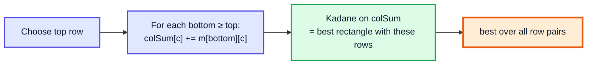

# Kadane's Algorithm — Complete In-Depth Guide

**DSA gap pattern #4 of 16** · Priority 🔴 · from [topics_not_covered.md](../topics_not_covered.md)

**Maximum Subarray** — find the contiguous subarray with the largest sum — is one of the most famous interview problems. Brute force is O(n²) (or O(n³)); **Kadane's algorithm** solves it in **O(n) time and O(1) space** with one simple rule: *at each element, either extend the previous subarray or start fresh*. These notes explain why that rule works (it's really a tiny dynamic programming solution), how to recover the subarray itself, and the variations interviewers love: circular arrays, maximum product, best time to buy and sell stock, maximum absolute sum and the 2D maximum-sum rectangle.

> [!NOTE]
> This pattern isn't in the playlist, so there are no video timestamps. All code targets **Java 21**. You only need arrays ([video 12](../kunal-java-notes-claude/java_12_video_arrays_arraylist.md)) and complexity basics ([video 24](../kunal-java-notes-claude/java_24_video_time_space_complexity.md)). Kadane is a good first look at **dynamic programming** ideas before the full DP topic.

---

## Table of Contents

| # | Topic (anchor link) | Level |
|---|---|---|
| 0 | [The Maximum Subarray Problem](#0-the-maximum-subarray-problem) | Basics |
| 1 | [From Brute Force to O(n)](#1-from-brute-force-to-on) | Basics |
| 2 | [Kadane's Algorithm](#2-kadanes-algorithm) | Core |
| 3 | [Why It Works: Kadane Is DP](#3-why-it-works-kadane-is-dp) | Core |
| 4 | [Returning the Subarray Itself](#4-returning-the-subarray-itself) | Core |
| 5 | [Maximum Sum Circular Subarray](#5-maximum-sum-circular-subarray) | In depth |
| 6 | [Maximum Product Subarray](#6-maximum-product-subarray) | In depth |
| 7 | [Best Time to Buy and Sell Stock](#7-best-time-to-buy-and-sell-stock) | In depth |
| 8 | [Maximum Absolute Sum and Minimum Subarray](#8-maximum-absolute-sum-and-minimum-subarray) | In depth |
| 9 | [2D: Maximum Sum Rectangle](#9-2d-maximum-sum-rectangle) | Advanced |
| 10 | [Divide and Conquer Alternative](#10-divide-and-conquer-alternative) | Advanced |
| 11 | [Pitfalls and Problem List](#11-pitfalls-and-problem-list) | Interview |

---

## 0. The Maximum Subarray Problem

**LC 53:** given `nums`, return the largest sum of a **non-empty contiguous** subarray.

```
nums = [-2, 1, -3, 4, -1, 2, 1, -5, 4]
best subarray = [4, -1, 2, 1]  (indices 3..6), sum = 6
```

| Detail | Meaning |
|---|---|
| Contiguous | Elements must be next to each other (not a subsequence) |
| Non-empty | At least one element, so with all-negative input the answer is the largest (least negative) element, not 0 |
| Negatives allowed | That's what makes it interesting: with only non-negative numbers, the whole array is the answer |

---

## 1. From Brute Force to O(n)

| Approach | Idea | Time | Space |
|---|---|---|---|
| Triple loop | Every `(i, j)`, sum `i..j` with a third loop | O(n³) | O(1) |
| Double loop | Every start `i`, extend `j` keeping a running sum | O(n²) | O(1) |
| Prefix sums | `sum(i..j) = p[j+1] − p[i]`; for each `j`, subtract the **smallest** earlier prefix | O(n) | O(1) |
| Divide and conquer | Best in left half, right half, or crossing the middle | O(n log n) | O(log n) |
| **Kadane** | Best subarray **ending at** each index | **O(n)** | **O(1)** |

```java
public class MaxSubarrayBrute {
    static int maxSubArrayN2(int[] a) {
        int best = Integer.MIN_VALUE;
        for (int i = 0; i < a.length; i++) {
            int sum = 0;
            for (int j = i; j < a.length; j++) {
                sum += a[j];
                best = Math.max(best, sum);
            }
        }
        return best;
    }

    // Prefix-sum view: best = max over j of (prefix[j+1] − smallest prefix seen before it)
    static int maxSubArrayPrefix(int[] a) {
        int prefix = 0, minPrefix = 0, best = Integer.MIN_VALUE;
        for (int x : a) {
            prefix += x;
            best = Math.max(best, prefix - minPrefix);
            minPrefix = Math.min(minPrefix, prefix);
        }
        return best;
    }

    public static void main(String[] args) {
        int[] a = {-2, 1, -3, 4, -1, 2, 1, -5, 4};
        System.out.println(maxSubArrayN2(a) + " " + maxSubArrayPrefix(a));   // 6 6
    }
}
```

> [!TIP]
> The prefix-sum version is the same as **Best Time to Buy and Sell Stock** (Section 7): "buy" at the lowest prefix, "sell" at the current one. Both are Kadane in disguise.

---

## 2. Kadane's Algorithm

**Rule:** `current` = best sum of a subarray that **ends at** index `i`.

```
current = max(nums[i], current + nums[i])   // start fresh, or extend
best    = max(best, current)
```

If the best subarray ending at `i − 1` has a **negative** sum, it can only hurt, so drop it and start fresh at `nums[i]`.



```java
public class Kadane {
    static int maxSubArray(int[] nums) {
        int current = nums[0], best = nums[0];
        for (int i = 1; i < nums.length; i++) {
            current = Math.max(nums[i], current + nums[i]);
            best = Math.max(best, current);
        }
        return best;
    }

    public static void main(String[] args) {
        System.out.println(maxSubArray(new int[]{-2, 1, -3, 4, -1, 2, 1, -5, 4}));   // 6
        System.out.println(maxSubArray(new int[]{1}));                               // 1
        System.out.println(maxSubArray(new int[]{5, 4, -1, 7, 8}));                  // 23
        System.out.println(maxSubArray(new int[]{-3, -1, -2}));                      // -1
    }
}
```

**Dry run** on `[-2, 1, -3, 4, -1, 2, 1, -5, 4]`:

| i | nums[i] | extend (current + x) | fresh (x) | current | best |
|---|---|---|---|---|---|
| 0 | −2 | — | — | −2 | −2 |
| 1 | 1 | −1 | **1** | 1 | 1 |
| 2 | −3 | **−2** | −3 | −2 | 1 |
| 3 | 4 | 2 | **4** | 4 | 4 |
| 4 | −1 | **3** | −1 | 3 | 4 |
| 5 | 2 | **5** | 2 | 5 | 5 |
| 6 | 1 | **6** | 1 | 6 | **6** |
| 7 | −5 | **1** | −5 | 1 | 6 |
| 8 | 4 | **5** | 4 | 5 | 6 |

**Time** O(n), **space** O(1).

### The "reset to 0" version you'll see online

```java
int sum = 0, best = Integer.MIN_VALUE;
for (int x : nums) {
    sum += x;
    best = Math.max(best, sum);
    if (sum < 0) sum = 0;          // drop a negative running sum
}
```

> [!WARNING]
> The order matters: update `best` **before** resetting to 0. If you reset first, an all-negative array returns 0, which is wrong for LC 53 (the subarray must be non-empty). Some textbook versions return 0 because they allow an empty subarray; read the problem statement.

---

## 3. Why It Works: Kadane Is DP

Define `dp[i]` = maximum sum of a subarray that **ends exactly at index `i`**.

Any subarray ending at `i` is either:
1. just `[nums[i]]`, or
2. a subarray ending at `i − 1`, extended by `nums[i]`. The best such one has sum `dp[i − 1] + nums[i]`.

So `dp[i] = max(nums[i], dp[i − 1] + nums[i])`, and the answer is `max(dp[0..n−1])`, because the best subarray must end *somewhere*.



`dp[i]` only depends on `dp[i − 1]`, so the whole array collapses into one variable, `current`. That's the **space optimisation** you'll use again and again in the DP topic.

| DP idea | Here |
|---|---|
| State | `dp[i]` = best sum ending at `i` |
| Transition | `dp[i] = max(nums[i], dp[i−1] + nums[i])` |
| Base case | `dp[0] = nums[0]` |
| Answer | `max over all i of dp[i]` |
| Space optimisation | Keep only the previous value |

---

## 4. Returning the Subarray Itself

Track where the current subarray started; when `best` improves, remember `start` and `end`.

```java
import java.util.*;

public class KadaneWithIndices {
    static int[] maxSubArrayRange(int[] nums) {       // returns {sum, start, end}
        int current = nums[0], best = nums[0];
        int start = 0, bestStart = 0, bestEnd = 0;
        for (int i = 1; i < nums.length; i++) {
            if (nums[i] > current + nums[i]) {        // start fresh here
                current = nums[i];
                start = i;
            } else {
                current += nums[i];
            }
            if (current > best) {
                best = current;
                bestStart = start;
                bestEnd = i;
            }
        }
        return new int[]{best, bestStart, bestEnd};
    }

    public static void main(String[] args) {
        int[] a = {-2, 1, -3, 4, -1, 2, 1, -5, 4};
        int[] r = maxSubArrayRange(a);
        System.out.println("sum " + r[0] + ", indices " + r[1] + ".." + r[2] + " -> "
                + Arrays.toString(Arrays.copyOfRange(a, r[1], r[2] + 1)));   // sum 6, indices 3..6 -> [4, -1, 2, 1]
    }
}
```

> [!NOTE]
> With ties, `>` keeps the **first** best subarray. Use `>=` if you want the last one, or add a length rule if the problem asks for the shortest/longest.

---

## 5. Maximum Sum Circular Subarray

**LC 918:** the array is circular, so a subarray may wrap from the end to the start.

The best subarray is either:
1. **Normal** (doesn't wrap): plain Kadane → `maxNormal`.
2. **Wrapping**: it takes a prefix and a suffix, i.e. everything **except** a middle block. To maximise it, remove the **minimum-sum** middle subarray: `total − minSubarray`.



```java
public class MaxCircularSubarray {
    static int maxSubarraySumCircular(int[] nums) {
        int total = 0;
        int curMax = 0, maxSum = Integer.MIN_VALUE;
        int curMin = 0, minSum = Integer.MAX_VALUE;
        for (int x : nums) {
            total += x;
            curMax = Math.max(x, curMax + x);  maxSum = Math.max(maxSum, curMax);
            curMin = Math.min(x, curMin + x);  minSum = Math.min(minSum, curMin);
        }
        if (maxSum < 0) return maxSum;         // all negative: "total − minSum" would mean an EMPTY subarray
        return Math.max(maxSum, total - minSum);
    }

    public static void main(String[] args) {
        System.out.println(maxSubarraySumCircular(new int[]{1, -2, 3, -2}));   // 3
        System.out.println(maxSubarraySumCircular(new int[]{5, -3, 5}));       // 10  (wraps: 5 + 5)
        System.out.println(maxSubarraySumCircular(new int[]{-3, -2, -3}));     // -2
    }
}
```

| Input | total | maxSum | minSum | total − minSum | Answer |
|---|---|---|---|---|---|
| [1, −2, 3, −2] | 0 | 3 | −2 | 2 | 3 |
| [5, −3, 5] | 7 | 7 | −3 | **10** | 10 |
| [−3, −2, −3] | −8 | −2 | −8 | 0 (empty!) | **−2** |

> [!CAUTION]
> The all-negative case is the trap. There `minSum == total`, so `total − minSum = 0`, which corresponds to removing *every* element. Return `maxSum` instead.

---

## 6. Maximum Product Subarray

**LC 152:** products behave differently from sums: a **negative × negative** can become the largest value. So track both the largest **and the smallest** product ending at `i`; a big negative may flip into a big positive.

```java
public class MaxProductSubarray {
    static int maxProduct(int[] nums) {
        int maxEnd = nums[0], minEnd = nums[0], best = nums[0];
        for (int i = 1; i < nums.length; i++) {
            int x = nums[i];
            if (x < 0) { int t = maxEnd; maxEnd = minEnd; minEnd = t; }   // a negative swaps the roles
            maxEnd = Math.max(x, maxEnd * x);
            minEnd = Math.min(x, minEnd * x);
            best = Math.max(best, maxEnd);
        }
        return best;
    }

    public static void main(String[] args) {
        System.out.println(maxProduct(new int[]{2, 3, -2, 4}));    // 6
        System.out.println(maxProduct(new int[]{-2, 0, -1}));      // 0
        System.out.println(maxProduct(new int[]{-2, 3, -4}));      // 24
    }
}
```

**Dry run** on `[-2, 3, -4]`:

| i | x | swap? | maxEnd | minEnd | best |
|---|---|---|---|---|---|
| 0 | −2 | — | −2 | −2 | −2 |
| 1 | 3 | no | max(3, −6) = 3 | min(3, −6) = −6 | 3 |
| 2 | −4 | yes → max=−6, min=3 | max(−4, 24) = **24** | min(−4, −12) = −12 | **24** |

> [!NOTE]
> A **zero** resets both to `x = 0` naturally (`max(0, anything·0) = 0`), splitting the array into independent parts. An alternative solution: the answer is the max of all prefix products and all suffix products, resetting to 1 after a zero.

---

## 7. Best Time to Buy and Sell Stock

**LC 121:** one buy, one later sell; maximise profit. Track the lowest price so far; at each day, profit = price − lowest.

```java
public class BestTimeStock {
    static int maxProfit(int[] prices) {
        int minPrice = Integer.MAX_VALUE, best = 0;
        for (int p : prices) {
            minPrice = Math.min(minPrice, p);
            best = Math.max(best, p - minPrice);
        }
        return best;
    }

    // Same answer via Kadane on day-to-day differences
    static int maxProfitKadane(int[] prices) {
        int current = 0, best = 0;
        for (int i = 1; i < prices.length; i++) {
            current = Math.max(0, current + prices[i] - prices[i - 1]);   // empty allowed: profit ≥ 0
            best = Math.max(best, current);
        }
        return best;
    }

    public static void main(String[] args) {
        int[] p = {7, 1, 5, 3, 6, 4};
        System.out.println(maxProfit(p) + " " + maxProfitKadane(p));                   // 5 5
        System.out.println(maxProfit(new int[]{7, 6, 4, 3, 1}));                       // 0
    }
}
```

**Why Kadane on differences works:** selling on day `j` after buying on day `i` earns `prices[j] − prices[i]`, which equals the sum of the daily differences `d[i+1] + … + d[j]`. So max profit = max subarray sum of the differences (with "do nothing" = 0 allowed).

| Day | Price | Diff | current | best |
|---|---|---|---|---|
| 0 | 7 | — | 0 | 0 |
| 1 | 1 | −6 | 0 | 0 |
| 2 | 5 | +4 | 4 | 4 |
| 3 | 3 | −2 | 2 | 4 |
| 4 | 6 | +3 | **5** | **5** |
| 5 | 4 | −2 | 3 | 5 |

---

## 8. Maximum Absolute Sum and Minimum Subarray

**Minimum subarray sum:** Kadane with `min` instead of `max` (used in Section 5).

**LC 1749 Maximum Absolute Sum of Any Subarray:** the answer is `max(maxSubarray, −minSubarray)`. Even shorter with prefix sums: `maxPrefix − minPrefix` (both including the empty prefix 0).

```java
public class MaxAbsoluteSum {
    static int maxAbsoluteSum(int[] nums) {
        int curMax = 0, curMin = 0, best = 0;
        for (int x : nums) {
            curMax = Math.max(x, curMax + x);
            curMin = Math.min(x, curMin + x);
            best = Math.max(best, Math.max(curMax, -curMin));
        }
        return best;
    }

    static int viaPrefix(int[] nums) {
        int prefix = 0, hi = 0, lo = 0;
        for (int x : nums) { prefix += x; hi = Math.max(hi, prefix); lo = Math.min(lo, prefix); }
        return hi - lo;
    }

    public static void main(String[] args) {
        int[] a = {1, -3, 2, 3, -4}, b = {2, -5, 1, -4, 3, -2};
        System.out.println(maxAbsoluteSum(a) + " " + viaPrefix(a));   // 5 5
        System.out.println(maxAbsoluteSum(b) + " " + viaPrefix(b));   // 8 8
    }
}
```

---

## 9. 2D: Maximum Sum Rectangle

Find the sub-rectangle of a matrix with the largest sum. Fix a **pair of rows** `top..bottom`, squash those rows into one array of column sums, and run 1D Kadane on it.



```java
public class MaxSumRectangle {
    static int kadane(int[] a) {
        int cur = a[0], best = a[0];
        for (int i = 1; i < a.length; i++) { cur = Math.max(a[i], cur + a[i]); best = Math.max(best, cur); }
        return best;
    }

    static int maxRectangle(int[][] m) {
        int R = m.length, C = m[0].length, best = Integer.MIN_VALUE;
        for (int top = 0; top < R; top++) {
            int[] colSum = new int[C];
            for (int bottom = top; bottom < R; bottom++) {
                for (int c = 0; c < C; c++) colSum[c] += m[bottom][c];
                best = Math.max(best, kadane(colSum));
            }
        }
        return best;
    }

    public static void main(String[] args) {
        int[][] m = {
                {1, 2, -1, -4, -20},
                {-8, -3, 4, 2, 1},
                {3, 8, 10, 1, 3},
                {-4, -1, 1, 7, -6}};
        System.out.println(maxRectangle(m));   // 29
    }
}
```

The best rectangle here is rows 1–3, columns 1–3 (`-3+4+2 + 8+10+1 + -1+1+7 = 29`).

**Time** O(R² · C) (put the smaller dimension in the outer loops), **space** O(C). LC 363 *Max Sum of Rectangle No Larger Than K* uses the same row-pair idea with a `TreeSet` of prefix sums instead of Kadane.

---

## 10. Divide and Conquer Alternative

Interviewers sometimes ask for this as a follow-up ("can you solve it with divide and conquer?"). The best subarray is in the left half, in the right half, or **crosses the middle**; the crossing one is the best suffix of the left half plus the best prefix of the right half. Same structure as merge sort ([video 30](../kunal-java-notes-claude/java_30_video_merge_sort.md)).

```java
public class MaxSubarrayDivideConquer {
    static int solve(int[] a, int lo, int hi) {
        if (lo == hi) return a[lo];
        int mid = lo + (hi - lo) / 2;
        int leftBest = solve(a, lo, mid), rightBest = solve(a, mid + 1, hi);

        int sum = 0, bestSuffix = Integer.MIN_VALUE;
        for (int i = mid; i >= lo; i--) { sum += a[i]; bestSuffix = Math.max(bestSuffix, sum); }
        sum = 0;
        int bestPrefix = Integer.MIN_VALUE;
        for (int i = mid + 1; i <= hi; i++) { sum += a[i]; bestPrefix = Math.max(bestPrefix, sum); }

        return Math.max(Math.max(leftBest, rightBest), bestSuffix + bestPrefix);
    }

    public static void main(String[] args) {
        int[] a = {-2, 1, -3, 4, -1, 2, 1, -5, 4};
        System.out.println(solve(a, 0, a.length - 1));   // 6
    }
}
```

Recurrence `T(n) = 2T(n/2) + O(n)` → **O(n log n)**: slower than Kadane, but the same "combine left, right and crossing" idea powers a **segment tree** that answers "max subarray in range `[l, r]`" with updates in O(log n).

---

## 11. Pitfalls and Problem List

### Pitfalls

| Pitfall | Fix |
|---|---|
| Starting `best` at 0 | Start at `nums[0]` (or `Integer.MIN_VALUE`) — the subarray is non-empty |
| Resetting to 0 before updating `best` | Update `best` first |
| Circular version with all negatives | Return `maxSum` if it's negative |
| Max product forgetting negatives | Track `minEnd` too, swap on negative `x` |
| Overflow with big values | Use `long` |
| Confusing subarray with subsequence | Max **subsequence** sum = sum of all positives (or max element if none) — no Kadane needed |

### Problem list (in order)

| # | Problem | Variation | Difficulty |
|---|---|---|---|
| 1 | LC 53 Maximum Subarray | Classic | Medium |
| 2 | LC 121 Best Time to Buy and Sell Stock | Min-so-far / Kadane on diffs | Easy |
| 3 | LC 1749 Maximum Absolute Sum of Any Subarray | Max and min Kadane | Medium |
| 4 | LC 918 Maximum Sum Circular Subarray | total − min subarray | Medium |
| 5 | LC 152 Maximum Product Subarray | Track max and min | Medium |
| 6 | LC 1191 K-Concatenation Maximum Sum | Kadane on 2 copies + total·(k−2) if total > 0 | Medium |
| 7 | LC 1186 Maximum Subarray Sum with One Deletion | Two DP states (deleted or not) | Medium |
| 8 | LC 363 Max Sum of Rectangle No Larger Than K | Row pairs + `TreeSet` | Hard |

### Interview Q&A

| Question | Short answer |
|---|---|
| What's Kadane's algorithm? | Best sum ending at each index: `cur = max(x, cur + x)`, answer = max of `cur`. O(n), O(1). |
| Why drop the running sum when it's negative? | A negative prefix only lowers any subarray that extends it. |
| Is Kadane greedy or DP? | DP with a one-variable state (it looks greedy because the state is so small). |
| All negative numbers? | Returns the largest element (as long as `best` starts at `nums[0]`). |
| How to get indices? | Remember where the current run started; save it when `best` improves. |
| Circular array? | `max(normalMax, total − normalMin)`, except all-negative → `normalMax`. |
| Max product? | Keep max and min products ending here; a negative swaps them. |

---

## 🧩 Complete Example: Everything Together

All the Kadane variants from this file, plus a random cross-check against brute force for the linear, circular, product and 2D versions.

```java
import java.util.*;

public class KadaneShowcase {

    static long[] kadane(int[] a) {                 // {sum, start, end}
        long cur = a[0], best = a[0];
        int start = 0, bs = 0, be = 0;
        for (int i = 1; i < a.length; i++) {
            if (a[i] > cur + a[i]) { cur = a[i]; start = i; } else cur += a[i];
            if (cur > best) { best = cur; bs = start; be = i; }
        }
        return new long[]{best, bs, be};
    }

    static long circular(int[] a) {
        long total = 0, cMax = 0, mx = Long.MIN_VALUE, cMin = 0, mn = Long.MAX_VALUE;
        for (int x : a) {
            total += x;
            cMax = Math.max(x, cMax + x); mx = Math.max(mx, cMax);
            cMin = Math.min(x, cMin + x); mn = Math.min(mn, cMin);
        }
        return mx < 0 ? mx : Math.max(mx, total - mn);
    }

    static long maxProduct(int[] a) {
        long hi = a[0], lo = a[0], best = a[0];
        for (int i = 1; i < a.length; i++) {
            long x = a[i];
            if (x < 0) { long t = hi; hi = lo; lo = t; }
            hi = Math.max(x, hi * x);
            lo = Math.min(x, lo * x);
            best = Math.max(best, hi);
        }
        return best;
    }

    static int stockProfit(int[] prices) {
        int minP = Integer.MAX_VALUE, best = 0;
        for (int p : prices) { minP = Math.min(minP, p); best = Math.max(best, p - minP); }
        return best;
    }

    static long maxRect(int[][] m) {
        int R = m.length, C = m[0].length;
        long best = Long.MIN_VALUE;
        for (int top = 0; top < R; top++) {
            int[] col = new int[C];
            for (int bot = top; bot < R; bot++) {
                for (int c = 0; c < C; c++) col[c] += m[bot][c];
                best = Math.max(best, kadane(col)[0]);
            }
        }
        return best;
    }

    // ---- brute force ----
    static long bruteMax(int[] a) {
        long best = Long.MIN_VALUE;
        for (int i = 0; i < a.length; i++) { long s = 0; for (int j = i; j < a.length; j++) best = Math.max(best, s += a[j]); }
        return best;
    }
    static long bruteCircular(int[] a) {
        int n = a.length;
        long best = Long.MIN_VALUE;
        for (int i = 0; i < n; i++) { long s = 0; for (int len = 1; len <= n; len++) best = Math.max(best, s += a[(i + len - 1) % n]); }
        return best;
    }
    static long bruteProduct(int[] a) {
        long best = Long.MIN_VALUE;
        for (int i = 0; i < a.length; i++) { long p = 1; for (int j = i; j < a.length; j++) best = Math.max(best, p *= a[j]); }
        return best;
    }
    static long bruteRect(int[][] m) {
        long best = Long.MIN_VALUE;
        for (int r1 = 0; r1 < m.length; r1++) for (int r2 = r1; r2 < m.length; r2++)
            for (int c1 = 0; c1 < m[0].length; c1++) for (int c2 = c1; c2 < m[0].length; c2++) {
                long s = 0;
                for (int r = r1; r <= r2; r++) for (int c = c1; c <= c2; c++) s += m[r][c];
                best = Math.max(best, s);
            }
        return best;
    }

    public static void main(String[] args) {
        int[] a = {-2, 1, -3, 4, -1, 2, 1, -5, 4};
        long[] k = kadane(a);
        System.out.println("1. Max subarray: sum " + k[0] + " at " + k[1] + ".." + k[2]
                + " = " + Arrays.toString(Arrays.copyOfRange(a, (int) k[1], (int) k[2] + 1)));
        System.out.println("2. All negative [-3,-1,-2]: " + kadane(new int[]{-3, -1, -2})[0]);
        System.out.println("3. Circular [5,-3,5]: " + circular(new int[]{5, -3, 5}) + ", [-3,-2,-3]: " + circular(new int[]{-3, -2, -3}));
        System.out.println("4. Max product [-2,3,-4]: " + maxProduct(new int[]{-2, 3, -4}) + ", [2,3,-2,4]: " + maxProduct(new int[]{2, 3, -2, 4}));
        System.out.println("5. Stock profit [7,1,5,3,6,4]: " + stockProfit(new int[]{7, 1, 5, 3, 6, 4}));
        int[][] grid = {{1, 2, -1, -4, -20}, {-8, -3, 4, 2, 1}, {3, 8, 10, 1, 3}, {-4, -1, 1, 7, -6}};
        System.out.println("6. Max sum rectangle: " + maxRect(grid));

        Random rnd = new Random(53);
        int checks = 0, mismatches = 0;
        for (int t = 0; t < 400; t++) {
            int n = 1 + rnd.nextInt(12);
            int[] x = new int[n];
            for (int i = 0; i < n; i++) x[i] = rnd.nextInt(13) - 6;
            if (kadane(x)[0] != bruteMax(x)) mismatches++;
            if (circular(x) != bruteCircular(x)) mismatches++;
            if (maxProduct(x) != bruteProduct(x)) mismatches++;
            int R = 1 + rnd.nextInt(4), C = 1 + rnd.nextInt(4);
            int[][] m = new int[R][C];
            for (int[] row : m) for (int c = 0; c < C; c++) row[c] = rnd.nextInt(11) - 5;
            if (maxRect(m) != bruteRect(m)) mismatches++;
            checks += 4;
        }
        System.out.println("Random cross-checks: " + checks + ", mismatches: " + mismatches);
    }
}
```

**Expected Output:**
```
1. Max subarray: sum 6 at 3..6 = [4, -1, 2, 1]
2. All negative [-3,-1,-2]: -1
3. Circular [5,-3,5]: 10, [-3,-2,-3]: -2
4. Max product [-2,3,-4]: 24, [2,3,-2,4]: 6
5. Stock profit [7,1,5,3,6,4]: 5
6. Max sum rectangle: 29
Random cross-checks: 1600, mismatches: 0
```

---

## Quick Reference Cheat Sheet

| Concept | One-Line Summary |
|---|---|
| **Problem** | Largest sum of a non-empty contiguous subarray |
| **Kadane** | `cur = max(x, cur + x); best = max(best, cur)`; O(n), O(1) |
| **Start values** | `cur = best = nums[0]` (handles all-negative input) |
| **It's DP** | `dp[i]` = best sum ending at `i`; only `dp[i−1]` is needed |
| **Indices** | Reset `start = i` when starting fresh; save on improvement |
| **Circular** | `max(maxSub, total − minSub)`; all negative → `maxSub` |
| **Product** | Track `maxEnd` and `minEnd`; swap on a negative |
| **Stock (LC 121)** | Track min price so far, or Kadane on daily differences |
| **Max absolute sum** | `max(maxSub, −minSub)` = `maxPrefix − minPrefix` |
| **2D rectangle** | Fix row pairs, sum columns, Kadane: O(R²·C) |
| **Divide & conquer** | left / right / crossing: O(n log n) |
