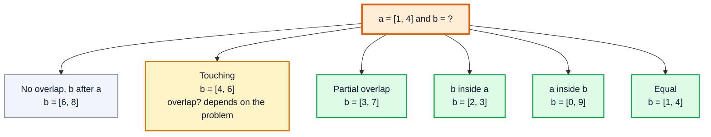
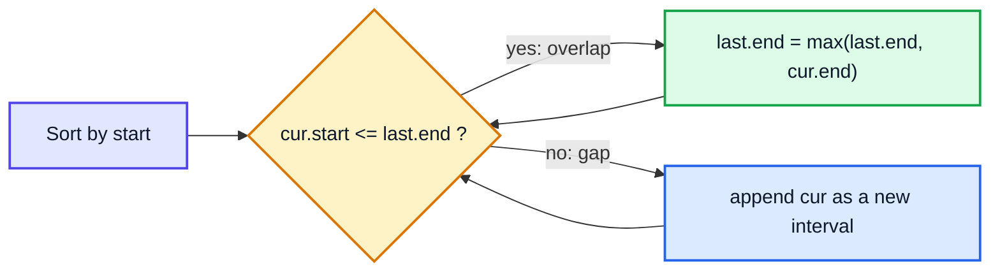
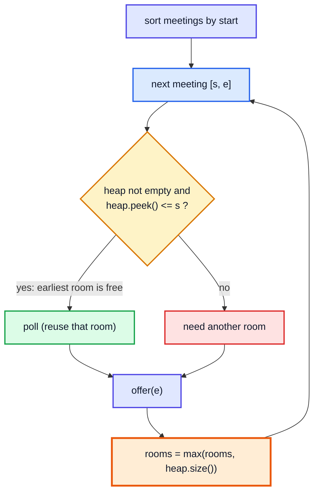
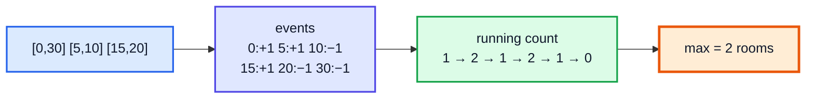

# Merge Intervals — Complete In-Depth Guide

**DSA gap pattern #5 of 16** · Priority 🔴 · from [topics_not_covered.md](../topics_not_covered.md)

Interval problems — meetings, bookings, time ranges, number ranges — show up constantly in interviews and real systems (calendars, schedulers). Almost all of them follow one recipe: **sort the intervals, then sweep through them once**, deciding at each step whether the current interval overlaps the previous one. These notes cover the overlap test, merging, inserting, intersecting, the greedy "remove the fewest / shoot the fewest arrows" problems, meeting rooms with a heap and with a sweep line, and calendar booking with a `TreeMap`.

> [!NOTE]
> This pattern isn't in the playlist, so there are no video timestamps. All code targets **Java 21**. You need sorting with a comparator ([gap Java #3](../Java%20Topics%20Not%20Covered%20Notes/java_gap_03_comparator_comparable.md)), and for meeting rooms a `PriorityQueue` ([video 56](../kunal-java-notes-claude/java_56_video_heaps_priority_queue.md)). Two pointers ([gap #2](dsa_gap_02_two_pointers.md)) and difference arrays ([gap #3](dsa_gap_03_prefix_sum_difference_array.md)) also appear.

---

## Table of Contents

| # | Topic (anchor link) | Level |
|---|---|---|
| 0 | [Intervals and How They Can Overlap](#0-intervals-and-how-they-can-overlap) | Basics |
| 1 | [The Overlap Test](#1-the-overlap-test) | Basics |
| 2 | [Merge Intervals](#2-merge-intervals) | Core |
| 3 | [Insert Interval](#3-insert-interval) | Core |
| 4 | [Interval List Intersections](#4-interval-list-intersections) | Core |
| 5 | [Greedy by End Time: Non-Overlapping Intervals](#5-greedy-by-end-time-non-overlapping-intervals) | In depth |
| 6 | [Minimum Arrows to Burst Balloons](#6-minimum-arrows-to-burst-balloons) | In depth |
| 7 | [Meeting Rooms: Can Attend and Rooms Needed](#7-meeting-rooms-can-attend-and-rooms-needed) | In depth |
| 8 | [The Sweep Line Technique](#8-the-sweep-line-technique) | In depth |
| 9 | [Calendar Booking with a TreeMap](#9-calendar-booking-with-a-treemap) | In depth |
| 10 | [Removing Covered Intervals](#10-removing-covered-intervals) | In depth |
| 11 | [Which Sort Order? Pitfalls and Problem List](#11-which-sort-order-pitfalls-and-problem-list) | Interview |

---

## 0. Intervals and How They Can Overlap

An interval is a pair `[start, end]`, usually stored as `int[]{start, end}` (that's what LeetCode passes) or a `record Interval(int start, int end)`.

Two intervals `a` and `b` (with `a.start <= b.start`) can relate in six ways:



> [!IMPORTANT]
> **Do touching intervals overlap?** Read every problem carefully.
> - **Closed** intervals `[1, 4]` and `[4, 6]` share the point 4 → they overlap (LC 56 merges them into `[1, 6]`; balloons in LC 452 touching at 4 are burst by one arrow).
> - **Half-open** intervals `[start, end)` like meetings: one ending at 4 and one starting at 4 **don't** clash (LC 252, LC 435).

---

## 1. The Overlap Test

Two intervals overlap **unless** one ends before the other starts:

```
overlap(a, b)  ⇔  a.start <= b.end  &&  b.start <= a.end      (closed, touching counts)
overlap(a, b)  ⇔  a.start <  b.end  &&  b.start <  a.end      (half-open, touching doesn't)
```

Their intersection (when it exists) is `[max(a.start, b.start), min(a.end, b.end)]`, and their merge is `[min(starts), max(ends)]`.

**After sorting by start**, the test gets simpler: the next interval `cur` overlaps the last kept one `last` exactly when `cur.start <= last.end`.

```java
public class OverlapTest {
    static boolean overlapClosed(int[] a, int[] b)   { return a[0] <= b[1] && b[0] <= a[1]; }
    static boolean overlapHalfOpen(int[] a, int[] b) { return a[0] < b[1] && b[0] < a[1]; }

    public static void main(String[] args) {
        int[] a = {1, 4};
        int[][] others = {{6, 8}, {4, 6}, {3, 7}, {2, 3}, {0, 9}};
        for (int[] b : others) {
            System.out.printf("[1,4] vs [%d,%d]: closed=%b half-open=%b%n",
                    b[0], b[1], overlapClosed(a, b), overlapHalfOpen(a, b));
        }
    }
}
// Output:
// [1,4] vs [6,8]: closed=false half-open=false
// [1,4] vs [4,6]: closed=true half-open=false
// [1,4] vs [3,7]: closed=true half-open=true
// [1,4] vs [2,3]: closed=true half-open=true
// [1,4] vs [0,9]: closed=true half-open=true
```

---

## 2. Merge Intervals

**LC 56:** merge all overlapping intervals.

**Approach:** sort by start. Walk through; if the current interval overlaps the last merged one, extend that one's end; otherwise start a new merged interval.



```java
import java.util.*;

public class MergeIntervals {
    static int[][] merge(int[][] intervals) {
        Arrays.sort(intervals, (a, b) -> Integer.compare(a[0], b[0]));
        List<int[]> out = new ArrayList<>();
        for (int[] cur : intervals) {
            if (out.isEmpty() || cur[0] > out.getLast()[1]) {
                out.add(new int[]{cur[0], cur[1]});                 // gap: new interval (copy, don't alias input)
            } else {
                out.getLast()[1] = Math.max(out.getLast()[1], cur[1]);   // overlap: extend
            }
        }
        return out.toArray(new int[0][]);
    }

    public static void main(String[] args) {
        System.out.println(Arrays.deepToString(merge(new int[][]{{1, 3}, {2, 6}, {8, 10}, {15, 18}})));   // [[1, 6], [8, 10], [15, 18]]
        System.out.println(Arrays.deepToString(merge(new int[][]{{1, 4}, {4, 5}})));                      // [[1, 5]]
        System.out.println(Arrays.deepToString(merge(new int[][]{{1, 10}, {2, 3}, {4, 5}})));             // [[1, 10]]
    }
}
```

**Dry run** on `[[8,10], [1,3], [2,6], [15,18]]` → sorted `[[1,3], [2,6], [8,10], [15,18]]`:

| cur | last merged | cur.start <= last.end? | Action | Result |
|---|---|---|---|---|
| [1,3] | — | — | add | [1,3] |
| [2,6] | [1,3] | 2 <= 3 ✅ | end = max(3, 6) = 6 | [1,6] |
| [8,10] | [1,6] | 8 <= 6 ❌ | add | [1,6] [8,10] |
| [15,18] | [8,10] | 15 <= 10 ❌ | add | [1,6] [8,10] [15,18] |

> [!WARNING]
> `Math.max(last.end, cur.end)`, not just `cur.end`: in `[[1,10], [2,3]]`, the second interval is *inside* the first, and setting the end to 3 would shrink it.

**Time** O(n log n) (sorting dominates), **space** O(n) for the output (plus the sort's O(log n)). `List.getLast()` is Java 21; on Java 17 use `out.get(out.size() - 1)`.

---

## 3. Insert Interval

**LC 57:** the list is already sorted and non-overlapping; insert `newInterval` and merge if needed. No sort needed → **O(n)**.

Three phases:
1. Copy every interval that ends **before** the new one starts.
2. Merge every interval that **overlaps** the new one into it.
3. Copy the rest.

```java
import java.util.*;

public class InsertInterval {
    static int[][] insert(int[][] intervals, int[] newInterval) {
        List<int[]> out = new ArrayList<>();
        int i = 0, n = intervals.length;
        int start = newInterval[0], end = newInterval[1];

        while (i < n && intervals[i][1] < start) out.add(intervals[i++]);             // 1. entirely before
        while (i < n && intervals[i][0] <= end) {                                      // 2. overlapping
            start = Math.min(start, intervals[i][0]);
            end = Math.max(end, intervals[i][1]);
            i++;
        }
        out.add(new int[]{start, end});
        while (i < n) out.add(intervals[i++]);                                         // 3. entirely after
        return out.toArray(new int[0][]);
    }

    public static void main(String[] args) {
        System.out.println(Arrays.deepToString(insert(new int[][]{{1, 3}, {6, 9}}, new int[]{2, 5})));
        // [[1, 5], [6, 9]]
        System.out.println(Arrays.deepToString(insert(new int[][]{{1, 2}, {3, 5}, {6, 7}, {8, 10}, {12, 16}}, new int[]{4, 8})));
        // [[1, 2], [3, 10], [12, 16]]
        System.out.println(Arrays.deepToString(insert(new int[][]{}, new int[]{5, 7})));
        // [[5, 7]]
    }
}
```

**Dry run**, insert `[4, 8]` into `[[1,2], [3,5], [6,7], [8,10], [12,16]]`:

| Interval | Phase | start, end after |
|---|---|---|
| [1,2] | ends before 4 → copy | 4, 8 |
| [3,5] | starts ≤ 8 → merge | 3, 8 |
| [6,7] | merge | 3, 8 |
| [8,10] | merge | 3, 10 |
| — | add [3, 10] | |
| [12,16] | after → copy | |

---

## 4. Interval List Intersections

**LC 986:** two lists, each sorted and non-overlapping. Return all intersections. Use **two pointers** ([gap #2](dsa_gap_02_two_pointers.md)): intersect the current pair, then advance whichever interval **ends first** (it can't intersect anything further in the other list).

```java
import java.util.*;

public class IntervalIntersections {
    static int[][] intervalIntersection(int[][] A, int[][] B) {
        List<int[]> out = new ArrayList<>();
        int i = 0, j = 0;
        while (i < A.length && j < B.length) {
            int lo = Math.max(A[i][0], B[j][0]);
            int hi = Math.min(A[i][1], B[j][1]);
            if (lo <= hi) out.add(new int[]{lo, hi});      // closed intervals: a single point counts
            if (A[i][1] < B[j][1]) i++; else j++;          // drop the one that ends first
        }
        return out.toArray(new int[0][]);
    }

    public static void main(String[] args) {
        int[][] A = {{0, 2}, {5, 10}, {13, 23}, {24, 25}};
        int[][] B = {{1, 5}, {8, 12}, {15, 24}, {25, 26}};
        System.out.println(Arrays.deepToString(intervalIntersection(A, B)));
        // [[1, 2], [5, 5], [8, 10], [15, 23], [24, 24], [25, 25]]
    }
}
```

**Time** O(m + n), **space** O(output).

---

## 5. Greedy by End Time: Non-Overlapping Intervals

**LC 435:** remove the **fewest** intervals so the rest don't overlap (touching is fine).

Equivalent question: keep the **most** intervals that don't overlap. That's the classic **activity selection** problem, and its greedy solution is: **sort by end time, and always keep the interval that finishes earliest.**

**Why end time?** The interval that ends first leaves the most room for everything after it. Any optimal solution can swap its first interval for the earliest-ending one without losing anything (the *exchange argument*).

```java
import java.util.*;

public class NonOverlapping {
    static int eraseOverlapIntervals(int[][] intervals) {
        Arrays.sort(intervals, (a, b) -> Integer.compare(a[1], b[1]));   // by END
        int kept = 0, lastEnd = Integer.MIN_VALUE;
        for (int[] iv : intervals) {
            if (iv[0] >= lastEnd) {          // starts at or after the last kept end: no clash
                kept++;
                lastEnd = iv[1];
            }                                // otherwise drop it (it ends later than the one we kept)
        }
        return intervals.length - kept;
    }

    public static void main(String[] args) {
        System.out.println(eraseOverlapIntervals(new int[][]{{1, 2}, {2, 3}, {3, 4}, {1, 3}}));   // 1
        System.out.println(eraseOverlapIntervals(new int[][]{{1, 2}, {1, 2}, {1, 2}}));           // 2
        System.out.println(eraseOverlapIntervals(new int[][]{{1, 2}, {2, 3}}));                   // 0
    }
}
```

**Dry run** on `[[1,2], [2,3], [3,4], [1,3]]` → sorted by end `[[1,2], [2,3], [1,3], [3,4]]`:

| Interval | lastEnd | start >= lastEnd? | Action | kept |
|---|---|---|---|---|
| [1,2] | −∞ | ✅ | keep, lastEnd = 2 | 1 |
| [2,3] | 2 | ✅ (touching OK) | keep, lastEnd = 3 | 2 |
| [1,3] | 3 | ❌ | remove | 2 |
| [3,4] | 3 | ✅ | keep, lastEnd = 4 | 3 |

Removed = 4 − 3 = **1**.

> [!CAUTION]
> Sorting by **start** and keeping the first one is wrong: `[[1, 100], [2, 3], [4, 5]]` would keep `[1, 100]` and remove the other two, but removing just `[1, 100]` is optimal. Sort by **end** for "maximum non-overlapping".

---

## 6. Minimum Arrows to Burst Balloons

**LC 452:** balloons are closed intervals on the x-axis; an arrow at `x` bursts every balloon with `start <= x <= end`. Minimum arrows?

Same greedy: sort by end, shoot an arrow at the **end** of the first balloon, skip every balloon that arrow hits, repeat.

```java
import java.util.*;

public class MinArrows {
    static int findMinArrowShots(int[][] points) {
        Arrays.sort(points, (a, b) -> Integer.compare(a[1], b[1]));   // NOT a[1] - b[1]: overflow!
        int arrows = 0;
        long arrowX = Long.MIN_VALUE;
        for (int[] p : points) {
            if (p[0] > arrowX) {          // this balloon isn't hit by the last arrow
                arrows++;
                arrowX = p[1];            // shoot at its end
            }
        }
        return arrows;
    }

    public static void main(String[] args) {
        System.out.println(findMinArrowShots(new int[][]{{10, 16}, {2, 8}, {1, 6}, {7, 12}}));    // 2
        System.out.println(findMinArrowShots(new int[][]{{1, 2}, {3, 4}, {5, 6}, {7, 8}}));       // 4
        System.out.println(findMinArrowShots(new int[][]{{1, 2}, {2, 3}, {3, 4}, {4, 5}}));       // 2
        System.out.println(findMinArrowShots(new int[][]{{-2147483646, -2147483645}, {2147483646, 2147483647}}));   // 2
    }
}
```

| | LC 435 (non-overlapping) | LC 452 (arrows) |
|---|---|---|
| Intervals | Half-open (touching is fine) | Closed (touching = one arrow) |
| Condition to start a new group | `start >= lastEnd` | `start > arrowX` |
| Answer | `n − kept` | number of groups |

> [!WARNING]
> LC 452 has values near `Integer.MIN_VALUE` and `Integer.MAX_VALUE`. The comparator `(a, b) -> a[1] - b[1]` overflows and sorts wrongly. Use `Integer.compare` ([gap Java #3, pitfalls](../Java%20Topics%20Not%20Covered%20Notes/java_gap_03_comparator_comparable.md#10-pitfalls)).

---

## 7. Meeting Rooms: Can Attend and Rooms Needed

### Can one person attend all meetings? (LC 252)

Sort by start; if any meeting starts before the previous one ends, there's a clash.

```java
import java.util.*;

public class MeetingRooms {
    static boolean canAttendMeetings(int[][] meetings) {
        Arrays.sort(meetings, (a, b) -> Integer.compare(a[0], b[0]));
        for (int i = 1; i < meetings.length; i++) {
            if (meetings[i][0] < meetings[i - 1][1]) return false;   // half-open: equal is fine
        }
        return true;
    }

    public static void main(String[] args) {
        System.out.println(canAttendMeetings(new int[][]{{0, 30}, {5, 10}, {15, 20}}));   // false
        System.out.println(canAttendMeetings(new int[][]{{7, 10}, {2, 4}}));              // true
    }
}
```

### Minimum meeting rooms (LC 253, premium; free version: LC 2406)

**Approach 1: min-heap of end times.** Sort by start. The heap holds the end times of meetings currently using a room; its top is the room that frees up first. If that room is free by the time the new meeting starts, reuse it.



```java
import java.util.*;

public class MinMeetingRooms {
    // LC 253: half-open meetings [start, end)
    static int minMeetingRooms(int[][] meetings) {
        Arrays.sort(meetings, (a, b) -> Integer.compare(a[0], b[0]));
        PriorityQueue<Integer> ends = new PriorityQueue<>();
        for (int[] m : meetings) {
            if (!ends.isEmpty() && ends.peek() <= m[0]) ends.poll();   // a room is free: reuse it
            ends.offer(m[1]);
        }
        return ends.size();                                            // the heap never shrinks below the peak
    }

    // LC 2406 Divide Intervals Into Minimum Number of Groups: CLOSED intervals, so touching clashes
    static int minGroups(int[][] intervals) {
        Arrays.sort(intervals, (a, b) -> Integer.compare(a[0], b[0]));
        PriorityQueue<Integer> ends = new PriorityQueue<>();
        for (int[] iv : intervals) {
            if (!ends.isEmpty() && ends.peek() < iv[0]) ends.poll();   // strictly before
            ends.offer(iv[1]);
        }
        return ends.size();
    }

    public static void main(String[] args) {
        System.out.println(minMeetingRooms(new int[][]{{0, 30}, {5, 10}, {15, 20}}));                 // 2
        System.out.println(minMeetingRooms(new int[][]{{7, 10}, {2, 4}}));                            // 1
        System.out.println(minGroups(new int[][]{{5, 10}, {6, 8}, {1, 5}, {2, 3}, {1, 10}}));          // 3
        System.out.println(minGroups(new int[][]{{1, 3}, {5, 6}, {8, 10}, {11, 13}}));                // 1
    }
}
```

**Dry run** of `minMeetingRooms` on `[[0,30], [5,10], [15,20]]`:

| Meeting | heap.peek() before | Free room? | Heap after | Rooms in use |
|---|---|---|---|---|
| [0,30] | — | — | {30} | 1 |
| [5,10] | 30 | 30 <= 5? no | {10, 30} | 2 |
| [15,20] | 10 | 10 <= 15? yes → poll 10 | {20, 30} | 2 |

**Answer 2.** Each meeting is offered once and polled at most once → **O(n log n)**.

> [!NOTE]
> Why is `ends.size()` at the end the answer? The heap only shrinks by one when it also grows by one (poll then offer), so its size never decreases: the final size equals the largest size it ever reached.

---

## 8. The Sweep Line Technique

Turn each interval into two **events**: `+1` at its start and `−1` at its end. Sort the events by time and sweep left to right, keeping a running count. The maximum running count is the maximum number of overlapping intervals.



```java
import java.util.*;

public class SweepLine {
    // Version 1: two sorted arrays of starts and ends (no event objects needed)
    static int maxOverlap(int[][] meetings) {
        int n = meetings.length;
        int[] starts = new int[n], ends = new int[n];
        for (int i = 0; i < n; i++) { starts[i] = meetings[i][0]; ends[i] = meetings[i][1]; }
        Arrays.sort(starts);
        Arrays.sort(ends);
        int rooms = 0, best = 0, j = 0;
        for (int i = 0; i < n; i++) {
            while (j < n && ends[j] <= starts[i]) { rooms--; j++; }   // meetings that ended (half-open)
            rooms++;
            best = Math.max(best, rooms);
        }
        return best;
    }

    // Version 2: a TreeMap of changes — works for huge coordinates and gives the count at every point
    static TreeMap<Integer, Integer> coverage(int[][] meetings) {
        TreeMap<Integer, Integer> delta = new TreeMap<>();
        for (int[] m : meetings) {
            delta.merge(m[0], 1, Integer::sum);
            delta.merge(m[1], -1, Integer::sum);
        }
        TreeMap<Integer, Integer> countFrom = new TreeMap<>();   // time → number of meetings from this time on
        int running = 0;
        for (var e : delta.entrySet()) countFrom.put(e.getKey(), running += e.getValue());
        return countFrom;
    }

    public static void main(String[] args) {
        int[][] m = {{0, 30}, {5, 10}, {15, 20}};
        System.out.println(maxOverlap(m));    // 2
        System.out.println(coverage(m));      // {0=1, 5=2, 10=1, 15=2, 20=1, 30=0}
    }
}
```

> [!TIP]
> When end and start happen at the same time, process the **end first** for half-open intervals (a meeting ending at 10 frees the room for one starting at 10). `TreeMap.merge` does this automatically by adding `+1` and `−1` at the same key. With a list of event pairs, sort by `(time, delta)` so `−1` comes before `+1`.

This is the [difference array (gap #3, section 8)](dsa_gap_03_prefix_sum_difference_array.md#8-difference-arrays-for-range-updates) on sparse coordinates. Problems: LC 1094 Car Pooling, LC 2406, LC 732 My Calendar III, LC 218 The Skyline Problem (sweep + max-heap).

---

## 9. Calendar Booking with a TreeMap

**LC 729 My Calendar I:** `book(start, end)` returns `true` and adds the event if it doesn't clash with any existing one (half-open). Keep events in a `TreeMap<start, end>` and check only the two **neighbours**: the event that starts just before, and the one that starts just after.

```java
import java.util.*;

public class MyCalendar {
    private final TreeMap<Integer, Integer> events = new TreeMap<>();   // start → end

    public boolean book(int start, int end) {
        Map.Entry<Integer, Integer> prev = events.floorEntry(start);   // starts at or before `start`
        Map.Entry<Integer, Integer> next = events.ceilingEntry(start); // starts at or after `start`
        if (prev != null && prev.getValue() > start) return false;     // previous event still running
        if (next != null && next.getKey() < end) return false;         // next event starts too early
        events.put(start, end);
        return true;
    }

    public static void main(String[] args) {
        MyCalendar cal = new MyCalendar();
        System.out.println(cal.book(10, 20));   // true
        System.out.println(cal.book(15, 25));   // false (clashes with 10–20)
        System.out.println(cal.book(20, 30));   // true  (touching is fine)
        System.out.println(cal.book(5, 10));    // true
        System.out.println(cal.book(5, 11));    // false
    }
}
```

| Approach | `book` time |
|---|---|
| Check against every booking in a list | O(n) |
| **`TreeMap` neighbours** | **O(log n)** |

Because existing bookings never overlap, only the two neighbours can possibly clash with a new one.

---

## 10. Removing Covered Intervals

**LC 1288:** remove every interval covered by another (`c <= a` and `b <= d`). Sort by start **ascending**, and for equal starts by end **descending** (so the bigger one comes first and covers the smaller). Then an interval is covered exactly when its end is ≤ the largest end seen so far.

```java
import java.util.*;

public class RemoveCovered {
    static int removeCoveredIntervals(int[][] intervals) {
        Arrays.sort(intervals, (a, b) -> a[0] != b[0] ? Integer.compare(a[0], b[0]) : Integer.compare(b[1], a[1]));
        int kept = 0, maxEnd = Integer.MIN_VALUE;
        for (int[] iv : intervals) {
            if (iv[1] > maxEnd) { kept++; maxEnd = iv[1]; }   // not covered
        }
        return kept;
    }

    public static void main(String[] args) {
        System.out.println(removeCoveredIntervals(new int[][]{{1, 4}, {3, 6}, {2, 8}}));   // 2  ([3,6] is inside [2,8])
        System.out.println(removeCoveredIntervals(new int[][]{{1, 4}, {1, 2}}));           // 1
    }
}
```

> [!NOTE]
> The tie-breaker matters: with `[[1,2], [1,4]]` sorted by end **ascending**, `[1,2]` would come first and be counted as uncovered. That's a two-key comparator, covered in [gap Java #3, section 6](../Java%20Topics%20Not%20Covered%20Notes/java_gap_03_comparator_comparable.md#6-multi-key-sorting-with-thencomparing).

---

## 11. Which Sort Order? Pitfalls and Problem List

### Which sort order?

| Goal | Sort by | Why |
|---|---|---|
| Merge / union, insert, can-attend | **Start** | Overlapping intervals become neighbours |
| Max non-overlapping, min removals, min arrows | **End** | Greedy: finishing early leaves the most room |
| Rooms / max simultaneous | Start (+ heap of ends), or **events** by time | Track what's active right now |
| Covered intervals | Start asc, end **desc** | The covering interval comes first |
| Two sorted lists | Already sorted → two pointers | O(m + n) |

### Pitfalls

| Pitfall | Fix |
|---|---|
| Closed vs half-open confusion | Decide whether touching overlaps; use `<=` vs `<` accordingly |
| `a[0] - b[0]` comparator | `Integer.compare(a[0], b[0])` (overflow in LC 452) |
| Setting `last.end = cur.end` when merging | `Math.max(last.end, cur.end)` (nested intervals) |
| Mutating the input arrays while merging | Copy into new arrays if the caller still needs the input |
| Sorting by start for activity selection | Sort by end |
| Sweep with ties processed in the wrong order | Ends before starts for half-open intervals |

### Problem list (in order)

| # | Problem | Technique | Difficulty |
|---|---|---|---|
| 1 | LC 252 Meeting Rooms (premium) | Sort by start | Easy |
| 2 | LC 56 Merge Intervals | Sort by start, merge | Medium |
| 3 | LC 57 Insert Interval | Three phases, O(n) | Medium |
| 4 | LC 986 Interval List Intersections | Two pointers | Medium |
| 5 | LC 435 Non-overlapping Intervals | Greedy by end | Medium |
| 6 | LC 452 Minimum Number of Arrows | Greedy by end | Medium |
| 7 | LC 1288 Remove Covered Intervals | Start asc, end desc | Medium |
| 8 | LC 253 Meeting Rooms II (premium) / LC 2406 | Heap or sweep line | Medium |
| 9 | LC 1094 Car Pooling | Sweep / difference array | Medium |
| 10 | LC 729 My Calendar I | `TreeMap` neighbours | Medium |
| 11 | LC 731 / 732 My Calendar II / III | Sweep with `TreeMap` | Medium / Hard |
| 12 | LC 759 Employee Free Time (premium) | Merge all, report gaps | Hard |
| 13 | LC 218 The Skyline Problem | Sweep + max-heap | Hard |

### Interview Q&A

| Question | Short answer |
|---|---|
| How do you merge intervals? | Sort by start; extend the last one while the next starts before it ends. O(n log n). |
| When do two intervals overlap? | `a.start <= b.end && b.start <= a.end` (use `<` for half-open). |
| Minimum intervals to remove to avoid overlap? | Greedy by end time; answer = n − max kept. |
| Why sort by end for that? | Earliest finish leaves the most room (exchange argument). |
| Minimum meeting rooms? | Sort by start + min-heap of end times, or sweep line over start/end events. |
| Insert into a sorted list? | Copy before, merge overlapping, copy after: O(n), no sorting. |
| Book without clashes efficiently? | `TreeMap` and check `floorEntry`/`ceilingEntry`: O(log n). |

---

## 🧩 Complete Example: Everything Together

A small "conference scheduler" that merges busy times, finds free slots, inserts a meeting, intersects two people's availability, removes the fewest talks to avoid clashes, counts rooms with a heap and with a sweep line, books a calendar with a `TreeMap`, and cross-checks the results against brute force on random data.

```java
import java.util.*;

public class IntervalsShowcase {

    static int[][] merge(int[][] in) {
        int[][] iv = Arrays.stream(in).map(int[]::clone).toArray(int[][]::new);   // don't modify the caller's arrays
        Arrays.sort(iv, Comparator.comparingInt(a -> a[0]));
        List<int[]> out = new ArrayList<>();
        for (int[] cur : iv) {
            if (out.isEmpty() || cur[0] > out.getLast()[1]) out.add(cur);
            else out.getLast()[1] = Math.max(out.getLast()[1], cur[1]);
        }
        return out.toArray(new int[0][]);
    }

    static List<int[]> freeSlots(int[][] busy, int dayStart, int dayEnd) {
        List<int[]> free = new ArrayList<>();
        int t = dayStart;
        for (int[] b : merge(busy)) {
            if (b[0] > t) free.add(new int[]{t, b[0]});
            t = Math.max(t, b[1]);
        }
        if (t < dayEnd) free.add(new int[]{t, dayEnd});
        return free;
    }

    static int[][] insert(int[][] iv, int[] add) {
        List<int[]> out = new ArrayList<>();
        int i = 0, s = add[0], e = add[1];
        while (i < iv.length && iv[i][1] < s) out.add(iv[i++]);
        while (i < iv.length && iv[i][0] <= e) { s = Math.min(s, iv[i][0]); e = Math.max(e, iv[i][1]); i++; }
        out.add(new int[]{s, e});
        while (i < iv.length) out.add(iv[i++]);
        return out.toArray(new int[0][]);
    }

    static List<int[]> intersect(int[][] A, int[][] B) {
        List<int[]> out = new ArrayList<>();
        for (int i = 0, j = 0; i < A.length && j < B.length; ) {
            int lo = Math.max(A[i][0], B[j][0]), hi = Math.min(A[i][1], B[j][1]);
            if (lo < hi) out.add(new int[]{lo, hi});              // half-open availability: ignore single points
            if (A[i][1] < B[j][1]) i++; else j++;
        }
        return out;
    }

    static int minRemovals(int[][] in) {
        int[][] iv = in.clone();
        Arrays.sort(iv, Comparator.comparingInt(a -> a[1]));
        int kept = 0, lastEnd = Integer.MIN_VALUE;
        for (int[] x : iv) if (x[0] >= lastEnd) { kept++; lastEnd = x[1]; }
        return iv.length - kept;
    }

    static int roomsHeap(int[][] in) {
        int[][] iv = in.clone();
        Arrays.sort(iv, Comparator.comparingInt(a -> a[0]));
        PriorityQueue<Integer> ends = new PriorityQueue<>();
        for (int[] m : iv) { if (!ends.isEmpty() && ends.peek() <= m[0]) ends.poll(); ends.offer(m[1]); }
        return ends.size();
    }

    static int roomsSweep(int[][] iv) {
        TreeMap<Integer, Integer> d = new TreeMap<>();
        for (int[] m : iv) { d.merge(m[0], 1, Integer::sum); d.merge(m[1], -1, Integer::sum); }
        int run = 0, best = 0;
        for (int v : d.values()) best = Math.max(best, run += v);
        return best;
    }

    static final class Calendar {
        private final TreeMap<Integer, Integer> ev = new TreeMap<>();
        boolean book(int s, int e) {
            var prev = ev.floorEntry(s);
            var next = ev.ceilingEntry(s);
            if ((prev != null && prev.getValue() > s) || (next != null && next.getKey() < e)) return false;
            ev.put(s, e);
            return true;
        }
    }

    static String fmt(int[][] a) { return Arrays.deepToString(a); }
    static String fmt(List<int[]> a) { return fmt(a.toArray(new int[0][])); }

    // ---- brute force (half-open meetings on small integer times) ----
    static int bruteRooms(int[][] iv) {
        int best = 0;
        for (int t = 0; t <= 30; t++) {
            int c = 0;
            for (int[] m : iv) if (m[0] <= t && t < m[1]) c++;
            best = Math.max(best, c);
        }
        return best;
    }
    static int bruteRemovals(int[][] iv) {
        int n = iv.length, bestKeep = 0;
        for (int mask = 0; mask < (1 << n); mask++) {
            boolean ok = true;
            for (int i = 0; i < n && ok; i++) for (int j = i + 1; j < n && ok; j++)
                if ((mask >> i & 1) == 1 && (mask >> j & 1) == 1 && iv[i][0] < iv[j][1] && iv[j][0] < iv[i][1]) ok = false;
            if (ok) bestKeep = Math.max(bestKeep, Integer.bitCount(mask));
        }
        return n - bestKeep;
    }
    static boolean bruteMergeMatches(int[][] iv, int[][] merged) {       // closed intervals: compare covered points ×2
        boolean[] a = new boolean[70], b = new boolean[70];
        for (int[] x : iv) for (int p = 2 * x[0]; p <= 2 * x[1]; p++) a[p] = true;
        for (int[] x : merged) for (int p = 2 * x[0]; p <= 2 * x[1]; p++) b[p] = true;
        for (int i = 1; i < merged.length; i++) if (merged[i][0] <= merged[i - 1][1]) return false;   // still overlapping
        return Arrays.equals(a, b);
    }

    public static void main(String[] args) {
        int[][] busy = {{9, 10}, {13, 14}, {9, 11}, {16, 17}, {10, 12}};
        System.out.println("1. Merged busy times : " + fmt(merge(busy)));
        System.out.println("2. Free slots 9-18   : " + fmt(freeSlots(busy, 9, 18)));
        System.out.println("3. Insert [11,14]    : " + fmt(insert(merge(busy), new int[]{11, 14})));

        int[][] alice = {{9, 12}, {14, 17}}, bob = {{10, 15}, {16, 18}};
        System.out.println("4. Common free time  : " + fmt(intersect(alice, bob)));

        int[][] talks = {{9, 11}, {10, 12}, {11, 13}, {12, 14}, {9, 14}};
        System.out.println("5. Talks to cancel   : " + minRemovals(talks));
        System.out.println("6. Rooms needed      : heap " + roomsHeap(talks) + ", sweep " + roomsSweep(talks));

        Calendar cal = new Calendar();
        List<String> results = new ArrayList<>();
        for (int[] b : new int[][]{{10, 20}, {15, 25}, {20, 30}, {5, 10}, {5, 11}}) results.add("[" + b[0] + "," + b[1] + ")=" + cal.book(b[0], b[1]));
        System.out.println("7. Calendar bookings : " + results);

        Random rnd = new Random(11);
        int checks = 0, mismatches = 0;
        for (int t = 0; t < 300; t++) {
            int n = 1 + rnd.nextInt(9);
            int[][] iv = new int[n][];
            for (int i = 0; i < n; i++) { int s = rnd.nextInt(25); iv[i] = new int[]{s, s + 1 + rnd.nextInt(6)}; }
            if (roomsHeap(iv) != bruteRooms(iv) || roomsSweep(iv) != bruteRooms(iv)) mismatches++;
            if (minRemovals(iv) != bruteRemovals(iv)) mismatches++;
            if (!bruteMergeMatches(iv, merge(iv))) mismatches++;
            checks += 3;
        }
        System.out.println("Random cross-checks: " + checks + ", mismatches: " + mismatches);
    }
}
```

**Expected Output:**
```
1. Merged busy times : [[9, 12], [13, 14], [16, 17]]
2. Free slots 9-18   : [[12, 13], [14, 16], [17, 18]]
3. Insert [11,14]    : [[9, 14], [16, 17]]
4. Common free time  : [[10, 12], [14, 15], [16, 17]]
5. Talks to cancel   : 3
6. Rooms needed      : heap 3, sweep 3
7. Calendar bookings : [[10,20)=true, [15,25)=false, [20,30)=true, [5,10)=true, [5,11)=false]
Random cross-checks: 900, mismatches: 0
```

---

## Quick Reference Cheat Sheet

| Concept | One-Line Summary |
|---|---|
| **Overlap (closed)** | `a.start <= b.end && b.start <= a.end` |
| **Overlap (half-open)** | `a.start < b.end && b.start < a.end` |
| **Intersection** | `[max(starts), min(ends)]` if non-empty |
| **Merge (LC 56)** | Sort by start; if `cur.start <= last.end` extend with `max`, else append |
| **Insert (LC 57)** | Copy before → merge overlapping → copy after; O(n) |
| **Two lists (LC 986)** | Two pointers; advance the one that ends first |
| **Min removals (LC 435)** | Sort by end; keep if `start >= lastEnd`; answer `n − kept` |
| **Min arrows (LC 452)** | Sort by end; new arrow if `start > arrowX`; use `Integer.compare` |
| **Meeting rooms** | Sort by start + min-heap of ends; or sweep `+1`/`−1` events |
| **Sweep line** | `TreeMap<time, delta>`; running sum = active count |
| **Calendar (LC 729)** | `TreeMap` + check `floorEntry` and `ceilingEntry` |
| **Covered (LC 1288)** | Start asc, end desc; covered if `end <= maxEnd` |
| **Complexity** | Almost always O(n log n) from sorting |
