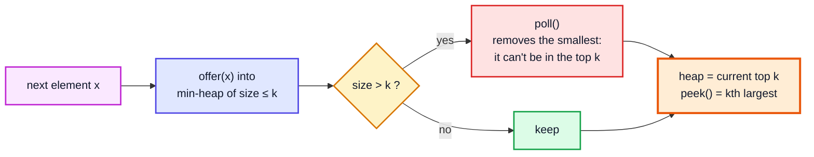
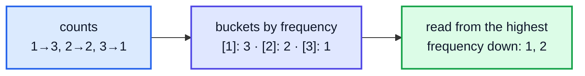
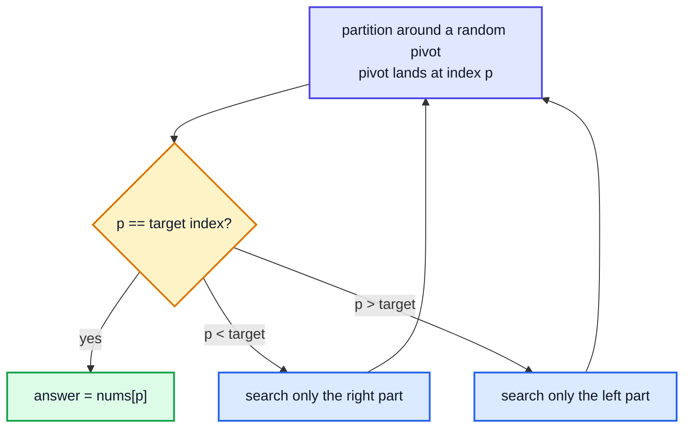
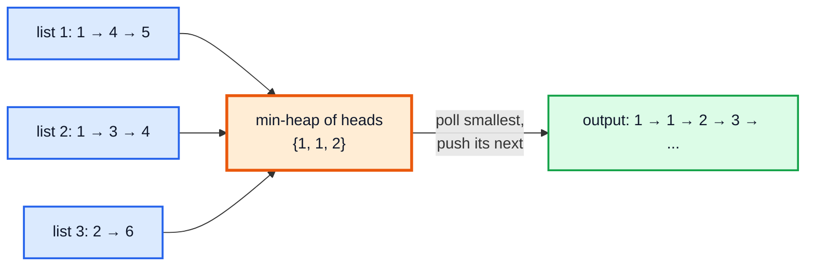
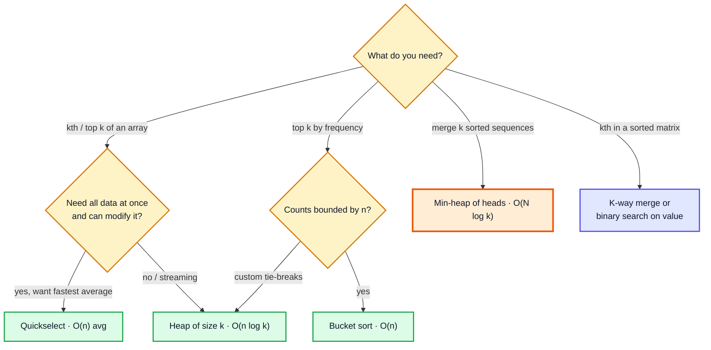

# Top-K Elements & K-way Merge — Complete In-Depth Guide

**DSA gap pattern #6 of 16** · Priority 🔴 · from [topics_not_covered.md](../topics_not_covered.md)

[Video 56](../kunal-java-notes-claude/java_56_video_heaps_priority_queue.md) builds a heap from scratch but doesn't solve the problems heaps are famous for. Two patterns cover most of them:

- **Top-K:** find the k largest / smallest / most frequent / closest items. Keep a heap of size **k**, so the work is **O(n log k)** instead of O(n log n) for a full sort.
- **K-way merge:** combine k sorted lists (or walk k sorted sequences together) by keeping only the **current head** of each list in a heap.

These notes cover Java's `PriorityQueue`, both patterns with their classic LeetCode problems, and the alternatives interviewers ask about: **quickselect** (average O(n)) and **bucket sort** (O(n)).

> [!NOTE]
> This pattern isn't in the playlist, so there are no video timestamps. All code targets **Java 21**. You need heaps ([video 56](../kunal-java-notes-claude/java_56_video_heaps_priority_queue.md)), comparators and lambdas ([gap Java #3](../Java%20Topics%20Not%20Covered%20Notes/java_gap_03_comparator_comparable.md)), `HashMap` counting ([video 57](../kunal-java-notes-claude/java_57_video_hashmap_hashtable.md)) and linked lists ([video 44](../kunal-java-notes-claude/java_44_video_linked_list.md)) for LC 23.

---

## Table of Contents

| # | Topic (anchor link) | Level |
|---|---|---|
| 0 | [PriorityQueue in Java](#0-priorityqueue-in-java) | Basics |
| 1 | [The Top-K Idea: a Heap of Size k](#1-the-top-k-idea-a-heap-of-size-k) | Core |
| 2 | [Kth Largest Element in an Array](#2-kth-largest-element-in-an-array) | Core |
| 3 | [Kth Largest in a Stream](#3-kth-largest-in-a-stream) | Core |
| 4 | [Top K Frequent Elements](#4-top-k-frequent-elements) | Core |
| 5 | [Top K Frequent Words: Tie-Breaking](#5-top-k-frequent-words-tie-breaking) | In depth |
| 6 | [K Closest Points to Origin](#6-k-closest-points-to-origin) | In depth |
| 7 | [Quickselect](#7-quickselect) | In depth |
| 8 | [K-way Merge: Merge K Sorted Lists](#8-k-way-merge-merge-k-sorted-lists) | Core |
| 9 | [Kth Smallest in a Sorted Matrix](#9-kth-smallest-in-a-sorted-matrix) | In depth |
| 10 | [K Pairs with Smallest Sums](#10-k-pairs-with-smallest-sums) | In depth |
| 11 | [Smallest Range Covering K Lists](#11-smallest-range-covering-k-lists) | Advanced |
| 12 | [Choosing an Approach, Pitfalls and Problem List](#12-choosing-an-approach-pitfalls-and-problem-list) | Interview |

---

## 0. PriorityQueue in Java

`java.util.PriorityQueue<E>` is a **binary min-heap** stored in an array, exactly the structure from video 56.

| Method | Meaning | Time |
|---|---|---|
| `offer(x)` / `add(x)` | Insert | O(log n) |
| `peek()` | Smallest element (or `null` if empty) | O(1) |
| `poll()` | Remove and return the smallest (or `null`) | O(log n) |
| `size()`, `isEmpty()` | | O(1) |
| `remove(x)` | Remove a specific element | **O(n)** (linear search) |
| `contains(x)` | | **O(n)** |
| `new PriorityQueue<>(collection)` | Build from a collection (heapify) | O(n) |

```java
import java.util.*;

public class PQBasics {
    public static void main(String[] args) {
        PriorityQueue<Integer> min = new PriorityQueue<>();                          // min-heap
        PriorityQueue<Integer> max = new PriorityQueue<>(Comparator.reverseOrder()); // max-heap
        for (int x : new int[]{5, 1, 8, 3, 9}) { min.offer(x); max.offer(x); }

        System.out.println(min.peek() + " " + max.peek());   // 1 9
        System.out.println(min);                             // [1, 3, 8, 5, 9]  ← heap order, NOT sorted

        StringBuilder sb = new StringBuilder();
        while (!min.isEmpty()) sb.append(min.poll()).append(' ');
        System.out.println(sb.toString().trim());            // 1 3 5 8 9  ← only polling gives sorted order

        // Heaps of arrays/records need a comparator
        PriorityQueue<int[]> byDist = new PriorityQueue<>((a, b) -> Integer.compare(a[1], b[1]));
        byDist.offer(new int[]{7, 30});
        byDist.offer(new int[]{2, 10});
        System.out.println(byDist.peek()[0]);                // 2
    }
}
```

> [!WARNING]
> Printing or iterating a `PriorityQueue` shows the **internal heap array**, not sorted order. Use repeated `poll()` to get elements in order. Also, if you change an object's field after inserting it, the heap doesn't re-sort: remove it, change it, re-insert.

---

## 1. The Top-K Idea: a Heap of Size k

To find the **k largest** elements, keep a **min-heap** of size k:

1. Push each element.
2. If the heap grows beyond k, pop the **smallest**.
3. At the end, the heap holds the k largest, and its **top is the kth largest**.

It feels backwards at first: a **min**-heap for the **largest** elements. The heap's root is the weakest member of the current top-k "club", so it's the one to kick out when someone better arrives.



| Want | Heap type | Pop when size > k | Top of heap |
|---|---|---|---|
| k **largest** | **min**-heap | the smallest | kth largest |
| k **smallest** | **max**-heap | the largest | kth smallest |
| k **most frequent** | min-heap by frequency | least frequent | — |
| k **closest** | max-heap by distance | farthest | — |

| Approach | Time | Space |
|---|---|---|
| Sort everything | O(n log n) | O(n) or O(log n) |
| Heap of size n, pop k times | O(n + k log n) | O(n) |
| **Heap of size k** | **O(n log k)** | **O(k)** |
| Quickselect (Section 7) | O(n) average, O(n²) worst | O(1) |

> [!TIP]
> The size-k heap also works when data arrives as a **stream** or doesn't fit in memory: you never hold more than k items.

---

## 2. Kth Largest Element in an Array

**LC 215:** the kth largest in sorted order (duplicates count separately).

```java
import java.util.*;

public class KthLargest {
    static int findKthLargest(int[] nums, int k) {
        PriorityQueue<Integer> heap = new PriorityQueue<>();   // min-heap
        for (int x : nums) {
            heap.offer(x);
            if (heap.size() > k) heap.poll();
        }
        return heap.peek();
    }

    public static void main(String[] args) {
        System.out.println(findKthLargest(new int[]{3, 2, 1, 5, 6, 4}, 2));            // 5
        System.out.println(findKthLargest(new int[]{3, 2, 3, 1, 2, 4, 5, 5, 6}, 4));   // 4
    }
}
```

**Dry run** on `[3, 2, 1, 5, 6, 4]`, k = 2:

| x | Heap after offer | Size > 2? | Heap after |
|---|---|---|---|
| 3 | {3} | no | {3} |
| 2 | {2, 3} | no | {2, 3} |
| 1 | {1, 2, 3} | yes → poll 1 | {2, 3} |
| 5 | {2, 3, 5} | poll 2 | {3, 5} |
| 6 | {3, 5, 6} | poll 3 | {5, 6} |
| 4 | {4, 5, 6} | poll 4 | {5, 6} |

`peek()` = **5**. **Time** O(n log k), **space** O(k).

---

## 3. Kth Largest in a Stream

**LC 703:** numbers keep arriving; after each `add`, return the current kth largest. The size-k min-heap is a perfect fit: each `add` is O(log k).

```java
import java.util.*;

public class KthLargestStream {
    private final PriorityQueue<Integer> heap = new PriorityQueue<>();
    private final int k;

    KthLargestStream(int k, int[] nums) {
        this.k = k;
        for (int x : nums) add(x);
    }

    int add(int val) {
        heap.offer(val);
        if (heap.size() > k) heap.poll();
        return heap.peek();
    }

    public static void main(String[] args) {
        KthLargestStream s = new KthLargestStream(3, new int[]{4, 5, 8, 2});
        System.out.println(s.add(3));    // 4
        System.out.println(s.add(5));    // 5
        System.out.println(s.add(10));   // 5
        System.out.println(s.add(9));    // 8
        System.out.println(s.add(4));    // 8
    }
}
```

> [!NOTE]
> A related "two heaps" problem, **Find Median from Data Stream (LC 295)**, keeps a max-heap for the lower half and a min-heap for the upper half. That's the next pattern in the gap list.

---

## 4. Top K Frequent Elements

**LC 347:** return the k most frequent values.

**Step 1:** count with a `HashMap`. **Step 2:** pick the top k by count.

### Approach A: min-heap of size k — O(n log k)

```java
import java.util.*;

public class TopKFrequentHeap {
    static int[] topKFrequent(int[] nums, int k) {
        Map<Integer, Integer> freq = new HashMap<>();
        for (int x : nums) freq.merge(x, 1, Integer::sum);

        PriorityQueue<Map.Entry<Integer, Integer>> heap =
                new PriorityQueue<>(Map.Entry.comparingByValue());       // min-heap by count
        for (Map.Entry<Integer, Integer> e : freq.entrySet()) {
            heap.offer(e);
            if (heap.size() > k) heap.poll();                            // drop the least frequent
        }
        int[] res = new int[k];
        for (int i = k - 1; i >= 0; i--) res[i] = heap.poll().getKey();  // most frequent first
        return res;
    }

    public static void main(String[] args) {
        System.out.println(Arrays.toString(topKFrequent(new int[]{1, 1, 1, 2, 2, 3}, 2)));   // [1, 2]
        System.out.println(Arrays.toString(topKFrequent(new int[]{4, 4, 7, 7, 7, 9}, 1)));   // [7]
    }
}
```

### Approach B: bucket sort — O(n)

A frequency is between 1 and n, so put each value in bucket `freq`, then read buckets from high to low.

```java
import java.util.*;

public class TopKFrequentBuckets {
    @SuppressWarnings("unchecked")
    static int[] topKFrequent(int[] nums, int k) {
        Map<Integer, Integer> freq = new HashMap<>();
        for (int x : nums) freq.merge(x, 1, Integer::sum);

        List<Integer>[] buckets = new List[nums.length + 1];             // index = frequency
        freq.forEach((value, count) -> {
            if (buckets[count] == null) buckets[count] = new ArrayList<>();
            buckets[count].add(value);
        });

        int[] res = new int[k];
        int idx = 0;
        for (int f = nums.length; f >= 1 && idx < k; f--) {
            if (buckets[f] == null) continue;
            for (int v : buckets[f]) { if (idx == k) break; res[idx++] = v; }
        }
        return res;
    }

    public static void main(String[] args) {
        System.out.println(Arrays.toString(topKFrequent(new int[]{1, 1, 1, 2, 2, 3}, 2)));   // [1, 2]
    }
}
```



| Approach | Time | Space |
|---|---|---|
| Sort entries by count | O(m log m), m = distinct values | O(m) |
| Size-k heap | O(n + m log k) | O(m + k) |
| **Bucket sort** | **O(n)** | O(n) |
| Quickselect on entries | O(n) average | O(m) |

---

## 5. Top K Frequent Words: Tie-Breaking

**LC 692:** the k most frequent words, sorted by frequency (high → low), and **alphabetically for ties**. Now the comparator decides everything.

With a size-k **min**-heap, the root must be the *worst* candidate: the **lowest** frequency, and among equal frequencies the **alphabetically last** word. So the heap order is "frequency ascending, then word **descending**", and at the end the polled words come out worst-first, so reverse them.

```java
import java.util.*;

public class TopKFrequentWords {
    static List<String> topKFrequent(String[] words, int k) {
        Map<String, Integer> freq = new HashMap<>();
        for (String w : words) freq.merge(w, 1, Integer::sum);

        Comparator<String> worstFirst = Comparator
                .comparingInt((String w) -> freq.get(w))           // lower frequency = worse
                .thenComparing(Comparator.<String>reverseOrder());  // same frequency: later in the alphabet = worse

        PriorityQueue<String> heap = new PriorityQueue<>(worstFirst);
        for (String w : freq.keySet()) {
            heap.offer(w);
            if (heap.size() > k) heap.poll();
        }
        List<String> res = new ArrayList<>();
        while (!heap.isEmpty()) res.add(heap.poll());
        Collections.reverse(res);                                    // best first
        return res;
    }

    public static void main(String[] args) {
        System.out.println(topKFrequent(new String[]{"i", "love", "leetcode", "i", "love", "coding"}, 2));
        // [i, love]
        System.out.println(topKFrequent(new String[]{"the", "day", "is", "sunny", "the", "the", "the", "sunny", "is", "is"}, 4));
        // [the, is, sunny, day]
    }
}
```

> [!IMPORTANT]
> The heap's comparator is the **opposite** of the final output order. Output: frequency desc, word asc. Min-heap (worst at the top): frequency asc, word desc. Getting one of the two keys backwards is the most common bug in this problem. ([gap Java #3](../Java%20Topics%20Not%20Covered%20Notes/java_gap_03_comparator_comparable.md#6-multi-key-sorting-with-thencomparing) covers multi-key comparators.)

---

## 6. K Closest Points to Origin

**LC 973:** the k points nearest to `(0, 0)`. "k smallest distances" → **max**-heap of size k, keyed by squared distance (no `sqrt` needed: it doesn't change the order).

```java
import java.util.*;

public class KClosestPoints {
    static int[][] kClosest(int[][] points, int k) {
        PriorityQueue<int[]> heap = new PriorityQueue<>(
                (a, b) -> Long.compare(dist(b), dist(a)));        // max-heap: farthest on top
        for (int[] p : points) {
            heap.offer(p);
            if (heap.size() > k) heap.poll();                    // drop the farthest
        }
        return heap.toArray(new int[0][]);
    }

    static long dist(int[] p) { return (long) p[0] * p[0] + (long) p[1] * p[1]; }   // long: avoid overflow

    public static void main(String[] args) {
        System.out.println(Arrays.deepToString(kClosest(new int[][]{{1, 3}, {-2, 2}}, 1)));          // [[-2, 2]]
        int[][] r = kClosest(new int[][]{{3, 3}, {5, -1}, {-2, 4}}, 2);
        Arrays.sort(r, Comparator.comparingLong(KClosestPoints::dist));
        System.out.println(Arrays.deepToString(r));                                                  // [[3, 3], [-2, 4]]
    }
}
```

| Point | Squared distance |
|---|---|
| (3, 3) | 18 |
| (5, −1) | 26 |
| (−2, 4) | 20 |

The two closest are (3, 3) and (−2, 4). The problem accepts any order.

---

## 7. Quickselect

**Idea:** quick sort's **partition** ([video 31](../kunal-java-notes-claude/java_31_video_quick_sort.md)) puts the pivot in its final sorted position `p`. If `p` is the index we want, done; otherwise recurse into **only one side**. On average the side halves each time: n + n/2 + n/4 + … = **O(n)**.



```java
import java.util.*;

public class Quickselect {
    static final Random RND = new Random(1);

    static int findKthLargest(int[] nums, int k) {
        int target = nums.length - k;                     // kth largest = index n − k in ascending order
        int lo = 0, hi = nums.length - 1;
        while (true) {
            int p = partition(nums, lo, hi);
            if (p == target) return nums[p];
            if (p < target) lo = p + 1; else hi = p - 1;  // iterate instead of recursing
        }
    }

    // Lomuto partition with a random pivot: smaller elements go left
    static int partition(int[] a, int lo, int hi) {
        swap(a, lo + RND.nextInt(hi - lo + 1), hi);       // random pivot → avoids the O(n²) worst case on sorted input
        int pivot = a[hi], store = lo;
        for (int i = lo; i < hi; i++) if (a[i] < pivot) swap(a, i, store++);
        swap(a, store, hi);
        return store;
    }

    static void swap(int[] a, int i, int j) { int t = a[i]; a[i] = a[j]; a[j] = t; }

    public static void main(String[] args) {
        System.out.println(findKthLargest(new int[]{3, 2, 1, 5, 6, 4}, 2));            // 5
        System.out.println(findKthLargest(new int[]{3, 2, 3, 1, 2, 4, 5, 5, 6}, 4));   // 4
        int[] sorted = new int[100_000];
        for (int i = 0; i < sorted.length; i++) sorted[i] = i;
        System.out.println(findKthLargest(sorted, 1));                                 // 99999
    }
}
```

| | Heap of size k | Quickselect |
|---|---|---|
| Average time | O(n log k) | **O(n)** |
| Worst time | O(n log k) | O(n²) (very unlikely with a random pivot) |
| Extra space | O(k) | O(1) |
| Modifies the input | No | **Yes** (reorders it) |
| Works on a stream | **Yes** | No (needs all data) |

> [!TIP]
> For arrays with **many duplicates**, Lomuto partition degrades (all equal elements go to one side). Use a **3-way partition** (the Dutch National Flag from [gap #2, section 8](dsa_gap_02_two_pointers.md#8-three-pointers-sort-colors)): if the target lands inside the "equal" block, you're done.

---

## 8. K-way Merge: Merge K Sorted Lists

**LC 23 (Hard):** merge k sorted linked lists into one sorted list.

**Idea:** the next smallest element overall is the smallest of the **current heads**. Keep one node per list in a min-heap; poll the smallest, append it, and push its `next`.



```java
import java.util.*;

public class MergeKSortedLists {
    static class ListNode {
        int val; ListNode next;
        ListNode(int val) { this.val = val; }
    }

    static ListNode mergeKLists(ListNode[] lists) {
        PriorityQueue<ListNode> heap = new PriorityQueue<>((a, b) -> Integer.compare(a.val, b.val));
        for (ListNode head : lists) if (head != null) heap.offer(head);

        ListNode dummy = new ListNode(0), tail = dummy;           // dummy head avoids special cases
        while (!heap.isEmpty()) {
            ListNode node = heap.poll();
            tail.next = node;
            tail = node;
            if (node.next != null) heap.offer(node.next);
        }
        return dummy.next;
    }

    static ListNode build(int... vals) {
        ListNode dummy = new ListNode(0), t = dummy;
        for (int v : vals) { t.next = new ListNode(v); t = t.next; }
        return dummy.next;
    }

    static String show(ListNode n) {
        StringJoiner sj = new StringJoiner(" -> ");
        for (; n != null; n = n.next) sj.add(String.valueOf(n.val));
        return sj.toString();
    }

    public static void main(String[] args) {
        ListNode[] lists = { build(1, 4, 5), build(1, 3, 4), build(2, 6) };
        System.out.println(show(mergeKLists(lists)));   // 1 -> 1 -> 2 -> 3 -> 4 -> 4 -> 5 -> 6
        System.out.println(show(mergeKLists(new ListNode[]{})).isEmpty());    // true (no lists → empty result)
    }
}
```

**Dry run** (heap shows values):

| Step | Heap before | Poll | Push | Output so far |
|---|---|---|---|---|
| 1 | {1ᵃ, 1ᵇ, 2} | 1ᵃ | 4ᵃ | 1 |
| 2 | {1ᵇ, 2, 4ᵃ} | 1ᵇ | 3ᵇ | 1 1 |
| 3 | {2, 3ᵇ, 4ᵃ} | 2 | 6 | 1 1 2 |
| 4 | {3ᵇ, 4ᵃ, 6} | 3ᵇ | 4ᵇ | 1 1 2 3 |
| 5 | {4ᵃ, 4ᵇ, 6} | 4ᵃ | 5ᵃ | … 4 |
| 6 | {4ᵇ, 5ᵃ, 6} | 4ᵇ | — | … 4 4 |
| 7 | {5ᵃ, 6} | 5ᵃ | — | … 5 |
| 8 | {6} | 6 | — | … 6 |

| Approach | Time (N = total nodes) | Space |
|---|---|---|
| Collect everything and sort | O(N log N) | O(N) |
| Merge lists one by one | O(N·k) | O(1) |
| **Min-heap of heads** | **O(N log k)** | O(k) |
| Divide and conquer (merge pairs, like merge sort) | O(N log k) | O(log k) recursion |

---

## 9. Kth Smallest in a Sorted Matrix

**LC 378:** every row and column is sorted. Treat each **row** as a sorted list and K-way merge them, stopping after k pops.

```java
import java.util.*;

public class KthSmallestMatrix {
    static int kthSmallest(int[][] m, int k) {
        int n = m.length;
        PriorityQueue<int[]> heap = new PriorityQueue<>((a, b) -> Integer.compare(a[0], b[0]));   // {value, row, col}
        for (int r = 0; r < Math.min(n, k); r++) heap.offer(new int[]{m[r][0], r, 0});          // first column
        int[] cur = null;
        for (int i = 0; i < k; i++) {
            cur = heap.poll();
            int r = cur[1], c = cur[2];
            if (c + 1 < m[r].length) heap.offer(new int[]{m[r][c + 1], r, c + 1});             // next in that row
        }
        return cur[0];
    }

    // Alternative: binary search on the VALUE, counting how many are <= mid (O(n log(max − min)))
    static int kthSmallestBinary(int[][] m, int k) {
        int n = m.length, lo = m[0][0], hi = m[n - 1][n - 1];
        while (lo < hi) {
            int mid = lo + (hi - lo) / 2, count = 0;
            for (int r = n - 1, c = 0; r >= 0 && c < n; ) {        // staircase walk from bottom-left
                if (m[r][c] <= mid) { count += r + 1; c++; } else r--;
            }
            if (count < k) lo = mid + 1; else hi = mid;
        }
        return lo;
    }

    public static void main(String[] args) {
        int[][] m = {{1, 5, 9}, {10, 11, 13}, {12, 13, 15}};
        System.out.println(kthSmallest(m, 8) + " " + kthSmallestBinary(m, 8));   // 13 13
    }
}
```

The binary-search version connects to the "binary search on the answer" questions in [video 15](../kunal-java-notes-claude/java_15_video_binary_search_questions.md) and the staircase search of [video 16](../kunal-java-notes-claude/java_16_video_binary_search_2d_arrays.md).

---

## 10. K Pairs with Smallest Sums

**LC 373:** two sorted arrays; return the k pairs `(u, v)` with the smallest sums. Think of an implicit matrix `sum[i][j] = nums1[i] + nums2[j]` whose rows are sorted, and K-way merge its rows.

```java
import java.util.*;

public class KSmallestPairs {
    static List<List<Integer>> kSmallestPairs(int[] a, int[] b, int k) {
        List<List<Integer>> res = new ArrayList<>();
        PriorityQueue<int[]> heap = new PriorityQueue<>((x, y) -> Integer.compare(a[x[0]] + b[x[1]], a[y[0]] + b[y[1]]));
        for (int i = 0; i < Math.min(a.length, k); i++) heap.offer(new int[]{i, 0});   // pair each a[i] with b[0]
        while (!heap.isEmpty() && res.size() < k) {
            int[] p = heap.poll();
            res.add(List.of(a[p[0]], b[p[1]]));
            if (p[1] + 1 < b.length) heap.offer(new int[]{p[0], p[1] + 1});           // next in this "row"
        }
        return res;
    }

    public static void main(String[] args) {
        System.out.println(kSmallestPairs(new int[]{1, 7, 11}, new int[]{2, 4, 6}, 3));   // [[1, 2], [1, 4], [1, 6]]
        System.out.println(kSmallestPairs(new int[]{1, 1, 2}, new int[]{1, 2, 3}, 2));    // [[1, 1], [1, 1]]
    }
}
```

**Time** O(k log min(n, k)): at most k pops, and the heap never holds more than `min(n, k)` entries.

---

## 11. Smallest Range Covering K Lists

**LC 632 (Hard):** k sorted lists; find the smallest range `[lo, hi]` containing at least one number from each list.

**Idea:** keep one number from each list in a min-heap and track the current **maximum**. The range `[heapMin, currentMax]` covers all lists. To try to shrink it, advance the list that holds the minimum. Stop when any list runs out.

```java
import java.util.*;

public class SmallestRange {
    static int[] smallestRange(List<List<Integer>> lists) {
        PriorityQueue<int[]> heap = new PriorityQueue<>((x, y) -> Integer.compare(x[0], y[0]));  // {value, list, index}
        int max = Integer.MIN_VALUE;
        for (int i = 0; i < lists.size(); i++) {
            heap.offer(new int[]{lists.get(i).get(0), i, 0});
            max = Math.max(max, lists.get(i).get(0));
        }
        int bestLo = 0, bestHi = Integer.MAX_VALUE;
        while (true) {
            int[] cur = heap.poll();
            if ((long) max - cur[0] < (long) bestHi - bestLo) { bestLo = cur[0]; bestHi = max; }
            int list = cur[1], idx = cur[2] + 1;
            if (idx == lists.get(list).size()) break;            // this list is exhausted
            int next = lists.get(list).get(idx);
            heap.offer(new int[]{next, list, idx});
            max = Math.max(max, next);
        }
        return new int[]{bestLo, bestHi};
    }

    public static void main(String[] args) {
        List<List<Integer>> lists = List.of(
                List.of(4, 10, 15, 24, 26),
                List.of(0, 9, 12, 20),
                List.of(5, 18, 22, 30));
        System.out.println(Arrays.toString(smallestRange(lists)));   // [20, 24]
    }
}
```

**Time** O(N log k) where N = total elements. This combines **K-way merge** with a **sliding window** idea ([gap #1](dsa_gap_01_sliding_window.md)) over the merged order.

---

## 12. Choosing an Approach, Pitfalls and Problem List



### Pitfalls

| Pitfall | Fix |
|---|---|
| Max-heap for "k largest" (or min-heap for "k smallest") | k largest → **min**-heap of size k; k smallest → **max**-heap |
| `(a, b) -> b - a` comparator | Overflows for big values; use `Integer.compare(b, a)` or `Comparator.reverseOrder()` |
| Expecting sorted output from printing a heap | Poll repeatedly |
| Forgetting to reverse after polling a min-heap of the top k | Polls come out smallest-first |
| Tie-break direction wrong in LC 692 | Heap order is the reverse of the output order |
| Squared distances overflowing `int` | Use `long` |
| Quickselect without a random pivot | O(n²) on sorted input; shuffle or pick a random pivot |
| Pushing all k list heads when some lists are empty (LC 23) | Skip `null` heads |

### Problem list (in order)

| # | Problem | Pattern | Difficulty |
|---|---|---|---|
| 1 | LC 1046 Last Stone Weight | Max-heap simulation | Easy |
| 2 | LC 703 Kth Largest Element in a Stream | Size-k min-heap | Easy |
| 3 | LC 215 Kth Largest Element in an Array | Heap / quickselect | Medium |
| 4 | LC 347 Top K Frequent Elements | Count + heap / buckets | Medium |
| 5 | LC 451 Sort Characters by Frequency | Count + buckets | Medium |
| 6 | LC 973 K Closest Points to Origin | Size-k max-heap | Medium |
| 7 | LC 692 Top K Frequent Words | Heap with tie-breaks | Medium |
| 8 | LC 658 Find K Closest Elements | Binary search / two pointers (heap also works) | Medium |
| 9 | LC 378 Kth Smallest Element in a Sorted Matrix | K-way merge / binary search | Medium |
| 10 | LC 373 Find K Pairs with Smallest Sums | K-way merge | Medium |
| 11 | LC 23 Merge k Sorted Lists | K-way merge | Hard |
| 12 | LC 632 Smallest Range Covering Elements from K Lists | K-way merge + window | Hard |

### Interview Q&A

| Question | Short answer |
|---|---|
| Why a min-heap for the k largest? | Its root is the weakest of the current top k, so it's the one to evict. |
| Time of the size-k heap? | O(n log k), space O(k). |
| Faster than O(n log k) for kth largest? | Quickselect: O(n) average, O(n²) worst; median-of-medians gives O(n) worst but is rarely coded. |
| Top k frequent in O(n)? | Bucket sort by frequency. |
| Merge k sorted lists? | Min-heap of the k heads: O(N log k). |
| Is Java's `PriorityQueue` thread-safe? | No; use `PriorityBlockingQueue`. |
| How do you make a max-heap? | `new PriorityQueue<>(Comparator.reverseOrder())`. |

---

## 🧩 Complete Example: Everything Together

Kth largest by heap and by quickselect, a stream, top-k frequent (heap and buckets), top-k words with tie-breaks, k closest points, merging k sorted arrays, kth smallest in a matrix, k smallest pairs and the smallest covering range — with random cross-checks against sorting.

```java
import java.util.*;
import java.util.stream.*;

public class TopKShowcase {

    static int kthLargestHeap(int[] a, int k) {
        PriorityQueue<Integer> h = new PriorityQueue<>();
        for (int x : a) { h.offer(x); if (h.size() > k) h.poll(); }
        return h.peek();
    }

    static final Random RND = new Random(3);
    static int kthLargestQuickselect(int[] input, int k) {
        int[] a = input.clone();
        int target = a.length - k, lo = 0, hi = a.length - 1;
        while (true) {
            int r = lo + RND.nextInt(hi - lo + 1);
            int t = a[r]; a[r] = a[hi]; a[hi] = t;
            int pivot = a[hi], s = lo;
            for (int i = lo; i < hi; i++) if (a[i] < pivot) { t = a[i]; a[i] = a[s]; a[s++] = t; }
            t = a[s]; a[s] = a[hi]; a[hi] = t;
            if (s == target) return a[s];
            if (s < target) lo = s + 1; else hi = s - 1;
        }
    }

    static List<Integer> topKFrequentBuckets(int[] a, int k) {
        Map<Integer, Integer> f = new HashMap<>();
        for (int x : a) f.merge(x, 1, Integer::sum);
        List<List<Integer>> buckets = new ArrayList<>();
        for (int i = 0; i <= a.length; i++) buckets.add(new ArrayList<>());
        f.forEach((v, c) -> buckets.get(c).add(v));
        List<Integer> res = new ArrayList<>();
        for (int c = a.length; c >= 1 && res.size() < k; c--) {
            List<Integer> b = buckets.get(c);
            Collections.sort(b);                                   // deterministic order for ties
            for (int v : b) if (res.size() < k) res.add(v);
        }
        return res;
    }

    static List<String> topKWords(String[] words, int k) {
        Map<String, Integer> f = new HashMap<>();
        for (String w : words) f.merge(w, 1, Integer::sum);
        PriorityQueue<String> h = new PriorityQueue<>(
                Comparator.comparingInt((String w) -> f.get(w)).thenComparing(Comparator.<String>reverseOrder()));
        for (String w : f.keySet()) { h.offer(w); if (h.size() > k) h.poll(); }
        LinkedList<String> res = new LinkedList<>();
        while (!h.isEmpty()) res.addFirst(h.poll());
        return res;
    }

    static List<String> kClosest(int[][] pts, int k) {
        PriorityQueue<int[]> h = new PriorityQueue<>((p, q) -> Long.compare(d(q), d(p)));
        for (int[] p : pts) { h.offer(p); if (h.size() > k) h.poll(); }
        return h.stream().sorted(Comparator.comparingLong(TopKShowcase::d)).map(Arrays::toString).toList();
    }
    static long d(int[] p) { return (long) p[0] * p[0] + (long) p[1] * p[1]; }

    static List<Integer> mergeK(int[][] arrays) {
        PriorityQueue<int[]> h = new PriorityQueue<>((x, y) -> Integer.compare(arrays[x[0]][x[1]], arrays[y[0]][y[1]]));
        for (int i = 0; i < arrays.length; i++) if (arrays[i].length > 0) h.offer(new int[]{i, 0});
        List<Integer> out = new ArrayList<>();
        while (!h.isEmpty()) {
            int[] c = h.poll();
            out.add(arrays[c[0]][c[1]]);
            if (c[1] + 1 < arrays[c[0]].length) h.offer(new int[]{c[0], c[1] + 1});
        }
        return out;
    }

    static int kthSmallestMatrix(int[][] m, int k) {
        PriorityQueue<int[]> h = new PriorityQueue<>((x, y) -> Integer.compare(x[0], y[0]));
        for (int r = 0; r < Math.min(m.length, k); r++) h.offer(new int[]{m[r][0], r, 0});
        int[] cur = null;
        for (int i = 0; i < k; i++) {
            cur = h.poll();
            if (cur[2] + 1 < m[cur[1]].length) h.offer(new int[]{m[cur[1]][cur[2] + 1], cur[1], cur[2] + 1});
        }
        return cur[0];
    }

    static List<List<Integer>> kSmallestPairs(int[] a, int[] b, int k) {
        List<List<Integer>> res = new ArrayList<>();
        PriorityQueue<int[]> h = new PriorityQueue<>((x, y) -> Integer.compare(a[x[0]] + b[x[1]], a[y[0]] + b[y[1]]));
        for (int i = 0; i < Math.min(a.length, k); i++) h.offer(new int[]{i, 0});
        while (!h.isEmpty() && res.size() < k) {
            int[] p = h.poll();
            res.add(List.of(a[p[0]], b[p[1]]));
            if (p[1] + 1 < b.length) h.offer(new int[]{p[0], p[1] + 1});
        }
        return res;
    }

    static int[] smallestRange(int[][] lists) {
        PriorityQueue<int[]> h = new PriorityQueue<>((x, y) -> Integer.compare(x[0], y[0]));
        int max = Integer.MIN_VALUE;
        for (int i = 0; i < lists.length; i++) { h.offer(new int[]{lists[i][0], i, 0}); max = Math.max(max, lists[i][0]); }
        int lo = 0, hi = Integer.MAX_VALUE;
        while (true) {
            int[] c = h.poll();
            if ((long) max - c[0] < (long) hi - lo) { lo = c[0]; hi = max; }
            if (c[2] + 1 == lists[c[1]].length) return new int[]{lo, hi};
            int nx = lists[c[1]][c[2] + 1];
            h.offer(new int[]{nx, c[1], c[2] + 1});
            max = Math.max(max, nx);
        }
    }

    public static void main(String[] args) {
        int[] nums = {3, 2, 3, 1, 2, 4, 5, 5, 6};
        System.out.println("1. 4th largest: heap " + kthLargestHeap(nums, 4) + ", quickselect " + kthLargestQuickselect(nums, 4));

        PriorityQueue<Integer> stream = new PriorityQueue<>();
        List<Integer> answers = new ArrayList<>();
        for (int x : new int[]{4, 5, 8, 2, 3, 5, 10, 9, 4}) {
            stream.offer(x);
            if (stream.size() > 3) stream.poll();
            if (stream.size() == 3) answers.add(stream.peek());
        }
        System.out.println("2. 3rd largest after each add: " + answers);

        System.out.println("3. Top 2 frequent: " + topKFrequentBuckets(new int[]{1, 1, 1, 2, 2, 3, 3, 3, 3}, 2));
        System.out.println("4. Top 4 words: " + topKWords("the day is sunny the the the sunny is is".split(" "), 4));
        System.out.println("5. 2 closest points: " + kClosest(new int[][]{{3, 3}, {5, -1}, {-2, 4}, {1, 1}}, 2));
        System.out.println("6. Merge k arrays: " + mergeK(new int[][]{{1, 4, 5}, {1, 3, 4}, {2, 6}, {}}));
        System.out.println("7. 8th smallest in matrix: " + kthSmallestMatrix(new int[][]{{1, 5, 9}, {10, 11, 13}, {12, 13, 15}}, 8));
        System.out.println("8. 3 smallest pairs: " + kSmallestPairs(new int[]{1, 7, 11}, new int[]{2, 4, 6}, 3));
        System.out.println("9. Smallest range: " + Arrays.toString(smallestRange(new int[][]{{4, 10, 15, 24, 26}, {0, 9, 12, 20}, {5, 18, 22, 30}})));

        Random rnd = new Random(99);
        int checks = 0, mismatches = 0;
        for (int t = 0; t < 400; t++) {
            int n = 1 + rnd.nextInt(30), k = 1 + rnd.nextInt(n);
            int[] a = rnd.ints(n, -20, 20).toArray();
            int[] sorted = a.clone();
            Arrays.sort(sorted);
            int expected = sorted[n - k];
            if (kthLargestHeap(a, k) != expected) mismatches++;
            if (kthLargestQuickselect(a, k) != expected) mismatches++;

            int[][] arrays = new int[1 + rnd.nextInt(4)][];
            for (int i = 0; i < arrays.length; i++) { arrays[i] = rnd.ints(rnd.nextInt(6), 0, 30).toArray(); Arrays.sort(arrays[i]); }
            List<Integer> all = Arrays.stream(arrays).flatMapToInt(Arrays::stream).sorted().boxed().collect(Collectors.toList());
            if (!mergeK(arrays).equals(all)) mismatches++;
            checks += 3;
        }
        System.out.println("Random cross-checks: " + checks + ", mismatches: " + mismatches);
    }
}
```

**Expected Output:**
```
1. 4th largest: heap 4, quickselect 4
2. 3rd largest after each add: [4, 4, 4, 5, 5, 8, 8]
3. Top 2 frequent: [3, 1]
4. Top 4 words: [the, is, sunny, day]
5. 2 closest points: [[1, 1], [3, 3]]
6. Merge k arrays: [1, 1, 2, 3, 4, 4, 5, 6]
7. 8th smallest in matrix: 13
8. 3 smallest pairs: [[1, 2], [1, 4], [1, 6]]
9. Smallest range: [20, 24]
Random cross-checks: 1200, mismatches: 0
```

---

## Quick Reference Cheat Sheet

| Concept | One-Line Summary |
|---|---|
| **`PriorityQueue`** | Min-heap; `offer`/`poll` O(log n), `peek` O(1); iteration is NOT sorted |
| **Max-heap** | `new PriorityQueue<>(Comparator.reverseOrder())` |
| **k largest** | Min-heap of size k; pop when size > k; `peek()` = kth largest |
| **k smallest / closest** | Max-heap of size k |
| **Complexity** | O(n log k) time, O(k) space; works on streams |
| **Top k frequent** | Count with `HashMap`, then size-k heap or bucket sort (O(n)) |
| **Tie-breaks (LC 692)** | Heap comparator = reverse of the output order; reverse at the end |
| **Quickselect** | Partition, recurse into one side; O(n) average; random pivot |
| **K-way merge** | Heap of current heads; poll smallest, push its successor; O(N log k) |
| **Sorted matrix kth** | K-way merge over rows, or binary search on the value |
| **K smallest pairs** | Heap of `(i, j)` index pairs, expand `j + 1` |
| **Smallest range** | Heap min + running max over one element per list |
