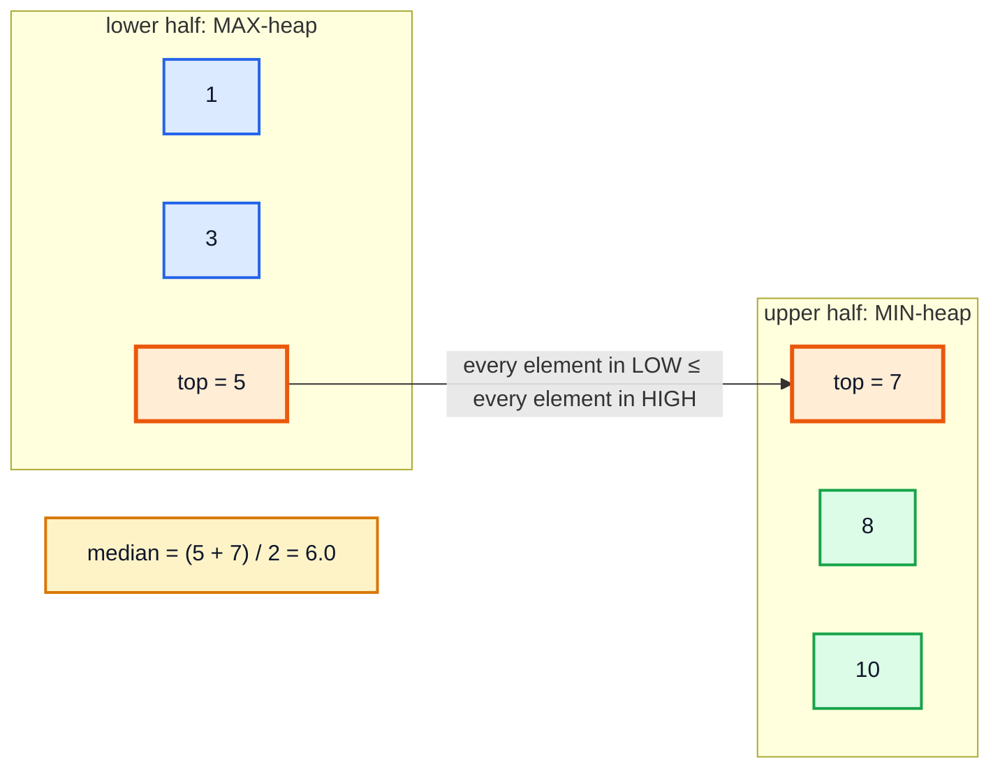
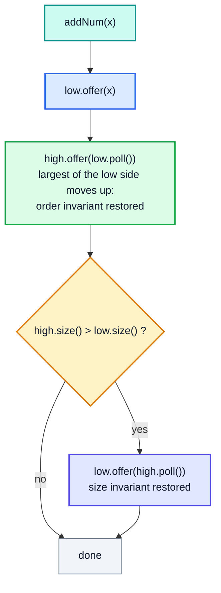
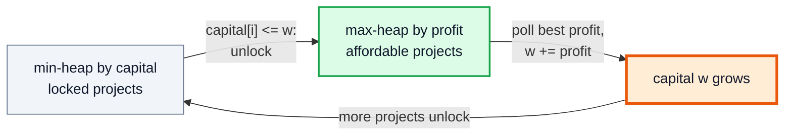

# Two Heaps — Complete In-Depth Guide

**DSA gap pattern #7 of 16** · Priority 🟡 · from [topics_not_covered.md](../topics_not_covered.md)

Some problems need fast access to the **middle** of a changing collection, such as the running median of a stream. One heap gives you only the smallest or the largest element. **Two heaps** split the data into a **lower half** (a max-heap, whose top is the largest of the small numbers) and an **upper half** (a min-heap, whose top is the smallest of the large numbers). The median is always at one or both tops. These notes cover the median of a stream, the sliding-window median, the IPO problem (two heaps used in a different way), percentiles, and the pitfalls.

> [!NOTE]
> This pattern isn't in the playlist, so there are no video timestamps. All code targets **Java 21**. You need heaps ([video 56](../kunal-java-notes-claude/java_56_video_heaps_priority_queue.md)), `PriorityQueue` and comparators ([gap #6](dsa_gap_06_top_k_k_way_merge.md#0-priorityqueue-in-java), [gap Java #3](../Java%20Topics%20Not%20Covered%20Notes/java_gap_03_comparator_comparable.md)), and `TreeMap`/`TreeSet` for the sliding-window version.

---

## Table of Contents

| # | Topic (anchor link) | Level |
|---|---|---|
| 0 | [The Idea](#0-the-idea) | Basics |
| 1 | [The Two Invariants](#1-the-two-invariants) | Basics |
| 2 | [Find Median from Data Stream](#2-find-median-from-data-stream) | Core |
| 3 | [Sliding Window Median](#3-sliding-window-median) | In depth |
| 4 | [IPO: Two Heaps as a Gate](#4-ipo-two-heaps-as-a-gate) | In depth |
| 5 | [Percentiles and Other Splits](#5-percentiles-and-other-splits) | In depth |
| 6 | [Alternatives, Pitfalls and Problem List](#6-alternatives-pitfalls-and-problem-list) | Interview |

---

## 0. The Idea

The median of a sorted list is the middle element (odd count) or the average of the two middle elements (even count). Re-sorting after every insert costs O(n log n); inserting into a sorted `ArrayList` costs O(n). With two heaps, each insert is **O(log n)** and reading the median is **O(1)**.



| Approach | Insert | Median |
|---|---|---|
| Unsorted list, sort on every query | O(1) | O(n log n) |
| Sorted `ArrayList` (binary search + insert) | O(n) (shifting) | O(1) |
| **Two heaps** | **O(log n)** | **O(1)** |
| Balanced BST / `TreeMap` with counts | O(log n) | O(log n) |

---

## 1. The Two Invariants

Keep these true after every operation:

| Invariant | Meaning |
|---|---|
| **Order** | `max(low) ≤ min(high)`: every number in the lower half is ≤ every number in the upper half |
| **Size** | `low.size() == high.size()` or `low.size() == high.size() + 1` (the lower half may hold one extra) |

Then:
- odd count → median = `low.peek()`
- even count → median = `(low.peek() + high.peek()) / 2.0`

### The "push through" trick for inserting

Instead of choosing the right heap with comparisons, **always** push into `low`, move `low`'s top to `high` (this fixes the order), then move one back if `high` became bigger (this fixes the size).



That's 3 heap operations per insert (each O(log n)) and no `if` on the value.

---

## 2. Find Median from Data Stream

**LC 295 (Hard):** `addNum(x)` and `findMedian()`.

```java
import java.util.*;

public class MedianFinder {
    private final PriorityQueue<Integer> low = new PriorityQueue<>(Comparator.reverseOrder());  // max-heap
    private final PriorityQueue<Integer> high = new PriorityQueue<>();                          // min-heap

    public void addNum(int x) {
        low.offer(x);
        high.offer(low.poll());                     // keep order: low's largest moves up
        if (high.size() > low.size()) low.offer(high.poll());   // keep sizes: low has the extra
    }

    public double findMedian() {
        if (low.size() > high.size()) return low.peek();
        return ((long) low.peek() + high.peek()) / 2.0;          // long: avoid int overflow
    }

    public static void main(String[] args) {
        MedianFinder mf = new MedianFinder();
        mf.addNum(1);
        mf.addNum(2);
        System.out.println(mf.findMedian());   // 1.5
        mf.addNum(3);
        System.out.println(mf.findMedian());   // 2.0

        MedianFinder s = new MedianFinder();
        StringJoiner sj = new StringJoiner(" ");
        for (int x : new int[]{5, 15, 1, 3, 8, 7, 9, 10}) { s.addNum(x); sj.add(String.valueOf(s.findMedian())); }
        System.out.println(sj);                // 5.0 10.0 5.0 4.0 5.0 6.0 7.0 7.5
    }
}
```

**Dry run** for the stream `5, 15, 1, 3`:

| add | low after push | moved to high | rebalance | low (max-heap) | high (min-heap) | median |
|---|---|---|---|---|---|---|
| 5 | {5} | 5 | high bigger → 5 back | {5} | {} | **5.0** |
| 15 | {15, 5} | 15 | sizes equal | {5} | {15} | **(5 + 15)/2 = 10.0** |
| 1 | {5, 1} | 5 | high bigger → 5 back | {5, 1} | {15} | **5.0** |
| 3 | {5, 3, 1} | 5 | sizes equal | {3, 1} | {5, 15} | **(3 + 5)/2 = 4.0** |

**Time:** `addNum` O(log n), `findMedian` O(1). **Space:** O(n).

> [!WARNING]
> `(low.peek() + high.peek()) / 2` with ints overflows near `Integer.MAX_VALUE` and also does **integer** division (`(1 + 2) / 2 = 1`). Add as `long` and divide by `2.0`.

### Follow-ups interviewers ask

| Follow-up | Answer |
|---|---|
| All numbers are in `[0, 100]` | Keep a count array of size 101; median by walking counts: O(100) per query |
| 99% of numbers are in `[0, 100]` | Count array for the range + two small lists/counters for outliers |
| Support removing numbers | Lazy deletion (Section 3) or a `TreeMap<Integer, count>` multiset |

---

## 3. Sliding Window Median

**LC 480 (Hard):** the median of every window of size `k`. Now numbers also **leave**, and `PriorityQueue.remove(x)` is O(k).

### Approach A: two `TreeSet`s of indices — O(n log k)

A `TreeSet` supports `remove` in O(log k). Store **indices** (so duplicates are distinct), ordered by `(value, index)`.

```java
import java.util.*;

public class SlidingWindowMedian {
    static double[] medianSlidingWindow(int[] nums, int k) {
        Comparator<Integer> cmp = (a, b) -> nums[a] != nums[b] ? Integer.compare(nums[a], nums[b]) : Integer.compare(a, b);
        TreeSet<Integer> low = new TreeSet<>(cmp), high = new TreeSet<>(cmp);   // low = smaller half
        double[] res = new double[nums.length - k + 1];

        for (int i = 0; i < nums.length; i++) {
            if (i >= k) { if (!low.remove(i - k)) high.remove(i - k); }          // leaving element: O(log k)
            low.add(i);
            high.add(low.pollLast());                                           // push through, like LC 295
            if (high.size() > low.size()) low.add(high.pollFirst());
            if (i >= k - 1) {
                res[i - k + 1] = k % 2 == 1 ? nums[low.last()]
                        : ((long) nums[low.last()] + nums[high.first()]) / 2.0;
            }
        }
        return res;
    }

    public static void main(String[] args) {
        System.out.println(Arrays.toString(medianSlidingWindow(new int[]{1, 3, -1, -3, 5, 3, 6, 7}, 3)));
        // [1.0, -1.0, -1.0, 3.0, 5.0, 6.0]
        System.out.println(Arrays.toString(medianSlidingWindow(new int[]{1, 2, 3, 4, 2, 3, 1, 4, 2}, 3)));
        // [2.0, 3.0, 3.0, 3.0, 2.0, 3.0, 2.0]
        System.out.println(Arrays.toString(medianSlidingWindow(new int[]{2147483647, 2147483647}, 2)));
        // [2.147483647E9]
    }
}
```

> [!NOTE]
> After removing the leaving element, the sizes may be off by one in either direction. The "add to low → move top to high → move back if high is bigger" sequence fixes both invariants no matter which side lost an element, because it always ends with `low.size()` equal to `high.size()` or one more.

### Approach B: two `PriorityQueue`s with lazy deletion — O(n log n)

Don't remove the leaving element right away. Record it in a `Map<value, pendingDeletes>` and only discard it when it reaches the **top** of its heap. You also need a `balance` counter of "real" sizes. It's faster in practice but much fiddlier; the `TreeSet` version is easier to get right in an interview.

| Approach | Time | Difficulty |
|---|---|---|
| Sort each window | O(n · k log k) | Easy |
| Sorted list + binary search insert/remove | O(n · k) | Easy |
| **Two `TreeSet`s of indices** | **O(n log k)** | Medium |
| Two heaps + lazy deletion | O(n log n) | Hard |

---

## 4. IPO: Two Heaps as a Gate

**LC 502 (Hard):** you start with capital `w` and may finish at most `k` projects. Project `i` needs `capital[i]` to start and adds `profits[i]`. Maximise the final capital.

Here the two heaps don't hold halves of one set. Instead:
- a **min-heap by required capital** holds projects you **can't afford yet**;
- a **max-heap by profit** holds projects you **can** afford.

Each round, move every newly affordable project from the first heap to the second, then greedily take the most profitable one.



```java
import java.util.*;

public class IPO {
    static int findMaximizedCapital(int k, int w, int[] profits, int[] capital) {
        PriorityQueue<int[]> locked = new PriorityQueue<>((a, b) -> Integer.compare(a[0], b[0]));   // {capital, profit}
        PriorityQueue<Integer> available = new PriorityQueue<>(Comparator.reverseOrder());          // profits
        for (int i = 0; i < profits.length; i++) locked.offer(new int[]{capital[i], profits[i]});

        for (int round = 0; round < k; round++) {
            while (!locked.isEmpty() && locked.peek()[0] <= w) available.offer(locked.poll()[1]);
            if (available.isEmpty()) break;                  // nothing affordable: stop early
            w += available.poll();
        }
        return w;
    }

    public static void main(String[] args) {
        System.out.println(findMaximizedCapital(2, 0, new int[]{1, 2, 3}, new int[]{0, 1, 1}));   // 4
        System.out.println(findMaximizedCapital(3, 0, new int[]{1, 2, 3}, new int[]{0, 1, 2}));   // 6
    }
}
```

**Dry run** for `k = 2, w = 0`, projects `(capital, profit)` = (0, 1), (1, 2), (1, 3):

| Round | Unlocked into `available` | Take | w after |
|---|---|---|---|
| 1 | (0, 1) | profit 1 | 1 |
| 2 | (1, 2), (1, 3) | profit 3 | **4** |

**Time** O(n log n), each project moves between heaps at most once.

---

## 5. Percentiles and Other Splits

The size invariant doesn't have to be "half and half". To track the **p-th percentile**, keep the lower heap at `ceil(p · n)` elements and the upper heap at the rest; the answer is `low.peek()`.

```java
import java.util.*;

public class RunningPercentile {
    private final PriorityQueue<Integer> low = new PriorityQueue<>(Comparator.reverseOrder()), high = new PriorityQueue<>();
    private final double p;                                  // e.g. 0.9 for the 90th percentile
    RunningPercentile(double p) { this.p = p; }

    void add(int x) {
        low.offer(x);
        high.offer(low.poll());
        int n = low.size() + high.size();
        int want = (int) Math.ceil(p * n);                  // how many belong in the low part
        while (low.size() < want) low.offer(high.poll());
        while (low.size() > want) high.offer(low.poll());
    }
    int get() { return low.peek(); }

    public static void main(String[] args) {
        RunningPercentile p90 = new RunningPercentile(0.9);
        for (int ms : new int[]{120, 80, 95, 300, 110, 105, 90, 100, 85, 250}) p90.add(ms);
        System.out.println("p90 latency = " + p90.get() + " ms");    // p90 latency = 250 ms
    }
}
```

This is how a service can report "90% of requests finished within X ms" without storing a sorted list of every request time. (Production systems often use approximate sketches such as t-digest instead, to bound memory.)

---

## 6. Alternatives, Pitfalls and Problem List

### When is "two heaps" the right pattern?

| Clue | Pattern |
|---|---|
| Median / middle of a growing stream | Two heaps (LC 295) |
| Median of every window | Two `TreeSet`s or heaps + lazy deletion (LC 480) |
| "Unlock" items by one key, then pick the best by another | Two heaps as a gate (LC 502) |
| Median of **two sorted arrays** (LC 4) | **Binary search**, not heaps: O(log(min(m, n))) |
| k-th largest only | One heap of size k ([gap #6](dsa_gap_06_top_k_k_way_merge.md)) |

### Pitfalls

| Pitfall | Fix |
|---|---|
| Max-heap and min-heap swapped | `low` = `new PriorityQueue<>(Comparator.reverseOrder())` |
| Integer division / overflow in the average | `((long) a + b) / 2.0` |
| Forgetting to rebalance after removal | Re-run the push-through step after every change |
| `PriorityQueue.remove(Object)` inside a loop | It's O(n); use `TreeSet` or lazy deletion |
| Duplicates in a `TreeSet` | Store indices with a `(value, index)` comparator |
| Asking for the median of an empty structure | Guard: `low.isEmpty()` |

### Problem list (in order)

| # | Problem | Idea | Difficulty |
|---|---|---|---|
| 1 | LC 295 Find Median from Data Stream | Two heaps | Hard |
| 2 | LC 480 Sliding Window Median | Two `TreeSet`s / lazy deletion | Hard |
| 3 | LC 502 IPO | Locked / available heaps | Hard |
| 4 | LC 1825 Finding MK Average | Three sorted multisets | Hard |
| 5 | LC 4 Median of Two Sorted Arrays | Binary search (contrast) | Hard |

### Interview Q&A

| Question | Short answer |
|---|---|
| How do you find a running median? | Max-heap for the lower half, min-heap for the upper half; median at the tops. |
| Insert and query cost? | O(log n) insert, O(1) median. |
| What invariants do you keep? | All of low ≤ all of high; sizes equal or low has one more. |
| How do you delete in a sliding window? | `TreeSet` of indices (O(log k)) or lazy deletion in heaps. |
| Median of two sorted arrays? | Binary search on the partition, not heaps. |

---

## 🧩 Complete Example: Everything Together

A stream of response times: running median and p90, the median of every window of 4, the IPO gate, and random cross-checks of both median structures against sorting.

```java
import java.util.*;

public class TwoHeapsShowcase {

    static final class MedianFinder {
        final PriorityQueue<Integer> low = new PriorityQueue<>(Comparator.reverseOrder()), high = new PriorityQueue<>();
        void add(int x) { low.offer(x); high.offer(low.poll()); if (high.size() > low.size()) low.offer(high.poll()); }
        double median() { return low.size() > high.size() ? low.peek() : ((long) low.peek() + high.peek()) / 2.0; }
    }

    static double[] windowMedians(int[] a, int k) {
        Comparator<Integer> cmp = (x, y) -> a[x] != a[y] ? Integer.compare(a[x], a[y]) : Integer.compare(x, y);
        TreeSet<Integer> low = new TreeSet<>(cmp), high = new TreeSet<>(cmp);
        double[] res = new double[a.length - k + 1];
        for (int i = 0; i < a.length; i++) {
            if (i >= k && !low.remove(i - k)) high.remove(i - k);
            low.add(i);
            high.add(low.pollLast());
            if (high.size() > low.size()) low.add(high.pollFirst());
            if (i >= k - 1) res[i - k + 1] = k % 2 == 1 ? a[low.last()] : ((long) a[low.last()] + a[high.first()]) / 2.0;
        }
        return res;
    }

    static int ipo(int k, int w, int[] profit, int[] capital) {
        PriorityQueue<int[]> locked = new PriorityQueue<>(Comparator.comparingInt(p -> p[0]));
        PriorityQueue<Integer> avail = new PriorityQueue<>(Comparator.reverseOrder());
        for (int i = 0; i < profit.length; i++) locked.offer(new int[]{capital[i], profit[i]});
        for (int r = 0; r < k; r++) {
            while (!locked.isEmpty() && locked.peek()[0] <= w) avail.offer(locked.poll()[1]);
            if (avail.isEmpty()) break;
            w += avail.poll();
        }
        return w;
    }

    static double sortedMedian(List<Integer> xs) {
        List<Integer> s = new ArrayList<>(xs);
        Collections.sort(s);
        int n = s.size();
        return n % 2 == 1 ? s.get(n / 2) : ((long) s.get(n / 2 - 1) + s.get(n / 2)) / 2.0;
    }

    public static void main(String[] args) {
        int[] latency = {120, 80, 95, 300, 110, 105, 90, 100, 85, 250};
        MedianFinder mf = new MedianFinder();
        StringJoiner running = new StringJoiner(", ");
        for (int x : latency) { mf.add(x); running.add(String.valueOf(mf.median())); }
        System.out.println("Running median: " + running);
        System.out.println("Window-of-4 medians: " + Arrays.toString(windowMedians(latency, 4)));
        System.out.println("IPO (k=3, w=1): " + ipo(3, 1, new int[]{5, 2, 9, 4}, new int[]{0, 1, 6, 3}));

        Random rnd = new Random(295);
        int checks = 0, mismatches = 0;
        for (int t = 0; t < 300; t++) {
            int n = 1 + rnd.nextInt(30);
            int[] a = rnd.ints(n, -50, 50).toArray();
            MedianFinder m = new MedianFinder();
            List<Integer> seen = new ArrayList<>();
            for (int x : a) {
                m.add(x); seen.add(x);
                if (m.median() != sortedMedian(seen)) mismatches++;
                checks++;
            }
            int k = 1 + rnd.nextInt(n);
            double[] got = windowMedians(a, k);
            for (int i = 0; i + k <= n; i++) {
                List<Integer> w = new ArrayList<>();
                for (int j = i; j < i + k; j++) w.add(a[j]);
                if (got[i] != sortedMedian(w)) mismatches++;
                checks++;
            }
        }
        System.out.println("Random cross-checks against sorting: " + checks + ", mismatches: " + mismatches);
    }
}
```

**Expected Output:**
```
Running median: 120.0, 100.0, 95.0, 107.5, 110.0, 107.5, 105.0, 102.5, 100.0, 102.5
Window-of-4 medians: [107.5, 102.5, 107.5, 107.5, 102.5, 95.0, 95.0]
IPO (k=3, w=1): 19
Random cross-checks against sorting: 7400, mismatches: 0
```

---

## Quick Reference Cheat Sheet

| Concept | One-Line Summary |
|---|---|
| **Two heaps** | Max-heap = lower half, min-heap = upper half |
| **Invariants** | max(low) ≤ min(high); `low.size()` = `high.size()` or one more |
| **Insert** | `low.offer(x); high.offer(low.poll()); if high bigger: low.offer(high.poll())` |
| **Median** | Odd: `low.peek()`; even: `(low.peek() + high.peek()) / 2.0` (as `long`) |
| **Costs** | Insert O(log n), median O(1) |
| **Sliding window** | Two `TreeSet`s of indices ordered by (value, index): O(n log k) |
| **Lazy deletion** | Mark removals in a map; drop them when they reach a heap's top |
| **IPO gate** | Min-heap by requirement → max-heap by value as items unlock |
| **Percentile** | Keep `ceil(p·n)` elements in the low heap |
| **Not for** | Median of two sorted arrays (binary search) |
