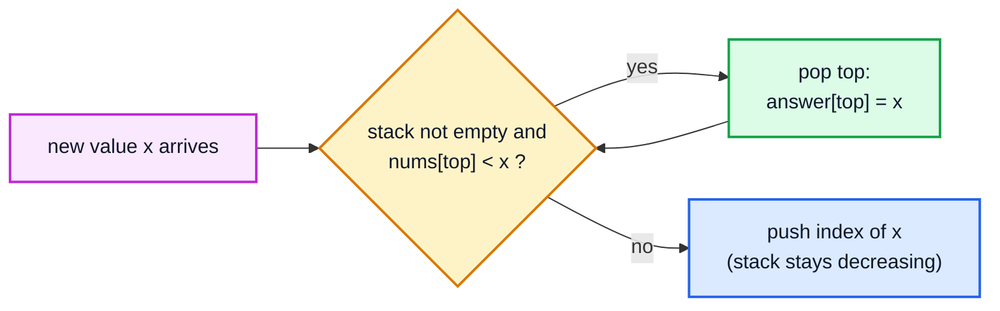
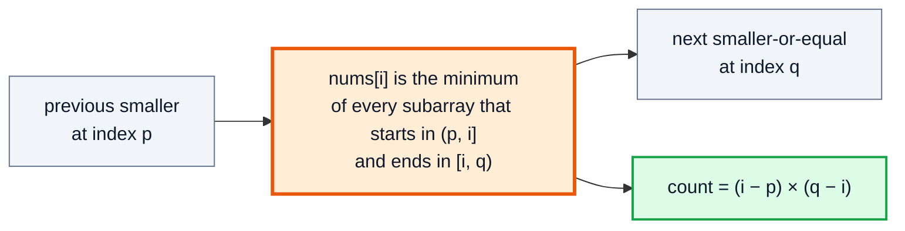

# Monotonic Stack — Complete In-Depth Guide

**DSA gap pattern #8 of 16** · Priority 🟡 · from [topics_not_covered.md](../topics_not_covered.md)

A **monotonic stack** is an ordinary stack whose contents are always kept in increasing (or decreasing) order. Before pushing a new element, you **pop everything that breaks the order**, and each pop answers a question: *"the element that just arrived is the **next greater** (or smaller) element for the one being popped"*. Every element is pushed once and popped at most once, so a problem that looks like it needs O(n²) "look ahead for the next bigger value" takes **O(n)**. [Video 47](../kunal-java-notes-claude/java_47_video_stack_queue_questions.md) does one hard example (Largest Rectangle in Histogram); these notes build up to it from the easier problems and continue to contribution counting and greedy digit removal.

> [!NOTE]
> This pattern isn't in the playlist, so there are no video timestamps. All code targets **Java 21**. You need stacks ([video 46](../kunal-java-notes-claude/java_46_video_stacks_queues.md)); use `ArrayDeque` as the stack (`push`, `pop`, `peek`). The sliding-window version (a monotonic **deque**) is [gap #9](dsa_gap_09_monotonic_deque.md).

---

## Table of Contents

| # | Topic (anchor link) | Level |
|---|---|---|
| 0 | [The Idea](#0-the-idea) | Basics |
| 1 | [The Four Variants](#1-the-four-variants) | Basics |
| 2 | [Next Greater Element I and II](#2-next-greater-element-i-and-ii) | Core |
| 3 | [Daily Temperatures](#3-daily-temperatures) | Core |
| 4 | [Online Stock Span](#4-online-stock-span) | Core |
| 5 | [Largest Rectangle in Histogram](#5-largest-rectangle-in-histogram) | In depth |
| 6 | [Maximal Rectangle in a Matrix](#6-maximal-rectangle-in-a-matrix) | In depth |
| 7 | [Contribution Counting: Sum of Subarray Minimums](#7-contribution-counting-sum-of-subarray-minimums) | In depth |
| 8 | [Greedy Stacks: Remove K Digits and Duplicate Letters](#8-greedy-stacks-remove-k-digits-and-duplicate-letters) | In depth |
| 9 | [Stack Simulation: Asteroid Collision](#9-stack-simulation-asteroid-collision) | Core |
| 10 | [Pitfalls and Problem List](#10-pitfalls-and-problem-list) | Interview |

---

## 0. The Idea

**Next Greater Element:** for each element, the first element to its **right** that is **larger**, or −1.

```
nums = [2, 1, 2, 4, 3]
NGE  = [4, 2, 4, -1, -1]
```

Brute force checks every later element for every position: O(n²). With a stack:

- Scan left to right. The stack holds indices whose next greater element **hasn't been found yet**.
- Those waiting values are in **decreasing** order from bottom to top. A bigger value would already have answered the smaller ones above it.
- When a new value `x` arrives, it's the answer for every waiting value smaller than it: **pop them all and record `x`**. Then push `x`.



```java
import java.util.*;

public class NextGreater {
    static int[] nextGreater(int[] nums) {
        int n = nums.length;
        int[] ans = new int[n];
        Arrays.fill(ans, -1);
        Deque<Integer> st = new ArrayDeque<>();          // indices, values decreasing from bottom to top
        for (int i = 0; i < n; i++) {
            while (!st.isEmpty() && nums[st.peek()] < nums[i]) ans[st.pop()] = nums[i];
            st.push(i);
        }
        return ans;                                      // whatever is left has no greater element
    }

    public static void main(String[] args) {
        System.out.println(Arrays.toString(nextGreater(new int[]{2, 1, 2, 4, 3})));   // [4, 2, 4, -1, -1]
    }
}
```

**Dry run** on `[2, 1, 2, 4, 3]`:

| i | nums[i] | Popped (and answered) | Stack after (values, bottom → top) |
|---|---|---|---|
| 0 | 2 | — | [2] |
| 1 | 1 | — | [2, 1] |
| 2 | 2 | 1 → answer 2 | [2, 2] |
| 3 | 4 | 2 → 4, 2 → 4 | [4] |
| 4 | 3 | — | [4, 3] |
| end | | 4 and 3 stay → −1 | |

**Why O(n)?** Each index is pushed exactly once and popped at most once, so the `while` loop runs at most n times **in total** across the whole scan. Same argument as the sliding window.

---

## 1. The Four Variants

| Want | Scan direction | Pop while | Stack order (bottom → top) |
|---|---|---|---|
| **Next greater** (to the right) | left → right | `nums[top] < x` | decreasing |
| **Next smaller** (to the right) | left → right | `nums[top] > x` | increasing |
| **Previous greater** (to the left) | left → right | `nums[top] <= x`, then the top is the answer | decreasing |
| **Previous smaller** (to the left) | left → right | `nums[top] >= x`, then the top is the answer | increasing |

For "next" problems, the answer is recorded **for the popped element**. For "previous" problems, the answer for `x` is whatever is **left on top after popping**.

```java
import java.util.*;

public class FourVariants {
    static int[] prevGreater(int[] a) {
        int[] ans = new int[a.length];
        Deque<Integer> st = new ArrayDeque<>();
        for (int i = 0; i < a.length; i++) {
            while (!st.isEmpty() && a[st.peek()] <= a[i]) st.pop();
            ans[i] = st.isEmpty() ? -1 : a[st.peek()];        // the top is the nearest greater on the left
            st.push(i);
        }
        return ans;
    }

    static int[] nextSmaller(int[] a) {
        int[] ans = new int[a.length];
        Arrays.fill(ans, -1);
        Deque<Integer> st = new ArrayDeque<>();
        for (int i = 0; i < a.length; i++) {
            while (!st.isEmpty() && a[st.peek()] > a[i]) ans[st.pop()] = a[i];
            st.push(i);
        }
        return ans;
    }

    public static void main(String[] args) {
        int[] a = {4, 5, 2, 10, 8};
        System.out.println("prev greater: " + Arrays.toString(prevGreater(a)));   // [-1, -1, 5, -1, 10]
        System.out.println("next smaller: " + Arrays.toString(nextSmaller(a)));   // [2, 2, -1, 8, -1]
    }
}
```

> [!TIP]
> Store **indices** on the stack, not values. With indices you can read the value (`nums[i]`), compute distances (`i − top`, as in Daily Temperatures), and handle duplicates correctly.

---

## 2. Next Greater Element I and II

### LC 496: `nums1` is a subset of `nums2`

Compute the next greater value for every element of `nums2` once (into a map), then look up `nums1`.

```java
import java.util.*;

public class NextGreaterI {
    static int[] nextGreaterElement(int[] nums1, int[] nums2) {
        Map<Integer, Integer> nge = new HashMap<>();
        Deque<Integer> st = new ArrayDeque<>();               // values (all distinct in this problem)
        for (int x : nums2) {
            while (!st.isEmpty() && st.peek() < x) nge.put(st.pop(), x);
            st.push(x);
        }
        int[] res = new int[nums1.length];
        for (int i = 0; i < nums1.length; i++) res[i] = nge.getOrDefault(nums1[i], -1);
        return res;
    }

    public static void main(String[] args) {
        System.out.println(Arrays.toString(nextGreaterElement(new int[]{4, 1, 2}, new int[]{1, 3, 4, 2})));   // [-1, 3, -1]
        System.out.println(Arrays.toString(nextGreaterElement(new int[]{2, 4}, new int[]{1, 2, 3, 4})));      // [3, -1]
    }
}
```

### LC 503: circular array

The search may wrap around to the start. Loop **twice** over the array (`i % n`), only pushing during the first pass.

```java
import java.util.*;

public class NextGreaterII {
    static int[] nextGreaterElements(int[] nums) {
        int n = nums.length;
        int[] ans = new int[n];
        Arrays.fill(ans, -1);
        Deque<Integer> st = new ArrayDeque<>();
        for (int i = 0; i < 2 * n; i++) {
            int x = nums[i % n];
            while (!st.isEmpty() && nums[st.peek()] < x) ans[st.pop()] = x;
            if (i < n) st.push(i);                         // second pass only answers, never adds
        }
        return ans;
    }

    public static void main(String[] args) {
        System.out.println(Arrays.toString(nextGreaterElements(new int[]{1, 2, 1})));         // [2, -1, 2]
        System.out.println(Arrays.toString(nextGreaterElements(new int[]{1, 2, 3, 4, 3})));   // [2, 3, 4, -1, 4]
    }
}
```

---

## 3. Daily Temperatures

**LC 739:** for each day, how many days until a warmer temperature (0 if never)? It's next greater, recording the **distance** instead of the value.

```java
import java.util.*;

public class DailyTemperatures {
    static int[] dailyTemperatures(int[] t) {
        int[] ans = new int[t.length];
        Deque<Integer> st = new ArrayDeque<>();
        for (int i = 0; i < t.length; i++) {
            while (!st.isEmpty() && t[st.peek()] < t[i]) {
                int j = st.pop();
                ans[j] = i - j;                              // days waited
            }
            st.push(i);
        }
        return ans;
    }

    public static void main(String[] args) {
        System.out.println(Arrays.toString(dailyTemperatures(new int[]{73, 74, 75, 71, 69, 72, 76, 73})));
        // [1, 1, 4, 2, 1, 1, 0, 0]
    }
}
```

| i | t[i] | Pops (index: wait) | Stack (temps) |
|---|---|---|---|
| 0 | 73 | — | [73] |
| 1 | 74 | 0: 1 | [74] |
| 2 | 75 | 1: 1 | [75] |
| 3 | 71 | — | [75, 71] |
| 4 | 69 | — | [75, 71, 69] |
| 5 | 72 | 4: 1, 3: 2 | [75, 72] |
| 6 | 76 | 5: 1, 2: 4 | [76] |
| 7 | 73 | — | [76, 73] |

---

## 4. Online Stock Span

**LC 901:** the span of today's price = the number of consecutive days, ending today, with price ≤ today's. It's **previous greater**, given one price at a time.

Keep pairs `(price, span)` on the stack. When today's price is ≥ the top's price, absorb its span (those days are covered too) and pop it.

```java
import java.util.*;

public class StockSpanner {
    private final Deque<int[]> st = new ArrayDeque<>();     // {price, span}, prices strictly decreasing

    public int next(int price) {
        int span = 1;
        while (!st.isEmpty() && st.peek()[0] <= price) span += st.pop()[1];
        st.push(new int[]{price, span});
        return span;
    }

    public static void main(String[] args) {
        StockSpanner s = new StockSpanner();
        StringJoiner sj = new StringJoiner(" ");
        for (int p : new int[]{100, 80, 60, 70, 60, 75, 85}) sj.add(String.valueOf(s.next(p)));
        System.out.println(sj);   // 1 1 1 2 1 4 6
    }
}
```

Each price is pushed once and popped once → **amortised O(1)** per call.

---

## 5. Largest Rectangle in Histogram

**LC 84 (Hard),** covered in [video 47](../kunal-java-notes-claude/java_47_video_stack_queue_questions.md). The largest rectangle that uses bar `i` as its **shortest** bar stretches left and right until a **shorter** bar. So for each bar we need the **previous smaller** and **next smaller** indices, and one increasing stack gives both at once.

When bar `i` pops bar `top` (because `heights[i] < heights[top]`):
- `i` is `top`'s **next smaller**;
- the element now below `top` on the stack is its **previous smaller**;
- width = `i − newTop − 1`.

```java
import java.util.*;

public class LargestRectangle {
    static int largestRectangleArea(int[] h) {
        Deque<Integer> st = new ArrayDeque<>();              // indices, heights increasing
        int best = 0, n = h.length;
        for (int i = 0; i <= n; i++) {
            int cur = i == n ? 0 : h[i];                     // sentinel 0 at the end flushes the stack
            while (!st.isEmpty() && h[st.peek()] > cur) {
                int height = h[st.pop()];
                int left = st.isEmpty() ? -1 : st.peek();    // previous smaller
                best = Math.max(best, height * (i - left - 1));
            }
            st.push(i);
        }
        return best;
    }

    public static void main(String[] args) {
        System.out.println(largestRectangleArea(new int[]{2, 1, 5, 6, 2, 3}));   // 10
        System.out.println(largestRectangleArea(new int[]{2, 4}));               // 4
        System.out.println(largestRectangleArea(new int[]{3, 3, 3}));            // 9
    }
}
```

**Dry run** on `[2, 1, 5, 6, 2, 3]` (+ sentinel 0):

| i | cur | Pops: height × width | best | Stack (indices) |
|---|---|---|---|---|
| 0 | 2 | — | 0 | [0] |
| 1 | 1 | 2 × (1 − (−1) − 1) = 2 | 2 | [1] |
| 2 | 5 | — | 2 | [1, 2] |
| 3 | 6 | — | 2 | [1, 2, 3] |
| 4 | 2 | 6 × (4 − 2 − 1) = 6; 5 × (4 − 1 − 1) = **10** | 10 | [1, 4] |
| 5 | 3 | — | 10 | [1, 4, 5] |
| 6 | 0 | 3 × 1 = 3; 2 × (6 − 1 − 1) = 8; 1 × 6 = 6 | **10** | [6] |

> [!TIP]
> The **sentinel** (an extra height 0 at the end) forces every remaining bar to be popped and measured, so no separate clean-up loop is needed.

---

## 6. Maximal Rectangle in a Matrix

**LC 85 (Hard):** the largest rectangle of 1s in a binary matrix. Treat each row as the **floor** of a histogram: `height[c]` = number of consecutive 1s ending at this row in column `c`. Then run LC 84 on every row.

```java
public class MaximalRectangle {
    static int maximalRectangle(char[][] m) {
        if (m.length == 0) return 0;
        int[] height = new int[m[0].length];
        int best = 0;
        for (char[] row : m) {
            for (int c = 0; c < row.length; c++) height[c] = row[c] == '1' ? height[c] + 1 : 0;
            best = Math.max(best, LargestRectangleHelper.area(height));
        }
        return best;
    }

    static class LargestRectangleHelper {
        static int area(int[] h) {
            java.util.Deque<Integer> st = new java.util.ArrayDeque<>();
            int best = 0;
            for (int i = 0; i <= h.length; i++) {
                int cur = i == h.length ? 0 : h[i];
                while (!st.isEmpty() && h[st.peek()] > cur) {
                    int height = h[st.pop()], left = st.isEmpty() ? -1 : st.peek();
                    best = Math.max(best, height * (i - left - 1));
                }
                st.push(i);
            }
            return best;
        }
    }

    public static void main(String[] args) {
        char[][] m = {"10100".toCharArray(), "10111".toCharArray(), "11111".toCharArray(), "10010".toCharArray()};
        System.out.println(maximalRectangle(m));   // 6
    }
}
```

| Row | Heights | Best rectangle in this histogram |
|---|---|---|
| `10100` | 1 0 1 0 0 | 1 |
| `10111` | 2 0 2 1 1 | 3 |
| `11111` | 3 1 3 2 2 | **6** (height 2 × width 3) |
| `10010` | 4 0 0 3 0 | 4 |

**Time** O(R · C).

---

## 7. Contribution Counting: Sum of Subarray Minimums

**LC 907:** the sum of `min(subarray)` over **all** subarrays. There are O(n²) subarrays; instead, count how many subarrays each element is the minimum **of**, and add `value × count`.

If `left[i]` = distance to the previous **smaller** element and `right[i]` = distance to the next **smaller-or-equal** element, then `nums[i]` is the minimum of exactly `left[i] × right[i]` subarrays.



```java
import java.util.*;

public class SumSubarrayMins {
    static int sumSubarrayMins(int[] a) {
        final int MOD = 1_000_000_007;
        int n = a.length;
        int[] left = new int[n], right = new int[n];
        Deque<Integer> st = new ArrayDeque<>();
        for (int i = 0; i < n; i++) {                            // previous STRICTLY smaller
            while (!st.isEmpty() && a[st.peek()] >= a[i]) st.pop();
            left[i] = st.isEmpty() ? i + 1 : i - st.peek();
            st.push(i);
        }
        st.clear();
        for (int i = n - 1; i >= 0; i--) {                       // next smaller OR EQUAL
            while (!st.isEmpty() && a[st.peek()] > a[i]) st.pop();
            right[i] = st.isEmpty() ? n - i : st.peek() - i;
            st.push(i);
        }
        long sum = 0;
        for (int i = 0; i < n; i++) sum = (sum + (long) a[i] * left[i] % MOD * right[i]) % MOD;
        return (int) sum;
    }

    public static void main(String[] args) {
        System.out.println(sumSubarrayMins(new int[]{3, 1, 2, 4}));          // 17
        System.out.println(sumSubarrayMins(new int[]{11, 81, 94, 43, 3}));   // 444
        System.out.println(sumSubarrayMins(new int[]{2, 2, 2}));             // 12
    }
}
```

| i | a[i] | left | right | Contribution |
|---|---|---|---|---|
| 0 | 3 | 1 | 1 | 3 |
| 1 | 1 | 2 | 3 | 6 |
| 2 | 2 | 1 | 2 | 4 |
| 3 | 4 | 1 | 1 | 4 |
| | | | **Total** | **17** |

> [!CAUTION]
> **Ties:** with equal values (`[2, 2, 2]`), each subarray's minimum must be counted **once**. Making one side strict (`>=` pop, i.e. previous strictly smaller) and the other non-strict (next smaller **or equal**) assigns each tied subarray to exactly one of the equal elements. Using strict on both sides double-counts; non-strict on both under-counts.

Related: LC 2104 Sum of Subarray Ranges (sum of maxes − sum of mins), LC 1856 Maximum Subarray Min-Product.

---

## 8. Greedy Stacks: Remove K Digits and Duplicate Letters

### Remove K Digits (LC 402)

Remove `k` digits to make the smallest number. Greedy: a digit should be removed if the **next** digit is smaller (a smaller digit further left always makes the number smaller). Keep an **increasing** stack.

```java
public class RemoveKDigits {
    static String removeKdigits(String num, int k) {
        StringBuilder st = new StringBuilder();                   // used as a stack of chars
        for (char c : num.toCharArray()) {
            while (k > 0 && st.length() > 0 && st.charAt(st.length() - 1) > c) {
                st.deleteCharAt(st.length() - 1);
                k--;
            }
            st.append(c);
        }
        st.setLength(st.length() - k);                            // still need removals: drop from the end
        int i = 0;
        while (i < st.length() - 1 && st.charAt(i) == '0') i++;   // strip leading zeros
        return st.length() == 0 ? "0" : st.substring(i);
    }

    public static void main(String[] args) {
        System.out.println(removeKdigits("1432219", 3));   // 1219
        System.out.println(removeKdigits("10200", 1));     // 200
        System.out.println(removeKdigits("10", 2));        // 0
        System.out.println(removeKdigits("12345", 2));     // 123
    }
}
```

### Remove Duplicate Letters (LC 316 / LC 1081)

Keep each letter exactly once and make the result the lexicographically smallest. Pop a larger letter from the stack only if it **appears again later**, so it can still be added afterwards.

```java
public class RemoveDuplicateLetters {
    static String removeDuplicateLetters(String s) {
        int[] last = new int[26];
        for (int i = 0; i < s.length(); i++) last[s.charAt(i) - 'a'] = i;
        boolean[] inStack = new boolean[26];
        StringBuilder st = new StringBuilder();
        for (int i = 0; i < s.length(); i++) {
            char c = s.charAt(i);
            if (inStack[c - 'a']) continue;                        // already placed
            while (st.length() > 0) {
                char top = st.charAt(st.length() - 1);
                if (top > c && last[top - 'a'] > i) { st.deleteCharAt(st.length() - 1); inStack[top - 'a'] = false; }
                else break;
            }
            st.append(c);
            inStack[c - 'a'] = true;
        }
        return st.toString();
    }

    public static void main(String[] args) {
        System.out.println(removeDuplicateLetters("bcabc"));      // abc
        System.out.println(removeDuplicateLetters("cbacdcbc"));   // acdb
    }
}
```

---

## 9. Stack Simulation: Asteroid Collision

**LC 735:** positive asteroids move right, negative ones move left; when they meet, the smaller explodes (both if equal). Not strictly "monotonic", but the same "pop while the new item beats the top" loop.

```java
import java.util.*;

public class AsteroidCollision {
    static int[] asteroidCollision(int[] asteroids) {
        Deque<Integer> st = new ArrayDeque<>();
        for (int a : asteroids) {
            boolean alive = true;
            while (alive && a < 0 && !st.isEmpty() && st.peek() > 0) {   // only right-mover vs left-mover collide
                if (st.peek() < -a) st.pop();                           // top explodes, keep checking
                else { if (st.peek() == -a) st.pop(); alive = false; }  // a explodes (and top too if equal)
            }
            if (alive) st.push(a);
        }
        int[] res = new int[st.size()];
        for (int i = res.length - 1; i >= 0; i--) res[i] = st.pop();
        return res;
    }

    public static void main(String[] args) {
        System.out.println(Arrays.toString(asteroidCollision(new int[]{5, 10, -5})));     // [5, 10]
        System.out.println(Arrays.toString(asteroidCollision(new int[]{8, -8})));         // []
        System.out.println(Arrays.toString(asteroidCollision(new int[]{10, 2, -5})));     // [10]
        System.out.println(Arrays.toString(asteroidCollision(new int[]{-2, -1, 1, 2})));  // [-2, -1, 1, 2]
    }
}
```

Other stack simulations from the same family: LC 20 Valid Parentheses ([video 47](../kunal-java-notes-claude/java_47_video_stack_queue_questions.md)), LC 150 Evaluate Reverse Polish Notation, LC 394 Decode String, LC 71 Simplify Path, LC 853 Car Fleet.

---

## 10. Pitfalls and Problem List

### Recognising the pattern

| Clue | Variant |
|---|---|
| "next greater / warmer / taller to the right" | Next greater (decreasing stack) |
| "nearest smaller to the left / right" | Previous / next smaller (increasing stack) |
| "how many consecutive days before … ≤ today" | Previous greater with spans |
| Largest rectangle, width bounded by shorter bars | Next + previous smaller in one pass |
| "sum over all subarrays of min/max" | Contribution counting |
| "remove k digits/letters for the smallest result" | Greedy increasing stack |

### Pitfalls

| Pitfall | Fix |
|---|---|
| Storing values when you need distances | Store indices |
| `<` vs `<=` in the pop condition | Decide what happens with **equal** values; strict on one side, non-strict on the other for counting |
| Forgetting elements left on the stack | They have no next greater (−1), or use a sentinel |
| Circular array | Loop `2n` with `i % n`, push only in the first pass |
| Using `java.util.Stack` | Prefer `ArrayDeque` (Stack is synchronized and legacy) |
| Leading zeros in LC 402 | Strip them; return "0" for empty |
| Overflow in contribution sums | `long` and `% 1_000_000_007` |

### Problem list (in order)

| # | Problem | Variant | Difficulty |
|---|---|---|---|
| 1 | LC 496 Next Greater Element I | Next greater + map | Easy |
| 2 | LC 1475 Final Prices With a Special Discount | Next smaller-or-equal | Easy |
| 3 | LC 739 Daily Temperatures | Next greater, distance | Medium |
| 4 | LC 503 Next Greater Element II | Circular | Medium |
| 5 | LC 901 Online Stock Span | Previous greater, spans | Medium |
| 6 | LC 735 Asteroid Collision | Stack simulation | Medium |
| 7 | LC 402 Remove K Digits | Greedy increasing stack | Medium |
| 8 | LC 316 Remove Duplicate Letters | Greedy + last occurrence | Medium |
| 9 | LC 907 Sum of Subarray Minimums | Contribution counting | Medium |
| 10 | LC 2104 Sum of Subarray Ranges | Contribution (max − min) | Medium |
| 11 | LC 84 Largest Rectangle in Histogram | Prev + next smaller | Hard |
| 12 | LC 85 Maximal Rectangle | Histogram per row | Hard |
| 13 | LC 42 Trapping Rain Water (stack version) | Fill between bars | Hard |

### Interview Q&A

| Question | Short answer |
|---|---|
| What's a monotonic stack? | A stack kept sorted; you pop elements that break the order before pushing. |
| Why is it O(n)? | Each element is pushed once and popped at most once. |
| Increasing or decreasing for next greater? | Decreasing (bottom → top); a bigger arrival pops smaller tops. |
| How do you handle a circular array? | Iterate 2n times with `i % n`. |
| Largest rectangle in histogram? | Increasing stack; when a bar is popped, the current index and the new top give its width. |
| How do you avoid double counting ties in LC 907? | Strict comparison on one side, non-strict on the other. |

---

## 🧩 Complete Example: Everything Together

All four next/previous variants, daily temperatures, stock span, histogram, subarray-min sums and remove-k-digits, each cross-checked against an O(n²) brute force on random arrays.

```java
import java.util.*;

public class MonotonicStackShowcase {

    static int[] nextGreater(int[] a) {
        int[] r = new int[a.length]; Arrays.fill(r, -1);
        Deque<Integer> st = new ArrayDeque<>();
        for (int i = 0; i < a.length; i++) { while (!st.isEmpty() && a[st.peek()] < a[i]) r[st.pop()] = a[i]; st.push(i); }
        return r;
    }
    static int[] prevSmaller(int[] a) {
        int[] r = new int[a.length];
        Deque<Integer> st = new ArrayDeque<>();
        for (int i = 0; i < a.length; i++) {
            while (!st.isEmpty() && a[st.peek()] >= a[i]) st.pop();
            r[i] = st.isEmpty() ? -1 : a[st.peek()];
            st.push(i);
        }
        return r;
    }
    static int[] waitDays(int[] t) {
        int[] r = new int[t.length];
        Deque<Integer> st = new ArrayDeque<>();
        for (int i = 0; i < t.length; i++) { while (!st.isEmpty() && t[st.peek()] < t[i]) { int j = st.pop(); r[j] = i - j; } st.push(i); }
        return r;
    }
    static int[] spans(int[] p) {
        int[] r = new int[p.length];
        Deque<int[]> st = new ArrayDeque<>();
        for (int i = 0; i < p.length; i++) {
            int s = 1;
            while (!st.isEmpty() && st.peek()[0] <= p[i]) s += st.pop()[1];
            st.push(new int[]{p[i], s});
            r[i] = s;
        }
        return r;
    }
    static int histogram(int[] h) {
        Deque<Integer> st = new ArrayDeque<>();
        int best = 0;
        for (int i = 0; i <= h.length; i++) {
            int cur = i == h.length ? 0 : h[i];
            while (!st.isEmpty() && h[st.peek()] > cur) { int ht = h[st.pop()]; int l = st.isEmpty() ? -1 : st.peek(); best = Math.max(best, ht * (i - l - 1)); }
            st.push(i);
        }
        return best;
    }
    static long sumMins(int[] a) {
        int n = a.length;
        int[] L = new int[n], R = new int[n];
        Deque<Integer> st = new ArrayDeque<>();
        for (int i = 0; i < n; i++) { while (!st.isEmpty() && a[st.peek()] >= a[i]) st.pop(); L[i] = st.isEmpty() ? i + 1 : i - st.peek(); st.push(i); }
        st.clear();
        for (int i = n - 1; i >= 0; i--) { while (!st.isEmpty() && a[st.peek()] > a[i]) st.pop(); R[i] = st.isEmpty() ? n - i : st.peek() - i; st.push(i); }
        long s = 0;
        for (int i = 0; i < n; i++) s += (long) a[i] * L[i] * R[i];
        return s;
    }
    static String removeK(String num, int k) {
        StringBuilder st = new StringBuilder();
        for (char c : num.toCharArray()) { while (k > 0 && st.length() > 0 && st.charAt(st.length() - 1) > c) { st.deleteCharAt(st.length() - 1); k--; } st.append(c); }
        st.setLength(st.length() - k);
        int i = 0;
        while (i < st.length() - 1 && st.charAt(i) == '0') i++;
        return st.length() == 0 ? "0" : st.substring(i);
    }

    // ---- brute force ----
    static int[] nextGreaterB(int[] a) {
        int[] r = new int[a.length];
        for (int i = 0; i < a.length; i++) { r[i] = -1; for (int j = i + 1; j < a.length; j++) if (a[j] > a[i]) { r[i] = a[j]; break; } }
        return r;
    }
    static int[] prevSmallerB(int[] a) {
        int[] r = new int[a.length];
        for (int i = 0; i < a.length; i++) { r[i] = -1; for (int j = i - 1; j >= 0; j--) if (a[j] < a[i]) { r[i] = a[j]; break; } }
        return r;
    }
    static int histogramB(int[] h) {
        int best = 0;
        for (int i = 0; i < h.length; i++) { int mn = Integer.MAX_VALUE; for (int j = i; j < h.length; j++) { mn = Math.min(mn, h[j]); best = Math.max(best, mn * (j - i + 1)); } }
        return best;
    }
    static long sumMinsB(int[] a) {
        long s = 0;
        for (int i = 0; i < a.length; i++) { int mn = Integer.MAX_VALUE; for (int j = i; j < a.length; j++) { mn = Math.min(mn, a[j]); s += mn; } }
        return s;
    }
    static String removeKB(String num, int k) {                  // try every set of k removals (small inputs)
        String best = null;
        int n = num.length();
        for (int mask = 0; mask < (1 << n); mask++) {
            if (Integer.bitCount(mask) != k) continue;
            StringBuilder sb = new StringBuilder();
            for (int i = 0; i < n; i++) if ((mask >> i & 1) == 0) sb.append(num.charAt(i));
            String s = sb.toString().replaceFirst("^0+(?=.)", "");
            if (s.isEmpty()) s = "0";
            if (best == null || s.length() < best.length() || (s.length() == best.length() && s.compareTo(best) < 0)) best = s;
        }
        return best;
    }

    public static void main(String[] args) {
        int[] a = {4, 5, 2, 10, 8};
        System.out.println("next greater   " + Arrays.toString(a) + " -> " + Arrays.toString(nextGreater(a)));
        System.out.println("prev smaller   " + Arrays.toString(a) + " -> " + Arrays.toString(prevSmaller(a)));
        System.out.println("wait days      -> " + Arrays.toString(waitDays(new int[]{73, 74, 75, 71, 69, 72, 76, 73})));
        System.out.println("stock spans    -> " + Arrays.toString(spans(new int[]{100, 80, 60, 70, 60, 75, 85})));
        System.out.println("histogram      [2,1,5,6,2,3] -> " + histogram(new int[]{2, 1, 5, 6, 2, 3}));
        System.out.println("sum of mins    [3,1,2,4] -> " + sumMins(new int[]{3, 1, 2, 4}));
        System.out.println("remove 3 digits 1432219 -> " + removeK("1432219", 3));

        Random rnd = new Random(84);
        int checks = 0, mismatches = 0;
        for (int t = 0; t < 400; t++) {
            int n = 1 + rnd.nextInt(12);
            int[] x = rnd.ints(n, 0, 8).toArray();               // small range → many ties
            if (!Arrays.equals(nextGreater(x), nextGreaterB(x))) mismatches++;
            if (!Arrays.equals(prevSmaller(x), prevSmallerB(x))) mismatches++;
            if (histogram(x) != histogramB(x)) mismatches++;
            if (sumMins(x) != sumMinsB(x)) mismatches++;
            StringBuilder num = new StringBuilder();
            for (int i = 0; i < 1 + rnd.nextInt(8); i++) num.append(rnd.nextInt(10));
            int k = rnd.nextInt(num.length() + 1);
            if (!removeK(num.toString(), k).equals(removeKB(num.toString(), k))) mismatches++;
            checks += 5;
        }
        System.out.println("Random cross-checks against brute force: " + checks + ", mismatches: " + mismatches);
    }
}
```

**Expected Output:**
```
next greater   [4, 5, 2, 10, 8] -> [5, 10, 10, -1, -1]
prev smaller   [4, 5, 2, 10, 8] -> [-1, 4, -1, 2, 2]
wait days      -> [1, 1, 4, 2, 1, 1, 0, 0]
stock spans    -> [1, 1, 1, 2, 1, 4, 6]
histogram      [2,1,5,6,2,3] -> 10
sum of mins    [3,1,2,4] -> 17
remove 3 digits 1432219 -> 1219
Random cross-checks against brute force: 2000, mismatches: 0
```

---

## Quick Reference Cheat Sheet

| Concept | One-Line Summary |
|---|---|
| **Monotonic stack** | Pop elements that break the order, then push; O(n) total |
| **Next greater** | Decreasing stack; arrival pops smaller tops and answers them |
| **Next smaller** | Increasing stack; arrival pops larger tops |
| **Previous greater/smaller** | After popping, the top is the answer for the arrival |
| **Store indices** | Gives values, distances and tie handling |
| **Circular** | Loop `2n`, use `i % n`, push only in pass 1 |
| **Stock span** | Stack of (price, span); absorb popped spans |
| **Histogram** | Increasing stack + sentinel 0; width = `i − newTop − 1` |
| **Maximal rectangle** | Histogram of heights for each row |
| **Contribution** | `value × left × right`; strict on one side, non-strict on the other |
| **Remove k digits** | Pop larger digits while `k > 0`; trim the end; strip zeros |
| **Duplicate letters** | Pop larger top only if it appears again later |
