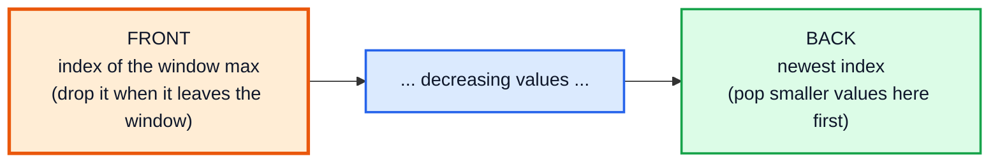
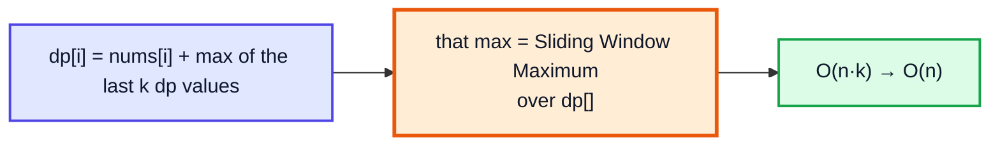

# Monotonic Deque — Complete In-Depth Guide

**DSA gap pattern #9 of 16** · Priority 🟡 · from [topics_not_covered.md](../topics_not_covered.md)

A [sliding window (gap #1)](dsa_gap_01_sliding_window.md) can keep a **sum** in O(1) per step, but not a **maximum**: when the current maximum leaves the window, which element is the next maximum? A **monotonic deque** solves this. It's a double-ended queue of indices whose values stay in decreasing order. The front is always the window's maximum, old indices fall off the **front**, and elements that can never be the maximum again are removed from the **back**. Every index enters and leaves once, so "maximum of every window" costs **O(n)** total. These notes cover Sliding Window Maximum, windows with both a max and a min, the shortest subarray with a sum of at least K (prefix sums + deque), and deque-optimised DP.

> [!NOTE]
> This pattern isn't in the playlist, so there are no video timestamps. All code targets **Java 21**. It combines the [monotonic stack (gap #8)](dsa_gap_08_monotonic_stack.md) with the sliding window. In Java, use `ArrayDeque<Integer>` with `peekFirst/pollFirst` and `peekLast/pollLast/offerLast`.

---

## Table of Contents

| # | Topic (anchor link) | Level |
|---|---|---|
| 0 | [Why a Deque](#0-why-a-deque) | Basics |
| 1 | [ArrayDeque Quick Reference](#1-arraydeque-quick-reference) | Basics |
| 2 | [Sliding Window Maximum](#2-sliding-window-maximum) | Core |
| 3 | [Max and Min Together: Longest Subarray Within a Limit](#3-max-and-min-together-longest-subarray-within-a-limit) | In depth |
| 4 | [Shortest Subarray with Sum at Least K](#4-shortest-subarray-with-sum-at-least-k) | Advanced |
| 5 | [Deque-Optimised DP: Jump Game VI](#5-deque-optimised-dp-jump-game-vi) | Advanced |
| 6 | [Pitfalls and Problem List](#6-pitfalls-and-problem-list) | Interview |

---

## 0. Why a Deque

| Approach for "max of every window of size k" | Time |
|---|---|
| Scan each window | O(n · k) |
| Max-heap with lazy deletion of old indices | O(n log n) |
| `TreeMap` of counts (sorted multiset) | O(n log k) |
| **Monotonic deque** | **O(n)** |

**Key observation:** if `nums[j] >= nums[i]` and `j > i`, then `i` can **never** be a window maximum again. `j` is at least as big and will stay in the window longer. So `i` can be thrown away immediately.

That leaves a deque whose values **decrease** from front to back:



| End | Removes | Why |
|---|---|---|
| **Back** | Indices with values `<=` the new value | They can never be the max again (monotonic stack idea) |
| **Front** | The index that has slid out of the window | Window boundary (sliding window idea) |

---

## 1. ArrayDeque Quick Reference

| Operation | Method | Time |
|---|---|---|
| Look at front / back | `peekFirst()` / `peekLast()` | O(1) |
| Remove front / back | `pollFirst()` / `pollLast()` | O(1) |
| Add at back / front | `offerLast(x)` / `offerFirst(x)` | O(1) amortised |
| Size / empty | `size()` / `isEmpty()` | O(1) |

> [!WARNING]
> `ArrayDeque` doesn't allow `null`, and `peekFirst()` returns `null` on an empty deque. Unboxing that `null` into an `int` throws `NullPointerException`, so always check `isEmpty()` first.

---

## 2. Sliding Window Maximum

**LC 239 (Hard):** the maximum of every window of size `k`.

```java
import java.util.*;

public class SlidingWindowMax {
    static int[] maxSlidingWindow(int[] nums, int k) {
        int n = nums.length;
        int[] res = new int[n - k + 1];
        Deque<Integer> dq = new ArrayDeque<>();                  // indices; nums[] decreasing front → back
        for (int i = 0; i < n; i++) {
            if (!dq.isEmpty() && dq.peekFirst() <= i - k) dq.pollFirst();          // 1. front left the window
            while (!dq.isEmpty() && nums[dq.peekLast()] <= nums[i]) dq.pollLast(); // 2. useless smaller values
            dq.offerLast(i);                                                       // 3. add the new index
            if (i >= k - 1) res[i - k + 1] = nums[dq.peekFirst()];                 // 4. front = window max
        }
        return res;
    }

    public static void main(String[] args) {
        System.out.println(Arrays.toString(maxSlidingWindow(new int[]{1, 3, -1, -3, 5, 3, 6, 7}, 3)));   // [3, 3, 5, 5, 6, 7]
        System.out.println(Arrays.toString(maxSlidingWindow(new int[]{1}, 1)));                          // [1]
        System.out.println(Arrays.toString(maxSlidingWindow(new int[]{9, 8, 7, 6, 5}, 2)));              // [9, 8, 7, 6]
    }
}
```

**Dry run** on `[1, 3, -1, -3, 5, 3, 6, 7]`, k = 3 (deque shows `index:value`):

| i | nums[i] | Front expired? | Popped from back | Deque after | Window max |
|---|---|---|---|---|---|
| 0 | 1 | — | — | [0:1] | — |
| 1 | 3 | — | 0:1 | [1:3] | — |
| 2 | −1 | — | — | [1:3, 2:−1] | **3** |
| 3 | −3 | — | — | [1:3, 2:−1, 3:−3] | **3** |
| 4 | 5 | 1 ≤ 4−3 → drop 1:3 | 3:−3, 2:−1 | [4:5] | **5** |
| 5 | 3 | — | — | [4:5, 5:3] | **5** |
| 6 | 6 | — | 5:3, 4:5 | [6:6] | **6** |
| 7 | 7 | — | 6:6 | [7:7] | **7** |

**Time** O(n): each index is added once and removed at most once (from either end). **Space** O(k).

> [!TIP]
> **Window minimum**: the same code with the comparison flipped (`nums[dq.peekLast()] >= nums[i]`), so values increase from front to back.

> [!NOTE]
> Use `<=` (not `<`) when popping from the back so equal values don't pile up. Either works for correctness here, but `<=` keeps the deque smaller.

---

## 3. Max and Min Together: Longest Subarray Within a Limit

**LC 1438:** the longest subarray where `max − min <= limit`. It's a **variable** sliding window ([gap #1, section 3](dsa_gap_01_sliding_window.md#3-variable-window-longest-valid)) whose validity check needs the window's max **and** min, so use two deques.

```java
import java.util.*;

public class LongestSubarrayLimit {
    static int longestSubarray(int[] nums, int limit) {
        Deque<Integer> maxQ = new ArrayDeque<>(), minQ = new ArrayDeque<>();   // values
        int left = 0, best = 0;
        for (int right = 0; right < nums.length; right++) {
            int x = nums[right];
            while (!maxQ.isEmpty() && maxQ.peekLast() < x) maxQ.pollLast();
            while (!minQ.isEmpty() && minQ.peekLast() > x) minQ.pollLast();
            maxQ.offerLast(x);
            minQ.offerLast(x);
            while (maxQ.peekFirst() - minQ.peekFirst() > limit) {               // invalid: shrink from the left
                if (maxQ.peekFirst() == nums[left]) maxQ.pollFirst();
                if (minQ.peekFirst() == nums[left]) minQ.pollFirst();
                left++;
            }
            best = Math.max(best, right - left + 1);
        }
        return best;
    }

    public static void main(String[] args) {
        System.out.println(longestSubarray(new int[]{8, 2, 4, 7}, 4));                // 2
        System.out.println(longestSubarray(new int[]{10, 1, 2, 4, 7, 2}, 5));         // 4  ([2, 4, 7, 2])
        System.out.println(longestSubarray(new int[]{4, 2, 2, 2, 4, 4, 2, 2}, 0));    // 3
    }
}
```

> [!NOTE]
> This version stores **values** and pops from the front when the leaving value **equals** the front. That's safe only because the back is popped with **strict** comparisons (`<` / `>`), so duplicates stay in the deque. With `<=`, a duplicate would be removed too early. Storing indices avoids the subtlety altogether.

---

## 4. Shortest Subarray with Sum at Least K

**LC 862 (Hard):** the shortest subarray with sum `>= K`, where numbers **can be negative**. The [sliding window](dsa_gap_01_sliding_window.md#8-when-sliding-window-fails) fails with negatives, so switch to **prefix sums** `P` ([gap #3](dsa_gap_03_prefix_sum_difference_array.md)): we want the smallest `j − i` with `P[j] − P[i] >= K`.

Keep a deque of indices `i` with **increasing** `P[i]`:
- **Front:** while `P[j] − P[front] >= K`, we've found a valid subarray; record it and **pop the front** (any later `j` would only give a longer subarray with that start).
- **Back:** while `P[back] >= P[j]`, pop it. `j` is a better start: smaller or equal prefix, and later (so shorter).

```java
import java.util.*;

public class ShortestSubarraySumK {
    static int shortestSubarray(int[] nums, int k) {
        int n = nums.length;
        long[] P = new long[n + 1];
        for (int i = 0; i < n; i++) P[i + 1] = P[i] + nums[i];
        Deque<Integer> dq = new ArrayDeque<>();                  // indices with increasing P
        int best = Integer.MAX_VALUE;
        for (int j = 0; j <= n; j++) {
            while (!dq.isEmpty() && P[j] - P[dq.peekFirst()] >= k) best = Math.min(best, j - dq.pollFirst());
            while (!dq.isEmpty() && P[dq.peekLast()] >= P[j]) dq.pollLast();
            dq.offerLast(j);
        }
        return best == Integer.MAX_VALUE ? -1 : best;
    }

    public static void main(String[] args) {
        System.out.println(shortestSubarray(new int[]{1}, 1));             // 1
        System.out.println(shortestSubarray(new int[]{1, 2}, 4));          // -1
        System.out.println(shortestSubarray(new int[]{2, -1, 2}, 3));      // 3
        System.out.println(shortestSubarray(new int[]{84, -37, 32, 40, 95}, 167));   // 3
    }
}
```

**Time** O(n). This is one of the hardest common deque problems: two different "useless element" arguments, one at each end.

---

## 5. Deque-Optimised DP: Jump Game VI

**LC 1696:** start at index 0, jump 1..k steps forward each time, score = sum of the visited `nums`. Maximise the score at the last index.

DP: `dp[i] = nums[i] + max(dp[i−k .. i−1])`. The inner `max` over the last k values is exactly **Sliding Window Maximum** over the `dp` array, so the O(n·k) DP becomes O(n).

```java
import java.util.*;

public class JumpGameVI {
    static int maxResult(int[] nums, int k) {
        int n = nums.length;
        int[] dp = new int[n];
        dp[0] = nums[0];
        Deque<Integer> dq = new ArrayDeque<>();                  // indices with decreasing dp
        dq.offerLast(0);
        for (int i = 1; i < n; i++) {
            if (dq.peekFirst() < i - k) dq.pollFirst();          // out of jump range
            dp[i] = nums[i] + dp[dq.peekFirst()];                // best reachable previous score
            while (!dq.isEmpty() && dp[dq.peekLast()] <= dp[i]) dq.pollLast();
            dq.offerLast(i);
        }
        return dp[n - 1];
    }

    public static void main(String[] args) {
        System.out.println(maxResult(new int[]{1, -1, -2, 4, -7, 3}, 2));          // 7
        System.out.println(maxResult(new int[]{10, -5, -2, 4, 0, 3}, 3));          // 17
        System.out.println(maxResult(new int[]{1, -5, -20, 4, -1, 3, -6, -3}, 2)); // 0
    }
}
```



The same trick speeds up LC 1425 Constrained Subsequence Sum and LC 1499 Max Value of Equation. Any DP whose transition is "max/min over a sliding range of previous states" can use a monotonic deque.

---

## 6. Pitfalls and Problem List

### Monotonic stack vs deque

| | Monotonic stack | Monotonic deque |
|---|---|---|
| Removes from | One end (top) | **Both** ends |
| Answers | Next/previous greater/smaller | Max/min of a **sliding window** |
| Extra rule | — | Drop the front when it leaves the window |

### Pitfalls

| Pitfall | Fix |
|---|---|
| Storing values and losing track of positions | Store indices |
| Forgetting to drop the expired front | Check `dq.peekFirst() <= i − k` every step |
| Popping the back with the wrong comparison | Max deque: pop `<=`; min deque: pop `>=` |
| `peekFirst()` on an empty deque, then unboxing | Check `isEmpty()` |
| Using a sliding window with negative numbers (LC 862) | Prefix sums + increasing deque |
| Recording the answer before the window is full | Only when `i >= k − 1` |

### Problem list (in order)

| # | Problem | Idea | Difficulty |
|---|---|---|---|
| 1 | LC 239 Sliding Window Maximum | Decreasing deque | Hard |
| 2 | LC 1438 Longest Subarray with Abs Diff ≤ Limit | Max + min deques | Medium |
| 3 | LC 1696 Jump Game VI | DP + window max | Medium |
| 4 | LC 1425 Constrained Subsequence Sum | DP + window max | Hard |
| 5 | LC 862 Shortest Subarray with Sum at Least K | Prefix sums + increasing deque | Hard |
| 6 | LC 1499 Max Value of Equation | Deque over `y − x` | Hard |
| 7 | LC 2398 Maximum Number of Robots Within Budget | Window + max deque | Hard |

### Interview Q&A

| Question | Short answer |
|---|---|
| Sliding window maximum in O(n)? | Deque of indices with decreasing values; front = max; drop expired front and smaller backs. |
| Why can a smaller earlier element be discarded? | A later, larger element dominates it for every future window. |
| Why is it O(n)? | Each index is added once and removed at most once. |
| Deque vs heap? | Deque O(n) total; heap O(n log n) with lazy deletion. |
| How does it speed up DP? | Replaces "max over the last k states" with an O(1) amortised lookup. |

---

## 🧩 Complete Example: Everything Together

Window max and min, longest subarray within a limit, shortest subarray with sum ≥ K, and deque-optimised DP, each cross-checked against brute force on random input.

```java
import java.util.*;

public class MonotonicDequeShowcase {

    static int[] windowExtreme(int[] a, int k, boolean max) {
        int[] r = new int[a.length - k + 1];
        Deque<Integer> dq = new ArrayDeque<>();
        for (int i = 0; i < a.length; i++) {
            if (!dq.isEmpty() && dq.peekFirst() <= i - k) dq.pollFirst();
            while (!dq.isEmpty() && (max ? a[dq.peekLast()] <= a[i] : a[dq.peekLast()] >= a[i])) dq.pollLast();
            dq.offerLast(i);
            if (i >= k - 1) r[i - k + 1] = a[dq.peekFirst()];
        }
        return r;
    }

    static int longestWithin(int[] a, int limit) {
        Deque<Integer> mx = new ArrayDeque<>(), mn = new ArrayDeque<>();      // indices
        int left = 0, best = 0;
        for (int r = 0; r < a.length; r++) {
            while (!mx.isEmpty() && a[mx.peekLast()] <= a[r]) mx.pollLast();
            while (!mn.isEmpty() && a[mn.peekLast()] >= a[r]) mn.pollLast();
            mx.offerLast(r); mn.offerLast(r);
            while (a[mx.peekFirst()] - a[mn.peekFirst()] > limit) {
                left++;
                if (mx.peekFirst() < left) mx.pollFirst();
                if (mn.peekFirst() < left) mn.pollFirst();
            }
            best = Math.max(best, r - left + 1);
        }
        return best;
    }

    static int shortestAtLeast(int[] a, int k) {
        long[] P = new long[a.length + 1];
        for (int i = 0; i < a.length; i++) P[i + 1] = P[i] + a[i];
        Deque<Integer> dq = new ArrayDeque<>();
        int best = Integer.MAX_VALUE;
        for (int j = 0; j < P.length; j++) {
            while (!dq.isEmpty() && P[j] - P[dq.peekFirst()] >= k) best = Math.min(best, j - dq.pollFirst());
            while (!dq.isEmpty() && P[dq.peekLast()] >= P[j]) dq.pollLast();
            dq.offerLast(j);
        }
        return best == Integer.MAX_VALUE ? -1 : best;
    }

    static int jumpScore(int[] a, int k) {
        int[] dp = new int[a.length];
        dp[0] = a[0];
        Deque<Integer> dq = new ArrayDeque<>(List.of(0));
        for (int i = 1; i < a.length; i++) {
            if (dq.peekFirst() < i - k) dq.pollFirst();
            dp[i] = a[i] + dp[dq.peekFirst()];
            while (!dq.isEmpty() && dp[dq.peekLast()] <= dp[i]) dq.pollLast();
            dq.offerLast(i);
        }
        return dp[a.length - 1];
    }

    // ---- brute force ----
    static int[] windowExtremeB(int[] a, int k, boolean max) {
        int[] r = new int[a.length - k + 1];
        for (int i = 0; i + k <= a.length; i++) {
            int v = a[i];
            for (int j = i; j < i + k; j++) v = max ? Math.max(v, a[j]) : Math.min(v, a[j]);
            r[i] = v;
        }
        return r;
    }
    static int longestWithinB(int[] a, int limit) {
        int best = 0;
        for (int i = 0; i < a.length; i++) {
            int mx = a[i], mn = a[i];
            for (int j = i; j < a.length; j++) { mx = Math.max(mx, a[j]); mn = Math.min(mn, a[j]); if (mx - mn <= limit) best = Math.max(best, j - i + 1); }
        }
        return best;
    }
    static int shortestAtLeastB(int[] a, int k) {
        int best = Integer.MAX_VALUE;
        for (int i = 0; i < a.length; i++) { long s = 0; for (int j = i; j < a.length; j++) if ((s += a[j]) >= k) { best = Math.min(best, j - i + 1); break; } }
        return best == Integer.MAX_VALUE ? -1 : best;
    }
    static int jumpScoreB(int[] a, int k) {
        int[] dp = new int[a.length];
        dp[0] = a[0];
        for (int i = 1; i < a.length; i++) { int b = Integer.MIN_VALUE; for (int j = Math.max(0, i - k); j < i; j++) b = Math.max(b, dp[j]); dp[i] = a[i] + b; }
        return dp[a.length - 1];
    }

    public static void main(String[] args) {
        int[] temps = {31, 29, 35, 33, 30, 36, 28, 27, 34};
        System.out.println("3-day max  : " + Arrays.toString(windowExtreme(temps, 3, true)));
        System.out.println("3-day min  : " + Arrays.toString(windowExtreme(temps, 3, false)));
        System.out.println("Longest stretch with swing <= 5: " + longestWithin(temps, 5));
        System.out.println("Shortest run with sum >= 7 in [2,-1,2,3,-4,5]: " + shortestAtLeast(new int[]{2, -1, 2, 3, -4, 5}, 7));
        System.out.println("Jump game VI [1,-1,-2,4,-7,3], k=2: " + jumpScore(new int[]{1, -1, -2, 4, -7, 3}, 2));

        Random rnd = new Random(239);
        int checks = 0, mismatches = 0;
        for (int t = 0; t < 400; t++) {
            int n = 1 + rnd.nextInt(15), k = 1 + rnd.nextInt(n);
            int[] a = rnd.ints(n, -10, 10).toArray();
            if (!Arrays.equals(windowExtreme(a, k, true), windowExtremeB(a, k, true))) mismatches++;
            if (!Arrays.equals(windowExtreme(a, k, false), windowExtremeB(a, k, false))) mismatches++;
            int limit = rnd.nextInt(8), target = rnd.nextInt(20) - 5;
            if (longestWithin(a, limit) != longestWithinB(a, limit)) mismatches++;
            if (shortestAtLeast(a, target) != shortestAtLeastB(a, target)) mismatches++;
            if (jumpScore(a, k) != jumpScoreB(a, k)) mismatches++;
            checks += 5;
        }
        System.out.println("Random cross-checks against brute force: " + checks + ", mismatches: " + mismatches);
    }
}
```

**Expected Output:**
```
3-day max  : [35, 35, 35, 36, 36, 36, 34]
3-day min  : [29, 29, 30, 30, 28, 27, 27]
Longest stretch with swing <= 5: 3
Shortest run with sum >= 7 in [2,-1,2,3,-4,5]: 6
Jump game VI [1,-1,-2,4,-7,3], k=2: 7
Random cross-checks against brute force: 2000, mismatches: 0
```

---

## Quick Reference Cheat Sheet

| Concept | One-Line Summary |
|---|---|
| **Monotonic deque** | Indices with monotone values; remove from both ends |
| **Window max** | Pop back while `a[back] <= a[i]`; drop front if `front <= i − k`; answer `a[front]` |
| **Window min** | Same with `>=` |
| **Why O(n)** | Each index enters once and leaves once |
| **Max and min** | Two deques; shrink the window while `max − min > limit` |
| **Sum ≥ K with negatives** | Prefix sums + increasing deque; pop front when valid, back when dominated |
| **DP speed-up** | `dp[i] = a[i] + max(dp[i−k..i−1])` with a window-max deque |
| **Java** | `ArrayDeque`: `offerLast`, `pollFirst`, `pollLast`, `peekFirst`, `peekLast` |
