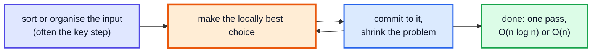
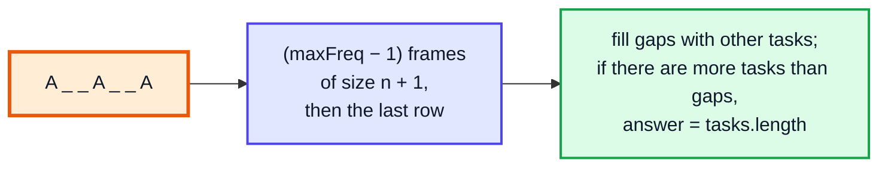
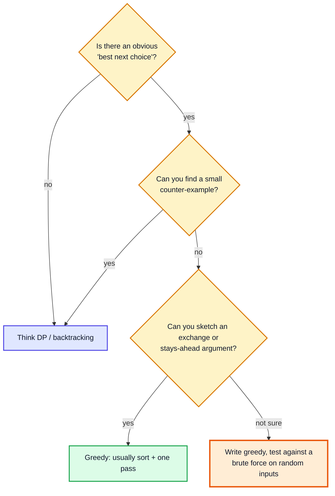

# Greedy Algorithms — Complete In-Depth Guide

**DSA gap pattern #10 of 16** · Priority 🟡 · from [topics_not_covered.md](../topics_not_covered.md)

A **greedy algorithm** builds a solution step by step, always taking the choice that looks best **right now**, and never reconsidering. When it works it's usually the simplest and fastest solution: often a sort followed by one pass. The catch is that it's often **wrong**, and the hard part is knowing when it's safe. The playlist's only greedy algorithm is Huffman coding ([video 61](../kunal-java-notes-claude/java_61_video_huffman_coding.md)). These notes explain how to *prove* a greedy choice (exchange argument, "stays ahead"), how to break one with a counter-example, and the classic problems: activity selection, jump games, gas station, assign cookies, partition labels, candy, task scheduler, fractional knapsack and more.

> [!NOTE]
> This pattern isn't in the playlist, so there are no video timestamps. All code targets **Java 21**. You need sorting with comparators ([gap Java #3](../Java%20Topics%20Not%20Covered%20Notes/java_gap_03_comparator_comparable.md)) and heaps ([video 56](../kunal-java-notes-claude/java_56_video_heaps_priority_queue.md)). Interval greedy problems (LC 435, 452, meeting rooms) are in [Merge Intervals (gap #5)](dsa_gap_05_merge_intervals.md#5-greedy-by-end-time-non-overlapping-intervals); when greedy fails you usually need [DP (topic #1)](dsa_topic_01_dynamic_programming.md).

---

## Table of Contents

| # | Topic (anchor link) | Level |
|---|---|---|
| 0 | [What Greedy Means](#0-what-greedy-means) | Basics |
| 1 | [Proving and Breaking a Greedy Choice](#1-proving-and-breaking-a-greedy-choice) | Core |
| 2 | [Activity Selection and Pair Chains](#2-activity-selection-and-pair-chains) | Core |
| 3 | [Jump Game I and II](#3-jump-game-i-and-ii) | Core |
| 4 | [Gas Station](#4-gas-station) | Core |
| 5 | [Matching: Assign Cookies and Boats](#5-matching-assign-cookies-and-boats) | Core |
| 6 | [Partition Labels](#6-partition-labels) | In depth |
| 7 | [Fractional vs 0/1 Knapsack](#7-fractional-vs-01-knapsack) | In depth |
| 8 | [Two-Pass Greedy: Candy](#8-two-pass-greedy-candy) | In depth |
| 9 | [Counting Greedy: Task Scheduler and Lemonade Change](#9-counting-greedy-task-scheduler-and-lemonade-change) | In depth |
| 10 | [Greedy Inside Famous Algorithms](#10-greedy-inside-famous-algorithms) | In depth |
| 11 | [Greedy or DP? Pitfalls and Problem List](#11-greedy-or-dp-pitfalls-and-problem-list) | Interview |

---

## 0. What Greedy Means



A greedy algorithm is correct when the problem has:

| Property | Meaning |
|---|---|
| **Greedy-choice property** | Some optimal solution starts with the greedy choice |
| **Optimal substructure** | After making that choice, the rest is a smaller instance of the same problem |

| | Greedy | DP |
|---|---|---|
| Choices tried | One (the locally best) | All |
| Revisits decisions | Never | Implicitly, through the table |
| Typical cost | O(n log n) | O(n²), O(n·W), … |
| Correctness | Needs a proof | Follows from trying everything |

---

## 1. Proving and Breaking a Greedy Choice

### Break it first: look for a counter-example

Before trusting a greedy idea, try small tricky inputs.

| Problem | Greedy idea | Counter-example | Correct method |
|---|---|---|---|
| Coin change, coins {1, 3, 4}, amount 6 | Take the biggest coin | 4 + 1 + 1 (3 coins) vs 3 + 3 (2) | DP |
| 0/1 knapsack | Highest value/weight first | W = 50: (60, 10), (100, 20), (120, 30) → greedy 160, best 220 | DP |
| Max non-overlapping intervals | Earliest **start** first | [1, 100], [2, 3], [4, 5] | Earliest **end** first |
| Longest path in a graph | Always take the heaviest edge | Easy to break | Not greedy (NP-hard in general) |

> [!TIP]
> Coin change greedy **does** work for "canonical" coin systems like Indian or US currency (1, 2, 5, 10, 20, 50, 100…). It's the arbitrary coin sets in LC 322 that break it.

### Prove it: two standard techniques

| Technique | Idea | Used for |
|---|---|---|
| **Exchange argument** | Take any optimal solution. Swap its first choice for the greedy choice; show it's still valid and no worse. Repeat. | Activity selection, Huffman, fractional knapsack |
| **Greedy stays ahead** | Show that after each step, the greedy partial solution is at least as good as any other solution's partial solution | Jump game, interval scheduling |

**Exchange argument for activity selection** (pick the most non-overlapping meetings): let `g` be the meeting that ends first. In any optimal schedule, replace its first meeting with `g`. Since `g` ends no later, it doesn't clash with anything that came after, so the schedule stays valid with the same count. So some optimal schedule starts with `g`, and we repeat on the meetings that start after `g` ends.

---

## 2. Activity Selection and Pair Chains

**Rule:** sort by **end** time; take every interval that starts after the last taken one ends. Covered in detail with LC 435 and LC 452 in [gap #5, sections 5–6](dsa_gap_05_merge_intervals.md#5-greedy-by-end-time-non-overlapping-intervals).

### Maximum Length of Pair Chain (LC 646)

Pairs `[a, b]`; `[c, d]` can follow `[a, b]` if `b < c`. Longest chain?

```java
import java.util.*;

public class PairChain {
    static int findLongestChain(int[][] pairs) {
        Arrays.sort(pairs, (x, y) -> Integer.compare(x[1], y[1]));   // by END
        int count = 0, lastEnd = Integer.MIN_VALUE;
        for (int[] p : pairs) {
            if (p[0] > lastEnd) { count++; lastEnd = p[1]; }          // strictly after
        }
        return count;
    }

    public static void main(String[] args) {
        System.out.println(findLongestChain(new int[][]{{1, 2}, {2, 3}, {3, 4}}));   // 2  ([1,2] → [3,4])
        System.out.println(findLongestChain(new int[][]{{1, 2}, {7, 8}, {4, 5}}));   // 3
    }
}
```

**Time** O(n log n). (An O(n²) DP like LIS also works, but greedy is simpler and faster.)

---

## 3. Jump Game I and II

### Jump Game (LC 55): can you reach the end?

`nums[i]` = maximum jump length from `i`. Track the **farthest** index reachable so far; if you ever stand beyond it, you're stuck.

```java
public class JumpGame {
    static boolean canJump(int[] nums) {
        int farthest = 0;
        for (int i = 0; i < nums.length; i++) {
            if (i > farthest) return false;                    // can't even reach i
            farthest = Math.max(farthest, i + nums[i]);
        }
        return true;
    }

    // LC 45: minimum number of jumps (reaching the end is guaranteed)
    static int jump(int[] nums) {
        int jumps = 0, curEnd = 0, farthest = 0;
        for (int i = 0; i < nums.length - 1; i++) {
            farthest = Math.max(farthest, i + nums[i]);
            if (i == curEnd) {                                 // must jump now: go as far as possible
                jumps++;
                curEnd = farthest;
            }
        }
        return jumps;
    }

    public static void main(String[] args) {
        System.out.println(canJump(new int[]{2, 3, 1, 1, 4}) + " " + canJump(new int[]{3, 2, 1, 0, 4}));   // true false
        System.out.println(jump(new int[]{2, 3, 1, 1, 4}) + " " + jump(new int[]{2, 3, 0, 1, 4}));         // 2 2
    }
}
```

**Jump Game II as BFS levels:** `[0, curEnd]` is everything reachable in `jumps` jumps; scanning it finds the next level's limit, `farthest`. It's BFS on an implicit graph ([topic #2](dsa_topic_02_graphs.md#12-implicit-graphs-and-cloning)) without a queue.

| i | nums[i] | farthest | i == curEnd? | jumps | curEnd |
|---|---|---|---|---|---|
| 0 | 2 | 2 | yes | 1 | 2 |
| 1 | 3 | 4 | no | 1 | 2 |
| 2 | 1 | 4 | yes | 2 | 4 |
| 3 | 1 | 4 | no | 2 | 4 |

**Time** O(n), **space** O(1).

---

## 4. Gas Station

**LC 134:** stations in a circle; `gas[i]` fuel at station `i`, `cost[i]` to drive to the next. Find the start index that completes the loop, or −1.

Two facts give an O(n) greedy:
1. If `sum(gas) < sum(cost)`, no start works.
2. If, starting from `s`, the tank goes negative on the way to station `j`, then **no station between `s` and `j`** can be a valid start either (each would arrive at `j` with even less fuel). So jump the start to `j + 1`.

```java
public class GasStation {
    static int canCompleteCircuit(int[] gas, int[] cost) {
        int total = 0, tank = 0, start = 0;
        for (int i = 0; i < gas.length; i++) {
            int diff = gas[i] - cost[i];
            total += diff;
            tank += diff;
            if (tank < 0) {                 // can't reach i + 1 from start
                start = i + 1;
                tank = 0;
            }
        }
        return total >= 0 ? start : -1;
    }

    public static void main(String[] args) {
        System.out.println(canCompleteCircuit(new int[]{1, 2, 3, 4, 5}, new int[]{3, 4, 5, 1, 2}));   // 3
        System.out.println(canCompleteCircuit(new int[]{2, 3, 4}, new int[]{3, 4, 3}));               // -1
    }
}
```

| i | gas − cost | tank | Reset? | start |
|---|---|---|---|---|
| 0 | −2 | −2 | yes → 0 | 1 |
| 1 | −2 | −2 | yes → 0 | 2 |
| 2 | −2 | −2 | yes → 0 | 3 |
| 3 | +3 | 3 | no | 3 |
| 4 | +3 | 6 | no | 3 |

`total = 0 ≥ 0`, so the answer is **3**.

---

## 5. Matching: Assign Cookies and Boats

### Assign Cookies (LC 455)

Child `i` is content with a cookie of size ≥ `g[i]`. Maximise content children. Sort both; give each child the **smallest cookie that's big enough**, so bigger cookies stay available for greedier children.

```java
import java.util.*;

public class AssignCookies {
    static int findContentChildren(int[] g, int[] s) {
        Arrays.sort(g);
        Arrays.sort(s);
        int child = 0;
        for (int cookie = 0; cookie < s.length && child < g.length; cookie++) {
            if (s[cookie] >= g[child]) child++;          // this cookie satisfies the least greedy child left
        }
        return child;
    }

    // LC 881 Boats to Save People: each boat holds ≤ 2 people and ≤ limit weight
    static int numRescueBoats(int[] people, int limit) {
        Arrays.sort(people);
        int boats = 0, l = 0, r = people.length - 1;
        while (l <= r) {
            if (people[l] + people[r] <= limit) l++;     // lightest rides with the heaviest if possible
            r--;                                         // the heaviest always leaves on this boat
            boats++;
        }
        return boats;
    }

    public static void main(String[] args) {
        System.out.println(findContentChildren(new int[]{1, 2, 3}, new int[]{1, 1}));      // 1
        System.out.println(findContentChildren(new int[]{1, 2}, new int[]{1, 2, 3}));      // 2
        System.out.println(numRescueBoats(new int[]{3, 2, 2, 1}, 3));                      // 3
        System.out.println(numRescueBoats(new int[]{3, 5, 3, 4}, 5));                      // 4
    }
}
```

Boats is greedy **plus two pointers** ([gap #2](dsa_gap_02_two_pointers.md)): the heaviest person must go on some boat; pairing them with the lightest is never worse than any other partner.

---

## 6. Partition Labels

**LC 763:** split a string into as many parts as possible so that each letter appears in at most one part. Record each letter's **last** index; extend the current part's end to the last occurrence of every letter inside it; close the part when `i` reaches that end.

```java
import java.util.*;

public class PartitionLabels {
    static List<Integer> partitionLabels(String s) {
        int[] last = new int[26];
        for (int i = 0; i < s.length(); i++) last[s.charAt(i) - 'a'] = i;
        List<Integer> sizes = new ArrayList<>();
        int start = 0, end = 0;
        for (int i = 0; i < s.length(); i++) {
            end = Math.max(end, last[s.charAt(i) - 'a']);
            if (i == end) {                                  // every letter so far ends inside this part
                sizes.add(end - start + 1);
                start = i + 1;
            }
        }
        return sizes;
    }

    public static void main(String[] args) {
        System.out.println(partitionLabels("ababcbacadefegdehijhklij"));   // [9, 7, 8]
        System.out.println(partitionLabels("eccbbbbdec"));                 // [10]
    }
}
```

**Time** O(n), **space** O(1) (26 letters). Same "extend the reach" idea as Jump Game and merging intervals.

---

## 7. Fractional vs 0/1 Knapsack

When items can be **split**, greedy by **value per weight** is optimal (exchange argument: replacing any part of a worse-ratio item with the better one never decreases value). When items are all-or-nothing, greedy fails and you need [DP](dsa_topic_01_dynamic_programming.md#4-01-knapsack-and-subset-sum).

```java
import java.util.*;

public class FractionalKnapsack {
    static double fractional(int[] value, int[] weight, int W) {
        Integer[] idx = new Integer[value.length];
        for (int i = 0; i < idx.length; i++) idx[i] = i;
        Arrays.sort(idx, (a, b) -> Double.compare((double) value[b] / weight[b], (double) value[a] / weight[a]));   // best ratio first
        double total = 0;
        int room = W;
        for (int i : idx) {
            if (room == 0) break;
            int take = Math.min(room, weight[i]);
            total += (double) value[i] * take / weight[i];
            room -= take;
        }
        return total;
    }

    static int zeroOneDP(int[] value, int[] weight, int W) {
        int[] dp = new int[W + 1];
        for (int i = 0; i < value.length; i++) for (int w = W; w >= weight[i]; w--) dp[w] = Math.max(dp[w], value[i] + dp[w - weight[i]]);
        return dp[W];
    }

    static int zeroOneGreedy(int[] value, int[] weight, int W) {      // WRONG for 0/1, shown for comparison
        Integer[] idx = new Integer[value.length];
        for (int i = 0; i < idx.length; i++) idx[i] = i;
        Arrays.sort(idx, (a, b) -> Double.compare((double) value[b] / weight[b], (double) value[a] / weight[a]));
        int total = 0, room = W;
        for (int i : idx) if (weight[i] <= room) { total += value[i]; room -= weight[i]; }
        return total;
    }

    public static void main(String[] args) {
        int[] v = {60, 100, 120}, w = {10, 20, 30};
        System.out.println(fractional(v, w, 50));        // 240.0  (all of items 1 and 2, 2/3 of item 3)
        System.out.println(zeroOneGreedy(v, w, 50));     // 160    (greedy picks items 1 and 2, then can't fit 3)
        System.out.println(zeroOneDP(v, w, 50));         // 220    (items 2 and 3)
    }
}
```

| Item | Value | Weight | Value / weight |
|---|---|---|---|
| 1 | 60 | 10 | **6.0** |
| 2 | 100 | 20 | 5.0 |
| 3 | 120 | 30 | 4.0 |

---

## 8. Two-Pass Greedy: Candy

**LC 135 (Hard):** children in a line with ratings; each gets ≥ 1 candy, and a child with a higher rating than a **neighbour** gets more than that neighbour. Minimum total candies.

Satisfy each side separately:
1. Left → right: if `r[i] > r[i−1]`, `c[i] = c[i−1] + 1`.
2. Right → left: if `r[i] > r[i+1]`, `c[i] = max(c[i], c[i+1] + 1)`.

```java
import java.util.*;

public class Candy {
    static int candy(int[] r) {
        int n = r.length;
        int[] c = new int[n];
        Arrays.fill(c, 1);
        for (int i = 1; i < n; i++) if (r[i] > r[i - 1]) c[i] = c[i - 1] + 1;                   // left neighbours
        for (int i = n - 2; i >= 0; i--) if (r[i] > r[i + 1]) c[i] = Math.max(c[i], c[i + 1] + 1); // right neighbours
        return Arrays.stream(c).sum();
    }

    public static void main(String[] args) {
        System.out.println(candy(new int[]{1, 0, 2}));            // 5  (2, 1, 2)
        System.out.println(candy(new int[]{1, 2, 2}));            // 4  (1, 2, 1)
        System.out.println(candy(new int[]{1, 3, 4, 5, 2}));      // 11 (1, 2, 3, 4, 1)
    }
}
```

The `max` in the second pass keeps the first pass's constraint satisfied while adding the second. The same two-pass idea appears in Trapping Rain Water and Product of Array Except Self ([gap #3](dsa_gap_03_prefix_sum_difference_array.md#6-prefix-and-suffix-products)).

---

## 9. Counting Greedy: Task Scheduler and Lemonade Change

### Task Scheduler (LC 621)

Tasks are letters; the same task needs `n` idle slots between runs. Minimum total time? The most frequent task decides the frame:

```
answer = max(tasks.length, (maxFreq − 1) × (n + 1) + countOfTasksWithMaxFreq)
```



```java
public class TaskScheduler {
    static int leastInterval(char[] tasks, int n) {
        int[] freq = new int[26];
        for (char t : tasks) freq[t - 'A']++;
        int maxFreq = 0, countMax = 0;
        for (int f : freq) {
            if (f > maxFreq) { maxFreq = f; countMax = 1; }
            else if (f == maxFreq) countMax++;
        }
        return Math.max(tasks.length, (maxFreq - 1) * (n + 1) + countMax);
    }

    // LC 860 Lemonade Change: pay back with the biggest notes first
    static boolean lemonadeChange(int[] bills) {
        int fives = 0, tens = 0;
        for (int b : bills) {
            if (b == 5) fives++;
            else if (b == 10) { if (fives == 0) return false; fives--; tens++; }
            else {                                                    // $20: prefer 10 + 5 (keep fives, they're more flexible)
                if (tens > 0 && fives > 0) { tens--; fives--; }
                else if (fives >= 3) fives -= 3;
                else return false;
            }
        }
        return true;
    }

    public static void main(String[] args) {
        System.out.println(leastInterval("AAABBB".toCharArray(), 2));         // 8  (A B _ A B _ A B)
        System.out.println(leastInterval("AAABBB".toCharArray(), 0));         // 6
        System.out.println(leastInterval("AAAAAABCDEFG".toCharArray(), 2));   // 16
        System.out.println(lemonadeChange(new int[]{5, 5, 5, 10, 20}) + " " + lemonadeChange(new int[]{5, 5, 10, 10, 20}));   // true false
    }
}
```

---

## 10. Greedy Inside Famous Algorithms

| Algorithm | Greedy choice | Notes |
|---|---|---|
| **Huffman coding** ([video 61](../kunal-java-notes-claude/java_61_video_huffman_coding.md)) | Merge the two least frequent nodes | Exchange argument; min-heap |
| **Dijkstra** ([topic #2](dsa_topic_02_graphs.md#9-shortest-paths-dijkstra-and-0-1-bfs)) | Finalise the closest unvisited vertex | Needs non-negative weights |
| **Prim** | Add the cheapest edge leaving the tree | Cut property |
| **Kruskal** | Add the cheapest edge that doesn't form a cycle | Cut property + [DSU](dsa_topic_03_union_find.md) |
| **Activity selection** | Earliest finishing interval | Exchange argument |
| **Kadane** ([gap #4](dsa_gap_04_kadanes_algorithm.md)) | Drop a negative running sum | Really a 1-variable DP |
| **Monotonic stack greedy** ([gap #8](dsa_gap_08_monotonic_stack.md#8-greedy-stacks-remove-k-digits-and-duplicate-letters)) | Remove a larger digit if a smaller one follows | Remove K Digits |

---

## 11. Greedy or DP? Pitfalls and Problem List



### Pitfalls

| Pitfall | Fix |
|---|---|
| Trusting greedy without checking | Try counter-examples; compare with brute force (as the complete example does) |
| Sorting by the wrong key | Intervals: by end for "max count"; by start for merging |
| Comparator overflow (`a[1] - b[1]`) | `Integer.compare` |
| Forgetting the global feasibility check (Gas Station) | `total >= 0` |
| One-pass greedy where two constraints pull in opposite directions | Two passes (Candy) |
| Floating-point ratios compared with `==` | Use `Double.compare`, or compare `v1 * w2` vs `v2 * w1` with `long` |

### Problem list (in order)

| # | Problem | Greedy idea | Difficulty |
|---|---|---|---|
| 1 | LC 455 Assign Cookies | Smallest sufficient cookie | Easy |
| 2 | LC 860 Lemonade Change | Give the biggest change first | Easy |
| 3 | LC 1005 Maximize Sum After K Negations | Flip the most negative | Easy |
| 4 | LC 55 Jump Game | Farthest reach | Medium |
| 5 | LC 45 Jump Game II | BFS-like levels | Medium |
| 6 | LC 134 Gas Station | Reset start when tank < 0 | Medium |
| 7 | LC 763 Partition Labels | Extend to last occurrence | Medium |
| 8 | LC 646 Maximum Length of Pair Chain | Sort by end | Medium |
| 9 | LC 435 Non-overlapping Intervals | Sort by end | Medium |
| 10 | LC 452 Minimum Arrows | Sort by end | Medium |
| 11 | LC 881 Boats to Save People | Sort + two pointers | Medium |
| 12 | LC 621 Task Scheduler | Frame formula | Medium |
| 13 | LC 1029 Two City Scheduling | Sort by cost difference | Medium |
| 14 | LC 135 Candy | Two passes | Hard |
| 15 | LC 630 Course Schedule III | Sort by deadline + max-heap | Hard |

### Interview Q&A

| Question | Short answer |
|---|---|
| What is a greedy algorithm? | Repeatedly take the locally best choice without revisiting it. |
| When does greedy work? | When the problem has the greedy-choice property and optimal substructure. |
| How do you prove it? | Exchange argument or "greedy stays ahead". |
| Greedy vs DP? | Greedy commits to one choice; DP tries all. Use DP when greedy has a counter-example. |
| Why is fractional knapsack greedy but 0/1 isn't? | Splitting lets you always fill the bag with the best ratio; all-or-nothing items break that. |
| Activity selection: sort by what? | End time. |

---

## 🧩 Complete Example: Everything Together

The greedy solutions from this file, each **cross-checked against an exhaustive search** on random small inputs, which is exactly how to gain confidence in a greedy idea, plus a demonstration of greedy **failing** for 0/1 knapsack and arbitrary coins.

```java
import java.util.*;

public class GreedyShowcase {

    static boolean canJump(int[] a) { int far = 0; for (int i = 0; i < a.length; i++) { if (i > far) return false; far = Math.max(far, i + a[i]); } return true; }
    static int minJumps(int[] a) { int j = 0, end = 0, far = 0; for (int i = 0; i < a.length - 1; i++) { far = Math.max(far, i + a[i]); if (i == end) { j++; end = far; } } return j; }
    static int gasStart(int[] g, int[] c) { int tot = 0, tank = 0, s = 0; for (int i = 0; i < g.length; i++) { int d = g[i] - c[i]; tot += d; tank += d; if (tank < 0) { s = i + 1; tank = 0; } } return tot >= 0 ? s : -1; }
    static int maxChain(int[][] p) { int[][] q = p.clone(); Arrays.sort(q, Comparator.comparingInt(x -> x[1])); int n = 0; long last = Long.MIN_VALUE; for (int[] x : q) if (x[0] > last) { n++; last = x[1]; } return n; }
    static int candy(int[] r) { int[] c = new int[r.length]; Arrays.fill(c, 1); for (int i = 1; i < r.length; i++) if (r[i] > r[i - 1]) c[i] = c[i - 1] + 1; for (int i = r.length - 2; i >= 0; i--) if (r[i] > r[i + 1]) c[i] = Math.max(c[i], c[i + 1] + 1); return Arrays.stream(c).sum(); }
    static int greedyCoins(int[] coins, int amt) { int[] c = coins.clone(); Arrays.sort(c); int n = 0; for (int i = c.length - 1; i >= 0; i--) { n += amt / c[i]; amt %= c[i]; } return amt == 0 ? n : -1; }

    // ---- exhaustive checks ----
    static int jumpsBFS(int[] a) {                         // exact minimum jumps (or -1)
        int[] d = new int[a.length]; Arrays.fill(d, -1); d[0] = 0;
        Deque<Integer> q = new ArrayDeque<>(List.of(0));
        while (!q.isEmpty()) { int u = q.poll(); for (int s = 1; s <= a[u] && u + s < a.length; s++) if (d[u + s] == -1) { d[u + s] = d[u] + 1; q.offer(u + s); } }
        return d[a.length - 1];
    }
    static int gasBrute(int[] g, int[] c) {
        int n = g.length;
        for (int s = 0; s < n; s++) { int tank = 0; boolean ok = true; for (int k = 0; k < n && ok; k++) { int i = (s + k) % n; tank += g[i] - c[i]; if (tank < 0) ok = false; } if (ok) return s; }
        return -1;
    }
    static int chainBrute(int[][] p) {
        int best = 0, n = p.length;
        for (int mask = 0; mask < (1 << n); mask++) {
            List<int[]> sel = new ArrayList<>();
            for (int i = 0; i < n; i++) if ((mask >> i & 1) == 1) sel.add(p[i]);
            sel.sort(Comparator.comparingInt(x -> x[0]));
            boolean ok = true;
            for (int i = 1; i < sel.size(); i++) if (sel.get(i)[0] <= sel.get(i - 1)[1]) ok = false;
            if (ok) best = Math.max(best, sel.size());
        }
        return best;
    }
    static int candyBrute(int[] r) {                        // repeat fixing until stable = the minimal valid assignment
        int[] c = new int[r.length]; Arrays.fill(c, 1);
        boolean changed = true;
        while (changed) {
            changed = false;
            for (int i = 0; i < r.length; i++) {
                if (i > 0 && r[i] > r[i - 1] && c[i] <= c[i - 1]) { c[i] = c[i - 1] + 1; changed = true; }
                if (i + 1 < r.length && r[i] > r[i + 1] && c[i] <= c[i + 1]) { c[i] = c[i + 1] + 1; changed = true; }
            }
        }
        return Arrays.stream(c).sum();
    }
    static int coinsDP(int[] coins, int amt) {
        int[] dp = new int[amt + 1]; Arrays.fill(dp, amt + 1); dp[0] = 0;
        for (int a = 1; a <= amt; a++) for (int c : coins) if (c <= a) dp[a] = Math.min(dp[a], dp[a - c] + 1);
        return dp[amt] > amt ? -1 : dp[amt];
    }

    public static void main(String[] args) {
        System.out.println("Jump game [2,3,1,1,4]: reachable " + canJump(new int[]{2, 3, 1, 1, 4}) + ", min jumps " + minJumps(new int[]{2, 3, 1, 1, 4}));
        System.out.println("Gas station start: " + gasStart(new int[]{1, 2, 3, 4, 5}, new int[]{3, 4, 5, 1, 2}));
        System.out.println("Longest pair chain: " + maxChain(new int[][]{{1, 2}, {7, 8}, {4, 5}, {2, 3}}));
        System.out.println("Candy [1,3,4,5,2]: " + candy(new int[]{1, 3, 4, 5, 2}));
        System.out.println("Coins {1,2,5,10} for 28: greedy " + greedyCoins(new int[]{1, 2, 5, 10}, 28) + ", DP " + coinsDP(new int[]{1, 2, 5, 10}, 28));
        System.out.println("Coins {1,3,4} for 6:     greedy " + greedyCoins(new int[]{1, 3, 4}, 6) + ", DP " + coinsDP(new int[]{1, 3, 4}, 6) + "  <- greedy fails");

        Random rnd = new Random(55);
        int checks = 0, mismatches = 0;
        for (int t = 0; t < 400; t++) {
            int n = 2 + rnd.nextInt(8);
            int[] jumps = new int[n];
            for (int i = 0; i < n; i++) jumps[i] = 1 + rnd.nextInt(3);        // always reachable
            if (minJumps(jumps) != jumpsBFS(jumps)) mismatches++;
            int[] maybe = rnd.ints(n, 0, 3).toArray();
            if (canJump(maybe) != (jumpsBFS(maybe) != -1)) mismatches++;

            int[] g = rnd.ints(n, 0, 6).toArray(), c = rnd.ints(n, 0, 6).toArray();
            int gs = gasStart(g, c), gb = gasBrute(g, c);
            if ((gs == -1) != (gb == -1) || (gs != -1 && gasBrute(rotateCheck(g, gs), rotateCheck(c, gs)) != 0)) mismatches++;

            int[][] pairs = new int[1 + rnd.nextInt(7)][];
            for (int i = 0; i < pairs.length; i++) { int a = rnd.nextInt(10); pairs[i] = new int[]{a, a + 1 + rnd.nextInt(4)}; }
            if (maxChain(pairs) != chainBrute(pairs)) mismatches++;

            int[] ratings = rnd.ints(n, 0, 4).toArray();
            if (candy(ratings) != candyBrute(ratings)) mismatches++;
            checks += 5;
        }
        System.out.println("Random cross-checks against exhaustive search: " + checks + ", mismatches: " + mismatches);
    }

    static int[] rotateCheck(int[] a, int s) {                // rotate so the claimed start is index 0
        int[] r = new int[a.length];
        for (int i = 0; i < a.length; i++) r[i] = a[(s + i) % a.length];
        return r;
    }
}
```

**Expected Output:**
```
Jump game [2,3,1,1,4]: reachable true, min jumps 2
Gas station start: 3
Longest pair chain: 3
Candy [1,3,4,5,2]: 11
Coins {1,2,5,10} for 28: greedy 5, DP 5
Coins {1,3,4} for 6:     greedy 3, DP 2  <- greedy fails
Random cross-checks against exhaustive search: 2000, mismatches: 0
```

> [!NOTE]
> The Gas Station check verifies that the greedy start really completes the loop (a valid start, after rotating, must succeed from index 0). LeetCode guarantees the answer is unique; random inputs may have several valid starts, so comparing indices directly would be unfair.

---

## Quick Reference Cheat Sheet

| Concept | One-Line Summary |
|---|---|
| **Greedy** | Locally best choice, never revisited; often sort + one pass |
| **When it works** | Greedy-choice property + optimal substructure |
| **Prove** | Exchange argument / greedy stays ahead |
| **Break** | Find a small counter-example; compare with brute force |
| **Activity selection** | Sort by end; take if `start > lastEnd` |
| **Jump Game** | Track the farthest reach; jumps = BFS levels |
| **Gas Station** | `total ≥ 0`; reset start to `i + 1` when the tank < 0 |
| **Assign Cookies / Boats** | Sort; match smallest sufficient / heaviest with lightest |
| **Partition Labels** | Extend the part to each letter's last index |
| **Fractional knapsack** | Best value/weight first (0/1 needs DP) |
| **Candy** | Left pass, right pass with `max` |
| **Task Scheduler** | `max(n, (maxFreq − 1)(n + 1) + countMax)` |
| **Coin change** | Greedy only for canonical coin systems |
