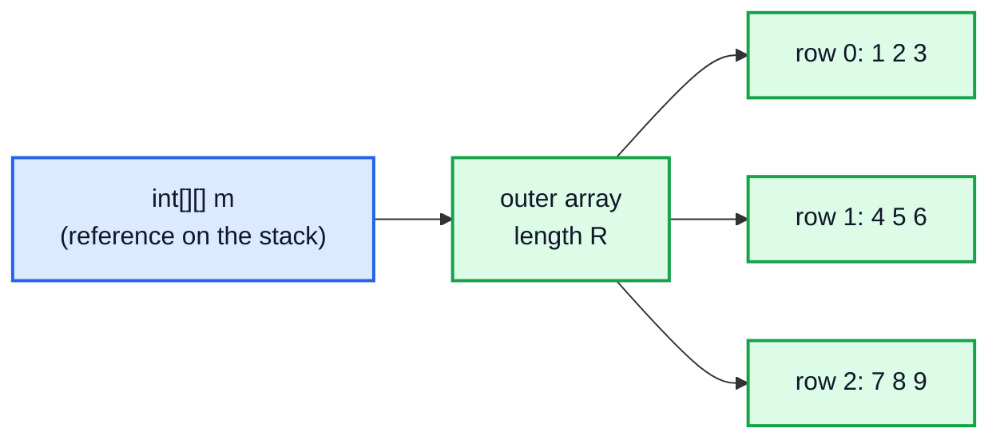
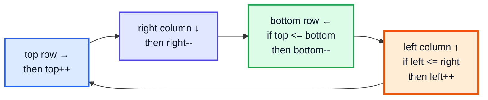
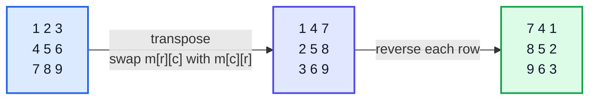

# Matrix Traversal — Complete In-Depth Guide

**DSA gap pattern #11 of 16** · Priority 🟡 · from [topics_not_covered.md](../topics_not_covered.md)

The playlist covers 2D arrays ([video 12](../kunal-java-notes-claude/java_12_video_arrays_arraylist.md)) and searching in a sorted matrix ([video 16](../kunal-java-notes-claude/java_16_video_binary_search_2d_arrays.md)), but not the "walk the matrix in a clever order" or "transform it in place" problems interviewers love: spiral order, rotating an image, setting zeroes with O(1) space, diagonal traversal, Game of Life, and validating a Sudoku. All of them come down to **index arithmetic**. These notes collect the standard tricks (direction arrays, layer-by-layer boundaries, transpose + reverse, in-place markers, `r + c` and `r − c` diagonals, `r / 3 * 3 + c / 3` boxes) with dry runs and code.

> [!NOTE]
> This pattern isn't in the playlist, so there are no video timestamps. All code targets **Java 21**. Flood Fill and Number of Islands (LC 733 / 200), listed with this pattern in `topics_not_covered.md`, are **graph** problems and are covered in [topic #2, section 5](dsa_topic_02_graphs.md#5-grid-graphs-islands-flood-fill-rotting-oranges).

---

## Table of Contents

| # | Topic (anchor link) | Level |
|---|---|---|
| 0 | [Indexing Basics](#0-indexing-basics) | Basics |
| 1 | [Direction Arrays and Bounds](#1-direction-arrays-and-bounds) | Basics |
| 2 | [Spiral Matrix I and II](#2-spiral-matrix-i-and-ii) | Core |
| 3 | [Transpose, Reshape and Rotate Image](#3-transpose-reshape-and-rotate-image) | Core |
| 4 | [Set Matrix Zeroes in O(1) Space](#4-set-matrix-zeroes-in-o1-space) | Core |
| 5 | [Diagonals](#5-diagonals) | In depth |
| 6 | [Game of Life: In-Place State Encoding](#6-game-of-life-in-place-state-encoding) | In depth |
| 7 | [Valid Sudoku: Rows, Columns, Boxes](#7-valid-sudoku-rows-columns-boxes) | In depth |
| 8 | [Searching a Sorted Matrix (Recap)](#8-searching-a-sorted-matrix-recap) | Core |
| 9 | [Pitfalls and Problem List](#9-pitfalls-and-problem-list) | Interview |

---

## 0. Indexing Basics

A Java `int[][] m` is an **array of row arrays**: `m.length` = number of rows `R`, `m[0].length` = number of columns `C`, `m[r][c]` = row `r`, column `c`.



| Idea | Formula |
|---|---|
| Cell → single index (row-major) | `id = r * C + c` |
| Single index → cell | `r = id / C`, `c = id % C` |
| Number of cells | `R * C` |
| Same diagonal (↘) | `r − c` is constant |
| Same anti-diagonal (↙) | `r + c` is constant |
| 3×3 Sudoku box | `(r / 3) * 3 + c / 3` |

> [!TIP]
> Rows of a Java 2D array can have different lengths (a **jagged** array). LeetCode matrices are rectangular, but use `m[r].length` if you're not sure.

The single-index trick is what turns a sorted matrix into one sorted list for binary search (LC 74, [video 16](../kunal-java-notes-claude/java_16_video_binary_search_2d_arrays.md)), and grid cells into [Union-Find](dsa_topic_03_union_find.md#9-dsu-on-grids) ids.

---

## 1. Direction Arrays and Bounds

```java
int[][] DIR4 = {{0, 1}, {1, 0}, {0, -1}, {-1, 0}};            // right, down, left, up (clockwise)
int[][] DIR8 = {{-1, -1}, {-1, 0}, {-1, 1}, {0, -1}, {0, 1}, {1, -1}, {1, 0}, {1, 1}};

boolean inside(int r, int c, int R, int C) { return r >= 0 && r < R && c >= 0 && c < C; }
```

Ordering `DIR4` **clockwise** lets you "turn right" with `d = (d + 1) % 4`, which is the simplest way to walk a spiral (Section 2, version B).

---

## 2. Spiral Matrix I and II

### LC 54: read a matrix in spiral order

**Version A: shrinking boundaries (layer by layer).** Keep `top`, `bottom`, `left`, `right`; walk the outer layer, then shrink.

```java
import java.util.*;

public class SpiralMatrix {
    static List<Integer> spiralOrder(int[][] m) {
        List<Integer> out = new ArrayList<>();
        int top = 0, bottom = m.length - 1, left = 0, right = m[0].length - 1;
        while (top <= bottom && left <= right) {
            for (int c = left; c <= right; c++) out.add(m[top][c]);          // → along the top
            top++;
            for (int r = top; r <= bottom; r++) out.add(m[r][right]);        // ↓ down the right
            right--;
            if (top <= bottom) {                                             // ← along the bottom (if a row is left)
                for (int c = right; c >= left; c--) out.add(m[bottom][c]);
                bottom--;
            }
            if (left <= right) {                                             // ↑ up the left (if a column is left)
                for (int r = bottom; r >= top; r--) out.add(m[r][left]);
                left++;
            }
        }
        return out;
    }

    // Version B: walk and turn right when blocked (works for any shape)
    static List<Integer> spiralByTurning(int[][] m) {
        int R = m.length, C = m[0].length;
        int[][] dir = {{0, 1}, {1, 0}, {0, -1}, {-1, 0}};
        boolean[][] seen = new boolean[R][C];
        List<Integer> out = new ArrayList<>();
        for (int i = 0, r = 0, c = 0, d = 0; i < R * C; i++) {
            out.add(m[r][c]);
            seen[r][c] = true;
            int nr = r + dir[d][0], nc = c + dir[d][1];
            if (nr < 0 || nr >= R || nc < 0 || nc >= C || seen[nr][nc]) {   // blocked: turn right
                d = (d + 1) % 4;
                nr = r + dir[d][0]; nc = c + dir[d][1];
            }
            r = nr; c = nc;
        }
        return out;
    }

    public static void main(String[] args) {
        int[][] a = {{1, 2, 3}, {4, 5, 6}, {7, 8, 9}};
        int[][] b = {{1, 2, 3, 4}, {5, 6, 7, 8}, {9, 10, 11, 12}};
        System.out.println(spiralOrder(a));       // [1, 2, 3, 6, 9, 8, 7, 4, 5]
        System.out.println(spiralOrder(b));       // [1, 2, 3, 4, 8, 12, 11, 10, 9, 5, 6, 7]
        System.out.println(spiralByTurning(b));   // [1, 2, 3, 4, 8, 12, 11, 10, 9, 5, 6, 7]
        System.out.println(spiralOrder(new int[][]{{1}, {2}, {3}}));   // [1, 2, 3]
    }
}
```



> [!CAUTION]
> The two `if` checks matter for **non-square** matrices. With a single row `[[1, 2, 3]]`, without `if (top <= bottom)` the bottom pass would read the same row backwards and output `1 2 3 2 1`.

### LC 59: generate an n×n spiral

The same boundaries, writing `1, 2, 3, …` instead of reading.

```java
import java.util.*;

public class SpiralMatrixII {
    static int[][] generateMatrix(int n) {
        int[][] m = new int[n][n];
        int top = 0, bottom = n - 1, left = 0, right = n - 1, v = 1;
        while (v <= n * n) {
            for (int c = left; c <= right; c++) m[top][c] = v++;
            top++;
            for (int r = top; r <= bottom; r++) m[r][right] = v++;
            right--;
            for (int c = right; c >= left; c--) m[bottom][c] = v++;
            bottom--;
            for (int r = bottom; r >= top; r--) m[r][left] = v++;
            left++;
        }
        return m;
    }

    public static void main(String[] args) {
        System.out.println(Arrays.deepToString(generateMatrix(3)));   // [[1, 2, 3], [8, 9, 4], [7, 6, 5]]
    }
}
```

(For a square n×n, the extra `if` checks aren't needed: the loops become empty automatically when the layer runs out.)

---

## 3. Transpose, Reshape and Rotate Image

### Transpose (LC 867) and Reshape (LC 566)

```java
import java.util.*;

public class TransposeReshape {
    static int[][] transpose(int[][] m) {                  // R×C → C×R
        int R = m.length, C = m[0].length;
        int[][] t = new int[C][R];
        for (int r = 0; r < R; r++) for (int c = 0; c < C; c++) t[c][r] = m[r][c];
        return t;
    }

    static int[][] reshape(int[][] m, int r2, int c2) {    // same row-major order, new shape
        int R = m.length, C = m[0].length;
        if (R * C != r2 * c2) return m;
        int[][] out = new int[r2][c2];
        for (int id = 0; id < R * C; id++) out[id / c2][id % c2] = m[id / C][id % C];
        return out;
    }

    public static void main(String[] args) {
        System.out.println(Arrays.deepToString(transpose(new int[][]{{1, 2, 3}, {4, 5, 6}})));     // [[1, 4], [2, 5], [3, 6]]
        System.out.println(Arrays.deepToString(reshape(new int[][]{{1, 2}, {3, 4}}, 1, 4)));       // [[1, 2, 3, 4]]
    }
}
```

### Rotate Image 90° clockwise, in place (LC 48)

**Clockwise rotation = transpose, then reverse each row.**



```java
import java.util.*;

public class RotateImage {
    static void rotateClockwise(int[][] m) {
        int n = m.length;
        for (int r = 0; r < n; r++)
            for (int c = r + 1; c < n; c++) { int t = m[r][c]; m[r][c] = m[c][r]; m[c][r] = t; }   // transpose (upper triangle only!)
        for (int[] row : m)
            for (int l = 0, h = n - 1; l < h; l++, h--) { int t = row[l]; row[l] = row[h]; row[h] = t; }   // reverse row
    }

    static void rotateCounterClockwise(int[][] m) {       // transpose, then reverse each COLUMN
        int n = m.length;
        for (int r = 0; r < n; r++)
            for (int c = r + 1; c < n; c++) { int t = m[r][c]; m[r][c] = m[c][r]; m[c][r] = t; }
        for (int top = 0, bot = n - 1; top < bot; top++, bot--) { int[] t = m[top]; m[top] = m[bot]; m[bot] = t; }
    }

    public static void main(String[] args) {
        int[][] a = {{1, 2, 3}, {4, 5, 6}, {7, 8, 9}};
        rotateClockwise(a);
        System.out.println(Arrays.deepToString(a));   // [[7, 4, 1], [8, 5, 2], [9, 6, 3]]
        rotateCounterClockwise(a);
        System.out.println(Arrays.deepToString(a));   // [[1, 2, 3], [4, 5, 6], [7, 8, 9]]  (back to the start)
    }
}
```

| Rotation | Recipe | Cell mapping (n×n) |
|---|---|---|
| 90° clockwise | transpose + reverse each row | `(r, c) → (c, n−1−r)` |
| 90° counter-clockwise | transpose + reverse the row order | `(r, c) → (n−1−c, r)` |
| 180° | reverse the row order + reverse each row | `(r, c) → (n−1−r, n−1−c)` |

> [!WARNING]
> Transpose only the **upper triangle** (`c = r + 1`). Looping over every `(r, c)` swaps each pair twice and leaves the matrix unchanged.

---

## 4. Set Matrix Zeroes in O(1) Space

**LC 73:** if a cell is 0, set its whole row and column to 0, in place.

| Approach | Extra space |
|---|---|
| Copy the matrix | O(R·C) |
| `boolean[] zeroRow, zeroCol` | O(R + C) |
| **Use row 0 and column 0 as the markers** | **O(1)** |

The first row and column hold the flags for the other rows and columns. Two extra booleans remember whether row 0 / column 0 **themselves** must become zero.

```java
import java.util.*;

public class SetMatrixZeroes {
    static void setZeroes(int[][] m) {
        int R = m.length, C = m[0].length;
        boolean firstRow = false, firstCol = false;
        for (int c = 0; c < C; c++) if (m[0][c] == 0) firstRow = true;
        for (int r = 0; r < R; r++) if (m[r][0] == 0) firstCol = true;

        for (int r = 1; r < R; r++)                     // 1. record markers in row 0 / column 0
            for (int c = 1; c < C; c++)
                if (m[r][c] == 0) { m[r][0] = 0; m[0][c] = 0; }

        for (int r = 1; r < R; r++)                     // 2. zero inner cells using the markers
            for (int c = 1; c < C; c++)
                if (m[r][0] == 0 || m[0][c] == 0) m[r][c] = 0;

        if (firstRow) Arrays.fill(m[0], 0);             // 3. finally the first row and column
        if (firstCol) for (int r = 0; r < R; r++) m[r][0] = 0;
    }

    public static void main(String[] args) {
        int[][] a = {{1, 1, 1}, {1, 0, 1}, {1, 1, 1}};
        setZeroes(a);
        System.out.println(Arrays.deepToString(a));   // [[1, 0, 1], [0, 0, 0], [1, 0, 1]]
        int[][] b = {{0, 1, 2, 0}, {3, 4, 5, 2}, {1, 3, 1, 5}};
        setZeroes(b);
        System.out.println(Arrays.deepToString(b));   // [[0, 0, 0, 0], [0, 4, 5, 0], [0, 3, 1, 0]]
    }
}
```

> [!IMPORTANT]
> **Order matters.** Zero the inner cells (step 2) before the first row/column (step 3). Otherwise the markers you're reading get overwritten and the whole matrix turns to zero.

---

## 5. Diagonals

### Diagonal Traverse (LC 498): zig-zag

Cells with the same `r + c` lie on the same anti-diagonal. Walk `s = r + c` from 0 to `R + C − 2`, alternating direction.

```java
import java.util.*;

public class DiagonalTraverse {
    static int[] findDiagonalOrder(int[][] m) {
        int R = m.length, C = m[0].length, k = 0;
        int[] out = new int[R * C];
        for (int s = 0; s <= R + C - 2; s++) {
            if (s % 2 == 0) {                                   // going up-right: r decreases
                for (int r = Math.min(s, R - 1); r >= 0 && s - r < C; r--) out[k++] = m[r][s - r];
            } else {                                            // going down-left: r increases
                for (int r = Math.max(0, s - C + 1); r < R && s - r >= 0; r++) out[k++] = m[r][s - r];
            }
        }
        return out;
    }

    // Group by diagonal key: r − c (↘) or r + c (↙)
    static Map<Integer, List<Integer>> byDiagonal(int[][] m) {
        Map<Integer, List<Integer>> g = new TreeMap<>();
        for (int r = 0; r < m.length; r++)
            for (int c = 0; c < m[0].length; c++) g.computeIfAbsent(r - c, x -> new ArrayList<>()).add(m[r][c]);
        return g;
    }

    public static void main(String[] args) {
        int[][] m = {{1, 2, 3}, {4, 5, 6}, {7, 8, 9}};
        System.out.println(Arrays.toString(findDiagonalOrder(m)));   // [1, 2, 4, 7, 5, 3, 6, 8, 9]
        System.out.println(byDiagonal(m));                           // {-2=[3], -1=[2, 6], 0=[1, 5, 9], 1=[4, 8], 2=[7]}
    }
}
```

| Key | Diagonal direction | Range | Used in |
|---|---|---|---|
| `r − c` | top-left → bottom-right (↘) | `−(C−1) … R−1` | LC 1329 Sort the Matrix Diagonally, LC 766 Toeplitz Matrix, N-Queens |
| `r + c` | top-right → bottom-left (↙) | `0 … R+C−2` | LC 498, N-Queens |

The same two keys detect queen attacks in N-Queens ([video 36](../kunal-java-notes-claude/java_36_video_nqueens_nknights_sudoku.md)): two queens share a diagonal exactly when their `r − c` or `r + c` match.

---

## 6. Game of Life: In-Place State Encoding

**LC 289:** every cell updates **simultaneously** from its 8 neighbours:
- live with 2 or 3 live neighbours → stays alive; otherwise dies;
- dead with exactly 3 live neighbours → becomes alive.

Updating in place would corrupt neighbours that haven't been processed yet. **Encode both states in one int**: bit 0 = current state, bit 1 = next state. At the end, shift right.

```java
import java.util.*;

public class GameOfLife {
    static void gameOfLife(int[][] b) {
        int R = b.length, C = b[0].length;
        for (int r = 0; r < R; r++)
            for (int c = 0; c < C; c++) {
                int live = 0;
                for (int dr = -1; dr <= 1; dr++)
                    for (int dc = -1; dc <= 1; dc++) {
                        if (dr == 0 && dc == 0) continue;
                        int nr = r + dr, nc = c + dc;
                        if (nr >= 0 && nr < R && nc >= 0 && nc < C) live += b[nr][nc] & 1;   // bit 0 = current
                    }
                boolean alive = (b[r][c] & 1) == 1;
                if ((alive && (live == 2 || live == 3)) || (!alive && live == 3)) b[r][c] |= 2;   // set bit 1 = next
            }
        for (int[] row : b) for (int c = 0; c < C; c++) row[c] >>= 1;                           // next becomes current
    }

    public static void main(String[] args) {
        int[][] b = {{0, 1, 0}, {0, 0, 1}, {1, 1, 1}, {0, 0, 0}};
        gameOfLife(b);
        System.out.println(Arrays.deepToString(b));   // [[0, 0, 0], [1, 0, 1], [0, 1, 1], [0, 1, 0]]
    }
}
```

| Value | Bit 1 (next) | Bit 0 (now) | Meaning |
|---|---|---|---|
| 0 | 0 | 0 | dead → dead |
| 1 | 0 | 1 | live → dead |
| 2 | 1 | 0 | dead → live |
| 3 | 1 | 1 | live → live |

The same "store two states in one cell" trick works for any simultaneous-update simulation (bitwise operators from [video 25](../kunal-java-notes-claude/java_25_video_bitwise_number_systems.md)).

---

## 7. Valid Sudoku: Rows, Columns, Boxes

**LC 36:** check that no digit repeats in any row, column or 3×3 box (empty cells are `'.'`). One pass with 27 sets, or with bitmasks.

```java
public class ValidSudoku {
    static boolean isValidSudoku(char[][] board) {
        int[] rows = new int[9], cols = new int[9], boxes = new int[9];    // bit d set = digit d seen
        for (int r = 0; r < 9; r++)
            for (int c = 0; c < 9; c++) {
                char ch = board[r][c];
                if (ch == '.') continue;
                int bit = 1 << (ch - '1'), box = (r / 3) * 3 + c / 3;
                if ((rows[r] & bit) != 0 || (cols[c] & bit) != 0 || (boxes[box] & bit) != 0) return false;
                rows[r] |= bit; cols[c] |= bit; boxes[box] |= bit;
            }
        return true;
    }

    public static void main(String[] args) {
        String[] rows = {
                "53..7....", "6..195...", ".98....6.",
                "8...6...3", "4..8.3..1", "7...2...6",
                ".6....28.", "...419..5", "....8..79"};
        char[][] board = new char[9][];
        for (int i = 0; i < 9; i++) board[i] = rows[i].toCharArray();
        System.out.println(isValidSudoku(board));   // true
        board[0][0] = '8';                          // now column 0 has two 8s
        System.out.println(isValidSudoku(board));   // false
    }
}
```

| Box index `(r/3)*3 + c/3` | c 0–2 | c 3–5 | c 6–8 |
|---|---|---|---|
| r 0–2 | 0 | 1 | 2 |
| r 3–5 | 3 | 4 | 5 |
| r 6–8 | 6 | 7 | 8 |

Solving the Sudoku (LC 37) adds backtracking on top of these same checks ([video 36](../kunal-java-notes-claude/java_36_video_nqueens_nknights_sudoku.md)).

---

## 8. Searching a Sorted Matrix (Recap)

From [video 16](../kunal-java-notes-claude/java_16_video_binary_search_2d_arrays.md):

| Matrix property | Technique | Time |
|---|---|---|
| Each row sorted and each row's first element > previous row's last (LC 74) | Treat as one sorted array: `mid → (mid / C, mid % C)` | O(log(R·C)) |
| Rows and columns sorted independently (LC 240) | **Staircase**: start at the top-right; go left if too big, down if too small | O(R + C) |
| Count / k-th smallest in such a matrix (LC 378) | Staircase count inside a binary search on the value ([gap #6, section 9](dsa_gap_06_top_k_k_way_merge.md#9-kth-smallest-in-a-sorted-matrix)) | O((R + C) log range) |

---

## 9. Pitfalls and Problem List

### Pitfalls

| Pitfall | Fix |
|---|---|
| Mixing up `m.length` (rows) and `m[0].length` (columns) | Name them `R` and `C` at the top |
| Spiral on non-square matrices repeating cells | Guard the bottom and left passes |
| Transposing every pair (swapping twice) | Only `c > r` |
| Overwriting markers in Set Matrix Zeroes | Handle row 0 / column 0 last |
| Updating Game of Life in place without encoding | Use bit 1 for the next state |
| Off-by-one in diagonal ranges | `r + c` ∈ [0, R + C − 2] |
| `int[][] copy = m.clone()` thinking it's a deep copy | It copies row **references**; clone each row |

### Problem list (in order)

| # | Problem | Trick | Difficulty |
|---|---|---|---|
| 1 | LC 867 Transpose Matrix | `t[c][r] = m[r][c]` | Easy |
| 2 | LC 566 Reshape the Matrix | Single index | Easy |
| 3 | LC 766 Toeplitz Matrix | `r − c` diagonals | Easy |
| 4 | LC 1572 Matrix Diagonal Sum | Two diagonals, avoid double-counting the centre | Easy |
| 5 | LC 54 Spiral Matrix | Boundaries | Medium |
| 6 | LC 59 Spiral Matrix II | Boundaries | Medium |
| 7 | LC 48 Rotate Image | Transpose + reverse | Medium |
| 8 | LC 73 Set Matrix Zeroes | Row 0 / column 0 markers | Medium |
| 9 | LC 498 Diagonal Traverse | `r + c` zig-zag | Medium |
| 10 | LC 36 Valid Sudoku | Row / column / box sets | Medium |
| 11 | LC 289 Game of Life | Two-bit encoding | Medium |
| 12 | LC 74 / 240 Search a 2D Matrix I / II | Binary search / staircase | Medium |
| 13 | LC 1329 Sort the Matrix Diagonally | Group by `r − c` | Medium |

### Interview Q&A

| Question | Short answer |
|---|---|
| Rotate a matrix 90° in place? | Transpose, then reverse each row (clockwise). |
| Spiral order? | Four shrinking boundaries, or walk and turn right when blocked. |
| Set Matrix Zeroes in O(1) space? | Use the first row and column as markers; handle them last. |
| How do you identify diagonals? | `r − c` constant (↘), `r + c` constant (↙). |
| Which 3×3 box is `(r, c)` in? | `(r / 3) * 3 + c / 3`. |
| Simultaneous updates in place? | Encode old and new state in different bits. |

---

## 🧩 Complete Example: Everything Together

Spiral (both methods), spiral generation, all three rotations, set zeroes, diagonal traversal, Game of Life and Sudoku validation, with random cross-checks: the two spiral methods must agree, four clockwise rotations must give back the original, and the O(1)-space Set Zeroes must match the simple O(R + C) version.

```java
import java.util.*;

public class MatrixShowcase {

    static List<Integer> spiralBounds(int[][] m) {
        List<Integer> out = new ArrayList<>();
        int t = 0, b = m.length - 1, l = 0, r = m[0].length - 1;
        while (t <= b && l <= r) {
            for (int c = l; c <= r; c++) out.add(m[t][c]);
            t++;
            for (int i = t; i <= b; i++) out.add(m[i][r]);
            r--;
            if (t <= b) { for (int c = r; c >= l; c--) out.add(m[b][c]); b--; }
            if (l <= r) { for (int i = b; i >= t; i--) out.add(m[i][l]); l++; }
        }
        return out;
    }

    static List<Integer> spiralTurning(int[][] m) {
        int R = m.length, C = m[0].length;
        int[][] d = {{0, 1}, {1, 0}, {0, -1}, {-1, 0}};
        boolean[][] seen = new boolean[R][C];
        List<Integer> out = new ArrayList<>();
        for (int i = 0, r = 0, c = 0, k = 0; i < R * C; i++) {
            out.add(m[r][c]); seen[r][c] = true;
            int nr = r + d[k][0], nc = c + d[k][1];
            if (nr < 0 || nr >= R || nc < 0 || nc >= C || seen[nr][nc]) { k = (k + 1) % 4; nr = r + d[k][0]; nc = c + d[k][1]; }
            r = nr; c = nc;
        }
        return out;
    }

    static int[][] generateSpiral(int n) {
        int[][] m = new int[n][n];
        int t = 0, b = n - 1, l = 0, r = n - 1, v = 1;
        while (v <= n * n) {
            for (int c = l; c <= r; c++) m[t][c] = v++;
            t++;
            for (int i = t; i <= b; i++) m[i][r] = v++;
            r--;
            for (int c = r; c >= l; c--) m[b][c] = v++;
            b--;
            for (int i = b; i >= t; i--) m[i][l] = v++;
            l++;
        }
        return m;
    }

    static void rotateCW(int[][] m) {
        int n = m.length;
        for (int r = 0; r < n; r++) for (int c = r + 1; c < n; c++) { int x = m[r][c]; m[r][c] = m[c][r]; m[c][r] = x; }
        for (int[] row : m) for (int l = 0, h = n - 1; l < h; l++, h--) { int x = row[l]; row[l] = row[h]; row[h] = x; }
    }

    static void setZeroesO1(int[][] m) {
        int R = m.length, C = m[0].length;
        boolean fr = false, fc = false;
        for (int c = 0; c < C; c++) if (m[0][c] == 0) fr = true;
        for (int r = 0; r < R; r++) if (m[r][0] == 0) fc = true;
        for (int r = 1; r < R; r++) for (int c = 1; c < C; c++) if (m[r][c] == 0) { m[r][0] = 0; m[0][c] = 0; }
        for (int r = 1; r < R; r++) for (int c = 1; c < C; c++) if (m[r][0] == 0 || m[0][c] == 0) m[r][c] = 0;
        if (fr) Arrays.fill(m[0], 0);
        if (fc) for (int r = 0; r < R; r++) m[r][0] = 0;
    }

    static void setZeroesSimple(int[][] m) {
        boolean[] zr = new boolean[m.length], zc = new boolean[m[0].length];
        for (int r = 0; r < m.length; r++) for (int c = 0; c < m[0].length; c++) if (m[r][c] == 0) { zr[r] = true; zc[c] = true; }
        for (int r = 0; r < m.length; r++) for (int c = 0; c < m[0].length; c++) if (zr[r] || zc[c]) m[r][c] = 0;
    }

    static int[] zigzag(int[][] m) {
        int R = m.length, C = m[0].length, k = 0;
        int[] out = new int[R * C];
        for (int s = 0; s <= R + C - 2; s++) {
            if (s % 2 == 0) for (int r = Math.min(s, R - 1); r >= 0 && s - r < C; r--) out[k++] = m[r][s - r];
            else for (int r = Math.max(0, s - C + 1); r < R && s - r >= 0; r++) out[k++] = m[r][s - r];
        }
        return out;
    }

    static void life(int[][] b) {
        int R = b.length, C = b[0].length;
        for (int r = 0; r < R; r++) for (int c = 0; c < C; c++) {
            int live = 0;
            for (int dr = -1; dr <= 1; dr++) for (int dc = -1; dc <= 1; dc++) {
                int nr = r + dr, nc = c + dc;
                if ((dr != 0 || dc != 0) && nr >= 0 && nr < R && nc >= 0 && nc < C) live += b[nr][nc] & 1;
            }
            if (((b[r][c] & 1) == 1 && (live == 2 || live == 3)) || ((b[r][c] & 1) == 0 && live == 3)) b[r][c] |= 2;
        }
        for (int[] row : b) for (int c = 0; c < C; c++) row[c] >>= 1;
    }

    static int[][] deepCopy(int[][] m) { int[][] c = new int[m.length][]; for (int i = 0; i < m.length; i++) c[i] = m[i].clone(); return c; }

    public static void main(String[] args) {
        int[][] m = {{1, 2, 3, 4}, {5, 6, 7, 8}, {9, 10, 11, 12}};
        System.out.println("Spiral           : " + spiralBounds(m));
        System.out.println("Zig-zag diagonals: " + Arrays.toString(zigzag(m)));
        System.out.println("Spiral 4x4       : " + Arrays.deepToString(generateSpiral(4)));

        int[][] img = {{1, 2, 3}, {4, 5, 6}, {7, 8, 9}};
        rotateCW(img);
        System.out.println("Rotated 90       : " + Arrays.deepToString(img));
        rotateCW(img);
        System.out.println("Rotated 180      : " + Arrays.deepToString(img));

        int[][] z = {{0, 1, 2, 0}, {3, 4, 5, 2}, {1, 3, 1, 5}};
        setZeroesO1(z);
        System.out.println("Set zeroes       : " + Arrays.deepToString(z));

        int[][] blinker = {{0, 0, 0}, {1, 1, 1}, {0, 0, 0}};
        life(blinker);
        System.out.println("Blinker step 1   : " + Arrays.deepToString(blinker));
        life(blinker);
        System.out.println("Blinker step 2   : " + Arrays.deepToString(blinker));

        Random rnd = new Random(48);
        int checks = 0, mismatches = 0;
        for (int t = 0; t < 300; t++) {
            int R = 1 + rnd.nextInt(6), C = 1 + rnd.nextInt(6);
            int[][] a = new int[R][C];
            for (int[] row : a) for (int c = 0; c < C; c++) row[c] = rnd.nextInt(5);
            if (!spiralBounds(a).equals(spiralTurning(a))) mismatches++;

            int[][] x = deepCopy(a), y = deepCopy(a);
            setZeroesO1(x); setZeroesSimple(y);
            if (!Arrays.deepEquals(x, y)) mismatches++;

            int n = 1 + rnd.nextInt(6);
            int[][] sq = new int[n][n];
            for (int[] row : sq) for (int c = 0; c < n; c++) row[c] = rnd.nextInt(100);
            int[][] orig = deepCopy(sq);
            for (int k = 0; k < 4; k++) rotateCW(sq);
            if (!Arrays.deepEquals(sq, orig)) mismatches++;
            checks += 3;
        }
        System.out.println("Random cross-checks: " + checks + ", mismatches: " + mismatches);
    }
}
```

**Expected Output:**
```
Spiral           : [1, 2, 3, 4, 8, 12, 11, 10, 9, 5, 6, 7]
Zig-zag diagonals: [1, 2, 5, 9, 6, 3, 4, 7, 10, 11, 8, 12]
Spiral 4x4       : [[1, 2, 3, 4], [12, 13, 14, 5], [11, 16, 15, 6], [10, 9, 8, 7]]
Rotated 90       : [[7, 4, 1], [8, 5, 2], [9, 6, 3]]
Rotated 180      : [[9, 8, 7], [6, 5, 4], [3, 2, 1]]
Set zeroes       : [[0, 0, 0, 0], [0, 4, 5, 0], [0, 3, 1, 0]]
Blinker step 1   : [[0, 1, 0], [0, 1, 0], [0, 1, 0]]
Blinker step 2   : [[0, 0, 0], [1, 1, 1], [0, 0, 0]]
Random cross-checks: 900, mismatches: 0
```

---

## Quick Reference Cheat Sheet

| Concept | One-Line Summary |
|---|---|
| **Sizes** | `R = m.length`, `C = m[0].length` |
| **Flatten** | `id = r*C + c`; `r = id / C`, `c = id % C` |
| **Directions** | `{0,1},{1,0},{0,-1},{-1,0}` clockwise; turn right with `(d+1) % 4` |
| **Spiral** | Four shrinking bounds; guard bottom/left for non-square |
| **Rotate CW** | Transpose (upper triangle) + reverse rows |
| **Rotate CCW** | Transpose + reverse row order |
| **Set zeroes O(1)** | Row 0 / col 0 as markers + two booleans; fix them last |
| **Diagonals** | `r − c` (↘) and `r + c` (↙) are constant |
| **Game of Life** | Bit 0 = now, bit 1 = next; shift at the end |
| **Sudoku box** | `(r/3)*3 + c/3` |
| **Sorted matrix** | Flattened binary search (LC 74) or staircase (LC 240) |
| **Grid BFS/DFS** | See graphs topic #2 |
