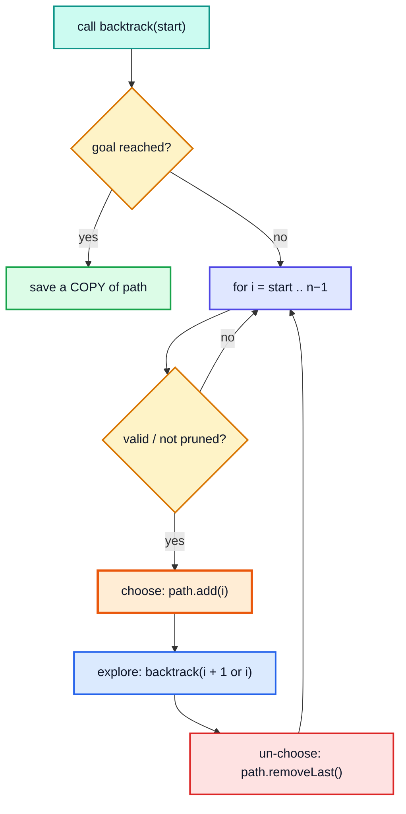
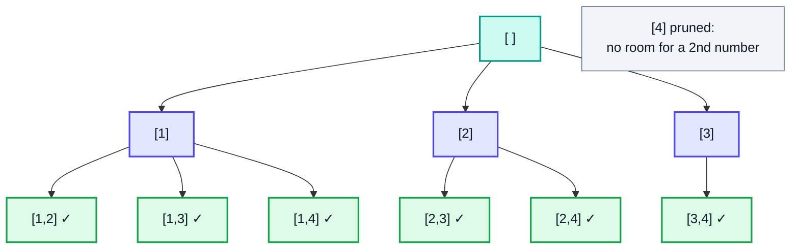
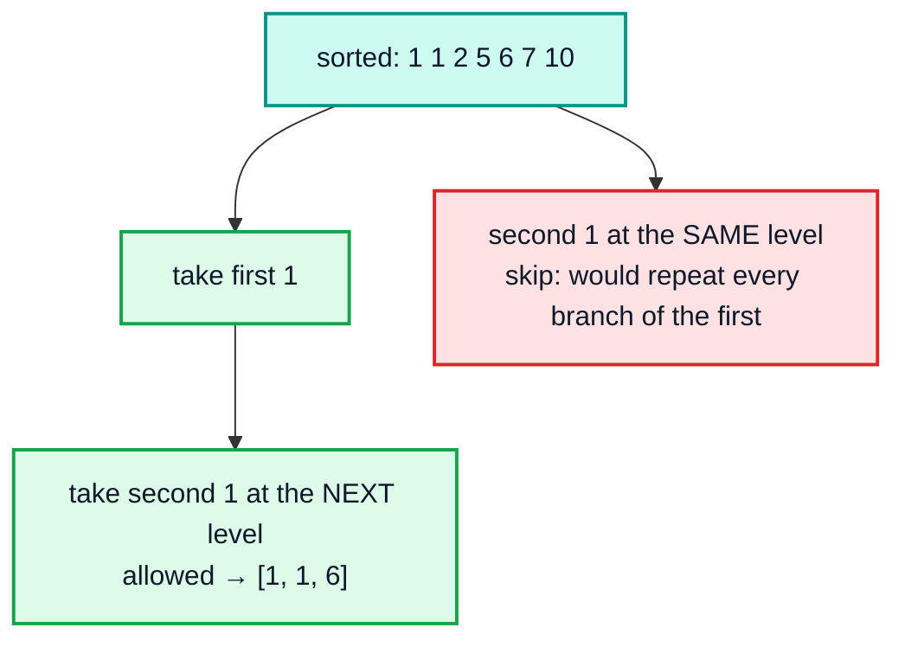

# Combination-Style Backtracking — Complete In-Depth Guide

**DSA gap pattern #12 of 16** · Priority 🟡 · from [topics_not_covered.md](../topics_not_covered.md)

The playlist teaches recursion with subsets ([video 32](../kunal-java-notes-claude/java_32_video_recursion_subsets_strings.md)), permutations ([video 33](../kunal-java-notes-claude/java_33_video_recursion_permutations.md)) and grid backtracking ([videos 35–36](../kunal-java-notes-claude/java_35_video_backtracking_maze.md)). Interview problems mostly use one more template: **combinations with a start index**, which builds each answer by choosing elements in increasing index order so the same group is never produced twice. These notes give one template and show how small changes to it solve Combinations, Combination Sum I/II/III, Subsets II, Word Search, Palindrome Partitioning, Generate Parentheses and Restore IP Addresses. They also cover pruning, duplicate handling and how to estimate complexity.

> [!NOTE]
> This pattern isn't in the playlist, so there are no video timestamps. All code targets **Java 21**. Word Search II (many words at once) uses a trie and is in [topic #4, section 8](dsa_topic_04_trie.md#8-word-search-ii-trie-plus-backtracking). When you only need to **count** combinations, [DP](dsa_topic_01_dynamic_programming.md#5-unbounded-knapsack-and-coin-change) is usually much faster.

---

## Table of Contents

| # | Topic (anchor link) | Level |
|---|---|---|
| 0 | [The Backtracking Template](#0-the-backtracking-template) | Basics |
| 1 | [Subsets vs Combinations vs Permutations](#1-subsets-vs-combinations-vs-permutations) | Basics |
| 2 | [Combinations](#2-combinations) | Core |
| 3 | [Combination Sum: Reuse Allowed](#3-combination-sum-reuse-allowed) | Core |
| 4 | [Combination Sum II and Subsets II: Skipping Duplicates](#4-combination-sum-ii-and-subsets-ii-skipping-duplicates) | Core |
| 5 | [Combination Sum III: Two Constraints](#5-combination-sum-iii-two-constraints) | Core |
| 6 | [Word Search](#6-word-search) | In depth |
| 7 | [Partitioning Strings: Palindromes and IP Addresses](#7-partitioning-strings-palindromes-and-ip-addresses) | In depth |
| 8 | [Generate Parentheses](#8-generate-parentheses) | In depth |
| 9 | [Pruning and Complexity](#9-pruning-and-complexity) | In depth |
| 10 | [Pitfalls and Problem List](#10-pitfalls-and-problem-list) | Interview |

---

## 0. The Backtracking Template

```java
void backtrack(State state, int start, List<Item> path, List<List<Item>> results) {
    if (isComplete(state)) {                    // 1. goal reached
        results.add(new ArrayList<>(path));     //    COPY the path
        return;
    }
    for (int i = start; i < n; i++) {           // 2. try each remaining choice
        if (!isValid(i, state)) continue;       //    (or break, if sorted: pruning)
        path.add(item[i]);                      // 3. choose
        backtrack(next(state), i + 1, path, results);   // 4. explore (i + 1: each item once)
        path.remove(path.size() - 1);           // 5. un-choose (backtrack)
    }
}
```



| Knob | Options |
|---|---|
| Next start index | `i + 1` (each item at most once) or `i` (item can be reused) |
| Duplicates in the input | Sort, then `if (i > start && a[i] == a[i−1]) continue;` |
| Pruning | Sort; `break` when the remaining choices can't work |
| When to record | At a fixed size / target, or at **every** node (subsets) |

> [!CAUTION]
> `results.add(path)` adds the **same** list object every time; by the end it's empty and every saved answer shows `[]`. Always save `new ArrayList<>(path)`. This is the most common backtracking bug (references, from [video 5](../kunal-java-notes-claude/java_05_video_intro_programming.md)).

---

## 1. Subsets vs Combinations vs Permutations

| Problem | Order matters? | Recursion moves to | Record when | Count for n items |
|---|---|---|---|---|
| **Subsets** | No | `i + 1` | Every node | 2ⁿ |
| **Combinations of size k** | No | `i + 1` | `path.size() == k` | C(n, k) |
| **Permutations** | **Yes** | Any unused index (a `used[]` array) | `path.size() == n` | n! |
| **Combination Sum** (reuse) | No | `i` | `remaining == 0` | depends on the target |

```java
import java.util.*;

public class ThreeShapes {
    static void subsets(int[] a, int start, List<Integer> path, List<List<Integer>> out) {
        out.add(new ArrayList<>(path));                                 // every node is a subset
        for (int i = start; i < a.length; i++) { path.add(a[i]); subsets(a, i + 1, path, out); path.remove(path.size() - 1); }
    }

    static void permutations(int[] a, boolean[] used, List<Integer> path, List<List<Integer>> out) {
        if (path.size() == a.length) { out.add(new ArrayList<>(path)); return; }
        for (int i = 0; i < a.length; i++) {                           // start from 0: order matters
            if (used[i]) continue;
            used[i] = true; path.add(a[i]);
            permutations(a, used, path, out);
            path.remove(path.size() - 1); used[i] = false;
        }
    }

    public static void main(String[] args) {
        List<List<Integer>> s = new ArrayList<>(), p = new ArrayList<>();
        subsets(new int[]{1, 2, 3}, 0, new ArrayList<>(), s);
        permutations(new int[]{1, 2, 3}, new boolean[3], new ArrayList<>(), p);
        System.out.println(s);   // [[], [1], [1, 2], [1, 2, 3], [1, 3], [2], [2, 3], [3]]
        System.out.println(p);   // [[1, 2, 3], [1, 3, 2], [2, 1, 3], [2, 3, 1], [3, 1, 2], [3, 2, 1]]
    }
}
```

---

## 2. Combinations

**LC 77:** all combinations of `k` numbers from `1..n`.

```java
import java.util.*;

public class Combinations {
    static List<List<Integer>> combine(int n, int k) {
        List<List<Integer>> out = new ArrayList<>();
        dfs(1, n, k, new ArrayList<>(), out);
        return out;
    }

    static void dfs(int start, int n, int k, List<Integer> path, List<List<Integer>> out) {
        if (path.size() == k) { out.add(new ArrayList<>(path)); return; }
        int need = k - path.size();
        for (int i = start; i <= n - need + 1; i++) {          // PRUNE: leave room for the rest
            path.add(i);
            dfs(i + 1, n, k, path, out);
            path.remove(path.size() - 1);
        }
    }

    public static void main(String[] args) {
        System.out.println(combine(4, 2));          // [[1, 2], [1, 3], [1, 4], [2, 3], [2, 4], [3, 4]]
        System.out.println(combine(5, 3).size());   // 10 = C(5, 3)
    }
}
```



> [!TIP]
> The loop bound `i <= n − need + 1` is a **pruning** step: if only 1 number is left to choose but you need 2, stop. It doesn't change the output, but it skips dead branches.

---

## 3. Combination Sum: Reuse Allowed

**LC 39:** distinct candidates, each usable **any number of times**; find all combinations summing to `target`. Recurse with `i` (not `i + 1`) so the same candidate can be taken again; sort so you can `break` once a candidate is too big.

```java
import java.util.*;

public class CombinationSum {
    static List<List<Integer>> combinationSum(int[] candidates, int target) {
        Arrays.sort(candidates);
        List<List<Integer>> out = new ArrayList<>();
        dfs(candidates, 0, target, new ArrayList<>(), out);
        return out;
    }

    static void dfs(int[] a, int start, int remaining, List<Integer> path, List<List<Integer>> out) {
        if (remaining == 0) { out.add(new ArrayList<>(path)); return; }
        for (int i = start; i < a.length; i++) {
            if (a[i] > remaining) break;                    // sorted: everything after is too big too
            path.add(a[i]);
            dfs(a, i, remaining - a[i], path, out);         // i, not i + 1: reuse allowed
            path.remove(path.size() - 1);
        }
    }

    public static void main(String[] args) {
        System.out.println(combinationSum(new int[]{2, 3, 6, 7}, 7));    // [[2, 2, 3], [7]]
        System.out.println(combinationSum(new int[]{2, 3, 5}, 8));       // [[2, 2, 2, 2], [2, 3, 3], [3, 5]]
        System.out.println(combinationSum(new int[]{2}, 1));             // []
    }
}
```

**Trace** for `[2, 3, 6, 7]`, target 7 (each line is a call; `rem` = remaining):

| Path | rem | Next choices tried |
|---|---|---|
| [] | 7 | 2, 3, 6, 7 |
| [2] | 5 | 2, 3 (6 > 5 → break) |
| [2, 2] | 3 | 2, 3 |
| [2, 2, 2] | 1 | 2 > 1 → break |
| [2, 2, 3] | 0 | ✓ saved |
| [2, 3] | 2 | 3 > 2 → break |
| [3] | 4 | 3 (6 > 4 → break) |
| [3, 3] | 1 | break |
| [6] | 1 | break |
| [7] | 0 | ✓ saved |

> [!NOTE]
> Starting the loop at `start` (not 0) is what prevents `[2, 2, 3]`, `[2, 3, 2]` and `[3, 2, 2]` all appearing: each combination is built in **non-decreasing index order**, so it's produced once.

---

## 4. Combination Sum II and Subsets II: Skipping Duplicates

When the **input has duplicates** and each element may be used once, sort and skip equal values **at the same level of the tree** (same `start`), but allow them deeper.

```java
if (i > start && a[i] == a[i - 1]) continue;   // same value already tried at this depth
```

### Combination Sum II (LC 40)

```java
import java.util.*;

public class CombinationSumII {
    static List<List<Integer>> combinationSum2(int[] candidates, int target) {
        Arrays.sort(candidates);
        List<List<Integer>> out = new ArrayList<>();
        dfs(candidates, 0, target, new ArrayList<>(), out);
        return out;
    }

    static void dfs(int[] a, int start, int remaining, List<Integer> path, List<List<Integer>> out) {
        if (remaining == 0) { out.add(new ArrayList<>(path)); return; }
        for (int i = start; i < a.length; i++) {
            if (i > start && a[i] == a[i - 1]) continue;    // skip duplicate branch at this level
            if (a[i] > remaining) break;
            path.add(a[i]);
            dfs(a, i + 1, remaining - a[i], path, out);      // i + 1: each element once
            path.remove(path.size() - 1);
        }
    }

    public static void main(String[] args) {
        System.out.println(combinationSum2(new int[]{10, 1, 2, 7, 6, 1, 5}, 8));   // [[1, 1, 6], [1, 2, 5], [1, 7], [2, 6]]
        System.out.println(combinationSum2(new int[]{2, 5, 2, 1, 2}, 5));          // [[1, 2, 2], [5]]
    }
}
```



> [!IMPORTANT]
> The condition is `i > start`, **not** `i > 0`. With `i > 0` you'd also forbid `[1, 1, 6]`, because the second 1 would be skipped even when it's the next element of the path rather than an alternative at the same position.

### Subsets II (LC 90)

The same skip rule on the subsets template.

```java
import java.util.*;

public class SubsetsII {
    static List<List<Integer>> subsetsWithDup(int[] nums) {
        Arrays.sort(nums);
        List<List<Integer>> out = new ArrayList<>();
        dfs(nums, 0, new ArrayList<>(), out);
        return out;
    }
    static void dfs(int[] a, int start, List<Integer> path, List<List<Integer>> out) {
        out.add(new ArrayList<>(path));
        for (int i = start; i < a.length; i++) {
            if (i > start && a[i] == a[i - 1]) continue;
            path.add(a[i]);
            dfs(a, i + 1, path, out);
            path.remove(path.size() - 1);
        }
    }

    public static void main(String[] args) {
        System.out.println(subsetsWithDup(new int[]{1, 2, 2}));   // [[], [1], [1, 2], [1, 2, 2], [2], [2, 2]]
    }
}
```

---

## 5. Combination Sum III: Two Constraints

**LC 216:** `k` distinct numbers from 1–9 that sum to `n`. Stop as soon as **either** constraint is broken.

```java
import java.util.*;

public class CombinationSumIII {
    static List<List<Integer>> combinationSum3(int k, int n) {
        List<List<Integer>> out = new ArrayList<>();
        dfs(1, k, n, new ArrayList<>(), out);
        return out;
    }
    static void dfs(int start, int k, int remaining, List<Integer> path, List<List<Integer>> out) {
        if (path.size() == k) { if (remaining == 0) out.add(new ArrayList<>(path)); return; }
        for (int d = start; d <= 9 && d <= remaining; d++) {     // prune by remaining sum
            path.add(d);
            dfs(d + 1, k, remaining - d, path, out);
            path.remove(path.size() - 1);
        }
    }

    public static void main(String[] args) {
        System.out.println(combinationSum3(3, 7));   // [[1, 2, 4]]
        System.out.println(combinationSum3(3, 9));   // [[1, 2, 6], [1, 3, 5], [2, 3, 4]]
        System.out.println(combinationSum3(4, 1));   // []
    }
}
```

---

## 6. Word Search

**LC 79:** does `word` exist in the grid as a path of adjacent cells (no cell reused)? Backtracking on a grid: mark the cell, explore 4 neighbours, unmark.

```java
public class WordSearch {
    static boolean exist(char[][] board, String word) {
        for (int r = 0; r < board.length; r++)
            for (int c = 0; c < board[0].length; c++)
                if (dfs(board, word, 0, r, c)) return true;
        return false;
    }

    static boolean dfs(char[][] b, String w, int i, int r, int c) {
        if (i == w.length()) return true;
        if (r < 0 || c < 0 || r >= b.length || c >= b[0].length || b[r][c] != w.charAt(i)) return false;
        char saved = b[r][c];
        b[r][c] = '#';                                          // choose: mark as used
        boolean found = dfs(b, w, i + 1, r + 1, c) || dfs(b, w, i + 1, r - 1, c)
                     || dfs(b, w, i + 1, r, c + 1) || dfs(b, w, i + 1, r, c - 1);
        b[r][c] = saved;                                        // un-choose
        return found;
    }

    public static void main(String[] args) {
        char[][] board = {{'A', 'B', 'C', 'E'}, {'S', 'F', 'C', 'S'}, {'A', 'D', 'E', 'E'}};
        System.out.println(exist(board, "ABCCED"));   // true
        System.out.println(exist(board, "SEE"));      // true
        System.out.println(exist(board, "ABCB"));     // false (would reuse B)
    }
}
```

**Time** O(R · C · 3^L): after the first step, each cell has at most 3 unvisited neighbours to try. Pruning tips: return early if the board has fewer of some letter than the word needs, and search from the end of the word if its last letter is rarer than its first.

---

## 7. Partitioning Strings: Palindromes and IP Addresses

Here the "choice" at each step is **where to cut** the string next.

### Palindrome Partitioning (LC 131)

```java
import java.util.*;

public class PalindromePartitioning {
    static List<List<String>> partition(String s) {
        int n = s.length();
        boolean[][] pal = new boolean[n][n];                 // pal[i][j]: s[i..j] is a palindrome (DP)
        for (int i = n - 1; i >= 0; i--)
            for (int j = i; j < n; j++)
                pal[i][j] = s.charAt(i) == s.charAt(j) && (j - i < 2 || pal[i + 1][j - 1]);
        List<List<String>> out = new ArrayList<>();
        dfs(s, 0, pal, new ArrayList<>(), out);
        return out;
    }

    static void dfs(String s, int start, boolean[][] pal, List<String> path, List<List<String>> out) {
        if (start == s.length()) { out.add(new ArrayList<>(path)); return; }
        for (int end = start; end < s.length(); end++) {
            if (!pal[start][end]) continue;                  // only cut after a palindrome
            path.add(s.substring(start, end + 1));
            dfs(s, end + 1, pal, path, out);
            path.remove(path.size() - 1);
        }
    }

    public static void main(String[] args) {
        System.out.println(partition("aab"));    // [[a, a, b], [aa, b]]
        System.out.println(partition("a"));      // [[a]]
        System.out.println(partition("aaa"));    // [[a, a, a], [a, aa], [aa, a], [aaa]]
    }
}
```

Precomputing `pal[i][j]` with DP turns each palindrome check from O(n) into O(1): backtracking for the enumeration, DP for the test.

### Restore IP Addresses (LC 93)

Exactly 4 parts, each 0–255, no leading zeros (except `"0"` itself).

```java
import java.util.*;

public class RestoreIP {
    static List<String> restoreIpAddresses(String s) {
        List<String> out = new ArrayList<>();
        dfs(s, 0, new ArrayList<>(), out);
        return out;
    }

    static void dfs(String s, int start, List<String> parts, List<String> out) {
        int left = s.length() - start, partsLeft = 4 - parts.size();
        if (partsLeft == 0) { if (left == 0) out.add(String.join(".", parts)); return; }
        if (left < partsLeft || left > 3 * partsLeft) return;          // prune: can't fit the rest
        for (int len = 1; len <= 3 && start + len <= s.length(); len++) {
            String part = s.substring(start, start + len);
            if (part.length() > 1 && part.charAt(0) == '0') break;     // leading zero
            if (Integer.parseInt(part) > 255) break;
            parts.add(part);
            dfs(s, start + len, parts, out);
            parts.remove(parts.size() - 1);
        }
    }

    public static void main(String[] args) {
        System.out.println(restoreIpAddresses("25525511135"));   // [255.255.11.135, 255.255.111.35]
        System.out.println(restoreIpAddresses("0000"));          // [0.0.0.0]
        System.out.println(restoreIpAddresses("101023"));        // [1.0.10.23, 1.0.102.3, 10.1.0.23, 10.10.2.3, 101.0.2.3]
    }
}
```

---

## 8. Generate Parentheses

**LC 22:** all valid strings of `n` pairs. At each step you may add `(` if fewer than `n` opens were used, and `)` if it wouldn't close more than were opened. Those two rules alone prune every invalid string.

```java
import java.util.*;

public class GenerateParentheses {
    static List<String> generateParenthesis(int n) {
        List<String> out = new ArrayList<>();
        dfs(n, 0, 0, new StringBuilder(), out);
        return out;
    }

    static void dfs(int n, int open, int close, StringBuilder sb, List<String> out) {
        if (sb.length() == 2 * n) { out.add(sb.toString()); return; }
        if (open < n)     { sb.append('('); dfs(n, open + 1, close, sb, out); sb.deleteCharAt(sb.length() - 1); }
        if (close < open) { sb.append(')'); dfs(n, open, close + 1, sb, out); sb.deleteCharAt(sb.length() - 1); }
    }

    public static void main(String[] args) {
        System.out.println(generateParenthesis(3));          // [((())), (()()), (())(), ()(()), ()()()]
        System.out.println(generateParenthesis(4).size());   // 14
    }
}
```

The counts 1, 2, 5, 14, 42, … are the **Catalan numbers**, `C(2n, n) / (n + 1)` (see [gap #16](dsa_gap_16_maths_extras.md)).

---

## 9. Pruning and Complexity

Backtracking is exponential; the goal is to **cut branches early**.

| Pruning technique | Example |
|---|---|
| Sort + `break` when an element is too big | Combination Sum |
| Leave room for the remaining choices | Combinations: `i <= n − need + 1` |
| Validity counters | Parentheses: `open < n`, `close < open` |
| Feasibility bounds | IP addresses: remaining length between `partsLeft` and `3 · partsLeft` |
| Precomputed tables | Palindrome partitioning's `pal[i][j]` |
| Prefix structure | Word Search II with a trie |

| Problem | Rough time | Why |
|---|---|---|
| Subsets | O(n · 2ⁿ) | 2ⁿ subsets × copying |
| Combinations C(n, k) | O(k · C(n, k)) | Answers × copy length |
| Permutations | O(n · n!) | n! answers |
| Combination Sum | O(n^(T/min)) worst case | Depth ≤ target / smallest candidate |
| Word Search | O(R · C · 3^L) | 3 choices after the first step |
| Palindrome partitioning | O(n · 2ⁿ) | Up to 2ⁿ⁻¹ ways to cut |

> [!TIP]
> If the question asks only **how many** combinations (not to list them), switch to DP: "number of ways to make the target with these coins" is Coin Change II, O(n · target), instead of an exponential search ([topic #1, section 5](dsa_topic_01_dynamic_programming.md#5-unbounded-knapsack-and-coin-change)).

---

## 10. Pitfalls and Problem List

### Pitfalls

| Pitfall | Fix |
|---|---|
| Saving `path` instead of a copy | `out.add(new ArrayList<>(path))` |
| Forgetting to un-choose | Undo every change after the recursive call (list, board, counters) |
| Duplicate combinations | Use a `start` index; for duplicate inputs, sort + `i > start` skip |
| Using `i > 0` instead of `i > start` | Blocks valid answers like `[1, 1, 6]` |
| `i + 1` vs `i` | `i` = reuse allowed (LC 39); `i + 1` = once (LC 40) |
| Exponential blow-up | Prune with sorting, bounds, precomputed tables |
| Listing when only a count is needed | Use DP |

### Problem list (in order)

| # | Problem | Twist | Difficulty |
|---|---|---|---|
| 1 | LC 78 Subsets | Record every node | Medium |
| 2 | LC 77 Combinations | Size k + room pruning | Medium |
| 3 | LC 46 Permutations | `used[]` | Medium |
| 4 | LC 39 Combination Sum | Reuse: recurse with `i` | Medium |
| 5 | LC 40 Combination Sum II | Sort + skip duplicates | Medium |
| 6 | LC 216 Combination Sum III | Size + sum | Medium |
| 7 | LC 90 Subsets II | Skip duplicates | Medium |
| 8 | LC 47 Permutations II | Skip if `a[i] == a[i−1] && !used[i−1]` | Medium |
| 9 | LC 17 Letter Combinations ([video 34](../kunal-java-notes-claude/java_34_video_recursion_dice_phone_letters.md)) | One choice list per digit | Medium |
| 10 | LC 22 Generate Parentheses | Open/close counters | Medium |
| 11 | LC 79 Word Search | Grid mark/unmark | Medium |
| 12 | LC 131 Palindrome Partitioning | Cut points + DP table | Medium |
| 13 | LC 93 Restore IP Addresses | Cut points + bounds | Medium |
| 14 | LC 51 N-Queens ([video 36](../kunal-java-notes-claude/java_36_video_nqueens_nknights_sudoku.md)) | Column + diagonal sets | Hard |
| 15 | LC 212 Word Search II | Trie + backtracking | Hard |

### Interview Q&A

| Question | Short answer |
|---|---|
| What is backtracking? | DFS over choices: choose, explore, un-choose; prune invalid branches. |
| How do you avoid duplicate combinations? | Only pick indices `≥ start`; with duplicate values, sort and skip equal values at the same level. |
| Reuse vs no reuse? | Recurse with `i` vs `i + 1`. |
| Why copy the path? | It's one shared list that keeps changing; saved answers must be snapshots. |
| How do you speed it up? | Prune early (sorting, bounds, counters) and precompute checks. |
| Backtracking or DP? | Backtracking to **list** solutions; DP to **count** or optimise them. |

---

## 🧩 Complete Example: Everything Together

Every template in this file, plus cross-checks: combination counts against C(n, k), Combination Sum against a DP count of the same combinations, Subsets II against a set of sorted subsets, Generate Parentheses against the Catalan numbers, and Word Search against an independent stack-based search on random boards.

```java
import java.util.*;

public class BacktrackingShowcase {

    static void combine(int start, int n, int k, Deque<Integer> path, List<List<Integer>> out) {
        if (path.size() == k) { out.add(new ArrayList<>(path)); return; }
        for (int i = start; i <= n - (k - path.size()) + 1; i++) { path.addLast(i); combine(i + 1, n, k, path, out); path.removeLast(); }
    }

    static void comboSum(int[] a, int start, int rem, Deque<Integer> path, List<List<Integer>> out) {
        if (rem == 0) { out.add(new ArrayList<>(path)); return; }
        for (int i = start; i < a.length && a[i] <= rem; i++) { path.addLast(a[i]); comboSum(a, i, rem - a[i], path, out); path.removeLast(); }
    }

    static void comboSum2(int[] a, int start, int rem, Deque<Integer> path, List<List<Integer>> out) {
        if (rem == 0) { out.add(new ArrayList<>(path)); return; }
        for (int i = start; i < a.length && a[i] <= rem; i++) {
            if (i > start && a[i] == a[i - 1]) continue;
            path.addLast(a[i]); comboSum2(a, i + 1, rem - a[i], path, out); path.removeLast();
        }
    }

    static void subsetsDup(int[] a, int start, Deque<Integer> path, List<List<Integer>> out) {
        out.add(new ArrayList<>(path));
        for (int i = start; i < a.length; i++) {
            if (i > start && a[i] == a[i - 1]) continue;
            path.addLast(a[i]); subsetsDup(a, i + 1, path, out); path.removeLast();
        }
    }

    static void parens(int n, int open, int close, StringBuilder sb, List<String> out) {
        if (sb.length() == 2 * n) { out.add(sb.toString()); return; }
        if (open < n) { sb.append('('); parens(n, open + 1, close, sb, out); sb.setLength(sb.length() - 1); }
        if (close < open) { sb.append(')'); parens(n, open, close + 1, sb, out); sb.setLength(sb.length() - 1); }
    }

    static boolean wordExists(char[][] b, String w) {
        for (int r = 0; r < b.length; r++) for (int c = 0; c < b[0].length; c++) if (ws(b, w, 0, r, c)) return true;
        return false;
    }
    static boolean ws(char[][] b, String w, int i, int r, int c) {
        if (i == w.length()) return true;
        if (r < 0 || c < 0 || r >= b.length || c >= b[0].length || b[r][c] != w.charAt(i)) return false;
        char s = b[r][c]; b[r][c] = '#';
        boolean f = ws(b, w, i + 1, r + 1, c) || ws(b, w, i + 1, r - 1, c) || ws(b, w, i + 1, r, c + 1) || ws(b, w, i + 1, r, c - 1);
        b[r][c] = s;
        return f;
    }

    // ---- independent checks ----
    static long nCr(int n, int r) { long x = 1; for (int i = 1; i <= r; i++) x = x * (n - r + i) / i; return x; }
    static long countCombos(int[] coins, int target) {          // DP count of combinations (order ignored)
        long[] dp = new long[target + 1]; dp[0] = 1;
        for (int c : coins) for (int a = c; a <= target; a++) dp[a] += dp[a - c];
        return dp[target];
    }
    static Set<List<Integer>> allSortedSubsets(int[] a) {       // brute force over bitmasks
        Set<List<Integer>> s = new HashSet<>();
        for (int mask = 0; mask < (1 << a.length); mask++) {
            List<Integer> l = new ArrayList<>();
            for (int i = 0; i < a.length; i++) if ((mask >> i & 1) == 1) l.add(a[i]);
            Collections.sort(l);
            s.add(l);
        }
        return s;
    }
    static boolean wordBrute(char[][] b, String w) {             // try every path of cells (no reuse) via explicit stack of states
        int R = b.length, C = b[0].length;
        for (int start = 0; start < R * C; start++) {
            Deque<int[]> st = new ArrayDeque<>();                // {cell, index in word, visited mask (R*C <= 16)}
            st.push(new int[]{start, 0, 0});
            while (!st.isEmpty()) {
                int[] s = st.pop();
                int cell = s[0], i = s[1], mask = s[2];
                int r = cell / C, c = cell % C;
                if (b[r][c] != w.charAt(i) || (mask >> cell & 1) == 1) continue;
                if (i == w.length() - 1) return true;
                int nm = mask | (1 << cell);
                int[][] d = {{1, 0}, {-1, 0}, {0, 1}, {0, -1}};
                for (int[] dd : d) { int nr = r + dd[0], nc = c + dd[1]; if (nr >= 0 && nr < R && nc >= 0 && nc < C) st.push(new int[]{nr * C + nc, i + 1, nm}); }
            }
        }
        return false;
    }

    public static void main(String[] args) {
        List<List<Integer>> comb = new ArrayList<>();
        combine(1, 5, 3, new ArrayDeque<>(), comb);
        System.out.println("C(5,3) combinations: " + comb.size() + " -> first three " + comb.subList(0, 3));

        List<List<Integer>> cs = new ArrayList<>();
        comboSum(new int[]{2, 3, 5}, 0, 8, new ArrayDeque<>(), cs);
        System.out.println("Combination Sum [2,3,5] -> 8: " + cs);

        int[] dupes = {10, 1, 2, 7, 6, 1, 5};
        Arrays.sort(dupes);
        List<List<Integer>> cs2 = new ArrayList<>();
        comboSum2(dupes, 0, 8, new ArrayDeque<>(), cs2);
        System.out.println("Combination Sum II -> 8: " + cs2);

        List<String> ps = new ArrayList<>();
        parens(3, 0, 0, new StringBuilder(), ps);
        System.out.println("Parentheses n=3: " + ps);

        char[][] board = {{'A', 'B', 'C', 'E'}, {'S', 'F', 'C', 'S'}, {'A', 'D', 'E', 'E'}};
        System.out.println("Word search ABCCED / ABCB: " + wordExists(board, "ABCCED") + " / " + wordExists(board, "ABCB"));

        Random rnd = new Random(39);
        int checks = 0, mismatches = 0;
        for (int t = 0; t < 200; t++) {
            int n = 1 + rnd.nextInt(8), k = rnd.nextInt(n + 1);
            List<List<Integer>> c = new ArrayList<>();
            combine(1, n, k, new ArrayDeque<>(), c);
            if (c.size() != nCr(n, k)) mismatches++;

            int[] coins = rnd.ints(1 + rnd.nextInt(4), 1, 8).distinct().sorted().toArray();
            int target = rnd.nextInt(16);
            List<List<Integer>> sums = new ArrayList<>();
            comboSum(coins, 0, target, new ArrayDeque<>(), sums);
            if (sums.size() != countCombos(coins, target)) mismatches++;

            int[] a = rnd.ints(rnd.nextInt(7), 0, 3).sorted().toArray();
            List<List<Integer>> sd = new ArrayList<>();
            subsetsDup(a, 0, new ArrayDeque<>(), sd);
            if (sd.size() != allSortedSubsets(a).size() || !new HashSet<>(sd).equals(allSortedSubsets(a))) mismatches++;

            int p = rnd.nextInt(7);
            List<String> pp = new ArrayList<>();
            parens(p, 0, 0, new StringBuilder(), pp);
            if (pp.size() != nCr(2 * p, p) / (p + 1)) mismatches++;

            int R = 1 + rnd.nextInt(4), C = 1 + rnd.nextInt(4);
            char[][] g = new char[R][C];
            for (char[] row : g) for (int j = 0; j < C; j++) row[j] = (char) ('a' + rnd.nextInt(3));
            StringBuilder w = new StringBuilder();
            for (int i = 0; i < 1 + rnd.nextInt(4); i++) w.append((char) ('a' + rnd.nextInt(3)));
            if (wordExists(g, w.toString()) != wordBrute(g, w.toString())) mismatches++;
            checks += 5;
        }
        System.out.println("Random cross-checks: " + checks + ", mismatches: " + mismatches);
    }
}
```

**Expected Output:**
```
C(5,3) combinations: 10 -> first three [[1, 2, 3], [1, 2, 4], [1, 2, 5]]
Combination Sum [2,3,5] -> 8: [[2, 2, 2, 2], [2, 3, 3], [3, 5]]
Combination Sum II -> 8: [[1, 1, 6], [1, 2, 5], [1, 7], [2, 6]]
Parentheses n=3: [((())), (()()), (())(), ()(()), ()()()]
Word search ABCCED / ABCB: true / false
Random cross-checks: 1000, mismatches: 0
```

---

## Quick Reference Cheat Sheet

| Concept | One-Line Summary |
|---|---|
| **Template** | Goal? save a copy. Else for `i` from `start`: choose → recurse → un-choose |
| **Copy the path** | `new ArrayList<>(path)` |
| **Subsets** | Record at every node; recurse `i + 1` |
| **Combinations (k)** | Record at size k; prune `i <= n − need + 1` |
| **Permutations** | `used[]`, loop from 0 |
| **Reuse allowed** | Recurse with `i` (LC 39) |
| **Use once** | Recurse with `i + 1` (LC 40, 216) |
| **Duplicate inputs** | Sort; `if (i > start && a[i] == a[i−1]) continue` |
| **Pruning** | Sort + `break`, room bounds, counters, precomputed tables |
| **Grid** | Mark cell, explore 4 neighbours, unmark |
| **String cuts** | Loop over the end of the next piece (palindromes, IPs) |
| **Parentheses** | Add `(` if `open < n`; `)` if `close < open`; Catalan count |
| **Count only?** | Use DP instead |
