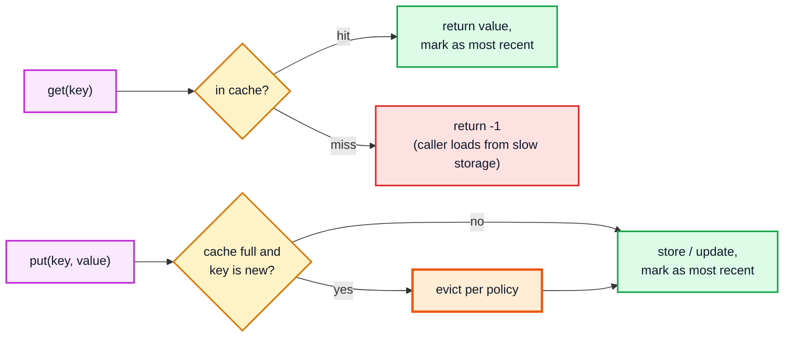
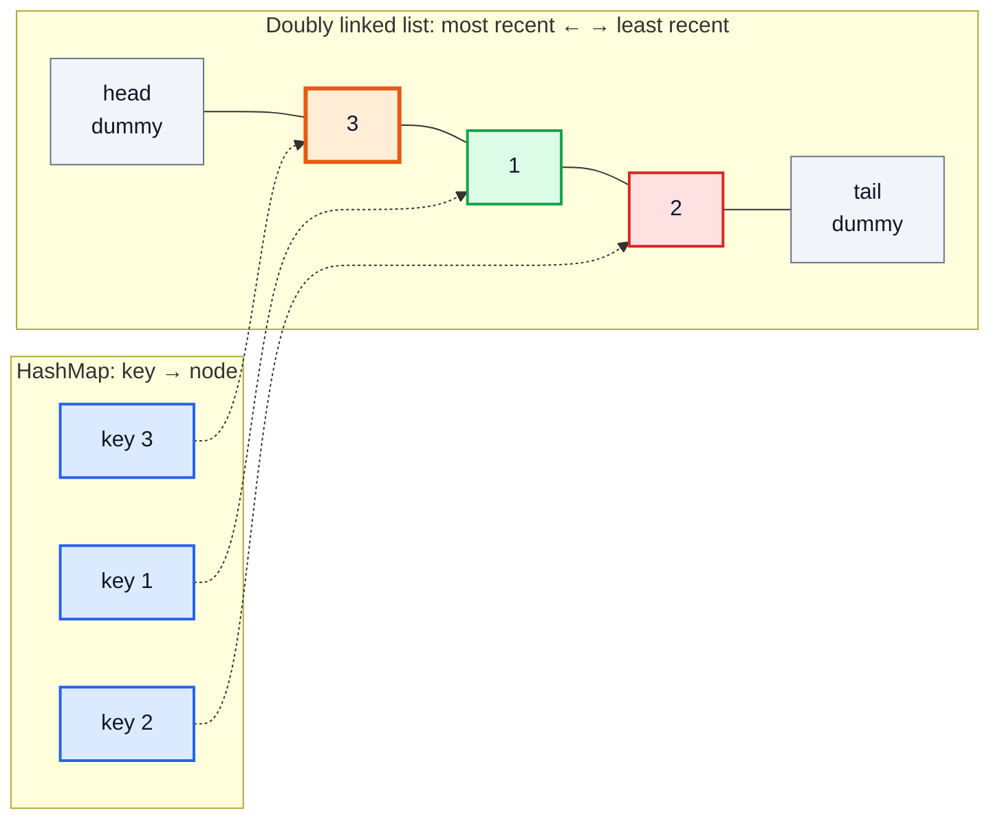
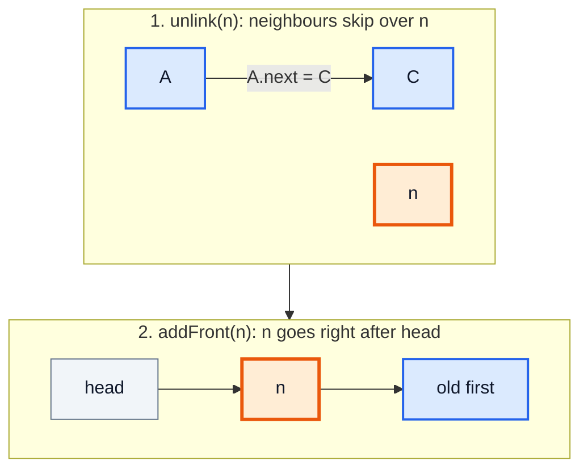
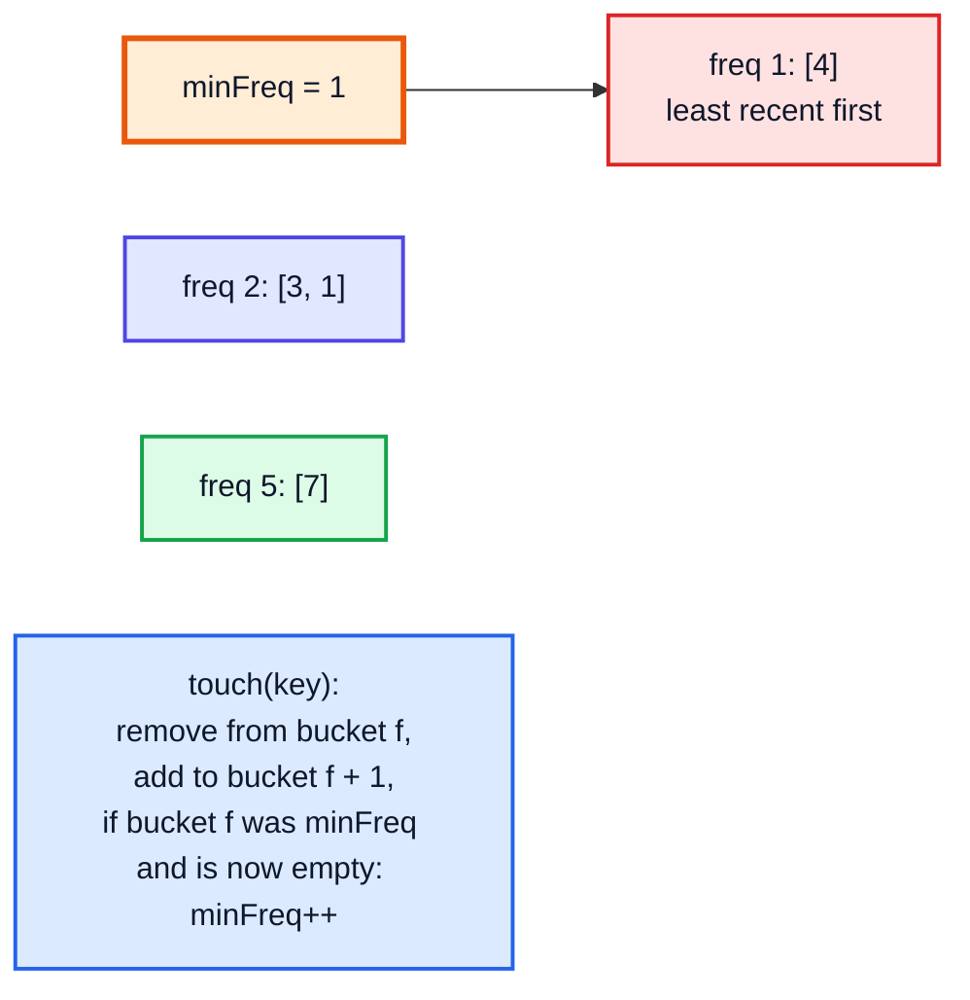

# LRU & LFU Cache — Complete In-Depth Guide

**DSA gap pattern #13 of 16** · Priority 🟡 · from [topics_not_covered.md](../topics_not_covered.md)

"Design an LRU cache" is one of the most frequently asked coding-interview design questions. It's small enough to code in 30 minutes, and it tests whether you can **combine two data structures** so that every operation is O(1). A `HashMap` finds items instantly but has no order; a doubly linked list keeps order and moves nodes in O(1) but can't find them. Together they give `get` and `put` in O(1). These notes build LRU from scratch (LC 146), show the `LinkedHashMap` shortcut, then build the harder LFU cache (LC 460), and finish with thread safety and other eviction policies.

> [!NOTE]
> This pattern isn't in the playlist, so there are no video timestamps. All code targets **Java 21**. You need `HashMap` ([video 57](../kunal-java-notes-claude/java_57_video_hashmap_hashtable.md)) and doubly linked lists ([video 44](../kunal-java-notes-claude/java_44_video_linked_list.md)). `LinkedHashMap` and `SequencedMap` are covered in [gap Java #7, section 11](../Java%20Topics%20Not%20Covered%20Notes/java_gap_07_modern_java_features.md#11-sequenced-collections).

---

## Table of Contents

| # | Topic (anchor link) | Level |
|---|---|---|
| 0 | [Caches and Eviction Policies](#0-caches-and-eviction-policies) | Basics |
| 1 | [Why HashMap plus Doubly Linked List](#1-why-hashmap-plus-doubly-linked-list) | Basics |
| 2 | [LRU Cache from Scratch](#2-lru-cache-from-scratch) | Core |
| 3 | [The LinkedHashMap Shortcut](#3-the-linkedhashmap-shortcut) | Core |
| 4 | [LFU Cache](#4-lfu-cache) | In depth |
| 5 | [Thread Safety and Real-World Caches](#5-thread-safety-and-real-world-caches) | In depth |
| 6 | [Pitfalls and Problem List](#6-pitfalls-and-problem-list) | Interview |

---

## 0. Caches and Eviction Policies

A **cache** keeps a limited number of recently or frequently used items in fast memory. When it's full and a new item arrives, it must **evict** one.

| Policy | Evicts | Good when | Example |
|---|---|---|---|
| **LRU** (Least Recently Used) | The item not touched for the longest time | Recent items are likely to be used again (most workloads) | Browser history, OS page cache |
| **LFU** (Least Frequently Used) | The item used the fewest times (ties → least recent) | Some items stay popular for a long time | CDN popular content |
| **FIFO** | The oldest inserted item | Simplicity matters more than hit rate | Simple buffers |
| **TTL** | Items older than a time limit | Data goes stale | DNS, session caches |
| **Random** | A random item | Very cheap; surprisingly decent | Some CPU caches |



---

## 1. Why HashMap plus Doubly Linked List

LRU needs three things in O(1): **find** a key, **move** it to the "most recent" end, and **remove** the "least recent" item.

| Structure alone | Find | Move to front | Remove oldest |
|---|---|---|---|
| `HashMap` | O(1) ✅ | — no order ❌ | must scan ❌ |
| Array / `ArrayList` ordered by recency | O(n) ❌ | O(n) shifting ❌ | O(1) at one end |
| Singly linked list | O(n) ❌ | O(n) (need the previous node) ❌ | O(1) |
| **HashMap (key → node) + doubly linked list** | **O(1)** | **O(1)** (the node knows `prev` and `next`) | **O(1)** (the tail) |



The node right after `head` (3) is the **most recently used**; the node right before `tail` (2, red) is the **next to be evicted**.

> [!TIP]
> **Dummy head and tail nodes** (sentinels) mean every real node always has a non-null `prev` and `next`, so insert and remove never need `if (node == head)` special cases. That removes most of the bugs in a linked-list implementation.

---

## 2. LRU Cache from Scratch

**LC 146:** `get(key)` returns the value or −1; `put(key, value)` inserts or updates and evicts the LRU item when over capacity. Both must be O(1).

```java
import java.util.*;

public class LRUCache {
    private static final class Node {
        int key, value;
        Node prev, next;
        Node(int k, int v) { key = k; value = v; }
    }

    private final int capacity;
    private final Map<Integer, Node> map = new HashMap<>();
    private final Node head = new Node(0, 0), tail = new Node(0, 0);   // sentinels

    public LRUCache(int capacity) {
        this.capacity = capacity;
        head.next = tail;
        tail.prev = head;
    }

    public int get(int key) {
        Node n = map.get(key);
        if (n == null) return -1;
        moveToFront(n);                                   // it's now the most recently used
        return n.value;
    }

    public void put(int key, int value) {
        Node n = map.get(key);
        if (n != null) {                                  // update existing
            n.value = value;
            moveToFront(n);
            return;
        }
        if (map.size() == capacity) {                     // evict LRU = node before the tail
            Node lru = tail.prev;
            unlink(lru);
            map.remove(lru.key);                          // this is why nodes store their key
        }
        Node fresh = new Node(key, value);
        addFront(fresh);
        map.put(key, fresh);
    }

    private void unlink(Node n) { n.prev.next = n.next; n.next.prev = n.prev; }
    private void addFront(Node n) { n.next = head.next; n.prev = head; head.next.prev = n; head.next = n; }
    private void moveToFront(Node n) { unlink(n); addFront(n); }

    String order() {                                      // most → least recent, for printing
        StringJoiner sj = new StringJoiner(", ", "[", "]");
        for (Node n = head.next; n != tail; n = n.next) sj.add(n.key + "=" + n.value);
        return sj.toString();
    }

    public static void main(String[] args) {
        LRUCache c = new LRUCache(2);
        c.put(1, 1);
        c.put(2, 2);
        System.out.println(c.get(1) + " " + c.order());   // 1 [1=1, 2=2]
        c.put(3, 3);                                      // evicts key 2
        System.out.println(c.get(2) + " " + c.order());   // -1 [3=3, 1=1]
        c.put(4, 4);                                      // evicts key 1
        System.out.println(c.get(1) + " " + c.get(3) + " " + c.get(4) + " " + c.order());   // -1 3 4 [4=4, 3=3]
    }
}
```

**Dry run** (capacity 2):

| Operation | Result | List after (most → least recent) | Evicted |
|---|---|---|---|
| put(1, 1) | — | [1] | — |
| put(2, 2) | — | [2, 1] | — |
| get(1) | 1 | [1, 2] | — |
| put(3, 3) | — | [3, 1] | **2** |
| get(2) | −1 | [3, 1] | — |
| put(4, 4) | — | [4, 3] | **1** |
| get(1) | −1 | [4, 3] | — |
| get(3) | 3 | [3, 4] | — |
| get(4) | 4 | [4, 3] | — |

### Moving a node to the front, step by step



| Operation | Time | Space |
|---|---|---|
| `get` | O(1) | — |
| `put` | O(1) | — |
| Total | | O(capacity) |

> [!IMPORTANT]
> Each node must store its **key**, not just its value. When you evict `tail.prev`, you need its key to remove it from the `HashMap`.

---

## 3. The LinkedHashMap Shortcut

`java.util.LinkedHashMap` **is** a hash map plus a doubly linked list. With `accessOrder = true`, every `get`/`put` moves the entry to the end, and overriding `removeEldestEntry` gives automatic eviction.

```java
import java.util.*;

public class LRUWithLinkedHashMap<K, V> extends LinkedHashMap<K, V> {
    private final int capacity;

    public LRUWithLinkedHashMap(int capacity) {
        super(16, 0.75f, true);                          // true = ACCESS order (false = insertion order)
        this.capacity = capacity;
    }

    @Override
    protected boolean removeEldestEntry(Map.Entry<K, V> eldest) {
        return size() > capacity;                        // called after every put
    }

    public static void main(String[] args) {
        LRUWithLinkedHashMap<Integer, Integer> c = new LRUWithLinkedHashMap<>(2);
        c.put(1, 1); c.put(2, 2);
        c.get(1);                                        // 1 becomes most recent
        c.put(3, 3);                                     // evicts 2
        System.out.println(c.keySet());                  // [1, 3]  (least → most recent)
        System.out.println(c.getOrDefault(2, -1));       // -1
    }
}
```

| | Hand-written (Section 2) | `LinkedHashMap` |
|---|---|---|
| Lines of code | ~40 | ~10 |
| Shows understanding in an interview | ✅ (what most interviewers want) | Mention it as the "real code" answer |
| Iteration order | Most → least recent (as written) | **Least → most** recent |
| Thread-safe | No | No |

> [!WARNING]
> With `accessOrder = true`, even `get` **modifies** the map's structure (it reorders entries). Iterating the map while calling `get` on it throws `ConcurrentModificationException` ([gap Java #10](../Java%20Topics%20Not%20Covered%20Notes/java_gap_10_iterator_fail_fast_fail_safe.md#5-concurrentmodificationexception-and-modcount)).

---

## 4. LFU Cache

**LC 460 (Hard):** evict the key with the **lowest use count**; among ties, the **least recently used** one. `get` and `put` in O(1).

### The design

| Structure | Holds | Why |
|---|---|---|
| `Map<Integer, Integer> values` | key → value | O(1) lookup |
| `Map<Integer, Integer> counts` | key → frequency | O(1) frequency |
| `Map<Integer, LinkedHashSet<Integer>> buckets` | frequency → keys in LRU order | O(1) "least recent with frequency f" |
| `int minFreq` | smallest frequency present | O(1) choice of the bucket to evict from |



```java
import java.util.*;

public class LFUCache {
    private final int capacity;
    private final Map<Integer, Integer> values = new HashMap<>(), counts = new HashMap<>();
    private final Map<Integer, LinkedHashSet<Integer>> buckets = new HashMap<>();   // insertion order = recency
    private int minFreq = 0;

    public LFUCache(int capacity) { this.capacity = capacity; }

    public int get(int key) {
        if (!values.containsKey(key)) return -1;
        touch(key);
        return values.get(key);
    }

    public void put(int key, int value) {
        if (capacity == 0) return;
        if (values.containsKey(key)) { values.put(key, value); touch(key); return; }
        if (values.size() == capacity) {                       // evict: least recent key in the minFreq bucket
            LinkedHashSet<Integer> bucket = buckets.get(minFreq);
            int evict = bucket.iterator().next();
            bucket.remove(evict);
            values.remove(evict);
            counts.remove(evict);
        }
        values.put(key, value);
        counts.put(key, 1);
        buckets.computeIfAbsent(1, f -> new LinkedHashSet<>()).add(key);
        minFreq = 1;                                           // a brand-new key always has the lowest count
    }

    private void touch(int key) {                              // frequency f → f + 1
        int f = counts.get(key);
        counts.put(key, f + 1);
        LinkedHashSet<Integer> bucket = buckets.get(f);
        bucket.remove(key);
        if (f == minFreq && bucket.isEmpty()) minFreq++;
        buckets.computeIfAbsent(f + 1, x -> new LinkedHashSet<>()).add(key);   // added at the end = most recent
    }

    public static void main(String[] args) {
        LFUCache c = new LFUCache(2);
        c.put(1, 1); c.put(2, 2);
        System.out.println(c.get(1));     // 1   (key 1: freq 2)
        c.put(3, 3);                      // evicts key 2 (freq 1)
        System.out.println(c.get(2));     // -1
        System.out.println(c.get(3));     // 3   (key 3: freq 2)
        c.put(4, 4);                      // tie at freq 2: key 1 is less recent → evict 1
        System.out.println(c.get(1));     // -1
        System.out.println(c.get(3));     // 3
        System.out.println(c.get(4));     // 4
    }
}
```

**Dry run** (capacity 2):

| Operation | Counts after | Buckets after | minFreq | Evicted |
|---|---|---|---|---|
| put(1,1) | 1:1 | 1:[1] | 1 | — |
| put(2,2) | 1:1, 2:1 | 1:[1, 2] | 1 | — |
| get(1) → 1 | 1:2, 2:1 | 1:[2], 2:[1] | 1 | — |
| put(3,3) | 1:2, 3:1 | 1:[3], 2:[1] | 1 | **2** |
| get(3) → 3 | 1:2, 3:2 | 1:[], 2:[1, 3] | 2 | — |
| put(4,4) | 3:2, 4:1 | 1:[4], 2:[3] | 1 | **1** (least recent in freq 2) |

> [!NOTE]
> Why does `put` of a new key set `minFreq = 1`? A new key has count 1, the smallest possible, so it's always the new minimum. That's the trick that makes eviction O(1) without scanning frequencies.

| | LRU | LFU |
|---|---|---|
| Structures | HashMap + 1 doubly linked list | HashMap(s) + a list **per frequency** + `minFreq` |
| Evicts | Least recent | Least frequent, then least recent |
| Weakness | One scan of many items flushes useful ones | An item popular long ago can stay forever ("cache pollution") |

---

## 5. Thread Safety and Real-World Caches

Neither implementation above is thread-safe ([gap Java #1](../Java%20Topics%20Not%20Covered%20Notes/java_gap_01_multithreading_concurrency.md)).

| Option | Notes |
|---|---|
| `Collections.synchronizedMap(new LRUWithLinkedHashMap<>(n))` | One lock for everything; simple, contended under load |
| `synchronized` on `get`/`put` of the hand-written class | Same idea; easy to reason about |
| `ReentrantReadWriteLock` | Doesn't help much: in an LRU, `get` **writes** (it reorders) |
| Lock striping / segmented caches | Split keys into N independent LRUs by hash |
| **Caffeine** (library) | Production-grade, near-optimal hit rate (W-TinyLFU), concurrent, TTL support |

```java
public class SynchronizedLRU {
    private final LRUWithLinkedHashMap<String, String> inner = new LRUWithLinkedHashMap<>(100);
    public synchronized String get(String k) { return inner.get(k); }
    public synchronized void put(String k, String v) { inner.put(k, v); }
}
```

### Design follow-ups interviewers ask

| Follow-up | Idea |
|---|---|
| Add a time-to-live | Store an expiry timestamp in each node; treat expired entries as misses; optionally a background cleaner or a min-heap by expiry |
| Cache in a distributed system | Redis / Memcached with an LRU-like eviction policy (`allkeys-lru`) |
| Weight entries by size, not count | Track total bytes; evict until under the limit |
| Avoid "one big scan flushes everything" | Segmented LRU / 2Q / W-TinyLFU (Caffeine) |

---

## 6. Pitfalls and Problem List

### Pitfalls

| Pitfall | Fix |
|---|---|
| Not storing the key in the node | You can't remove the evicted entry from the map |
| Forgetting to update recency on `get` | `get` must move the node to the front |
| Updating an existing key evicts something | Check "key exists" **before** checking capacity |
| `null` checks everywhere in the list | Use dummy head and tail |
| LFU: forgetting `minFreq = 1` for a new key | New keys always have frequency 1 |
| LFU: not bumping `minFreq` when its bucket empties | `if (f == minFreq && bucket.isEmpty()) minFreq++` |
| Capacity 0 | Ignore `put` |
| `LinkedHashMap` without `accessOrder = true` | It's then FIFO, not LRU |

### Problem list

| # | Problem | Idea | Difficulty |
|---|---|---|---|
| 1 | LC 146 LRU Cache | HashMap + doubly linked list | Medium |
| 2 | LC 460 LFU Cache | Frequency buckets + `minFreq` | Hard |
| 3 | LC 432 All O(1) Data Structure | Buckets of keys by count (like LFU) | Hard |
| 4 | LC 1472 Design Browser History | Doubly linked list / array with a cursor | Medium |
| 5 | LC 706 Design HashMap | Chaining ([video 57](../kunal-java-notes-claude/java_57_video_hashmap_hashtable.md)) | Easy |
| 6 | LC 380 Insert Delete GetRandom O(1) | HashMap + array, swap with last on delete | Medium |
| 7 | LC 895 Maximum Frequency Stack | Frequency → stack, like LFU | Hard |

### Interview Q&A

| Question | Short answer |
|---|---|
| How do you get O(1) `get` and `put` in an LRU? | HashMap for lookup + doubly linked list for recency order. |
| Why doubly, not singly, linked? | Removing a node in O(1) needs its `prev`. |
| Why dummy head/tail? | No null checks or special cases for the first/last node. |
| Quick Java answer? | `LinkedHashMap(cap, 0.75f, true)` + `removeEldestEntry`. |
| LRU vs LFU? | Recency vs frequency; LFU breaks ties by recency. |
| How does LFU evict in O(1)? | Keep `minFreq` and an ordered set of keys per frequency. |
| Is it thread-safe? | No; synchronise, stripe, or use Caffeine. |

---

## 🧩 Complete Example: Everything Together

The hand-written LRU, the `LinkedHashMap` LRU and the LFU running the same random workloads, cross-checked against simple O(n) "reference" caches that are obviously correct, plus a hit-rate comparison of LRU and LFU on a skewed workload.

```java
import java.util.*;

public class CacheShowcase {

    // ---------- hand-written LRU ----------
    static final class LRU {
        static final class Node { int k, v; Node p, n; Node(int k, int v) { this.k = k; this.v = v; } }
        final int cap; final Map<Integer, Node> map = new HashMap<>(); final Node h = new Node(0, 0), t = new Node(0, 0);
        LRU(int cap) { this.cap = cap; h.n = t; t.p = h; }
        void unlink(Node x) { x.p.n = x.n; x.n.p = x.p; }
        void front(Node x) { x.n = h.n; x.p = h; h.n.p = x; h.n = x; }
        int get(int k) { Node x = map.get(k); if (x == null) return -1; unlink(x); front(x); return x.v; }
        void put(int k, int v) {
            Node x = map.get(k);
            if (x != null) { x.v = v; unlink(x); front(x); return; }
            if (map.size() == cap) { Node lru = t.p; unlink(lru); map.remove(lru.k); }
            x = new Node(k, v); front(x); map.put(k, x);
        }
    }

    // ---------- LinkedHashMap LRU ----------
    static final class LHM extends LinkedHashMap<Integer, Integer> {
        final int cap; LHM(int cap) { super(16, 0.75f, true); this.cap = cap; }
        @Override protected boolean removeEldestEntry(Map.Entry<Integer, Integer> e) { return size() > cap; }
        int read(int k) { return getOrDefault(k, -1); }
    }

    // ---------- LFU ----------
    static final class LFU {
        final int cap; int minF; final Map<Integer, Integer> val = new HashMap<>(), cnt = new HashMap<>();
        final Map<Integer, LinkedHashSet<Integer>> b = new HashMap<>();
        LFU(int cap) { this.cap = cap; }
        void touch(int k) { int f = cnt.get(k); cnt.put(k, f + 1); b.get(f).remove(k); if (f == minF && b.get(f).isEmpty()) minF++; b.computeIfAbsent(f + 1, x -> new LinkedHashSet<>()).add(k); }
        int get(int k) { if (!val.containsKey(k)) return -1; touch(k); return val.get(k); }
        void put(int k, int v) {
            if (cap == 0) return;
            if (val.containsKey(k)) { val.put(k, v); touch(k); return; }
            if (val.size() == cap) { int e = b.get(minF).iterator().next(); b.get(minF).remove(e); val.remove(e); cnt.remove(e); }
            val.put(k, v); cnt.put(k, 1); b.computeIfAbsent(1, x -> new LinkedHashSet<>()).add(k); minF = 1;
        }
    }

    // ---------- obviously-correct O(n) references ----------
    static final class RefLRU {                         // list of {key, value}, index 0 = most recent
        final int cap; final List<int[]> items = new ArrayList<>();
        RefLRU(int cap) { this.cap = cap; }
        int find(int k) { for (int i = 0; i < items.size(); i++) if (items.get(i)[0] == k) return i; return -1; }
        int get(int k) { int i = find(k); if (i < 0) return -1; int[] e = items.remove(i); items.add(0, e); return e[1]; }
        void put(int k, int v) {
            int i = find(k);
            if (i >= 0) items.remove(i);
            else if (items.size() == cap) items.remove(items.size() - 1);
            items.add(0, new int[]{k, v});
        }
    }
    static final class RefLFU {                         // {key, value, count, lastUsedTime}
        final int cap; final List<long[]> items = new ArrayList<>(); long clock = 0;
        RefLFU(int cap) { this.cap = cap; }
        long[] find(int k) { for (long[] e : items) if (e[0] == k) return e; return null; }
        int get(int k) { long[] e = find(k); if (e == null) return -1; e[2]++; e[3] = ++clock; return (int) e[1]; }
        void put(int k, int v) {
            if (cap == 0) return;
            long[] e = find(k);
            if (e != null) { e[1] = v; e[2]++; e[3] = ++clock; return; }
            if (items.size() == cap) items.remove(Collections.min(items, Comparator.<long[]>comparingLong(x -> x[2]).thenComparingLong(x -> x[3])));
            items.add(new long[]{k, v, 1, ++clock});
        }
    }

    public static void main(String[] args) {
        LRU lru = new LRU(2);
        lru.put(1, 1); lru.put(2, 2); int a = lru.get(1); lru.put(3, 3);
        System.out.println("LRU (cap 2): get(1)=" + a + ", after put(3): get(2)=" + lru.get(2) + ", get(3)=" + lru.get(3));

        LFU lfu = new LFU(2);
        lfu.put(1, 1); lfu.put(2, 2); lfu.get(1); lfu.put(3, 3); lfu.get(3); lfu.put(4, 4);
        System.out.println("LFU (cap 2): get(1)=" + lfu.get(1) + ", get(3)=" + lfu.get(3) + ", get(4)=" + lfu.get(4));

        Random rnd = new Random(146);
        int checks = 0, mismatches = 0;
        for (int t = 0; t < 200; t++) {
            int cap = rnd.nextInt(4) + (t % 10 == 0 ? 0 : 1);
            LRU x = new LRU(Math.max(cap, 1)); LHM y = new LHM(Math.max(cap, 1)); RefLRU rl = new RefLRU(Math.max(cap, 1));
            LFU f = new LFU(cap); RefLFU rf = new RefLFU(cap);
            for (int op = 0; op < 60; op++) {
                int k = rnd.nextInt(6), v = rnd.nextInt(100);
                if (rnd.nextBoolean()) {
                    int g1 = x.get(k), g2 = y.read(k), g3 = rl.get(k), g4 = f.get(k), g5 = rf.get(k);
                    if (g1 != g3 || g2 != g3 || g4 != g5) mismatches++;
                    checks++;
                } else { x.put(k, v); y.put(k, v); rl.put(k, v); f.put(k, v); rf.put(k, v); }
            }
        }
        System.out.println("Random cross-checks against reference caches: " + checks + ", mismatches: " + mismatches);

        // Hit-rate experiment: a few "hot" keys requested often, mixed with a scan of cold keys
        LRU lruHits = new LRU(5);
        LFU lfuHits = new LFU(5);
        int lruHit = 0, lfuHit = 0, requests = 0;
        Random w = new Random(7);
        for (int i = 0; i < 20_000; i++) {
            int key = w.nextInt(10) < 7 ? w.nextInt(3) : 100 + (i % 50);    // 70% hot keys 0..2, 30% a cold scan
            requests++;
            if (lruHits.get(key) != -1) lruHit++; else lruHits.put(key, key);
            if (lfuHits.get(key) != -1) lfuHit++; else lfuHits.put(key, key);
        }
        System.out.printf("Hit rate with a cold scan mixed in: LRU %.1f%%, LFU %.1f%%%n", 100.0 * lruHit / requests, 100.0 * lfuHit / requests);
    }
}
```

**Expected Output:**
```
LRU (cap 2): get(1)=1, after put(3): get(2)=-1, get(3)=3
LFU (cap 2): get(1)=-1, get(3)=3, get(4)=4
Random cross-checks against reference caches: 5977, mismatches: 0
Hit rate with a cold scan mixed in: LRU 59.6%, LFU 69.9%
```

---

## Quick Reference Cheat Sheet

| Concept | One-Line Summary |
|---|---|
| **LRU** | Evict the least recently used |
| **Structures** | `HashMap<key, Node>` + doubly linked list with dummy head/tail |
| **get** | Look up; move to front; return value (or −1) |
| **put** | Update + move to front, or evict `tail.prev` if full, then add at front |
| **Node** | Stores key **and** value (the key is needed to remove it from the map) |
| **Java shortcut** | `new LinkedHashMap<>(cap, 0.75f, true)` + `removeEldestEntry` |
| **LFU** | Evict the least frequent, ties by least recent |
| **LFU structures** | key→value, key→count, count→`LinkedHashSet` of keys, `minFreq` |
| **LFU new key** | count 1, `minFreq = 1` |
| **LFU touch** | Move key from bucket f to f+1; bump `minFreq` if bucket f empties |
| **Complexity** | O(1) for both operations, O(capacity) space |
| **Thread safety** | Synchronise, stripe, or use Caffeine |
