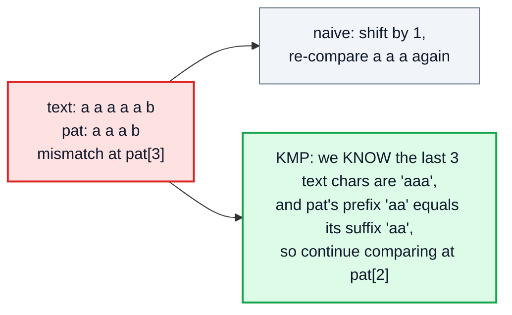
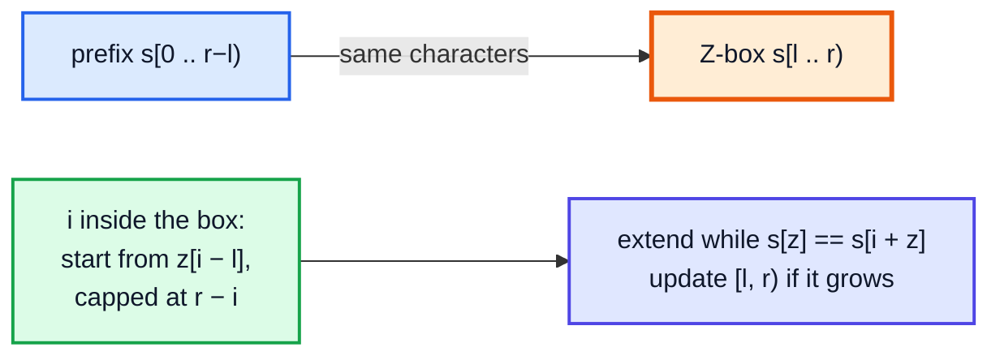
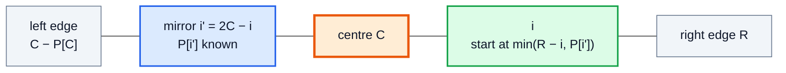

# String Algorithms: KMP, Z-Algorithm, Manacher — Complete In-Depth Guide

**DSA gap pattern #14 of 16** · Priority 🟢 · from [topics_not_covered.md](../topics_not_covered.md)

Searching for a pattern in a text by trying every position costs O(n · m) in the worst case. [Video 58](../kunal-java-notes-claude/java_58_video_karp_rabin.md) shows **Rabin-Karp**, which uses hashing to be fast on average. These notes cover the three classic **linear-time** string algorithms that don't rely on hashing:

- **KMP** (Knuth–Morris–Pratt) precomputes, for each prefix of the pattern, its longest proper prefix that is also a suffix, so the search never re-reads text characters.
- The **Z-algorithm** computes, for every position, how far the string starting there matches the string's own prefix.
- **Manacher's algorithm** finds every palindrome centre's radius in O(n).

They're less common in interviews than the 🔴 patterns, but they come up for "find the pattern / repeated pattern / shortest palindrome" questions and in competitive programming.

> [!NOTE]
> This pattern isn't in the playlist, so there are no video timestamps. All code targets **Java 21**. You need strings ([video 21](../kunal-java-notes-claude/java_21_video_strings_stringbuilder.md)) and the idea of a sliding comparison window. The simpler O(n²) "expand around centre" palindrome method is in [DP topic #1, section 8](dsa_topic_01_dynamic_programming.md#8-string-dp-lcs-edit-distance-palindromes).

---

## Table of Contents

| # | Topic (anchor link) | Level |
|---|---|---|
| 0 | [Why Naive Matching Is Slow](#0-why-naive-matching-is-slow) | Basics |
| 1 | [The Prefix Function (LPS Array)](#1-the-prefix-function-lps-array) | Core |
| 2 | [KMP Search](#2-kmp-search) | Core |
| 3 | [KMP Applications](#3-kmp-applications) | In depth |
| 4 | [The Z-Algorithm](#4-the-z-algorithm) | In depth |
| 5 | [Manacher's Algorithm](#5-manachers-algorithm) | Advanced |
| 6 | [Rabin-Karp Recap and Choosing an Algorithm](#6-rabin-karp-recap-and-choosing-an-algorithm) | Interview |
| 7 | [Pitfalls and Problem List](#7-pitfalls-and-problem-list) | Interview |

---

## 0. Why Naive Matching Is Slow

```java
static int naive(String text, String pat) {
    for (int i = 0; i + pat.length() <= text.length(); i++) {
        int j = 0;
        while (j < pat.length() && text.charAt(i + j) == pat.charAt(j)) j++;
        if (j == pat.length()) return i;
    }
    return -1;
}
```

Worst case: `text = "aaaa…aab"`, `pat = "aaab"`. At every position we match `m − 1` characters before failing, then **start again one step later**, throwing away everything we learned. Total O(n · m).



> [!TIP]
> Java's `String.indexOf` uses a naive-style loop (with fast intrinsics). It's fine for normal inputs; the linear algorithms matter for adversarial inputs, very long texts, or when you need the extra information they compute (borders, periods, palindrome radii).

---

## 1. The Prefix Function (LPS Array)

For a string `p`, `lps[i]` = length of the **longest proper prefix of `p[0..i]` that is also a suffix** of it. ("Proper" = not the whole string.) Such a prefix-that-is-also-a-suffix is called a **border**.

| i | p[0..i] | Longest border | lps[i] |
|---|---|---|---|
| 0 | a | — | 0 |
| 1 | aa | a | 1 |
| 2 | aab | — | 0 |
| 3 | aaba | a | 1 |
| 4 | aabaa | aa | 2 |
| 5 | aabaaa | aa | 2 |
| 6 | aabaaab | aab | 3 |

### Computing it in O(m)

Keep `len` = length of the current border. When the next character extends it, `len++`. When it doesn't, **fall back** to the next shorter border, `lps[len − 1]`, and try again. Never restart from zero unless forced.

```java
import java.util.*;

public class PrefixFunction {
    static int[] lps(String p) {
        int m = p.length();
        int[] lps = new int[m];
        int len = 0;                                         // length of the current border
        for (int i = 1; i < m; i++) {
            while (len > 0 && p.charAt(i) != p.charAt(len)) len = lps[len - 1];   // fall back to a shorter border
            if (p.charAt(i) == p.charAt(len)) len++;
            lps[i] = len;
        }
        return lps;
    }

    public static void main(String[] args) {
        System.out.println(Arrays.toString(lps("aabaaab")));      // [0, 1, 0, 1, 2, 2, 3]
        System.out.println(Arrays.toString(lps("ababcabab")));    // [0, 0, 1, 2, 0, 1, 2, 3, 4]
        System.out.println(Arrays.toString(lps("aaaa")));         // [0, 1, 2, 3]
    }
}
```

**Dry run** for `"aabaaab"`:

| i | p[i] | len before | Fall-backs | Match? | lps[i] |
|---|---|---|---|---|---|
| 1 | a | 0 | — | p[1] = p[0] ✓ | 1 |
| 2 | b | 1 | p[2] ≠ p[1] → len = lps[0] = 0 | p[2] ≠ p[0] | 0 |
| 3 | a | 0 | — | ✓ | 1 |
| 4 | a | 1 | — | p[4] = p[1] ✓ | 2 |
| 5 | a | 2 | p[5] ≠ p[2] ('b') → len = lps[1] = 1 | p[5] = p[1] ✓ | 2 |
| 6 | b | 2 | — | p[6] = p[2] ✓ | 3 |

> [!NOTE]
> **Why O(m)?** `len` increases by at most 1 per step, and every fall-back decreases it. It can't decrease more times in total than it increased, so all the `while` loops together run at most m times. That's the same amortised argument as the sliding window and monotonic stack.

---

## 2. KMP Search

Run the same logic over the **text**, with `j` = how many pattern characters currently match. On a mismatch, fall back with `j = lps[j − 1]`; the text pointer `i` **never moves backwards**.

```java
import java.util.*;

public class KMP {
    static int[] lps(String p) {
        int[] lps = new int[p.length()];
        for (int i = 1, len = 0; i < p.length(); i++) {
            while (len > 0 && p.charAt(i) != p.charAt(len)) len = lps[len - 1];
            if (p.charAt(i) == p.charAt(len)) len++;
            lps[i] = len;
        }
        return lps;
    }

    static List<Integer> searchAll(String text, String pat) {
        List<Integer> hits = new ArrayList<>();
        if (pat.isEmpty()) return hits;
        int[] lps = lps(pat);
        for (int i = 0, j = 0; i < text.length(); i++) {
            while (j > 0 && text.charAt(i) != pat.charAt(j)) j = lps[j - 1];
            if (text.charAt(i) == pat.charAt(j)) j++;
            if (j == pat.length()) {                         // full match ending at i
                hits.add(i - j + 1);
                j = lps[j - 1];                              // keep going: allow overlapping matches
            }
        }
        return hits;
    }

    // LC 28 Find the Index of the First Occurrence in a String
    static int strStr(String haystack, String needle) {
        List<Integer> h = searchAll(haystack, needle);
        return needle.isEmpty() ? 0 : h.isEmpty() ? -1 : h.get(0);
    }

    public static void main(String[] args) {
        System.out.println(searchAll("ababcabcabababd", "ababd"));   // [10]
        System.out.println(searchAll("aaaaa", "aa"));                // [0, 1, 2, 3]  (overlapping)
        System.out.println(strStr("sadbutsad", "sad") + " " + strStr("leetcode", "leeto"));   // 0 -1
    }
}
```

| | Naive | KMP |
|---|---|---|
| Preprocessing | — | O(m) |
| Search | O(n · m) worst | **O(n)** |
| Text pointer moves back? | Yes | **Never** (good for streams) |
| Extra space | O(1) | O(m) |

---

## 3. KMP Applications

The `lps` array says a lot about a string's structure.

### Repeated Substring Pattern (LC 459)

Is `s` some substring repeated several times? With `L = lps[n − 1]`, the shortest **period** of `s` is `n − L`. `s` is a repetition exactly when `L > 0` and `n % (n − L) == 0`.

### Longest Happy Prefix (LC 1392)

The longest proper prefix that's also a suffix of the whole string is `s.substring(0, lps[n − 1])`.

### Shortest Palindrome (LC 214)

Add characters **in front of** `s` to make it a palindrome. We need the longest palindromic **prefix** of `s`. Build `t = s + "#" + reverse(s)`; `lps[last]` of `t` is that prefix's length (the `#` stops a match from crossing the middle).

```java
public class KMPApplications {
    static int[] lps(String p) {
        int[] lps = new int[p.length()];
        for (int i = 1, len = 0; i < p.length(); i++) {
            while (len > 0 && p.charAt(i) != p.charAt(len)) len = lps[len - 1];
            if (p.charAt(i) == p.charAt(len)) len++;
            lps[i] = len;
        }
        return lps;
    }

    static boolean repeatedSubstringPattern(String s) {
        int n = s.length(), L = lps(s)[n - 1];
        return L > 0 && n % (n - L) == 0;
    }

    static String longestPrefix(String s) { return s.substring(0, lps(s)[s.length() - 1]); }

    static String shortestPalindrome(String s) {
        String t = s + "#" + new StringBuilder(s).reverse();
        int palPrefix = lps(t)[t.length() - 1];
        return new StringBuilder(s.substring(palPrefix)).reverse() + s;
    }

    public static void main(String[] args) {
        System.out.println(repeatedSubstringPattern("abab") + " " + repeatedSubstringPattern("aba")
                + " " + repeatedSubstringPattern("abcabcabcabc"));                     // true false true
        System.out.println(longestPrefix("level") + " " + longestPrefix("ababab"));     // l abab
        System.out.println(shortestPalindrome("aacecaaa") + " " + shortestPalindrome("abcd"));   // aaacecaaa dcbabcd
    }
}
```

| Question | Use of `lps` |
|---|---|
| Shortest period | `n − lps[n − 1]` |
| Is it a repetition? | `lps[n−1] > 0 && n % period == 0` |
| Longest border | `lps[n − 1]` |
| Longest palindromic prefix | `lps` of `s + "#" + reverse(s)` |
| Count occurrences | KMP search with `j = lps[j − 1]` after each match |

---

## 4. The Z-Algorithm

`z[i]` = length of the longest substring starting at `i` that matches a **prefix** of the string (`z[0]` is usually set to 0 or n).

| i | 0 | 1 | 2 | 3 | 4 | 5 | 6 | 7 |
|---|---|---|---|---|---|---|---|---|
| s | a | a | b | c | a | a | b | x |
| z | – | 1 | 0 | 0 | 3 | 1 | 0 | 0 |

`z[4] = 3` because `s[4..6] = "aab"` equals the prefix `"aab"`.

### Computing it in O(n): the Z-box

Keep the rightmost window `[l, r)` that matches a prefix. For `i` inside it, `s[i..r)` equals `s[i−l .. r−l)`, so `z[i]` is at least `min(r − i, z[i − l])` for free. Then extend by direct comparison.



```java
import java.util.*;

public class ZAlgorithm {
    static int[] z(String s) {
        int n = s.length();
        int[] z = new int[n];
        for (int i = 1, l = 0, r = 0; i < n; i++) {
            if (i < r) z[i] = Math.min(r - i, z[i - l]);              // reuse what the Z-box tells us
            while (i + z[i] < n && s.charAt(z[i]) == s.charAt(i + z[i])) z[i]++;
            if (i + z[i] > r) { l = i; r = i + z[i]; }                // new rightmost box
        }
        return z;
    }

    // Pattern search: z of pat + '$' + text; a value equal to pat.length() marks a match
    static List<Integer> search(String text, String pat) {
        String s = pat + "\u0000" + text;                               // separator that appears in neither
        int[] z = z(s);
        List<Integer> hits = new ArrayList<>();
        for (int i = pat.length() + 1; i < s.length(); i++) if (z[i] >= pat.length()) hits.add(i - pat.length() - 1);
        return hits;
    }

    public static void main(String[] args) {
        System.out.println(Arrays.toString(z("aabcaabx")));            // [0, 1, 0, 0, 3, 1, 0, 0]
        System.out.println(Arrays.toString(z("aaaaa")));               // [0, 4, 3, 2, 1]
        System.out.println(search("ababcabcabababd", "abab"));        // [0, 8, 10]
    }
}
```

| | KMP (prefix function) | Z-algorithm |
|---|---|---|
| Stores per position | Longest border **ending** here | Longest prefix match **starting** here |
| Pattern search | Run over the text with `lps` of the pattern | `z` of `pat + sep + text` |
| Time | O(n + m) | O(n + m) |
| Feels more natural for | Streaming text, periods | "Matches the prefix from here" questions (LC 2223 Sum of Scores of Built Strings) |

The two arrays carry the same information and can be converted into each other.

---

## 5. Manacher's Algorithm

**Goal:** for every centre, the radius of the longest palindrome around it, in O(n). This gives the longest palindromic substring (LC 5) and the count of palindromic substrings (LC 647) in linear time, versus O(n²) for expanding around each centre.

**Trick 1: transform** the string to handle odd and even lengths together: `"abba"` → `"^#a#b#b#a#$"`. Every palindrome in the new string has odd length and a single centre; `^` and `$` are different sentinels so the expansion stops without bounds checks.

**Trick 2: mirror.** Keep the palindrome `[C − P[C], C + P[C]]` that reaches furthest right (`R`). For `i < R`, its mirror `i' = 2C − i` has already been computed, and by symmetry `P[i] ≥ min(R − i, P[i'])`. Then try to expand further.



```java
public class Manacher {
    // P[i] in the transformed string = length of the palindrome in the ORIGINAL string centred there
    static int[] radii(String s) {
        StringBuilder t = new StringBuilder("^");
        for (char c : s.toCharArray()) t.append('#').append(c);
        t.append("#$");
        int n = t.length();
        int[] P = new int[n];
        for (int i = 1, C = 0, R = 0; i < n - 1; i++) {
            if (i < R) P[i] = Math.min(R - i, P[2 * C - i]);                        // mirror
            while (t.charAt(i + P[i] + 1) == t.charAt(i - P[i] - 1)) P[i]++;        // expand
            if (i + P[i] > R) { C = i; R = i + P[i]; }
        }
        return P;
    }

    // LC 5
    static String longestPalindrome(String s) {
        int[] P = radii(s);
        int best = 0, centre = 0;
        for (int i = 1; i < P.length - 1; i++) if (P[i] > best) { best = P[i]; centre = i; }
        int start = (centre - best) / 2;                    // map back to the original string
        return s.substring(start, start + best);
    }

    // LC 647: a centre with radius P[i] contributes ceil(P[i] / 2) palindromes
    static int countSubstrings(String s) {
        int[] P = radii(s);
        int count = 0;
        for (int i = 1; i < P.length - 1; i++) count += (P[i] + 1) / 2;
        return count;
    }

    public static void main(String[] args) {
        System.out.println(longestPalindrome("babad") + " " + longestPalindrome("cbbd") + " " + longestPalindrome("forgeeksskeegfor"));
        // bab bb geeksskeeg
        System.out.println(countSubstrings("abc") + " " + countSubstrings("aaa"));   // 3 6
    }
}
```

| Method | Longest palindromic substring | Count palindromic substrings |
|---|---|---|
| Check every substring | O(n³) | O(n³) |
| DP table `isPal[i][j]` | O(n²) time and space | O(n²) |
| Expand around 2n − 1 centres | O(n²) time, O(1) space | O(n²) |
| **Manacher** | **O(n)** | **O(n)** |

> [!TIP]
> In interviews, **expand around centre** is usually expected and accepted for LC 5 / 647. Mention Manacher as the O(n) follow-up; code it if asked.

---

## 6. Rabin-Karp Recap and Choosing an Algorithm

[Video 58](../kunal-java-notes-claude/java_58_video_karp_rabin.md) uses a **rolling hash**: the hash of the next window comes from the previous one in O(1). Average O(n + m), worst O(n · m) if many hashes collide (always verify a hash match by comparing characters).

| Need | Best tool |
|---|---|
| One pattern, normal input | `String.indexOf` / `contains` |
| Guaranteed linear time, or a streaming text | **KMP** |
| Many patterns of the same length / substring equality checks / 2D matching | **Rabin-Karp** (rolling hash) |
| Longest repeated substring (LC 1044) | Rabin-Karp + binary search on the length (or a suffix array) |
| Borders, periods, "is it a repetition?" | **Prefix function** |
| "Longest match with the prefix from each position" | **Z-algorithm** |
| All palindromes / longest palindrome in O(n) | **Manacher** |
| Many patterns at once | Aho–Corasick (a trie + KMP-style failure links); see the [trie notes](dsa_topic_04_trie.md) for the trie part |

---

## 7. Pitfalls and Problem List

### Pitfalls

| Pitfall | Fix |
|---|---|
| Computing `lps` with `len = 0` reset on every mismatch | Fall back with `len = lps[len − 1]` inside a `while` |
| Missing overlapping matches | After a full match, set `j = lps[j − 1]`, not 0 |
| Z-search separator that appears in the text | Use a character outside the alphabet |
| Shortest Palindrome without the `#` separator | The match could run across both halves |
| Manacher bounds errors | Use distinct sentinels `^` and `$` at both ends |
| Rabin-Karp without verifying | Always confirm a hash hit by comparing characters |
| Empty pattern | Decide the convention (LC 28 returns 0) |

### Problem list (in order)

| # | Problem | Algorithm | Difficulty |
|---|---|---|---|
| 1 | LC 28 Find the Index of the First Occurrence | KMP / Z | Easy |
| 2 | LC 459 Repeated Substring Pattern | Prefix function | Easy |
| 3 | LC 1392 Longest Happy Prefix | Prefix function | Hard |
| 4 | LC 214 Shortest Palindrome | KMP on `s#rev(s)` | Hard |
| 5 | LC 686 Repeated String Match | KMP / Rabin-Karp | Medium |
| 6 | LC 5 Longest Palindromic Substring | Expand / Manacher | Medium |
| 7 | LC 647 Palindromic Substrings | Expand / Manacher | Medium |
| 8 | LC 1044 Longest Duplicate Substring | Rabin-Karp + binary search | Hard |
| 9 | LC 2223 Sum of Scores of Built Strings | Z-algorithm | Hard |
| 10 | LC 3008 Find Beautiful Indices II | KMP / Z for both patterns | Hard |

### Interview Q&A

| Question | Short answer |
|---|---|
| What does the LPS array store? | For each prefix, the length of its longest proper prefix that's also a suffix. |
| Why is KMP O(n + m)? | The text pointer never moves back; fall-backs are paid for by earlier advances. |
| What's the Z-array? | `z[i]` = longest substring starting at `i` that matches a prefix. |
| How do you find a string's period? | `n − lps[n − 1]`. |
| Manacher's key idea? | Reuse the mirrored radius inside the rightmost known palindrome. |
| Rabin-Karp's worst case? | O(n · m) with many hash collisions; average O(n + m). |

---

## 🧩 Complete Example: Everything Together

Prefix function, KMP, Z-algorithm and Manacher on sample strings, plus random cross-checks: KMP and Z search against `String.indexOf`, the prefix function against a brute-force border search, and Manacher against brute-force palindrome checks.

```java
import java.util.*;

public class StringAlgorithmsShowcase {

    static int[] lps(String p) {
        int[] l = new int[p.length()];
        for (int i = 1, len = 0; i < p.length(); i++) {
            while (len > 0 && p.charAt(i) != p.charAt(len)) len = l[len - 1];
            if (p.charAt(i) == p.charAt(len)) len++;
            l[i] = len;
        }
        return l;
    }

    static List<Integer> kmpAll(String t, String p) {
        List<Integer> hits = new ArrayList<>();
        int[] l = lps(p);
        for (int i = 0, j = 0; i < t.length(); i++) {
            while (j > 0 && t.charAt(i) != p.charAt(j)) j = l[j - 1];
            if (t.charAt(i) == p.charAt(j)) j++;
            if (j == p.length()) { hits.add(i - j + 1); j = l[j - 1]; }
        }
        return hits;
    }

    static int[] zArr(String s) {
        int n = s.length();
        int[] z = new int[n];
        for (int i = 1, l = 0, r = 0; i < n; i++) {
            if (i < r) z[i] = Math.min(r - i, z[i - l]);
            while (i + z[i] < n && s.charAt(z[i]) == s.charAt(i + z[i])) z[i]++;
            if (i + z[i] > r) { l = i; r = i + z[i]; }
        }
        return z;
    }

    static List<Integer> zAll(String t, String p) {
        String s = p + "\u0000" + t;
        int[] z = zArr(s);
        List<Integer> hits = new ArrayList<>();
        for (int i = p.length() + 1; i < s.length(); i++) if (z[i] >= p.length()) hits.add(i - p.length() - 1);
        return hits;
    }

    static int[] manacher(String s) {
        StringBuilder t = new StringBuilder("^");
        for (char c : s.toCharArray()) t.append('#').append(c);
        t.append("#$");
        int[] P = new int[t.length()];
        for (int i = 1, C = 0, R = 0; i < t.length() - 1; i++) {
            if (i < R) P[i] = Math.min(R - i, P[2 * C - i]);
            while (t.charAt(i + P[i] + 1) == t.charAt(i - P[i] - 1)) P[i]++;
            if (i + P[i] > R) { C = i; R = i + P[i]; }
        }
        return P;
    }
    static String longestPal(String s) {
        int[] P = manacher(s);
        int best = 0, c = 0;
        for (int i = 1; i < P.length - 1; i++) if (P[i] > best) { best = P[i]; c = i; }
        return s.substring((c - best) / 2, (c - best) / 2 + best);
    }
    static int countPal(String s) { int[] P = manacher(s); int n = 0; for (int i = 1; i < P.length - 1; i++) n += (P[i] + 1) / 2; return n; }

    // ---- brute force ----
    static List<Integer> indexOfAll(String t, String p) {
        List<Integer> hits = new ArrayList<>();
        for (int i = t.indexOf(p); i >= 0; i = t.indexOf(p, i + 1)) hits.add(i);
        return hits;
    }
    static int[] lpsBrute(String p) {
        int[] l = new int[p.length()];
        for (int i = 0; i < p.length(); i++)
            for (int len = i; len >= 1; len--) if (p.substring(0, len).equals(p.substring(i - len + 1, i + 1))) { l[i] = len; break; }
        return l;
    }
    static boolean isPal(String s) { return new StringBuilder(s).reverse().toString().equals(s); }
    static int longestPalB(String s) { int b = 0; for (int i = 0; i < s.length(); i++) for (int j = i; j < s.length(); j++) if (isPal(s.substring(i, j + 1))) b = Math.max(b, j - i + 1); return b; }
    static int countPalB(String s) { int c = 0; for (int i = 0; i < s.length(); i++) for (int j = i; j < s.length(); j++) if (isPal(s.substring(i, j + 1))) c++; return c; }

    public static void main(String[] args) {
        String text = "abracadabra abracadabra", pat = "abra";
        System.out.println("LPS of 'abracadabra': " + Arrays.toString(lps("abracadabra")));
        System.out.println("KMP matches of 'abra': " + kmpAll(text, pat));
        System.out.println("Z matches of 'abra'  : " + zAll(text, pat));
        String s = "abcabcabc";
        int period = s.length() - lps(s)[s.length() - 1];
        System.out.println("'" + s + "' has period " + period + " -> repeated? " + (s.length() % period == 0 && period < s.length()));
        System.out.println("Longest palindrome in 'forgeeksskeegfor': " + longestPal("forgeeksskeegfor"));
        System.out.println("Palindromic substrings in 'aabaa': " + countPal("aabaa"));

        Random rnd = new Random(28);
        int checks = 0, mismatches = 0;
        for (int t = 0; t < 400; t++) {
            StringBuilder a = new StringBuilder(), b = new StringBuilder();
            for (int i = 0; i < 1 + rnd.nextInt(30); i++) a.append((char) ('a' + rnd.nextInt(2)));
            for (int i = 0; i < 1 + rnd.nextInt(4); i++) b.append((char) ('a' + rnd.nextInt(2)));
            String tx = a.toString(), pt = b.toString();
            List<Integer> ref = indexOfAll(tx, pt);
            if (!kmpAll(tx, pt).equals(ref) || !zAll(tx, pt).equals(ref)) mismatches++;
            if (!Arrays.equals(lps(tx), lpsBrute(tx))) mismatches++;
            if (longestPal(tx).length() != longestPalB(tx) || !isPal(longestPal(tx)) || countPal(tx) != countPalB(tx)) mismatches++;
            checks += 3;
        }
        System.out.println("Random cross-checks: " + checks + ", mismatches: " + mismatches);
    }
}
```

**Expected Output:**
```
LPS of 'abracadabra': [0, 0, 0, 1, 0, 1, 0, 1, 2, 3, 4]
KMP matches of 'abra': [0, 7, 12, 19]
Z matches of 'abra'  : [0, 7, 12, 19]
'abcabcabc' has period 3 -> repeated? true
Longest palindrome in 'forgeeksskeegfor': geeksskeeg
Palindromic substrings in 'aabaa': 9
Random cross-checks: 1200, mismatches: 0
```

---

## Quick Reference Cheat Sheet

| Concept | One-Line Summary |
|---|---|
| **Naive match** | O(n · m) worst case; restarts after every mismatch |
| **LPS / prefix function** | `lps[i]` = longest proper border of `p[0..i]`; fall back with `len = lps[len−1]` |
| **KMP search** | Text pointer never moves back; after a match `j = lps[j−1]`; O(n + m) |
| **Period** | `n − lps[n−1]`; repetition if it divides n and is < n |
| **Shortest palindrome** | `lps` of `s + "#" + reverse(s)` |
| **Z-array** | `z[i]` = longest prefix match starting at `i`; Z-box `[l, r)` |
| **Z search** | `z` of `pat + sep + text`; hit where `z[i] ≥ m` |
| **Manacher** | Transform `^#a#b#$`; mirror `P[2C − i]`; O(n) palindrome radii |
| **Count palindromes** | Σ `(P[i] + 1) / 2` |
| **Rabin-Karp** | Rolling hash; verify hits; good for many equal-length patterns |
