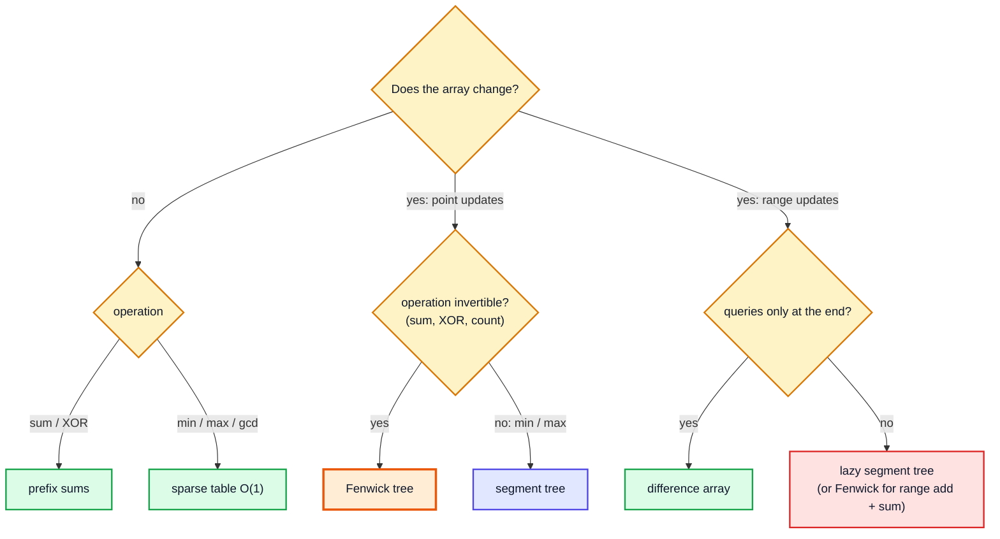
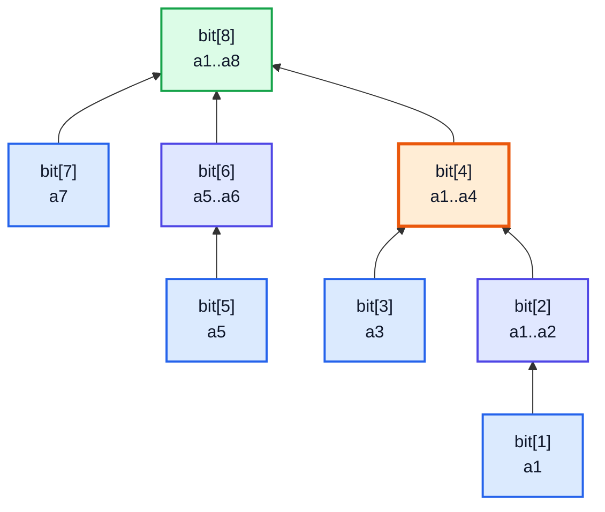
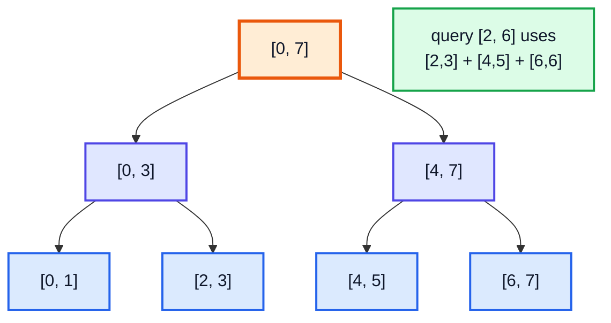
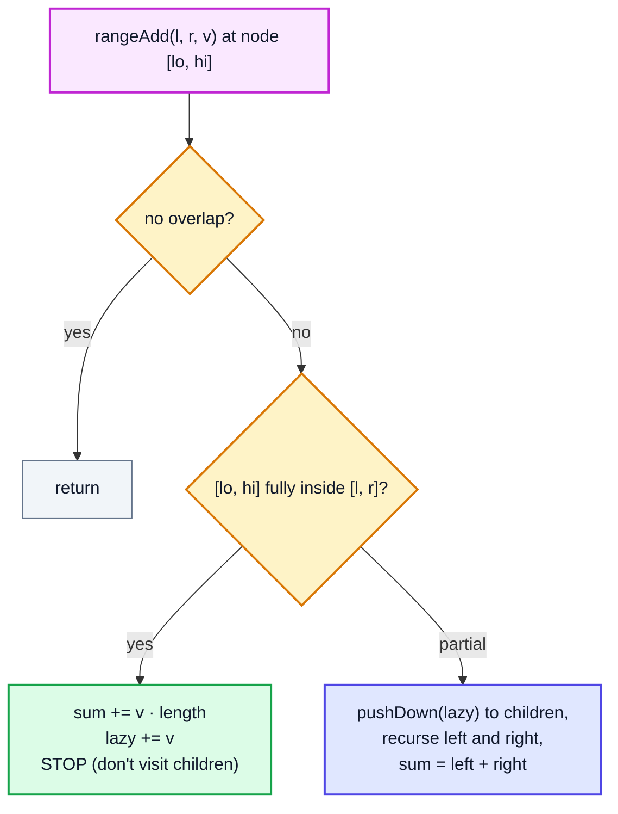
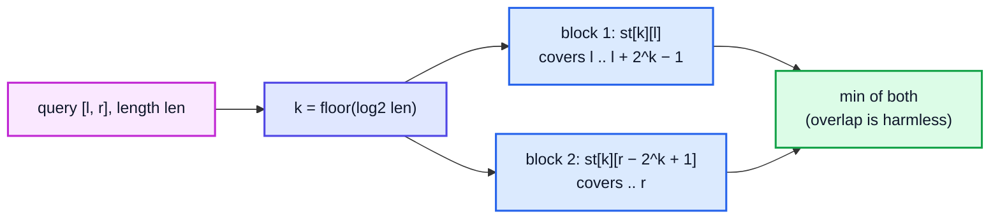

# Advanced Range-Query Structures: Fenwick Tree, Lazy Segment Tree, Sparse Table — Complete In-Depth Guide

**DSA gap pattern #15 of 16** · Priority 🟢 · from [topics_not_covered.md](../topics_not_covered.md)

"Sum / min / max of `a[l..r]`, with updates in between" is a whole family of problems. The playlist covers the **segment tree** ([video 51](../kunal-java-notes-claude/java_51_video_segment_trees.md)) with point updates, and **sqrt decomposition** ([video 62](../kunal-java-notes-claude/java_62_video_sqrt_decomposition_mos_algorithm.md)). These notes add three tools:

- the **Fenwick tree** (Binary Indexed Tree), a tiny array that does prefix sums with updates in O(log n), also used for counting inversions and "smaller elements after self";
- **lazy propagation**, which lets a segment tree apply an update to a whole **range** in O(log n);
- the **sparse table**, which answers range min/max in **O(1)** on a static array.

> [!NOTE]
> This pattern isn't in the playlist, so there are no video timestamps. All code targets **Java 21**. Prerequisites: prefix sums ([gap #3](dsa_gap_03_prefix_sum_difference_array.md)), segment trees ([video 51](../kunal-java-notes-claude/java_51_video_segment_trees.md)), bitwise operators ([video 25](../kunal-java-notes-claude/java_25_video_bitwise_number_systems.md)) for `i & -i`.

---

## Table of Contents

| # | Topic (anchor link) | Level |
|---|---|---|
| 0 | [Choosing a Range-Query Structure](#0-choosing-a-range-query-structure) | Basics |
| 1 | [Fenwick Tree: The Idea](#1-fenwick-tree-the-idea) | Core |
| 2 | [Fenwick Tree: Code and Range Sum Query Mutable](#2-fenwick-tree-code-and-range-sum-query-mutable) | Core |
| 3 | [Fenwick Variants: Range Update, Counting Smaller](#3-fenwick-variants-range-update-counting-smaller) | In depth |
| 4 | [Segment Tree Recap](#4-segment-tree-recap) | Core |
| 5 | [Lazy Propagation: Range Updates](#5-lazy-propagation-range-updates) | Advanced |
| 6 | [Sparse Table: O(1) Range Min](#6-sparse-table-o1-range-min) | In depth |
| 7 | [Pitfalls and Problem List](#7-pitfalls-and-problem-list) | Interview |

---

## 0. Choosing a Range-Query Structure

| Structure | Build | Range query | Point update | Range update | Works for | Code size |
|---|---|---|---|---|---|---|
| Prefix sums ([gap #3](dsa_gap_03_prefix_sum_difference_array.md)) | O(n) | **O(1)** | O(n) | O(n) (difference array if read only at the end) | Sum, XOR | Tiny |
| Sqrt decomposition ([video 62](../kunal-java-notes-claude/java_62_video_sqrt_decomposition_mos_algorithm.md)) | O(n) | O(√n) | O(1) | O(√n) | Anything | Small |
| **Fenwick tree** | O(n) | O(log n) | O(log n) | O(log n) (sum variant) | **Invertible** ops: sum, XOR, counts | **Tiny** |
| Segment tree ([video 51](../kunal-java-notes-claude/java_51_video_segment_trees.md)) | O(n) | O(log n) | O(log n) | O(n) | Any **associative** op: sum, min, max, gcd | Medium |
| **Lazy segment tree** | O(n) | O(log n) | O(log n) | **O(log n)** | Associative ops with composable updates | Larger |
| **Sparse table** | O(n log n) | **O(1)** (idempotent) | ✗ static | ✗ | **Idempotent** ops: min, max, gcd | Small |



> [!NOTE]
> **Invertible** means you can "subtract" a prefix: `sum(l..r) = prefix(r) − prefix(l−1)`. Min isn't invertible: knowing `min(0..r)` and `min(0..l−1)` doesn't give `min(l..r)`. **Idempotent** means combining a value with itself changes nothing (`min(x, x) = x`), so overlapping ranges are fine.

---

## 1. Fenwick Tree: The Idea

A Fenwick tree is an array `bit[1..n]` (1-indexed) where `bit[i]` stores the sum of a block of `lowbit(i)` elements **ending at `i`**, with `lowbit(i) = i & -i` (the value of the lowest set bit).

| i (binary) | lowbit | bit[i] covers |
|---|---|---|
| 1 (0001) | 1 | a[1] |
| 2 (0010) | 2 | a[1..2] |
| 3 (0011) | 1 | a[3] |
| 4 (0100) | 4 | a[1..4] |
| 5 (0101) | 1 | a[5] |
| 6 (0110) | 2 | a[5..6] |
| 7 (0111) | 1 | a[7] |
| 8 (1000) | 8 | a[1..8] |



| Operation | Walk | Example |
|---|---|---|
| `prefix(i)` = a[1..i] | `i -= i & -i` (strip the lowest bit) | prefix(7) = bit[7] + bit[6] + bit[4] |
| `add(i, delta)` | `i += i & -i` (move to the next block that contains `i`) | add(3) touches bit[3], bit[4], bit[8] |

Each walk changes one bit per step, so both take **O(log n)**.

> [!TIP]
> `i & -i` works because `-i` in two's complement ([video 25](../kunal-java-notes-claude/java_25_video_bitwise_number_systems.md)) is `~i + 1`: all bits above the lowest set bit flip, so the AND keeps only that bit. `12 = 1100`, `-12 = …0100`, `12 & -12 = 0100 = 4`.

---

## 2. Fenwick Tree: Code and Range Sum Query Mutable

```java
public class Fenwick {
    private final long[] bit;                           // 1-indexed internally
    Fenwick(int n) { bit = new long[n + 1]; }

    Fenwick(int[] a) {                                  // O(n) build
        this(a.length);
        for (int i = 1; i <= a.length; i++) {
            bit[i] += a[i - 1];
            int parent = i + (i & -i);
            if (parent <= a.length) bit[parent] += bit[i];
        }
    }

    void add(int idx, long delta) {                     // idx is 0-indexed for the caller
        for (int i = idx + 1; i < bit.length; i += i & -i) bit[i] += delta;
    }

    long prefix(int idx) {                              // sum of a[0..idx]
        long s = 0;
        for (int i = idx + 1; i > 0; i -= i & -i) s += bit[i];
        return s;
    }

    long rangeSum(int l, int r) { return prefix(r) - (l > 0 ? prefix(l - 1) : 0); }

    public static void main(String[] args) {
        int[] a = {1, 3, 5};
        Fenwick f = new Fenwick(a);
        System.out.println(f.rangeSum(0, 2));   // 9
        f.add(1, 2 - a[1]);                     // LC 307 update(1, 2): add the DIFFERENCE
        a[1] = 2;
        System.out.println(f.rangeSum(0, 2));   // 8
        System.out.println(f.rangeSum(1, 2));   // 7
    }
}
```

**LC 307 Range Sum Query — Mutable** is exactly this: keep the original array to compute `delta = newValue − oldValue` for `update`.

> [!WARNING]
> Fenwick trees are **1-indexed** inside. Index 0 would loop forever (`0 & -0 = 0`). Convert at the boundary (`idx + 1`) as above, and keep the public API 0-indexed.

---

## 3. Fenwick Variants: Range Update, Counting Smaller

### Range update + point query

Store a **difference array** ([gap #3, section 8](dsa_gap_03_prefix_sum_difference_array.md#8-difference-arrays-for-range-updates)) in the Fenwick tree: `add(l, v)`, `add(r + 1, −v)`; then `a[i] = prefix(i)`.

### Range update + range sum (two Fenwick trees)

`sum(1..i)` after range adds can be written as `B1.prefix(i) · i − B2.prefix(i)`; each range add updates both trees at `l` and `r + 1`.

```java
public class FenwickRangeRange {
    final long[] b1, b2;
    FenwickRangeRange(int n) { b1 = new long[n + 2]; b2 = new long[n + 2]; }

    private void upd(long[] b, int i, long v) { for (; i < b.length; i += i & -i) b[i] += v; }
    private long qry(long[] b, int i) { long s = 0; for (; i > 0; i -= i & -i) s += b[i]; return s; }

    void rangeAdd(int l, int r, long v) {             // 0-indexed, inclusive
        l++; r++;
        upd(b1, l, v); upd(b1, r + 1, -v);
        upd(b2, l, v * (l - 1)); upd(b2, r + 1, -v * r);
    }
    long prefix(int i) { i++; return qry(b1, i) * i - qry(b2, i); }
    long rangeSum(int l, int r) { return prefix(r) - (l > 0 ? prefix(l - 1) : 0); }

    public static void main(String[] args) {
        FenwickRangeRange f = new FenwickRangeRange(5);
        for (int i = 0; i < 5; i++) f.rangeAdd(i, i, i + 1);   // a = [1, 2, 3, 4, 5]
        f.rangeAdd(1, 3, 10);                                   // a = [1, 12, 13, 14, 5]
        System.out.println(f.rangeSum(0, 4) + " " + f.rangeSum(1, 2));   // 45 25
    }
}
```

### Count of Smaller Numbers After Self (LC 315)

Scan from **right to left**; a Fenwick tree over values (after **coordinate compression**) counts how many values smaller than the current one have already been seen.

```java
import java.util.*;

public class CountSmallerAfterSelf {
    static List<Integer> countSmaller(int[] nums) {
        int[] sorted = Arrays.stream(nums).distinct().sorted().toArray();     // coordinate compression
        int[] bit = new int[sorted.length + 1];
        Integer[] res = new Integer[nums.length];
        for (int i = nums.length - 1; i >= 0; i--) {
            int rank = Arrays.binarySearch(sorted, nums[i]) + 1;              // 1-based rank
            int smaller = 0;
            for (int j = rank - 1; j > 0; j -= j & -j) smaller += bit[j];     // count of ranks < rank
            res[i] = smaller;
            for (int j = rank; j < bit.length; j += j & -j) bit[j]++;          // record nums[i]
        }
        return Arrays.asList(res);
    }

    public static void main(String[] args) {
        System.out.println(countSmaller(new int[]{5, 2, 6, 1}));    // [2, 1, 1, 0]
        System.out.println(countSmaller(new int[]{-1, -1}));        // [0, 0]
    }
}
```

The same scan counts **inversions** (pairs `i < j` with `a[i] > a[j]`) in O(n log n), an alternative to the merge-sort method from [video 30](../kunal-java-notes-claude/java_30_video_merge_sort.md). Related: LC 493 Reverse Pairs, LC 1649 Create Sorted Array through Instructions.

---

## 4. Segment Tree Recap

From [video 51](../kunal-java-notes-claude/java_51_video_segment_trees.md): node `v` covers `[lo, hi]`; its children cover the halves. A query splits into O(log n) fully-covered nodes; a point update changes the O(log n) nodes on the path to one leaf.



Updating every element in `[l, r]` one at a time costs O((r − l + 1) log n). **Lazy propagation** fixes that.

---

## 5. Lazy Propagation: Range Updates

**Idea:** when an update covers a node's **entire** range, update that node's value and leave a **lazy tag** ("all my children still owe +v") instead of visiting the children. Push the tag down only when a later operation needs to go inside that node.



```java
public class LazySegmentTree {
    private final long[] sum, lazy;
    private final int n;

    LazySegmentTree(int[] a) {
        n = a.length;
        sum = new long[4 * n];
        lazy = new long[4 * n];
        build(a, 1, 0, n - 1);
    }

    private void build(int[] a, int v, int lo, int hi) {
        if (lo == hi) { sum[v] = a[lo]; return; }
        int mid = (lo + hi) / 2;
        build(a, 2 * v, lo, mid);
        build(a, 2 * v + 1, mid + 1, hi);
        sum[v] = sum[2 * v] + sum[2 * v + 1];
    }

    private void apply(int v, int lo, int hi, long add) {     // add to every element of this node's range
        sum[v] += add * (hi - lo + 1);
        lazy[v] += add;
    }

    private void pushDown(int v, int lo, int hi) {
        if (lazy[v] == 0) return;
        int mid = (lo + hi) / 2;
        apply(2 * v, lo, mid, lazy[v]);
        apply(2 * v + 1, mid + 1, hi, lazy[v]);
        lazy[v] = 0;
    }

    void rangeAdd(int l, int r, long add) { rangeAdd(1, 0, n - 1, l, r, add); }
    private void rangeAdd(int v, int lo, int hi, int l, int r, long add) {
        if (r < lo || hi < l) return;                          // no overlap
        if (l <= lo && hi <= r) { apply(v, lo, hi, add); return; }   // full cover: stop here
        pushDown(v, lo, hi);
        int mid = (lo + hi) / 2;
        rangeAdd(2 * v, lo, mid, l, r, add);
        rangeAdd(2 * v + 1, mid + 1, hi, l, r, add);
        sum[v] = sum[2 * v] + sum[2 * v + 1];
    }

    long query(int l, int r) { return query(1, 0, n - 1, l, r); }
    private long query(int v, int lo, int hi, int l, int r) {
        if (r < lo || hi < l) return 0;
        if (l <= lo && hi <= r) return sum[v];
        pushDown(v, lo, hi);
        int mid = (lo + hi) / 2;
        return query(2 * v, lo, mid, l, r) + query(2 * v + 1, mid + 1, hi, l, r);
    }

    public static void main(String[] args) {
        LazySegmentTree st = new LazySegmentTree(new int[]{1, 2, 3, 4, 5});
        st.rangeAdd(1, 3, 10);                                 // [1, 12, 13, 14, 5]
        System.out.println(st.query(0, 4) + " " + st.query(1, 2) + " " + st.query(4, 4));   // 45 25 5
        st.rangeAdd(0, 4, -1);                                 // [0, 11, 12, 13, 4]
        System.out.println(st.query(0, 2));                    // 23
    }
}
```

| | Point-update segment tree | Lazy segment tree |
|---|---|---|
| Range update | O(n log n) worst (each element) | **O(log n)** |
| Range query | O(log n) | O(log n) |
| Extra memory | — | `lazy[4n]` |

> [!IMPORTANT]
> The lazy tag must **compose**: two pending "add" tags combine by adding. For "assign x to the range", a new assign **replaces** the old tag; mixing add and assign needs a rule for which applies first. Getting this composition right is the whole difficulty of lazy segment trees.

Problems: LC 2569 Handling Sum Queries After Update (range flip), LC 699 Falling Squares (range assign + max), LC 732 My Calendar III (range add + max).

---

## 6. Sparse Table: O(1) Range Min

For a **static** array, precompute `st[k][i]` = min of the block of length `2ᵏ` starting at `i`:

`st[k][i] = min(st[k−1][i], st[k−1][i + 2^(k−1)])`

A query `[l, r]` takes the largest `k` with `2ᵏ ≤ r − l + 1` and combines two blocks that **overlap** to cover the range: `min(st[k][l], st[k][r − 2ᵏ + 1])`. Overlap is fine because `min` is idempotent.



```java
public class SparseTable {
    private final int[][] st;
    private final int[] log;

    SparseTable(int[] a) {
        int n = a.length;
        log = new int[n + 1];
        for (int i = 2; i <= n; i++) log[i] = log[i / 2] + 1;          // floor(log2 i)
        int K = log[n] + 1;
        st = new int[K][n];
        st[0] = a.clone();
        for (int k = 1; k < K; k++)
            for (int i = 0; i + (1 << k) <= n; i++)
                st[k][i] = Math.min(st[k - 1][i], st[k - 1][i + (1 << (k - 1))]);
    }

    int min(int l, int r) {
        int k = log[r - l + 1];
        return Math.min(st[k][l], st[k][r - (1 << k) + 1]);
    }

    public static void main(String[] args) {
        SparseTable t = new SparseTable(new int[]{5, 2, 4, 7, 1, 3, 6});
        System.out.println(t.min(0, 3) + " " + t.min(2, 6) + " " + t.min(5, 6) + " " + t.min(3, 3));   // 2 1 3 7
    }
}
```

| | Sparse table | Segment tree |
|---|---|---|
| Build | O(n log n) time and space | O(n) |
| Min/max query | **O(1)** | O(log n) |
| Sum query | O(log n) (no overlap allowed) | O(log n) |
| Updates | ✗ | ✓ |

Uses: LCA (lowest common ancestor) via an Euler tour + RMQ, many competitive-programming range-min problems, LC 239-style questions on static data.

---

## 7. Pitfalls and Problem List

### Pitfalls

| Pitfall | Fix |
|---|---|
| Fenwick at index 0 (infinite loop) | Shift to 1-based internally |
| Fenwick `update(i, value)` meaning "set" | Fenwick adds; pass `newValue − oldValue` |
| Fenwick for min/max with arbitrary updates | Not invertible: use a segment tree |
| Segment tree array too small | Allocate `4 * n` |
| Forgetting `pushDown` before recursing into children | Every partial-cover visit must push first |
| Wrong lazy composition (add vs assign) | Define how tags combine; assign overrides |
| Sparse table for sums with overlapping blocks | Overlap double-counts: only for idempotent ops |
| Value ranges up to 10⁹ in a Fenwick over values | Coordinate-compress first |
| Overflow | Use `long` |

### Problem list (in order)

| # | Problem | Structure | Difficulty |
|---|---|---|---|
| 1 | LC 303 Range Sum Query — Immutable | Prefix sums | Easy |
| 2 | LC 307 Range Sum Query — Mutable | Fenwick / segment tree | Medium |
| 3 | LC 304 / 308 Range Sum Query 2D (Immutable / Mutable) | 2D prefix / 2D Fenwick | Medium / Hard |
| 4 | LC 315 Count of Smaller Numbers After Self | Fenwick + compression | Hard |
| 5 | LC 493 Reverse Pairs | Fenwick / merge sort | Hard |
| 6 | LC 1649 Create Sorted Array through Instructions | Fenwick | Hard |
| 7 | LC 732 My Calendar III | Lazy segment tree / sweep | Hard |
| 8 | LC 699 Falling Squares | Lazy (assign + max) | Hard |
| 9 | LC 2407 Longest Increasing Subsequence II | Segment tree (max) over values | Hard |
| 10 | LC 1483 Kth Ancestor of a Tree Node | Binary lifting (the same powers-of-two table idea as a sparse table) | Hard |

### Interview Q&A

| Question | Short answer |
|---|---|
| Fenwick vs segment tree? | Fenwick: tiny code, invertible ops (sum). Segment tree: any associative op (min/max), range updates with lazy tags. |
| What does `i & -i` do? | Isolates the lowest set bit: the size of `bit[i]`'s block. |
| Why lazy propagation? | Range updates in O(log n) by postponing work on fully covered nodes. |
| Sparse table query time? | O(1) for idempotent ops (min, max, gcd), after O(n log n) preprocessing. |
| Count inversions with a BIT? | Scan right to left; count already-seen smaller values; add the current value. |

---

## 🧩 Complete Example: Everything Together

All four structures handling random operations, each cross-checked against a plain array updated and scanned directly.

```java
import java.util.*;

public class RangeQueryShowcase {

    static final class Fenwick {
        final long[] b;
        Fenwick(int n) { b = new long[n + 1]; }
        void add(int i, long d) { for (i++; i < b.length; i += i & -i) b[i] += d; }
        long prefix(int i) { long s = 0; for (i++; i > 0; i -= i & -i) s += b[i]; return s; }
        long sum(int l, int r) { return prefix(r) - (l > 0 ? prefix(l - 1) : 0); }
    }

    static final class Lazy {
        final long[] s, z; final int n;
        Lazy(int n) { this.n = n; s = new long[4 * n]; z = new long[4 * n]; }
        void ap(int v, int lo, int hi, long a) { s[v] += a * (hi - lo + 1); z[v] += a; }
        void push(int v, int lo, int hi) { if (z[v] != 0) { int m = (lo + hi) / 2; ap(2 * v, lo, m, z[v]); ap(2 * v + 1, m + 1, hi, z[v]); z[v] = 0; } }
        void add(int l, int r, long a) { add(1, 0, n - 1, l, r, a); }
        void add(int v, int lo, int hi, int l, int r, long a) {
            if (r < lo || hi < l) return;
            if (l <= lo && hi <= r) { ap(v, lo, hi, a); return; }
            push(v, lo, hi);
            int m = (lo + hi) / 2;
            add(2 * v, lo, m, l, r, a); add(2 * v + 1, m + 1, hi, l, r, a);
            s[v] = s[2 * v] + s[2 * v + 1];
        }
        long q(int l, int r) { return q(1, 0, n - 1, l, r); }
        long q(int v, int lo, int hi, int l, int r) {
            if (r < lo || hi < l) return 0;
            if (l <= lo && hi <= r) return s[v];
            push(v, lo, hi);
            int m = (lo + hi) / 2;
            return q(2 * v, lo, m, l, r) + q(2 * v + 1, m + 1, hi, l, r);
        }
    }

    static final class Sparse {
        final int[][] st; final int[] lg;
        Sparse(int[] a) {
            int n = a.length; lg = new int[n + 1];
            for (int i = 2; i <= n; i++) lg[i] = lg[i / 2] + 1;
            st = new int[lg[n] + 1][];
            st[0] = a.clone();
            for (int k = 1; k < st.length; k++) {
                st[k] = new int[n - (1 << k) + 1];
                for (int i = 0; i < st[k].length; i++) st[k][i] = Math.min(st[k - 1][i], st[k - 1][i + (1 << (k - 1))]);
            }
        }
        int min(int l, int r) { int k = lg[r - l + 1]; return Math.min(st[k][l], st[k][r - (1 << k) + 1]); }
    }

    static long inversionsBIT(int[] a) {
        int[] sorted = Arrays.stream(a).distinct().sorted().toArray();
        Fenwick f = new Fenwick(sorted.length);
        long inv = 0;
        for (int i = a.length - 1; i >= 0; i--) {
            int r = Arrays.binarySearch(sorted, a[i]);
            if (r > 0) inv += f.prefix(r - 1);
            f.add(r, 1);
        }
        return inv;
    }

    public static void main(String[] args) {
        int[] a = {5, 2, 4, 7, 1, 3, 6};
        Fenwick fw = new Fenwick(a.length);
        for (int i = 0; i < a.length; i++) fw.add(i, a[i]);
        System.out.println("Fenwick sum [1, 4] = " + fw.sum(1, 4));
        Lazy lz = new Lazy(a.length);
        for (int i = 0; i < a.length; i++) lz.add(i, i, a[i]);
        lz.add(2, 5, 10);
        System.out.println("Lazy tree after +10 on [2, 5]: sum [0, 6] = " + lz.q(0, 6));
        Sparse sp = new Sparse(a);
        System.out.println("Sparse table min [2, 6] = " + sp.min(2, 6) + ", min [0, 1] = " + sp.min(0, 1));
        System.out.println("Inversions in " + Arrays.toString(a) + " = " + inversionsBIT(a));

        Random rnd = new Random(307);
        int checks = 0, mismatches = 0;
        for (int t = 0; t < 100; t++) {
            int n = 1 + rnd.nextInt(30);
            long[] plain = new long[n];
            Fenwick f = new Fenwick(n);
            Lazy l = new Lazy(n);
            for (int op = 0; op < 100; op++) {
                int x = rnd.nextInt(n), y = x + rnd.nextInt(n - x);
                long v = rnd.nextInt(21) - 10;
                switch (rnd.nextInt(3)) {
                    case 0 -> { plain[x] += v; f.add(x, v); l.add(x, x, v); }                       // point add
                    case 1 -> { for (int i = x; i <= y; i++) plain[i] += v; l.add(x, y, v); for (int i = x; i <= y; i++) f.add(i, v); }   // range add
                    default -> {
                        long expect = 0;
                        for (int i = x; i <= y; i++) expect += plain[i];
                        if (f.sum(x, y) != expect || l.q(x, y) != expect) mismatches++;
                        checks++;
                    }
                }
            }
            int[] arr = rnd.ints(n, -50, 50).toArray();
            Sparse s = new Sparse(arr);
            for (int q = 0; q < 20; q++) {
                int x = rnd.nextInt(n), y = x + rnd.nextInt(n - x);
                int expect = Integer.MAX_VALUE;
                for (int i = x; i <= y; i++) expect = Math.min(expect, arr[i]);
                if (s.min(x, y) != expect) mismatches++;
                checks++;
            }
            long inv = 0;
            for (int i = 0; i < n; i++) for (int j = i + 1; j < n; j++) if (arr[i] > arr[j]) inv++;
            if (inversionsBIT(arr) != inv) mismatches++;
            checks++;
        }
        System.out.println("Random cross-checks against a plain array: " + checks + ", mismatches: " + mismatches);
    }
}
```

**Expected Output:**
```
Fenwick sum [1, 4] = 14
Lazy tree after +10 on [2, 5]: sum [0, 6] = 68
Sparse table min [2, 6] = 1, min [0, 1] = 2
Inversions in [5, 2, 4, 7, 1, 3, 6] = 10
Random cross-checks against a plain array: 5509, mismatches: 0
```

---

## Quick Reference Cheat Sheet

| Concept | One-Line Summary |
|---|---|
| **Pick a structure** | Static sum → prefix; static min → sparse table; updates + sum → Fenwick; updates + min / range updates → segment tree (lazy) |
| **lowbit** | `i & -i` |
| **Fenwick add** | `for (i++; i <= n; i += i & -i) bit[i] += d` |
| **Fenwick prefix** | `for (i++; i > 0; i -= i & -i) s += bit[i]` |
| **Fenwick "set"** | Add `new − old` |
| **Range add, point query** | Fenwick over a difference array |
| **Range add, range sum** | Two Fenwicks, or a lazy segment tree |
| **Count smaller / inversions** | Compress values; scan right to left with a Fenwick of counts |
| **Lazy tag** | Full cover → update node + tag; partial → push down, recurse, recombine |
| **Segment tree size** | `4 * n` |
| **Sparse table** | `st[k][i]` over `2^k` blocks; query = two overlapping blocks; O(1) for min/max/gcd |
