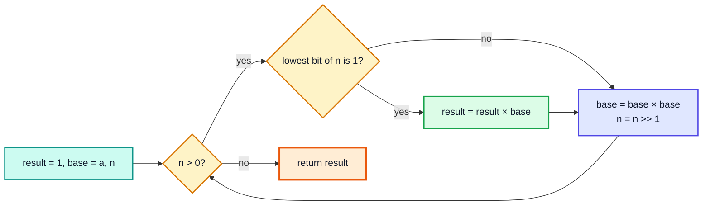
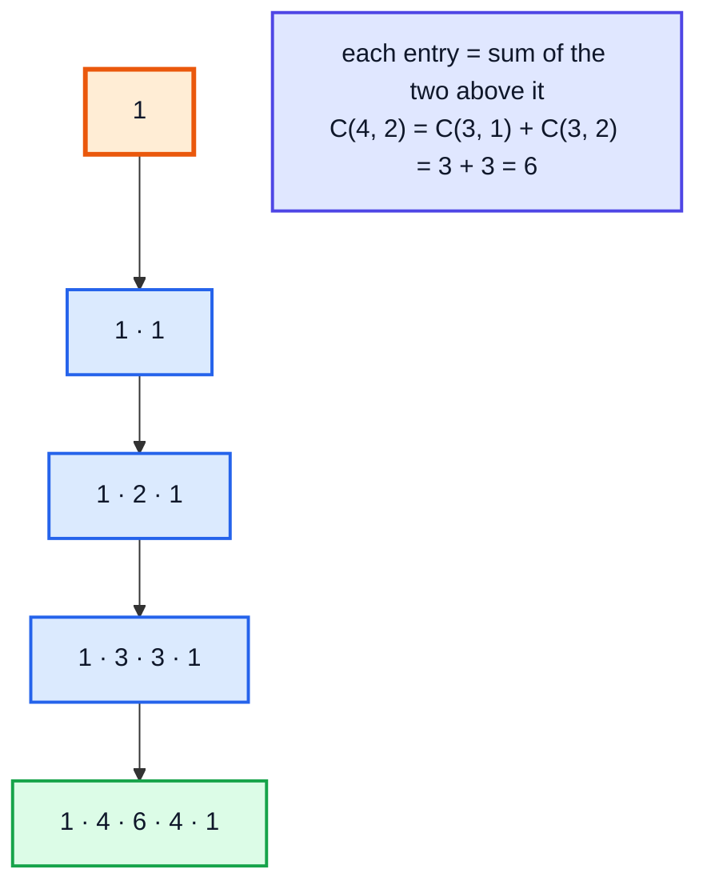

# Maths Extras: Fast Power, Modular Inverse, nCr, Combinatorics — Complete In-Depth Guide

**DSA gap pattern #16 of 16** · Priority 🟢 · from [topics_not_covered.md](../topics_not_covered.md)

[Video 26](../kunal-java-notes-claude/java_26_video_maths_for_dsa.md) covers primes, the sieve, square roots, GCD/LCM and modulo rules. Counting problems in interviews and contests need a few more tools, usually with answers "modulo 10⁹ + 7":
- **fast exponentiation** (`aⁿ` in O(log n));
- **modular inverse** (how to "divide" under a modulus);
- **nCr** computed three ways;
- the combinatorics formulas behind many problems: permutations, combinations, stars and bars, Catalan numbers and inclusion–exclusion;
- **matrix exponentiation** for linear recurrences like Fibonacci.

> [!NOTE]
> This pattern isn't in the playlist, so there are no video timestamps. All code targets **Java 21**. Prerequisites: modulo properties and GCD ([video 26](../kunal-java-notes-claude/java_26_video_maths_for_dsa.md)), bits ([video 25](../kunal-java-notes-claude/java_25_video_bitwise_number_systems.md)), recursion ([video 27](../kunal-java-notes-claude/java_27_video_recursion_level1.md)), and `BigInteger` ([video 53](../kunal-java-notes-claude/java_53_video_biginteger_bigdecimal.md)) for checking answers.

---

## Table of Contents

| # | Topic (anchor link) | Level |
|---|---|---|
| 0 | [Modular Arithmetic Recap](#0-modular-arithmetic-recap) | Basics |
| 1 | [Fast Power (Binary Exponentiation)](#1-fast-power-binary-exponentiation) | Core |
| 2 | [Pow(x, n) with Doubles and Negative Exponents](#2-powx-n-with-doubles-and-negative-exponents) | Core |
| 3 | [Modular Inverse](#3-modular-inverse) | Core |
| 4 | [nCr Three Ways](#4-ncr-three-ways) | Core |
| 5 | [Counting Formulas](#5-counting-formulas) | In depth |
| 6 | [Catalan Numbers](#6-catalan-numbers) | In depth |
| 7 | [Inclusion–Exclusion](#7-inclusionexclusion) | In depth |
| 8 | [Matrix Exponentiation](#8-matrix-exponentiation) | Advanced |
| 9 | [Pitfalls and Problem List](#9-pitfalls-and-problem-list) | Interview |

---

## 0. Modular Arithmetic Recap

Answers to counting problems grow astronomically (C(1000, 500) has about 300 digits), so problems ask for the result **mod M**, usually `M = 1_000_000_007` (a prime that fits in an `int`, and whose square fits in a `long`).

| Rule | Works? |
|---|---|
| `(a + b) % M = ((a % M) + (b % M)) % M` | ✅ |
| `(a − b) % M = ((a % M) − (b % M) + M) % M` | ✅ (add M to avoid negatives) |
| `(a × b) % M = ((a % M) × (b % M)) % M` | ✅ (multiply as `long`) |
| `(a ÷ b) % M = ((a % M) ÷ (b % M)) % M` | ❌ **wrong**; use the modular inverse (Section 3) |

```java
public class ModBasics {
    static final long MOD = 1_000_000_007L;

    public static void main(String[] args) {
        long a = 999_999_999L, b = 888_888_888L;
        System.out.println((a * b) % MOD);                         // 888888952  (long product fits: < 9.2e18)
        int x = 999_999_999, y = 888_888_888;
        System.out.println((x * y) % (int) MOD);                   // -190342193  WRONG: int overflow happens BEFORE the %
        System.out.println(((3 - 5) % MOD + MOD) % MOD);           // 1000000005 (−2 mod M)
        System.out.println((6 / 3) % 5 + " vs " + (6 % 5) / (3 % 5));   // 2 vs 0: division doesn't distribute over %
    }
}
```

> [!WARNING]
> `int * int` overflows **before** you take the modulus. Cast one operand to `long` first: `(long) x * y % MOD`. In Java, `%` of a negative number is negative, so add `MOD` after subtracting.

---

## 1. Fast Power (Binary Exponentiation)

Computing `aⁿ` by multiplying n times is O(n): too slow for n = 10¹⁸. Use the binary representation of n:

- `a¹³ = a⁸ · a⁴ · a¹` because 13 = `1101₂`.
- Square `a` repeatedly (a, a², a⁴, a⁸, …) and multiply in the powers whose bit is set.



```java
public class FastPower {
    static final long MOD = 1_000_000_007L;

    static long modPow(long base, long exp, long mod) {     // iterative
        long result = 1;
        base %= mod;
        while (exp > 0) {
            if ((exp & 1) == 1) result = result * base % mod;
            base = base * base % mod;
            exp >>= 1;
        }
        return result;
    }

    static long modPowRec(long base, long exp, long mod) {  // recursive: a^n = (a^(n/2))² · (a if n is odd)
        if (exp == 0) return 1 % mod;
        long half = modPowRec(base, exp / 2, mod);
        long sq = half * half % mod;
        return exp % 2 == 0 ? sq : sq * (base % mod) % mod;
    }

    public static void main(String[] args) {
        System.out.println(modPow(2, 10, MOD));                  // 1024
        System.out.println(modPow(3, 200, MOD));                 // 136318165
        System.out.println(modPowRec(3, 200, MOD));              // 136318165
        System.out.println(modPow(2, 1_000_000_000_000L, MOD));  // 959366170  (2^(10^12) mod p, in about 40 steps)
    }
}
```

**Dry run** of `modPow(3, 13, ∞)`:

| exp (binary) | Lowest bit | result | base (after squaring) |
|---|---|---|---|
| 13 (1101) | 1 | 1 × 3 = 3 | 9 |
| 6 (110) | 0 | 3 | 81 |
| 3 (11) | 1 | 3 × 81 = 243 | 6561 |
| 1 (1) | 1 | 243 × 6561 = **1594323** | — |

3¹³ = 1,594,323 ✓. **Time** O(log n), **space** O(1).

### Count Good Numbers (LC 1922)

Even positions (0-indexed) hold an even digit (5 choices), odd positions a prime digit (4 choices: 2, 3, 5, 7). Answer = `5^ceil(n/2) · 4^floor(n/2) mod M`, with n up to 10¹⁵.

```java
public class CountGoodNumbers {
    static final long MOD = 1_000_000_007L;
    static long modPow(long b, long e) { long r = 1; b %= MOD; for (; e > 0; e >>= 1, b = b * b % MOD) if ((e & 1) == 1) r = r * b % MOD; return r; }

    static int countGoodNumbers(long n) {
        return (int) (modPow(5, (n + 1) / 2) * modPow(4, n / 2) % MOD);
    }

    public static void main(String[] args) {
        System.out.println(countGoodNumbers(1) + " " + countGoodNumbers(4) + " " + countGoodNumbers(50));   // 5 400 564908303
    }
}
```

---

## 2. Pow(x, n) with Doubles and Negative Exponents

**LC 50:** `x` is a `double` and `n` can be negative (down to `Integer.MIN_VALUE`).

```java
public class PowDouble {
    static double myPow(double x, int n) {
        long e = n;                                  // long: −Integer.MIN_VALUE overflows an int
        if (e < 0) { x = 1 / x; e = -e; }
        double result = 1;
        while (e > 0) {
            if ((e & 1) == 1) result *= x;
            x *= x;
            e >>= 1;
        }
        return result;
    }

    public static void main(String[] args) {
        System.out.println(myPow(2.0, 10));                    // 1024.0
        System.out.println(myPow(2.1, 3));                     // 9.261000000000001
        System.out.println(myPow(2.0, -2));                    // 0.25
        System.out.println(myPow(1.0, Integer.MIN_VALUE));     // 1.0
    }
}
```

> [!CAUTION]
> `-n` when `n == Integer.MIN_VALUE` is still `Integer.MIN_VALUE` (overflow), so a version using `int` loops wrongly. Copy `n` into a `long` first.

---

## 3. Modular Inverse

To compute `a / b mod M`, multiply by the **inverse** of `b`: the number `b⁻¹` with `b · b⁻¹ ≡ 1 (mod M)`. It exists only when `gcd(b, M) = 1`.

| Method | Requirement | Time |
|---|---|---|
| **Fermat's little theorem**: `b⁻¹ = b^(M−2) mod M` | M **prime**, b not a multiple of M | O(log M) |
| **Extended Euclid**: solve `b·x + M·y = 1` | `gcd(b, M) = 1` (any M) | O(log M) |
| Linear table: `inv[i] = −(M / i) · inv[M % i] mod M` | M prime, need all inverses 1..n | O(n) total |

```java
public class ModInverse {
    static final long MOD = 1_000_000_007L;

    static long modPow(long b, long e, long m) { long r = 1; b %= m; for (; e > 0; e >>= 1, b = b * b % m) if ((e & 1) == 1) r = r * b % m; return r; }

    static long inverseFermat(long b) { return modPow(b, MOD - 2, MOD); }

    // Extended Euclid: returns {g, x, y} with a·x + b·y = g = gcd(a, b)
    static long[] extGcd(long a, long b) {
        if (b == 0) return new long[]{a, 1, 0};
        long[] r = extGcd(b, a % b);
        return new long[]{r[0], r[2], r[1] - (a / b) * r[2]};
    }
    static long inverseEuclid(long b, long m) {
        long[] r = extGcd(b, m);
        if (r[0] != 1) throw new ArithmeticException("no inverse: gcd = " + r[0]);
        return ((r[1] % m) + m) % m;
    }

    public static void main(String[] args) {
        System.out.println(inverseFermat(3));                        // 333333336
        System.out.println(3 * inverseFermat(3) % MOD);              // 1
        System.out.println(inverseEuclid(3, 11) + " " + inverseEuclid(7, 26));   // 4 15   (3·4 = 12 ≡ 1 mod 11; 7·15 = 105 ≡ 1 mod 26)
        long tenDivFive = 10 * inverseFermat(5) % MOD;
        System.out.println(tenDivFive);                              // 2
        try { inverseEuclid(4, 26); } catch (ArithmeticException e) { System.out.println(e.getMessage()); }   // no inverse: gcd = 2
    }
}
```

> [!NOTE]
> Extended Euclid is the same recursion as the Euclidean GCD from [video 26](../kunal-java-notes-claude/java_26_video_maths_for_dsa.md), but it also keeps track of the coefficients `x, y` on the way back up.

---

## 4. nCr Three Ways

`C(n, r)` = number of ways to choose `r` items from `n`, ignoring order = `n! / (r! (n − r)!)`.

| Method | Precompute | Per query | Good for |
|---|---|---|---|
| **Pascal's triangle** `C(n, r) = C(n−1, r−1) + C(n−1, r)` | O(n²) | O(1) | n ≤ ~5000, any modulus (no division!) |
| **Multiplicative** `C(n, r) = Π (n − r + i) / i` | — | O(r) | One exact value without mod (fits in `long` for moderate n) |
| **Factorials + inverse factorials mod p** | O(n) | O(1) | n up to 10⁶–10⁷, prime modulus |



```java
import java.math.BigInteger;
import java.util.*;

public class NCr {
    static final long MOD = 1_000_000_007L;

    // 1. Pascal's triangle (LC 118)
    static List<List<Integer>> pascal(int rows) {
        List<List<Integer>> t = new ArrayList<>();
        for (int n = 0; n < rows; n++) {
            List<Integer> row = new ArrayList<>();
            for (int r = 0; r <= n; r++) row.add(r == 0 || r == n ? 1 : t.get(n - 1).get(r - 1) + t.get(n - 1).get(r));
            t.add(row);
        }
        return t;
    }

    // 2. Multiplicative, exact (divide at each step: the running value is always C(n − r + i, i), an integer)
    static long nCrExact(int n, int r) {
        r = Math.min(r, n - r);
        long c = 1;
        for (int i = 1; i <= r; i++) c = c * (n - r + i) / i;
        return c;
    }

    // 3. Factorials + inverse factorials mod p
    static long[] fact, invFact;
    static void precompute(int N) {
        fact = new long[N + 1]; invFact = new long[N + 1];
        fact[0] = 1;
        for (int i = 1; i <= N; i++) fact[i] = fact[i - 1] * i % MOD;
        invFact[N] = modPow(fact[N], MOD - 2);                       // one Fermat inverse...
        for (int i = N; i > 0; i--) invFact[i - 1] = invFact[i] * i % MOD;   // ...then walk down: O(N) total
    }
    static long nCrMod(int n, int r) {
        if (r < 0 || r > n) return 0;
        return fact[n] * invFact[r] % MOD * invFact[n - r] % MOD;
    }
    static long modPow(long b, long e) { long x = 1; b %= MOD; for (; e > 0; e >>= 1, b = b * b % MOD) if ((e & 1) == 1) x = x * b % MOD; return x; }

    public static void main(String[] args) {
        System.out.println(pascal(5));                                // [[1], [1, 1], [1, 2, 1], [1, 3, 3, 1], [1, 4, 6, 4, 1]]
        System.out.println(nCrExact(10, 3) + " " + nCrExact(52, 5));  // 120 2598960
        precompute(1_000_000);
        System.out.println(nCrMod(10, 3) + " " + nCrMod(1000, 500));  // 120 159835829
        BigInteger exact = BigInteger.ONE;
        for (int i = 1; i <= 500; i++) exact = exact.multiply(BigInteger.valueOf(500 + i)).divide(BigInteger.valueOf(i));
        System.out.println(exact.mod(BigInteger.valueOf(MOD)));       // 159835829  (BigInteger agrees)
    }
}
```

> [!TIP]
> **Unique Paths (LC 62)** in O(min(m, n)): a path is a sequence of `(m − 1)` downs and `(n − 1)` rights, so the answer is `C(m + n − 2, m − 1)`. For a 3×7 grid, `C(8, 2) = 28`, matching the DP in [topic #1, section 6](dsa_topic_01_dynamic_programming.md#6-grid-dp).

---

## 5. Counting Formulas

| Question | Formula | Example |
|---|---|---|
| Arrange n distinct items | n! | 4 books on a shelf: 24 |
| Ordered selection of r from n (permutations) | n! / (n − r)! | Gold/silver/bronze from 8 runners: 336 |
| Unordered selection of r from n (combinations) | C(n, r) | 5-card hands: 2,598,960 |
| Arrangements of a multiset | n! / (a! b! …) | "BANANA": 6! / (3! 2!) = 60 |
| Subsets of n items | 2ⁿ | |
| r identical items into k boxes, empty allowed (**stars and bars**) | C(r + k − 1, k − 1) | 5 candies to 3 kids: C(7, 2) = 21 |
| … each box at least one | C(r − 1, k − 1) | 5 candies, 3 kids, each ≥ 1: C(4, 2) = 6 |
| Lattice paths in an m × n grid | C(m + n − 2, m − 1) | LC 62 |
| Derangements (nobody in their own place) | D(n) = (n − 1)(D(n−1) + D(n−2)) | D(4) = 9 |

```java
public class CountingFormulas {
    static long fact(int n) { long f = 1; for (int i = 2; i <= n; i++) f *= i; return f; }
    static long nCr(int n, int r) { long c = 1; for (int i = 1; i <= r; i++) c = c * (n - r + i) / i; return c; }

    static long derangements(int n) {
        if (n == 0) return 1;
        long a = 1, b = 0;                                   // D(0), D(1)
        for (int i = 2; i <= n; i++) { long c = (i - 1) * (a + b); a = b; b = c; }
        return n == 1 ? 0 : b;
    }

    public static void main(String[] args) {
        System.out.println("BANANA arrangements: " + fact(6) / (fact(3) * fact(2)));        // 60
        System.out.println("5 candies, 3 kids: " + nCr(7, 2) + ", each at least 1: " + nCr(4, 2));   // 21, 6
        System.out.println("Unique paths 3x7: " + nCr(3 + 7 - 2, 3 - 1));                   // 28
        System.out.println("Derangements of 4: " + derangements(4));                        // 9
    }
}
```

---

## 6. Catalan Numbers

`Cₙ = C(2n, n) / (n + 1)`: 1, 1, 2, 5, 14, 42, 132, 429, 1430, … They count an amazing number of structures:

| Counts | n = 3 gives 5 |
|---|---|
| Valid parenthesis strings with n pairs (LC 22, [gap #12](dsa_gap_12_combination_backtracking.md#8-generate-parentheses)) | `((())) (()()) (())() ()(()) ()()()` |
| Structurally unique BSTs with n keys (LC 96) | 5 trees |
| Ways to triangulate a polygon with n + 2 sides | |
| Monotonic lattice paths that never cross the diagonal | |

The recurrence `Cₙ = Σ Cᵢ · Cₙ₋₁₋ᵢ` (choose the root, then the left and right subtrees independently) is exactly the DP for **Unique Binary Search Trees (LC 96)**.

```java
public class Catalan {
    static long catalanDP(int n) {                          // LC 96
        long[] c = new long[n + 1];
        c[0] = 1;
        for (int i = 1; i <= n; i++)
            for (int root = 0; root < i; root++) c[i] += c[root] * c[i - 1 - root];   // left × right
        return c[n];
    }

    static long catalanFormula(int n) {
        long c = 1;
        for (int i = 1; i <= n; i++) c = c * (n + i) / i;   // C(2n, n), exact at each step
        return c / (n + 1);
    }

    public static void main(String[] args) {
        StringBuilder sb = new StringBuilder();
        for (int n = 0; n <= 10; n++) sb.append(catalanDP(n)).append(' ');
        System.out.println(sb.toString().trim());           // 1 1 2 5 14 42 132 429 1430 4862 16796
        System.out.println(catalanDP(19) + " " + catalanFormula(19));   // 1767263190 1767263190
    }
}
```

---

## 7. Inclusion–Exclusion

To count elements in a **union**, add the single sets, subtract the pairwise overlaps, add back the triple overlaps, and so on:

`|A ∪ B ∪ C| = |A| + |B| + |C| − |A∩B| − |A∩C| − |B∩C| + |A∩B∩C|`


**Example:** how many numbers in `1..N` are divisible by 3, 5 or 7? Loop over the non-empty subsets of the divisors with a bitmask; a subset of size k contributes `(−1)^(k+1) · N / lcm(subset)`.

```java
public class InclusionExclusion {
    static long gcd(long a, long b) { return b == 0 ? a : gcd(b, a % b); }

    static long countDivisible(long N, int[] divisors) {
        long total = 0;
        int k = divisors.length;
        for (int mask = 1; mask < (1 << k); mask++) {
            long lcm = 1;
            for (int i = 0; i < k; i++) if ((mask >> i & 1) == 1) lcm = lcm / gcd(lcm, divisors[i]) * divisors[i];
            total += (Integer.bitCount(mask) % 2 == 1 ? 1 : -1) * (N / lcm);
        }
        return total;
    }

    public static void main(String[] args) {
        System.out.println(countDivisible(100, new int[]{3, 5, 7}));   // 55  (33 + 20 + 14 − 6 − 4 − 2 + 0)
        int brute = 0;
        for (int i = 1; i <= 100; i++) if (i % 3 == 0 || i % 5 == 0 || i % 7 == 0) brute++;
        System.out.println(brute);                                     // 55
    }
}
```

Related problems: LC 878 Nth Magical Number and LC 1201 Ugly Number III (inclusion–exclusion + binary search on the answer), and derangements (inclusion–exclusion over "who is in their own place").

---

## 8. Matrix Exponentiation

A linear recurrence such as Fibonacci, `F(n) = F(n−1) + F(n−2)`, can be written as a matrix product:

```
| F(n+1) |   | 1 1 |   | F(n)   |
| F(n)   | = | 1 0 | × | F(n−1) |      so      | F(n+1) F(n)   |  = | 1 1 |ⁿ
                                                | F(n)   F(n−1) |    | 1 0 |
```

Raise the matrix to the n-th power with **fast power** (Section 1, but multiplying matrices): **O(log n)** matrix multiplications. That gives `F(10¹⁸) mod M` instantly.

```java
public class MatrixPower {
    static final long MOD = 1_000_000_007L;

    static long[][] mul(long[][] A, long[][] B) {
        int n = A.length;
        long[][] C = new long[n][n];
        for (int i = 0; i < n; i++)
            for (int k = 0; k < n; k++)
                for (int j = 0; j < n; j++) C[i][j] = (C[i][j] + A[i][k] * B[k][j]) % MOD;
        return C;
    }

    static long[][] power(long[][] M, long e) {
        int n = M.length;
        long[][] R = new long[n][n];
        for (int i = 0; i < n; i++) R[i][i] = 1;              // identity
        for (; e > 0; e >>= 1, M = mul(M, M)) if ((e & 1) == 1) R = mul(R, M);
        return R;
    }

    static long fib(long n) { return n == 0 ? 0 : power(new long[][]{{1, 1}, {1, 0}}, n)[0][1]; }

    // Tribonacci (LC 1137): T(n) = T(n−1) + T(n−2) + T(n−3) with a 3×3 matrix
    static long trib(long n) {
        if (n == 0) return 0;
        if (n <= 2) return 1;
        long[][] P = power(new long[][]{{1, 1, 1}, {1, 0, 0}, {0, 1, 0}}, n - 2);
        return (P[0][0] + P[0][1]) % MOD;                    // T(2) = 1, T(1) = 1, T(0) = 0
    }

    public static void main(String[] args) {
        System.out.println(fib(0) + " " + fib(10) + " " + fib(50));               // 0 55 586268941  (F(50) = 12586269025, mod p)
        System.out.println(fib(1_000_000_000_000_000_000L));                       // 209783453  (F(10^18) mod 1e9+7)
        System.out.println(trib(4) + " " + trib(25));                              // 4 1389537
    }
}
```

> [!NOTE]
> A k×k matrix product costs O(k³), so a k-term recurrence takes O(k³ log n). This beats the O(n) DP once n is huge (10¹² and beyond). It's the same "repeated squaring" idea as fast power and the sparse table's doubling.

---

## 9. Pitfalls and Problem List

### Pitfalls

| Pitfall | Fix |
|---|---|
| `int × int` overflow before `% MOD` | Cast to `long` first |
| Negative results after subtraction | `((a − b) % M + M) % M` |
| Dividing under a modulus | Multiply by the modular inverse |
| Fermat's inverse with a non-prime modulus | Use extended Euclid (and check gcd = 1) |
| `−n` for `n = Integer.MIN_VALUE` | Use `long` |
| Computing `n!` exactly for n > 20 | Overflows `long`; work mod p or with `BigInteger` |
| Pascal's triangle for huge n | O(n²) memory; use factorials + inverse factorials |
| Inclusion–exclusion LCM overflow | `lcm / gcd * x` order; cap when it exceeds N |

### Problem list (in order)

| # | Problem | Tool | Difficulty |
|---|---|---|---|
| 1 | LC 118 / 119 Pascal's Triangle I / II | Pascal | Easy |
| 2 | LC 509 / 1137 Fibonacci / Tribonacci | DP or matrix power | Easy |
| 3 | LC 50 Pow(x, n) | Fast power | Medium |
| 4 | LC 372 Super Pow | Fast power digit by digit (mod 1337) | Medium |
| 5 | LC 1922 Count Good Numbers | Fast power mod p | Medium |
| 6 | LC 62 Unique Paths (combinatorics version) | nCr | Medium |
| 7 | LC 96 Unique Binary Search Trees | Catalan | Medium |
| 8 | LC 1201 Ugly Number III | Inclusion–exclusion + binary search | Medium |
| 9 | LC 878 Nth Magical Number | LCM + binary search | Hard |
| 10 | LC 1916 Count Ways to Build Rooms in an Ant Colony | Factorials + inverses on a tree | Hard |
| 11 | LC 1569 Number of Ways to Reorder Array to Get Same BST | nCr mod p + recursion | Hard |

### Interview Q&A

| Question | Short answer |
|---|---|
| How do you compute aⁿ fast? | Binary exponentiation: square the base, multiply in when the bit is 1; O(log n). |
| Why is 10⁹ + 7 popular? | Prime (so inverses exist), fits in `int`, and products of two residues fit in `long`. |
| How do you divide mod p? | Multiply by `b^(p−2)` (Fermat) or use extended Euclid. |
| nCr mod p for many queries? | Precompute factorials and inverse factorials in O(n); each query O(1). |
| What are Catalan numbers? | `C(2n, n)/(n+1)`: counts valid parentheses, BST shapes, triangulations. |
| Fibonacci for n = 10¹⁸? | 2×2 matrix exponentiation, O(log n). |

---

## 🧩 Complete Example: Everything Together

Fast power, modular inverses, nCr three ways, stars and bars, Catalan numbers, inclusion–exclusion and matrix Fibonacci, cross-checked against `BigInteger` and brute force.

```java
import java.math.BigInteger;
import java.util.*;

public class MathsExtrasShowcase {
    static final long MOD = 1_000_000_007L;
    static final BigInteger BMOD = BigInteger.valueOf(MOD);

    static long modPow(long b, long e, long m) { long r = 1 % m; b %= m; for (; e > 0; e >>= 1, b = b * b % m) if ((e & 1) == 1) r = r * b % m; return r; }
    static long inv(long b) { return modPow(b, MOD - 2, MOD); }

    static long[] fact = new long[2001], invFact = new long[2001];
    static {
        fact[0] = 1;
        for (int i = 1; i <= 2000; i++) fact[i] = fact[i - 1] * i % MOD;
        invFact[2000] = inv(fact[2000]);
        for (int i = 2000; i > 0; i--) invFact[i - 1] = invFact[i] * i % MOD;
    }
    static long nCrMod(int n, int r) { return r < 0 || r > n ? 0 : fact[n] * invFact[r] % MOD * invFact[n - r] % MOD; }

    static long[][] pascal(int N) {
        long[][] c = new long[N + 1][N + 1];
        for (int n = 0; n <= N; n++) { c[n][0] = 1; for (int r = 1; r <= n; r++) c[n][r] = (c[n - 1][r - 1] + c[n - 1][r]) % MOD; }
        return c;
    }

    static long catalan(int n) { return nCrMod(2 * n, n) * inv(n + 1) % MOD; }

    static long[][] mul(long[][] A, long[][] B) {
        long[][] C = new long[2][2];
        for (int i = 0; i < 2; i++) for (int k = 0; k < 2; k++) for (int j = 0; j < 2; j++) C[i][j] = (C[i][j] + A[i][k] * B[k][j]) % MOD;
        return C;
    }
    static long fib(long n) {
        long[][] R = {{1, 0}, {0, 1}}, M = {{1, 1}, {1, 0}};
        for (; n > 0; n >>= 1, M = mul(M, M)) if ((n & 1) == 1) R = mul(R, M);
        return R[0][1];
    }

    static long gcd(long a, long b) { return b == 0 ? a : gcd(b, a % b); }
    static long divisibleCount(long N, int[] d) {
        long total = 0;
        for (int mask = 1; mask < (1 << d.length); mask++) {
            long l = 1;
            for (int i = 0; i < d.length; i++) if ((mask >> i & 1) == 1) l = l / gcd(l, d[i]) * d[i];
            total += (Integer.bitCount(mask) % 2 == 1 ? 1 : -1) * (N / l);
        }
        return total;
    }

    public static void main(String[] args) {
        System.out.println("3^200 mod p        = " + modPow(3, 200, MOD));
        System.out.println("inverse of 3 mod p = " + inv(3) + "  (check: " + 3 * inv(3) % MOD + ")");
        System.out.println("C(1000, 500) mod p = " + nCrMod(1000, 500));
        System.out.println("Stars and bars: 10 candies to 4 kids = " + nCrMod(13, 3));
        System.out.println("Catalan 0..8       = " + java.util.stream.IntStream.rangeClosed(0, 8).mapToObj(n -> String.valueOf(catalan(n))).toList());
        System.out.println("Fib(90) mod p      = " + fib(90) + ", Fib(10^18) mod p = " + fib(1_000_000_000_000_000_000L));
        System.out.println("1..1000 divisible by 2, 3 or 5 = " + divisibleCount(1000, new int[]{2, 3, 5}));

        long[][] pas = pascal(200);
        Random rnd = new Random(1922);
        int checks = 0, mismatches = 0;
        for (int t = 0; t < 300; t++) {
            long b = rnd.nextInt(1_000_000), e = rnd.nextInt(1_000_000), m = 2 + rnd.nextInt(1_000_000);
            if (modPow(b, e, m) != BigInteger.valueOf(b).modPow(BigInteger.valueOf(e), BigInteger.valueOf(m)).longValue()) mismatches++;

            long x = 1 + rnd.nextInt(1_000_000_000);
            if (x * inv(x) % MOD != 1) mismatches++;

            int n = rnd.nextInt(200), r = rnd.nextInt(n + 1);
            BigInteger exact = BigInteger.ONE;
            for (int i = 1; i <= r; i++) exact = exact.multiply(BigInteger.valueOf(n - r + i)).divide(BigInteger.valueOf(i));
            long ref = exact.mod(BMOD).longValue();
            if (nCrMod(n, r) != ref || pas[n][r] != ref) mismatches++;

            int f = rnd.nextInt(90);
            long a0 = 0, a1 = 1;
            for (int i = 0; i < f; i++) { long c = a0 + a1; a0 = a1; a1 = c; }
            if (fib(f) != a0 % MOD) mismatches++;

            long N = rnd.nextInt(500);
            int[] ds = rnd.ints(1 + rnd.nextInt(3), 2, 12).toArray();
            long brute = 0;
            for (long v = 1; v <= N; v++) { for (int dd : ds) if (v % dd == 0) { brute++; break; } }
            if (divisibleCount(N, ds) != brute) mismatches++;
            checks += 5;
        }
        System.out.println("Random cross-checks against BigInteger / brute force: " + checks + ", mismatches: " + mismatches);
    }
}
```

**Expected Output:**
```
3^200 mod p        = 136318165
inverse of 3 mod p = 333333336  (check: 1)
C(1000, 500) mod p = 159835829
Stars and bars: 10 candies to 4 kids = 286
Catalan 0..8       = [1, 1, 2, 5, 14, 42, 132, 429, 1430]
Fib(90) mod p      = 210345902, Fib(10^18) mod p = 209783453
1..1000 divisible by 2, 3 or 5 = 734
Random cross-checks against BigInteger / brute force: 1500, mismatches: 0
```

---

## Quick Reference Cheat Sheet

| Concept | One-Line Summary |
|---|---|
| **MOD** | `1_000_000_007`; multiply as `long`; add MOD after subtracting |
| **Fast power** | `while (e > 0) { if (e & 1) r = r·b; b = b·b; e >>= 1; }` — O(log e) |
| **Pow(x, n)** | Copy `n` to `long`; negative → `x = 1/x` |
| **Inverse (prime p)** | `b^(p−2) mod p` |
| **Inverse (any m)** | Extended Euclid, needs `gcd(b, m) = 1` |
| **nCr small n** | Pascal's triangle |
| **nCr exact** | `c = c·(n−r+i)/i` for i = 1..r |
| **nCr mod p, many queries** | `fact[n] · invFact[r] · invFact[n−r]` |
| **Stars and bars** | `C(r + k − 1, k − 1)` |
| **Grid paths** | `C(m + n − 2, m − 1)` |
| **Catalan** | `C(2n, n)/(n+1)`; parentheses, BSTs |
| **Inclusion–exclusion** | Bitmask over sets; sign by subset size |
| **Matrix power** | Linear recurrence in O(k³ log n) |
