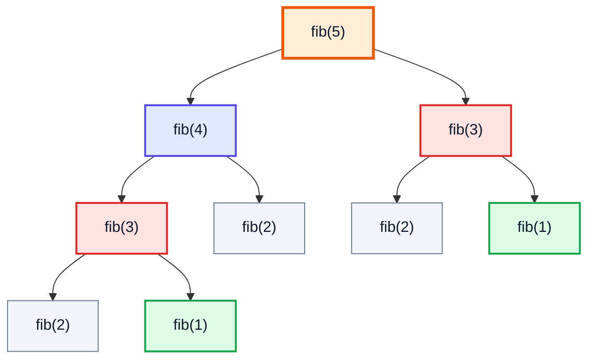
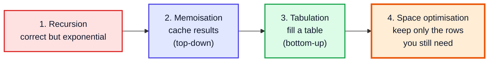
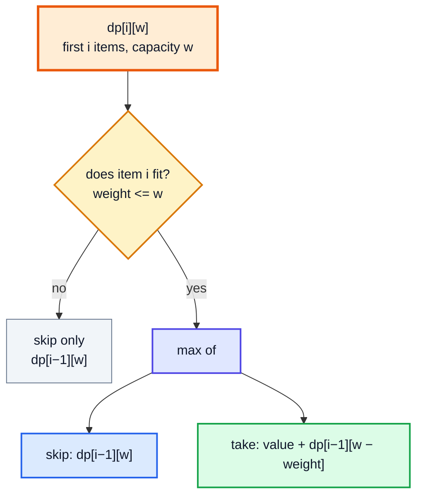
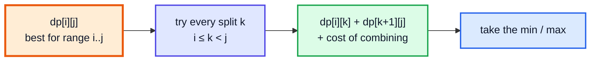
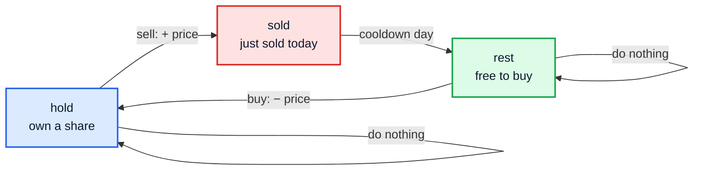
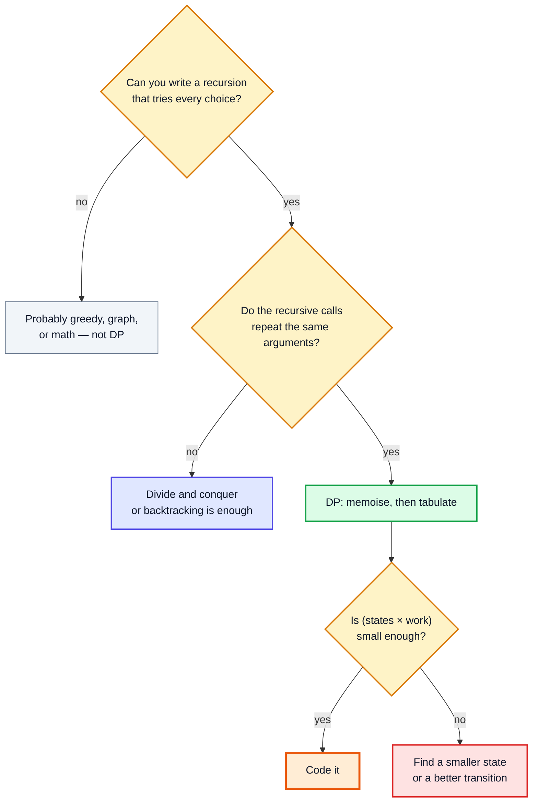

# Dynamic Programming — Complete In-Depth Guide

**DSA whole topic #1 of 4** · Priority 🔴 · from [topics_not_covered.md](../topics_not_covered.md)

Dynamic programming (DP) is the biggest topic the playlist doesn't teach. The closest it gets is the memoised dice problem in [video 34](../kunal-java-notes-claude/java_34_video_recursion_dice_phone_letters.md). DP is a way to solve problems whose recursive solution **recomputes the same subproblems again and again**: you solve each subproblem **once**, store the answer, and reuse it. That turns exponential recursions into polynomial algorithms.

These notes start from the recursion you already know (videos 23–36) and build up in a fixed order: memoisation → tabulation → space optimisation, then every major DP family interviewers ask about. Those are 1D, knapsack, unbounded knapsack, grids, LIS, strings, intervals, trees, bitmasks and the stock-trading state machines.

> [!NOTE]
> This topic isn't in the playlist, so there are no video timestamps. All code targets **Java 21**. Prerequisites: recursion ([videos 23, 27–29](../kunal-java-notes-claude/java_27_video_recursion_level1.md)), subsets ([video 32](../kunal-java-notes-claude/java_32_video_recursion_subsets_strings.md)), complexity ([video 24](../kunal-java-notes-claude/java_24_video_time_space_complexity.md)), trees ([video 55](../kunal-java-notes-claude/java_55_video_binary_tree_questions.md)) for tree DP, and bitwise operators ([video 25](../kunal-java-notes-claude/java_25_video_bitwise_number_systems.md)) for bitmask DP. [Kadane's algorithm (gap #4)](dsa_gap_04_kadanes_algorithm.md) is a small DP you may have seen already.

---

## Table of Contents

| # | Topic (anchor link) | Level |
|---|---|---|
| 0 | [What DP Is and When It Applies](#0-what-dp-is-and-when-it-applies) | Basics |
| 1 | [From Recursion to DP: Fibonacci Four Ways](#1-from-recursion-to-dp-fibonacci-four-ways) | Basics |
| 2 | [The Five-Step Method](#2-the-five-step-method) | Core |
| 3 | [1D DP](#3-1d-dp) | Core |
| 4 | [0/1 Knapsack and Subset Sum](#4-01-knapsack-and-subset-sum) | Core |
| 5 | [Unbounded Knapsack and Coin Change](#5-unbounded-knapsack-and-coin-change) | Core |
| 6 | [Grid DP](#6-grid-dp) | Core |
| 7 | [Longest Increasing Subsequence](#7-longest-increasing-subsequence) | In depth |
| 8 | [String DP: LCS, Edit Distance, Palindromes](#8-string-dp-lcs-edit-distance-palindromes) | In depth |
| 9 | [Interval DP](#9-interval-dp) | Advanced |
| 10 | [DP on Trees](#10-dp-on-trees) | Advanced |
| 11 | [Bitmask DP](#11-bitmask-dp) | Advanced |
| 12 | [State Machine DP: Stock Problems](#12-state-machine-dp-stock-problems) | Advanced |
| 13 | [Recognising DP, Pitfalls and Problem List](#13-recognising-dp-pitfalls-and-problem-list) | Interview |

---

## 0. What DP Is and When It Applies

A problem can be solved with DP when it has **both** properties:

| Property | Meaning | Example |
|---|---|---|
| **Optimal substructure** | The best answer is built from the best answers to smaller subproblems | Shortest path A→C through B = shortest A→B + shortest B→C |
| **Overlapping subproblems** | The same subproblems are needed many times | `fib(5)` needs `fib(3)` twice and `fib(2)` three times |

If the subproblems **don't** overlap (merge sort: each half is different), plain divide and conquer is enough; caching wouldn't help.



The red `fib(3)` and grey `fib(2)` nodes are computed **repeatedly**. The tree has about 2ⁿ nodes but only n **distinct** subproblems. DP computes each distinct one once.

### DP vs greedy vs divide and conquer

| | Greedy | Divide and conquer | DP |
|---|---|---|---|
| Decision | Take the locally best choice, never reconsider | Split into **independent** parts | Try **all** choices, reuse shared results |
| Subproblems overlap? | — | No | **Yes** |
| Example | Activity selection | Merge sort | Coin change, LCS |
| Risk | Wrong if the local choice isn't globally safe | — | Too much memory if the state is huge |

> [!TIP]
> **Greedy or DP?** Look for a counter-example to the greedy choice. Coins `{1, 3, 4}`, amount 6: greedy takes 4 + 1 + 1 (3 coins), but 3 + 3 uses 2. Once greedy can be wrong, you need DP to try every choice.

---

## 1. From Recursion to DP: Fibonacci Four Ways

`fib(0) = 0`, `fib(1) = 1`, `fib(n) = fib(n−1) + fib(n−2)` (LC 509).

### 1. Plain recursion — O(2ⁿ)

```java
static long fibRec(int n) {
    if (n <= 1) return n;
    return fibRec(n - 1) + fibRec(n - 2);
}
```

### 2. Memoisation (top-down) — O(n)

The same recursion, but **check a cache first** and **store the answer before returning**.

```java
static long fibMemo(int n, long[] memo) {
    if (n <= 1) return n;
    if (memo[n] != 0) return memo[n];                        // already solved
    return memo[n] = fibMemo(n - 1, memo) + fibMemo(n - 2, memo);
}
```

### 3. Tabulation (bottom-up) — O(n)

Fill a table from the **smallest** subproblems up, in an order where everything you need is already computed. No recursion.

```java
static long fibTab(int n) {
    if (n <= 1) return n;
    long[] dp = new long[n + 1];
    dp[1] = 1;
    for (int i = 2; i <= n; i++) dp[i] = dp[i - 1] + dp[i - 2];
    return dp[n];
}
```

### 4. Space optimised — O(n) time, O(1) space

`dp[i]` only needs the last two values, so keep two variables.

```java
static long fibOpt(int n) {
    if (n <= 1) return n;
    long prev2 = 0, prev1 = 1;
    for (int i = 2; i <= n; i++) {
        long cur = prev1 + prev2;
        prev2 = prev1;
        prev1 = cur;
    }
    return prev1;
}
```

```java
public class FibFourWays {
    static long calls = 0;
    static long fibRec(int n) { calls++; return n <= 1 ? n : fibRec(n - 1) + fibRec(n - 2); }
    static long fibMemo(int n, long[] memo) {
        if (n <= 1) return n;
        if (memo[n] != 0) return memo[n];
        return memo[n] = fibMemo(n - 1, memo) + fibMemo(n - 2, memo);
    }
    static long fibTab(int n) {
        if (n <= 1) return n;
        long[] dp = new long[n + 1];
        dp[1] = 1;
        for (int i = 2; i <= n; i++) dp[i] = dp[i - 1] + dp[i - 2];
        return dp[n];
    }
    static long fibOpt(int n) {
        if (n <= 1) return n;
        long a = 0, b = 1;
        for (int i = 2; i <= n; i++) { long c = a + b; a = b; b = c; }
        return b;
    }

    public static void main(String[] args) {
        System.out.println(fibRec(25) + " in " + calls + " calls");       // 75025 in 242785 calls
        System.out.println(fibMemo(90, new long[91]));                     // 2880067194370816120
        System.out.println(fibTab(90) + " " + fibOpt(90));                 // 2880067194370816120 2880067194370816120
    }
}
```

| Version | Time | Space | Notes |
|---|---|---|---|
| Recursion | O(2ⁿ) (≈ 1.6ⁿ) | O(n) stack | 242,785 calls for n = 25 |
| **Memoisation** | O(n) | O(n) cache + O(n) stack | Easiest to write from a recursive idea |
| **Tabulation** | O(n) | O(n) | No recursion → no stack overflow |
| **Space optimised** | O(n) | **O(1)** | Only when each state needs a few previous ones |



> [!IMPORTANT]
> **Always go through these four steps in order** for a new problem: write the recursion first (it's the "what"), then memoise, then tabulate, then optimise space. Jumping straight to a table is why DP feels like magic. In an interview, a correct memoised solution is usually enough; the later steps are follow-ups.

| | Memoisation (top-down) | Tabulation (bottom-up) |
|---|---|---|
| Written as | Recursion + cache | Loops over a table |
| Computes | Only the states actually reached | Every state in the table |
| Order of states | Automatic (recursion figures it out) | You must choose a valid order |
| Stack overflow risk | Yes, for deep recursion (n ≈ 10⁴+) | No |
| Space optimisation | Hard | Easy (rolling arrays) |

---

## 2. The Five-Step Method

For every DP problem, answer these five questions. Write them down before coding.

| Step | Question | Fibonacci | Climbing stairs |
|---|---|---|---|
| **1. State** | What does `dp[i]` (or `dp[i][j]`) **mean**, in words? | `dp[i]` = the ith Fibonacci number | `dp[i]` = ways to reach step `i` |
| **2. Transition** | How is a state built from smaller states? (Think about the **last choice**.) | `dp[i] = dp[i−1] + dp[i−2]` | last step was 1 or 2: `dp[i] = dp[i−1] + dp[i−2]` |
| **3. Base cases** | Which states are known without the transition? | `dp[0] = 0, dp[1] = 1` | `dp[0] = 1` (one way to stand still), `dp[1] = 1` |
| **4. Order** | In what order can you fill the table so dependencies come first? | `i` increasing | `i` increasing |
| **5. Answer** | Which state (or combination) is the final answer? | `dp[n]` | `dp[n]` |

> [!TIP]
> The **state** is the hardest part. Ask: "If I were halfway through solving this by hand, what would I need to remember to finish?" That's your state. If the answer is "the index I'm at and how much capacity is left", the state is `dp[i][capacity]`.

**Complexity of any DP** = (number of states) × (work per transition). For example, LCS has `m × n` states with O(1) work each → O(m·n).

---

## 3. 1D DP

### Climbing Stairs (LC 70)

Ways to climb `n` steps taking 1 or 2 at a time. It's Fibonacci shifted by one.

```java
public class ClimbStairs {
    static int climbStairs(int n) {
        int a = 1, b = 1;                           // dp[0], dp[1]
        for (int i = 2; i <= n; i++) { int c = a + b; a = b; b = c; }
        return b;
    }

    public static void main(String[] args) {
        System.out.println(climbStairs(2) + " " + climbStairs(3) + " " + climbStairs(5));   // 2 3 8
    }
}
```

### Min Cost Climbing Stairs (LC 746)

`dp[i]` = minimum cost to **reach** step `i` (the top is step `n`). You arrive from `i−1` (paying `cost[i−1]`) or `i−2` (paying `cost[i−2]`).

```java
public class MinCostStairs {
    static int minCostClimbingStairs(int[] cost) {
        int n = cost.length, a = 0, b = 0;          // dp[0] = dp[1] = 0: you may start on step 0 or 1
        for (int i = 2; i <= n; i++) {
            int c = Math.min(b + cost[i - 1], a + cost[i - 2]);
            a = b; b = c;
        }
        return b;
    }

    public static void main(String[] args) {
        System.out.println(minCostClimbingStairs(new int[]{10, 15, 20}));                          // 15
        System.out.println(minCostClimbingStairs(new int[]{1, 100, 1, 1, 1, 100, 1, 1, 100, 1}));  // 6
    }
}
```

### House Robber (LC 198) — the "take or skip" choice

You can't rob two adjacent houses. At house `i`, either **skip** it (keep `dp[i−1]`) or **take** it (`nums[i] + dp[i−2]`).

```java
public class HouseRobber {
    // Step 1: recursion — best(i) = max money from houses 0..i
    static int robRec(int[] a, int i) {
        if (i < 0) return 0;
        return Math.max(robRec(a, i - 1), a[i] + robRec(a, i - 2));
    }

    // Step 2: memoisation
    static int robMemo(int[] a, int i, Integer[] memo) {
        if (i < 0) return 0;
        if (memo[i] != null) return memo[i];
        return memo[i] = Math.max(robMemo(a, i - 1, memo), a[i] + robMemo(a, i - 2, memo));
    }

    // Steps 3 + 4: tabulation, then two variables
    static int rob(int[] a) {
        int prev2 = 0, prev1 = 0;                   // best up to i−2 and up to i−1
        for (int x : a) {
            int cur = Math.max(prev1, x + prev2);
            prev2 = prev1;
            prev1 = cur;
        }
        return prev1;
    }

    // LC 213 House Robber II: houses in a circle → first and last can't both be robbed
    static int robCircle(int[] a) {
        if (a.length == 1) return a[0];
        return Math.max(rob(java.util.Arrays.copyOfRange(a, 0, a.length - 1)),
                        rob(java.util.Arrays.copyOfRange(a, 1, a.length)));
    }

    public static void main(String[] args) {
        int[] a = {2, 7, 9, 3, 1};
        System.out.println(robRec(a, a.length - 1) + " " + robMemo(a, a.length - 1, new Integer[a.length]) + " " + rob(a));   // 12 12 12
        System.out.println(rob(new int[]{1, 2, 3, 1}));            // 4
        System.out.println(robCircle(new int[]{2, 3, 2}));         // 3
        System.out.println(robCircle(new int[]{1, 2, 3, 1}));      // 4
    }
}
```

**Dry run** of `rob` on `[2, 7, 9, 3, 1]`:

| i | x | skip = prev1 | take = x + prev2 | dp[i] |
|---|---|---|---|---|
| 0 | 2 | 0 | 2 + 0 = 2 | 2 |
| 1 | 7 | 2 | 7 + 0 = 7 | 7 |
| 2 | 9 | 7 | 9 + 2 = **11** | 11 |
| 3 | 3 | **11** | 3 + 7 = 10 | 11 |
| 4 | 1 | 11 | 1 + 11 = **12** | **12** |

(Rob houses 0, 2 and 4: 2 + 9 + 1 = 12.)

> [!NOTE]
> The memo uses `Integer[]` with `null` meaning "not computed", because 0 is a valid answer. With `int[]`, fill it with `-1` first. Using 0 as "unknown" (like the Fibonacci memo) only works when 0 can never be a real answer for that state.

### Decode Ways (LC 91)

`'A'..'Z'` ↔ `1..26`. Count the ways to decode a digit string. The last character is decoded either alone (if it's not `'0'`) or together with the previous one (if they form 10..26).

```java
public class DecodeWays {
    static int numDecodings(String s) {
        int n = s.length();
        int[] dp = new int[n + 1];          // dp[i] = ways to decode the first i characters
        dp[0] = 1;
        for (int i = 1; i <= n; i++) {
            if (s.charAt(i - 1) != '0') dp[i] += dp[i - 1];                   // one digit
            if (i >= 2) {
                int two = Integer.parseInt(s.substring(i - 2, i));
                if (two >= 10 && two <= 26) dp[i] += dp[i - 2];                // two digits
            }
        }
        return dp[n];
    }

    public static void main(String[] args) {
        System.out.println(numDecodings("12") + " " + numDecodings("226") + " " + numDecodings("06"));   // 2 3 0
    }
}
```

### Word Break (LC 139)

`dp[i]` = can the first `i` characters be split into dictionary words? `dp[i]` is true if some `j < i` has `dp[j]` true and `s[j..i)` is a word.

```java
import java.util.*;

public class WordBreak {
    static boolean wordBreak(String s, List<String> words) {
        Set<String> dict = new HashSet<>(words);
        boolean[] dp = new boolean[s.length() + 1];
        dp[0] = true;                                         // empty prefix
        for (int i = 1; i <= s.length(); i++) {
            for (int j = 0; j < i && !dp[i]; j++) {
                dp[i] = dp[j] && dict.contains(s.substring(j, i));
            }
        }
        return dp[s.length()];
    }

    public static void main(String[] args) {
        System.out.println(wordBreak("leetcode", List.of("leet", "code")));                           // true
        System.out.println(wordBreak("applepenapple", List.of("apple", "pen")));                      // true
        System.out.println(wordBreak("catsandog", List.of("cats", "dog", "sand", "and", "cat")));     // false
    }
}
```

**Time** O(n² · L) with substring creation (L = word length), **space** O(n). A [Trie (topic #4)](dsa_topic_04_trie.md) can speed up the inner loop.

---

## 4. 0/1 Knapsack and Subset Sum

**Problem:** items with `weight[i]` and `value[i]`, a bag of capacity `W`. Each item can be taken **at most once**. Maximise the total value.

**State:** `dp[i][w]` = best value using the first `i` items with capacity `w`.
**Transition:** for item `i`, **skip** it or **take** it (if it fits):
`dp[i][w] = max(dp[i−1][w], value[i−1] + dp[i−1][w − weight[i−1]])`



```java
public class Knapsack01 {
    // 2D table
    static int knapsack2D(int[] wt, int[] val, int W) {
        int n = wt.length;
        int[][] dp = new int[n + 1][W + 1];                   // row 0 / column 0 = 0
        for (int i = 1; i <= n; i++) {
            for (int w = 0; w <= W; w++) {
                dp[i][w] = dp[i - 1][w];                                          // skip
                if (wt[i - 1] <= w) dp[i][w] = Math.max(dp[i][w], val[i - 1] + dp[i - 1][w - wt[i - 1]]);  // take
            }
        }
        return dp[n][W];
    }

    // 1D table: iterate capacity DOWNWARDS so each item is used at most once
    static int knapsack1D(int[] wt, int[] val, int W) {
        int[] dp = new int[W + 1];
        for (int i = 0; i < wt.length; i++) {
            for (int w = W; w >= wt[i]; w--) {
                dp[w] = Math.max(dp[w], val[i] + dp[w - wt[i]]);
            }
        }
        return dp[W];
    }

    public static void main(String[] args) {
        int[] wt = {1, 3, 4, 5}, val = {1, 4, 5, 7};
        System.out.println(knapsack2D(wt, val, 7) + " " + knapsack1D(wt, val, 7));   // 9 9  (items 2 and 3: 4 + 5)
    }
}
```

**Table** for `wt = {1, 3, 4, 5}`, `val = {1, 4, 5, 7}`, `W = 7` (rows = items used, columns = capacity):

| i \ w | 0 | 1 | 2 | 3 | 4 | 5 | 6 | 7 |
|---|---|---|---|---|---|---|---|---|
| 0 items | 0 | 0 | 0 | 0 | 0 | 0 | 0 | 0 |
| + (1, 1) | 0 | 1 | 1 | 1 | 1 | 1 | 1 | 1 |
| + (3, 4) | 0 | 1 | 1 | 4 | 5 | 5 | 5 | 5 |
| + (4, 5) | 0 | 1 | 1 | 4 | 5 | 6 | 6 | **9** |
| + (5, 7) | 0 | 1 | 1 | 4 | 5 | 7 | 8 | **9** |

**Time** O(n·W), **space** O(n·W) → **O(W)** with the 1D version.

> [!CAUTION]
> **Why iterate `w` downwards in the 1D version?** `dp[w − wt[i]]` must still hold the value from the **previous** item row. Going upwards would overwrite it first, so the same item could be added again and again. That's the *unbounded* knapsack (Section 5). The direction of one loop is the whole difference.

> [!NOTE]
> O(n·W) is **pseudo-polynomial**: it depends on the *value* of W, not its number of digits. Knapsack is NP-complete in general ([video 24, section 25](../kunal-java-notes-claude/java_24_video_time_space_complexity.md#25-np-complete-problems-22454)); DP is fast only when W is small (say ≤ 10⁵).

### Subset Sum and Partition Equal Subset Sum (LC 416)

"Can some subset sum to exactly `T`?" is knapsack with booleans. LC 416: can the array be split into two equal-sum halves? → subset sum with `T = total / 2`.

```java
public class PartitionEqual {
    static boolean canPartition(int[] nums) {
        int total = 0;
        for (int x : nums) total += x;
        if (total % 2 == 1) return false;
        int T = total / 2;
        boolean[] dp = new boolean[T + 1];        // dp[s] = some subset of items seen so far sums to s
        dp[0] = true;
        for (int x : nums) {
            for (int s = T; s >= x; s--) dp[s] = dp[s] || dp[s - x];     // downwards: 0/1
        }
        return dp[T];
    }

    public static void main(String[] args) {
        System.out.println(canPartition(new int[]{1, 5, 11, 5}));   // true  ([1, 5, 5] and [11])
        System.out.println(canPartition(new int[]{1, 2, 3, 5}));    // false
    }
}
```

### Target Sum (LC 494) — counting version

Put `+` or `−` before each number to reach `target`. If `P` is the sum of the `+` numbers, then `P − (total − P) = target` → `P = (total + target) / 2`. So: **count** subsets summing to `P`.

```java
public class TargetSum {
    static int findTargetSumWays(int[] nums, int target) {
        int total = 0;
        for (int x : nums) total += x;
        if (Math.abs(target) > total || (total + target) % 2 != 0) return 0;
        int P = (total + target) / 2;
        int[] ways = new int[P + 1];
        ways[0] = 1;
        for (int x : nums) for (int s = P; s >= x; s--) ways[s] += ways[s - x];
        return ways[P];
    }

    public static void main(String[] args) {
        System.out.println(findTargetSumWays(new int[]{1, 1, 1, 1, 1}, 3));   // 5
        System.out.println(findTargetSumWays(new int[]{1}, 1));               // 1
    }
}
```

| 0/1 knapsack variant | dp holds | Combine with |
|---|---|---|
| Max value | `int` (best value) | `max` |
| Is it possible? (subset sum) | `boolean` | `||` |
| How many ways? (target sum) | `int`/`long` count | `+` |
| Fewest items | `int` (count), init ∞ | `min(…, 1 + …)` |

---

## 5. Unbounded Knapsack and Coin Change

Now each item (coin) can be used **any number of times**. In the 1D version, iterate capacity **upwards**: `dp[w − c]` may already include coin `c`, which is now allowed.

### Coin Change (LC 322) — fewest coins

`dp[a]` = fewest coins that make amount `a`.

```java
import java.util.*;

public class CoinChange {
    static int coinChange(int[] coins, int amount) {
        int INF = amount + 1;                          // more than any possible answer
        int[] dp = new int[amount + 1];
        Arrays.fill(dp, INF);
        dp[0] = 0;
        for (int a = 1; a <= amount; a++) {
            for (int c : coins) {
                if (c <= a) dp[a] = Math.min(dp[a], 1 + dp[a - c]);   // last coin used is c
            }
        }
        return dp[amount] >= INF ? -1 : dp[amount];
    }

    public static void main(String[] args) {
        System.out.println(coinChange(new int[]{1, 2, 5}, 11));   // 3  (5 + 5 + 1)
        System.out.println(coinChange(new int[]{2}, 3));          // -1
        System.out.println(coinChange(new int[]{1, 3, 4}, 6));    // 2  (3 + 3; greedy would say 3)
    }
}
```

**Dry run** for coins `{1, 3, 4}`, amount 6:

| a | via 1 | via 3 | via 4 | dp[a] |
|---|---|---|---|---|
| 0 | — | — | — | 0 |
| 1 | 1 + dp[0] = 1 | — | — | 1 |
| 2 | 1 + dp[1] = 2 | — | — | 2 |
| 3 | 1 + dp[2] = 3 | 1 + dp[0] = **1** | — | 1 |
| 4 | 1 + dp[3] = 2 | 1 + dp[1] = 2 | 1 + dp[0] = **1** | 1 |
| 5 | 1 + dp[4] = **2** | 1 + dp[2] = 3 | 1 + dp[1] = **2** | 2 |
| 6 | 1 + dp[5] = 3 | 1 + dp[3] = **2** | 1 + dp[2] = 3 | **2** |

> [!WARNING]
> Don't use `Integer.MAX_VALUE` as "infinity" here: `1 + Integer.MAX_VALUE` overflows to a negative number, and `min` would pick it. Use `amount + 1`, which is safely larger than any real answer.

### Coin Change II (LC 518) vs Combination Sum IV (LC 377): the loop order trap

Both **count** ways to make an amount. The difference is whether order matters:

```java
public class CountWays {
    // LC 518: combinations — {1,2} and {2,1} are the SAME. Coins in the OUTER loop.
    static int change(int amount, int[] coins) {
        int[] dp = new int[amount + 1];
        dp[0] = 1;
        for (int c : coins)
            for (int a = c; a <= amount; a++) dp[a] += dp[a - c];
        return dp[amount];
    }

    // LC 377: permutations — {1,2} and {2,1} are DIFFERENT. Amount in the OUTER loop.
    static int combinationSum4(int[] nums, int target) {
        int[] dp = new int[target + 1];
        dp[0] = 1;
        for (int a = 1; a <= target; a++)
            for (int x : nums) if (x <= a) dp[a] += dp[a - x];
        return dp[target];
    }

    public static void main(String[] args) {
        System.out.println(change(5, new int[]{1, 2, 5}));              // 4
        System.out.println(combinationSum4(new int[]{1, 2, 3}, 4));     // 7
        System.out.println(change(4, new int[]{1, 2, 3}));              // 4  (same coins, order ignored)
    }
}
```

| Loop order | Counts | Why |
|---|---|---|
| **Coins outside**, amount inside | **Combinations** | Coins are added in a fixed order (all 1s, then 2s, …), so each multiset is counted once |
| **Amount outside**, coins inside | **Permutations** | At each amount, any coin can be the last one, so every ordering is counted |

| Knapsack type | Inner capacity loop | Item reuse |
|---|---|---|
| 0/1 | **Downwards** | Once |
| Unbounded | **Upwards** | Unlimited |

---

## 6. Grid DP

### Unique Paths (LC 62) and with Obstacles (LC 63)

Moving only right or down, count paths from the top-left to the bottom-right. You enter a cell from above or from the left: `dp[r][c] = dp[r−1][c] + dp[r][c−1]`.

```java
public class GridPaths {
    static int uniquePaths(int m, int n) {
        int[] dp = new int[n];                             // one row, reused (rolling array)
        java.util.Arrays.fill(dp, 1);                      // first row: one way to each cell
        for (int r = 1; r < m; r++)
            for (int c = 1; c < n; c++) dp[c] += dp[c - 1];   // dp[c] (above) + dp[c−1] (left)
        return dp[n - 1];
    }

    static int uniquePathsWithObstacles(int[][] g) {
        int n = g[0].length;
        int[] dp = new int[n];
        dp[0] = g[0][0] == 1 ? 0 : 1;
        for (int[] row : g)
            for (int c = 0; c < n; c++) {
                if (row[c] == 1) dp[c] = 0;                // blocked
                else if (c > 0) dp[c] += dp[c - 1];
            }
        return dp[n - 1];
    }

    // LC 64 Minimum Path Sum
    static int minPathSum(int[][] g) {
        int R = g.length, C = g[0].length;
        int[][] dp = new int[R][C];
        for (int r = 0; r < R; r++)
            for (int c = 0; c < C; c++) {
                if (r == 0 && c == 0) dp[r][c] = g[0][0];
                else if (r == 0) dp[r][c] = dp[r][c - 1] + g[r][c];
                else if (c == 0) dp[r][c] = dp[r - 1][c] + g[r][c];
                else dp[r][c] = Math.min(dp[r - 1][c], dp[r][c - 1]) + g[r][c];
            }
        return dp[R - 1][C - 1];
    }

    public static void main(String[] args) {
        System.out.println(uniquePaths(3, 7));                                                    // 28
        System.out.println(uniquePathsWithObstacles(new int[][]{{0, 0, 0}, {0, 1, 0}, {0, 0, 0}}));  // 2
        System.out.println(minPathSum(new int[][]{{1, 3, 1}, {1, 5, 1}, {4, 2, 1}}));             // 7
    }
}
```

**`minPathSum` table** for `[[1,3,1],[1,5,1],[4,2,1]]`:

| | c=0 | c=1 | c=2 |
|---|---|---|---|
| r=0 | 1 | 4 | 5 |
| r=1 | 2 | 7 | 6 |
| r=2 | 6 | 8 | **7** |

(Path 1 → 3 → 1 → 1 → 1.)

### Triangle (LC 120) — bottom-up from the last row

```java
import java.util.*;

public class Triangle {
    static int minimumTotal(List<List<Integer>> tri) {
        int n = tri.size();
        int[] dp = new int[n + 1];                           // row below the last = zeros
        for (int r = n - 1; r >= 0; r--)
            for (int c = 0; c <= r; c++) dp[c] = tri.get(r).get(c) + Math.min(dp[c], dp[c + 1]);
        return dp[0];
    }

    public static void main(String[] args) {
        System.out.println(minimumTotal(List.of(List.of(2), List.of(3, 4), List.of(6, 5, 7), List.of(4, 1, 8, 3))));   // 11
    }
}
```

Starting from the bottom, the answer ends up at the single top cell, and there are no edge cases.

### Maximal Square (LC 221)

`dp[r][c]` = side of the largest all-1 square whose **bottom-right corner** is `(r, c)`: `1 + min(up, left, up-left)`.

```java
public class MaximalSquare {
    static int maximalSquare(char[][] m) {
        int R = m.length, C = m[0].length, best = 0;
        int[][] dp = new int[R + 1][C + 1];
        for (int r = 1; r <= R; r++)
            for (int c = 1; c <= C; c++)
                if (m[r - 1][c - 1] == '1') {
                    dp[r][c] = 1 + Math.min(dp[r - 1][c - 1], Math.min(dp[r - 1][c], dp[r][c - 1]));
                    best = Math.max(best, dp[r][c]);
                }
        return best * best;
    }

    public static void main(String[] args) {
        char[][] m = {"10100".toCharArray(), "10111".toCharArray(), "11111".toCharArray(), "10010".toCharArray()};
        System.out.println(maximalSquare(m));   // 4
    }
}
```

---

## 7. Longest Increasing Subsequence

**LC 300:** length of the longest strictly increasing **subsequence** (not necessarily contiguous).

### O(n²) DP

`dp[i]` = length of the LIS that **ends at** `i`. It extends the best LIS ending at any earlier `j` with `nums[j] < nums[i]`.

```java
public class LIS {
    static int lisN2(int[] a) {
        int n = a.length, best = 0;
        int[] dp = new int[n];
        for (int i = 0; i < n; i++) {
            dp[i] = 1;
            for (int j = 0; j < i; j++) if (a[j] < a[i]) dp[i] = Math.max(dp[i], dp[j] + 1);
            best = Math.max(best, dp[i]);
        }
        return best;
    }

    // O(n log n): tails[k] = smallest possible tail of an increasing subsequence of length k + 1
    static int lisNLogN(int[] a) {
        int[] tails = new int[a.length];
        int len = 0;
        for (int x : a) {
            int lo = 0, hi = len;                  // binary search: first tail >= x
            while (lo < hi) {
                int mid = (lo + hi) >>> 1;
                if (tails[mid] < x) lo = mid + 1; else hi = mid;
            }
            tails[lo] = x;                         // replace, or append if lo == len
            if (lo == len) len++;
        }
        return len;
    }

    public static void main(String[] args) {
        int[] a = {10, 9, 2, 5, 3, 7, 101, 18};
        System.out.println(lisN2(a) + " " + lisNLogN(a));                   // 4 4  (e.g. 2, 3, 7, 18)
        System.out.println(lisNLogN(new int[]{0, 1, 0, 3, 2, 3}));           // 4
        System.out.println(lisNLogN(new int[]{7, 7, 7, 7}));                 // 1
    }
}
```

**Dry run** of the O(n log n) version on `[10, 9, 2, 5, 3, 7, 101, 18]`:

| x | First tail ≥ x | tails after | len |
|---|---|---|---|
| 10 | none → append | [10] | 1 |
| 9 | 10 → replace | [9] | 1 |
| 2 | 9 → replace | [2] | 1 |
| 5 | none → append | [2, 5] | 2 |
| 3 | 5 → replace | [2, 3] | 2 |
| 7 | none → append | [2, 3, 7] | 3 |
| 101 | none → append | [2, 3, 7, 101] | 4 |
| 18 | 101 → replace | [2, 3, 7, 18] | **4** |

> [!NOTE]
> `tails` is **not** an actual LIS; it's the best "ending values" for each length. Keeping each tail as small as possible gives later numbers the best chance to extend. The binary search is the "lower bound" from [video 15](../kunal-java-notes-claude/java_15_video_binary_search_questions.md) (ceiling of a number).

Related: LC 354 Russian Doll Envelopes (sort by width asc, height **desc**, then LIS on heights), LC 673 Number of LIS, LC 1143 LCS (next section).

---

## 8. String DP: LCS, Edit Distance, Palindromes

Two-string problems almost always use `dp[i][j]` = answer for the **first `i` characters of `a`** and the **first `j` characters of `b`**, with an extra row and column for empty prefixes.

### Longest Common Subsequence (LC 1143)

- If `a[i−1] == b[j−1]`: that character is in the LCS → `dp[i][j] = 1 + dp[i−1][j−1]`.
- Otherwise drop one character from either string → `max(dp[i−1][j], dp[i][j−1])`.

```java
public class LCS {
    static int[][] table(String a, String b) {
        int m = a.length(), n = b.length();
        int[][] dp = new int[m + 1][n + 1];
        for (int i = 1; i <= m; i++)
            for (int j = 1; j <= n; j++)
                dp[i][j] = a.charAt(i - 1) == b.charAt(j - 1)
                        ? 1 + dp[i - 1][j - 1]
                        : Math.max(dp[i - 1][j], dp[i][j - 1]);
        return dp;
    }

    // Reconstruct one LCS by walking back from dp[m][n]
    static String reconstruct(String a, String b) {
        int[][] dp = table(a, b);
        StringBuilder sb = new StringBuilder();
        for (int i = a.length(), j = b.length(); i > 0 && j > 0; ) {
            if (a.charAt(i - 1) == b.charAt(j - 1)) { sb.append(a.charAt(i - 1)); i--; j--; }
            else if (dp[i - 1][j] >= dp[i][j - 1]) i--;
            else j--;
        }
        return sb.reverse().toString();
    }

    public static void main(String[] args) {
        System.out.println(table("abcde", "ace")[5][3] + " " + reconstruct("abcde", "ace"));   // 3 ace
        System.out.println(reconstruct("AGGTAB", "GXTXAYB"));                                  // GTAB
    }
}
```

**Table** for `a = "abcde"`, `b = "ace"`:

| | "" | a | c | e |
|---|---|---|---|---|
| "" | 0 | 0 | 0 | 0 |
| a | 0 | **1** | 1 | 1 |
| b | 0 | 1 | 1 | 1 |
| c | 0 | 1 | **2** | 2 |
| d | 0 | 1 | 2 | 2 |
| e | 0 | 1 | 2 | **3** |

**Time** O(m·n), **space** O(m·n) (O(min(m, n)) with two rows if you only need the length).

### Edit Distance (LC 72)

Minimum insertions, deletions and replacements to turn `a` into `b`.

| Case | dp[i][j] |
|---|---|
| `a[i−1] == b[j−1]` | `dp[i−1][j−1]` (no cost) |
| otherwise | `1 + min(dp[i−1][j]` (delete), `dp[i][j−1]` (insert), `dp[i−1][j−1]` (replace)`)` |
| Base | `dp[i][0] = i` (delete all), `dp[0][j] = j` (insert all) |

```java
public class EditDistance {
    static int minDistance(String a, String b) {
        int m = a.length(), n = b.length();
        int[][] dp = new int[m + 1][n + 1];
        for (int i = 0; i <= m; i++) dp[i][0] = i;
        for (int j = 0; j <= n; j++) dp[0][j] = j;
        for (int i = 1; i <= m; i++)
            for (int j = 1; j <= n; j++)
                dp[i][j] = a.charAt(i - 1) == b.charAt(j - 1)
                        ? dp[i - 1][j - 1]
                        : 1 + Math.min(dp[i - 1][j - 1], Math.min(dp[i - 1][j], dp[i][j - 1]));
        return dp[m][n];
    }

    public static void main(String[] args) {
        System.out.println(minDistance("horse", "ros"));             // 3
        System.out.println(minDistance("intention", "execution"));   // 5
        System.out.println(minDistance("", "abc"));                  // 3
    }
}
```

`horse → rorse` (replace h) `→ rose` (delete r) `→ ros` (delete e): 3 operations.

### Palindromes

| Problem | Approach |
|---|---|
| **Longest palindromic subsequence (LC 516)** | LCS of `s` and `reverse(s)`, or interval DP `dp[i][j]` |
| **Longest palindromic substring (LC 5)** | Expand around each of the 2n − 1 centres: O(n²) time, O(1) space (simpler than the DP table) |
| **Count palindromic substrings (LC 647)** | Same expansion, count instead of max |
| **Min cuts for palindrome partitioning (LC 132)** | `isPal[i][j]` table + 1D DP on cuts |

```java
public class Palindromes {
    static int longestPalSubseq(String s) {                       // LC 516 via interval DP
        int n = s.length();
        int[][] dp = new int[n][n];
        for (int i = n - 1; i >= 0; i--) {
            dp[i][i] = 1;
            for (int j = i + 1; j < n; j++)
                dp[i][j] = s.charAt(i) == s.charAt(j) ? 2 + dp[i + 1][j - 1] : Math.max(dp[i + 1][j], dp[i][j - 1]);
        }
        return dp[0][n - 1];
    }

    static String longestPalSubstring(String s) {                  // LC 5: expand around centres
        int bestL = 0, bestR = 0;
        for (int c = 0; c < s.length(); c++) {
            for (int[] lr : new int[][]{{c, c}, {c, c + 1}}) {    // odd and even centres
                int l = lr[0], r = lr[1];
                while (l >= 0 && r < s.length() && s.charAt(l) == s.charAt(r)) { l--; r++; }
                if (r - l - 1 > bestR - bestL) { bestL = l + 1; bestR = r; }
            }
        }
        return s.substring(bestL, bestR);
    }

    public static void main(String[] args) {
        System.out.println(longestPalSubseq("bbbab") + " " + longestPalSubseq("cbbd"));          // 4 2
        System.out.println(longestPalSubstring("babad") + " " + longestPalSubstring("cbbd"));    // bab bb
    }
}
```

> [!NOTE]
> For `dp[i][j]` over a substring, fill `i` **downwards** and `j` **upwards**: `dp[i][j]` needs `dp[i+1][…]`, the row below. Getting the fill order right is step 4 of the method.

---

## 9. Interval DP

The state is a **range** `[i, j]`, and the transition tries every split point `k` inside it. Fill by increasing **length** of the range.



### Matrix Chain Multiplication (classic)

Matrices `A₁ … Aₙ` where `Aᵢ` is `d[i−1] × d[i]`. Multiplying a `p×q` by a `q×r` matrix costs `p·q·r`. Find the cheapest parenthesisation.

```java
public class MatrixChain {
    static int mcm(int[] d) {
        int n = d.length - 1;                              // number of matrices
        int[][] dp = new int[n + 1][n + 1];                // dp[i][j] = min cost for A_i..A_j (1-indexed)
        for (int len = 2; len <= n; len++)
            for (int i = 1; i + len - 1 <= n; i++) {
                int j = i + len - 1;
                dp[i][j] = Integer.MAX_VALUE;
                for (int k = i; k < j; k++)
                    dp[i][j] = Math.min(dp[i][j], dp[i][k] + dp[k + 1][j] + d[i - 1] * d[k] * d[j]);
            }
        return dp[1][n];
    }

    public static void main(String[] args) {
        System.out.println(mcm(new int[]{10, 30, 5, 60}));      // 4500  ((A1·A2)·A3)
        System.out.println(mcm(new int[]{40, 20, 30, 10, 30})); // 26000
    }
}
```

`(A₁A₂)A₃` = 10·30·5 + 10·5·60 = 1500 + 3000 = **4500**, versus `A₁(A₂A₃)` = 30·5·60 + 10·30·60 = 27000.

### Burst Balloons (LC 312)

Burst all balloons; bursting `i` earns `left · nums[i] · right` for its current neighbours. Trick: choose which balloon in `(i, j)` is burst **last**, because then its neighbours are fixed as `i` and `j`.

```java
public class BurstBalloons {
    static int maxCoins(int[] nums) {
        int n = nums.length;
        int[] a = new int[n + 2];
        a[0] = a[n + 1] = 1;                               // virtual 1s at both ends
        for (int i = 0; i < n; i++) a[i + 1] = nums[i];
        int[][] dp = new int[n + 2][n + 2];                // dp[i][j] = best for balloons strictly between i and j
        for (int len = 2; len <= n + 1; len++)
            for (int i = 0; i + len <= n + 1; i++) {
                int j = i + len;
                for (int k = i + 1; k < j; k++)            // k is the LAST balloon burst in (i, j)
                    dp[i][j] = Math.max(dp[i][j], dp[i][k] + a[i] * a[k] * a[j] + dp[k][j]);
            }
        return dp[0][n + 1];
    }

    public static void main(String[] args) {
        System.out.println(maxCoins(new int[]{3, 1, 5, 8}));   // 167
        System.out.println(maxCoins(new int[]{1, 5}));         // 10
    }
}
```

**Time** O(n³), **space** O(n²).

---

## 10. DP on Trees

Compute each node's answer from its **children's** answers in a post-order DFS ([video 55](../kunal-java-notes-claude/java_55_video_binary_tree_questions.md)). The "table" is spread over the tree: each call returns the DP values for its subtree.

### House Robber III (LC 337)

Each node returns **two** values: best if this node is **robbed**, and best if it's **not**.

```java
public class TreeDP {
    static class TreeNode {
        int val; TreeNode left, right;
        TreeNode(int v) { val = v; }
        TreeNode(int v, TreeNode l, TreeNode r) { val = v; left = l; right = r; }
    }

    // returns {notRobbed, robbed}
    static int[] dfs(TreeNode n) {
        if (n == null) return new int[]{0, 0};
        int[] L = dfs(n.left), R = dfs(n.right);
        int robbed = n.val + L[0] + R[0];                         // children must NOT be robbed
        int notRobbed = Math.max(L[0], L[1]) + Math.max(R[0], R[1]);
        return new int[]{notRobbed, robbed};
    }
    static int rob(TreeNode root) { int[] r = dfs(root); return Math.max(r[0], r[1]); }

    // LC 124 Binary Tree Maximum Path Sum
    static int best;
    static int gain(TreeNode n) {                                 // best downward path starting at n
        if (n == null) return 0;
        int l = Math.max(0, gain(n.left)), r = Math.max(0, gain(n.right));   // ignore negative branches
        best = Math.max(best, n.val + l + r);                    // path that bends at n
        return n.val + Math.max(l, r);                           // only one side can continue upwards
    }
    static int maxPathSum(TreeNode root) { best = Integer.MIN_VALUE; gain(root); return best; }

    public static void main(String[] args) {
        //     3
        //    / \
        //   2   3
        //    \   \
        //     3   1
        TreeNode t = new TreeNode(3, new TreeNode(2, null, new TreeNode(3)), new TreeNode(3, null, new TreeNode(1)));
        System.out.println(rob(t));                                // 7  (3 + 3 + 1)

        TreeNode p = new TreeNode(-10, new TreeNode(9), new TreeNode(20, new TreeNode(15), new TreeNode(7)));
        System.out.println(maxPathSum(p));                         // 42 (15 + 20 + 7)
    }
}
```

| Tree DP problem | Each node returns |
|---|---|
| House Robber III | {best without me, best with me} |
| Max path sum (LC 124) | best downward path; global max updated at the bend |
| Diameter (LC 543) | height; global max of left + right |
| Binary Tree Cameras (LC 968) | state 0/1/2 (not covered / covered / has camera) |

---

## 11. Bitmask DP

When the state must remember **which items of a small set (n ≤ ~20) have been used**, store that set as an integer bitmask: bit `i` is 1 if item `i` is used ([video 25](../kunal-java-notes-claude/java_25_video_bitwise_number_systems.md)).

| Operation | Code |
|---|---|
| Is item `i` in `mask`? | `(mask >> i & 1) == 1` |
| Add item `i` | `mask \| (1 << i)` |
| All n items | `(1 << n) - 1` |
| Number of states | `2ⁿ` |

### Travelling Salesman (shortest tour visiting every city once)

`dp[mask][i]` = shortest path that starts at city 0, visits exactly the cities in `mask`, and ends at `i`.

```java
import java.util.*;

public class TSP {
    static int tsp(int[][] dist) {
        int n = dist.length, FULL = (1 << n) - 1, INF = Integer.MAX_VALUE / 2;
        int[][] dp = new int[1 << n][n];
        for (int[] row : dp) Arrays.fill(row, INF);
        dp[1][0] = 0;                                        // only city 0 visited, standing at 0
        for (int mask = 1; mask <= FULL; mask++)
            for (int i = 0; i < n; i++) {
                if (dp[mask][i] == INF || (mask >> i & 1) == 0) continue;
                for (int j = 0; j < n; j++) {
                    if ((mask >> j & 1) == 1) continue;     // already visited
                    int next = mask | (1 << j);
                    dp[next][j] = Math.min(dp[next][j], dp[mask][i] + dist[i][j]);
                }
            }
        int best = INF;
        for (int i = 1; i < n; i++) best = Math.min(best, dp[FULL][i] + dist[i][0]);   // return home
        return best;
    }

    public static void main(String[] args) {
        int[][] dist = {{0, 10, 15, 20}, {10, 0, 35, 25}, {15, 35, 0, 30}, {20, 25, 30, 0}};
        System.out.println(tsp(dist));   // 80  (0 → 1 → 3 → 2 → 0)
    }
}
```

**Time** O(2ⁿ · n²) vs O(n!) for trying every order: for n = 15, about 7·10⁶ vs 1.3·10¹². Related: LC 698 Partition to K Equal Sum Subsets, LC 1986 Minimum Number of Work Sessions, LC 943 Find the Shortest Superstring.

---

## 12. State Machine DP: Stock Problems

When each day you can be in one of a few **states** (holding a stock, not holding, cooling down), keep one DP value per state and write transitions between them.



```java
public class StockStates {
    // LC 122: unlimited transactions
    static int maxProfitUnlimited(int[] p) {
        int hold = -p[0], free = 0;
        for (int i = 1; i < p.length; i++) {
            int newHold = Math.max(hold, free - p[i]);
            free = Math.max(free, hold + p[i]);
            hold = newHold;
        }
        return free;
    }

    // LC 309: unlimited, but a 1-day cooldown after each sale (the diagram above)
    static int maxProfitCooldown(int[] p) {
        int hold = -p[0], sold = 0, rest = 0;
        for (int i = 1; i < p.length; i++) {
            int newHold = Math.max(hold, rest - p[i]);
            int newSold = hold + p[i];
            int newRest = Math.max(rest, sold);
            hold = newHold; sold = newSold; rest = newRest;
        }
        return Math.max(sold, rest);
    }

    // LC 714: unlimited, with a fee per transaction
    static int maxProfitFee(int[] p, int fee) {
        int hold = -p[0], free = 0;
        for (int i = 1; i < p.length; i++) {
            int newHold = Math.max(hold, free - p[i]);
            free = Math.max(free, hold + p[i] - fee);
            hold = newHold;
        }
        return free;
    }

    public static void main(String[] args) {
        System.out.println(maxProfitUnlimited(new int[]{7, 1, 5, 3, 6, 4}));       // 7
        System.out.println(maxProfitCooldown(new int[]{1, 2, 3, 0, 2}));           // 3
        System.out.println(maxProfitFee(new int[]{1, 3, 2, 8, 4, 9}, 2));          // 8
    }
}
```

| Problem | States | Notes |
|---|---|---|
| LC 121 one transaction | min price so far | Kadane-like ([gap #4](dsa_gap_04_kadanes_algorithm.md#7-best-time-to-buy-and-sell-stock)) |
| LC 122 unlimited | hold, free | |
| LC 123 at most 2 | buy1, sell1, buy2, sell2 | |
| LC 188 at most k | `buy[t]`, `sell[t]` for t = 1..k | |
| LC 309 cooldown | hold, sold, rest | |
| LC 714 fee | hold, free (pay fee on sell) | |

---

## 13. Recognising DP, Pitfalls and Problem List

### Is it DP?

| Clue | Likely DP family |
|---|---|
| "number of ways", "count the ways" | Counting DP (stairs, coin change II, decode ways) |
| "minimum / maximum cost / value", "fewest / most" | Optimisation DP |
| "can you reach / is it possible" with choices | Boolean DP (subset sum, word break) |
| Items + a capacity / target | Knapsack |
| Two strings | `dp[i][j]` on prefixes |
| "subsequence" | LIS / LCS style |
| A grid with right/down moves | Grid DP |
| "burst / merge / split a range" | Interval DP |
| Tree + "choose nodes with a constraint" | Tree DP |
| n ≤ 20 and "visit all / assign all" | Bitmask DP |
| Several modes per day (holding, cooldown) | State machine DP |



### Pitfalls

| Pitfall | Fix |
|---|---|
| Using 0 as "not computed" when 0 is a valid answer | `Integer[]` with `null`, or fill with `-1` |
| `Integer.MAX_VALUE + 1` overflow in min-DP | Use `amount + 1` or `MAX_VALUE / 2` as infinity |
| Wrong loop direction in 1D knapsack | 0/1 → capacity **down**; unbounded → **up** |
| Wrong loop nesting in counting | Coins outside = combinations; amount outside = permutations |
| Filling a table in an order where dependencies aren't ready | Check what `dp[i][j]` reads before choosing loop directions |
| Off-by-one between `dp[i]` and `s.charAt(i - 1)` | Decide whether `i` is a **length** or an **index**, and write it in the state definition |
| Stack overflow in deep memoisation | Switch to tabulation (or run on a thread with a bigger stack, [gap Java #9](../Java%20Topics%20Not%20Covered%20Notes/java_gap_09_jvm_internals_gc.md#11-outofmemoryerror-and-stackoverflowerror)) |
| Counting answers that overflow | Use `long` and `% 1_000_000_007` if the problem asks |
| Memoising with a `HashMap` and `computeIfAbsent` recursively | Throws `ConcurrentModificationException`; check / compute / `put` manually |

### Problem list (in order)

| # | Problem | Family | Difficulty |
|---|---|---|---|
| 1 | LC 509 Fibonacci Number | Intro | Easy |
| 2 | LC 70 Climbing Stairs | 1D counting | Easy |
| 3 | LC 746 Min Cost Climbing Stairs | 1D min | Easy |
| 4 | LC 198 House Robber | 1D take/skip | Medium |
| 5 | LC 213 House Robber II | 1D, circular | Medium |
| 6 | LC 91 Decode Ways | 1D counting | Medium |
| 7 | LC 139 Word Break | 1D boolean | Medium |
| 8 | LC 322 Coin Change | Unbounded min | Medium |
| 9 | LC 518 Coin Change II | Unbounded count | Medium |
| 10 | LC 416 Partition Equal Subset Sum | 0/1 boolean | Medium |
| 11 | LC 494 Target Sum | 0/1 count | Medium |
| 12 | LC 62 / 63 Unique Paths (I, II) | Grid | Medium |
| 13 | LC 64 Minimum Path Sum | Grid | Medium |
| 14 | LC 120 Triangle | Grid | Medium |
| 15 | LC 221 Maximal Square | Grid | Medium |
| 16 | LC 300 Longest Increasing Subsequence | LIS | Medium |
| 17 | LC 1143 Longest Common Subsequence | Two strings | Medium |
| 18 | LC 72 Edit Distance | Two strings | Medium |
| 19 | LC 5 / 516 Longest Palindromic Substring / Subsequence | Strings | Medium |
| 20 | LC 309 Best Time with Cooldown | State machine | Medium |
| 21 | LC 337 House Robber III | Tree | Medium |
| 22 | LC 124 Binary Tree Maximum Path Sum | Tree | Hard |
| 23 | LC 312 Burst Balloons | Interval | Hard |
| 24 | LC 698 Partition to K Equal Sum Subsets | Bitmask | Medium |
| 25 | LC 354 Russian Doll Envelopes | LIS + sort | Hard |

### Interview Q&A

| Question | Short answer |
|---|---|
| What is DP? | Solving each overlapping subproblem once and reusing it, when the problem has optimal substructure. |
| Memoisation vs tabulation? | Top-down recursion + cache vs bottom-up loops over a table. |
| How do you find the state? | What you'd need to remember to finish the problem from a partial solution. |
| Time complexity of a DP? | Number of states × work per transition. |
| 0/1 vs unbounded knapsack in 1D? | Capacity loop downwards vs upwards. |
| Why is knapsack "pseudo-polynomial"? | O(n·W) depends on W's value, not its size in bits. |
| LIS in O(n log n)? | Keep the smallest tail for each length; binary search where each number goes. |
| DP vs greedy? | Greedy commits to one choice; DP tries all and keeps the best. Use DP when greedy has a counter-example. |

---

## 🧩 Complete Example: Everything Together

One DP from every family in this file, each cross-checked against a brute-force recursive solution on random small inputs.

```java
import java.util.*;

public class DynamicProgrammingShowcase {

    // ---------- DP solutions ----------
    static int rob(int[] a) {
        int p2 = 0, p1 = 0;
        for (int x : a) { int c = Math.max(p1, x + p2); p2 = p1; p1 = c; }
        return p1;
    }

    static int knapsack(int[] wt, int[] val, int W) {
        int[] dp = new int[W + 1];
        for (int i = 0; i < wt.length; i++) for (int w = W; w >= wt[i]; w--) dp[w] = Math.max(dp[w], val[i] + dp[w - wt[i]]);
        return dp[W];
    }

    static int coinChange(int[] coins, int amount) {
        int[] dp = new int[amount + 1];
        Arrays.fill(dp, amount + 1);
        dp[0] = 0;
        for (int a = 1; a <= amount; a++) for (int c : coins) if (c <= a) dp[a] = Math.min(dp[a], 1 + dp[a - c]);
        return dp[amount] > amount ? -1 : dp[amount];
    }

    static int countCombinations(int[] coins, int amount) {
        int[] dp = new int[amount + 1];
        dp[0] = 1;
        for (int c : coins) for (int a = c; a <= amount; a++) dp[a] += dp[a - c];
        return dp[amount];
    }

    static int minPath(int[][] g) {
        int R = g.length, C = g[0].length;
        int[] dp = new int[C];
        for (int r = 0; r < R; r++)
            for (int c = 0; c < C; c++) {
                if (r == 0 && c == 0) dp[c] = g[0][0];
                else if (r == 0) dp[c] = dp[c - 1] + g[r][c];
                else if (c == 0) dp[c] = dp[c] + g[r][c];
                else dp[c] = Math.min(dp[c], dp[c - 1]) + g[r][c];
            }
        return dp[C - 1];
    }

    static int lis(int[] a) {
        int[] tails = new int[a.length];
        int len = 0;
        for (int x : a) {
            int lo = 0, hi = len;
            while (lo < hi) { int mid = (lo + hi) >>> 1; if (tails[mid] < x) lo = mid + 1; else hi = mid; }
            tails[lo] = x;
            if (lo == len) len++;
        }
        return len;
    }

    static int lcs(String a, String b) {
        int[] prev = new int[b.length() + 1], cur = new int[b.length() + 1];   // two rolling rows
        for (int i = 1; i <= a.length(); i++) {
            for (int j = 1; j <= b.length(); j++)
                cur[j] = a.charAt(i - 1) == b.charAt(j - 1) ? prev[j - 1] + 1 : Math.max(prev[j], cur[j - 1]);
            int[] t = prev; prev = cur; cur = t;
        }
        return prev[b.length()];
    }

    static int editDistance(String a, String b) {
        int m = a.length(), n = b.length();
        int[][] dp = new int[m + 1][n + 1];
        for (int i = 0; i <= m; i++) dp[i][0] = i;
        for (int j = 0; j <= n; j++) dp[0][j] = j;
        for (int i = 1; i <= m; i++) for (int j = 1; j <= n; j++)
            dp[i][j] = a.charAt(i - 1) == b.charAt(j - 1) ? dp[i - 1][j - 1]
                    : 1 + Math.min(dp[i - 1][j - 1], Math.min(dp[i - 1][j], dp[i][j - 1]));
        return dp[m][n];
    }

    static int burstBalloons(int[] nums) {
        int n = nums.length;
        int[] a = new int[n + 2];
        a[0] = a[n + 1] = 1;
        System.arraycopy(nums, 0, a, 1, n);
        int[][] dp = new int[n + 2][n + 2];
        for (int len = 2; len <= n + 1; len++)
            for (int i = 0; i + len <= n + 1; i++) {
                int j = i + len;
                for (int k = i + 1; k < j; k++) dp[i][j] = Math.max(dp[i][j], dp[i][k] + a[i] * a[k] * a[j] + dp[k][j]);
            }
        return dp[0][n + 1];
    }

    static int stockCooldown(int[] p) {
        int hold = -p[0], sold = 0, rest = 0;
        for (int i = 1; i < p.length; i++) {
            int h = Math.max(hold, rest - p[i]), s = hold + p[i], r = Math.max(rest, sold);
            hold = h; sold = s; rest = r;
        }
        return Math.max(sold, rest);
    }

    // ---------- brute-force recursions ----------
    static int robB(int[] a, int i) { return i < 0 ? 0 : Math.max(robB(a, i - 1), a[i] + robB(a, i - 2)); }
    static int knapB(int[] wt, int[] val, int i, int W) {
        if (i == wt.length) return 0;
        int skip = knapB(wt, val, i + 1, W);
        return wt[i] <= W ? Math.max(skip, val[i] + knapB(wt, val, i + 1, W - wt[i])) : skip;
    }
    static int coinB(int[] coins, int amt) {
        if (amt == 0) return 0;
        int best = Integer.MAX_VALUE;
        for (int c : coins) if (c <= amt) { int r = coinB(coins, amt - c); if (r >= 0) best = Math.min(best, r + 1); }
        return best == Integer.MAX_VALUE ? -1 : best;
    }
    static int countB(int[] coins, int i, int amt) {
        if (amt == 0) return 1;
        if (i == coins.length || amt < 0) return 0;
        return countB(coins, i, amt - coins[i]) + countB(coins, i + 1, amt);
    }
    static int pathB(int[][] g, int r, int c) {
        if (r == 0 && c == 0) return g[0][0];
        int best = Integer.MAX_VALUE;
        if (r > 0) best = Math.min(best, pathB(g, r - 1, c));
        if (c > 0) best = Math.min(best, pathB(g, r, c - 1));
        return best + g[r][c];
    }
    static int lisB(int[] a, int i, int prev) {
        if (i == a.length) return 0;
        int skip = lisB(a, i + 1, prev);
        return a[i] > prev ? Math.max(skip, 1 + lisB(a, i + 1, a[i])) : skip;
    }
    static int lcsB(String a, String b, int i, int j) {
        if (i == a.length() || j == b.length()) return 0;
        if (a.charAt(i) == b.charAt(j)) return 1 + lcsB(a, b, i + 1, j + 1);
        return Math.max(lcsB(a, b, i + 1, j), lcsB(a, b, i, j + 1));
    }
    static int editB(String a, String b, int i, int j) {
        if (i == a.length()) return b.length() - j;
        if (j == b.length()) return a.length() - i;
        if (a.charAt(i) == b.charAt(j)) return editB(a, b, i + 1, j + 1);
        return 1 + Math.min(editB(a, b, i + 1, j + 1), Math.min(editB(a, b, i + 1, j), editB(a, b, i, j + 1)));
    }
    static int burstB(List<Integer> b) {
        if (b.isEmpty()) return 0;
        int best = 0;
        for (int i = 0; i < b.size(); i++) {
            int l = i > 0 ? b.get(i - 1) : 1, r = i < b.size() - 1 ? b.get(i + 1) : 1;
            List<Integer> rest = new ArrayList<>(b);
            rest.remove(i);
            best = Math.max(best, l * b.get(i) * r + burstB(rest));
        }
        return best;
    }
    static int stockB(int[] p, int day, boolean holding, boolean cooldown) {
        if (day == p.length) return 0;
        int best = stockB(p, day + 1, holding, false);                                   // do nothing
        if (holding) best = Math.max(best, p[day] + stockB(p, day + 1, false, true));     // sell
        else if (!cooldown) best = Math.max(best, -p[day] + stockB(p, day + 1, true, false));   // buy
        return best;
    }

    static String randWord(Random r, int n) {
        StringBuilder sb = new StringBuilder();
        for (int i = 0; i < n; i++) sb.append((char) ('a' + r.nextInt(3)));
        return sb.toString();
    }

    public static void main(String[] args) {
        System.out.println("House robber [2,7,9,3,1]        = " + rob(new int[]{2, 7, 9, 3, 1}));
        System.out.println("0/1 knapsack W=7                = " + knapsack(new int[]{1, 3, 4, 5}, new int[]{1, 4, 5, 7}, 7));
        System.out.println("Coin change {1,3,4} -> 6        = " + coinChange(new int[]{1, 3, 4}, 6));
        System.out.println("Coin change II {1,2,5} -> 5     = " + countCombinations(new int[]{1, 2, 5}, 5));
        System.out.println("Min path sum                    = " + minPath(new int[][]{{1, 3, 1}, {1, 5, 1}, {4, 2, 1}}));
        System.out.println("LIS [10,9,2,5,3,7,101,18]       = " + lis(new int[]{10, 9, 2, 5, 3, 7, 101, 18}));
        System.out.println("LCS abcde / ace                 = " + lcs("abcde", "ace"));
        System.out.println("Edit distance horse -> ros      = " + editDistance("horse", "ros"));
        System.out.println("Burst balloons [3,1,5,8]        = " + burstBalloons(new int[]{3, 1, 5, 8}));
        System.out.println("Stock with cooldown [1,2,3,0,2] = " + stockCooldown(new int[]{1, 2, 3, 0, 2}));

        Random rnd = new Random(1143);
        int checks = 0, mismatches = 0;
        for (int t = 0; t < 200; t++) {
            int n = 1 + rnd.nextInt(8);
            int[] a = rnd.ints(n, 0, 20).toArray();
            if (rob(a) != robB(a, n - 1)) mismatches++;

            int[] wt = rnd.ints(n, 1, 6).toArray(), val = rnd.ints(n, 1, 10).toArray();
            int W = rnd.nextInt(15);
            if (knapsack(wt, val, W) != knapB(wt, val, 0, W)) mismatches++;

            int[] coins = rnd.ints(1 + rnd.nextInt(3), 1, 7).distinct().toArray();
            int amt = rnd.nextInt(15);
            if (coinChange(coins, amt) != coinB(coins, amt)) mismatches++;
            if (countCombinations(coins, amt) != countB(coins, 0, amt)) mismatches++;

            int R = 1 + rnd.nextInt(4), C = 1 + rnd.nextInt(4);
            int[][] g = new int[R][C];
            for (int[] row : g) for (int c = 0; c < C; c++) row[c] = rnd.nextInt(10);
            if (minPath(g) != pathB(g, R - 1, C - 1)) mismatches++;

            int[] seq = rnd.ints(n, 0, 10).toArray();
            if (lis(seq) != lisB(seq, 0, Integer.MIN_VALUE)) mismatches++;

            String s1 = randWord(rnd, rnd.nextInt(7)), s2 = randWord(rnd, rnd.nextInt(7));
            if (lcs(s1, s2) != lcsB(s1, s2, 0, 0)) mismatches++;
            if (editDistance(s1, s2) != editB(s1, s2, 0, 0)) mismatches++;

            int[] balloons = rnd.ints(1 + rnd.nextInt(6), 1, 9).toArray();
            if (burstBalloons(balloons) != burstB(Arrays.stream(balloons).boxed().toList())) mismatches++;

            int[] prices = rnd.ints(1 + rnd.nextInt(8), 1, 10).toArray();
            if (stockCooldown(prices) != stockB(prices, 0, false, false)) mismatches++;
            checks += 10;
        }
        System.out.println("Random cross-checks against brute force: " + checks + ", mismatches: " + mismatches);
    }
}
```

**Expected Output:**
```
House robber [2,7,9,3,1]        = 12
0/1 knapsack W=7                = 9
Coin change {1,3,4} -> 6        = 2
Coin change II {1,2,5} -> 5     = 4
Min path sum                    = 7
LIS [10,9,2,5,3,7,101,18]       = 4
LCS abcde / ace                 = 3
Edit distance horse -> ros      = 3
Burst balloons [3,1,5,8]        = 167
Stock with cooldown [1,2,3,0,2] = 3
Random cross-checks against brute force: 2000, mismatches: 0
```

---

## Quick Reference Cheat Sheet

| Concept | One-Line Summary |
|---|---|
| **DP applies when** | Optimal substructure + overlapping subproblems |
| **Four steps** | Recursion → memoisation → tabulation → space optimisation |
| **Five questions** | State, transition, base cases, fill order, answer |
| **Complexity** | (#states) × (work per transition) |
| **1D take/skip** | `dp[i] = max(dp[i−1], a[i] + dp[i−2])` (House Robber) |
| **0/1 knapsack** | `dp[w] = max(dp[w], v + dp[w−wt])`, capacity loop **down** |
| **Unbounded knapsack** | Same, capacity loop **up** |
| **Coin change min** | `dp[a] = min(1 + dp[a−c])`, ∞ = amount + 1 |
| **Count combinations / permutations** | Coins outside / amount outside |
| **Grid** | `dp[r][c]` from up and left; one rolling row |
| **LIS** | O(n²) `dp[i]`; O(n log n) tails + binary search |
| **LCS** | Match → diag + 1; else max(up, left) |
| **Edit distance** | Match → diag; else 1 + min(diag, up, left) |
| **Interval DP** | `dp[i][j]` over splits `k`; fill by length |
| **Tree DP** | Post-order; return a small tuple per node |
| **Bitmask DP** | `dp[mask][i]`, n ≤ ~20, O(2ⁿ·n²) |
| **State machine** | One variable per state per day (hold / sold / rest) |
