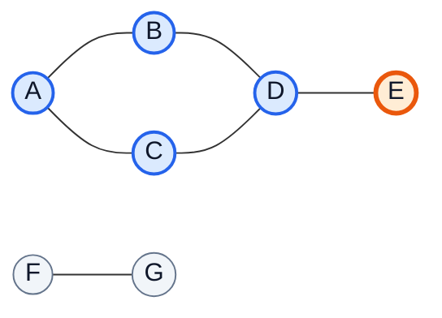
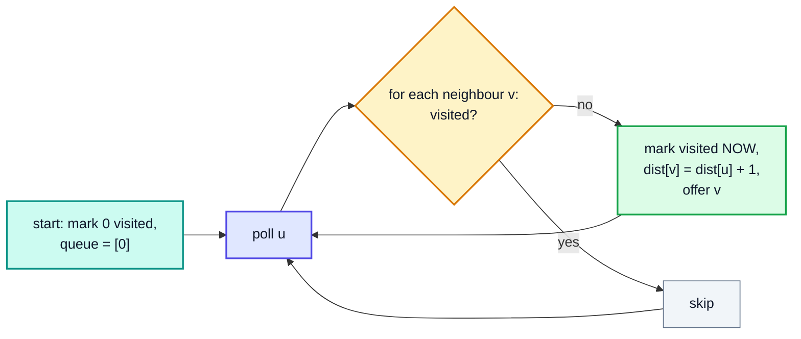
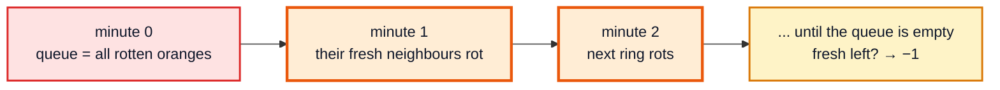
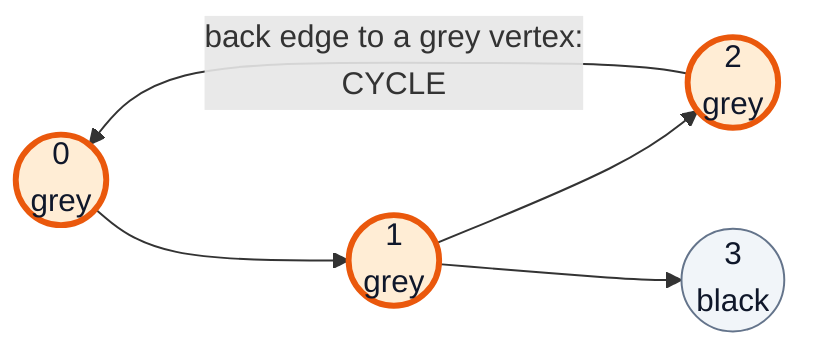
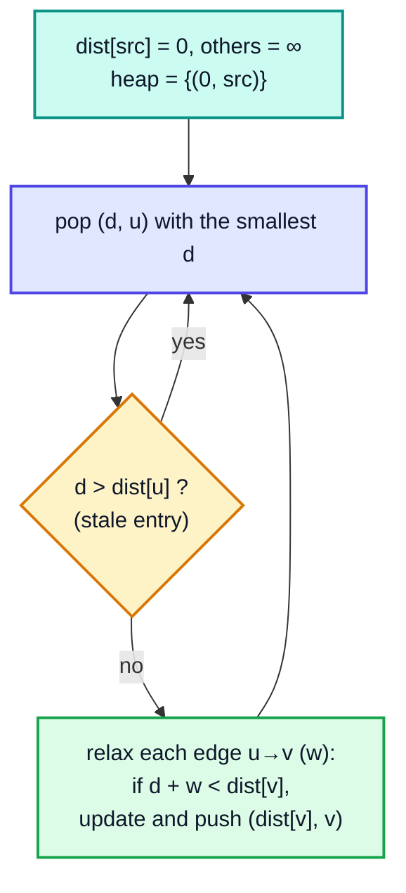
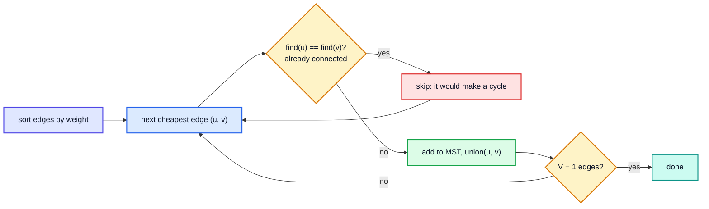
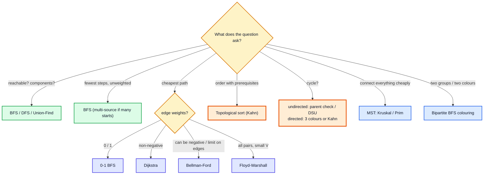

# Graphs — Complete In-Depth Guide

**DSA whole topic #2 of 4** · Priority 🔴 · from [topics_not_covered.md](../topics_not_covered.md)

A **graph** is a set of things (vertices) and the connections between them (edges): cities and roads, users and friendships, courses and prerequisites, web pages and links. Trees ([videos 49, 55](../kunal-java-notes-claude/java_55_video_binary_tree_questions.md)) are a special kind of graph, and the playlist's only true graph problem is Word Ladder ([video 65](../kunal-java-notes-claude/java_65_video_word_ladder.md)).

These notes cover what interviews expect:
- how to represent a graph
- BFS and DFS, connected components and grid graphs
- cycle detection, topological sort and bipartite checking
- shortest paths (BFS, Dijkstra, 0-1 BFS, Bellman-Ford, Floyd-Warshall)
- minimum spanning trees (Prim, Kruskal)
- strongly connected components and bridges

> [!NOTE]
> This topic isn't in the playlist, so there are no video timestamps. All code targets **Java 21**. Prerequisites: queues and stacks ([video 46](../kunal-java-notes-claude/java_46_video_stacks_queues.md)), recursion ([video 27](../kunal-java-notes-claude/java_27_video_recursion_level1.md)), tree BFS/DFS ([video 55](../kunal-java-notes-claude/java_55_video_binary_tree_questions.md)), heaps ([video 56](../kunal-java-notes-claude/java_56_video_heaps_priority_queue.md)) and comparators ([gap Java #3](../Java%20Topics%20Not%20Covered%20Notes/java_gap_03_comparator_comparable.md)). Kruskal uses [Union-Find (topic #3)](dsa_topic_03_union_find.md).

---

## Table of Contents

| # | Topic (anchor link) | Level |
|---|---|---|
| 0 | [Graph Vocabulary](#0-graph-vocabulary) | Basics |
| 1 | [Representing a Graph](#1-representing-a-graph) | Basics |
| 2 | [Breadth-First Search](#2-breadth-first-search) | Core |
| 3 | [Depth-First Search](#3-depth-first-search) | Core |
| 4 | [Connected Components](#4-connected-components) | Core |
| 5 | [Grid Graphs: Islands, Flood Fill, Rotting Oranges](#5-grid-graphs-islands-flood-fill-rotting-oranges) | Core |
| 6 | [Cycle Detection](#6-cycle-detection) | Core |
| 7 | [Topological Sort](#7-topological-sort) | Core |
| 8 | [Bipartite Graphs](#8-bipartite-graphs) | In depth |
| 9 | [Shortest Paths: Dijkstra and 0-1 BFS](#9-shortest-paths-dijkstra-and-0-1-bfs) | In depth |
| 10 | [Bellman-Ford and Floyd-Warshall](#10-bellman-ford-and-floyd-warshall) | In depth |
| 11 | [Minimum Spanning Trees: Prim and Kruskal](#11-minimum-spanning-trees-prim-and-kruskal) | In depth |
| 12 | [Implicit Graphs and Cloning](#12-implicit-graphs-and-cloning) | In depth |
| 13 | [Strongly Connected Components and Bridges](#13-strongly-connected-components-and-bridges) | Advanced |
| 14 | [Choosing an Algorithm, Pitfalls and Problem List](#14-choosing-an-algorithm-pitfalls-and-problem-list) | Interview |

---

## 0. Graph Vocabulary



| Term | Meaning | In the picture |
|---|---|---|
| **Vertex (node)** | A thing | A … G (V = 7) |
| **Edge** | A connection between two vertices | A–B, … (E = 6) |
| **Undirected / directed** | Edges go both ways / one way (`u → v`) | Undirected |
| **Weighted** | Each edge has a cost or length | Unweighted |
| **Degree** | Number of edges at a vertex (directed: in-degree and out-degree) | deg(D) = 3 |
| **Path** | A sequence of vertices joined by edges | A → B → D → E |
| **Cycle** | A path that returns to its start | A → B → D → C → A |
| **Connected component** | A maximal set of vertices all reachable from each other | {A, B, C, D, E} and {F, G} |
| **Tree** | A connected graph with no cycles (exactly V − 1 edges) | {F, G} is a tree |
| **DAG** | Directed Acyclic Graph | Prerequisites, build orders |
| **Dense / sparse** | E close to V² / E close to V | |

> [!NOTE]
> A tree is a graph where you never need a `visited` set: following child pointers can't loop back. In a general graph, cycles mean you **must** track visited vertices, or BFS/DFS runs forever. That's the main difference between tree traversal and graph traversal.

---

## 1. Representing a Graph

| Representation | Space | Check edge u–v | List neighbours of u | Best for |
|---|---|---|---|---|
| **Adjacency list** | O(V + E) | O(deg u) | O(deg u) | Almost everything (sparse graphs) |
| **Adjacency matrix** | O(V²) | **O(1)** | O(V) | Dense graphs, Floyd-Warshall, small V |
| **Edge list** | O(E) | O(E) | O(E) | Kruskal, Bellman-Ford (they loop over edges) |

```java
import java.util.*;

public class GraphRepresentations {
    public static void main(String[] args) {
        int n = 5;
        int[][] edges = {{0, 1}, {0, 2}, {1, 3}, {2, 3}, {3, 4}};      // undirected

        // 1. Adjacency list: List<List<Integer>>
        List<List<Integer>> adj = new ArrayList<>();
        for (int i = 0; i < n; i++) adj.add(new ArrayList<>());
        for (int[] e : edges) {
            adj.get(e[0]).add(e[1]);
            adj.get(e[1]).add(e[0]);           // omit this line for a directed graph
        }
        System.out.println(adj);               // [[1, 2], [0, 3], [0, 3], [1, 2, 4], [3]]

        // 2. Adjacency matrix
        boolean[][] matrix = new boolean[n][n];
        for (int[] e : edges) matrix[e[0]][e[1]] = matrix[e[1]][e[0]] = true;
        System.out.println(matrix[1][3] + " " + matrix[1][4]);   // true false

        // 3. Weighted adjacency list: each entry is {neighbour, weight}
        int[][] wEdges = {{0, 1, 4}, {0, 2, 1}, {2, 1, 2}};
        List<List<int[]>> wAdj = new ArrayList<>();
        for (int i = 0; i < 3; i++) wAdj.add(new ArrayList<>());
        for (int[] e : wEdges) wAdj.get(e[0]).add(new int[]{e[1], e[2]});     // directed
        for (int[] nb : wAdj.get(0)) System.out.print("0->" + nb[0] + " (w=" + nb[1] + ")  ");
        System.out.println();                  // 0->1 (w=4)  0->2 (w=1)

        // 4. Graph keyed by strings / objects: Map<String, List<String>>
        Map<String, List<String>> g = new HashMap<>();
        for (String[] e : new String[][]{{"JFK", "LHR"}, {"JFK", "SFO"}})
            g.computeIfAbsent(e[0], k -> new ArrayList<>()).add(e[1]);
        System.out.println(g);                 // {JFK=[LHR, SFO]}
    }
}
```

> [!TIP]
> LeetCode usually gives `n` and an edge list `int[][] edges`. The first five lines of almost every graph solution build `List<List<Integer>> adj` from it. Memorise that block.

---

## 2. Breadth-First Search

BFS explores the graph **level by level** using a **queue**: first everything 1 edge away, then 2, then 3. That's exactly level-order traversal of a tree ([video 55](../kunal-java-notes-claude/java_55_video_binary_tree_questions.md)), plus a `visited` array.

**Key property:** in an **unweighted** graph, the first time BFS reaches a vertex is along a **shortest path** (fewest edges).



```java
import java.util.*;

public class BFS {
    static List<List<Integer>> build(int n, int[][] edges) {
        List<List<Integer>> adj = new ArrayList<>();
        for (int i = 0; i < n; i++) adj.add(new ArrayList<>());
        for (int[] e : edges) { adj.get(e[0]).add(e[1]); adj.get(e[1]).add(e[0]); }
        return adj;
    }

    static int[] bfs(List<List<Integer>> adj, int src, List<Integer> order) {
        int[] dist = new int[adj.size()];
        Arrays.fill(dist, -1);                         // -1 = not visited
        Deque<Integer> q = new ArrayDeque<>();
        dist[src] = 0;
        q.offer(src);
        while (!q.isEmpty()) {
            int u = q.poll();
            order.add(u);
            for (int v : adj.get(u)) {
                if (dist[v] == -1) {                   // mark when ENQUEUED, not when polled
                    dist[v] = dist[u] + 1;
                    q.offer(v);
                }
            }
        }
        return dist;
    }

    public static void main(String[] args) {
        //   0 — 1 — 3
        //   |       |
        //   2 — 4 — 5
        List<List<Integer>> adj = build(6, new int[][]{{0, 1}, {0, 2}, {1, 3}, {2, 4}, {3, 5}, {4, 5}});
        List<Integer> order = new ArrayList<>();
        int[] dist = bfs(adj, 0, order);
        System.out.println("BFS order: " + order);                  // [0, 1, 2, 3, 4, 5]
        System.out.println("distances: " + Arrays.toString(dist));  // [0, 1, 1, 2, 2, 3]
    }
}
```

**Dry run** from vertex 0:

| Poll | Neighbours | Newly discovered (dist) | Queue after |
|---|---|---|---|
| 0 | 1, 2 | 1 (1), 2 (1) | [1, 2] |
| 1 | 0, 3 | 3 (2) | [2, 3] |
| 2 | 0, 4 | 4 (2) | [3, 4] |
| 3 | 1, 5 | 5 (3) | [4, 5] |
| 4 | 2, 5 | — | [5] |
| 5 | 3, 4 | — | [] |

**Time** O(V + E): each vertex is enqueued once, and each edge is looked at twice (once from each end). **Space** O(V).

> [!IMPORTANT]
> Mark a vertex as visited **when you add it to the queue**, not when you take it out. Marking on poll lets the same vertex be added many times (once per neighbour that sees it before it's polled), which can blow up the queue on dense graphs.

### Getting the actual path

Keep `parent[v] = u` when `v` is discovered, then walk back from the target.

```java
static List<Integer> path(int[] parent, int target) {      // parent[src] = -1
    LinkedList<Integer> p = new LinkedList<>();
    for (int v = target; v != -1; v = parent[v]) p.addFirst(v);
    return p;
}
```

---

## 3. Depth-First Search

DFS goes **as deep as possible** along one branch before backtracking: recursion (or an explicit **stack**). It's preorder traversal of a tree, plus `visited`.

```java
import java.util.*;

public class DFS {
    static void dfs(List<List<Integer>> adj, int u, boolean[] visited, List<Integer> order) {
        visited[u] = true;
        order.add(u);
        for (int v : adj.get(u)) if (!visited[v]) dfs(adj, v, visited, order);
    }

    // Iterative version with an explicit stack (no recursion depth limit)
    static List<Integer> dfsIterative(List<List<Integer>> adj, int src) {
        List<Integer> order = new ArrayList<>();
        boolean[] visited = new boolean[adj.size()];
        Deque<Integer> stack = new ArrayDeque<>();
        stack.push(src);
        while (!stack.isEmpty()) {
            int u = stack.pop();
            if (visited[u]) continue;                       // may have been pushed twice
            visited[u] = true;
            order.add(u);
            List<Integer> nb = adj.get(u);
            for (int i = nb.size() - 1; i >= 0; i--)         // reverse so the smallest neighbour is visited first
                if (!visited[nb.get(i)]) stack.push(nb.get(i));
        }
        return order;
    }

    public static void main(String[] args) {
        List<List<Integer>> adj = BFS.build(6, new int[][]{{0, 1}, {0, 2}, {1, 3}, {2, 4}, {3, 5}, {4, 5}});
        List<Integer> order = new ArrayList<>();
        dfs(adj, 0, new boolean[6], order);
        System.out.println("DFS recursive: " + order);                 // [0, 1, 3, 5, 4, 2]
        System.out.println("DFS iterative: " + dfsIterative(adj, 0));  // [0, 1, 3, 5, 4, 2]
    }

    // build() reused from the BFS example
    static class BFS {
        static List<List<Integer>> build(int n, int[][] edges) {
            List<List<Integer>> adj = new ArrayList<>();
            for (int i = 0; i < n; i++) adj.add(new ArrayList<>());
            for (int[] e : edges) { adj.get(e[0]).add(e[1]); adj.get(e[1]).add(e[0]); }
            return adj;
        }
    }
}
```

| | BFS | DFS |
|---|---|---|
| Structure | Queue | Stack / recursion |
| Order | Level by level | Deep first, then backtrack |
| Shortest path (unweighted) | ✅ | ❌ |
| Memory | Width of the graph | Depth of the graph |
| Natural for | Shortest paths, levels, multi-source spreading | Components, cycles, topological sort, backtracking, bridges |
| Time | O(V + E) | O(V + E) |

> [!WARNING]
> Recursive DFS on a graph with 10⁵+ vertices in a long chain can overflow the stack. Use the iterative version, or run on a thread with a bigger stack ([gap Java #9, section 11](../Java%20Topics%20Not%20Covered%20Notes/java_gap_09_jvm_internals_gc.md#11-outofmemoryerror-and-stackoverflowerror)).

---

## 4. Connected Components

Run BFS/DFS from every vertex that isn't visited yet. Each run discovers one whole component.

### Number of Provinces (LC 547)

The input is an adjacency **matrix** `isConnected[i][j]`.

```java
public class Provinces {
    static int findCircleNum(int[][] m) {
        int n = m.length, count = 0;
        boolean[] seen = new boolean[n];
        for (int i = 0; i < n; i++) {
            if (!seen[i]) { count++; dfs(m, i, seen); }        // new component
        }
        return count;
    }
    static void dfs(int[][] m, int u, boolean[] seen) {
        seen[u] = true;
        for (int v = 0; v < m.length; v++) if (m[u][v] == 1 && !seen[v]) dfs(m, v, seen);
    }

    public static void main(String[] args) {
        System.out.println(findCircleNum(new int[][]{{1, 1, 0}, {1, 1, 0}, {0, 0, 1}}));   // 2
        System.out.println(findCircleNum(new int[][]{{1, 0, 0}, {0, 1, 0}, {0, 0, 1}}));   // 3
    }
}
```

**Time** O(V²) with a matrix (O(V + E) with a list). [Union-Find (topic #3)](dsa_topic_03_union_find.md) solves the same problem, and is better when edges arrive one at a time.

---

## 5. Grid Graphs: Islands, Flood Fill, Rotting Oranges

A grid is a graph where each cell is a vertex and edges go to the 4 (or 8) neighbours. You never build an adjacency list; you compute neighbours with **direction arrays**.

```java
int[][] DIRS = {{1, 0}, {-1, 0}, {0, 1}, {0, -1}};   // down, up, right, left
for (int[] d : DIRS) {
    int nr = r + d[0], nc = c + d[1];
    if (nr < 0 || nc < 0 || nr >= R || nc >= C) continue;   // out of bounds
    ...
}
```

```java
import java.util.*;

public class GridGraphs {
    static final int[][] DIRS = {{1, 0}, {-1, 0}, {0, 1}, {0, -1}};

    // LC 200 Number of Islands: count components of '1'
    static int numIslands(char[][] g) {
        int count = 0;
        for (int r = 0; r < g.length; r++)
            for (int c = 0; c < g[0].length; c++)
                if (g[r][c] == '1') { count++; sink(g, r, c); }
        return count;
    }
    static void sink(char[][] g, int r, int c) {             // DFS that marks visited by overwriting
        if (r < 0 || c < 0 || r >= g.length || c >= g[0].length || g[r][c] != '1') return;
        g[r][c] = '0';
        for (int[] d : DIRS) sink(g, r + d[0], c + d[1]);
    }

    // LC 733 Flood Fill
    static int[][] floodFill(int[][] img, int sr, int sc, int color) {
        int old = img[sr][sc];
        if (old != color) fill(img, sr, sc, old, color);    // guard: same colour would loop forever
        return img;
    }
    static void fill(int[][] img, int r, int c, int old, int color) {
        if (r < 0 || c < 0 || r >= img.length || c >= img[0].length || img[r][c] != old) return;
        img[r][c] = color;
        for (int[] d : DIRS) fill(img, r + d[0], c + d[1], old, color);
    }

    // LC 994 Rotting Oranges: MULTI-SOURCE BFS — all rotten oranges start in the queue together
    static int orangesRotting(int[][] g) {
        int R = g.length, C = g[0].length, fresh = 0, minutes = 0;
        Deque<int[]> q = new ArrayDeque<>();
        for (int r = 0; r < R; r++)
            for (int c = 0; c < C; c++) {
                if (g[r][c] == 2) q.offer(new int[]{r, c});
                else if (g[r][c] == 1) fresh++;
            }
        while (!q.isEmpty() && fresh > 0) {
            for (int size = q.size(); size > 0; size--) {    // one level = one minute
                int[] cell = q.poll();
                for (int[] d : DIRS) {
                    int nr = cell[0] + d[0], nc = cell[1] + d[1];
                    if (nr < 0 || nc < 0 || nr >= R || nc >= C || g[nr][nc] != 1) continue;
                    g[nr][nc] = 2;
                    fresh--;
                    q.offer(new int[]{nr, nc});
                }
            }
            minutes++;
        }
        return fresh == 0 ? minutes : -1;
    }

    public static void main(String[] args) {
        char[][] grid = {
                "11000".toCharArray(),
                "11000".toCharArray(),
                "00100".toCharArray(),
                "00011".toCharArray()};
        System.out.println(numIslands(grid));                                                     // 3
        System.out.println(Arrays.deepToString(floodFill(new int[][]{{1, 1, 1}, {1, 1, 0}, {1, 0, 1}}, 1, 1, 2)));
        // [[2, 2, 2], [2, 2, 0], [2, 0, 1]]
        System.out.println(orangesRotting(new int[][]{{2, 1, 1}, {1, 1, 0}, {0, 1, 1}}));        // 4
        System.out.println(orangesRotting(new int[][]{{2, 1, 1}, {0, 1, 1}, {1, 0, 1}}));        // -1
    }
}
```



> [!TIP]
> **Multi-source BFS**: when the question is "distance to the *nearest* X" (nearest rotten orange, nearest 0 in LC 542 01 Matrix, nearest gate in LC 286), put **all** X's in the queue at the start with distance 0. One BFS then gives every cell its distance to the closest source.

---

## 6. Cycle Detection

### Undirected graphs: "visited, and not my parent"

In an undirected graph, the edge back to the vertex you just came from isn't a cycle. Any **other** already-visited neighbour is.

```java
import java.util.*;

public class CycleUndirected {
    static boolean hasCycle(int n, int[][] edges) {
        List<List<Integer>> adj = new ArrayList<>();
        for (int i = 0; i < n; i++) adj.add(new ArrayList<>());
        for (int[] e : edges) { adj.get(e[0]).add(e[1]); adj.get(e[1]).add(e[0]); }
        boolean[] seen = new boolean[n];
        for (int s = 0; s < n; s++) if (!seen[s] && dfs(adj, s, -1, seen)) return true;
        return false;
    }
    static boolean dfs(List<List<Integer>> adj, int u, int parent, boolean[] seen) {
        seen[u] = true;
        for (int v : adj.get(u)) {
            if (!seen[v]) { if (dfs(adj, v, u, seen)) return true; }
            else if (v != parent) return true;              // visited and not where we came from
        }
        return false;
    }

    public static void main(String[] args) {
        System.out.println(hasCycle(4, new int[][]{{0, 1}, {1, 2}, {2, 3}}));          // false (a path)
        System.out.println(hasCycle(4, new int[][]{{0, 1}, {1, 2}, {2, 0}, {2, 3}}));  // true  (0-1-2-0)
    }
}
```

### Directed graphs: three colours

In a directed graph, reaching a visited vertex isn't enough (two paths can merge without a cycle). A cycle exists exactly when DFS reaches a vertex that is **still on the current recursion path**.

| Colour | Meaning |
|---|---|
| 0 = white | Not visited yet |
| 1 = grey | On the current DFS path (being explored) |
| 2 = black | Fully finished |

Reaching a **grey** vertex = a back edge = a cycle.



```java
import java.util.*;

public class CourseSchedule {
    // LC 207: can all courses be finished? = is the prerequisite graph acyclic?
    static boolean canFinish(int n, int[][] prereq) {
        List<List<Integer>> adj = new ArrayList<>();
        for (int i = 0; i < n; i++) adj.add(new ArrayList<>());
        for (int[] p : prereq) adj.get(p[1]).add(p[0]);          // to take p[0], first take p[1]
        int[] color = new int[n];
        for (int i = 0; i < n; i++) if (color[i] == 0 && hasCycle(adj, i, color)) return false;
        return true;
    }
    static boolean hasCycle(List<List<Integer>> adj, int u, int[] color) {
        color[u] = 1;                                           // grey: on the path
        for (int v : adj.get(u)) {
            if (color[v] == 1) return true;                     // back edge
            if (color[v] == 0 && hasCycle(adj, v, color)) return true;
        }
        color[u] = 2;                                           // black: done
        return false;
    }

    public static void main(String[] args) {
        System.out.println(canFinish(2, new int[][]{{1, 0}}));              // true
        System.out.println(canFinish(2, new int[][]{{1, 0}, {0, 1}}));      // false
        System.out.println(canFinish(4, new int[][]{{1, 0}, {2, 0}, {3, 1}, {3, 2}}));   // true (diamond, no cycle)
    }
}
```

> [!CAUTION]
> Using the undirected "visited and not parent" check on a **directed** graph gives wrong answers. In the diamond `0→1, 0→2, 1→3, 2→3`, vertex 3 is reached twice but there's no cycle. Only grey vertices indicate a cycle.

---

## 7. Topological Sort

A **topological order** of a DAG lists the vertices so that every edge `u → v` has `u` before `v`: a valid order to take courses, build modules or run tasks. It exists **only if the graph has no cycle**.

### Kahn's algorithm (BFS on in-degrees)

Repeatedly take a vertex with **no remaining prerequisites** (in-degree 0), output it, and remove its outgoing edges.

```java
import java.util.*;

public class TopoSort {
    // LC 210 Course Schedule II
    static int[] findOrder(int n, int[][] prereq) {
        List<List<Integer>> adj = new ArrayList<>();
        for (int i = 0; i < n; i++) adj.add(new ArrayList<>());
        int[] indeg = new int[n];
        for (int[] p : prereq) { adj.get(p[1]).add(p[0]); indeg[p[0]]++; }

        Deque<Integer> q = new ArrayDeque<>();
        for (int i = 0; i < n; i++) if (indeg[i] == 0) q.offer(i);
        int[] order = new int[n];
        int idx = 0;
        while (!q.isEmpty()) {
            int u = q.poll();
            order[idx++] = u;
            for (int v : adj.get(u)) if (--indeg[v] == 0) q.offer(v);
        }
        return idx == n ? order : new int[0];               // fewer than n → there was a cycle
    }

    // DFS version: a vertex is added AFTER all its descendants → reverse post-order
    static List<Integer> topoDfs(int n, int[][] edges) {
        List<List<Integer>> adj = new ArrayList<>();
        for (int i = 0; i < n; i++) adj.add(new ArrayList<>());
        for (int[] e : edges) adj.get(e[0]).add(e[1]);
        boolean[] seen = new boolean[n];
        Deque<Integer> stack = new ArrayDeque<>();
        for (int i = 0; i < n; i++) if (!seen[i]) dfs(adj, i, seen, stack);
        return new ArrayList<>(stack);                       // stack top = first in the order
    }
    static void dfs(List<List<Integer>> adj, int u, boolean[] seen, Deque<Integer> stack) {
        seen[u] = true;
        for (int v : adj.get(u)) if (!seen[v]) dfs(adj, v, seen, stack);
        stack.push(u);                                       // post-order push
    }

    public static void main(String[] args) {
        System.out.println(Arrays.toString(findOrder(4, new int[][]{{1, 0}, {2, 0}, {3, 1}, {3, 2}})));   // [0, 1, 2, 3]
        System.out.println(Arrays.toString(findOrder(2, new int[][]{{1, 0}, {0, 1}})));                   // []
        System.out.println(topoDfs(6, new int[][]{{5, 2}, {5, 0}, {4, 0}, {4, 1}, {2, 3}, {3, 1}}));      // [5, 4, 2, 3, 1, 0]
    }
}
```

**Dry run** of Kahn's on courses `0 → {1, 2}`, `1 → 3`, `2 → 3`:

| Step | Queue | Output | In-degrees after (0, 1, 2, 3) |
|---|---|---|---|
| start | [0] | [] | 0, 1, 1, 2 |
| poll 0 | [1, 2] | [0] | 0, 0, 0, 2 |
| poll 1 | [2] | [0, 1] | 0, 0, 0, 1 |
| poll 2 | [3] | [0, 1, 2] | 0, 0, 0, 0 |
| poll 3 | [] | [0, 1, 2, 3] | — |

| | Kahn (BFS) | DFS post-order |
|---|---|---|
| Detects cycles | Output size < n | Needs the grey-colour check |
| Order produced | Level by level | Reverse finishing time |
| Easy to get the *lexicographically smallest* order | ✅ use a `PriorityQueue` instead of a queue | ❌ |

**Time** O(V + E). Related problems: LC 269 Alien Dictionary, LC 1136 Parallel Courses (number of BFS levels = minimum semesters), LC 2115 Find All Possible Recipes.

---

## 8. Bipartite Graphs

A graph is **bipartite** if its vertices can be coloured with two colours so that every edge joins different colours. Equivalently, it has **no odd-length cycle**.

```java
import java.util.*;

public class Bipartite {
    // LC 785: graph[u] = neighbours of u
    static boolean isBipartite(int[][] graph) {
        int n = graph.length;
        int[] color = new int[n];                           // 0 = uncoloured, 1 / -1 = the two sides
        for (int s = 0; s < n; s++) {
            if (color[s] != 0) continue;
            Deque<Integer> q = new ArrayDeque<>();
            q.offer(s);
            color[s] = 1;
            while (!q.isEmpty()) {
                int u = q.poll();
                for (int v : graph[u]) {
                    if (color[v] == 0) { color[v] = -color[u]; q.offer(v); }
                    else if (color[v] == color[u]) return false;      // same colour on both ends
                }
            }
        }
        return true;
    }

    public static void main(String[] args) {
        System.out.println(isBipartite(new int[][]{{1, 3}, {0, 2}, {1, 3}, {0, 2}}));         // true  (square)
        System.out.println(isBipartite(new int[][]{{1, 2, 3}, {0, 2}, {0, 1, 3}, {0, 2}}));   // false (triangle 0-1-2)
    }
}
```

Uses: splitting people into two teams with "these two dislike each other" constraints (LC 886 Possible Bipartition), job–worker matching.

---

## 9. Shortest Paths: Dijkstra and 0-1 BFS

| Graph | Algorithm | Time |
|---|---|---|
| Unweighted | **BFS** | O(V + E) |
| Weights only 0 or 1 | **0-1 BFS** (deque) | O(V + E) |
| Non-negative weights | **Dijkstra** (min-heap) | O((V + E) log V) |
| Negative weights, single source | **Bellman-Ford** | O(V · E) |
| All pairs | **Floyd-Warshall** | O(V³) |

### Dijkstra

Like BFS, but always expand the vertex with the **smallest known distance**, using a min-heap. Once a vertex is popped with its smallest distance, that distance is final, because all edges are non-negative, so no later path can be shorter.



```java
import java.util.*;

public class Dijkstra {
    static int[] dijkstra(int n, int[][] edges, int src) {      // edges: {u, v, w}, directed
        List<List<int[]>> adj = new ArrayList<>();
        for (int i = 0; i < n; i++) adj.add(new ArrayList<>());
        for (int[] e : edges) adj.get(e[0]).add(new int[]{e[1], e[2]});

        int[] dist = new int[n];
        Arrays.fill(dist, Integer.MAX_VALUE);
        dist[src] = 0;
        PriorityQueue<int[]> pq = new PriorityQueue<>((a, b) -> Integer.compare(a[0], b[0]));   // {dist, vertex}
        pq.offer(new int[]{0, src});
        while (!pq.isEmpty()) {
            int[] top = pq.poll();
            int d = top[0], u = top[1];
            if (d > dist[u]) continue;                          // stale: a shorter path was already found
            for (int[] e : adj.get(u)) {
                int v = e[0], nd = d + e[1];
                if (nd < dist[v]) { dist[v] = nd; pq.offer(new int[]{nd, v}); }
            }
        }
        return dist;
    }

    // LC 743 Network Delay Time (nodes are 1..n)
    static int networkDelayTime(int[][] times, int n, int k) {
        int[][] edges = new int[times.length][];
        for (int i = 0; i < times.length; i++) edges[i] = new int[]{times[i][0] - 1, times[i][1] - 1, times[i][2]};
        int best = 0;
        for (int d : dijkstra(n, edges, k - 1)) {
            if (d == Integer.MAX_VALUE) return -1;
            best = Math.max(best, d);
        }
        return best;
    }

    public static void main(String[] args) {
        int[][] edges = {{0, 1, 4}, {0, 2, 1}, {2, 1, 2}, {1, 3, 1}, {2, 3, 5}, {3, 4, 3}};
        System.out.println(Arrays.toString(dijkstra(5, edges, 0)));                          // [0, 3, 1, 4, 7]
        System.out.println(networkDelayTime(new int[][]{{2, 1, 1}, {2, 3, 1}, {3, 4, 1}}, 4, 2));   // 2
        System.out.println(networkDelayTime(new int[][]{{1, 2, 1}}, 2, 2));                        // -1
    }
}
```

**Dry run** from 0 on edges `0→1 (4), 0→2 (1), 2→1 (2), 1→3 (1), 2→3 (5), 3→4 (3)`:

| Pop (d, u) | Relaxations | dist after [0..4] |
|---|---|---|
| (0, 0) | 1: 4, 2: 1 | 0, 4, 1, ∞, ∞ |
| (1, 2) | 1: 1+2 = **3** < 4, 3: 1+5 = 6 | 0, 3, 1, 6, ∞ |
| (3, 1) | 3: 3+1 = **4** < 6 | 0, 3, 1, 4, ∞ |
| (4, 1) stale (4 > dist[1] = 3) | skip | |
| (4, 3) | 4: 4+3 = 7 | 0, 3, 1, 4, 7 |
| (6, 3) stale | skip | |
| (7, 4) | — | **0, 3, 1, 4, 7** |

> [!CAUTION]
> Dijkstra is **wrong with negative edge weights**: a vertex can be finalised before a cheaper path through a negative edge is found. Use Bellman-Ford. (Java's `PriorityQueue` has no decrease-key, so we push duplicates and skip stale entries: the "lazy deletion" trick.)

### 0-1 BFS

When every weight is 0 or 1 (e.g. "free" moves vs "cost 1" moves), a **deque** replaces the heap: push weight-0 neighbours to the **front**, weight-1 neighbours to the **back**. The deque stays sorted by distance, so it's O(V + E). Problem: LC 1368 Minimum Cost to Make at Least One Valid Path in a Grid, LC 2290.

```java
// inside the loop, for an edge u → v with weight w ∈ {0, 1}:
if (dist[u] + w < dist[v]) {
    dist[v] = dist[u] + w;
    if (w == 0) deque.offerFirst(v); else deque.offerLast(v);
}
```

---

## 10. Bellman-Ford and Floyd-Warshall

### Bellman-Ford

**Relax every edge, V − 1 times.** A shortest path has at most V − 1 edges, and after round `i` all shortest paths using ≤ `i` edges are correct. If a **V-th** round still improves something, there's a **negative cycle**.

It's dynamic programming in disguise: `dist_i[v]` = shortest path to `v` using at most `i` edges.

**Cheapest Flights Within K Stops (LC 787)** limits the number of edges, so it's Bellman-Ford stopped after `k + 1` rounds. Copy the array each round so one round can't chain several edges.

```java
import java.util.*;

public class BellmanFord {
    static int[] bellmanFord(int n, int[][] edges, int src) {       // returns null if a negative cycle is reachable
        long[] dist = new long[n];
        Arrays.fill(dist, Long.MAX_VALUE);
        dist[src] = 0;
        for (int round = 1; round < n; round++)
            for (int[] e : edges)
                if (dist[e[0]] != Long.MAX_VALUE && dist[e[0]] + e[2] < dist[e[1]]) dist[e[1]] = dist[e[0]] + e[2];
        for (int[] e : edges)
            if (dist[e[0]] != Long.MAX_VALUE && dist[e[0]] + e[2] < dist[e[1]]) return null;   // still improving
        return Arrays.stream(dist).mapToInt(d -> d == Long.MAX_VALUE ? Integer.MAX_VALUE : (int) d).toArray();
    }

    static int findCheapestPrice(int n, int[][] flights, int src, int dst, int k) {
        int[] dist = new int[n];
        Arrays.fill(dist, Integer.MAX_VALUE);
        dist[src] = 0;
        for (int round = 0; round <= k; round++) {                  // k stops = k + 1 edges
            int[] next = dist.clone();                              // use only the previous round's values
            for (int[] f : flights)
                if (dist[f[0]] != Integer.MAX_VALUE && dist[f[0]] + f[2] < next[f[1]]) next[f[1]] = dist[f[0]] + f[2];
            dist = next;
        }
        return dist[dst] == Integer.MAX_VALUE ? -1 : dist[dst];
    }

    public static void main(String[] args) {
        System.out.println(Arrays.toString(bellmanFord(4, new int[][]{{0, 1, 4}, {0, 2, 5}, {1, 2, -3}, {2, 3, 2}}, 0)));   // [0, 4, 1, 3]
        System.out.println(bellmanFord(3, new int[][]{{0, 1, 1}, {1, 2, -2}, {2, 1, 1}}, 0));                               // null
        int[][] flights = {{0, 1, 100}, {1, 2, 100}, {2, 0, 100}, {1, 3, 600}, {2, 3, 200}};
        System.out.println(findCheapestPrice(4, flights, 0, 3, 1));                                                        // 700
        System.out.println(findCheapestPrice(3, new int[][]{{0, 1, 100}, {1, 2, 100}, {0, 2, 500}}, 0, 2, 1));             // 200
        System.out.println(findCheapestPrice(3, new int[][]{{0, 1, 100}, {1, 2, 100}, {0, 2, 500}}, 0, 2, 0));             // 500
    }
}
```

### Floyd-Warshall (all pairs)

`dist[i][j]` = shortest path from `i` to `j`. For each possible **middle vertex** `k`, check whether going through `k` is shorter: `dist[i][j] = min(dist[i][j], dist[i][k] + dist[k][j])`. The `k` loop **must be outermost**.

```java
public class FloydWarshall {
    static final int INF = Integer.MAX_VALUE / 2;          // /2 so INF + INF doesn't overflow

    static int[][] floyd(int n, int[][] edges) {
        int[][] d = new int[n][n];
        for (int i = 0; i < n; i++) for (int j = 0; j < n; j++) d[i][j] = i == j ? 0 : INF;
        for (int[] e : edges) d[e[0]][e[1]] = Math.min(d[e[0]][e[1]], e[2]);
        for (int k = 0; k < n; k++)
            for (int i = 0; i < n; i++)
                for (int j = 0; j < n; j++)
                    if (d[i][k] + d[k][j] < d[i][j]) d[i][j] = d[i][k] + d[k][j];
        return d;
    }

    public static void main(String[] args) {
        int[][] d = floyd(4, new int[][]{{0, 1, 3}, {1, 2, 1}, {2, 3, 7}, {0, 3, 15}, {3, 0, 2}});
        for (int[] row : d) System.out.println(java.util.Arrays.toString(row));
        // [0, 3, 4, 11]
        // [10, 0, 1, 8]
        // [9, 12, 0, 7]
        // [2, 5, 6, 0]
    }
}
```

**Time** O(V³), **space** O(V²): fine for V ≤ ~400. Problems: LC 1334 Find the City With the Smallest Number of Neighbors, LC 399 Evaluate Division (also solvable with weighted Union-Find).

---

## 11. Minimum Spanning Trees: Prim and Kruskal

A **spanning tree** of a connected undirected graph connects all V vertices with V − 1 edges and no cycle. A **minimum spanning tree (MST)** is one with the smallest total edge weight (cheapest way to wire up all cities).

Both classic algorithms are **greedy**:

| | Prim | Kruskal |
|---|---|---|
| Idea | Grow one tree from a start vertex; always add the cheapest edge leaving the tree | Sort all edges; add each edge if it doesn't create a cycle |
| Data structure | Min-heap | Sorting + **Union-Find** |
| Time | O(E log V) | O(E log E) |
| Better for | Dense graphs (or the O(V²) array version) | Sparse graphs / edge lists |

### Min Cost to Connect All Points (LC 1584)

Every pair of points is an edge with Manhattan distance as the weight (a dense, complete graph).

```java
import java.util.*;

public class MinimumSpanningTree {
    static int dist(int[] a, int[] b) { return Math.abs(a[0] - b[0]) + Math.abs(a[1] - b[1]); }

    // Prim, O(V²) array version: best for complete graphs
    static int prim(int[][] pts) {
        int n = pts.length, total = 0;
        int[] best = new int[n];                       // cheapest edge connecting each vertex to the tree
        Arrays.fill(best, Integer.MAX_VALUE);
        boolean[] inTree = new boolean[n];
        best[0] = 0;
        for (int it = 0; it < n; it++) {
            int u = -1;
            for (int v = 0; v < n; v++) if (!inTree[v] && (u == -1 || best[v] < best[u])) u = v;
            inTree[u] = true;
            total += best[u];
            for (int v = 0; v < n; v++) if (!inTree[v]) best[v] = Math.min(best[v], dist(pts[u], pts[v]));
        }
        return total;
    }

    // Kruskal with a small Union-Find (see topic #3 for the full explanation)
    static int[] parent;
    static int find(int x) { return parent[x] == x ? x : (parent[x] = find(parent[x])); }

    static int kruskal(int[][] pts) {
        int n = pts.length;
        List<int[]> edges = new ArrayList<>();
        for (int i = 0; i < n; i++) for (int j = i + 1; j < n; j++) edges.add(new int[]{dist(pts[i], pts[j]), i, j});
        edges.sort((a, b) -> Integer.compare(a[0], b[0]));
        parent = new int[n];
        for (int i = 0; i < n; i++) parent[i] = i;
        int total = 0, used = 0;
        for (int[] e : edges) {
            int a = find(e[1]), b = find(e[2]);
            if (a == b) continue;                      // would form a cycle
            parent[a] = b;
            total += e[0];
            if (++used == n - 1) break;                // MST complete
        }
        return total;
    }

    public static void main(String[] args) {
        int[][] pts = {{0, 0}, {2, 2}, {3, 10}, {5, 2}, {7, 0}};
        System.out.println(prim(pts) + " " + kruskal(pts));   // 20 20
    }
}
```



---

## 12. Implicit Graphs and Cloning

Many problems never mention a "graph": the vertices are **states** and the edges are **moves**. Build neighbours on the fly and run BFS for the minimum number of moves.

| Problem | Vertex | Edge |
|---|---|---|
| Word Ladder (LC 127, [video 65](../kunal-java-notes-claude/java_65_video_word_ladder.md)) | a word | change one letter |
| Open the Lock (LC 752) | a 4-digit code | turn one wheel ±1 |
| Sliding Puzzle (LC 773) | a board configuration | slide a tile |
| Minimum Genetic Mutation (LC 433) | a gene string | change one character |
| Jump Game III (LC 1306) | an index | jump ±arr[i] |

### Clone Graph (LC 133)

Deep-copy a graph of `Node { val; List<Node> neighbors }`. Use a `HashMap<original, copy>`: it's both the visited set and the way to connect copies.

```java
import java.util.*;

public class CloneGraph {
    static class Node {
        int val; List<Node> neighbors = new ArrayList<>();
        Node(int v) { val = v; }
    }

    static Node cloneGraph(Node node) {
        if (node == null) return null;
        Map<Node, Node> copies = new HashMap<>();
        Deque<Node> q = new ArrayDeque<>();
        copies.put(node, new Node(node.val));
        q.offer(node);
        while (!q.isEmpty()) {
            Node u = q.poll();
            for (Node v : u.neighbors) {
                if (!copies.containsKey(v)) { copies.put(v, new Node(v.val)); q.offer(v); }
                copies.get(u).neighbors.add(copies.get(v));
            }
        }
        return copies.get(node);
    }

    public static void main(String[] args) {
        Node[] n = new Node[5];
        for (int i = 1; i <= 4; i++) n[i] = new Node(i);
        int[][] adj = {{}, {2, 4}, {1, 3}, {2, 4}, {1, 3}};             // LC 133 example: a square
        for (int i = 1; i <= 4; i++) for (int j : adj[i]) n[i].neighbors.add(n[j]);

        Node c = cloneGraph(n[1]);
        System.out.println(c != n[1]);                                   // true (a new object)
        System.out.println(c.val + " -> " + c.neighbors.stream().map(x -> x.val).toList());   // 1 -> [2, 4]
        Node threeVia2 = c.neighbors.get(0).neighbors.get(1), threeVia4 = c.neighbors.get(1).neighbors.get(1);
        System.out.println(threeVia2 == threeVia4 && threeVia2 != n[3]);   // true (one shared copy of node 3, not the original)
    }
}
```

---

## 13. Strongly Connected Components and Bridges

🟢 Less common in interviews, but they come up in hard rounds and competitive programming.

### Strongly connected components (Kosaraju)

In a **directed** graph, an SCC is a maximal set where every vertex can reach every other.

1. DFS the graph and record vertices in order of **finishing time**.
2. **Reverse** every edge.
3. DFS the reversed graph in **decreasing finishing time**; each DFS tree is one SCC.

```java
import java.util.*;

public class Kosaraju {
    static int countSCC(int n, int[][] edges) {
        List<List<Integer>> g = new ArrayList<>(), rg = new ArrayList<>();
        for (int i = 0; i < n; i++) { g.add(new ArrayList<>()); rg.add(new ArrayList<>()); }
        for (int[] e : edges) { g.get(e[0]).add(e[1]); rg.get(e[1]).add(e[0]); }

        boolean[] seen = new boolean[n];
        Deque<Integer> order = new ArrayDeque<>();
        for (int i = 0; i < n; i++) if (!seen[i]) dfs1(g, i, seen, order);

        Arrays.fill(seen, false);
        int count = 0;
        while (!order.isEmpty()) {
            int u = order.pop();                          // latest finish first
            if (!seen[u]) { count++; dfs2(rg, u, seen); }
        }
        return count;
    }
    static void dfs1(List<List<Integer>> g, int u, boolean[] seen, Deque<Integer> order) {
        seen[u] = true;
        for (int v : g.get(u)) if (!seen[v]) dfs1(g, v, seen, order);
        order.push(u);
    }
    static void dfs2(List<List<Integer>> rg, int u, boolean[] seen) {
        seen[u] = true;
        for (int v : rg.get(u)) if (!seen[v]) dfs2(rg, v, seen);
    }

    public static void main(String[] args) {
        int[][] edges = {{0, 1}, {1, 2}, {2, 0}, {1, 3}, {3, 4}, {4, 5}, {5, 3}};
        System.out.println(countSCC(7, edges));   // 3  ({0,1,2}, {3,4,5}, {6})
    }
}
```

### Bridges (Tarjan) — Critical Connections (LC 1192)

A **bridge** is an edge whose removal disconnects the graph. During DFS, record each vertex's discovery time `tin[u]` and `low[u]` = the earliest discovery time reachable from `u`'s subtree using **one back edge**. Edge `u–v` (v a child) is a bridge exactly when `low[v] > tin[u]`: `v`'s subtree can't get back above `u` without that edge.

```java
import java.util.*;

public class Bridges {
    static int timer;
    static int[] tin, low;
    static List<List<Integer>> adj;
    static List<List<Integer>> result;

    static List<List<Integer>> criticalConnections(int n, List<List<Integer>> connections) {
        adj = new ArrayList<>();
        for (int i = 0; i < n; i++) adj.add(new ArrayList<>());
        for (List<Integer> c : connections) { adj.get(c.get(0)).add(c.get(1)); adj.get(c.get(1)).add(c.get(0)); }
        tin = new int[n]; low = new int[n];
        Arrays.fill(tin, -1);
        timer = 0;
        result = new ArrayList<>();
        for (int i = 0; i < n; i++) if (tin[i] == -1) dfs(i, -1);
        return result;
    }

    static void dfs(int u, int parent) {
        tin[u] = low[u] = timer++;
        for (int v : adj.get(u)) {
            if (v == parent) continue;
            if (tin[v] != -1) low[u] = Math.min(low[u], tin[v]);    // back edge
            else {
                dfs(v, u);
                low[u] = Math.min(low[u], low[v]);
                if (low[v] > tin[u]) result.add(List.of(u, v));     // v's subtree can't climb above u
            }
        }
    }

    public static void main(String[] args) {
        List<List<Integer>> conns = List.of(List.of(0, 1), List.of(1, 2), List.of(2, 0), List.of(1, 3));
        System.out.println(criticalConnections(4, conns));   // [[1, 3]]
    }
}
```

The same `tin`/`low` idea finds **articulation points** (vertices whose removal disconnects the graph): non-root `u` is one if some child has `low[v] >= tin[u]`.

---

## 14. Choosing an Algorithm, Pitfalls and Problem List



### Complexities

| Algorithm | Time | Space |
|---|---|---|
| BFS / DFS | O(V + E) | O(V) |
| Topological sort | O(V + E) | O(V) |
| Dijkstra (binary heap) | O((V + E) log V) | O(V + E) |
| 0-1 BFS | O(V + E) | O(V) |
| Bellman-Ford | O(V · E) | O(V) |
| Floyd-Warshall | O(V³) | O(V²) |
| Prim (heap) / Prim (array) | O(E log V) / O(V²) | O(V + E) |
| Kruskal | O(E log E) | O(V + E) |
| Kosaraju / Tarjan | O(V + E) | O(V + E) |

### Pitfalls

| Pitfall | Fix |
|---|---|
| Forgetting `visited` | Graphs have cycles: always track visited |
| Marking visited when polling in BFS | Mark when enqueuing |
| Adding an undirected edge only once | Add both `u→v` and `v→u` |
| Getting the prerequisite direction backwards | `[a, b]` = "b before a" → edge `b → a` |
| Parent check for cycles in a directed graph | Use 3 colours |
| Dijkstra with negative weights | Bellman-Ford |
| Processing stale heap entries in Dijkstra | `if (d > dist[u]) continue;` |
| `INF + w` overflow | Check `dist[u] != INF` first, or use `INF = MAX_VALUE / 2` |
| Floyd-Warshall with `k` not outermost | `for k` → `for i` → `for j` |
| Recursion depth on big graphs | Iterative DFS or BFS |
| Disconnected graphs | Loop over all vertices as starting points |

### Problem list (in order)

| # | Problem | Technique | Difficulty |
|---|---|---|---|
| 1 | LC 733 Flood Fill | Grid DFS | Easy |
| 2 | LC 1971 Find if Path Exists in Graph | BFS/DFS | Easy |
| 3 | LC 200 Number of Islands | Grid components | Medium |
| 4 | LC 695 Max Area of Island | Grid DFS | Medium |
| 5 | LC 547 Number of Provinces | Components | Medium |
| 6 | LC 133 Clone Graph | BFS + map | Medium |
| 7 | LC 994 Rotting Oranges | Multi-source BFS | Medium |
| 8 | LC 542 01 Matrix | Multi-source BFS | Medium |
| 9 | LC 417 Pacific Atlantic Water Flow | Reverse BFS from both oceans | Medium |
| 10 | LC 130 Surrounded Regions | DFS from the border | Medium |
| 11 | LC 207 / 210 Course Schedule I, II | Cycle detection / topo sort | Medium |
| 12 | LC 785 Is Graph Bipartite? | BFS colouring | Medium |
| 13 | LC 743 Network Delay Time | Dijkstra | Medium |
| 14 | LC 787 Cheapest Flights Within K Stops | Bellman-Ford | Medium |
| 15 | LC 1584 Min Cost to Connect All Points | MST | Medium |
| 16 | LC 1631 Path With Minimum Effort | Dijkstra on a grid | Medium |
| 17 | LC 752 Open the Lock | Implicit BFS | Medium |
| 18 | LC 127 Word Ladder | Implicit BFS | Hard |
| 19 | LC 269 Alien Dictionary (premium) | Topo sort | Hard |
| 20 | LC 1192 Critical Connections | Bridges | Hard |

### Interview Q&A

| Question | Short answer |
|---|---|
| Adjacency list or matrix? | List for sparse graphs (O(V + E) space); matrix for dense graphs or O(1) edge checks. |
| BFS vs DFS? | BFS for shortest paths in unweighted graphs; DFS for exploring, cycles, topo sort. Both O(V + E). |
| Why does BFS give shortest paths? | It visits vertices in order of distance (number of edges) from the source. |
| Detect a cycle in a directed graph? | DFS with three colours (grey = on the path), or Kahn's algorithm outputs fewer than V vertices. |
| What's a topological sort? | An order where every edge goes forward; exists only for DAGs. |
| Why can't Dijkstra handle negative edges? | It finalises a vertex when popped; a negative edge could later give a shorter path. |
| Dijkstra complexity? | O((V + E) log V) with a binary heap. |
| Prim vs Kruskal? | Grow one tree with a heap vs sort edges and join components with Union-Find. |
| What's a bipartite graph? | 2-colourable; equivalently no odd cycle. |

---

## 🧩 Complete Example: Everything Together

A small "city map" exercise: BFS distances and path, DFS components, cycle detection in both kinds of graph, topological order, bipartite check, Dijkstra / Bellman-Ford / Floyd-Warshall agreeing on random graphs, Prim and Kruskal agreeing on the MST weight, multi-source grid BFS and bridges.

```java
import java.util.*;

public class GraphsShowcase {

    static List<List<Integer>> undirected(int n, int[][] edges) {
        List<List<Integer>> adj = new ArrayList<>();
        for (int i = 0; i < n; i++) adj.add(new ArrayList<>());
        for (int[] e : edges) { adj.get(e[0]).add(e[1]); adj.get(e[1]).add(e[0]); }
        return adj;
    }

    static List<Integer> bfsPath(List<List<Integer>> adj, int s, int t) {
        int[] parent = new int[adj.size()];
        Arrays.fill(parent, -2);
        parent[s] = -1;
        Deque<Integer> q = new ArrayDeque<>(List.of(s));
        while (!q.isEmpty()) {
            int u = q.poll();
            for (int v : adj.get(u)) if (parent[v] == -2) { parent[v] = u; q.offer(v); }
        }
        if (parent[t] == -2) return List.of();
        LinkedList<Integer> path = new LinkedList<>();
        for (int v = t; v != -1; v = parent[v]) path.addFirst(v);
        return path;
    }

    static int components(List<List<Integer>> adj) {
        boolean[] seen = new boolean[adj.size()];
        int count = 0;
        for (int s = 0; s < adj.size(); s++) {
            if (seen[s]) continue;
            count++;
            Deque<Integer> st = new ArrayDeque<>(List.of(s));
            seen[s] = true;
            while (!st.isEmpty()) for (int v : adj.get(st.pop())) if (!seen[v]) { seen[v] = true; st.push(v); }
        }
        return count;
    }

    static List<Integer> topo(int n, int[][] edges) {
        List<List<Integer>> adj = new ArrayList<>();
        for (int i = 0; i < n; i++) adj.add(new ArrayList<>());
        int[] indeg = new int[n];
        for (int[] e : edges) { adj.get(e[0]).add(e[1]); indeg[e[1]]++; }
        PriorityQueue<Integer> q = new PriorityQueue<>();               // smallest available first → deterministic
        for (int i = 0; i < n; i++) if (indeg[i] == 0) q.offer(i);
        List<Integer> order = new ArrayList<>();
        while (!q.isEmpty()) { int u = q.poll(); order.add(u); for (int v : adj.get(u)) if (--indeg[v] == 0) q.offer(v); }
        return order.size() == n ? order : null;                        // null = cycle
    }

    static boolean bipartite(List<List<Integer>> adj) {
        int[] col = new int[adj.size()];
        for (int s = 0; s < adj.size(); s++) {
            if (col[s] != 0) continue;
            col[s] = 1;
            Deque<Integer> q = new ArrayDeque<>(List.of(s));
            while (!q.isEmpty()) {
                int u = q.poll();
                for (int v : adj.get(u)) {
                    if (col[v] == 0) { col[v] = -col[u]; q.offer(v); }
                    else if (col[v] == col[u]) return false;
                }
            }
        }
        return true;
    }

    static final int INF = Integer.MAX_VALUE / 2;

    static int[] dijkstra(int n, int[][] edges, int s) {
        List<List<int[]>> adj = new ArrayList<>();
        for (int i = 0; i < n; i++) adj.add(new ArrayList<>());
        for (int[] e : edges) adj.get(e[0]).add(new int[]{e[1], e[2]});
        int[] d = new int[n];
        Arrays.fill(d, INF);
        d[s] = 0;
        PriorityQueue<int[]> pq = new PriorityQueue<>(Comparator.comparingInt(a -> a[0]));
        pq.offer(new int[]{0, s});
        while (!pq.isEmpty()) {
            int[] t = pq.poll();
            if (t[0] > d[t[1]]) continue;
            for (int[] e : adj.get(t[1])) if (t[0] + e[1] < d[e[0]]) { d[e[0]] = t[0] + e[1]; pq.offer(new int[]{d[e[0]], e[0]}); }
        }
        return d;
    }

    static int[] bellmanFord(int n, int[][] edges, int s) {
        int[] d = new int[n];
        Arrays.fill(d, INF);
        d[s] = 0;
        for (int r = 1; r < n; r++) for (int[] e : edges) if (d[e[0]] != INF && d[e[0]] + e[2] < d[e[1]]) d[e[1]] = d[e[0]] + e[2];
        return d;
    }

    static int[][] floyd(int n, int[][] edges) {
        int[][] d = new int[n][n];
        for (int[] row : d) Arrays.fill(row, INF);
        for (int i = 0; i < n; i++) d[i][i] = 0;
        for (int[] e : edges) d[e[0]][e[1]] = Math.min(d[e[0]][e[1]], e[2]);
        for (int k = 0; k < n; k++) for (int i = 0; i < n; i++) for (int j = 0; j < n; j++)
            if (d[i][k] + d[k][j] < d[i][j]) d[i][j] = d[i][k] + d[k][j];
        return d;
    }

    static int primWeight(int n, int[][] edges) {                       // edges undirected {u, v, w}
        List<List<int[]>> adj = new ArrayList<>();
        for (int i = 0; i < n; i++) adj.add(new ArrayList<>());
        for (int[] e : edges) { adj.get(e[0]).add(new int[]{e[1], e[2]}); adj.get(e[1]).add(new int[]{e[0], e[2]}); }
        boolean[] in = new boolean[n];
        PriorityQueue<int[]> pq = new PriorityQueue<>(Comparator.comparingInt(a -> a[0]));
        pq.offer(new int[]{0, 0});
        int total = 0, added = 0;
        while (!pq.isEmpty() && added < n) {
            int[] t = pq.poll();
            if (in[t[1]]) continue;
            in[t[1]] = true; total += t[0]; added++;
            for (int[] e : adj.get(t[1])) if (!in[e[0]]) pq.offer(new int[]{e[1], e[0]});
        }
        return added == n ? total : -1;
    }

    static int[] par;
    static int find(int x) { return par[x] == x ? x : (par[x] = find(par[x])); }
    static int kruskalWeight(int n, int[][] edges) {
        int[][] es = edges.clone();
        Arrays.sort(es, Comparator.comparingInt(e -> e[2]));
        par = new int[n];
        for (int i = 0; i < n; i++) par[i] = i;
        int total = 0, used = 0;
        for (int[] e : es) { int a = find(e[0]), b = find(e[1]); if (a != b) { par[a] = b; total += e[2]; used++; } }
        return used == n - 1 ? total : -1;
    }

    static int[][] nearestHospital(char[][] city) {                    // multi-source BFS on a grid
        int R = city.length, C = city[0].length;
        int[][] d = new int[R][C];
        Deque<int[]> q = new ArrayDeque<>();
        for (int r = 0; r < R; r++) for (int c = 0; c < C; c++) {
            if (city[r][c] == 'H') { d[r][c] = 0; q.offer(new int[]{r, c}); } else d[r][c] = -1;
        }
        int[][] dirs = {{1, 0}, {-1, 0}, {0, 1}, {0, -1}};
        while (!q.isEmpty()) {
            int[] p = q.poll();
            for (int[] dd : dirs) {
                int nr = p[0] + dd[0], nc = p[1] + dd[1];
                if (nr < 0 || nc < 0 || nr >= R || nc >= C || city[nr][nc] == '#' || d[nr][nc] != -1) continue;
                d[nr][nc] = d[p[0]][p[1]] + 1;
                q.offer(new int[]{nr, nc});
            }
        }
        return d;
    }

    static int timer; static int[] tin, low; static List<String> bridges;
    static void bridgeDfs(List<List<Integer>> adj, int u, int p) {
        tin[u] = low[u] = timer++;
        for (int v : adj.get(u)) {
            if (v == p) continue;
            if (tin[v] != -1) low[u] = Math.min(low[u], tin[v]);
            else { bridgeDfs(adj, v, u); low[u] = Math.min(low[u], low[v]); if (low[v] > tin[u]) bridges.add(u + "-" + v); }
        }
    }

    public static void main(String[] args) {
        int[][] roads = {{0, 1}, {1, 2}, {2, 3}, {0, 4}, {4, 3}, {5, 6}};
        List<List<Integer>> city = undirected(7, roads);
        System.out.println("1. Shortest route 0 -> 3: " + bfsPath(city, 0, 3) + ", 0 -> 6: " + bfsPath(city, 0, 6));
        System.out.println("2. Connected components: " + components(city));
        System.out.println("3. Bipartite? city with the 5-cycle 0-1-2-3-4: " + bipartite(city)
                + ", a square: " + bipartite(undirected(4, new int[][]{{0, 1}, {1, 2}, {2, 3}, {3, 0}})));

        int[][] tasks = {{0, 2}, {1, 2}, {2, 3}, {3, 4}, {1, 4}};
        System.out.println("4. Build order: " + topo(5, tasks) + ", with a cycle: " + topo(3, new int[][]{{0, 1}, {1, 2}, {2, 0}}));

        int[][] weighted = {{0, 1, 4}, {0, 2, 1}, {2, 1, 2}, {1, 3, 1}, {2, 3, 5}, {3, 4, 3}};
        System.out.println("5. Dijkstra from 0: " + Arrays.toString(dijkstra(5, weighted, 0)));

        int[][] wires = {{0, 1, 7}, {0, 3, 5}, {1, 2, 8}, {1, 3, 9}, {1, 4, 7}, {2, 4, 5}, {3, 4, 15}, {3, 5, 6}, {4, 5, 8}, {4, 6, 9}, {5, 6, 11}};
        System.out.println("6. MST weight: Prim " + primWeight(7, wires) + ", Kruskal " + kruskalWeight(7, wires));

        char[][] grid = {"H..#".toCharArray(), ".#..".toCharArray(), "...H".toCharArray()};
        System.out.println("7. Distance to nearest hospital: " + Arrays.deepToString(nearestHospital(grid)));

        List<List<Integer>> net = undirected(5, new int[][]{{0, 1}, {1, 2}, {2, 0}, {1, 3}, {3, 4}});
        timer = 0; tin = new int[5]; low = new int[5]; Arrays.fill(tin, -1); bridges = new ArrayList<>();
        bridgeDfs(net, 0, -1);
        System.out.println("8. Bridges: " + bridges);

        Random rnd = new Random(743);
        int checks = 0, mismatches = 0;
        for (int t = 0; t < 200; t++) {
            int n = 2 + rnd.nextInt(7), m = rnd.nextInt(n * 3);
            int[][] es = new int[m][];
            for (int i = 0; i < m; i++) es[i] = new int[]{rnd.nextInt(n), rnd.nextInt(n), rnd.nextInt(10)};
            int[] dj = dijkstra(n, es, 0), bf = bellmanFord(n, es, 0), fw = floyd(n, es)[0];
            if (!Arrays.equals(dj, bf) || !Arrays.equals(dj, fw)) mismatches++;

            int[][] und = new int[m][];
            for (int i = 0; i < m; i++) und[i] = new int[]{rnd.nextInt(n), rnd.nextInt(n), 1 + rnd.nextInt(10)};
            if (primWeight(n, und) != kruskalWeight(n, und)) mismatches++;
            checks += 2;
        }
        System.out.println("Random cross-checks (Dijkstra = Bellman-Ford = Floyd, Prim = Kruskal): " + checks + ", mismatches: " + mismatches);
    }
}
```

**Expected Output:**
```
1. Shortest route 0 -> 3: [0, 4, 3], 0 -> 6: []
2. Connected components: 2
3. Bipartite? city with the 5-cycle 0-1-2-3-4: false, a square: true
4. Build order: [0, 1, 2, 3, 4], with a cycle: null
5. Dijkstra from 0: [0, 3, 1, 4, 7]
6. MST weight: Prim 39, Kruskal 39
7. Distance to nearest hospital: [[0, 1, 2, -1], [1, -1, 2, 1], [2, 2, 1, 0]]
8. Bridges: [3-4, 1-3]
Random cross-checks (Dijkstra = Bellman-Ford = Floyd, Prim = Kruskal): 400, mismatches: 0
```

---

## Quick Reference Cheat Sheet

| Concept | One-Line Summary |
|---|---|
| **Adjacency list** | `List<List<Integer>>`; add both directions for undirected |
| **BFS** | Queue + visited (mark on enqueue); shortest path in unweighted graphs |
| **DFS** | Recursion / stack + visited; components, cycles, topo sort |
| **Grid graph** | Direction arrays; bounds check; mark visited in place |
| **Multi-source BFS** | All sources in the queue at distance 0 |
| **Undirected cycle** | Visited neighbour that isn't the parent (or DSU) |
| **Directed cycle** | Reaching a grey (on-path) vertex |
| **Topological sort** | Kahn: repeatedly remove in-degree-0 vertices; fewer than V → cycle |
| **Bipartite** | BFS 2-colouring; conflict → not bipartite |
| **Dijkstra** | Min-heap of (dist, v); skip stale; non-negative weights only |
| **0-1 BFS** | Deque: weight 0 → front, weight 1 → back |
| **Bellman-Ford** | Relax all edges V − 1 times; one more improvement = negative cycle |
| **Floyd-Warshall** | `k` outermost; O(V³) all-pairs |
| **MST** | Prim (grow with heap) or Kruskal (sorted edges + DSU) |
| **SCC** | Kosaraju: finish order, reverse graph, DFS again |
| **Bridges** | `low[v] > tin[u]` |
