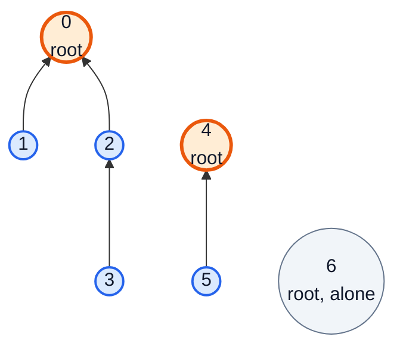
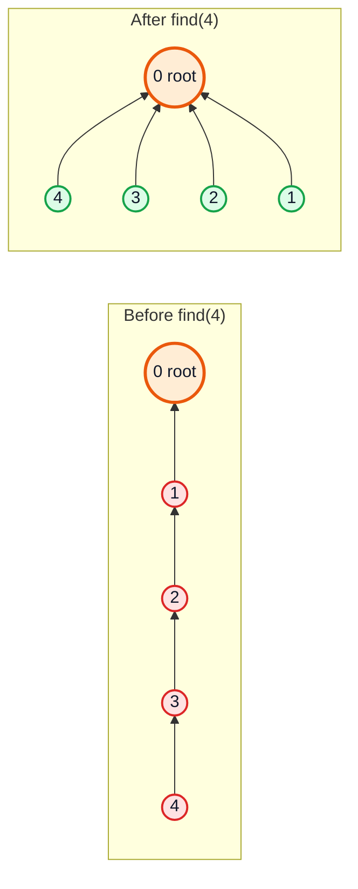
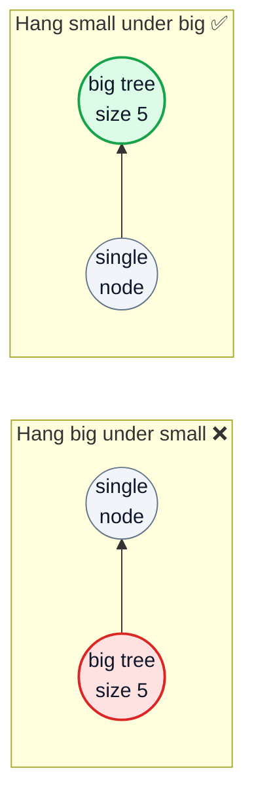
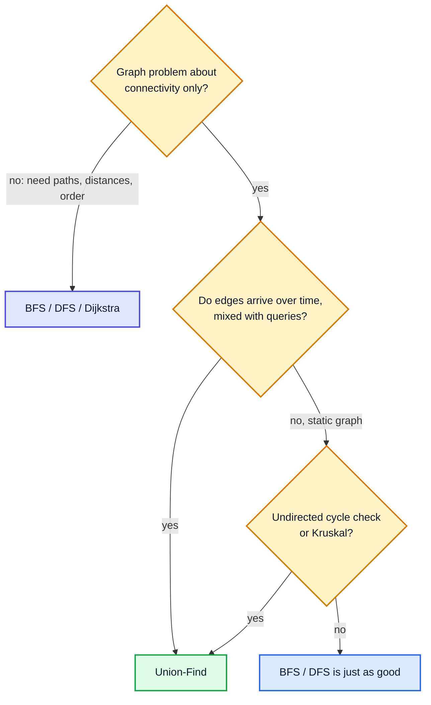

# Union-Find (Disjoint Set Union) — Complete In-Depth Guide

**DSA whole topic #3 of 4** · Priority 🔴 · from [topics_not_covered.md](../topics_not_covered.md)

**Union-Find**, also called **Disjoint Set Union (DSU)**, keeps track of items split into groups and answers two questions almost instantly: *"are these two items in the same group?"* and *"merge these two groups"*. With two small tricks, **path compression** and **union by rank/size**, each operation costs effectively O(1). It powers Kruskal's MST, cycle detection, connected components when edges arrive over time, account merging, equation checks and many grid problems.

> [!NOTE]
> This topic isn't in the playlist, so there are no video timestamps. All code targets **Java 21**. It's useful to know [graph BFS/DFS (topic #2)](dsa_topic_02_graphs.md) first, so you can compare. The implementation only needs arrays ([video 12](../kunal-java-notes-claude/java_12_video_arrays_arraylist.md)) and recursion ([video 27](../kunal-java-notes-claude/java_27_video_recursion_level1.md)).

---

## Table of Contents

| # | Topic (anchor link) | Level |
|---|---|---|
| 0 | [The Problem Union-Find Solves](#0-the-problem-union-find-solves) | Basics |
| 1 | [Sets as Trees: find and union](#1-sets-as-trees-find-and-union) | Basics |
| 2 | [Optimisation 1: Path Compression](#2-optimisation-1-path-compression) | Core |
| 3 | [Optimisation 2: Union by Rank or Size](#3-optimisation-2-union-by-rank-or-size) | Core |
| 4 | [The Complete DSU Class](#4-the-complete-dsu-class) | Core |
| 5 | [Counting Components](#5-counting-components) | Core |
| 6 | [Cycle Detection: Redundant Connection](#6-cycle-detection-redundant-connection) | Core |
| 7 | [Kruskal's MST](#7-kruskals-mst) | In depth |
| 8 | [Mapping Non-Integer Items: Equations and Accounts](#8-mapping-non-integer-items-equations-and-accounts) | In depth |
| 9 | [DSU on Grids](#9-dsu-on-grids) | In depth |
| 10 | [Weighted Union-Find](#10-weighted-union-find) | Advanced |
| 11 | [DSU vs BFS/DFS, Pitfalls and Problem List](#11-dsu-vs-bfsdfs-pitfalls-and-problem-list) | Interview |

---

## 0. The Problem Union-Find Solves

Ten people; friendships are announced one at a time. After each announcement, someone asks *"are Asha and Ben in the same friend circle?"*

| Approach | Merge two groups | "Same group?" |
|---|---|---|
| BFS/DFS from scratch on every query | O(1) (add an edge) | O(V + E) per query |
| Store a group label per person, relabel on merge (quick-find) | O(n) | O(1) |
| **Union-Find** with both optimisations | **≈ O(1)** | **≈ O(1)** |

Union-Find shines when edges arrive **online** (one at a time, mixed with queries) and you only care about **connectivity**, not the actual paths.

| Operation | Meaning |
|---|---|
| `find(x)` | Return the **representative** (root) of `x`'s group |
| `union(a, b)` | Merge the groups of `a` and `b` |
| `connected(a, b)` | `find(a) == find(b)` |

---

## 1. Sets as Trees: find and union

Each group is a **tree** stored in a `parent[]` array. Each item points to its parent; the **root** points to itself and represents the group.



| x | 0 | 1 | 2 | 3 | 4 | 5 | 6 |
|---|---|---|---|---|---|---|---|
| parent[x] | 0 | 0 | 0 | 2 | 4 | 4 | 6 |

Groups: {0, 1, 2, 3}, {4, 5}, {6}.

```java
public class NaiveDSU {
    int[] parent;

    NaiveDSU(int n) {
        parent = new int[n];
        for (int i = 0; i < n; i++) parent[i] = i;      // everyone starts alone
    }

    int find(int x) {
        while (parent[x] != x) x = parent[x];           // climb to the root
        return x;
    }

    void union(int a, int b) {
        int ra = find(a), rb = find(b);
        if (ra != rb) parent[ra] = rb;                  // hang one root under the other
    }

    public static void main(String[] args) {
        NaiveDSU d = new NaiveDSU(7);
        d.union(1, 0); d.union(2, 0); d.union(3, 2); d.union(5, 4);
        System.out.println(d.find(3) + " " + d.find(5) + " " + d.find(6));   // 0 4 6
        System.out.println(d.find(1) == d.find(3));                         // true
        System.out.println(d.find(1) == d.find(5));                         // false
    }
}
```

### The problem: trees can become long chains

```java
// union(0,1), union(1,2), union(2,3), ... always hangs the root under the next node:
// 0 → 1 → 2 → 3 → … → n−1     find(0) walks n steps → O(n) per operation
```

Two optimisations fix this.

---

## 2. Optimisation 1: Path Compression

While `find` climbs to the root, make **every node on the path point directly to the root**. The next `find` on any of them is one step.

```java
int find(int x) {
    if (parent[x] != x) parent[x] = find(parent[x]);   // recursive: point x straight at the root
    return parent[x];
}
```



### Iterative version (no recursion depth issues)

```java
int find(int x) {
    int root = x;
    while (parent[root] != root) root = parent[root];        // pass 1: find the root
    while (parent[x] != root) {                              // pass 2: repoint the path
        int next = parent[x];
        parent[x] = root;
        x = next;
    }
    return root;
}
```

> [!TIP]
> A popular one-pass alternative is **path halving**: `while (parent[x] != x) { parent[x] = parent[parent[x]]; x = parent[x]; }`. Each node skips to its grandparent. It has the same complexity and no recursion.

---

## 3. Optimisation 2: Union by Rank or Size

When merging, hang the **smaller / shorter** tree under the **larger / taller** one, so trees stay shallow.

| Strategy | Store | Rule | Bonus |
|---|---|---|---|
| **Union by rank** | `rank[root]` ≈ an upper bound on height | Lower rank under higher; equal ranks → pick one, increase its rank | — |
| **Union by size** | `size[root]` = number of items | Smaller size under larger; add sizes | You get component sizes for free |



### Complexity

| Version | Cost per operation |
|---|---|
| Naive | O(n) worst case |
| Union by rank/size only | O(log n) (height ≤ log₂ n) |
| Path compression only | O(log n) amortised |
| **Both** | **O(α(n)) amortised** |

`α(n)` is the **inverse Ackermann function**. It grows so slowly that α(n) ≤ 4 for any n you could ever store (n < 2^65536). In practice, treat it as **O(1)**.

> [!NOTE]
> "Amortised" means the *average* over a long sequence of operations. One `find` can still walk a longer path, but it flattens that path so later calls are cheap.

---

## 4. The Complete DSU Class

This is the version to memorise. Union by size, path compression, a component counter, and `union` returning whether a merge actually happened (that's what cycle detection and Kruskal need).

```java
public class DSU {
    private final int[] parent, size;
    private int components;

    public DSU(int n) {
        parent = new int[n];
        size = new int[n];
        components = n;
        for (int i = 0; i < n; i++) { parent[i] = i; size[i] = 1; }
    }

    public int find(int x) {
        while (parent[x] != x) {
            parent[x] = parent[parent[x]];     // path halving
            x = parent[x];
        }
        return x;
    }

    /** Returns false if a and b were already connected (so this edge would close a cycle). */
    public boolean union(int a, int b) {
        int ra = find(a), rb = find(b);
        if (ra == rb) return false;
        if (size[ra] < size[rb]) { int t = ra; ra = rb; rb = t; }   // ra is the bigger root
        parent[rb] = ra;
        size[ra] += size[rb];
        components--;
        return true;
    }

    public boolean connected(int a, int b) { return find(a) == find(b); }
    public int sizeOf(int x) { return size[find(x)]; }
    public int components() { return components; }

    public static void main(String[] args) {
        DSU d = new DSU(7);
        System.out.println(d.union(0, 1) + " " + d.union(1, 2) + " " + d.union(3, 4));   // true true true
        System.out.println(d.union(0, 2));                                               // false (already connected)
        System.out.println(d.connected(0, 2) + " " + d.connected(2, 3));                 // true false
        System.out.println(d.sizeOf(1) + " " + d.sizeOf(4) + " " + d.sizeOf(6));         // 3 2 1
        System.out.println(d.components());                                              // 4  ({0,1,2} {3,4} {5} {6})
    }
}
```

**Dry run** of the calls above:

| Call | Roots found | Action | parent after (0..6) | size of new root | components |
|---|---|---|---|---|---|
| union(0, 1) | 0, 1 | sizes equal → 1 under 0 | 0 0 2 3 4 5 6 | size[0] = 2 | 6 |
| union(1, 2) | 0, 2 | 2 (size 1) under 0 (size 2) | 0 0 0 3 4 5 6 | size[0] = 3 | 5 |
| union(3, 4) | 3, 4 | 4 under 3 | 0 0 0 3 3 5 6 | size[3] = 2 | 4 |
| union(0, 2) | 0, 0 | same root → **false** | unchanged | — | 4 |

---

## 5. Counting Components

### Number of Provinces (LC 547) — DSU version

```java
public class ProvincesDSU {
    static int findCircleNum(int[][] isConnected) {
        int n = isConnected.length;
        int[] parent = new int[n];
        for (int i = 0; i < n; i++) parent[i] = i;
        int components = n;
        for (int i = 0; i < n; i++)
            for (int j = i + 1; j < n; j++)
                if (isConnected[i][j] == 1) {
                    int a = find(parent, i), b = find(parent, j);
                    if (a != b) { parent[a] = b; components--; }     // each real merge removes one component
                }
        return components;
    }
    static int find(int[] p, int x) { return p[x] == x ? x : (p[x] = find(p, p[x])); }

    public static void main(String[] args) {
        System.out.println(findCircleNum(new int[][]{{1, 1, 0}, {1, 1, 0}, {0, 0, 1}}));   // 2
    }
}
```

### Number of Operations to Make Network Connected (LC 1319)

You may move cables. Connecting `c` components needs `c − 1` cables; every cable that would close a cycle is a **spare** you can move.

```java
public class NetworkConnected {
    static int makeConnected(int n, int[][] connections) {
        if (connections.length < n - 1) return -1;            // not enough cables at all
        int[] parent = new int[n];
        for (int i = 0; i < n; i++) parent[i] = i;
        int components = n;
        for (int[] c : connections) {
            int a = find(parent, c[0]), b = find(parent, c[1]);
            if (a != b) { parent[a] = b; components--; }
        }
        return components - 1;
    }
    static int find(int[] p, int x) { return p[x] == x ? x : (p[x] = find(p, p[x])); }

    public static void main(String[] args) {
        System.out.println(makeConnected(4, new int[][]{{0, 1}, {0, 2}, {1, 2}}));                       // 1
        System.out.println(makeConnected(6, new int[][]{{0, 1}, {0, 2}, {0, 3}, {1, 2}, {1, 3}}));        // 2
        System.out.println(makeConnected(6, new int[][]{{0, 1}, {0, 2}, {0, 3}, {1, 2}}));                // -1
    }
}
```

---

## 6. Cycle Detection: Redundant Connection

In an **undirected** graph, adding edge `u–v` creates a cycle exactly when `u` and `v` are **already connected**. `union` returning `false` tells you that directly.

### Redundant Connection (LC 684)

A tree with one extra edge added; return the edge that closes the cycle (the last such one in the input).

```java
import java.util.*;

public class RedundantConnection {
    static int[] findRedundantConnection(int[][] edges) {
        int[] parent = new int[edges.length + 1];                // nodes are 1..n
        for (int i = 0; i < parent.length; i++) parent[i] = i;
        for (int[] e : edges) {
            int a = find(parent, e[0]), b = find(parent, e[1]);
            if (a == b) return e;                                // already connected → this edge makes a cycle
            parent[a] = b;
        }
        return new int[0];
    }
    static int find(int[] p, int x) { return p[x] == x ? x : (p[x] = find(p, p[x])); }

    public static void main(String[] args) {
        System.out.println(Arrays.toString(findRedundantConnection(new int[][]{{1, 2}, {1, 3}, {2, 3}})));                   // [2, 3]
        System.out.println(Arrays.toString(findRedundantConnection(new int[][]{{1, 2}, {2, 3}, {3, 4}, {1, 4}, {1, 5}})));   // [1, 4]
    }
}
```

| Edge | find(u), find(v) | Same? | Action |
|---|---|---|---|
| 1–2 | 1, 2 | no | union |
| 2–3 | 2, 3 | no | union |
| 3–4 | 3, 4 | no | union |
| 1–4 | 4, 4 | **yes** | return [1, 4] |

> [!WARNING]
> This works for **undirected** graphs only. In a directed graph, `a → b` and `c → b` put `a` and `c` in one DSU set without any directed cycle. Use the three-colour DFS or Kahn's algorithm from [topic #2](dsa_topic_02_graphs.md#6-cycle-detection) instead (LC 685 Redundant Connection II needs extra care for this reason).

---

## 7. Kruskal's MST

Sort edges by weight; add each one unless it would create a cycle (`union` returns `false`). Stop at V − 1 edges. The full explanation is in [topic #2, section 11](dsa_topic_02_graphs.md#11-minimum-spanning-trees-prim-and-kruskal).

```java
import java.util.*;

public class KruskalDSU {
    static int[] parent, size;
    static int find(int x) { while (parent[x] != x) { parent[x] = parent[parent[x]]; x = parent[x]; } return x; }
    static boolean union(int a, int b) {
        int ra = find(a), rb = find(b);
        if (ra == rb) return false;
        if (size[ra] < size[rb]) { int t = ra; ra = rb; rb = t; }
        parent[rb] = ra; size[ra] += size[rb];
        return true;
    }

    static int mst(int n, int[][] edges, List<int[]> chosen) {
        parent = new int[n]; size = new int[n];
        for (int i = 0; i < n; i++) { parent[i] = i; size[i] = 1; }
        int[][] es = edges.clone();
        Arrays.sort(es, Comparator.comparingInt(e -> e[2]));
        int total = 0;
        for (int[] e : es) {
            if (union(e[0], e[1])) { total += e[2]; chosen.add(e); }
            if (chosen.size() == n - 1) break;
        }
        return chosen.size() == n - 1 ? total : -1;                // -1: graph is disconnected
    }

    public static void main(String[] args) {
        int[][] edges = {{0, 1, 4}, {0, 2, 3}, {1, 2, 1}, {1, 3, 2}, {2, 3, 4}, {3, 4, 2}, {4, 5, 6}};
        List<int[]> chosen = new ArrayList<>();
        System.out.println(mst(6, edges, chosen));                                    // 14
        chosen.forEach(e -> System.out.print(e[0] + "-" + e[1] + "(" + e[2] + ") "));  // 1-2(1) 1-3(2) 3-4(2) 0-2(3) 4-5(6)
        System.out.println();
    }
}
```

---

## 8. Mapping Non-Integer Items: Equations and Accounts

DSU arrays are indexed by integers. When items are letters, strings or objects, **map each one to an index** first (`c - 'a'`, or a `HashMap<String, Integer>`).

### Satisfiability of Equality Equations (LC 990)

Process all `==` first (union), then check every `!=` (must be in different sets).

```java
public class EqualityEquations {
    static boolean equationsPossible(String[] eqs) {
        int[] parent = new int[26];
        for (int i = 0; i < 26; i++) parent[i] = i;
        for (String e : eqs)
            if (e.charAt(1) == '=') parent[find(parent, e.charAt(0) - 'a')] = find(parent, e.charAt(3) - 'a');
        for (String e : eqs)
            if (e.charAt(1) == '!' && find(parent, e.charAt(0) - 'a') == find(parent, e.charAt(3) - 'a')) return false;
        return true;
    }
    static int find(int[] p, int x) { return p[x] == x ? x : (p[x] = find(p, p[x])); }

    public static void main(String[] args) {
        System.out.println(equationsPossible(new String[]{"a==b", "b!=a"}));               // false
        System.out.println(equationsPossible(new String[]{"b==a", "a==b"}));               // true
        System.out.println(equationsPossible(new String[]{"a==b", "b==c", "a==c"}));       // true
        System.out.println(equationsPossible(new String[]{"a==b", "b!=c", "c==a"}));       // false
    }
}
```

> [!IMPORTANT]
> The **two passes** matter. Checking `b!=c` before seeing `c==a` would wrongly accept the last example. Union everything first, then verify the constraints.

### Accounts Merge (LC 721)

Accounts sharing any email belong to the same person. Give each email an id, union all emails within one account, then group emails by root.

```java
import java.util.*;

public class AccountsMerge {
    static int[] parent;
    static int find(int x) { return parent[x] == x ? x : (parent[x] = find(parent[x])); }

    static List<List<String>> accountsMerge(List<List<String>> accounts) {
        Map<String, Integer> id = new HashMap<>();
        Map<String, String> owner = new HashMap<>();
        for (List<String> acc : accounts)
            for (int i = 1; i < acc.size(); i++) {
                id.putIfAbsent(acc.get(i), id.size());
                owner.put(acc.get(i), acc.get(0));
            }
        parent = new int[id.size()];
        for (int i = 0; i < parent.length; i++) parent[i] = i;
        for (List<String> acc : accounts)
            for (int i = 2; i < acc.size(); i++)
                parent[find(id.get(acc.get(i)))] = find(id.get(acc.get(1)));    // link to the first email

        Map<Integer, TreeSet<String>> groups = new HashMap<>();
        for (String email : id.keySet()) groups.computeIfAbsent(find(id.get(email)), k -> new TreeSet<>()).add(email);

        List<List<String>> res = new ArrayList<>();
        for (TreeSet<String> emails : groups.values()) {
            List<String> acc = new ArrayList<>();
            acc.add(owner.get(emails.first()));
            acc.addAll(emails);
            res.add(acc);
        }
        res.sort(Comparator.comparing((List<String> a) -> a.get(0)).thenComparing(a -> a.get(1)));   // deterministic output
        return res;
    }

    public static void main(String[] args) {
        List<List<String>> accounts = List.of(
                List.of("John", "johnsmith@mail.com", "john_newyork@mail.com"),
                List.of("John", "johnsmith@mail.com", "john00@mail.com"),
                List.of("Mary", "mary@mail.com"),
                List.of("John", "johnnybravo@mail.com"));
        accountsMerge(accounts).forEach(System.out::println);
    }
}
// Output:
// [John, john00@mail.com, john_newyork@mail.com, johnsmith@mail.com]
// [John, johnnybravo@mail.com]
// [Mary, mary@mail.com]
```

---

## 9. DSU on Grids

Map cell `(r, c)` to index `r * C + c`. Union each land cell with its land neighbour to the right and below (that covers every adjacent pair once).

```java
public class IslandsDSU {
    static int[] parent;
    static int find(int x) { return parent[x] == x ? x : (parent[x] = find(parent[x])); }

    static int numIslands(char[][] g) {
        int R = g.length, C = g[0].length, count = 0;
        parent = new int[R * C];
        for (int i = 0; i < R * C; i++) parent[i] = i;
        for (int r = 0; r < R; r++)
            for (int c = 0; c < C; c++) {
                if (g[r][c] != '1') continue;
                count++;                                                 // every land cell starts as its own island
                int id = r * C + c;
                if (c + 1 < C && g[r][c + 1] == '1') count -= union(id, id + 1);
                if (r + 1 < R && g[r + 1][c] == '1') count -= union(id, id + C);
            }
        return count;
    }
    static int union(int a, int b) {
        int ra = find(a), rb = find(b);
        if (ra == rb) return 0;
        parent[ra] = rb;
        return 1;                                                         // two islands became one
    }

    public static void main(String[] args) {
        char[][] g = {"11000".toCharArray(), "11000".toCharArray(), "00100".toCharArray(), "00011".toCharArray()};
        System.out.println(numIslands(g));   // 3
    }
}
```

> [!TIP]
> For a static grid, DFS is just as good. DSU wins on **Number of Islands II (LC 305)**, where land is added one cell at a time and you must report the island count after **each** addition: each addition costs α(n) instead of re-running DFS.

### Longest Consecutive Sequence (LC 128) with DSU

Union each number `x` with `x + 1` if both exist; the answer is the largest component size. (A `HashSet` solution is also O(n) and simpler; this shows the DSU idea.)

```java
import java.util.*;

public class LongestConsecutiveDSU {
    static int longestConsecutive(int[] nums) {
        Map<Integer, Integer> parent = new HashMap<>(), size = new HashMap<>();
        for (int x : nums) { parent.putIfAbsent(x, x); size.putIfAbsent(x, 1); }
        int best = nums.length == 0 ? 0 : 1;
        for (int x : parent.keySet().toArray(new Integer[0])) {
            if (!parent.containsKey(x + 1)) continue;
            int a = find(parent, x), b = find(parent, x + 1);
            if (a == b) continue;
            parent.put(a, b);
            size.put(b, size.get(a) + size.get(b));
            best = Math.max(best, size.get(b));
        }
        return best;
    }
    static int find(Map<Integer, Integer> p, int x) {
        while (p.get(x) != x) { p.put(x, p.get(p.get(x))); x = p.get(x); }
        return x;
    }

    public static void main(String[] args) {
        System.out.println(longestConsecutive(new int[]{100, 4, 200, 1, 3, 2}));            // 4
        System.out.println(longestConsecutive(new int[]{0, 3, 7, 2, 5, 8, 4, 6, 0, 1}));    // 9
    }
}
```

---

## 10. Weighted Union-Find

Each node also stores a **weight relative to its parent**. Path compression then accumulates weights along the path. Classic use: **Evaluate Division (LC 399)**, where `a / b = 2` and `b / c = 3`, so what is `a / c`?

Store `weight[x]` = `x / parent[x]`. Then `x / root` = product of weights along the path.

```java
import java.util.*;

public class EvaluateDivision {
    static Map<String, String> parent = new HashMap<>();
    static Map<String, Double> weight = new HashMap<>();        // weight[x] = x / parent[x]

    static String find(String x) {
        if (!parent.get(x).equals(x)) {
            String p = parent.get(x);
            String root = find(p);
            weight.put(x, weight.get(x) * weight.get(p));        // x/root = x/p · p/root
            parent.put(x, root);
        }
        return parent.get(x);
    }

    static void union(String a, String b, double value) {        // a / b = value
        parent.putIfAbsent(a, a); weight.putIfAbsent(a, 1.0);
        parent.putIfAbsent(b, b); weight.putIfAbsent(b, 1.0);
        String ra = find(a), rb = find(b);
        if (ra.equals(rb)) return;
        parent.put(ra, rb);
        weight.put(ra, value * weight.get(b) / weight.get(a));   // ra/rb = (a/b)·(b/rb)/(a/ra)
    }

    static double query(String a, String b) {
        if (!parent.containsKey(a) || !parent.containsKey(b)) return -1.0;
        if (!find(a).equals(find(b))) return -1.0;
        return weight.get(a) / weight.get(b);                    // (a/root) / (b/root)
    }

    public static void main(String[] args) {
        union("a", "b", 2.0);
        union("b", "c", 3.0);
        String[][] qs = {{"a", "c"}, {"b", "a"}, {"a", "e"}, {"a", "a"}, {"x", "x"}};
        List<Double> ans = new ArrayList<>();
        for (String[] q : qs) ans.add(query(q[0], q[1]));
        System.out.println(ans);   // [6.0, 0.5, -1.0, 1.0, -1.0]
    }
}
```

Other uses of weighted DSU: parity / bipartiteness checking online (store "same or different colour as parent"), LC 1202 Smallest String With Swaps (plain DSU + sorting per component), and "relative position" puzzles.

---

## 11. DSU vs BFS/DFS, Pitfalls and Problem List



| | Union-Find | BFS / DFS |
|---|---|---|
| Edges added over time | ✅ α(n) each | ❌ re-traverse |
| Edges removed | ❌ not supported (process offline in reverse) | ✅ |
| Paths / distances | ❌ | ✅ |
| Directed graphs | ❌ | ✅ |
| Undirected cycle detection | ✅ very simple | ✅ |
| Component sizes | ✅ union by size | ✅ |

### Pitfalls

| Pitfall | Fix |
|---|---|
| `parent[a] = b` instead of `parent[find(a)] = find(b)` | Always union the **roots** |
| Comparing `parent[a] == parent[b]` for connectivity | Compare `find(a) == find(b)` |
| Forgetting to initialise `parent[i] = i` | Every item starts as its own root |
| Off-by-one when nodes are 1-indexed | Allocate `n + 1` |
| Recursive `find` on a long chain before compression | Use union by size, or the iterative/halving `find` |
| Using DSU for directed cycles | Use colour DFS / Kahn |
| Counting components wrongly | Decrement only when `union` actually merges |
| Checking `!=` constraints before all `==` unions | Two passes |

### Problem list (in order)

| # | Problem | Idea | Difficulty |
|---|---|---|---|
| 1 | LC 1971 Find if Path Exists in Graph | `connected(s, t)` | Easy |
| 2 | LC 547 Number of Provinces | Count components | Medium |
| 3 | LC 684 Redundant Connection | `union` returns false | Medium |
| 4 | LC 1319 Number of Operations to Make Network Connected | components − 1 | Medium |
| 5 | LC 990 Satisfiability of Equality Equations | Two passes | Medium |
| 6 | LC 200 Number of Islands (DSU version) | Grid indices | Medium |
| 7 | LC 721 Accounts Merge | Map strings to ids | Medium |
| 8 | LC 1202 Smallest String With Swaps | Sort within each component | Medium |
| 9 | LC 1584 Min Cost to Connect All Points | Kruskal | Medium |
| 10 | LC 128 Longest Consecutive Sequence | Union `x` with `x + 1` | Medium |
| 11 | LC 399 Evaluate Division | Weighted DSU | Medium |
| 12 | LC 947 Most Stones Removed | Union rows and columns | Medium |
| 13 | LC 1631 Path With Minimum Effort | Sort edges + DSU until connected | Medium |
| 14 | LC 305 Number of Islands II (premium) | Online additions | Hard |
| 15 | LC 685 Redundant Connection II | Directed: extra in-degree case | Hard |

### Interview Q&A

| Question | Short answer |
|---|---|
| What does Union-Find do? | Maintains disjoint sets with near-O(1) `find` and `union`. |
| What are the two optimisations? | Path compression and union by rank/size. |
| Complexity with both? | O(α(n)) amortised per operation, effectively constant. |
| How do you detect a cycle with it? | Adding edge `u–v` when `find(u) == find(v)` closes a cycle (undirected only). |
| Where is it used? | Kruskal's MST, dynamic connectivity, account merging, grid islands with additions. |
| Can it delete edges? | No; handle deletions offline by processing in reverse, or use other structures. |
| Rank vs size? | Both keep trees shallow; size also gives component sizes. |

---

## 🧩 Complete Example: Everything Together

A "social network" simulation: friendships arrive one by one; after each, the program reports circles and the biggest circle size. Then it detects a redundant friendship, builds the cheapest network with Kruskal, merges accounts by shared emails, checks equations, and cross-checks DSU connectivity against BFS on random graphs.

```java
import java.util.*;

public class UnionFindShowcase {

    static final class DSU {
        final int[] parent, size;
        int components;
        DSU(int n) {
            parent = new int[n]; size = new int[n]; components = n;
            for (int i = 0; i < n; i++) { parent[i] = i; size[i] = 1; }
        }
        int find(int x) { while (parent[x] != x) { parent[x] = parent[parent[x]]; x = parent[x]; } return x; }
        boolean union(int a, int b) {
            int ra = find(a), rb = find(b);
            if (ra == rb) return false;
            if (size[ra] < size[rb]) { int t = ra; ra = rb; rb = t; }
            parent[rb] = ra; size[ra] += size[rb]; components--;
            return true;
        }
        boolean connected(int a, int b) { return find(a) == find(b); }
        int sizeOf(int x) { return size[find(x)]; }
    }

    static boolean bfsConnected(int n, List<int[]> edges, int s, int t) {
        List<List<Integer>> adj = new ArrayList<>();
        for (int i = 0; i < n; i++) adj.add(new ArrayList<>());
        for (int[] e : edges) { adj.get(e[0]).add(e[1]); adj.get(e[1]).add(e[0]); }
        boolean[] seen = new boolean[n];
        Deque<Integer> q = new ArrayDeque<>(List.of(s));
        seen[s] = true;
        while (!q.isEmpty()) for (int v : adj.get(q.poll())) if (!seen[v]) { seen[v] = true; q.offer(v); }
        return seen[t];
    }

    public static void main(String[] args) {
        String[] people = {"Asha", "Ben", "Chen", "Dev", "Eva", "Farah"};
        DSU net = new DSU(people.length);
        int[][] friendships = {{0, 1}, {2, 3}, {1, 2}, {4, 5}, {0, 3}};
        for (int[] f : friendships) {
            boolean merged = net.union(f[0], f[1]);
            int biggest = 0;
            for (int i = 0; i < people.length; i++) biggest = Math.max(biggest, net.sizeOf(i));
            System.out.printf("%-5s + %-5s -> %s; circles = %d, biggest = %d%n",
                    people[f[0]], people[f[1]], merged ? "merged" : "already friends (cycle!)", net.components, biggest);
        }
        System.out.println("Asha and Dev connected? " + net.connected(0, 3) + "; Asha and Eva? " + net.connected(0, 4));

        // Kruskal: cheapest set of cables to connect 6 offices
        int[][] cables = {{0, 1, 4}, {0, 2, 3}, {1, 2, 1}, {1, 3, 2}, {2, 3, 4}, {3, 4, 2}, {4, 5, 6}};
        Arrays.sort(cables, Comparator.comparingInt(e -> e[2]));
        DSU k = new DSU(6);
        int cost = 0;
        List<String> used = new ArrayList<>();
        for (int[] c : cables) if (k.union(c[0], c[1])) { cost += c[2]; used.add(c[0] + "-" + c[1]); }
        System.out.println("Kruskal cost = " + cost + " using " + used);

        // Equations a==b, b==c, c!=a
        DSU letters = new DSU(26);
        String[] eqs = {"a==b", "b==c", "c!=a"};
        for (String e : eqs) if (e.charAt(1) == '=') letters.union(e.charAt(0) - 'a', e.charAt(3) - 'a');
        boolean ok = true;
        for (String e : eqs) if (e.charAt(1) == '!' && letters.connected(e.charAt(0) - 'a', e.charAt(3) - 'a')) ok = false;
        System.out.println("Equations " + Arrays.toString(eqs) + " satisfiable? " + ok);

        // Group emails by owner
        String[][] accounts = {{"x@a", "y@a"}, {"z@a"}, {"y@a", "w@a"}, {"z@a", "v@a"}};
        Map<String, Integer> id = new LinkedHashMap<>();
        for (String[] acc : accounts) for (String e : acc) id.putIfAbsent(e, id.size());
        DSU emails = new DSU(id.size());
        for (String[] acc : accounts) for (String e : acc) emails.union(id.get(acc[0]), id.get(e));
        Map<Integer, TreeSet<String>> groups = new TreeMap<>();
        id.forEach((e, i) -> groups.computeIfAbsent(emails.find(i), r -> new TreeSet<>()).add(e));
        System.out.println("Merged accounts: " + groups.values());

        // Random cross-check: DSU connectivity == BFS reachability
        Random rnd = new Random(684);
        int checks = 0, mismatches = 0;
        for (int t = 0; t < 300; t++) {
            int n = 2 + rnd.nextInt(10), m = rnd.nextInt(2 * n);
            DSU d = new DSU(n);
            List<int[]> edges = new ArrayList<>();
            for (int i = 0; i < m; i++) { int a = rnd.nextInt(n), b = rnd.nextInt(n); edges.add(new int[]{a, b}); d.union(a, b); }
            int s = rnd.nextInt(n), u = rnd.nextInt(n);
            if (d.connected(s, u) != bfsConnected(n, edges, s, u)) mismatches++;
            checks++;
        }
        System.out.println("Random cross-checks against BFS: " + checks + ", mismatches: " + mismatches);
    }
}
```

**Expected Output:**
```
Asha  + Ben   -> merged; circles = 5, biggest = 2
Chen  + Dev   -> merged; circles = 4, biggest = 2
Ben   + Chen  -> merged; circles = 3, biggest = 4
Eva   + Farah -> merged; circles = 2, biggest = 4
Asha  + Dev   -> already friends (cycle!); circles = 2, biggest = 4
Asha and Dev connected? true; Asha and Eva? false
Kruskal cost = 14 using [1-2, 1-3, 3-4, 0-2, 4-5]
Equations [a==b, b==c, c!=a] satisfiable? false
Merged accounts: [[w@a, x@a, y@a], [v@a, z@a]]
Random cross-checks against BFS: 300, mismatches: 0
```

---

## Quick Reference Cheat Sheet

| Concept | One-Line Summary |
|---|---|
| **DSU** | Disjoint sets as trees in a `parent[]` array; root = representative |
| **Init** | `parent[i] = i`, `size[i] = 1` |
| **find** | Climb to the root; compress the path (recursive or halving) |
| **union** | Link the roots; smaller size under larger |
| **connected** | `find(a) == find(b)` |
| **Complexity** | O(α(n)) amortised ≈ O(1) with both optimisations |
| **Count components** | Start at n, decrement on every successful union |
| **Undirected cycle** | `union` returns false → this edge closes a cycle |
| **Kruskal** | Sort edges; keep those where `union` succeeds |
| **Strings / objects** | Map to integer ids with a `HashMap` |
| **Grids** | Index = `r * C + c`; union with right and down neighbours |
| **Weighted DSU** | Store weight to parent; multiply along the path (LC 399) |
| **Limits** | No deletions, no paths, undirected connectivity only |
