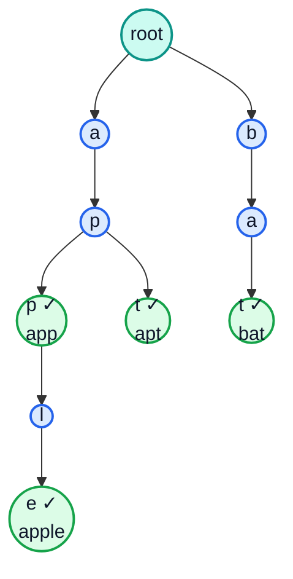
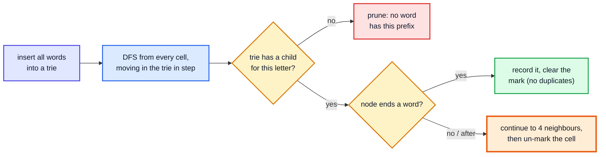
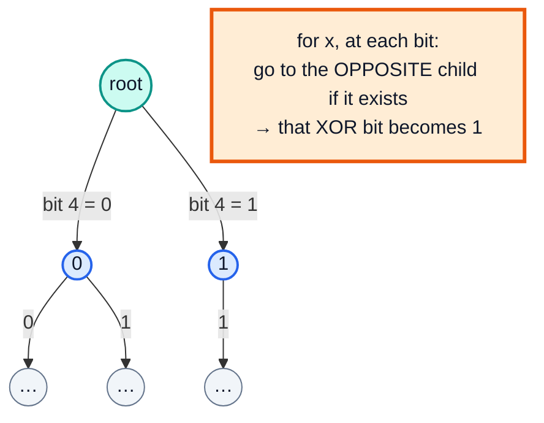

# Trie (Prefix Tree) — Complete In-Depth Guide

**DSA whole topic #4 of 4** · Priority 🔴 · from [topics_not_covered.md](../topics_not_covered.md)

A **trie** (pronounced "try", from re*trie*val) is a tree that stores strings **character by character**, so words that share a prefix share a path. It answers *"does any word start with `pre`?"* in O(length of `pre`), no matter how many words are stored. That's why it shows up in autocomplete, spell checkers, IP routing and word games. These notes build a trie from scratch, then use it for wildcard search, Word Search II, search suggestions, replacing words with roots, prefix counting and the binary trie behind Maximum XOR.

> [!NOTE]
> This topic isn't in the playlist, so there are no video timestamps. All code targets **Java 21**. You need trees and recursion ([videos 49](../kunal-java-notes-claude/java_49_video_binary_trees_bst.md), [27](../kunal-java-notes-claude/java_27_video_recursion_level1.md)), strings ([video 21](../kunal-java-notes-claude/java_21_video_strings_stringbuilder.md)), backtracking for Word Search II ([video 35](../kunal-java-notes-claude/java_35_video_backtracking_maze.md)), and bits for the XOR trie ([video 25](../kunal-java-notes-claude/java_25_video_bitwise_number_systems.md)).

---

## Table of Contents

| # | Topic (anchor link) | Level |
|---|---|---|
| 0 | [Why a Trie](#0-why-a-trie) | Basics |
| 1 | [The Trie Node](#1-the-trie-node) | Basics |
| 2 | [Insert, Search and StartsWith](#2-insert-search-and-startswith) | Core |
| 3 | [Complexity and Memory](#3-complexity-and-memory) | Core |
| 4 | [Wildcard Search](#4-wildcard-search) | Core |
| 5 | [Prefix Counts and Deletion](#5-prefix-counts-and-deletion) | In depth |
| 6 | [Autocomplete: Search Suggestions](#6-autocomplete-search-suggestions) | In depth |
| 7 | [Replace Words and Longest Word](#7-replace-words-and-longest-word) | In depth |
| 8 | [Word Search II: Trie plus Backtracking](#8-word-search-ii-trie-plus-backtracking) | In depth |
| 9 | [Binary Trie: Maximum XOR](#9-binary-trie-maximum-xor) | Advanced |
| 10 | [Trie vs HashSet vs TreeSet, Pitfalls and Problem List](#10-trie-vs-hashset-vs-treeset-pitfalls-and-problem-list) | Interview |

---

## 0. Why a Trie

Store `{"app", "apple", "apt", "bat"}`:



- Each **edge** is a character; each path from the root spells a prefix.
- A ✓ (`isEnd = true`) marks nodes where a whole word **ends**. `"app"` ends in the middle of the path to `"apple"`.
- `"app"`, `"apple"` and `"apt"` share the nodes for `a → p`.

| Question | HashSet of words | Sorted list + binary search | **Trie** |
|---|---|---|---|
| Is `w` a word? | O(L) average | O(L log n) | **O(L)** |
| Does any word start with `p`? | O(n · L) (check every word) | O(L log n) | **O(L)** |
| List all words with prefix `p` | O(n · L) | O(L log n + output) | **O(L + output)** |
| Words in sorted order | Sort needed | ✅ | ✅ (DFS in child order) |
| Wildcards like `b.d` | O(n · L) | — | Branch only at `.` |

(L = word length, n = number of words.)

---

## 1. The Trie Node

| Children stored as | Memory per node | Speed | Use when |
|---|---|---|---|
| `TrieNode[26]` array | 26 references (~120 bytes) even if empty | Fastest, O(1) child lookup | Lowercase letters only (most LeetCode) |
| `HashMap<Character, TrieNode>` | Only existing children | Slower (hashing, boxing) | Large / unknown alphabets (Unicode, URLs) |
| `TreeMap<Character, TrieNode>` | Only existing children | O(log σ) | Need children in sorted order with a big alphabet |

```java
class TrieNode {
    TrieNode[] children = new TrieNode[26];   // children['c' - 'a']
    boolean isEnd;                             // a word ends exactly here
}
```

> [!NOTE]
> The **root** stores no character; it's the empty prefix. A trie with n words of average length L has at most n·L + 1 nodes.

---

## 2. Insert, Search and StartsWith

### Implement Trie (LC 208)

```java
public class Trie {
    private static class Node {
        Node[] next = new Node[26];
        boolean isEnd;
    }

    private final Node root = new Node();

    public void insert(String word) {
        Node cur = root;
        for (char ch : word.toCharArray()) {
            int i = ch - 'a';
            if (cur.next[i] == null) cur.next[i] = new Node();   // create the path as needed
            cur = cur.next[i];
        }
        cur.isEnd = true;                                        // mark the end of the word
    }

    public boolean search(String word) {
        Node n = walk(word);
        return n != null && n.isEnd;                             // must end exactly here
    }

    public boolean startsWith(String prefix) {
        return walk(prefix) != null;                             // the path just has to exist
    }

    private Node walk(String s) {                                // follow s; null if the path breaks
        Node cur = root;
        for (char ch : s.toCharArray()) {
            cur = cur.next[ch - 'a'];
            if (cur == null) return null;
        }
        return cur;
    }

    public static void main(String[] args) {
        Trie t = new Trie();
        t.insert("apple");
        System.out.println(t.search("apple"));     // true
        System.out.println(t.search("app"));       // false  (only a prefix so far)
        System.out.println(t.startsWith("app"));   // true
        t.insert("app");
        System.out.println(t.search("app"));       // true
        System.out.println(t.startsWith("b"));     // false
    }
}
```

**Dry run**: `insert("app")` after `"apple"` is stored:

| Char | Child exists? | Action | cur |
|---|---|---|---|
| a | yes | move | node `a` |
| p | yes | move | node `ap` |
| p | yes | move | node `app` |
| end | — | `isEnd = true` | node `app` is now a word |

No new nodes are created: `"app"` reuses the start of `"apple"`'s path.

| `search` vs `startsWith` | Path must exist | Last node must have `isEnd` |
|---|---|---|
| `search("app")` | ✅ | ✅ |
| `startsWith("app")` | ✅ | ❌ not needed |

---

## 3. Complexity and Memory

| Operation | Time | Extra space |
|---|---|---|
| `insert(word)` | O(L) | O(L) new nodes at most |
| `search(word)` | O(L) | O(1) |
| `startsWith(prefix)` | O(L) | O(1) |
| Build from n words | O(total characters) | O(total characters × alphabet) with arrays |

> [!WARNING]
> Tries can use a lot of memory. 10⁵ words of length 10 can mean 10⁶ nodes × 26 references ≈ 100+ MB with `Node[26]`. If memory matters, use `HashMap` children, a compressed trie (radix tree: merge single-child chains into one edge labelled with a string), or a sorted array with binary search.

---

## 4. Wildcard Search

### Design Add and Search Words (LC 211)

`.` matches any single letter. At a `.`, try **every** child (DFS); at a normal letter, follow one child.

```java
public class WordDictionary {
    private static class Node { Node[] next = new Node[26]; boolean isEnd; }
    private final Node root = new Node();

    public void addWord(String w) {
        Node cur = root;
        for (char c : w.toCharArray()) {
            if (cur.next[c - 'a'] == null) cur.next[c - 'a'] = new Node();
            cur = cur.next[c - 'a'];
        }
        cur.isEnd = true;
    }

    public boolean search(String w) { return dfs(w, 0, root); }

    private boolean dfs(String w, int i, Node node) {
        if (node == null) return false;
        if (i == w.length()) return node.isEnd;
        char c = w.charAt(i);
        if (c != '.') return dfs(w, i + 1, node.next[c - 'a']);
        for (Node child : node.next)                          // '.': try all 26 branches
            if (child != null && dfs(w, i + 1, child)) return true;
        return false;
    }

    public static void main(String[] args) {
        WordDictionary d = new WordDictionary();
        for (String w : new String[]{"bad", "dad", "mad"}) d.addWord(w);
        System.out.println(d.search("pad"));   // false
        System.out.println(d.search("bad"));   // true
        System.out.println(d.search(".ad"));   // true
        System.out.println(d.search("b.."));   // true
        System.out.println(d.search("b."));    // false (length 2)
    }
}
```

**Time:** O(L) without dots; O(26^d · L) in the worst case with `d` dots, though real tries are far sparser.

---

## 5. Prefix Counts and Deletion

Add two counters per node:

| Field | Meaning |
|---|---|
| `pass` | How many inserted words go **through** this node (= words with this prefix) |
| `end` | How many inserted words **end** here (supports duplicates) |

With these, "how many words start with `p`?" is one walk, and deletion is just decrementing counters along the path (LC 1804 Implement Trie II).

```java
public class CountingTrie {
    private static class Node { Node[] next = new Node[26]; int pass, end; }
    private final Node root = new Node();

    void insert(String w) {
        Node cur = root;
        cur.pass++;
        for (char c : w.toCharArray()) {
            if (cur.next[c - 'a'] == null) cur.next[c - 'a'] = new Node();
            cur = cur.next[c - 'a'];
            cur.pass++;
        }
        cur.end++;
    }

    int countWordsEqualTo(String w) { Node n = walk(w); return n == null ? 0 : n.end; }
    int countWordsStartingWith(String p) { Node n = walk(p); return n == null ? 0 : n.pass; }

    void erase(String w) {                                      // assumes w was inserted
        if (countWordsEqualTo(w) == 0) return;
        Node cur = root;
        cur.pass--;
        for (char c : w.toCharArray()) {
            Node child = cur.next[c - 'a'];
            if (--child.pass == 0) { cur.next[c - 'a'] = null; return; }   // no word uses this branch any more: cut it
            cur = child;
        }
        cur.end--;
    }

    private Node walk(String s) {
        Node cur = root;
        for (char c : s.toCharArray()) { cur = cur.next[c - 'a']; if (cur == null) return null; }
        return cur;
    }

    // Longest common prefix of all words (LC 14): follow the path while exactly one child and no word ends
    String longestCommonPrefix() {
        StringBuilder sb = new StringBuilder();
        Node cur = root;
        while (cur.end == 0) {
            int only = -1, count = 0;
            for (int i = 0; i < 26; i++) if (cur.next[i] != null) { only = i; count++; }
            if (count != 1) break;
            sb.append((char) ('a' + only));
            cur = cur.next[only];
        }
        return sb.toString();
    }

    public static void main(String[] args) {
        CountingTrie t = new CountingTrie();
        for (String w : new String[]{"apple", "apple", "app", "apt", "bat"}) t.insert(w);
        System.out.println(t.countWordsEqualTo("apple") + " " + t.countWordsStartingWith("ap"));   // 2 4
        t.erase("apple");
        System.out.println(t.countWordsEqualTo("apple") + " " + t.countWordsStartingWith("ap"));   // 1 3
        t.erase("bat");
        System.out.println(t.countWordsStartingWith("b"));                                         // 0

        CountingTrie lcp = new CountingTrie();
        for (String w : new String[]{"flower", "flow", "flight"}) lcp.insert(w);
        System.out.println(lcp.longestCommonPrefix());                                             // fl
    }
}
```

---

## 6. Autocomplete: Search Suggestions

### Search Suggestions System (LC 1268)

After each typed character, show up to 3 product names with that prefix, in lexicographic order.

**Approach:** at each node store the (up to) 3 lexicographically smallest words passing through it. Inserting the products in **sorted order** means the first 3 that pass a node are the smallest.

```java
import java.util.*;

public class SearchSuggestions {
    private static class Node {
        Node[] next = new Node[26];
        List<String> top = new ArrayList<>();                 // up to 3 suggestions for this prefix
    }

    static List<List<String>> suggestedProducts(String[] products, String searchWord) {
        Arrays.sort(products);                                // so the first 3 seen are the smallest
        Node root = new Node();
        for (String p : products) {
            Node cur = root;
            for (char c : p.toCharArray()) {
                if (cur.next[c - 'a'] == null) cur.next[c - 'a'] = new Node();
                cur = cur.next[c - 'a'];
                if (cur.top.size() < 3) cur.top.add(p);
            }
        }
        List<List<String>> res = new ArrayList<>();
        Node cur = root;
        for (char c : searchWord.toCharArray()) {
            cur = cur == null ? null : cur.next[c - 'a'];
            res.add(cur == null ? List.of() : cur.top);       // once the path breaks, no more suggestions
        }
        return res;
    }

    public static void main(String[] args) {
        String[] products = {"mobile", "mouse", "moneypot", "monitor", "mousepad"};
        suggestedProducts(products, "mouse").forEach(System.out::println);
        System.out.println(suggestedProducts(new String[]{"havana"}, "tatiana"));
    }
}
// Output:
// [mobile, moneypot, monitor]
// [mobile, moneypot, monitor]
// [mouse, mousepad]
// [mouse, mousepad]
// [mouse, mousepad]
// [[], [], [], [], [], [], []]
```

| Approach | Build | Per query character |
|---|---|---|
| Trie with top-3 lists | O(total chars) after sorting | **O(1)** |
| Sort + binary search for each prefix | O(n log n) | O(L log n) |
| Trie + DFS to collect 3 words each time | O(total chars) | O(subtree) |

> [!TIP]
> Real autocomplete ranks by **popularity**, not alphabet. Store a count at each word end and keep the top-k by count at each node, using a small heap ([gap #6](dsa_gap_06_top_k_k_way_merge.md)).

---

## 7. Replace Words and Longest Word

### Replace Words (LC 648)

Replace each word in a sentence with the **shortest root** from the dictionary that is a prefix of it. Walk the trie and stop at the **first** `isEnd`.

```java
public class ReplaceWords {
    private static class Node { Node[] next = new Node[26]; boolean isEnd; }

    static String replaceWords(java.util.List<String> roots, String sentence) {
        Node root = new Node();
        for (String r : roots) {
            Node cur = root;
            for (char c : r.toCharArray()) {
                if (cur.next[c - 'a'] == null) cur.next[c - 'a'] = new Node();
                cur = cur.next[c - 'a'];
            }
            cur.isEnd = true;
        }
        StringBuilder out = new StringBuilder();
        for (String w : sentence.split(" ")) {
            if (out.length() > 0) out.append(' ');
            Node cur = root;
            int len = 0;
            for (char c : w.toCharArray()) {
                cur = cur.next[c - 'a'];
                if (cur == null) break;
                len++;
                if (cur.isEnd) break;                           // shortest root found
            }
            out.append(cur != null && cur.isEnd ? w.substring(0, len) : w);
        }
        return out.toString();
    }

    public static void main(String[] args) {
        System.out.println(replaceWords(java.util.List.of("cat", "bat", "rat"), "the cattle was rattled by the battery"));
        // the cat was rat by the bat
        System.out.println(replaceWords(java.util.List.of("a", "b", "c"), "aadsfasf absbs bbab cadsfafs"));
        // a a b c
    }
}
```

### Longest Word in Dictionary (LC 720)

The longest word that can be built **one letter at a time** from other words in the list (every prefix must also be a word). DFS the trie, only stepping into nodes with `isEnd`; ties go to the lexicographically smaller word, which visiting children in `a..z` order gives for free.

```java
public class LongestWord {
    private static class Node { Node[] next = new Node[26]; String word; }   // word != null ⇔ a word ends here

    static String longestWord(String[] words) {
        Node root = new Node();
        for (String w : words) {
            Node cur = root;
            for (char c : w.toCharArray()) {
                if (cur.next[c - 'a'] == null) cur.next[c - 'a'] = new Node();
                cur = cur.next[c - 'a'];
            }
            cur.word = w;
        }
        return dfs(root, "");
    }

    static String dfs(Node n, String best) {
        for (Node child : n.next) {
            if (child == null || child.word == null) continue;          // the prefix must itself be a word
            if (child.word.length() > best.length()) best = child.word; // strictly longer wins; a..z order handles ties
            best = dfs(child, best);
        }
        return best;
    }

    public static void main(String[] args) {
        System.out.println(longestWord(new String[]{"w", "wo", "wor", "worl", "world"}));                     // world
        System.out.println(longestWord(new String[]{"a", "banana", "app", "appl", "ap", "apply", "apple"}));  // apple
    }
}
```

---

## 8. Word Search II: Trie plus Backtracking

**LC 212 (Hard):** find all dictionary words that can be traced on a letter grid by moving up/down/left/right without reusing a cell.

Running Word Search I (LC 79) once per word is O(words × cells × 4^L). Instead, put all words in a trie and run **one** backtracking DFS from each cell, walking the trie alongside: if the current path isn't a prefix of any word, **prune** immediately.



```java
import java.util.*;

public class WordSearchII {
    private static class Node { Node[] next = new Node[26]; String word; }

    static List<String> findWords(char[][] board, String[] words) {
        Node root = new Node();
        for (String w : words) {
            Node cur = root;
            for (char c : w.toCharArray()) {
                if (cur.next[c - 'a'] == null) cur.next[c - 'a'] = new Node();
                cur = cur.next[c - 'a'];
            }
            cur.word = w;                                     // storing the word avoids rebuilding it from the path
        }
        List<String> found = new ArrayList<>();
        for (int r = 0; r < board.length; r++)
            for (int c = 0; c < board[0].length; c++) dfs(board, r, c, root, found);
        return found;
    }

    static void dfs(char[][] b, int r, int c, Node parent, List<String> found) {
        if (r < 0 || c < 0 || r >= b.length || c >= b[0].length) return;
        char ch = b[r][c];
        if (ch == '#') return;                                // already on the current path
        Node node = parent.next[ch - 'a'];
        if (node == null) return;                             // PRUNE: no word continues this way
        if (node.word != null) { found.add(node.word); node.word = null; }   // found; clear to avoid duplicates

        b[r][c] = '#';                                        // choose
        dfs(b, r + 1, c, node, found);
        dfs(b, r - 1, c, node, found);
        dfs(b, r, c + 1, node, found);
        dfs(b, r, c - 1, node, found);
        b[r][c] = ch;                                         // un-choose (backtrack)
    }

    public static void main(String[] args) {
        char[][] board = {
                {'o', 'a', 'a', 'n'},
                {'e', 't', 'a', 'e'},
                {'i', 'h', 'k', 'r'},
                {'i', 'f', 'l', 'v'}};
        List<String> res = findWords(board, new String[]{"oath", "pea", "eat", "rain"});
        Collections.sort(res);
        System.out.println(res);                                                      // [eat, oath]
        System.out.println(findWords(new char[][]{{'a', 'b'}, {'c', 'd'}}, new String[]{"abcb"}));   // []
    }
}
```

> [!TIP]
> Two extra optimisations make LC 212 much faster on big inputs: (1) after recording a word, **remove leaf nodes** that no longer lead to any word, so later searches prune earlier; (2) skip the whole search if the board doesn't contain enough of some letter. The choose/explore/un-choose structure is the same backtracking as [videos 35–36](../kunal-java-notes-claude/java_36_video_nqueens_nknights_sudoku.md).

---

## 9. Binary Trie: Maximum XOR

**LC 421:** the maximum `a XOR b` over all pairs in an array.

Insert every number into a trie of its **bits**, from the most significant (bit 30) down to bit 0, so each node has two children, `0` and `1`. For each number `x`, walk the trie and at every bit **prefer the opposite bit** (it makes that XOR bit 1). Higher bits matter more, so greedy from the top is optimal.



```java
public class MaxXor {
    private static class Node { Node[] child = new Node[2]; }

    static int findMaximumXOR(int[] nums) {
        Node root = new Node();
        int best = 0;
        for (int x : nums) {
            // insert x
            Node cur = root;
            for (int b = 30; b >= 0; b--) {
                int bit = (x >> b) & 1;
                if (cur.child[bit] == null) cur.child[bit] = new Node();
                cur = cur.child[bit];
            }
            // best partner for x among the numbers inserted so far (including x itself → XOR 0 at worst)
            Node q = root;
            int xor = 0;
            for (int b = 30; b >= 0; b--) {
                int bit = (x >> b) & 1, want = bit ^ 1;
                if (q.child[want] != null) { xor |= 1 << b; q = q.child[want]; }
                else q = q.child[bit];
            }
            best = Math.max(best, xor);
        }
        return best;
    }

    public static void main(String[] args) {
        System.out.println(findMaximumXOR(new int[]{3, 10, 5, 25, 2, 8}));                                  // 28 (5 ^ 25)
        System.out.println(findMaximumXOR(new int[]{14, 70, 53, 83, 49, 91, 36, 80, 92, 51, 66, 70}));      // 127
    }
}
```

`5 = 00101`, `25 = 11001`, `5 ^ 25 = 11100 = 28`.

**Time** O(n · 31), **space** O(n · 31). Related: LC 1707 Maximum XOR With an Element From Array (offline: sort queries, insert numbers up to the limit), LC 1803 Count Pairs With XOR in a Range (binary trie with counts).

---

## 10. Trie vs HashSet vs TreeSet, Pitfalls and Problem List

| Need | Best choice | Why |
|---|---|---|
| Exact word lookups only | `HashSet<String>` | Simplest, O(L) average |
| Prefix existence / counts | **Trie** | O(prefix length) |
| All words with a prefix, sorted | **Trie** (or `TreeSet.subSet(p, p + '￿')`) | Trie: O(L + output) |
| Wildcards `.` | **Trie** | Branch only at wildcards |
| Many words searched on a grid | **Trie** + backtracking | Prune whole branches |
| Max XOR pairs | **Binary trie** | Greedy bit by bit |
| Tight memory, few prefix queries | Sorted array + binary search | No node overhead |

### Pitfalls

| Pitfall | Fix |
|---|---|
| `search` returns true for a prefix | Check `isEnd` at the last node |
| `ch - 'a'` with uppercase or other characters | Use `HashMap` children, or `int[128]` / `Node[128]` |
| Duplicates found twice in Word Search II | Clear `node.word` after recording it |
| Forgetting to restore the board cell | Always un-mark after the 4 recursive calls |
| Deleting a node another word still uses | Track `pass` counts; only cut when `pass` reaches 0 |
| Huge memory with `Node[26]` for big inputs | `HashMap` children or a compressed trie |
| Binary trie with negative numbers | Bit 31 is the sign bit; for LC 421 inputs are non-negative, start at bit 30 |

### Problem list (in order)

| # | Problem | Idea | Difficulty |
|---|---|---|---|
| 1 | LC 14 Longest Common Prefix | Single-child path | Easy |
| 2 | LC 208 Implement Trie | insert / search / startsWith | Medium |
| 3 | LC 211 Design Add and Search Words | Wildcard DFS | Medium |
| 4 | LC 648 Replace Words | Shortest root | Medium |
| 5 | LC 720 Longest Word in Dictionary | DFS over word nodes | Medium |
| 6 | LC 1268 Search Suggestions System | Top-3 per node | Medium |
| 7 | LC 677 Map Sum Pairs | Sum stored per node | Medium |
| 8 | LC 1804 Implement Trie II (premium) | pass / end counts | Medium |
| 9 | LC 421 Maximum XOR of Two Numbers | Binary trie | Medium |
| 10 | LC 139 Word Break (with a trie) | Trie speeds up the DP inner loop | Medium |
| 11 | LC 212 Word Search II | Trie + backtracking | Hard |
| 12 | LC 336 Palindrome Pairs | Trie of reversed words | Hard |
| 13 | LC 745 Prefix and Suffix Search | Trie of `suffix#word` | Hard |

### Interview Q&A

| Question | Short answer |
|---|---|
| What is a trie? | A tree where each edge is a character and each root-to-node path is a prefix. |
| Time for insert / search? | O(L), the word length, independent of how many words are stored. |
| Trie vs HashSet? | HashSet is simpler for exact lookups; the trie wins for prefix queries and wildcards. |
| How does a trie know a word ended? | An `isEnd` flag (or counter) on the last node. |
| Array vs map children? | Array: fast, wastes memory. Map: compact, slower. |
| Why use a trie in Word Search II? | One DFS checks all words at once and prunes paths that aren't prefixes. |
| What's a binary trie for? | Bitwise problems like maximum XOR, by choosing the opposite bit greedily. |

---

## 🧩 Complete Example: Everything Together

A mini "dictionary engine": insert words with counts, search, prefix counts, wildcard search, autocomplete, root replacement, longest common prefix, a word grid search, and maximum XOR, with random cross-checks of the trie against a `HashSet` / brute force.

```java
import java.util.*;

public class TrieShowcase {

    static final class Trie {
        private static final class Node { Node[] next = new Node[26]; int pass, end; }
        private final Node root = new Node();

        void insert(String w) {
            Node cur = root;
            cur.pass++;
            for (char c : w.toCharArray()) {
                if (cur.next[c - 'a'] == null) cur.next[c - 'a'] = new Node();
                cur = cur.next[c - 'a'];
                cur.pass++;
            }
            cur.end++;
        }
        private Node walk(String s) {
            Node cur = root;
            for (char c : s.toCharArray()) { cur = cur.next[c - 'a']; if (cur == null) return null; }
            return cur;
        }
        boolean search(String w) { Node n = walk(w); return n != null && n.end > 0; }
        boolean startsWith(String p) { Node n = walk(p); return n != null && n.pass > 0; }
        int countPrefix(String p) { Node n = walk(p); return n == null ? 0 : n.pass; }

        boolean matches(String pattern) { return match(pattern, 0, root); }
        private boolean match(String p, int i, Node n) {
            if (n == null) return false;
            if (i == p.length()) return n.end > 0;
            if (p.charAt(i) != '.') return match(p, i + 1, n.next[p.charAt(i) - 'a']);
            for (Node c : n.next) if (match(p, i + 1, c)) return true;
            return false;
        }

        List<String> autocomplete(String prefix, int limit) {
            List<String> out = new ArrayList<>();
            Node n = walk(prefix);
            if (n != null) collect(n, new StringBuilder(prefix), out, limit);
            return out;
        }
        private void collect(Node n, StringBuilder sb, List<String> out, int limit) {
            if (out.size() == limit) return;
            if (n.end > 0) out.add(sb.toString());
            for (int i = 0; i < 26 && out.size() < limit; i++) {
                if (n.next[i] == null) continue;
                sb.append((char) ('a' + i));
                collect(n.next[i], sb, out, limit);
                sb.deleteCharAt(sb.length() - 1);
            }
        }

        String shortestRoot(String w) {
            Node cur = root;
            for (int i = 0; i < w.length(); i++) {
                cur = cur.next[w.charAt(i) - 'a'];
                if (cur == null) return w;
                if (cur.end > 0) return w.substring(0, i + 1);
            }
            return w;
        }
    }

    static List<String> wordGrid(char[][] board, String[] words) {
        Trie t = new Trie();
        for (String w : words) t.insert(w);
        Set<String> found = new TreeSet<>();
        for (int r = 0; r < board.length; r++) for (int c = 0; c < board[0].length; c++) grid(board, r, c, t.root, new StringBuilder(), found);
        return new ArrayList<>(found);
    }
    static void grid(char[][] b, int r, int c, Trie.Node parent, StringBuilder path, Set<String> found) {
        if (r < 0 || c < 0 || r >= b.length || c >= b[0].length || b[r][c] == '#') return;
        char ch = b[r][c];
        Trie.Node node = parent.next[ch - 'a'];
        if (node == null) return;
        path.append(ch);
        if (node.end > 0) found.add(path.toString());
        b[r][c] = '#';
        grid(b, r + 1, c, node, path, found); grid(b, r - 1, c, node, path, found);
        grid(b, r, c + 1, node, path, found); grid(b, r, c - 1, node, path, found);
        b[r][c] = ch;
        path.deleteCharAt(path.length() - 1);
    }

    static int maxXor(int[] nums) {
        int[][] child = new int[nums.length * 31 + 1][2];
        int nodes = 1, best = 0;
        for (int x : nums) {
            int cur = 0;
            for (int b = 30; b >= 0; b--) {
                int bit = x >> b & 1;
                if (child[cur][bit] == 0) child[cur][bit] = nodes++;
                cur = child[cur][bit];
            }
            int q = 0, xor = 0;
            for (int b = 30; b >= 0; b--) {
                int bit = x >> b & 1;
                if (child[q][bit ^ 1] != 0) { xor |= 1 << b; q = child[q][bit ^ 1]; } else q = child[q][bit];
            }
            best = Math.max(best, xor);
        }
        return best;
    }

    public static void main(String[] args) {
        Trie dict = new Trie();
        String[] words = {"car", "card", "care", "careful", "cart", "cat", "dog", "dot", "do"};
        for (String w : words) dict.insert(w);

        System.out.println("search(care) = " + dict.search("care") + ", search(ca) = " + dict.search("ca"));
        System.out.println("startsWith(ca) = " + dict.startsWith("ca") + ", words with prefix 'car' = " + dict.countPrefix("car"));
        System.out.println("matches(c.t) = " + dict.matches("c.t") + ", matches(d..) = " + dict.matches("d..") + ", matches(..) = " + dict.matches(".."));
        System.out.println("autocomplete(car, 3) = " + dict.autocomplete("car", 3) + ", autocomplete(do, 5) = " + dict.autocomplete("do", 5));

        StringJoiner sentence = new StringJoiner(" ");
        for (String w : "the careless cartoon dogged a dotty cat".split(" ")) sentence.add(dict.shortestRoot(w));
        System.out.println("replace with roots: " + sentence);

        char[][] board = {{'c', 'a', 't'}, {'x', 'r', 'd'}, {'d', 'o', 'g'}};
        System.out.println("words on the grid: " + wordGrid(board, words));
        System.out.println("max XOR of [3,10,5,25,2,8] = " + maxXor(new int[]{3, 10, 5, 25, 2, 8}));

        Random rnd = new Random(208);
        int checks = 0, mismatches = 0;
        for (int t = 0; t < 300; t++) {
            Trie trie = new Trie();
            Set<String> set = new HashSet<>();
            for (int i = 0; i < 1 + rnd.nextInt(15); i++) { String w = rand(rnd); trie.insert(w); set.add(w); }
            String q = rand(rnd);
            boolean prefix = set.stream().anyMatch(w -> w.startsWith(q));
            if (trie.search(q) != set.contains(q) || trie.startsWith(q) != prefix) mismatches++;

            int[] nums = rnd.ints(2 + rnd.nextInt(10), 0, 1000).toArray();
            int brute = 0;
            for (int a : nums) for (int b : nums) brute = Math.max(brute, a ^ b);
            if (maxXor(nums) != brute) mismatches++;
            checks += 2;
        }
        System.out.println("Random cross-checks (trie vs HashSet, XOR trie vs brute force): " + checks + ", mismatches: " + mismatches);
    }

    static String rand(Random r) {
        StringBuilder sb = new StringBuilder();
        for (int i = 0; i < 1 + r.nextInt(4); i++) sb.append((char) ('a' + r.nextInt(3)));
        return sb.toString();
    }
}
```

**Expected Output:**
```
search(care) = true, search(ca) = false
startsWith(ca) = true, words with prefix 'car' = 5
matches(c.t) = true, matches(d..) = true, matches(..) = true
autocomplete(car, 3) = [car, card, care], autocomplete(do, 5) = [do, dog, dot]
replace with roots: the car car do a do cat
words on the grid: [car, card, cat, do, dog]
max XOR of [3,10,5,25,2,8] = 28
Random cross-checks (trie vs HashSet, XOR trie vs brute force): 600, mismatches: 0
```

---

## Quick Reference Cheat Sheet

| Concept | One-Line Summary |
|---|---|
| **Trie** | Tree of characters; each root-to-node path is a prefix |
| **Node** | `Node[26] next` + `isEnd` (or `pass` / `end` counts) |
| **insert** | Walk, creating missing children; mark the last node |
| **search** | Walk; the last node must have `isEnd` |
| **startsWith** | Walk; the path just has to exist |
| **Time** | O(L) per operation, independent of the number of words |
| **Wildcard `.`** | DFS into every child at that position |
| **Prefix counts** | `pass` counter on each node |
| **Delete** | Decrement counts; cut a branch when `pass` hits 0 |
| **Autocomplete** | Walk to the prefix, DFS in a..z order, or store top-k per node |
| **Shortest root** | Stop at the first `isEnd` while walking |
| **Word Search II** | Trie + grid backtracking; prune non-prefixes; clear found words |
| **Binary trie** | Bits from high to low; pick the opposite bit for max XOR |
| **Memory** | `Node[26]` is fast but heavy; use maps or compression if needed |
