# Multithreading & Concurrency — Complete In-Depth Guide

**Java gap topic #1 of 12** · Priority 🔴 · from [topics_not_covered.md](../topics_not_covered.md)

The playlist only touches thread safety when it compares `Vector` with `ArrayList` ([video 43](../kunal-java-notes-claude/java_43_video_collections_vector_enums.md)). These notes cover everything a Java interview expects: creating threads, the thread lifecycle, race conditions, `synchronized`, `volatile`, `wait`/`notify`, deadlock, locks, atomics, thread pools, `CompletableFuture`, concurrent collections, synchronizers and Java 21 virtual threads.

> [!NOTE]
> This topic isn't in the playlist, so there are no video timestamps. Sections go from basics to advanced. All code targets **Java 21**.

---

## Table of Contents

| # | Topic (anchor link) | Level |
|---|---|---|
| 0 | [Why Concurrency](#0-why-concurrency) | Basics |
| 1 | [Creating Threads](#1-creating-threads) | Basics |
| 2 | [Thread Lifecycle and States](#2-thread-lifecycle-and-states) | Basics |
| 3 | [Useful Thread Methods](#3-useful-thread-methods) | Basics |
| 4 | [Race Conditions](#4-race-conditions) | Core |
| 5 | [The synchronized Keyword](#5-the-synchronized-keyword) | Core |
| 6 | [volatile and the Java Memory Model](#6-volatile-and-the-java-memory-model) | Core |
| 7 | [wait, notify and Producer-Consumer](#7-wait-notify-and-producer-consumer) | Core |
| 8 | [Deadlock, Livelock and Starvation](#8-deadlock-livelock-and-starvation) | Core |
| 9 | [Explicit Locks](#9-explicit-locks) | In depth |
| 10 | [Atomic Variables and CAS](#10-atomic-variables-and-cas) | In depth |
| 11 | [ExecutorService and Thread Pools](#11-executorservice-and-thread-pools) | In depth |
| 12 | [CompletableFuture](#12-completablefuture) | In depth |
| 13 | [Concurrent Collections](#13-concurrent-collections) | In depth |
| 14 | [Synchronizers](#14-synchronizers) | In depth |
| 15 | [Virtual Threads (Java 21)](#15-virtual-threads-java-21) | Modern |
| 16 | [Common Interview Questions](#16-common-interview-questions) | Interview |

---

## 0. Why Concurrency

### Process vs Thread

| | **Process** | **Thread** |
|---|---|---|
| What it is | A running program with its own memory | A path of execution *inside* a process |
| Memory | Own heap, own address space | **Shares the heap** with other threads of the process; has its **own stack** |
| Cost to create | Heavy | Light (a platform thread is still ~1 MB of stack) |
| Communication | Pipes, sockets, files | Just read/write shared objects (fast, but dangerous) |
| A crash | Usually doesn't affect other processes | An uncaught error kills only that thread, but corrupt shared state hurts everyone |

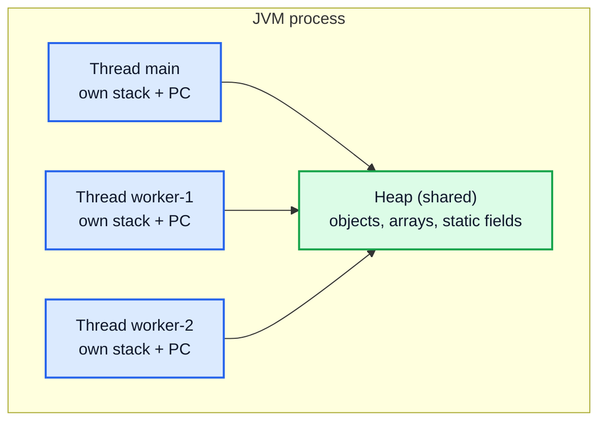

This links straight back to the stack/heap model from [video 5](../kunal-java-notes-claude/java_05_video_intro_programming.md): **local variables live on a thread's own stack, so they are safe. Objects live on the shared heap, so they need protection.**

### Concurrency vs Parallelism

| Term | Meaning | Needs multiple cores? |
|---|---|---|
| **Concurrency** | Several tasks *in progress* at the same time (they take turns) | No |
| **Parallelism** | Several tasks *running* at the same instant | Yes |

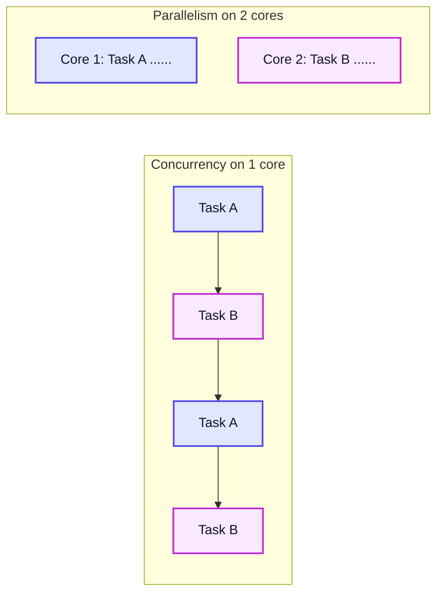

### Why bother?

- **Responsiveness:** a UI or server keeps answering while slow work runs in the background.
- **Throughput:** while one thread waits for disk or network (I/O), another uses the CPU.
- **Speed:** CPU-heavy work split across cores (e.g. parallel sorting).

> [!WARNING]
> Threads add a whole class of bugs that don't exist in single-threaded code: race conditions, visibility bugs, deadlocks. They often appear only under load and are hard to reproduce. Use the highest-level tool that works (executors, concurrent collections) before raw threads and locks.

---

## 1. Creating Threads

There are three classic ways. All of them end with a `Thread` object whose `start()` is called.

### Way 1: Extend `Thread`

```java
class MyThread extends Thread {
    @Override
    public void run() {
        System.out.println("Running in: " + Thread.currentThread().getName());
    }
}

public class ExtendThread {
    public static void main(String[] args) {
        MyThread t = new MyThread();
        t.setName("worker");
        t.start();                      // new thread runs run()
        System.out.println("Main is: " + Thread.currentThread().getName());
    }
}
// Output (order may vary):
// Main is: main
// Running in: worker
```

### Way 2: Implement `Runnable` (preferred)

```java
public class RunnableDemo {
    public static void main(String[] args) throws InterruptedException {
        Runnable task = () -> System.out.println("Hello from " + Thread.currentThread().getName());
        Thread t1 = new Thread(task, "T1");
        Thread t2 = new Thread(task, "T2");
        t1.start();
        t2.start();
        t1.join();
        t2.join();
        System.out.println("Both done");
    }
}
// Output (T1/T2 order may vary):
// Hello from T1
// Hello from T2
// Both done
```

| | `extends Thread` | `implements Runnable` |
|---|---|---|
| Inheritance | Uses up your only superclass | Class can still extend something else |
| Separation | Task and thread mixed together | Task (what) separate from thread (how) |
| Reuse | One object = one thread | Same Runnable can go to many threads or a thread pool |
| Lambdas | No | Yes, `Runnable` is a functional interface |

### Way 3: `Callable` (returns a value, can throw)

`Runnable.run()` returns `void` and can't throw checked exceptions. `Callable<V>.call()` returns a `V` and may throw. You run a `Callable` through an executor (Section 11) and get a `Future`.

```java
import java.util.concurrent.*;

public class CallableDemo {
    public static void main(String[] args) throws Exception {
        Callable<Integer> sumTask = () -> {
            int sum = 0;
            for (int i = 1; i <= 100; i++) sum += i;
            return sum;
        };
        try (ExecutorService ex = Executors.newSingleThreadExecutor()) {
            Future<Integer> f = ex.submit(sumTask);
            System.out.println("Sum = " + f.get());   // blocks until ready
        }
    }
}
// Output:
// Sum = 5050
```

> [!TIP]
> Since Java 19, `ExecutorService` implements `AutoCloseable`, so try-with-resources shuts it down and waits for tasks. On Java 17 you must call `shutdown()` yourself.

### `start()` vs `run()` — the classic trap

```java
public class StartVsRun {
    public static void main(String[] args) {
        Thread t = new Thread(() -> System.out.println("run by " + Thread.currentThread().getName()), "worker");
        t.run();    // plain method call on the MAIN thread
        t.start();  // creates a new thread that calls run()
    }
}
// Output (second line may come later):
// run by main
// run by worker
```

> [!IMPORTANT]
> `run()` is just a normal method call; no new thread is created. Only `start()` creates a thread. Calling `start()` twice on the same `Thread` throws `IllegalThreadStateException`.

---

## 2. Thread Lifecycle and States

`Thread.getState()` returns one of six values of the enum `Thread.State`.

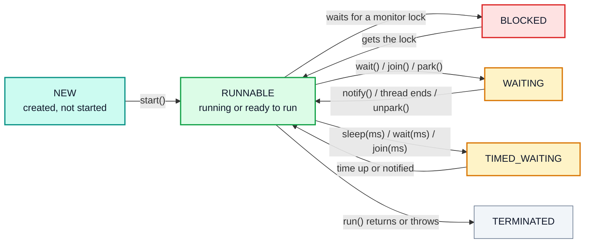

| State | When |
|---|---|
| `NEW` | `new Thread(...)` done, `start()` not yet called |
| `RUNNABLE` | Running **or** waiting for the OS to give it a CPU (Java doesn't separate "ready" and "running") |
| `BLOCKED` | Waiting to enter a `synchronized` block whose lock another thread holds |
| `WAITING` | `wait()`, `join()`, `LockSupport.park()` with no timeout |
| `TIMED_WAITING` | `sleep(ms)`, `wait(ms)`, `join(ms)` |
| `TERMINATED` | `run()` finished (normally or by exception) |

```java
public class StatesDemo {
    public static void main(String[] args) throws InterruptedException {
        Thread t = new Thread(() -> {
            try { Thread.sleep(200); } catch (InterruptedException e) { }
        });
        System.out.println(t.getState());   // NEW
        t.start();
        Thread.sleep(50);
        System.out.println(t.getState());   // TIMED_WAITING (sleeping)
        t.join();
        System.out.println(t.getState());   // TERMINATED
    }
}
```

---

## 3. Useful Thread Methods

| Method | What it does |
|---|---|
| `Thread.sleep(ms)` | Pauses the **current** thread. Keeps any locks it holds. |
| `t.join()` | Current thread waits until `t` finishes |
| `t.interrupt()` | Sets `t`'s interrupt flag; wakes it with `InterruptedException` if it's sleeping/waiting |
| `Thread.currentThread()` | The thread running this line |
| `t.setDaemon(true)` | Daemon threads don't keep the JVM alive (must be set before `start()`) |
| `t.setPriority(1..10)` | A hint to the scheduler; don't rely on it |
| `Thread.yield()` | Hint: "I'm willing to give up the CPU"; rarely useful |

### `join()` — wait for a thread to finish

```java
public class JoinDemo {
    public static void main(String[] args) throws InterruptedException {
        int[] result = new int[1];
        Thread worker = new Thread(() -> {
            for (int i = 1; i <= 10; i++) result[0] += i;
        });
        worker.start();
        worker.join();                 // without this, main might print 0
        System.out.println(result[0]); // 55
    }
}
```

> [!NOTE]
> `join()` also creates a *happens-before* edge (Section 6): everything the worker wrote is guaranteed visible to `main` after `join()` returns. That's why reading `result[0]` here is safe without locks.

### Interrupting a thread correctly

Java has no safe way to *kill* a thread (`Thread.stop()` is deprecated and removed in recent versions). Instead you **ask** it to stop with `interrupt()`, and the thread checks the flag.

```java
public class InterruptDemo {
    public static void main(String[] args) throws InterruptedException {
        Thread worker = new Thread(() -> {
            int count = 0;
            while (!Thread.currentThread().isInterrupted()) {
                count++;
                try {
                    Thread.sleep(10);
                } catch (InterruptedException e) {
                    System.out.println("Interrupted while sleeping");
                    Thread.currentThread().interrupt();  // restore the flag!
                }
            }
            System.out.println("Worker stopping cleanly");
        });
        worker.start();
        Thread.sleep(50);
        worker.interrupt();
        worker.join();
    }
}
// Output:
// Interrupted while sleeping
// Worker stopping cleanly
```

> [!CAUTION]
> When `InterruptedException` is thrown, the interrupt flag is **cleared**. Swallowing it with an empty `catch` means the thread forgets it was asked to stop. Either rethrow it or call `Thread.currentThread().interrupt()` to restore the flag.

### Daemon threads

```java
public class DaemonDemo {
    public static void main(String[] args) {
        Thread heartbeat = new Thread(() -> {
            while (true) {
                try { Thread.sleep(1000); } catch (InterruptedException e) { return; }
            }
        });
        heartbeat.setDaemon(true);   // JVM won't wait for it
        heartbeat.start();
        System.out.println("main ends; JVM exits even though heartbeat loops forever");
    }
}
```

The garbage collector runs on daemon threads. The JVM exits when the last **non-daemon** thread ends.

---

## 4. Race Conditions

A **race condition** happens when the result depends on the timing of threads. The classic example is `count++`.

```java
public class RaceDemo {
    static int count = 0;

    public static void main(String[] args) throws InterruptedException {
        Runnable inc = () -> { for (int i = 0; i < 100_000; i++) count++; };
        Thread a = new Thread(inc), b = new Thread(inc);
        a.start(); b.start();
        a.join();  b.join();
        System.out.println("Expected 200000, got " + count);
    }
}
// Output (varies run to run):
// Expected 200000, got 137412
```

### Why `count++` isn't safe

`count++` looks like one step, but it's three: **read**, **add 1**, **write**.

| Step | Thread A | Thread B | `count` in memory |
|---|---|---|---|
| 1 | reads 5 | | 5 |
| 2 | | reads 5 | 5 |
| 3 | adds 1 → 6 | | 5 |
| 4 | | adds 1 → 6 | 5 |
| 5 | writes 6 | | 6 |
| 6 | | writes 6 | **6** ❌ (should be 7) |

One increment is **lost**. This is a *read-modify-write* race.

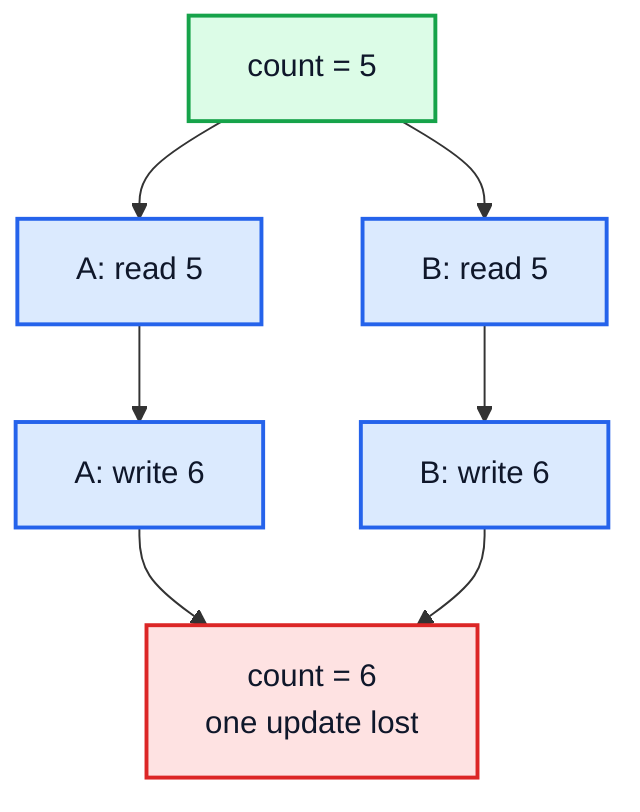

### Two kinds of race

| Kind | Pattern | Example |
|---|---|---|
| **Read-modify-write** | read a value, change it, write it back | `count++`, `balance -= amount` |
| **Check-then-act** | check a condition, then act on it | `if (!map.containsKey(k)) map.put(k, v);` — another thread may insert between the check and the put |

A piece of code that touches shared mutable state and must not be run by two threads at once is a **critical section**. The fixes: make it **atomic** with a lock (`synchronized`, `ReentrantLock`) or an atomic class (`AtomicInteger`), or **avoid sharing** (each thread uses its own data, or data is immutable).

---

## 5. The synchronized Keyword

Every Java object has a built-in lock called its **monitor** (intrinsic lock). `synchronized` makes a thread acquire it before entering, and release it when leaving (even on an exception). Only one thread can hold a given monitor at a time.

### Three forms

```java
class Counter {
    private int count = 0;
    private static int total = 0;
    private final Object lock = new Object();

    // 1. synchronized instance method: locks on `this`
    public synchronized void inc() { count++; }

    // 2. synchronized static method: locks on Counter.class
    public static synchronized void incTotal() { total++; }

    // 3. synchronized block: locks on any object you choose, only around the critical part
    public void incWithBlock() {
        // non-critical work here runs in parallel
        synchronized (lock) {
            count++;
        }
    }

    public synchronized int get() { return count; }
}

public class SyncDemo {
    public static void main(String[] args) throws InterruptedException {
        Counter c = new Counter();
        Runnable r = () -> { for (int i = 0; i < 100_000; i++) c.inc(); };
        Thread a = new Thread(r), b = new Thread(r);
        a.start(); b.start(); a.join(); b.join();
        System.out.println(c.get());   // 200000, every time
    }
}
```

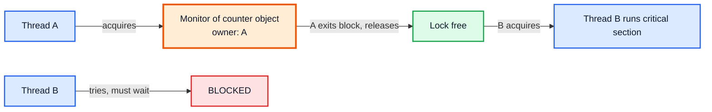

### Key facts

| Fact | Detail |
|---|---|
| **What is locked** | An *object*, never a method. Two threads calling `inc()` on **different** `Counter` objects don't block each other. |
| **Static vs instance** | `static synchronized` locks the `Class` object; instance `synchronized` locks `this`. They're different locks and don't exclude each other. |
| **Reentrant** | A thread that holds a lock can enter another `synchronized` block on the same lock (no self-deadlock). |
| **Visibility** | Releasing a lock flushes writes; acquiring it sees them. So `synchronized` gives both *atomicity* and *visibility*. |
| **Readers too** | `get()` must also be synchronized (or the field `volatile`), or a reader may see a stale value. |

> [!TIP]
> Prefer a `private final Object lock` over `synchronized(this)`. Outside code can't grab your private lock and accidentally block you.

> [!WARNING]
> Never synchronize on a `String` literal or boxed `Integer` (`synchronized ("lock")`). Literals are interned and shared across the whole JVM, so unrelated code may use the same lock.

### The video connection: `Vector` vs `ArrayList`

[Video 43](../kunal-java-notes-claude/java_43_video_collections_vector_enums.md) says `Vector` is synchronized and `ArrayList` isn't. Now you can see what that means: every `Vector` method is `synchronized`. That makes each single call safe, but **compound actions still race**:

```java
// Still a check-then-act race even with Vector:
if (!vector.contains(x)) vector.add(x);   // two separately locked calls
```

That's why modern code uses `ArrayList` plus your own locking, or the `java.util.concurrent` classes, instead of `Vector`.

---

## 6. volatile and the Java Memory Model

### The visibility problem

Each CPU core has caches, and the JIT compiler may keep a field in a register. Without synchronization, **a write by one thread may never be seen by another**.

```java
public class VisibilityBug {
    static boolean running = true;      // try adding `volatile` here

    public static void main(String[] args) throws InterruptedException {
        Thread worker = new Thread(() -> {
            long spins = 0;
            while (running) spins++;     // JIT may hoist `running` out of the loop
            System.out.println("Stopped after " + spins + " spins");
        });
        worker.start();
        Thread.sleep(100);
        running = false;                 // without volatile the worker may NEVER see this
        System.out.println("Asked worker to stop");
    }
}
```

Without `volatile` this program can hang forever on many machines. With `static volatile boolean running`, it always stops.

### What `volatile` guarantees

| Guarantee | `volatile` | `synchronized` |
|---|---|---|
| **Visibility** (others see the latest write) | ✅ | ✅ |
| **Ordering** (no reordering around it) | ✅ | ✅ |
| **Atomicity** of compound actions like `count++` | ❌ | ✅ |
| Blocks other threads | No | Yes |

> [!IMPORTANT]
> `volatile int count; count++;` is **still a race**. `volatile` only fixes visibility. Use `volatile` for flags written by one thread and read by others; use `synchronized` or `AtomicInteger` for counters.

### Happens-before (the rule behind everything)

The Java Memory Model says: if action X **happens-before** action Y, then Y sees everything X wrote. The main edges:

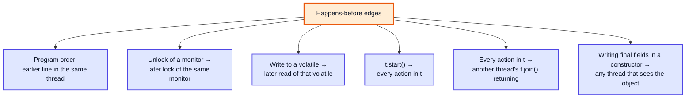

### Classic use: double-checked locking Singleton

[Video 38](../kunal-java-notes-claude/java_38_video_oop_static_packages_singleton.md) builds a Singleton. In a multithreaded program the lazy version needs this:

```java
public class Singleton {
    private static volatile Singleton instance;   // volatile is essential

    private Singleton() { }

    public static Singleton getInstance() {
        if (instance == null) {                    // 1st check, no lock (fast path)
            synchronized (Singleton.class) {
                if (instance == null) {            // 2nd check, inside the lock
                    instance = new Singleton();
                }
            }
        }
        return instance;
    }
}
```

> [!CAUTION]
> Without `volatile`, `instance = new Singleton()` can be reordered so another thread sees a **non-null but half-built** object. The simpler safe options are an `enum` singleton or the holder idiom: `private static class Holder { static final Singleton I = new Singleton(); }` (the JVM's class loading is thread-safe).

---

## 7. wait, notify and Producer-Consumer

`wait()`, `notify()` and `notifyAll()` are methods of **`Object`**, and you may only call them while holding that object's monitor (inside `synchronized(obj)`), or you get `IllegalMonitorStateException`.

| Method | Effect |
|---|---|
| `obj.wait()` | Releases `obj`'s lock and sleeps until notified (then re-acquires the lock) |
| `obj.notify()` | Wakes **one** waiting thread |
| `obj.notifyAll()` | Wakes **all** waiting threads (safer default) |

### Bounded buffer (producer-consumer)

```java
import java.util.ArrayDeque;
import java.util.Queue;

class BoundedBuffer {
    private final Queue<Integer> q = new ArrayDeque<>();
    private final int capacity;

    BoundedBuffer(int capacity) { this.capacity = capacity; }

    public synchronized void put(int x) throws InterruptedException {
        while (q.size() == capacity) wait();   // ALWAYS a while loop, never if
        q.add(x);
        notifyAll();                           // wake consumers
    }

    public synchronized int take() throws InterruptedException {
        while (q.isEmpty()) wait();
        int x = q.remove();
        notifyAll();                           // wake producers
        return x;
    }
}

public class ProducerConsumer {
    public static void main(String[] args) throws InterruptedException {
        BoundedBuffer buf = new BoundedBuffer(2);
        Thread producer = new Thread(() -> {
            try { for (int i = 1; i <= 5; i++) buf.put(i); } catch (InterruptedException e) { }
        });
        Thread consumer = new Thread(() -> {
            try {
                int sum = 0;
                for (int i = 1; i <= 5; i++) sum += buf.take();
                System.out.println("Consumer sum = " + sum);
            } catch (InterruptedException e) { }
        });
        producer.start(); consumer.start();
        producer.join();  consumer.join();
    }
}
// Output:
// Consumer sum = 15
```

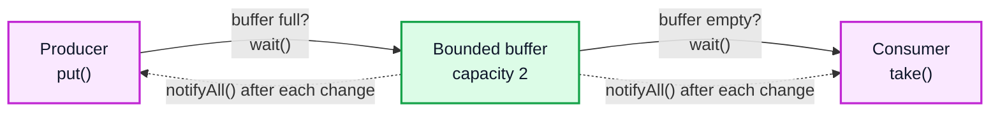

> [!IMPORTANT]
> Always call `wait()` in a **`while`** loop that re-checks the condition. A thread can wake up without being notified (a *spurious wakeup*), or another thread may grab the item first. `if` is a bug.

### `sleep()` vs `wait()`

| | `Thread.sleep()` | `obj.wait()` |
|---|---|---|
| Defined in | `Thread` (static) | `Object` |
| Releases locks? | **No** | **Yes**, releases `obj`'s monitor |
| Needs `synchronized`? | No | Yes |
| Woken by | Time passing (or interrupt) | `notify`/`notifyAll`, timeout, or interrupt |

> [!TIP]
> In real code, use `ArrayBlockingQueue` / `LinkedBlockingQueue` (Section 13) instead of writing your own buffer. They do all of this for you.

---

## 8. Deadlock, Livelock and Starvation

### Deadlock

Two (or more) threads each hold a lock the other needs, so both wait forever.

```java
public class DeadlockDemo {
    static final Object A = new Object(), B = new Object();

    public static void main(String[] args) {
        new Thread(() -> {
            synchronized (A) {
                sleep(50);
                synchronized (B) { System.out.println("T1 got both"); }
            }
        }).start();
        new Thread(() -> {
            synchronized (B) {          // opposite order → deadlock
                sleep(50);
                synchronized (A) { System.out.println("T2 got both"); }
            }
        }).start();
    }

    static void sleep(long ms) { try { Thread.sleep(ms); } catch (InterruptedException e) { } }
}
// Output: nothing. The program hangs forever.
```

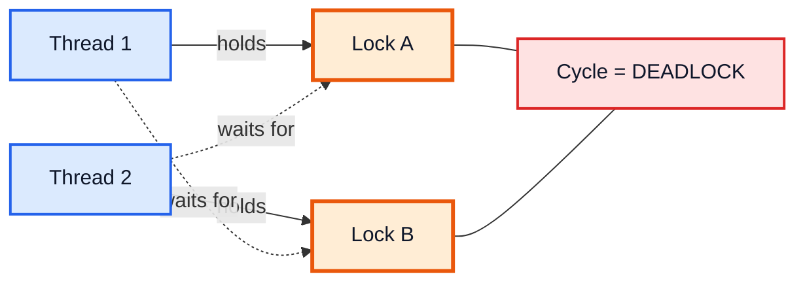

### The four Coffman conditions

Deadlock needs **all four**. Break any one and deadlock is impossible.

| Condition | Meaning | How to break it |
|---|---|---|
| Mutual exclusion | A resource can be held by one thread only | Use lock-free or immutable data |
| Hold and wait | Hold one lock while waiting for another | Acquire all locks at once, or none |
| No preemption | Locks can't be taken away | `tryLock` with a timeout and back off |
| Circular wait | A cycle of threads waiting on each other | **Always lock in the same global order** (most common fix) |

```java
// Fix: both threads lock A then B
synchronized (A) { synchronized (B) { /* ... */ } }
```

> [!TIP]
> To find a deadlock in a hung program, run `jstack <pid>` (or press Ctrl+Break in the console on Windows). The thread dump prints "Found one Java-level deadlock" and shows which threads hold which locks.

### Livelock and starvation

| Problem | What happens | Example |
|---|---|---|
| **Deadlock** | Threads blocked forever, doing nothing | Above |
| **Livelock** | Threads keep running but make no progress, politely reacting to each other | Two people in a corridor both stepping aside the same way, again and again |
| **Starvation** | One thread never gets the CPU or lock because others always win | Low-priority thread; unfair lock under heavy contention |

Fixes: random back-off for livelock; fair locks (`new ReentrantLock(true)`) for starvation.

---

## 9. Explicit Locks

`java.util.concurrent.locks` gives locks with more features than `synchronized`.

### `ReentrantLock`

```java
import java.util.concurrent.locks.ReentrantLock;

class BankAccount {
    private final ReentrantLock lock = new ReentrantLock();
    private int balance = 100;

    public boolean withdraw(int amount) {
        lock.lock();
        try {                                  // ALWAYS unlock in finally
            if (balance >= amount) {           // check-then-act is now safe
                balance -= amount;
                return true;
            }
            return false;
        } finally {
            lock.unlock();
        }
    }

    public int balance() {
        lock.lock();
        try { return balance; } finally { lock.unlock(); }
    }
}

public class LockDemo {
    public static void main(String[] args) throws InterruptedException {
        BankAccount acc = new BankAccount();
        Thread a = new Thread(() -> acc.withdraw(70));
        Thread b = new Thread(() -> acc.withdraw(70));
        a.start(); b.start(); a.join(); b.join();
        System.out.println("Balance: " + acc.balance());  // 30, never -40
    }
}
```

| Feature | `synchronized` | `ReentrantLock` |
|---|---|---|
| Release | Automatic | **Manual** — must `unlock()` in `finally` |
| Try without blocking | ❌ | `tryLock()`, `tryLock(1, SECONDS)` |
| Interruptible wait | ❌ | `lockInterruptibly()` |
| Fairness | ❌ | `new ReentrantLock(true)` (FIFO-ish) |
| Several wait conditions | One per object (`wait`/`notify`) | Many `Condition`s per lock |
| Simplicity | ✅ Simple | More code, easier to get wrong |

> [!TIP]
> Use `synchronized` by default. Reach for `ReentrantLock` when you need `tryLock`, timeouts, interruptibility, fairness, or multiple conditions.

### `tryLock` to avoid deadlock

```java
if (lockA.tryLock(100, TimeUnit.MILLISECONDS)) {
    try {
        if (lockB.tryLock(100, TimeUnit.MILLISECONDS)) {
            try { /* do work */ } finally { lockB.unlock(); }
        }
    } finally { lockA.unlock(); }
}
// If either lock isn't available in time, give up and retry later instead of waiting forever.
```

### `ReadWriteLock`

Many readers can read at once; a writer needs exclusive access. Great for read-heavy data like caches.

```java
import java.util.*;
import java.util.concurrent.locks.*;

class Cache {
    private final Map<String, String> map = new HashMap<>();
    private final ReadWriteLock rw = new ReentrantReadWriteLock();

    public String get(String k) {
        rw.readLock().lock();          // many threads may hold this together
        try { return map.get(k); } finally { rw.readLock().unlock(); }
    }

    public void put(String k, String v) {
        rw.writeLock().lock();         // exclusive
        try { map.put(k, v); } finally { rw.writeLock().unlock(); }
    }
}
```

### `Condition` — named wait queues

`lock.newCondition()` is the `Lock` version of `wait`/`notify`, but you can have several per lock (e.g. `notFull` and `notEmpty`), so producers only wake consumers and vice versa: `cond.await()`, `cond.signal()`, `cond.signalAll()`.

---

## 10. Atomic Variables and CAS

`java.util.concurrent.atomic` has lock-free classes for single variables: `AtomicInteger`, `AtomicLong`, `AtomicBoolean`, `AtomicReference<V>`, and `LongAdder`.

```java
import java.util.concurrent.atomic.AtomicInteger;

public class AtomicDemo {
    public static void main(String[] args) throws InterruptedException {
        AtomicInteger count = new AtomicInteger();
        Runnable inc = () -> { for (int i = 0; i < 100_000; i++) count.incrementAndGet(); };
        Thread a = new Thread(inc), b = new Thread(inc);
        a.start(); b.start(); a.join(); b.join();
        System.out.println(count.get());                      // 200000
        System.out.println(count.compareAndSet(200000, 0));   // true
        System.out.println(count.updateAndGet(x -> x + 5));   // 5
    }
}
```

### How CAS (Compare-And-Swap) works

The CPU offers one atomic instruction: *"if the value is still `expected`, set it to `new`; tell me whether it worked."* Atomics loop on it:

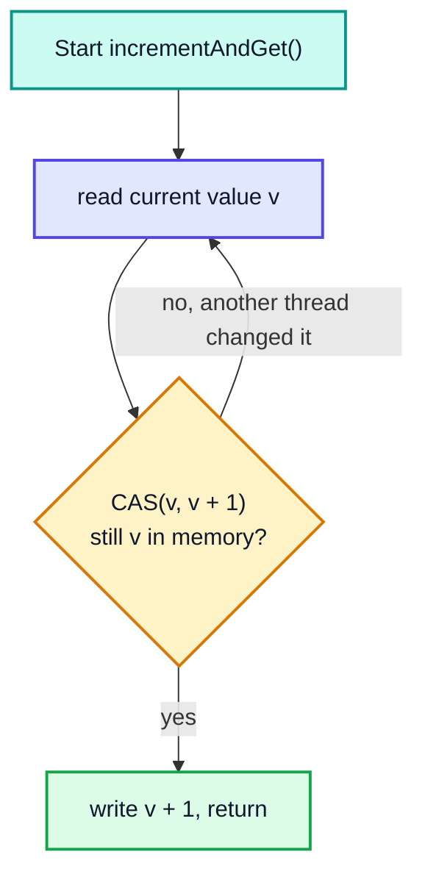

| Method | Meaning |
|---|---|
| `get()` / `set(v)` | Volatile read / write |
| `incrementAndGet()` / `getAndIncrement()` | `++x` / `x++`, atomically |
| `addAndGet(d)` | `x += d` |
| `compareAndSet(expect, update)` | The raw CAS; returns `true` if it swapped |
| `updateAndGet(f)` / `accumulateAndGet(x, f)` | Apply a function atomically (the function may run more than once, so keep it pure) |

> [!NOTE]
> **ABA problem:** a value changes A → B → A, and CAS can't tell anything happened. It rarely matters for counters but can for lock-free linked structures; `AtomicStampedReference` adds a version number to fix it.

> [!TIP]
> For a counter updated by many threads at once (e.g. request metrics), `LongAdder` is faster than `AtomicLong`: it spreads updates over several cells and adds them up in `sum()`.

---

## 11. ExecutorService and Thread Pools

Creating a thread per task is expensive and unbounded. A **thread pool** keeps a few worker threads and feeds them tasks from a queue.

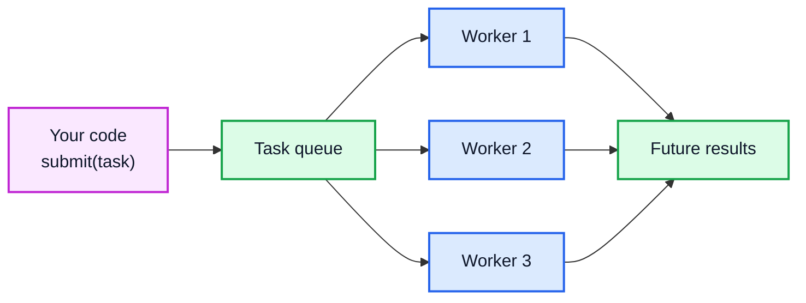

### Factory methods in `Executors`

| Factory | Pool | Use for |
|---|---|---|
| `newFixedThreadPool(n)` | Exactly `n` threads, unbounded queue | CPU-bound work (n ≈ number of cores) |
| `newCachedThreadPool()` | Grows as needed, idle threads die after 60 s | Many short tasks |
| `newSingleThreadExecutor()` | 1 thread, tasks run in order | Sequential background work |
| `newScheduledThreadPool(n)` | Runs tasks after a delay or periodically | Timers, heartbeats |
| `newVirtualThreadPerTaskExecutor()` | A new virtual thread per task (Java 21) | Lots of blocking I/O tasks |
| `newWorkStealingPool()` | A `ForkJoinPool` | Divide-and-conquer tasks |

### Submitting work and getting results

```java
import java.util.*;
import java.util.concurrent.*;

public class ExecutorDemo {
    public static void main(String[] args) throws Exception {
        ExecutorService pool = Executors.newFixedThreadPool(3);
        try {
            // submit → Future
            Future<Integer> f = pool.submit(() -> 6 * 7);
            System.out.println("Answer: " + f.get());

            // invokeAll → run a batch and wait for all
            List<Callable<Integer>> tasks = List.of(() -> 1, () -> 2, () -> 3);
            int sum = 0;
            for (Future<Integer> r : pool.invokeAll(tasks)) sum += r.get();
            System.out.println("Batch sum: " + sum);

            // get with timeout
            Future<String> slow = pool.submit(() -> { Thread.sleep(2000); return "late"; });
            try {
                slow.get(100, TimeUnit.MILLISECONDS);
            } catch (TimeoutException e) {
                System.out.println("Timed out, cancelling");
                slow.cancel(true);           // interrupts the task
            }
        } finally {
            pool.shutdown();                                  // stop accepting new tasks
            if (!pool.awaitTermination(5, TimeUnit.SECONDS)) {
                pool.shutdownNow();                           // interrupt running tasks
            }
        }
    }
}
// Output:
// Answer: 42
// Batch sum: 6
// Timed out, cancelling
```

| Method | Meaning |
|---|---|
| `execute(Runnable)` | Fire and forget, no result |
| `submit(Callable/Runnable)` | Returns a `Future` |
| `invokeAll(tasks)` | Runs all, returns all `Future`s when done |
| `invokeAny(tasks)` | Returns the result of the first one to succeed |
| `shutdown()` | Finish queued tasks, accept no new ones |
| `shutdownNow()` | Interrupt running tasks, return the queued ones |
| `awaitTermination(t, unit)` | Wait for the pool to finish |

> [!WARNING]
> If a task throws, `execute` prints the stack trace, but `submit` **hides** the exception inside the `Future`; you only see it (wrapped in `ExecutionException`) when you call `get()`. Unchecked `Future`s can silently swallow bugs.

> [!CAUTION]
> `newFixedThreadPool` and `newSingleThreadExecutor` use an **unbounded** queue, so a flood of tasks can run you out of memory. In production, build a `ThreadPoolExecutor` directly with a bounded `ArrayBlockingQueue` and a rejection policy.

### `ThreadPoolExecutor` parameters (often asked)

```java
new ThreadPoolExecutor(
    2,                        // corePoolSize: threads kept alive
    4,                        // maximumPoolSize: max threads when the queue is full
    30, TimeUnit.SECONDS,     // keepAliveTime for extra threads
    new ArrayBlockingQueue<>(100),             // bounded work queue
    new ThreadPoolExecutor.CallerRunsPolicy()  // when full: the caller runs the task itself
);
```

Order of decisions for a new task: fewer than *core* threads → start a thread; else queue it; queue full and fewer than *max* threads → start a thread; else **reject**.

---

## 12. CompletableFuture

`Future.get()` blocks. `CompletableFuture` (Java 8+) lets you **chain** steps that run when the previous one finishes, without blocking.

```java
import java.util.concurrent.*;

public class CFDemo {
    public static void main(String[] args) {
        CompletableFuture<Integer> price = CompletableFuture.supplyAsync(() -> 100);
        CompletableFuture<Integer> tax   = CompletableFuture.supplyAsync(() -> 18);

        int total = price
            .thenCombine(tax, Integer::sum)                // join two futures
            .thenApply(t -> t * 2)                         // transform the result
            .join();                                       // like get() but unchecked
        System.out.println("Total: " + total);             // 236

        String safe = CompletableFuture.supplyAsync(() -> {
                if (true) throw new IllegalStateException("service down");
                return "data";
            })
            .exceptionally(ex -> "fallback (" + ex.getCause().getMessage() + ")")
            .join();
        System.out.println(safe);                          // fallback (service down)
    }
}
```

| Method | Input → output | Like |
|---|---|---|
| `supplyAsync(supplier)` | start async, returns value | `submit(Callable)` |
| `runAsync(runnable)` | start async, no value | `execute` |
| `thenApply(fn)` | `T → U` | `map` |
| `thenAccept(consumer)` | `T → void` | `forEach` |
| `thenCompose(fn)` | `T → CompletableFuture<U>` (flattened) | `flatMap` |
| `thenCombine(other, fn)` | combine two independent results | `zip` |
| `allOf(cfs...)` / `anyOf(cfs...)` | wait for all / first | `invokeAll` / `invokeAny` |
| `exceptionally(fn)` | recover from an error | `catch` |
| `handle((v, ex) -> ...)` | handle success **or** error | `finally` that returns a value |

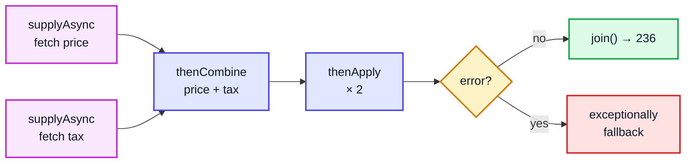

> [!NOTE]
> By default `supplyAsync` runs on `ForkJoinPool.commonPool()`, which is sized for CPU work. For blocking I/O, pass your own executor: `supplyAsync(task, myExecutor)`. Methods ending in `Async` (`thenApplyAsync`) run the next step on a pool thread instead of the thread that completed the previous step.

---

## 13. Concurrent Collections

| Class | Replaces | How it's thread-safe |
|---|---|---|
| `ConcurrentHashMap` | `Hashtable`, `Collections.synchronizedMap` | Locks only a single bin on write (CAS + tiny `synchronized`); reads don't lock |
| `CopyOnWriteArrayList` | `Vector`, `synchronizedList` | Every write copies the whole array; iteration never throws | 
| `ConcurrentLinkedQueue` | `synchronized LinkedList` | Lock-free (CAS) |
| `ArrayBlockingQueue` / `LinkedBlockingQueue` | hand-written producer-consumer | `put` blocks when full, `take` blocks when empty |
| `PriorityBlockingQueue` | `PriorityQueue` + locks | Blocking heap |
| `ConcurrentSkipListMap` | `synchronized TreeMap` | Sorted, lock-free skip list |

### `ConcurrentHashMap` atomic compound operations

```java
import java.util.concurrent.ConcurrentHashMap;

public class CHMDemo {
    public static void main(String[] args) throws InterruptedException {
        ConcurrentHashMap<String, Integer> freq = new ConcurrentHashMap<>();
        Runnable r = () -> {
            for (String w : "a b a c a b".split(" ")) freq.merge(w, 1, Integer::sum);  // atomic
        };
        Thread t1 = new Thread(r), t2 = new Thread(r);
        t1.start(); t2.start(); t1.join(); t2.join();
        System.out.println(freq);    // {a=6, b=4, c=2}

        freq.computeIfAbsent("d", k -> 0);        // atomic check-then-act
        freq.putIfAbsent("a", 100);               // no effect, "a" exists
        System.out.println(freq.get("a") + " " + freq.get("d"));   // 6 0
    }
}
```

> [!WARNING]
> `if (!map.containsKey(k)) map.put(k, v);` is still a race on a `ConcurrentHashMap`, because it's two calls. Use `putIfAbsent`, `computeIfAbsent`, `compute` or `merge`, which do the whole thing atomically. Also: `ConcurrentHashMap` doesn't allow `null` keys or values, and its `size()` is only an estimate while other threads are writing.

### `BlockingQueue` producer-consumer (the easy way)

```java
import java.util.concurrent.*;

public class BlockingQueueDemo {
    public static void main(String[] args) throws InterruptedException {
        BlockingQueue<Integer> q = new ArrayBlockingQueue<>(2);
        Thread producer = new Thread(() -> {
            try {
                for (int i = 1; i <= 5; i++) q.put(i);   // blocks when full
                q.put(-1);                               // "poison pill" = no more items
            } catch (InterruptedException e) { }
        });
        producer.start();
        int sum = 0;
        while (true) {
            int x = q.take();                            // blocks when empty
            if (x == -1) break;
            sum += x;
        }
        System.out.println("Sum: " + sum);               // 15
    }
}
```

| `BlockingQueue` method | Full/empty behaviour |
|---|---|
| `add` / `remove` | Throws an exception |
| `offer` / `poll` | Returns `false` / `null` |
| `put` / `take` | **Blocks** |
| `offer(x, t, unit)` / `poll(t, unit)` | Blocks up to a timeout |

---

## 14. Synchronizers

| Class | One-line idea | Reusable? |
|---|---|---|
| `CountDownLatch(n)` | Threads `await()` until `countDown()` has been called `n` times | No |
| `CyclicBarrier(n)` | `n` threads wait for each other at a point, then all continue | Yes |
| `Semaphore(k)` | At most `k` threads inside at once (`acquire` / `release`) | Yes |
| `Phaser` | A flexible barrier where parties can join and leave | Yes |
| `Exchanger` | Two threads swap objects | Yes |

```java
import java.util.concurrent.*;

public class SyncersDemo {
    public static void main(String[] args) throws InterruptedException {
        // CountDownLatch: main waits for 3 services to start
        CountDownLatch ready = new CountDownLatch(3);
        for (String s : new String[]{"db", "cache", "web"}) {
            new Thread(() -> ready.countDown()).start();
        }
        ready.await();
        System.out.println("All 3 services ready");

        // Semaphore: at most 2 threads in the "parking lot"
        Semaphore spots = new Semaphore(2);
        int[] maxInside = {0};
        int[] inside = {0};
        Runnable car = () -> {
            try {
                spots.acquire();
                synchronized (inside) { inside[0]++; maxInside[0] = Math.max(maxInside[0], inside[0]); }
                Thread.sleep(20);
                synchronized (inside) { inside[0]--; }
            } catch (InterruptedException e) {
            } finally {
                spots.release();
            }
        };
        Thread[] cars = new Thread[6];
        for (int i = 0; i < 6; i++) { cars[i] = new Thread(car); cars[i].start(); }
        for (Thread c : cars) c.join();
        System.out.println("Max cars parked at once: " + maxInside[0]);  // never more than 2
    }
}
```

> [!NOTE]
> In the Semaphore demo `release()` is in `finally`, so if `acquire()` itself was interrupted we'd release a permit we never got. In production, put `acquire()` *before* the `try`.

---

## 15. Virtual Threads (Java 21)

A normal (**platform**) thread is a thin wrapper over an OS thread: about 1 MB of stack and costly to create, so a server can run only a few thousand. **Virtual threads** (Project Loom, final in Java 21) are managed by the JVM. Millions can exist; when one blocks on I/O, the JVM *unmounts* it and runs another virtual thread on the same OS thread (the **carrier**).

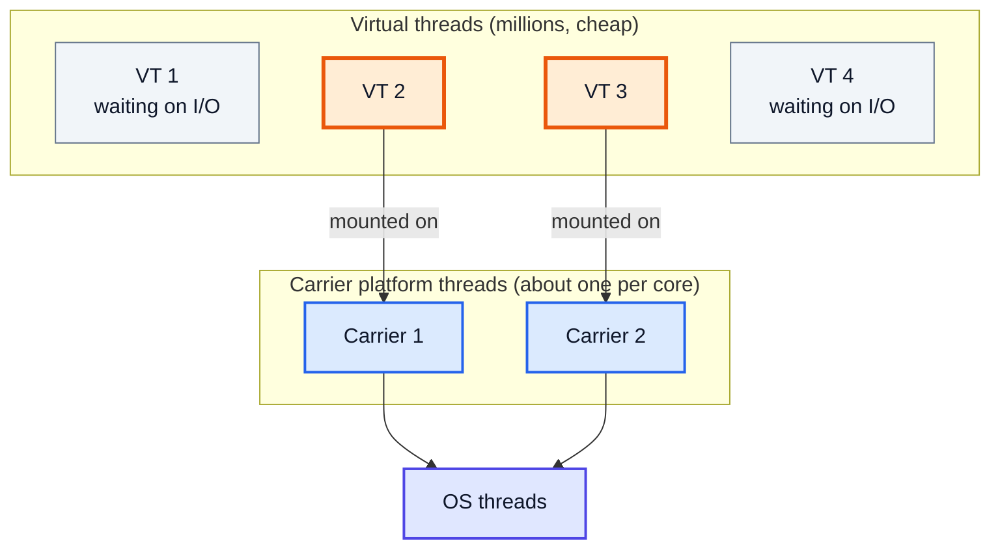

```java
import java.util.concurrent.*;
import java.util.stream.IntStream;

public class VirtualThreadsDemo {
    public static void main(String[] args) throws Exception {
        Thread vt = Thread.ofVirtual().name("vt-1").start(() ->
            System.out.println("Virtual? " + Thread.currentThread().isVirtual()));
        vt.join();                                          // Virtual? true

        long start = System.currentTimeMillis();
        try (ExecutorService ex = Executors.newVirtualThreadPerTaskExecutor()) {
            IntStream.range(0, 10_000).forEach(i ->
                ex.submit(() -> { Thread.sleep(1000); return i; }));   // 10,000 blocking tasks
        }                                                   // close() waits for all
        long secs = (System.currentTimeMillis() - start) / 1000;
        System.out.println("10,000 sleeping tasks took about " + secs + " s");
    }
}
// Output (timing varies by machine):
// Virtual? true
// 10,000 sleeping tasks took about 4 s
```

Run one after another, those tasks would take 10,000 seconds (almost 3 hours). With virtual threads they overlap, so the total is a few seconds. A test run on an 8-core Windows laptop took 1–6 s depending on JVM warm-up; most of that is the cost of starting 10,000 threads on a cold JVM, not the sleeping.

| | Platform thread | Virtual thread |
|---|---|---|
| Backed by | One OS thread for its whole life | Any carrier, switching when blocked |
| Memory | ~1 MB stack reserved | A few hundred bytes to KBs, grows on the heap |
| How many | Thousands | Millions |
| Good for | CPU-heavy work | **Blocking I/O** (HTTP calls, DB queries) |
| Pool them? | Yes | **No** — create one per task |
| Daemon? | Configurable | Always daemon |

> [!WARNING]
> Virtual threads don't make CPU-bound code faster; they only help when threads spend time waiting. In Java 21, blocking inside a `synchronized` block **pins** the virtual thread to its carrier (it can't unmount). For long blocking calls inside a lock, use `ReentrantLock` instead. (Java 24 removed most pinning for `synchronized`.)

---

## 16. Common Interview Questions

| Question | Short answer |
|---|---|
| Thread vs Runnable? | Prefer `Runnable`: keeps inheritance free and separates task from thread. |
| `start()` vs `run()`? | `start()` creates a new thread; `run()` is a normal call on the current thread. |
| `sleep()` vs `wait()`? | `sleep` keeps locks and is on `Thread`; `wait` releases the monitor, is on `Object`, needs `synchronized`. |
| Why are `wait/notify` in `Object`? | They work on monitors, and every object has a monitor. |
| Why call `wait()` in a loop? | Spurious wakeups, and the condition may have changed before the lock is re-acquired. |
| `volatile` vs `synchronized`? | `volatile` = visibility + ordering only; `synchronized` adds mutual exclusion (atomicity). |
| Is `volatile int x; x++` safe? | No. Use `AtomicInteger` or a lock. |
| What's a deadlock and how do you prevent it? | Circular waiting on locks; lock in a fixed order, use `tryLock` with timeouts, keep critical sections small. |
| `HashMap` vs `Hashtable` vs `ConcurrentHashMap`? | Not safe / one lock for everything (legacy) / fine-grained, high-throughput, no nulls. |
| `synchronized` vs `ReentrantLock`? | Lock adds `tryLock`, timeouts, fairness, interruptible waits, multiple conditions; must unlock in `finally`. |
| `Callable` vs `Runnable`? | `Callable` returns a value and can throw checked exceptions. |
| `submit` vs `execute`? | `submit` returns a `Future` (and hides exceptions in it). |
| `CountDownLatch` vs `CyclicBarrier`? | Latch: one-shot, threads wait for events. Barrier: reusable, threads wait for each other. |
| What is a thread-safe class? | Behaves correctly with many threads and no extra caller-side locking. Immutable classes are automatically thread-safe. |
| What are virtual threads? | JVM-managed lightweight threads (Java 21) for huge numbers of blocking tasks. |

---

## 🧩 Complete Example: Everything Together

A small "order processing" simulation using a thread pool, `ConcurrentHashMap`, `AtomicInteger`, a `ReentrantLock`-protected account, a `CountDownLatch`, `CompletableFuture`, and virtual threads. Results are collected so the output is the same on every run.

```java
import java.util.*;
import java.util.concurrent.*;
import java.util.concurrent.atomic.*;
import java.util.concurrent.locks.*;

public class ConcurrencyShowcase {

    // Shared account protected by an explicit lock
    static class Account {
        private final ReentrantLock lock = new ReentrantLock();
        private int balance;
        Account(int balance) { this.balance = balance; }

        boolean charge(int amount) {
            lock.lock();
            try {
                if (balance < amount) return false;
                balance -= amount;
                return true;
            } finally {
                lock.unlock();
            }
        }

        int balance() {
            lock.lock();
            try { return balance; } finally { lock.unlock(); }
        }
    }

    // Classic synchronized counter for comparison with the unsafe one
    static class SafeCounter {
        private int n;
        synchronized void inc() { n++; }
        synchronized int get() { return n; }
    }

    public static void main(String[] args) throws Exception {
        // 1. synchronized counter: two threads, no lost updates
        SafeCounter safe = new SafeCounter();
        Runnable work = () -> { for (int i = 0; i < 50_000; i++) safe.inc(); };
        Thread t1 = new Thread(work), t2 = new Thread(work);
        t1.start(); t2.start(); t1.join(); t2.join();
        System.out.println("1. synchronized counter = " + safe.get() + " (expected 100000)");

        // 2. Thread pool + atomics + concurrent map + latch + lock
        String[] items = {"pen", "book", "pen", "bag", "book", "pen", "lamp", "bag"};
        int[] prices  = {  10,    50,    10,    40,    50,    10,    90,    40 };

        Account account = new Account(200);
        AtomicInteger accepted = new AtomicInteger();
        AtomicInteger rejected = new AtomicInteger();
        ConcurrentHashMap<String, Integer> sold = new ConcurrentHashMap<>();
        CountDownLatch done = new CountDownLatch(items.length);

        ExecutorService pool = Executors.newFixedThreadPool(4);
        for (int i = 0; i < items.length; i++) {
            final int idx = i;
            pool.execute(() -> {
                try {
                    if (account.charge(prices[idx])) {
                        accepted.incrementAndGet();
                        sold.merge(items[idx], 1, Integer::sum);
                    } else {
                        rejected.incrementAndGet();
                    }
                } finally {
                    done.countDown();
                }
            });
        }
        done.await();
        pool.shutdown();
        pool.awaitTermination(5, TimeUnit.SECONDS);

        int totalOrders = accepted.get() + rejected.get();
        int spent = 200 - account.balance();
        int soldValue = 0;
        for (var e : sold.entrySet()) {
            for (int i = 0; i < items.length; i++) {
                if (items[i].equals(e.getKey())) { soldValue += prices[i] * e.getValue(); break; }
            }
        }
        System.out.println("2. orders processed = " + totalOrders);
        System.out.println("   balance never negative = " + (account.balance() >= 0));
        System.out.println("   money charged matches items sold = " + (spent == soldValue));

        // 3. CompletableFuture pipeline with fallback
        ExecutorService io = Executors.newFixedThreadPool(2);
        CompletableFuture<Integer> stock = CompletableFuture.supplyAsync(() -> 120, io);
        CompletableFuture<Integer> reserved = CompletableFuture.supplyAsync(() -> 45, io);
        int available = stock.thenCombine(reserved, (s, r) -> s - r).join();
        String report = CompletableFuture
                .supplyAsync(() -> { throw new IllegalStateException("report service down"); }, io)
                .handle((v, ex) -> ex == null ? v.toString() : "fallback report")
                .join();
        io.shutdown();
        System.out.println("3. available stock = " + available + ", report = " + report);

        // 4. Virtual threads: 1,000 blocking tasks
        AtomicLong virtualCount = new AtomicLong();
        try (ExecutorService vex = Executors.newVirtualThreadPerTaskExecutor()) {
            for (int i = 0; i < 1_000; i++) {
                vex.submit(() -> {
                    Thread.sleep(10);
                    if (Thread.currentThread().isVirtual()) virtualCount.incrementAndGet();
                    return null;
                });
            }
        }
        System.out.println("4. tasks that ran on virtual threads = " + virtualCount.get());

        // 5. volatile stop flag
        Flag flag = new Flag();
        Thread spinner = new Thread(() -> { while (flag.running) Thread.onSpinWait(); });
        spinner.start();
        Thread.sleep(20);
        flag.running = false;
        spinner.join(2000);
        System.out.println("5. spinner stopped via volatile flag = " + !spinner.isAlive());
    }

    static class Flag { volatile boolean running = true; }
}
```

**Expected Output:**
```
1. synchronized counter = 100000 (expected 100000)
2. orders processed = 8
   balance never negative = true
   money charged matches items sold = true
3. available stock = 75, report = fallback report
4. tasks that ran on virtual threads = 1000
5. spinner stopped via volatile flag = true
```

---

## Quick Reference Cheat Sheet

| Concept | One-Line Summary |
|---|---|
| **Thread** | A path of execution with its own stack, sharing the process heap |
| **Runnable / Callable** | Task with no result / task that returns a value and may throw |
| **`start()` vs `run()`** | New thread vs plain method call |
| **States** | NEW → RUNNABLE ⇄ BLOCKED / WAITING / TIMED_WAITING → TERMINATED |
| **`join()`** | Wait for a thread to finish (and see its writes) |
| **`interrupt()`** | Politely ask a thread to stop; restore the flag when you catch `InterruptedException` |
| **Daemon thread** | Doesn't keep the JVM alive |
| **Race condition** | Result depends on timing; `count++` is read-modify-write |
| **`synchronized`** | Locks an object's monitor: atomicity + visibility; reentrant |
| **`volatile`** | Visibility + ordering, **not** atomicity; good for flags |
| **Happens-before** | The JMM rule that says when one thread's writes are visible to another |
| **`wait/notify`** | Object methods; need the monitor; always `wait()` in a `while` loop |
| **Deadlock** | Circular wait on locks; fix with a global lock order or `tryLock` |
| **`ReentrantLock`** | Explicit lock with `tryLock`, fairness, conditions; unlock in `finally` |
| **`ReadWriteLock`** | Many readers or one writer |
| **Atomics / CAS** | Lock-free single-variable updates (`AtomicInteger`, `LongAdder`) |
| **ExecutorService** | Thread pool; `submit` → `Future`; always shut it down |
| **CompletableFuture** | Chain async steps: `thenApply`, `thenCompose`, `thenCombine`, `exceptionally` |
| **ConcurrentHashMap** | Thread-safe map; use `merge`/`compute*` for compound updates; no nulls |
| **BlockingQueue** | `put`/`take` block; easiest producer-consumer |
| **CountDownLatch / CyclicBarrier / Semaphore** | Wait for events / wait for each other / limit concurrent access |
| **Virtual threads** | Java 21 lightweight threads for blocking I/O; don't pool them |
