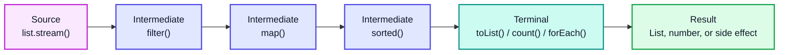
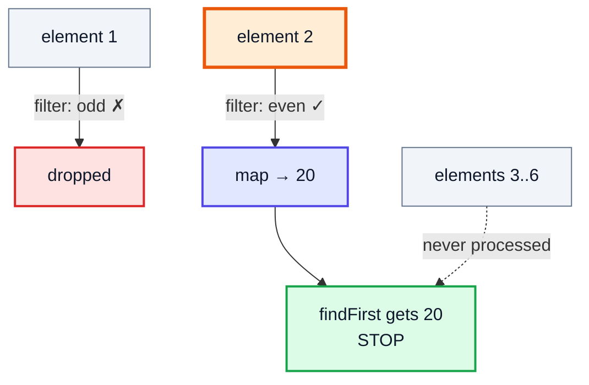
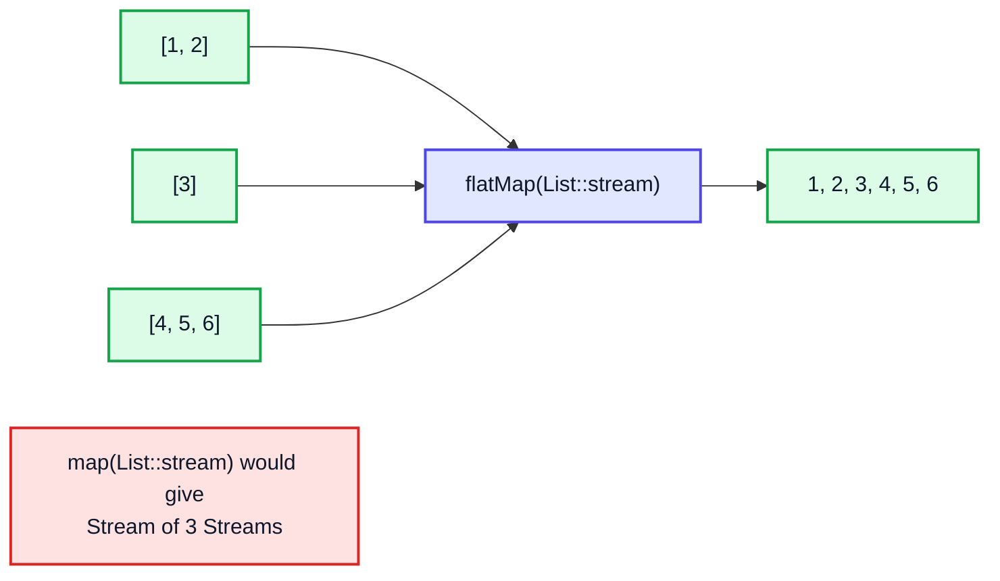
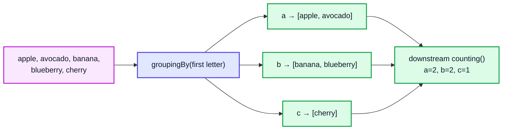
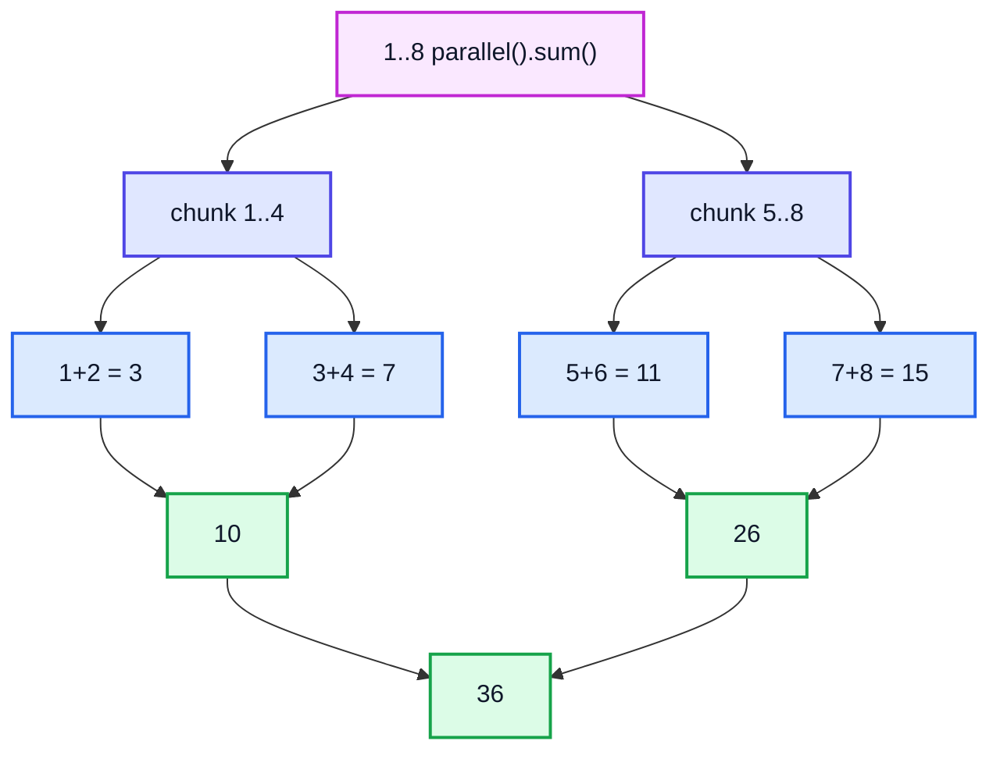

# Streams API — Complete In-Depth Guide

**Java gap topic #2 of 12** · Priority 🔴 · from [topics_not_covered.md](../topics_not_covered.md)

[Video 42](../kunal-java-notes-claude/java_42_video_generics_lambdas_exceptions_cloning.md) teaches lambdas but never really uses streams. A **stream** is a pipeline that takes data from a source, transforms it step by step, and produces a result, written in a declarative "what, not how" style. These notes go from `filter`/`map` up to `groupingBy`, `flatMap`, `reduce`, primitive streams, parallel streams and the Java 9–21 additions.

> [!NOTE]
> This topic isn't in the playlist, so there are no video timestamps. All code targets **Java 21**. Functional interfaces (`Function`, `Predicate`, …) and `Optional` get their own file: [gap topic #6](java_gap_06_functional_interfaces_optional.md).

---

## Table of Contents

| # | Topic (anchor link) | Level |
|---|---|---|
| 0 | [What is a Stream](#0-what-is-a-stream) | Basics |
| 1 | [Creating Streams](#1-creating-streams) | Basics |
| 2 | [The Pipeline and Laziness](#2-the-pipeline-and-laziness) | Basics |
| 3 | [Intermediate Operations](#3-intermediate-operations) | Core |
| 4 | [flatMap](#4-flatmap) | Core |
| 5 | [Terminal Operations](#5-terminal-operations) | Core |
| 6 | [reduce in Depth](#6-reduce-in-depth) | Core |
| 7 | [Collectors](#7-collectors) | Core |
| 8 | [groupingBy and partitioningBy](#8-groupingby-and-partitioningby) | In depth |
| 9 | [Primitive Streams](#9-primitive-streams) | In depth |
| 10 | [Parallel Streams](#10-parallel-streams) | In depth |
| 11 | [Java 9 to 21 Additions](#11-java-9-to-21-additions) | Modern |
| 12 | [Common Pitfalls](#12-common-pitfalls) | Pitfalls |
| 13 | [Streams for DSA and Interview Questions](#13-streams-for-dsa-and-interview-questions) | Interview |

---

## 0. What is a Stream

A `java.util.stream.Stream<T>` is a **sequence of elements that supports a pipeline of operations**. It's *not* a data structure: it doesn't store anything. It pulls elements from a source (a list, an array, a file, a generator) as needed.

### Loop vs stream

```java
import java.util.*;
import java.util.stream.*;

public class LoopVsStream {
    public static void main(String[] args) {
        List<String> names = List.of("kunal", "rahul", "anjali", "amit", "priya");

        // Imperative: say HOW
        List<String> result1 = new ArrayList<>();
        for (String n : names) {
            if (n.startsWith("a")) result1.add(n.toUpperCase());
        }
        Collections.sort(result1);

        // Declarative: say WHAT
        List<String> result2 = names.stream()
                .filter(n -> n.startsWith("a"))
                .map(String::toUpperCase)
                .sorted()
                .toList();

        System.out.println(result1);   // [AMIT, ANJALI]
        System.out.println(result2);   // [AMIT, ANJALI]
    }
}
```

### Collection vs Stream

| | Collection (`List`, `Set`) | Stream |
|---|---|---|
| Stores data? | Yes | No, it's a view/pipeline over a source |
| Iteration | External (`for` loop, you control it) | Internal (the stream drives it) |
| Can be reused | Yes, loop as often as you like | **No**, a stream is consumed once |
| Evaluation | Eager | **Lazy**, nothing runs until a terminal operation |
| Size | Finite | Can be infinite (`Stream.iterate`, `Stream.generate`) |
| Modifies source? | Yes (`add`, `remove`) | No, produces new results |

---

## 1. Creating Streams

```java
import java.util.*;
import java.util.stream.*;

public class CreateStreams {
    public static void main(String[] args) {
        Stream<String> s1 = List.of("a", "b", "c").stream();          // from a collection
        Stream<String> s2 = Stream.of("x", "y", "z");                  // from values
        IntStream s3 = Arrays.stream(new int[]{3, 1, 2});              // from an int[] → IntStream
        Stream<String> s4 = Arrays.stream(new String[]{"p", "q"});     // from an object array
        IntStream s5 = IntStream.range(0, 5);                          // 0,1,2,3,4
        IntStream s6 = IntStream.rangeClosed(1, 5);                    // 1..5
        Stream<Integer> s7 = Stream.iterate(1, x -> x * 2).limit(5);   // 1,2,4,8,16 (infinite without limit)
        Stream<Integer> s8 = Stream.iterate(1, x -> x < 50, x -> x * 3); // Java 9: 1,3,9,27
        Stream<Double> s9 = Stream.generate(Math::random).limit(2);    // supplier, infinite
        IntStream s10 = "hello".chars();                               // chars as ints
        Stream<String> s11 = "a,b,c".lines();                          // lines of a String (Java 11)
        Stream<String> s12 = Stream.empty();

        System.out.println(s7.toList());   // [1, 2, 4, 8, 16]
        System.out.println(s8.toList());   // [1, 3, 9, 27]
        System.out.println(s6.sum());      // 15
        System.out.println(s10.filter(c -> c == 'l').count());   // 2
    }
}
```

| Source | Code |
|---|---|
| Any `Collection` | `list.stream()`, `set.stream()` |
| `Map` | `map.entrySet().stream()`, `map.keySet().stream()`, `map.values().stream()` |
| Array | `Arrays.stream(arr)` or `Stream.of(arr)` (object arrays only) |
| Fixed values | `Stream.of(a, b, c)` |
| Number range | `IntStream.range(a, b)` (excludes b), `rangeClosed(a, b)` (includes b) |
| Infinite | `Stream.iterate(seed, f)`, `Stream.generate(supplier)` |
| String | `str.chars()`, `str.lines()`, `Pattern.compile(",").splitAsStream(str)` |
| File | `Files.lines(path)` (close it: use try-with-resources) |

> [!WARNING]
> `Stream.of(intArray)` with an `int[]` gives a `Stream<int[]>` with **one** element (the array), not a stream of ints. Use `Arrays.stream(intArray)` or `IntStream.of(...)`.

---

## 2. The Pipeline and Laziness

Every stream pipeline has three parts:



| Part | Returns | Count | Examples |
|---|---|---|---|
| **Source** | a `Stream` | exactly 1 | `stream()`, `Stream.of` |
| **Intermediate** | a new `Stream` | 0 or more | `filter`, `map`, `sorted`, `distinct`, `limit` |
| **Terminal** | a non-stream result | exactly 1 | `collect`, `toList`, `forEach`, `reduce`, `count` |

### Laziness: nothing happens until the terminal operation

```java
import java.util.stream.*;

public class LazyDemo {
    public static void main(String[] args) {
        Stream<Integer> s = Stream.of(1, 2, 3, 4, 5, 6)
                .filter(x -> { System.out.println("filter " + x); return x % 2 == 0; })
                .map(x -> { System.out.println("map " + x); return x * 10; });
        System.out.println("Pipeline built, nothing printed yet");

        Integer first = s.findFirst().orElse(-1);
        System.out.println("Result: " + first);
    }
}
// Output:
// Pipeline built, nothing printed yet
// filter 1
// filter 2
// map 2
// Result: 20
```

Two things to notice:

1. **Vertical processing:** each element goes through the *whole* pipeline before the next one starts (filter 1 → filter 2 → map 2). It's not "filter everything, then map everything".
2. **Short-circuiting:** `findFirst` stops as soon as it has an answer, so elements 3–6 are never touched. That's why `Stream.iterate(...)` can be infinite.



> [!NOTE]
> **Stateless** operations (`filter`, `map`) handle each element on its own. **Stateful** ones (`sorted`, `distinct`) must see many or all elements first: `sorted()` has to read the whole stream before it can emit anything, so `sorted` on an infinite stream never finishes.

---

## 3. Intermediate Operations

| Operation | What it does | Stateful? |
|---|---|---|
| `filter(Predicate)` | Keep elements where the test is true | No |
| `map(Function)` | Transform each element `T → R` | No |
| `mapToInt/Long/Double` | Transform to a primitive stream | No |
| `flatMap(Function)` | Each element → a stream, all flattened into one (Section 4) | No |
| `distinct()` | Remove duplicates (uses `equals`/`hashCode`) | Yes |
| `sorted()` / `sorted(Comparator)` | Natural or custom order | Yes |
| `limit(n)` | First `n` elements (short-circuits) | Yes (counts) |
| `skip(n)` | Drop the first `n` | Yes (counts) |
| `peek(Consumer)` | Look at each element (for debugging) | No |
| `takeWhile` / `dropWhile` | Java 9, Section 11 | No |
| `boxed()` | `IntStream` → `Stream<Integer>` | No |

```java
import java.util.*;
import java.util.stream.*;

public class IntermediateOps {
    public static void main(String[] args) {
        List<Integer> nums = List.of(5, 3, 8, 3, 1, 8, 9, 2);

        System.out.println(nums.stream().filter(n -> n > 4).toList());        // [5, 8, 8, 9]
        System.out.println(nums.stream().map(n -> n * n).toList());           // [25, 9, 64, 9, 1, 64, 81, 4]
        System.out.println(nums.stream().distinct().toList());                // [5, 3, 8, 1, 9, 2]
        System.out.println(nums.stream().sorted().toList());                  // [1, 2, 3, 3, 5, 8, 8, 9]
        System.out.println(nums.stream().sorted(Comparator.reverseOrder()).toList()); // [9, 8, 8, 5, 3, 3, 2, 1]
        System.out.println(nums.stream().skip(2).limit(3).toList());          // [8, 3, 1]

        // Pagination: page 2 with page size 3
        int page = 2, size = 3;
        System.out.println(nums.stream().skip((long) (page - 1) * size).limit(size).toList()); // [3, 1, 8]

        List<String> words = List.of("java", "streams", "are", "neat");
        System.out.println(words.stream().map(String::length).toList());      // [4, 7, 3, 4]
        System.out.println(words.stream()
                .sorted(Comparator.comparing(String::length).thenComparing(Comparator.naturalOrder()))
                .toList());                                                   // [are, java, neat, streams]
    }
}
```

> [!TIP]
> `peek` exists for debugging (`.peek(x -> System.out.println("after filter: " + x))`). Don't use it for real work: with some terminal operations (e.g. `count()` on a sized stream in Java 9+) the pipeline may be skipped entirely and `peek` never runs.

---

## 4. flatMap

`map` is one-to-one. `flatMap` is **one-to-many**: each element becomes a stream, and all those streams are joined into one flat stream.



```java
import java.util.*;
import java.util.stream.*;

public class FlatMapDemo {
    public static void main(String[] args) {
        // 1. Flatten a list of lists
        List<List<Integer>> nested = List.of(List.of(1, 2), List.of(3), List.of(4, 5, 6));
        List<Integer> flat = nested.stream().flatMap(List::stream).toList();
        System.out.println(flat);                                    // [1, 2, 3, 4, 5, 6]

        // 2. All unique words in several sentences
        List<String> lines = List.of("to be or", "not to be");
        List<String> words = lines.stream()
                .flatMap(line -> Arrays.stream(line.split(" ")))
                .distinct()
                .toList();
        System.out.println(words);                                   // [to, be, or, not]

        // 3. Flatten a 2D array
        int[][] grid = {{1, 2}, {3, 4}, {5}};
        int total = Arrays.stream(grid).flatMapToInt(Arrays::stream).sum();
        System.out.println(total);                                   // 15

        // 4. All pairs (i, j) with i < j  (like a nested loop)
        List<String> pairs = IntStream.rangeClosed(1, 3).boxed()
                .flatMap(i -> IntStream.rangeClosed(i + 1, 3).mapToObj(j -> "(" + i + "," + j + ")"))
                .toList();
        System.out.println(pairs);                                   // [(1,2), (1,3), (2,3)]
    }
}
```

---

## 5. Terminal Operations

| Operation | Returns | Short-circuits? |
|---|---|---|
| `forEach(Consumer)` | `void` | No |
| `toList()` (Java 16) | unmodifiable `List` | No |
| `collect(Collector)` | anything (Section 7) | No |
| `reduce(...)` | combined value (Section 6) | No |
| `count()` | `long` | No |
| `min(cmp)` / `max(cmp)` | `Optional<T>` | No |
| `findFirst()` / `findAny()` | `Optional<T>` | **Yes** |
| `anyMatch` / `allMatch` / `noneMatch` | `boolean` | **Yes** |
| `toArray()` / `toArray(String[]::new)` | array | No |

```java
import java.util.*;
import java.util.stream.*;

public class TerminalOps {
    public static void main(String[] args) {
        List<Integer> nums = List.of(4, 7, 1, 9, 3);

        System.out.println(nums.stream().count());                               // 5
        System.out.println(nums.stream().max(Integer::compare).get());           // 9
        System.out.println(nums.stream().min(Comparator.naturalOrder()).get());  // 1
        System.out.println(nums.stream().anyMatch(n -> n > 8));                  // true
        System.out.println(nums.stream().allMatch(n -> n > 0));                  // true
        System.out.println(nums.stream().noneMatch(n -> n % 5 == 0));            // true
        System.out.println(nums.stream().filter(n -> n > 4).findFirst());        // Optional[7]
        System.out.println(nums.stream().filter(n -> n > 100).findFirst());      // Optional.empty

        String[] arr = Stream.of("a", "b").toArray(String[]::new);
        System.out.println(arr.length);                                          // 2

        nums.stream().sorted().forEach(n -> System.out.print(n + " "));          // 1 3 4 7 9
        System.out.println();
    }
}
```

> [!NOTE]
> On an **empty** stream: `allMatch` → `true`, `anyMatch` → `false`, `noneMatch` → `true` ("vacuous truth"). An interview favourite.

> [!TIP]
> `findFirst` respects encounter order. `findAny` may return any element, which is faster in parallel streams. On a sequential stream they usually behave the same.

---

## 6. reduce in Depth

`reduce` folds all elements into one value by repeatedly applying a combining function.

```java
import java.util.*;
import java.util.stream.*;

public class ReduceDemo {
    public static void main(String[] args) {
        List<Integer> nums = List.of(1, 2, 3, 4);

        // Form 1: identity + accumulator → T
        int sum = nums.stream().reduce(0, (a, b) -> a + b);
        int product = nums.stream().reduce(1, (a, b) -> a * b);
        System.out.println(sum + " " + product);                 // 10 24

        // Form 2: accumulator only → Optional<T> (stream might be empty)
        Optional<Integer> max = nums.stream().reduce(Integer::max);
        System.out.println(max.get());                           // 4

        // Form 3: identity + accumulator + combiner (result type differs from element type)
        int totalLength = Stream.of("ab", "cde", "f")
                .reduce(0, (acc, s) -> acc + s.length(), Integer::sum);
        System.out.println(totalLength);                         // 6
    }
}
```

### Dry run: `reduce(0, (a, b) -> a + b)` on `[1, 2, 3, 4]`

| Step | `a` (accumulated) | `b` (element) | `a + b` |
|---|---|---|---|
| 1 | 0 (identity) | 1 | 1 |
| 2 | 1 | 2 | 3 |
| 3 | 3 | 3 | 6 |
| 4 | 6 | 4 | **10** |

> [!IMPORTANT]
> The **identity** must really be neutral (`0` for `+`, `1` for `*`, `""` for concatenation), and the function must be **associative** (`(a+b)+c == a+(b+c)`). Otherwise parallel streams give wrong answers, because they reduce chunks separately and combine them. Subtraction is not associative, so never `reduce` with `-`.

> [!TIP]
> For numbers, `mapToInt(...).sum()` is clearer and avoids boxing. For building collections, use `collect`, not `reduce`: `reduce` is meant for immutable values.

---

## 7. Collectors

`collect(Collector)` is the most flexible terminal operation. `java.util.stream.Collectors` has ready-made collectors.

```java
import java.util.*;
import java.util.stream.*;

public class CollectorsDemo {
    public static void main(String[] args) {
        List<String> fruits = List.of("apple", "banana", "cherry", "avocado", "blueberry");

        List<String> list = fruits.stream().collect(Collectors.toList());            // mutable ArrayList
        Set<Integer> lengths = fruits.stream().map(String::length).collect(Collectors.toSet());
        TreeSet<String> sorted = fruits.stream().collect(Collectors.toCollection(TreeSet::new));

        String joined = fruits.stream().collect(Collectors.joining(", ", "[", "]"));
        System.out.println(joined);              // [apple, banana, cherry, avocado, blueberry]

        Map<String, Integer> nameToLen = fruits.stream()
                .collect(Collectors.toMap(f -> f, String::length));
        System.out.println(nameToLen.get("cherry"));                                  // 6

        // toMap with duplicate keys: supply a merge function, and a map type to keep order
        Map<Character, String> byFirst = fruits.stream()
                .collect(Collectors.toMap(f -> f.charAt(0), f -> f,
                        (a, b) -> a + "|" + b, LinkedHashMap::new));
        System.out.println(byFirst);   // {a=apple|avocado, b=banana|blueberry, c=cherry}

        IntSummaryStatistics stats = fruits.stream().collect(Collectors.summarizingInt(String::length));
        System.out.println(stats.getMin() + " " + stats.getMax() + " " + stats.getAverage()); // 5 9 6.6

        double avg = fruits.stream().collect(Collectors.averagingInt(String::length));
        long count = fruits.stream().collect(Collectors.counting());
        System.out.println(avg + " " + count);                                        // 6.6 5

        // teeing (Java 12): two collectors at once, then merge their results
        String minMax = Stream.of(4, 9, 2, 7).collect(Collectors.teeing(
                Collectors.minBy(Integer::compare),
                Collectors.maxBy(Integer::compare),
                (mn, mx) -> mn.get() + ".." + mx.get()));
        System.out.println(minMax);                                                   // 2..9
    }
}
```

| Collector | Result |
|---|---|
| `toList()` / `toSet()` | `ArrayList` / `HashSet` (mutability not guaranteed by the spec) |
| `toUnmodifiableList()` | unmodifiable list (Java 10) |
| `toCollection(TreeSet::new)` | any collection you choose |
| `toMap(keyFn, valFn)` | `HashMap`; **throws** `IllegalStateException` on duplicate keys |
| `toMap(keyFn, valFn, merge)` | handles duplicates |
| `toMap(k, v, merge, LinkedHashMap::new)` | choose the map type |
| `joining(sep, prefix, suffix)` | one `String` |
| `counting()`, `summingInt`, `averagingInt` | numbers |
| `minBy(cmp)`, `maxBy(cmp)` | `Optional` |
| `summarizingInt` | count, sum, min, max, average together |
| `groupingBy`, `partitioningBy` | `Map` of groups (Section 8) |
| `mapping`, `filtering`, `flatMapping` | adapt a downstream collector |
| `collectingAndThen(c, fn)` | post-process a result |
| `teeing(c1, c2, merger)` | run two collectors and combine |

> [!WARNING]
> `Stream.toList()` (Java 16) returns an **unmodifiable** list; calling `add` on it throws `UnsupportedOperationException`. `Collectors.toList()` currently returns an `ArrayList` you can modify. Pick on purpose.

---

## 8. groupingBy and partitioningBy

The SQL `GROUP BY` of Java. `groupingBy(classifier)` puts elements into a `Map<Key, List<T>>`; an optional **downstream collector** decides what each group becomes.



```java
import java.util.*;
import java.util.stream.*;

public class GroupingDemo {
    record Employee(String name, String dept, int salary) { }

    public static void main(String[] args) {
        List<Employee> emps = List.of(
                new Employee("Asha", "Eng", 120), new Employee("Ben", "Eng", 90),
                new Employee("Chen", "Sales", 70), new Employee("Dev", "Sales", 85),
                new Employee("Eva", "HR", 60));

        // 1. Basic: dept → list of employees
        Map<String, List<Employee>> byDept = emps.stream()
                .collect(Collectors.groupingBy(Employee::dept));
        System.out.println(byDept.keySet().stream().sorted().toList());          // [Eng, HR, Sales]

        // 2. Count per group, in sorted key order (TreeMap)
        Map<String, Long> countByDept = emps.stream()
                .collect(Collectors.groupingBy(Employee::dept, TreeMap::new, Collectors.counting()));
        System.out.println(countByDept);                                          // {Eng=2, HR=1, Sales=2}

        // 3. Sum and average per group
        Map<String, Integer> totalPay = emps.stream()
                .collect(Collectors.groupingBy(Employee::dept, TreeMap::new, Collectors.summingInt(Employee::salary)));
        System.out.println(totalPay);                                             // {Eng=210, HR=60, Sales=155}

        // 4. Only names per group (mapping downstream)
        Map<String, List<String>> names = emps.stream()
                .collect(Collectors.groupingBy(Employee::dept, TreeMap::new,
                        Collectors.mapping(Employee::name, Collectors.toList())));
        System.out.println(names);                                                // {Eng=[Asha, Ben], HR=[Eva], Sales=[Chen, Dev]}

        // 5. Highest paid per group
        Map<String, String> topEarner = emps.stream()
                .collect(Collectors.groupingBy(Employee::dept, TreeMap::new,
                        Collectors.collectingAndThen(
                                Collectors.maxBy(Comparator.comparingInt(Employee::salary)),
                                e -> e.get().name())));
        System.out.println(topEarner);                                            // {Eng=Asha, HR=Eva, Sales=Dev}

        // 6. partitioningBy: always exactly two groups, true and false
        Map<Boolean, List<String>> highPaid = emps.stream()
                .collect(Collectors.partitioningBy(e -> e.salary() >= 85,
                        Collectors.mapping(Employee::name, Collectors.toList())));
        System.out.println(highPaid);                       // {false=[Chen, Eva], true=[Asha, Ben, Dev]}
    }
}
```

| `groupingBy` form | Map you get |
|---|---|
| `groupingBy(f)` | `HashMap<K, List<T>>` |
| `groupingBy(f, downstream)` | `HashMap<K, D>` |
| `groupingBy(f, TreeMap::new, downstream)` | `TreeMap<K, D>` (sorted keys) |

> [!TIP]
> `partitioningBy` always has both keys `true` and `false`, even if one group is empty. `groupingBy` only creates keys that actually occur.

### Frequency counting (very common in DSA)

```java
import java.util.*;
import java.util.function.Function;
import java.util.stream.*;

public class FrequencyDemo {
    public static void main(String[] args) {
        String s = "programming";
        Map<Character, Long> freq = s.chars()
                .mapToObj(c -> (char) c)
                .collect(Collectors.groupingBy(Function.identity(), LinkedHashMap::new, Collectors.counting()));
        System.out.println(freq);   // {p=1, r=2, o=1, g=2, a=1, m=2, i=1, n=1}

        // First non-repeating character
        char first = freq.entrySet().stream()
                .filter(e -> e.getValue() == 1)
                .map(Map.Entry::getKey)
                .findFirst().orElse('_');
        System.out.println(first);  // p
    }
}
```

---

## 9. Primitive Streams

`Stream<Integer>` boxes every number into an `Integer` object. `IntStream`, `LongStream` and `DoubleStream` work on raw primitives: faster, and they have number-specific methods.

```java
import java.util.*;
import java.util.stream.*;

public class PrimitiveStreams {
    public static void main(String[] args) {
        int[] arr = {3, 8, 1, 6};

        System.out.println(Arrays.stream(arr).sum());              // 18
        System.out.println(Arrays.stream(arr).max().getAsInt());   // 8
        System.out.println(Arrays.stream(arr).average().orElse(0)); // 4.5
        IntSummaryStatistics st = Arrays.stream(arr).summaryStatistics();
        System.out.println(st);    // IntSummaryStatistics{count=4, sum=18, min=1, average=4.500000, max=8}

        // Boxing and unboxing between the two worlds
        List<Integer> boxed = Arrays.stream(arr).boxed().toList();         // IntStream → Stream<Integer>
        int[] back = boxed.stream().mapToInt(Integer::intValue).toArray();   // Stream<Integer> → int[]
        System.out.println(boxed + " " + back.length);                       // [3, 8, 1, 6] 4

        // Sort an int[] in DESCENDING order (Arrays.sort can't do this for primitives)
        int[] desc = Arrays.stream(arr).boxed().sorted(Comparator.reverseOrder())
                .mapToInt(Integer::intValue).toArray();
        System.out.println(Arrays.toString(desc));                           // [8, 6, 3, 1]

        // Index-based loops
        String word = "stream";
        String reversed = IntStream.range(0, word.length())
                .mapToObj(i -> String.valueOf(word.charAt(word.length() - 1 - i)))
                .collect(Collectors.joining());
        System.out.println(reversed);                                        // maerts

        // Sum of squares 1..10
        System.out.println(IntStream.rangeClosed(1, 10).map(x -> x * x).sum());  // 385
    }
}
```

| Convert | Method |
|---|---|
| `Stream<T>` → `IntStream` | `mapToInt(fn)` |
| `IntStream` → `Stream<Integer>` | `boxed()` |
| `IntStream` → `Stream<R>` | `mapToObj(fn)` |
| `IntStream` → `LongStream`/`DoubleStream` | `asLongStream()` / `asDoubleStream()` |
| `IntStream` → `int[]` | `toArray()` |

> [!NOTE]
> `max()`, `min()` and `average()` on primitive streams return `OptionalInt` / `OptionalDouble` (empty if the stream is empty), but `sum()` returns `0` for an empty stream.

---

## 10. Parallel Streams

`list.parallelStream()` or `stream.parallel()` splits the work across cores using the common `ForkJoinPool`.



```java
import java.util.*;
import java.util.stream.*;

public class ParallelDemo {
    public static void main(String[] args) {
        long n = 50_000_000L;

        long t0 = System.nanoTime();
        long seq = LongStream.rangeClosed(1, n).sum();
        long t1 = System.nanoTime();
        long par = LongStream.rangeClosed(1, n).parallel().sum();
        long t2 = System.nanoTime();
        System.out.println(seq == par);                                       // true
        System.out.printf("seq %d ms, parallel %d ms%n", (t1 - t0) / 1_000_000, (t2 - t1) / 1_000_000);

        // BUG: side effects on a shared ArrayList from a parallel stream
        List<Integer> unsafe = new ArrayList<>();
        try {
            IntStream.range(0, 10_000).parallel().forEach(unsafe::add);
        } catch (Exception e) {
            System.out.println("crashed: " + e.getClass().getSimpleName());
        }
        System.out.println("unsafe size may be wrong: " + unsafe.size());

        // FIX: let the stream build the result
        List<Integer> safe = IntStream.range(0, 10_000).parallel().boxed().toList();
        System.out.println("safe size: " + safe.size());                      // 10000

        // forEach vs forEachOrdered in parallel
        IntStream.range(0, 5).parallel().forEachOrdered(i -> System.out.print(i)); // 01234
        System.out.println();
    }
}
```

### When parallel helps

| ✅ Good fit | ❌ Bad fit |
|---|---|
| Large data (100k+ elements) | Small collections (overhead beats the gain) |
| CPU-heavy, independent work per element | Blocking I/O inside the lambda (blocks the common pool) |
| Sources that split well: arrays, `ArrayList`, `IntStream.range` | `LinkedList`, `Stream.iterate`, `Files.lines` (split badly) |
| Stateless, associative operations | Ordered ops like `limit`, `findFirst`, `sorted` on huge data |
| No shared mutable state | Lambdas that write to shared variables |

> [!CAUTION]
> Always **measure**. Parallel streams are often *slower* for normal-sized data. Never write to a shared non-thread-safe collection from inside one; see [gap topic #1](java_gap_01_multithreading_concurrency.md) for why.

---

## 11. Java 9 to 21 Additions

| Version | Addition | Example |
|---|---|---|
| 9 | `takeWhile(p)` | take elements **while** `p` is true, then stop |
| 9 | `dropWhile(p)` | skip elements while `p` is true, keep the rest |
| 9 | `Stream.iterate(seed, hasNext, next)` | a for-loop as a stream |
| 9 | `Stream.ofNullable(x)` | 0 or 1 elements |
| 9 | `Collectors.filtering`, `flatMapping` | downstream versions of `filter`/`flatMap` |
| 10 | `Collectors.toUnmodifiableList/Set/Map` | immutable results |
| 12 | `Collectors.teeing` | two collectors at once |
| 16 | `Stream.toList()` | shorter than `collect(Collectors.toList())`, unmodifiable |
| 16 | `mapMulti` | push 0..n outputs per element (alternative to `flatMap`) |
| 22+ | `Stream.gather(Gatherer)` | custom intermediate ops (preview in 22–23, final in Java 24; **not** in 21) |

```java
import java.util.*;
import java.util.stream.*;

public class ModernStreamOps {
    public static void main(String[] args) {
        List<Integer> sortedNums = List.of(1, 3, 5, 8, 9, 2, 4);

        System.out.println(sortedNums.stream().takeWhile(n -> n % 2 == 1).toList());  // [1, 3, 5]
        System.out.println(sortedNums.stream().dropWhile(n -> n % 2 == 1).toList());  // [8, 9, 2, 4]
        System.out.println(sortedNums.stream().filter(n -> n % 2 == 1).toList());     // [1, 3, 5, 9]

        System.out.println(Stream.iterate(10, i -> i > 0, i -> i - 3).toList());       // [10, 7, 4, 1]
        System.out.println(Stream.ofNullable(null).count());                           // 0

        // mapMulti: each number n → n copies of n
        List<Integer> expanded = Stream.of(1, 2, 3)
                .<Integer>mapMulti((n, sink) -> { for (int i = 0; i < n; i++) sink.accept(n); })
                .toList();
        System.out.println(expanded);                                                  // [1, 2, 2, 3, 3, 3]
    }
}
```

> [!IMPORTANT]
> `takeWhile` is **not** `filter`. It stops at the first failure (`8`) and never looks at `9`. It's meant for ordered data where you know everything after a point fails.

---

## 12. Common Pitfalls

| Pitfall | What goes wrong | Fix |
|---|---|---|
| Reusing a stream | `IllegalStateException: stream has already been operated upon or closed` | Create a new stream each time (keep a `Supplier<Stream<T>>`) |
| Forgetting the terminal op | Nothing runs, silently | Every pipeline needs one terminal operation |
| Side effects in `map`/`filter` | Unpredictable, especially in parallel | Keep lambdas pure; collect results instead |
| `toMap` duplicate keys | `IllegalStateException: Duplicate key` | Pass a merge function |
| `toMap` null values | `NullPointerException` | Filter nulls first, or use `groupingBy`/a loop |
| Modifying the source during a stream | `ConcurrentModificationException` | Never change the source collection inside the pipeline |
| `Optional.get()` without checking | `NoSuchElementException` | `orElse`, `orElseThrow`, `ifPresent` |
| Changing `toList()` result | `UnsupportedOperationException` | Use `Collectors.toCollection(ArrayList::new)` |
| `sorted()` on an infinite stream | Hangs forever | `limit()` before `sorted()` |
| Checked exceptions in lambdas | Won't compile | Wrap in try/catch inside the lambda, or a helper method |

```java
import java.util.*;
import java.util.function.Supplier;
import java.util.stream.*;

public class PitfallsDemo {
    public static void main(String[] args) {
        Stream<String> s = Stream.of("a", "b");
        s.count();
        try {
            s.count();                                   // second use
        } catch (IllegalStateException e) {
            System.out.println("Reuse error: " + e.getMessage());
        }

        Supplier<Stream<String>> fresh = () -> Stream.of("a", "b");
        System.out.println(fresh.get().count() + fresh.get().count());   // 4

        try {
            Stream.of("ant", "ape").collect(Collectors.toMap(w -> w.charAt(0), w -> w));
        } catch (IllegalStateException e) {
            System.out.println("toMap error: " + e.getMessage());
        }
    }
}
// Output:
// Reuse error: stream has already been operated upon or closed
// 4
// toMap error: Duplicate key a (attempted merging values ant and ape)
```

### Streams vs loops: which to use?

| Prefer a **stream** when | Prefer a **loop** when |
|---|---|
| It's a clear filter / map / group / collect pipeline | You need `break`/`continue` with complex logic, or early `return` |
| You want readable, declarative code | You update several variables at once |
| You might want `parallel()` later | Performance is critical in a tight inner loop (DSA hot paths) |
| | You need checked exceptions or index juggling (two pointers, sliding window) |

---

## 13. Streams for DSA and Interview Questions

### Handy one-liners

```java
import java.util.*;
import java.util.function.Function;
import java.util.stream.*;

public class StreamOneLiners {
    public static void main(String[] args) {
        int[] arr = {4, 1, 7, 1, 9, 4, 4};

        // Second highest distinct value
        int second = Arrays.stream(arr).boxed().distinct()
                .sorted(Comparator.reverseOrder()).skip(1).findFirst().orElse(-1);
        System.out.println(second);                                         // 7

        // Most frequent element
        int mode = Arrays.stream(arr).boxed()
                .collect(Collectors.groupingBy(Function.identity(), Collectors.counting()))
                .entrySet().stream().max(Map.Entry.comparingByValue()).get().getKey();
        System.out.println(mode);                                           // 4

        // Duplicates
        Set<Integer> seen = new HashSet<>();
        Set<Integer> dups = Arrays.stream(arr).boxed().filter(x -> !seen.add(x)).collect(Collectors.toSet());
        System.out.println(dups);                                           // [1, 4]

        // Is a string a palindrome?
        String p = "racecar";
        boolean pal = IntStream.range(0, p.length() / 2).allMatch(i -> p.charAt(i) == p.charAt(p.length() - 1 - i));
        System.out.println(pal);                                            // true

        // Group anagrams (LC 49)
        List<String> words = List.of("eat", "tea", "tan", "ate", "nat", "bat");
        Collection<List<String>> groups = words.stream().collect(Collectors.groupingBy(w -> {
            char[] c = w.toCharArray(); Arrays.sort(c); return new String(c);
        }, TreeMap::new, Collectors.toList())).values();
        System.out.println(groups);                          // [[bat], [eat, tea, ate], [tan, nat]]

        // Word frequencies, sorted by count desc then word
        String text = "the cat and the hat and the bat";
        Arrays.stream(text.split(" "))
                .collect(Collectors.groupingBy(w -> w, Collectors.counting()))
                .entrySet().stream()
                .sorted(Map.Entry.<String, Long>comparingByValue().reversed()
                        .thenComparing(Map.Entry.comparingByKey()))
                .limit(2)
                .forEach(e -> System.out.println(e.getKey() + "=" + e.getValue()));   // the=3, and=2
    }
}
```

> [!WARNING]
> The "duplicates" trick uses a stateful lambda (`seen.add`) on an outside set. It works on a sequential stream but breaks in parallel. In real code prefer the `groupingBy` + `counting` approach and filter counts `> 1`.

### Interview Q&A

| Question | Short answer |
|---|---|
| What is a stream? | A lazy pipeline of operations over a data source; doesn't store data and can be used once. |
| Intermediate vs terminal? | Intermediate returns a stream and is lazy; terminal produces a result and triggers execution. |
| `map` vs `flatMap`? | One-to-one vs one-to-many then flatten. |
| `Collection.stream()` vs `parallelStream()`? | Sequential vs split across the common ForkJoinPool. |
| `findFirst` vs `findAny`? | First in encounter order vs any element (faster in parallel). |
| What does lazy mean here? | Nothing runs until a terminal op; elements flow one at a time; short-circuiting stops early. |
| Can you reuse a stream? | No; you get `IllegalStateException`. |
| `Stream.toList()` vs `Collectors.toList()`? | Unmodifiable (Java 16) vs (currently) a mutable `ArrayList`. |
| `groupingBy` vs `partitioningBy`? | Any number of keys vs exactly `true`/`false`. |
| Why is `reduce` with subtraction wrong in parallel? | It isn't associative, so chunk results combine incorrectly. |

---

## 🧩 Complete Example: Everything Together

A small sales report built entirely with streams: filtering, mapping, `flatMap`, `reduce`, primitive streams, `groupingBy` with downstream collectors, `partitioningBy`, `teeing`, `takeWhile` and a parallel sum.

```java
import java.util.*;
import java.util.function.Function;
import java.util.stream.*;

public class StreamsShowcase {

    record Order(int id, String customer, String city, List<String> items, double amount) { }

    public static void main(String[] args) {
        List<Order> orders = List.of(
                new Order(1, "Asha",  "Delhi",  List.of("pen", "book"),        250.0),
                new Order(2, "Ben",   "Mumbai", List.of("laptop"),             55000.0),
                new Order(3, "Asha",  "Delhi",  List.of("bag", "pen"),         900.0),
                new Order(4, "Chen",  "Pune",   List.of("phone", "case"),      21000.0),
                new Order(5, "Dev",   "Mumbai", List.of("book"),               300.0),
                new Order(6, "Ben",   "Mumbai", List.of("mouse", "pad", "pen"), 1500.0));

        // 1. filter + map + sorted + toList
        List<Integer> bigOrderIds = orders.stream()
                .filter(o -> o.amount() > 1000)
                .sorted(Comparator.comparingDouble(Order::amount).reversed())
                .map(Order::id)
                .toList();
        System.out.println("1. Big orders (by amount desc): " + bigOrderIds);

        // 2. mapToDouble + sum / average
        double revenue = orders.stream().mapToDouble(Order::amount).sum();
        OptionalDouble avg = orders.stream().mapToDouble(Order::amount).average();
        System.out.printf("2. Revenue = %.1f, average = %.1f%n", revenue, avg.orElse(0));

        // 3. flatMap: every item sold, counted
        Map<String, Long> itemCounts = orders.stream()
                .flatMap(o -> o.items().stream())
                .collect(Collectors.groupingBy(Function.identity(), TreeMap::new, Collectors.counting()));
        System.out.println("3. Item counts: " + itemCounts);

        // 4. groupingBy with downstream collectors
        Map<String, Double> revenueByCity = orders.stream()
                .collect(Collectors.groupingBy(Order::city, TreeMap::new, Collectors.summingDouble(Order::amount)));
        System.out.println("4. Revenue by city: " + revenueByCity);

        Map<String, Set<String>> customersByCity = orders.stream()
                .collect(Collectors.groupingBy(Order::city, TreeMap::new,
                        Collectors.mapping(Order::customer, Collectors.toCollection(TreeSet::new))));
        System.out.println("   Customers by city: " + customersByCity);

        // 5. Top customer by total spend
        String topCustomer = orders.stream()
                .collect(Collectors.groupingBy(Order::customer, Collectors.summingDouble(Order::amount)))
                .entrySet().stream()
                .max(Map.Entry.comparingByValue())
                .map(Map.Entry::getKey)
                .orElse("none");
        System.out.println("5. Top customer: " + topCustomer);

        // 6. partitioningBy
        Map<Boolean, Long> premiumSplit = orders.stream()
                .collect(Collectors.partitioningBy(o -> o.amount() >= 10_000, Collectors.counting()));
        System.out.println("6. Premium vs regular: " + premiumSplit);

        // 7. reduce: longest customer name
        String longestName = orders.stream().map(Order::customer)
                .reduce((a, b) -> b.length() > a.length() ? b : a).orElse("");
        System.out.println("7. Longest customer name: " + longestName);

        // 8. teeing: cheapest and most expensive order in one pass
        String range = orders.stream().collect(Collectors.teeing(
                Collectors.minBy(Comparator.comparingDouble(Order::amount)),
                Collectors.maxBy(Comparator.comparingDouble(Order::amount)),
                (mn, mx) -> "#" + mn.get().id() + " to #" + mx.get().id()));
        System.out.println("8. Cheapest to priciest: " + range);

        // 9. joining + distinct
        String cities = orders.stream().map(Order::city).distinct().sorted()
                .collect(Collectors.joining(" | ", "<", ">"));
        System.out.println("9. Cities: " + cities);

        // 10. takeWhile on ordered data, anyMatch / allMatch
        List<Integer> earlySmall = orders.stream().takeWhile(o -> o.amount() < 50_000).map(Order::id).toList();
        System.out.println("10. Orders before the first huge one: " + earlySmall);
        System.out.println("    Anyone in Pune? " + orders.stream().anyMatch(o -> o.city().equals("Pune"))
                + ", all positive? " + orders.stream().allMatch(o -> o.amount() > 0));

        // 11. Parallel sum gives the same answer as sequential
        long seq = LongStream.rangeClosed(1, 1_000_000).sum();
        long par = LongStream.rangeClosed(1, 1_000_000).parallel().sum();
        System.out.println("11. Sequential = parallel? " + (seq == par) + " (" + seq + ")");
    }
}
```

**Expected Output:**
```
1. Big orders (by amount desc): [2, 4, 6]
2. Revenue = 78950.0, average = 13158.3
3. Item counts: {bag=1, book=2, case=1, laptop=1, mouse=1, pad=1, pen=3, phone=1}
4. Revenue by city: {Delhi=1150.0, Mumbai=56800.0, Pune=21000.0}
   Customers by city: {Delhi=[Asha], Mumbai=[Ben, Dev], Pune=[Chen]}
5. Top customer: Ben
6. Premium vs regular: {false=4, true=2}
7. Longest customer name: Asha
8. Cheapest to priciest: #1 to #2
9. Cities: <Delhi | Mumbai | Pune>
10. Orders before the first huge one: [1]
    Anyone in Pune? true, all positive? true
11. Sequential = parallel? true (500000500000)
```

---

## Quick Reference Cheat Sheet

| Concept | One-Line Summary |
|---|---|
| **Stream** | Lazy, single-use pipeline over a source; stores nothing |
| **Pipeline** | Source → 0+ intermediate ops → exactly 1 terminal op |
| **Lazy + vertical** | Elements flow one at a time; nothing runs until the terminal op |
| **Short-circuit** | `findFirst`, `anyMatch`, `limit`, `takeWhile` can stop early |
| **`filter` / `map`** | Keep matching / transform one-to-one |
| **`flatMap`** | One-to-many, then flatten |
| **`sorted` / `distinct`** | Stateful: need to see many elements |
| **`reduce`** | Fold to one value; identity must be neutral, function associative |
| **`collect`** | Build any result with a `Collector` |
| **`toList()` (16)** | Unmodifiable list |
| **`toMap`** | Needs a merge function if keys can repeat |
| **`groupingBy(f, mapFactory, downstream)`** | SQL GROUP BY with counting / summing / mapping |
| **`partitioningBy`** | Split into `true`/`false` groups |
| **`teeing` (12)** | Two collectors in one pass |
| **`IntStream`** | Primitive stream: `sum`, `average`, `range`, `boxed`, `mapToObj` |
| **Parallel** | Only for big, CPU-heavy, stateless work; measure first |
| **`takeWhile` / `dropWhile` (9)** | Stop / start at the first failing element |
| **Can't reuse** | Second terminal op → `IllegalStateException` |
