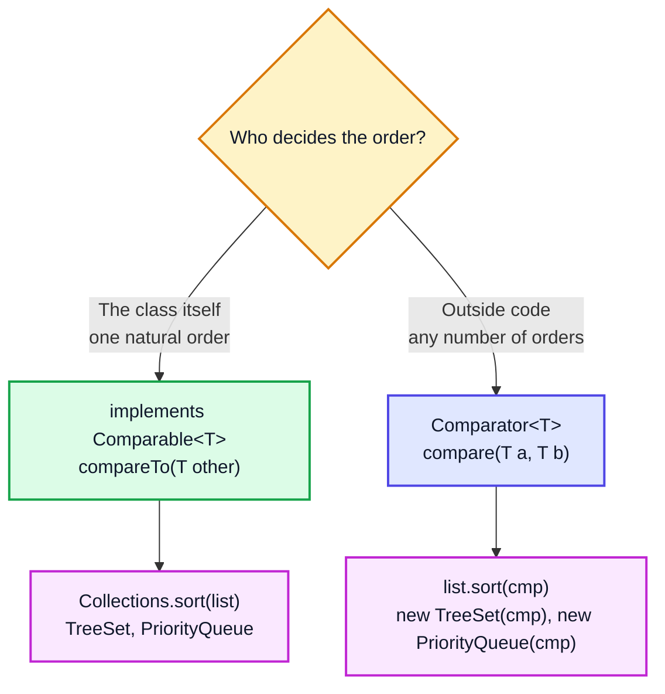
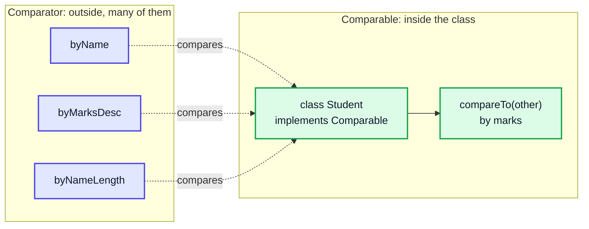
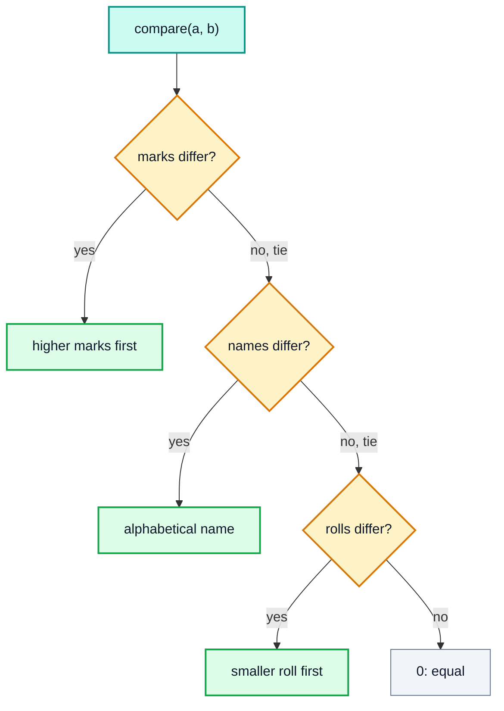

# Comparator & Comparable — Complete In-Depth Guide

**Java gap topic #3 of 12** · Priority 🔴 · from [topics_not_covered.md](../topics_not_covered.md)

Sorting numbers is easy (`Arrays.sort`, covered in videos 17–31). Sorting **objects** — students by marks, intervals by start time, tasks by priority in a `PriorityQueue` — needs you to tell Java *how to compare two objects*. That's what `Comparable` and `Comparator` do. These notes cover both, the modern `Comparator.comparing` API, multi-key sorting, nulls, and the DSA patterns that depend on them.

> [!NOTE]
> This topic isn't in the playlist, so there are no video timestamps. All code targets **Java 21**.

---

## Table of Contents

| # | Topic (anchor link) | Level |
|---|---|---|
| 0 | [Why Objects Need Comparing](#0-why-objects-need-comparing) | Basics |
| 1 | [The compare Contract](#1-the-compare-contract) | Basics |
| 2 | [Comparable: Natural Ordering](#2-comparable-natural-ordering) | Core |
| 3 | [Comparator: Custom Ordering](#3-comparator-custom-ordering) | Core |
| 4 | [Comparable vs Comparator](#4-comparable-vs-comparator) | Core |
| 5 | [Modern Comparator Factory Methods](#5-modern-comparator-factory-methods) | In depth |
| 6 | [Multi-Key Sorting with thenComparing](#6-multi-key-sorting-with-thencomparing) | In depth |
| 7 | [Reversing and Handling Nulls](#7-reversing-and-handling-nulls) | In depth |
| 8 | [Where Comparators Are Used](#8-where-comparators-are-used) | In depth |
| 9 | [Comparators in DSA Problems](#9-comparators-in-dsa-problems) | DSA |
| 10 | [Pitfalls](#10-pitfalls) | Pitfalls |
| 11 | [Common Interview Questions](#11-common-interview-questions) | Interview |

---

## 0. Why Objects Need Comparing

```java
import java.util.*;

public class WhyCompare {
    static class Student {
        String name; int marks;
        Student(String name, int marks) { this.name = name; this.marks = marks; }
    }

    public static void main(String[] args) {
        int[] nums = {5, 2, 9};
        Arrays.sort(nums);                         // fine: ints have an obvious order
        System.out.println(Arrays.toString(nums)); // [2, 5, 9]

        List<Student> list = new ArrayList<>(List.of(new Student("A", 80), new Student("B", 60)));
        try {
            Collections.sort((List) list);         // which comes first? Java has no idea
        } catch (ClassCastException e) {
            System.out.println("ClassCastException: Student cannot be compared");
        }
    }
}
// Output:
// [2, 5, 9]
// ClassCastException: Student cannot be compared
```

Should students be ordered by name? Marks? Roll number? Only you know. You tell Java in one of two ways:



---

## 1. The compare Contract

Both `compareTo(other)` and `compare(a, b)` return an `int` whose **sign** is what matters:

| Return value | Meaning | Sorted result |
|---|---|---|
| **negative** | `a` comes **before** `b` | `a, b` |
| **zero** | `a` and `b` are equal in this order | order kept (stable sorts) |
| **positive** | `a` comes **after** `b` | `b, a` |

> [!TIP]
> Memory trick: think `a - b`. If `a < b` the result is negative, so `a` goes first → ascending. `b - a` gives descending. (But don't actually use subtraction; see Pitfalls.)

### Rules every comparison must follow

| Rule | Meaning | Breaking it causes |
|---|---|---|
| **Antisymmetric** | `sign(compare(a,b)) == -sign(compare(b,a))` | Inconsistent results |
| **Transitive** | `a > b` and `b > c` ⇒ `a > c` | `IllegalArgumentException: Comparison method violates its general contract!` from `TimSort` |
| **Consistent** | Same inputs → same answer every time | Random sort order |
| *Consistent with equals* (recommended) | `compare(a,b) == 0` ⇔ `a.equals(b)` | `TreeSet`/`TreeMap` silently **drop** "equal" elements |

---

## 2. Comparable: Natural Ordering

A class implements `java.lang.Comparable<T>` to define its **natural order**: the one obvious way to sort it. `String`, `Integer`, `LocalDate`, `BigDecimal` and all enums already do.

```java
import java.util.*;

class Student implements Comparable<Student> {
    final String name;
    final int marks;

    Student(String name, int marks) { this.name = name; this.marks = marks; }

    @Override
    public int compareTo(Student other) {
        return Integer.compare(this.marks, other.marks);   // ascending by marks
    }

    @Override
    public String toString() { return name + "(" + marks + ")"; }
}

public class ComparableDemo {
    public static void main(String[] args) {
        List<Student> list = new ArrayList<>(List.of(
                new Student("Kunal", 92), new Student("Rahul", 75), new Student("Priya", 88)));

        Collections.sort(list);                       // uses compareTo
        System.out.println(list);                     // [Rahul(75), Priya(88), Kunal(92)]

        Student[] arr = list.toArray(new Student[0]);
        Arrays.sort(arr, Collections.reverseOrder()); // reverse of the natural order
        System.out.println(Arrays.toString(arr));     // [Kunal(92), Priya(88), Rahul(75)]

        TreeSet<Student> set = new TreeSet<>(list);   // TreeSet uses compareTo too
        System.out.println(set.first());              // Rahul(75)
    }
}
```

### Natural orders of built-in types

| Type | Natural order |
|---|---|
| `Integer`, `Long`, `Double`… | Numeric ascending |
| `String` | Lexicographic by UTF-16 code ("B" < "a", because uppercase letters have smaller codes) |
| `Character` | By char code |
| `Boolean` | `false` < `true` |
| `LocalDate`, `LocalDateTime` | Chronological |
| `enum` | Declaration order (`ordinal()`) |
| `BigDecimal` | Numeric, but `2.0` and `2.00` compare equal while `equals` says they differ |

> [!NOTE]
> `String.compareTo` returns the **difference** of the first mismatching characters (or of the lengths), e.g. `"apple".compareTo("banana")` is `-1` and `"cat".compareTo("car")` is `2`. Only the sign is guaranteed to mean anything; don't depend on the exact number. Use `compareToIgnoreCase` or `String.CASE_INSENSITIVE_ORDER` for case-insensitive order.

---

## 3. Comparator: Custom Ordering

`java.util.Comparator<T>` is a separate object that compares two `T`s. Use it when:
- the class has no natural order, or you can't change it (it's from a library);
- you need **several** orders (by name, by marks, by age…);
- you want an order different from the natural one.

### Four ways to write the same comparator

```java
import java.util.*;

public class ComparatorStyles {
    record Student(String name, int marks) { }

    // 1. Separate class
    static class ByName implements Comparator<Student> {
        public int compare(Student a, Student b) { return a.name().compareTo(b.name()); }
    }

    public static void main(String[] args) {
        List<Student> list = new ArrayList<>(List.of(
                new Student("Kunal", 92), new Student("Rahul", 75), new Student("Priya", 88)));

        // 1. Named class
        list.sort(new ByName());
        System.out.println(list);

        // 2. Anonymous class (pre-Java 8 style)
        list.sort(new Comparator<Student>() {
            @Override
            public int compare(Student a, Student b) { return Integer.compare(b.marks(), a.marks()); }
        });
        System.out.println(list);

        // 3. Lambda
        list.sort((a, b) -> Integer.compare(a.marks(), b.marks()));
        System.out.println(list);

        // 4. Factory method + method reference (modern, preferred)
        list.sort(Comparator.comparing(Student::name).reversed());
        System.out.println(list);
    }
}
// Output:
// [Student[name=Kunal, marks=92], Student[name=Priya, marks=88], Student[name=Rahul, marks=75]]
// [Student[name=Kunal, marks=92], Student[name=Priya, marks=88], Student[name=Rahul, marks=75]]
// [Student[name=Rahul, marks=75], Student[name=Priya, marks=88], Student[name=Kunal, marks=92]]
// [Student[name=Rahul, marks=75], Student[name=Priya, marks=88], Student[name=Kunal, marks=92]]
```

---

## 4. Comparable vs Comparator

| | `Comparable<T>` | `Comparator<T>` |
|---|---|---|
| Package | `java.lang` | `java.util` |
| Method | `int compareTo(T other)` | `int compare(T a, T b)` |
| Where it lives | **Inside** the class | **Outside**, a separate object/lambda |
| How many orders | One (the natural order) | As many as you like |
| Changes the class? | Yes | No |
| Works on library classes? | Only if they already implement it | Always |
| Used by default by | `Collections.sort(list)`, `Arrays.sort(arr)`, `TreeSet`, `TreeMap`, `PriorityQueue` | Overloads that take a comparator |
| Functional interface? | Technically one method, but not meant for lambdas | Yes, `@FunctionalInterface` |



---

## 5. Modern Comparator Factory Methods

Since Java 8, `Comparator` has static and default methods that build comparators from **key extractors**: "compare students by *this* field".

```java
import java.util.*;

public class FactoryMethods {
    record Person(String name, int age, double salary) { }

    public static void main(String[] args) {
        List<Person> people = new ArrayList<>(List.of(
                new Person("zara", 30, 50_000), new Person("Amit", 25, 72_000),
                new Person("bob", 30, 61_000), new Person("Chloe", 22, 45_000)));

        people.sort(Comparator.comparing(Person::name));
        System.out.println(names(people));       // [Amit, Chloe, bob, zara]  (uppercase first!)

        people.sort(Comparator.comparing(Person::name, String.CASE_INSENSITIVE_ORDER));
        System.out.println(names(people));       // [Amit, bob, Chloe, zara]

        people.sort(Comparator.comparingInt(Person::age));
        System.out.println(names(people));       // [Chloe, Amit, bob, zara]  (stable: bob before zara)

        people.sort(Comparator.comparingDouble(Person::salary).reversed());
        System.out.println(names(people));       // [Amit, bob, zara, Chloe]

        people.sort(Comparator.comparing(p -> p.name().length()));
        System.out.println(names(people));       // [bob, Amit, zara, Chloe]

        Person oldest = Collections.max(people, Comparator.comparingInt(Person::age));
        System.out.println(oldest.name());       // bob  (bob and zara are both 30; max keeps the first one it saw)
    }

    static List<String> names(List<Person> ps) { return ps.stream().map(Person::name).toList(); }
}
```

| Method | Builds a comparator that… |
|---|---|
| `Comparator.comparing(keyFn)` | compares `keyFn(a)` vs `keyFn(b)` by their natural order |
| `Comparator.comparing(keyFn, keyCmp)` | compares the keys with `keyCmp` |
| `comparingInt / comparingLong / comparingDouble(keyFn)` | same, without boxing (faster) |
| `Comparator.naturalOrder()` | uses `compareTo` |
| `Comparator.reverseOrder()` / `Collections.reverseOrder()` | reverse natural order |
| `cmp.reversed()` | flips any comparator |
| `cmp.thenComparing(...)` | tie-breaker (Section 6) |
| `Comparator.nullsFirst(cmp)` / `nullsLast(cmp)` | handles `null` (Section 7) |
| `Map.Entry.comparingByKey()` / `comparingByValue()` | for map entries |

> [!NOTE]
> Java's `List.sort` and `Arrays.sort` on objects use **TimSort**, which is **stable**: equal elements keep their previous order. That's why after sorting by age, `bob` stays ahead of `zara`. `Arrays.sort` on primitives uses dual-pivot quicksort, which isn't stable (it doesn't matter for primitives).

---

## 6. Multi-Key Sorting with thenComparing

"Sort by marks descending; if marks are equal, by name ascending; if still equal, by roll number." `thenComparing` adds a tie-breaker that's only used when the previous comparator returns `0`.

```java
import java.util.*;

public class MultiKeySort {
    record Student(String name, int marks, int roll) { }

    public static void main(String[] args) {
        List<Student> list = new ArrayList<>(List.of(
                new Student("Riya", 90, 4), new Student("Aman", 85, 2),
                new Student("Dev", 90, 1), new Student("Aman", 85, 1), new Student("Zoe", 70, 3)));

        Comparator<Student> cmp = Comparator
                .comparingInt(Student::marks).reversed()       // 1st key: marks desc
                .thenComparing(Student::name)                   // 2nd key: name asc
                .thenComparingInt(Student::roll);               // 3rd key: roll asc

        list.sort(cmp);
        list.forEach(s -> System.out.println(s.marks() + " " + s.name() + " " + s.roll()));
    }
}
// Output:
// 90 Dev 1
// 90 Riya 4
// 85 Aman 1
// 85 Aman 2
// 70 Zoe 3
```



### Dry run: comparing `Riya(90,4)` and `Dev(90,1)`

| Step | Key | Riya | Dev | Result |
|---|---|---|---|---|
| 1 | marks (desc) | 90 | 90 | tie → next key |
| 2 | name (asc) | "Riya" | "Dev" | `"Riya".compareTo("Dev") > 0` → **Dev first** |
| 3 | roll | — | — | not needed |

> [!WARNING]
> **`reversed()` reverses everything before it**, not just the last key.
> `comparing(Student::name).thenComparingInt(Student::marks).reversed()` sorts names **descending** *and* marks descending. To reverse only one key, reverse it on its own:
> `comparing(Student::name).thenComparing(Comparator.comparingInt(Student::marks).reversed())`
> or `thenComparing(Student::marks, Comparator.reverseOrder())`.

### The same thing written by hand

```java
Comparator<Student> manual = (a, b) -> {
    if (a.marks() != b.marks()) return Integer.compare(b.marks(), a.marks());  // desc
    int byName = a.name().compareTo(b.name());
    if (byName != 0) return byName;
    return Integer.compare(a.roll(), b.roll());
};
```

Hand-written is fine (and common in contest code), but the chained version is harder to get wrong.

---

## 7. Reversing and Handling Nulls

```java
import java.util.*;

public class ReverseAndNulls {
    public static void main(String[] args) {
        List<Integer> nums = new ArrayList<>(List.of(3, 1, 2));
        nums.sort(Comparator.reverseOrder());
        System.out.println(nums);                                    // [3, 2, 1]

        Integer[] boxed = {3, 1, 2};
        Arrays.sort(boxed, Collections.reverseOrder());              // works on Integer[]
        System.out.println(Arrays.toString(boxed));                  // [3, 2, 1]
        // Arrays.sort(new int[]{3,1,2}, Collections.reverseOrder()); // ❌ won't compile: int[] has no comparator overload

        List<String> withNulls = new ArrayList<>(Arrays.asList("pear", null, "apple", null, "fig"));
        try {
            withNulls.sort(Comparator.naturalOrder());
        } catch (NullPointerException e) {
            System.out.println("NPE: natural order can't compare null");
        }
        withNulls.sort(Comparator.nullsFirst(Comparator.naturalOrder()));
        System.out.println(withNulls);                               // [null, null, apple, fig, pear]
        withNulls.sort(Comparator.nullsLast(Comparator.<String>naturalOrder().reversed()));
        System.out.println(withNulls);                               // [pear, fig, apple, null, null]

        // Null FIELD inside an object
        record City(String name, Integer population) { }
        List<City> cities = new ArrayList<>(List.of(
                new City("A", 500), new City("B", null), new City("C", 100)));
        cities.sort(Comparator.comparing(City::population, Comparator.nullsLast(Comparator.naturalOrder())));
        System.out.println(cities.stream().map(City::name).toList()); // [C, A, B]
    }
}
```

> [!TIP]
> To sort an `int[]` descending: sort ascending then reverse it in place with two pointers, or go through streams: `Arrays.stream(a).boxed().sorted(Comparator.reverseOrder()).mapToInt(i -> i).toArray()` (see [gap topic #2](java_gap_02_streams_api.md)).

---

## 8. Where Comparators Are Used

| API | Without comparator | With comparator |
|---|---|---|
| `Collections.sort(list)` / `list.sort(null)` | natural order | `list.sort(cmp)` |
| `Arrays.sort(T[])` | natural order | `Arrays.sort(arr, cmp)`, also on a range `(arr, from, to, cmp)` |
| `TreeSet<T>` | natural order | `new TreeSet<>(cmp)` |
| `TreeMap<K,V>` | natural order of keys | `new TreeMap<>(cmp)` |
| `PriorityQueue<T>` | **min-heap** by natural order | `new PriorityQueue<>(cmp)` |
| `Collections.max/min` | natural | `max(coll, cmp)` |
| `stream.sorted()` / `max()` / `min()` | natural | `sorted(cmp)` etc. |
| `Collectors.maxBy/minBy` | — | `maxBy(cmp)` |
| `Arrays.binarySearch` / `Collections.binarySearch` | natural | must pass the **same** comparator the data was sorted with |

### `PriorityQueue`: min-heap vs max-heap

[Video 56](../kunal-java-notes-claude/java_56_video_heaps_priority_queue.md) builds a heap by hand. Java's `PriorityQueue` is a **min-heap by default**; a comparator turns it into anything else.

```java
import java.util.*;

public class PQComparators {
    public static void main(String[] args) {
        PriorityQueue<Integer> minHeap = new PriorityQueue<>();
        PriorityQueue<Integer> maxHeap = new PriorityQueue<>(Comparator.reverseOrder());
        for (int x : new int[]{5, 1, 8, 3}) { minHeap.add(x); maxHeap.add(x); }
        System.out.println(minHeap.poll() + " " + maxHeap.poll());       // 1 8

        // Tasks: highest priority first, then earliest deadline
        record Task(String name, int priority, int deadline) { }
        PriorityQueue<Task> tasks = new PriorityQueue<>(
                Comparator.comparingInt(Task::priority).reversed()
                          .thenComparingInt(Task::deadline));
        tasks.add(new Task("email", 1, 5));
        tasks.add(new Task("deploy", 3, 9));
        tasks.add(new Task("bugfix", 3, 2));
        tasks.add(new Task("lunch", 2, 1));
        while (!tasks.isEmpty()) System.out.print(tasks.poll().name() + " ");  // bugfix deploy lunch email
        System.out.println();
    }
}
```

> [!WARNING]
> Printing a `PriorityQueue` or iterating it does **not** give sorted order; only repeated `poll()` does. The internal array is a heap, not a sorted list.

### `TreeSet`/`TreeMap` treat `compare == 0` as a duplicate

```java
import java.util.*;

public class TreeSetGotcha {
    record Student(String name, int marks) { }

    public static void main(String[] args) {
        TreeSet<Student> byMarks = new TreeSet<>(Comparator.comparingInt(Student::marks));
        byMarks.add(new Student("A", 90));
        byMarks.add(new Student("B", 90));   // compare == 0 → treated as duplicate, NOT added
        System.out.println(byMarks.size());  // 1

        TreeSet<Student> fixed = new TreeSet<>(
                Comparator.comparingInt(Student::marks).thenComparing(Student::name));
        fixed.add(new Student("A", 90));
        fixed.add(new Student("B", 90));
        System.out.println(fixed.size());    // 2
    }
}
```

> [!IMPORTANT]
> Sorted sets and maps use **only** the comparator to decide equality; `equals()` is ignored. Always add tie-breakers so that `compare == 0` only when the objects really are the same.

---

## 9. Comparators in DSA Problems

### Sort intervals by start (Merge Intervals, LC 56)

```java
import java.util.*;

public class MergeIntervals {
    static int[][] merge(int[][] intervals) {
        Arrays.sort(intervals, (a, b) -> Integer.compare(a[0], b[0]));   // by start
        List<int[]> out = new ArrayList<>();
        for (int[] cur : intervals) {
            if (out.isEmpty() || out.get(out.size() - 1)[1] < cur[0]) out.add(cur);
            else out.get(out.size() - 1)[1] = Math.max(out.get(out.size() - 1)[1], cur[1]);
        }
        return out.toArray(new int[0][]);
    }

    public static void main(String[] args) {
        int[][] r = merge(new int[][]{{8, 10}, {1, 3}, {2, 6}, {15, 18}});
        System.out.println(Arrays.deepToString(r));   // [[1, 6], [8, 10], [15, 18]]
    }
}
```

**Dry run** after sorting: `[1,3] [2,6] [8,10] [15,18]`

| cur | last in `out` | overlap? (`last.end >= cur.start`) | `out` |
|---|---|---|---|
| [1,3] | — | — | [1,3] |
| [2,6] | [1,3] | 3 ≥ 2 ✅ merge | [1,6] |
| [8,10] | [1,6] | 6 ≥ 8 ❌ | [1,6] [8,10] |
| [15,18] | [8,10] | 10 ≥ 15 ❌ | [1,6] [8,10] [15,18] |

Time **O(n log n)** for the sort, space **O(n)** for the output.

### Largest Number (LC 179): a comparator that isn't about size

Arrange numbers so their concatenation is the largest. The trick: `a` goes before `b` if `a+b > b+a` as strings.

```java
import java.util.*;

public class LargestNumber {
    static String largestNumber(int[] nums) {
        String[] s = Arrays.stream(nums).mapToObj(String::valueOf).toArray(String[]::new);
        Arrays.sort(s, (a, b) -> (b + a).compareTo(a + b));   // descending by "concatenation value"
        if (s[0].equals("0")) return "0";                     // all zeros
        return String.join("", s);
    }

    public static void main(String[] args) {
        System.out.println(largestNumber(new int[]{3, 30, 34, 5, 9}));  // 9534330
        System.out.println(largestNumber(new int[]{0, 0}));             // 0
    }
}
```

| Pair | `a+b` | `b+a` | Who goes first |
|---|---|---|---|
| 3, 30 | "330" | "303" | 3 |
| 34, 3 | "343" | "334" | 34 |
| 9, 5 | "95" | "59" | 9 |

### Top K Frequent Elements (LC 347) with a comparator on a heap

```java
import java.util.*;

public class TopKFrequent {
    static int[] topK(int[] nums, int k) {
        Map<Integer, Integer> freq = new HashMap<>();
        for (int n : nums) freq.merge(n, 1, Integer::sum);
        // min-heap by frequency, size k
        PriorityQueue<Map.Entry<Integer, Integer>> pq =
                new PriorityQueue<>(Map.Entry.comparingByValue());
        for (var e : freq.entrySet()) {
            pq.offer(e);
            if (pq.size() > k) pq.poll();   // drop the least frequent
        }
        int[] res = new int[k];
        for (int i = k - 1; i >= 0; i--) res[i] = pq.poll().getKey();
        return res;
    }

    public static void main(String[] args) {
        System.out.println(Arrays.toString(topK(new int[]{1, 1, 1, 2, 2, 3}, 2)));  // [1, 2]
    }
}
```

Time **O(n log k)**, space **O(n)**. A min-heap of size `k` is the standard Top-K trick: the root is always the weakest of the current best `k`.

### Other problems where the comparator is the whole trick

| Problem | Comparator |
|---|---|
| K Closest Points to Origin (LC 973) | by `x*x + y*y` (max-heap of size k) |
| Sort Characters by Frequency (LC 451) | by count desc |
| Meeting Rooms II (LC 253) | intervals by start; heap of end times |
| Non-overlapping Intervals (LC 435) | by **end** time (greedy) |
| Reorder Data in Log Files (LC 937) | letter-logs by content then id; digit-logs keep order (stable sort) |
| Custom Sort String (LC 791) | by index in the order string |
| Minimum Number of Arrows (LC 452) | by end, using `Integer.compare` (values hit `Integer.MIN_VALUE`) |

---

## 10. Pitfalls

### The subtraction bug

```java
public class SubtractionBug {
    public static void main(String[] args) {
        java.util.Comparator<Integer> bad  = (a, b) -> a - b;               // ❌ overflows
        java.util.Comparator<Integer> good = (a, b) -> Integer.compare(a, b); // ✅

        int a = Integer.MIN_VALUE, b = 1;
        System.out.println(bad.compare(a, b));    // 2147483647 → says MIN_VALUE > 1 !
        System.out.println(good.compare(a, b));   // -1
    }
}
```

`Integer.MIN_VALUE - 1` overflows to `Integer.MAX_VALUE`, so the sign flips and sorting is wrong (LeetCode 452 has test cases built exactly for this). Always use `Integer.compare`, `Long.compare`, `Double.compare`, or `comparingInt`.

### More traps

| Trap | Why it's wrong | Fix |
|---|---|---|
| `(a, b) -> a - b` | Integer overflow | `Integer.compare(a, b)` |
| Comparing `double`s with `<` / `==` | `NaN` and `-0.0` break the rules | `Double.compare` |
| `==` on `Integer` objects inside a comparator | Compares references; fails outside −128..127 | `.equals` or `Integer.compare` |
| Returning only `1` or `-1`, never `0` | Breaks antisymmetry → "violates its general contract" | Return `0` for equal |
| Comparator reads mutable fields | Changing a field after insertion corrupts `TreeSet`/`PriorityQueue` | Don't mutate keys; remove, change, re-add |
| `compareTo` inconsistent with `equals` | Sorted sets drop elements; `HashSet` and `TreeSet` disagree | Add tie-breakers |
| `.reversed()` at the end of a chain | Reverses every key | Reverse the single key |
| Lambda type inference fails: `comparing(p -> p.name()).reversed()` | Java can't infer `p`'s type through `.reversed()` | Use a method reference `Person::name` or `Comparator.<Person, String>comparing(...)` |

---

## 11. Common Interview Questions

| Question | Short answer |
|---|---|
| Comparable vs Comparator? | Natural order inside the class (`compareTo`) vs any number of external orders (`compare`). |
| Which package is each in? | `java.lang.Comparable`, `java.util.Comparator`. |
| What does the return value mean? | Negative = first goes before, 0 = equal, positive = first goes after. |
| How do you sort in descending order? | `Collections.reverseOrder()`, `Comparator.reverseOrder()`, or `cmp.reversed()`. |
| How do you sort by two fields? | `comparing(f1).thenComparing(f2)`. |
| Why not `a - b`? | Overflow with large/negative ints. |
| Is `Collections.sort` stable? | Yes (TimSort), for objects. |
| How do you make a max-heap in Java? | `new PriorityQueue<>(Comparator.reverseOrder())` or `(a, b) -> b - a` (careful with overflow; prefer `Integer.compare(b, a)`). |
| What does "consistent with equals" mean? | `compare(a,b)==0` exactly when `a.equals(b)`; needed for sorted sets/maps to behave like normal sets/maps. |
| Can a comparator handle nulls? | Wrap it: `Comparator.nullsFirst(cmp)` / `nullsLast(cmp)`. |

---

## 🧩 Complete Example: Everything Together

A leaderboard that uses natural ordering, multi-key comparators, a reverse-only-one-key chain, `nullsLast`, a `TreeSet` with tie-breakers, a `PriorityQueue` for top-K, binary search with a comparator, and the overflow-safe comparator.

```java
import java.util.*;

public class ComparatorShowcase {

    // Natural order: by id
    static final class Player implements Comparable<Player> {
        final int id; final String name; final int score; final Integer age; // age may be null

        Player(int id, String name, int score, Integer age) {
            this.id = id; this.name = name; this.score = score; this.age = age;
        }
        int id() { return id; } String name() { return name; } int score() { return score; } Integer age() { return age; }

        @Override public int compareTo(Player o) { return Integer.compare(id, o.id); }
        @Override public String toString() { return name + "#" + id + "(" + score + ")"; }
    }

    public static void main(String[] args) {
        List<Player> players = new ArrayList<>(List.of(
                new Player(4, "Meera", 880, 21), new Player(1, "arjun", 950, null),
                new Player(3, "Bilal", 880, 25), new Player(5, "Chen", 720, 19),
                new Player(2, "Diya", 950, 23)));

        // 1. Natural order (Comparable)
        Collections.sort(players);
        System.out.println("1. By id (natural):       " + players);

        // 2. Leaderboard: score desc, then name case-insensitive asc
        Comparator<Player> leaderboard = Comparator.comparingInt(Player::score).reversed()
                .thenComparing(Player::name, String.CASE_INSENSITIVE_ORDER);
        players.sort(leaderboard);
        System.out.println("2. Leaderboard:           " + players);

        // 3. Reverse only the SECOND key: name asc, then score desc
        players.sort(Comparator.comparing(Player::name, String.CASE_INSENSITIVE_ORDER)
                .thenComparing(Player::score, Comparator.reverseOrder()));
        System.out.println("3. Name asc:              " + players);

        // 4. Nullable field: youngest first, unknown age last
        players.sort(Comparator.comparing(Player::age, Comparator.nullsLast(Comparator.naturalOrder())));
        System.out.println("4. By age, nulls last:    " + players.stream().map(p -> p.name() + "=" + p.age()).toList());

        // 5. TreeSet: without a tie-breaker, equal scores collapse
        TreeSet<Player> byScoreOnly = new TreeSet<>(Comparator.comparingInt(Player::score));
        byScoreOnly.addAll(players);
        TreeSet<Player> byScoreThenId = new TreeSet<>(Comparator.comparingInt(Player::score).thenComparingInt(Player::id));
        byScoreThenId.addAll(players);
        System.out.println("5. TreeSet sizes:         score only = " + byScoreOnly.size()
                + ", score+id = " + byScoreThenId.size());

        // 6. Top 3 with a min-heap of size 3
        PriorityQueue<Player> heap = new PriorityQueue<>(leaderboard.reversed());   // worst on top
        for (Player p : players) {
            heap.offer(p);
            if (heap.size() > 3) heap.poll();
        }
        List<Player> top3 = new ArrayList<>(heap);
        top3.sort(leaderboard);
        System.out.println("6. Top 3:                 " + top3);

        // 7. Binary search must use the same comparator the list was sorted with
        players.sort(leaderboard);
        int idx = Collections.binarySearch(players, new Player(0, "chen", 720, null), leaderboard);
        System.out.println("7. Chen found at index:   " + idx);

        // 8. Overflow-safe vs subtraction comparator
        Integer[] extremes = {5, Integer.MIN_VALUE, Integer.MAX_VALUE, -3};
        Integer[] copy = extremes.clone();
        Arrays.sort(extremes, Integer::compare);
        Arrays.sort(copy, (a, b) -> a - b);
        System.out.println("8. Integer.compare:       " + Arrays.toString(extremes));
        System.out.println("   a - b (broken):        " + Arrays.toString(copy));

        // 9. Largest Number (LC 179) comparator
        String[] parts = {"3", "30", "34", "5", "9"};
        Arrays.sort(parts, (a, b) -> (b + a).compareTo(a + b));
        System.out.println("9. Largest number:        " + String.join("", parts));
    }
}
```

**Expected Output:**
```
1. By id (natural):       [arjun#1(950), Diya#2(950), Bilal#3(880), Meera#4(880), Chen#5(720)]
2. Leaderboard:           [arjun#1(950), Diya#2(950), Bilal#3(880), Meera#4(880), Chen#5(720)]
3. Name asc:              [arjun#1(950), Bilal#3(880), Chen#5(720), Diya#2(950), Meera#4(880)]
4. By age, nulls last:    [Chen=19, Meera=21, Diya=23, Bilal=25, arjun=null]
5. TreeSet sizes:         score only = 3, score+id = 5
6. Top 3:                 [arjun#1(950), Diya#2(950), Bilal#3(880)]
7. Chen found at index:   4
8. Integer.compare:       [-2147483648, -3, 5, 2147483647]
   a - b (broken):        [5, 2147483647, -2147483648, -3]
9. Largest number:        9534330
```

---

## Quick Reference Cheat Sheet

| Concept | One-Line Summary |
|---|---|
| **Return sign** | negative = a first, 0 = equal, positive = b first |
| **`Comparable<T>`** | `compareTo(other)` inside the class; the natural order |
| **`Comparator<T>`** | `compare(a, b)` outside the class; any number of orders |
| **`Comparator.comparing(f)`** | Compare by a key |
| **`comparingInt/Long/Double`** | Key comparators without boxing |
| **`thenComparing`** | Tie-breaker for equal keys |
| **`reversed()`** | Reverses the **whole** chain before it |
| **Reverse one key** | `thenComparing(key, Comparator.reverseOrder())` |
| **`nullsFirst/nullsLast`** | Wrap a comparator to allow nulls |
| **`Collections.reverseOrder()`** | Descending natural order (also for `Integer[]`) |
| **`String.CASE_INSENSITIVE_ORDER`** | Ignore case |
| **Max-heap** | `new PriorityQueue<>(Comparator.reverseOrder())` |
| **Stable sort** | Object sorts (TimSort) keep the order of equal elements |
| **TreeSet/TreeMap** | `compare == 0` means duplicate; add tie-breakers |
| **Never `a - b`** | Overflow; use `Integer.compare` |
| **Binary search** | Must use the same comparator the data was sorted with |
