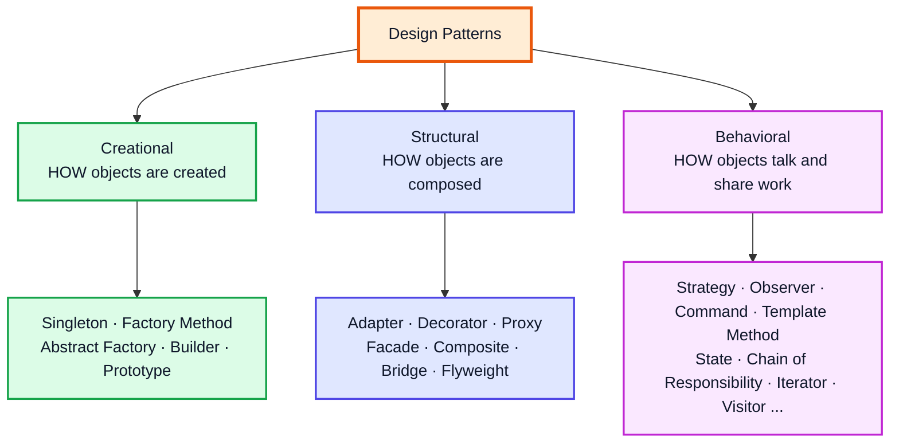
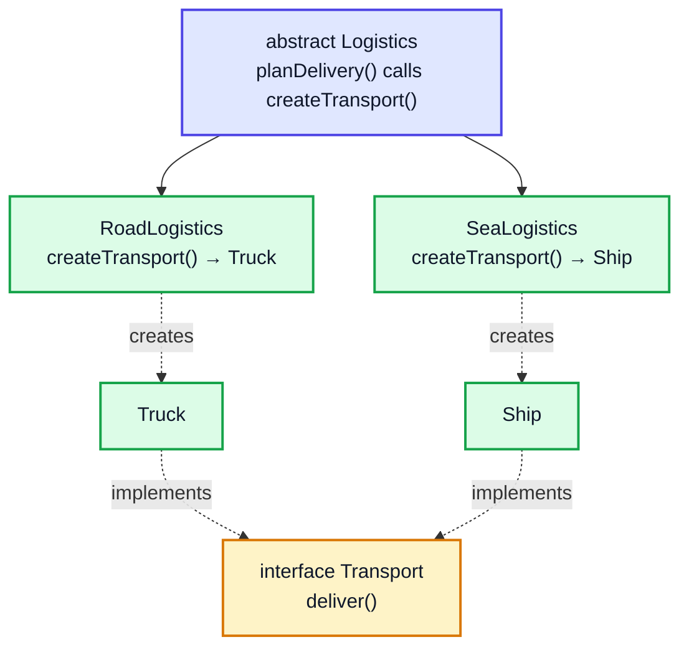
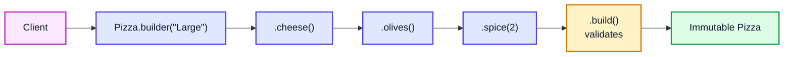
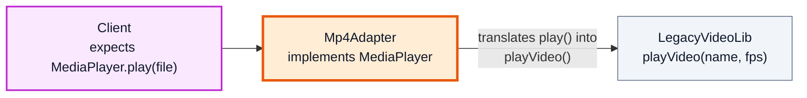
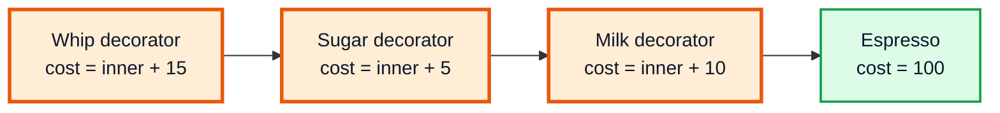
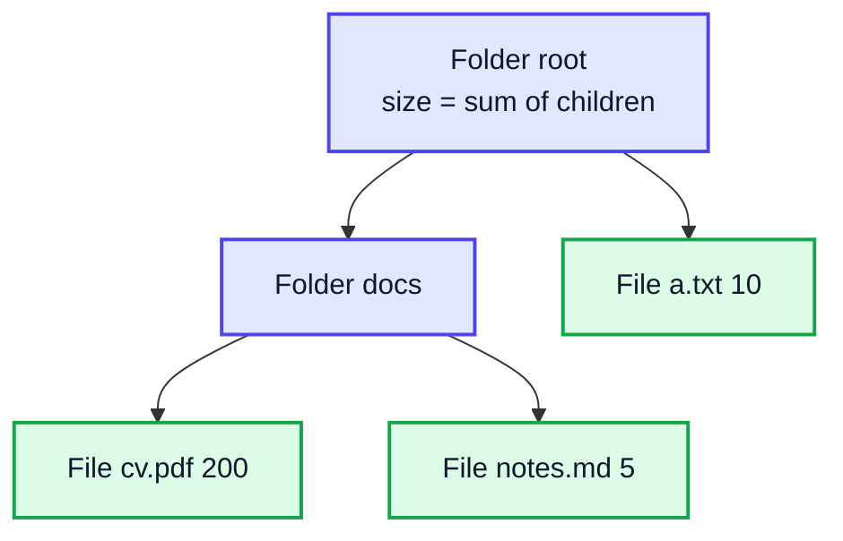
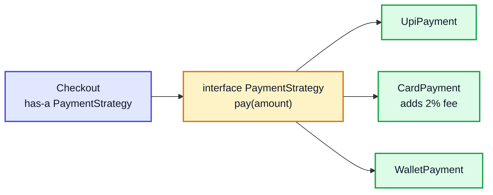
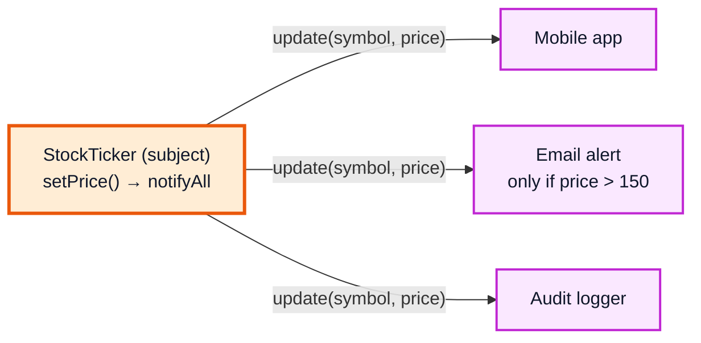
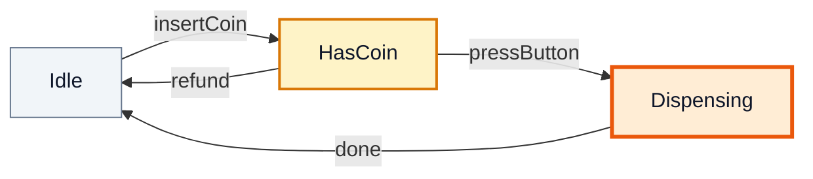

# Design Patterns — Complete In-Depth Guide

**Java gap topic #4 of 12** · Priority 🟡 · from [topics_not_covered.md](../topics_not_covered.md)

A **design pattern** is a proven, named solution to a problem that keeps coming up in object-oriented design. The playlist covers only **Singleton** ([video 38](../kunal-java-notes-claude/java_38_video_oop_static_packages_singleton.md)). These notes cover the patterns interviewers actually ask about, from the classic "Gang of Four" (GoF) book, each with the problem it solves, a diagram, runnable Java 21 code, and where the JDK itself uses it.

> [!NOTE]
> This topic isn't in the playlist, so there are no video timestamps. The OOP ideas used here (interfaces, abstract classes, polymorphism, composition) come from videos 37–41. SOLID principles, which explain *why* these patterns work, are in [gap topic #5](java_gap_05_solid_low_level_design.md).

---

## Table of Contents

| # | Topic (anchor link) | Category |
|---|---|---|
| 0 | [What Design Patterns Are](#0-what-design-patterns-are) | Basics |
| 1 | [Singleton Revisited](#1-singleton-revisited) | Creational |
| 2 | [Factory Method and Simple Factory](#2-factory-method-and-simple-factory) | Creational |
| 3 | [Abstract Factory](#3-abstract-factory) | Creational |
| 4 | [Builder](#4-builder) | Creational |
| 5 | [Prototype](#5-prototype) | Creational |
| 6 | [Adapter](#6-adapter) | Structural |
| 7 | [Decorator](#7-decorator) | Structural |
| 8 | [Proxy](#8-proxy) | Structural |
| 9 | [Facade](#9-facade) | Structural |
| 10 | [Composite](#10-composite) | Structural |
| 11 | [Strategy](#11-strategy) | Behavioral |
| 12 | [Observer](#12-observer) | Behavioral |
| 13 | [Command](#13-command) | Behavioral |
| 14 | [Template Method](#14-template-method) | Behavioral |
| 15 | [State](#15-state) | Behavioral |
| 16 | [Chain of Responsibility](#16-chain-of-responsibility) | Behavioral |
| 17 | [Choosing a Pattern and Interview Questions](#17-choosing-a-pattern-and-interview-questions) | Interview |

---

## 0. What Design Patterns Are

A pattern is **not** code you copy; it's a *shape* of solution with a name. Names matter: saying "use a Strategy here" tells another developer the whole design in three words.

The GoF book (1994) has 23 patterns in three groups:



### Two ideas behind almost every pattern

| Principle | Meaning |
|---|---|
| **Program to an interface, not an implementation** | Depend on `List`, not `ArrayList`; on `PaymentMethod`, not `CreditCard`. Then implementations can be swapped. |
| **Favour composition over inheritance** | Give an object a *has-a* reference to another object that does the varying work, instead of making ever-deeper subclasses. |

> [!WARNING]
> Patterns are tools, not goals. Adding a Factory + Strategy + Observer to a 50-line program makes it worse. Use a pattern when you actually feel the problem it solves.

---

## 1. Singleton Revisited

**Problem:** exactly one instance must exist (a config, a logger, a connection pool), with global access.

[Video 38](../kunal-java-notes-claude/java_38_video_oop_static_packages_singleton.md) shows the lazy version with a `null` check. That version is **not thread-safe**: two threads can both see `null` and create two objects. Safer versions:

```java
// 1. Eager: created when the class loads. Simple and thread-safe.
class EagerConfig {
    private static final EagerConfig INSTANCE = new EagerConfig();
    private EagerConfig() { }
    public static EagerConfig getInstance() { return INSTANCE; }
}

// 2. Holder idiom: lazy AND thread-safe, no locks (the JVM loads Holder only on first use)
class LazyConfig {
    private LazyConfig() { }
    private static class Holder { static final LazyConfig INSTANCE = new LazyConfig(); }
    public static LazyConfig getInstance() { return Holder.INSTANCE; }
}

// 3. Enum: thread-safe, and safe against reflection and serialization attacks
enum Registry {
    INSTANCE;
    private int counter;
    public int next() { return ++counter; }
}

public class SingletonDemo {
    public static void main(String[] args) {
        System.out.println(EagerConfig.getInstance() == EagerConfig.getInstance()); // true
        System.out.println(LazyConfig.getInstance() == LazyConfig.getInstance());   // true
        Registry.INSTANCE.next();
        System.out.println(Registry.INSTANCE.next());                               // 2
    }
}
```

| Version | Lazy? | Thread-safe? | Breaks under reflection/serialization? |
|---|---|---|---|
| Simple `if (instance == null)` (video 38) | ✅ | ❌ | Yes |
| `synchronized getInstance()` | ✅ | ✅ (slow: locks every call) | Yes |
| Double-checked locking + `volatile` | ✅ | ✅ | Yes (see [gap #1](java_gap_01_multithreading_concurrency.md#6-volatile-and-the-java-memory-model)) |
| Eager `static final` | ❌ | ✅ | Yes |
| Holder idiom | ✅ | ✅ | Yes |
| `enum` | ❌ (but cheap) | ✅ | **No** — Joshua Bloch's recommended approach |

> [!CAUTION]
> Singletons are global state in disguise: they make unit testing hard (you can't swap in a fake) and hide dependencies. In modern apps, a dependency-injection framework (Spring) usually creates one shared instance and *passes* it in, which gives you "one instance" without the static access.

**In the JDK:** `Runtime.getRuntime()`, `Desktop.getDesktop()`.

---

## 2. Factory Method and Simple Factory

**Problem:** code that does `new ConcreteClass()` everywhere is tied to those classes. Adding a new type means editing every `if/else` that creates objects.

### Simple Factory (not a GoF pattern, but the most common)

One method decides which class to create.

```java
interface Shape { double area(); }
record Circle(double r) implements Shape { public double area() { return Math.PI * r * r; } }
record Square(double s) implements Shape { public double area() { return s * s; } }

class ShapeFactory {
    static Shape create(String type, double size) {
        return switch (type.toLowerCase()) {
            case "circle" -> new Circle(size);
            case "square" -> new Square(size);
            default -> throw new IllegalArgumentException("Unknown shape: " + type);
        };
    }
}

public class SimpleFactoryDemo {
    public static void main(String[] args) {
        Shape s = ShapeFactory.create("square", 3);
        System.out.println(s + " area=" + s.area());   // Square[s=3.0] area=9.0
    }
}
```

### Factory Method (GoF)

A superclass defines the algorithm but leaves *which object to create* to subclasses via an overridable "factory method".



```java
interface Transport { String deliver(); }
class Truck implements Transport { public String deliver() { return "by road in a box"; } }
class Ship  implements Transport { public String deliver() { return "by sea in a container"; } }

abstract class Logistics {
    abstract Transport createTransport();          // the factory method

    String planDelivery(String item) {             // shared algorithm
        Transport t = createTransport();
        return item + " delivered " + t.deliver();
    }
}
class RoadLogistics extends Logistics { Transport createTransport() { return new Truck(); } }
class SeaLogistics  extends Logistics { Transport createTransport() { return new Ship(); } }

public class FactoryMethodDemo {
    public static void main(String[] args) {
        Logistics[] options = { new RoadLogistics(), new SeaLogistics() };
        for (Logistics l : options) System.out.println(l.planDelivery("Laptop"));
    }
}
// Output:
// Laptop delivered by road in a box
// Laptop delivered by sea in a container
```

**In the JDK:** `List.of(...)`, `Integer.valueOf(...)`, `Calendar.getInstance()`, `NumberFormat.getInstance()`, `Collection.iterator()` (each collection makes its own iterator).

> [!TIP]
> **Static factory methods** (`Integer.valueOf`, `LocalDate.of`, `Optional.empty`) are the everyday version: they have names, can cache instances, and can return a subtype. *Effective Java* item 1: "Consider static factory methods instead of constructors."

---

## 3. Abstract Factory

**Problem:** you need *families* of related objects that must match (a dark-theme button **and** a dark-theme checkbox, never mixed).

```java
interface Button   { String render(); }
interface Checkbox { String render(); }

interface UIFactory {                       // the abstract factory
    Button createButton();
    Checkbox createCheckbox();
}

class LightFactory implements UIFactory {
    public Button createButton()     { return () -> "[ Light Button ]"; }
    public Checkbox createCheckbox() { return () -> "[x] light checkbox"; }
}
class DarkFactory implements UIFactory {
    public Button createButton()     { return () -> "[ Dark Button ]"; }
    public Checkbox createCheckbox() { return () -> "[x] dark checkbox"; }
}

public class AbstractFactoryDemo {
    static void buildScreen(UIFactory f) {            // knows nothing about light/dark
        System.out.println(f.createButton().render() + "  " + f.createCheckbox().render());
    }

    public static void main(String[] args) {
        buildScreen(new LightFactory());
        buildScreen(new DarkFactory());
    }
}
// Output:
// [ Light Button ]  [x] light checkbox
// [ Dark Button ]  [x] dark checkbox
```

| | Factory Method | Abstract Factory |
|---|---|---|
| Creates | One product | A family of related products |
| How | Subclass overrides one method | An object with several create methods |
| Swap by | Choosing a subclass | Passing a different factory object |

**In the JDK:** `DocumentBuilderFactory`, `javax.xml.transform.TransformerFactory`.

---

## 4. Builder

**Problem:** a class with many fields, several optional. Constructors become unreadable: `new Pizza("L", true, false, true, false, 2)` — which `true` is cheese? This is the **telescoping constructor** problem.

```java
public class BuilderDemo {

    static final class Pizza {
        private final String size;          // required
        private final boolean cheese, mushrooms, olives;
        private final int extraShots;

        private Pizza(Builder b) {           // only the builder can construct
            size = b.size; cheese = b.cheese; mushrooms = b.mushrooms;
            olives = b.olives; extraShots = b.extraShots;
        }

        static Builder builder(String size) { return new Builder(size); }

        @Override public String toString() {
            return "Pizza{" + size + (cheese ? ", cheese" : "") + (mushrooms ? ", mushrooms" : "")
                    + (olives ? ", olives" : "") + (extraShots > 0 ? ", spice x" + extraShots : "") + "}";
        }

        static final class Builder {
            private final String size;
            private boolean cheese, mushrooms, olives;
            private int extraShots;

            private Builder(String size) { this.size = size; }
            Builder cheese()            { this.cheese = true; return this; }   // return this → chaining
            Builder mushrooms()         { this.mushrooms = true; return this; }
            Builder olives()            { this.olives = true; return this; }
            Builder spice(int shots)    { this.extraShots = shots; return this; }

            Pizza build() {                                                   // validate here
                if (extraShots > 3) throw new IllegalStateException("Too spicy!");
                return new Pizza(this);
            }
        }
    }

    public static void main(String[] args) {
        Pizza p = Pizza.builder("Large").cheese().olives().spice(2).build();
        System.out.println(p);                                   // Pizza{Large, cheese, olives, spice x2}
        System.out.println(Pizza.builder("Small").build());      // Pizza{Small}

        StringBuilder sb = new StringBuilder().append("Builder").append(" in the ").append("JDK");
        System.out.println(sb);                                  // Builder in the JDK
    }
}
```



| Benefit | How |
|---|---|
| Readable | Each option is named: `.cheese()` |
| Optional fields | Just don't call the method |
| Immutable result | All fields `final`, no setters on `Pizza` |
| Validation in one place | `build()` checks the combination |

**In the JDK:** `StringBuilder`, `Stream.Builder`, `HttpRequest.newBuilder()`, `Locale.Builder`. Lombok's `@Builder` generates this for you.

> [!TIP]
> For a class with only 2–3 fields, a constructor or a `record` is simpler. Builder pays off at about 4+ parameters, especially when several are optional.

---

## 5. Prototype

**Problem:** creating an object is expensive (loading from disk, heavy setup), or you want a copy of an object without knowing its exact class. Solution: **clone an existing instance**.

[Video 42](../kunal-java-notes-claude/java_42_video_generics_lambdas_exceptions_cloning.md) covers `clone()` and shallow vs deep copies. Prototype just puts it to use — usually with a copy constructor or a `copy()` method, because `Cloneable` is awkward.

```java
import java.util.*;

public class PrototypeDemo {
    static class Document {
        final String template;
        final List<String> sections;

        Document(String template, List<String> sections) {
            this.template = template;
            this.sections = sections;
        }

        Document copy() {                                   // deep copy of the mutable list
            return new Document(template, new ArrayList<>(sections));
        }
    }

    public static void main(String[] args) {
        Document base = new Document("Invoice", new ArrayList<>(List.of("Header", "Items", "Footer")));
        Document d1 = base.copy();
        d1.sections.add("Notes");

        System.out.println(base.sections);   // [Header, Items, Footer]   (unchanged)
        System.out.println(d1.sections);     // [Header, Items, Footer, Notes]
    }
}
```

> [!WARNING]
> A shallow copy shares mutable fields (the list), so changing the copy changes the original. Prototype nearly always needs a **deep** copy of mutable state.

---

## 6. Adapter

**Problem:** you have a class with the right behaviour but the wrong interface (like a 3-pin plug and a 2-pin socket). Wrap it in an adapter that translates calls.



```java
interface MediaPlayer { String play(String file); }

class Mp3Player implements MediaPlayer {
    public String play(String file) { return "Playing audio " + file; }
}

// Third-party class we can't change, with a different method signature
class LegacyVideoLib {
    String playVideo(String name, int fps) { return "Rendering " + name + " at " + fps + "fps"; }
}

class Mp4Adapter implements MediaPlayer {               // object adapter: has-a LegacyVideoLib
    private final LegacyVideoLib lib = new LegacyVideoLib();
    public String play(String file) { return lib.playVideo(file, 30); }
}

public class AdapterDemo {
    public static void main(String[] args) {
        MediaPlayer[] players = { new Mp3Player(), new Mp4Adapter() };
        System.out.println(players[0].play("song.mp3"));   // Playing audio song.mp3
        System.out.println(players[1].play("movie.mp4"));  // Rendering movie.mp4 at 30fps
    }
}
```

**In the JDK:** `Arrays.asList(array)` (array → `List`), `InputStreamReader` (byte stream → character `Reader`), `Collections.list(enumeration)`.

---

## 7. Decorator

**Problem:** add responsibilities to an object at runtime, in any combination, without a subclass for every combination (`MilkSugarWhipCoffee`…). A decorator **implements the same interface** and **wraps** another instance, adding behaviour before/after delegating.



```java
interface Coffee { int cost(); String desc(); }

class Espresso implements Coffee {
    public int cost() { return 100; }
    public String desc() { return "Espresso"; }
}

abstract class CoffeeDecorator implements Coffee {     // IS-A Coffee and HAS-A Coffee
    protected final Coffee inner;
    CoffeeDecorator(Coffee inner) { this.inner = inner; }
}

class Milk extends CoffeeDecorator {
    Milk(Coffee c) { super(c); }
    public int cost() { return inner.cost() + 10; }
    public String desc() { return inner.desc() + " + milk"; }
}
class Sugar extends CoffeeDecorator {
    Sugar(Coffee c) { super(c); }
    public int cost() { return inner.cost() + 5; }
    public String desc() { return inner.desc() + " + sugar"; }
}

public class DecoratorDemo {
    public static void main(String[] args) {
        Coffee c = new Sugar(new Milk(new Milk(new Espresso())));
        System.out.println(c.desc() + " = " + c.cost());  // Espresso + milk + milk + sugar = 125
    }
}
```

**In the JDK:** the whole `java.io` stream stack — `new BufferedReader(new InputStreamReader(new FileInputStream(f)))` from [video 54](../kunal-java-notes-claude/java_54_video_file_handling.md) is decorators wrapping decorators. Also `Collections.unmodifiableList(list)` and `Collections.synchronizedList(list)`.

> [!NOTE]
> **Decorator vs inheritance:** inheritance fixes behaviour at compile time and multiplies classes (2ⁿ combinations for n add-ons). Decorators combine at runtime with n classes.

---

## 8. Proxy

**Problem:** control access to an object: create it lazily (virtual proxy), check permissions (protection proxy), cache results (caching proxy), or log calls. A proxy has the **same interface** as the real object; the client can't tell the difference.

```java
import java.util.*;

interface ImageService { String load(String name); }

class RealImageService implements ImageService {
    public String load(String name) {
        System.out.println("  (slow disk read for " + name + ")");
        return "<pixels of " + name + ">";
    }
}

class CachingProxy implements ImageService {
    private final ImageService real;
    private final Map<String, String> cache = new HashMap<>();
    CachingProxy(ImageService real) { this.real = real; }

    public String load(String name) {
        return cache.computeIfAbsent(name, real::load);  // only hits the real service once
    }
}

public class ProxyDemo {
    public static void main(String[] args) {
        ImageService svc = new CachingProxy(new RealImageService());
        System.out.println(svc.load("cat.png"));
        System.out.println(svc.load("cat.png"));
    }
}
// Output:
//   (slow disk read for cat.png)
// <pixels of cat.png>
// <pixels of cat.png>
```

| | Decorator | Proxy |
|---|---|---|
| Intent | **Add** behaviour | **Control access** to the same behaviour |
| Who creates the wrapped object | Usually the client, and wrappers stack freely | Often the proxy itself (lazy creation) |
| Example | `BufferedReader` | Spring `@Transactional`, Hibernate lazy loading, `java.lang.reflect.Proxy` |

---

## 9. Facade

**Problem:** a subsystem has many classes that must be called in the right order. Give clients one simple front door.

```java
class Inventory { boolean reserve(String item) { System.out.println("  inventory: reserved " + item); return true; } }
class Payment   { boolean charge(int amount)   { System.out.println("  payment: charged " + amount); return true; } }
class Shipping  { String ship(String item)     { System.out.println("  shipping: label created"); return "TRK-42"; } }
class Notifier  { void email(String msg)       { System.out.println("  email: " + msg); } }

class OrderFacade {                                  // one simple method hides four subsystems
    private final Inventory inv = new Inventory();
    private final Payment pay = new Payment();
    private final Shipping ship = new Shipping();
    private final Notifier note = new Notifier();

    String placeOrder(String item, int amount) {
        if (!inv.reserve(item) || !pay.charge(amount)) return "FAILED";
        String tracking = ship.ship(item);
        note.email("Your " + item + " is on its way: " + tracking);
        return tracking;
    }
}

public class FacadeDemo {
    public static void main(String[] args) {
        System.out.println("Tracking: " + new OrderFacade().placeOrder("headphones", 1999));
    }
}
// Output:
//   inventory: reserved headphones
//   payment: charged 1999
//   shipping: label created
//   email: Your headphones is on its way: TRK-42
// Tracking: TRK-42
```

**In the JDK/libraries:** `javax.faces.context.FacesContext`, SLF4J (`LoggerFactory.getLogger`) in front of many logging back-ends. Facade doesn't stop you from using the subsystem directly; it just makes the common path easy.

---

## 10. Composite

**Problem:** treat single objects and groups of objects the same way, in a tree (files and folders, UI widgets inside panels, an org chart).



```java
import java.util.*;

interface FileNode { int size(); void print(String indent); }

record FileLeaf(String name, int size) implements FileNode {
    public void print(String indent) { System.out.println(indent + name + " (" + size + ")"); }
}

class Folder implements FileNode {
    private final String name;
    private final List<FileNode> children = new ArrayList<>();
    Folder(String name) { this.name = name; }
    Folder add(FileNode n) { children.add(n); return this; }

    public int size() { return children.stream().mapToInt(FileNode::size).sum(); }   // recursion
    public void print(String indent) {
        System.out.println(indent + name + "/ (" + size() + ")");
        for (FileNode c : children) c.print(indent + "  ");
    }
}

public class CompositeDemo {
    public static void main(String[] args) {
        Folder root = new Folder("root")
                .add(new Folder("docs").add(new FileLeaf("cv.pdf", 200)).add(new FileLeaf("notes.md", 5)))
                .add(new FileLeaf("a.txt", 10));
        root.print("");
    }
}
// Output:
// root/ (215)
//   docs/ (205)
//     cv.pdf (200)
//     notes.md (5)
//   a.txt (10)
```

This is the same recursive tree idea as [video 49](../kunal-java-notes-claude/java_49_video_binary_trees_bst.md), just with any number of children and a shared interface.

---

## 11. Strategy

**Problem:** you have several interchangeable algorithms (ways to pay, ways to sort, ways to compute a discount) and a growing `if/else` choosing between them. Put each algorithm behind an interface and **inject** the one you want.



```java
import java.util.*;

interface PaymentStrategy { String pay(int amount); }

class UpiPayment implements PaymentStrategy {
    public String pay(int amount) { return "Paid " + amount + " via UPI"; }
}
class CardPayment implements PaymentStrategy {
    public String pay(int amount) { return "Paid " + (amount + amount * 2 / 100) + " via card (2% fee)"; }
}

class Checkout {
    private PaymentStrategy strategy;
    Checkout(PaymentStrategy s) { this.strategy = s; }
    void setStrategy(PaymentStrategy s) { this.strategy = s; }      // swap at runtime
    String complete(int amount) { return strategy.pay(amount); }
}

public class StrategyDemo {
    public static void main(String[] args) {
        Checkout c = new Checkout(new UpiPayment());
        System.out.println(c.complete(500));                         // Paid 500 via UPI
        c.setStrategy(new CardPayment());
        System.out.println(c.complete(500));                         // Paid 510 via card (2% fee)
        c.setStrategy(amount -> "Paid " + amount + " via wallet");   // a lambda is a strategy too
        System.out.println(c.complete(500));                         // Paid 500 via wallet

        // Comparator is the JDK's most famous Strategy
        List<String> names = new ArrayList<>(List.of("bob", "Alexandra", "Eve"));
        names.sort(Comparator.comparing(String::length));            // inject the "by length" strategy
        System.out.println(names);                                   // [bob, Eve, Alexandra]
    }
}
```

> [!TIP]
> Since Java 8, a single-method strategy interface is a **functional interface**, so a lambda can be a strategy. Many "Strategy classes" collapse into `Function`, `Predicate` or `Comparator` ([gap topic #6](java_gap_06_functional_interfaces_optional.md)).

**In the JDK:** `Comparator` passed to `sort` ([gap topic #3](java_gap_03_comparator_comparable.md)), `ThreadPoolExecutor`'s `RejectedExecutionHandler`.

---

## 12. Observer

**Problem:** when one object (the **subject**) changes, many others (the **observers**) must react, but the subject shouldn't know their concrete classes. Also called publish–subscribe.



```java
import java.util.*;

interface PriceListener { void onPrice(String symbol, double price); }

class StockTicker {
    private final List<PriceListener> listeners = new ArrayList<>();
    void subscribe(PriceListener l)   { listeners.add(l); }
    void unsubscribe(PriceListener l) { listeners.remove(l); }

    void setPrice(String symbol, double price) {
        for (PriceListener l : listeners) l.onPrice(symbol, price);   // push to all
    }
}

public class ObserverDemo {
    public static void main(String[] args) {
        StockTicker ticker = new StockTicker();
        PriceListener app = (s, p) -> System.out.println("App: " + s + " is now " + p);
        PriceListener alert = (s, p) -> { if (p > 150) System.out.println("ALERT: " + s + " is above 150 at " + p); };

        ticker.subscribe(app);
        ticker.subscribe(alert);
        ticker.setPrice("ACME", 120);
        ticker.setPrice("ACME", 155);
        ticker.unsubscribe(app);
        ticker.setPrice("ACME", 160);
    }
}
// Output:
// App: ACME is now 120.0
// App: ACME is now 155.0
// ALERT: ACME is above 150 at 155.0
// ALERT: ACME is above 150 at 160.0
```

After `unsubscribe(app)`, only the alert listener hears the 160 update.

> [!WARNING]
> **Lapsed listener leak:** if observers subscribe and never unsubscribe, the subject's list keeps them alive forever (they can never be garbage collected). Always unsubscribe when an observer is done. Also, an observer that throws an exception stops the others from being notified unless you catch it in the loop.

**In the JDK/libraries:** Swing/JavaFX event listeners (`addActionListener`), `PropertyChangeListener`, `java.util.concurrent.Flow` (reactive streams), Spring application events. (`java.util.Observable` is deprecated since Java 9.)

---

## 13. Command

**Problem:** turn a request into an **object**, so you can queue it, log it, retry it, or **undo** it.

```java
import java.util.*;

interface Command { void execute(); void undo(); }

class TextEditor {
    final StringBuilder text = new StringBuilder();
}

class AppendCommand implements Command {
    private final TextEditor ed; private final String s;
    AppendCommand(TextEditor ed, String s) { this.ed = ed; this.s = s; }
    public void execute() { ed.text.append(s); }
    public void undo()    { ed.text.setLength(ed.text.length() - s.length()); }
}

class CommandManager {                                   // the "invoker"
    private final Deque<Command> history = new ArrayDeque<>();
    void run(Command c) { c.execute(); history.push(c); }
    void undo()         { if (!history.isEmpty()) history.pop().undo(); }
}

public class CommandDemo {
    public static void main(String[] args) {
        TextEditor ed = new TextEditor();
        CommandManager mgr = new CommandManager();
        mgr.run(new AppendCommand(ed, "Hello"));
        mgr.run(new AppendCommand(ed, ", world"));
        System.out.println(ed.text);   // Hello, world
        mgr.undo();
        System.out.println(ed.text);   // Hello
        mgr.undo();
        System.out.println("[" + ed.text + "]");   // []
    }
}
```

The undo history is a **stack** — the same LIFO structure from [video 46](../kunal-java-notes-claude/java_46_video_stacks_queues.md).

**In the JDK:** every `Runnable`/`Callable` handed to an `ExecutorService` is a command object ([gap topic #1](java_gap_01_multithreading_concurrency.md)).

---

## 14. Template Method

**Problem:** several classes run the same algorithm with a few steps that differ. Put the fixed skeleton in an abstract class (`final` method), and let subclasses fill in the varying steps.

```java
abstract class DataExporter {
    // The template method: final, so subclasses can't change the order
    public final String export(java.util.List<String> rows) {
        StringBuilder sb = new StringBuilder();
        sb.append(header());
        for (String r : rows) sb.append(formatRow(r));
        sb.append(footer());
        return sb.toString();
    }
    protected abstract String header();
    protected abstract String formatRow(String row);
    protected String footer() { return ""; }            // a "hook" with a default
}

class CsvExporter extends DataExporter {
    protected String header() { return "name\n"; }
    protected String formatRow(String r) { return r + "\n"; }
}
class HtmlExporter extends DataExporter {
    protected String header() { return "<ul>"; }
    protected String formatRow(String r) { return "<li>" + r + "</li>"; }
    protected String footer() { return "</ul>"; }
}

public class TemplateMethodDemo {
    public static void main(String[] args) {
        var rows = java.util.List.of("Asha", "Ben");
        System.out.print(new CsvExporter().export(rows));
        System.out.println(new HtmlExporter().export(rows));
    }
}
// Output:
// name
// Asha
// Ben
// <ul><li>Asha</li><li>Ben</li></ul>
```

| | Template Method | Strategy |
|---|---|---|
| Varies by | **Inheritance** (override steps) | **Composition** (inject an object) |
| Granularity | Some steps of an algorithm | The whole algorithm |
| Change at runtime? | No | Yes |

**In the JDK:** `AbstractList` (implement `get` and `size`, get everything else), `InputStream.read(byte[])` built on `read()`, `HttpServlet.service()` calling `doGet`/`doPost`.

---

## 15. State

**Problem:** an object behaves differently depending on its state, and every method has a `switch (state)` that keeps growing. Move each state's behaviour into its own class.



```java
public class StateDemo {
    sealed interface State permits Idle, HasCoin { State insertCoin(); State press(); }

    record Idle() implements State {
        public State insertCoin() { System.out.println("Coin accepted"); return new HasCoin(); }
        public State press()      { System.out.println("Insert a coin first"); return this; }
    }
    record HasCoin() implements State {
        public State insertCoin() { System.out.println("Already have a coin"); return this; }
        public State press()      { System.out.println("Dispensing a drink"); return new Idle(); }
    }

    static class VendingMachine {
        private State state = new Idle();
        void insertCoin() { state = state.insertCoin(); }
        void press()      { state = state.press(); }
        String state()    { return state.getClass().getSimpleName(); }
    }

    public static void main(String[] args) {
        VendingMachine vm = new VendingMachine();
        vm.press();
        vm.insertCoin();
        vm.insertCoin();
        vm.press();
        System.out.println("Final state: " + vm.state());
    }
}
// Output:
// Insert a coin first
// Coin accepted
// Already have a coin
// Dispensing a drink
// Final state: Idle
```

> [!NOTE]
> The code uses a `sealed` interface and `record`s (Java 17), covered in [gap topic #7](java_gap_07_modern_java_features.md). For a few simple states, an `enum` with abstract methods per constant is another clean way to write State.

---

## 16. Chain of Responsibility

**Problem:** a request should be handled by one of several handlers, tried in order, and the sender shouldn't know which one handles it (support tiers, middleware, validation steps).

```java
abstract class Handler {
    private Handler next;
    Handler linkWith(Handler next) { this.next = next; return next; }

    String handle(int amount) {
        if (next == null) return "Rejected: nobody can approve " + amount;
        return next.handle(amount);
    }
}

class TeamLead extends Handler {
    String handle(int amount) { return amount <= 1_000 ? "Team lead approved " + amount : super.handle(amount); }
}
class Manager extends Handler {
    String handle(int amount) { return amount <= 10_000 ? "Manager approved " + amount : super.handle(amount); }
}
class Director extends Handler {
    String handle(int amount) { return amount <= 100_000 ? "Director approved " + amount : super.handle(amount); }
}

public class ChainDemo {
    public static void main(String[] args) {
        Handler chain = new TeamLead();
        chain.linkWith(new Manager()).linkWith(new Director());
        for (int amt : new int[]{500, 7_000, 50_000, 500_000}) System.out.println(chain.handle(amt));
    }
}
// Output:
// Team lead approved 500
// Manager approved 7000
// Director approved 50000
// Rejected: nobody can approve 500000
```

**In the JDK/libraries:** servlet `Filter` chains, Spring Security's filter chain, `java.util.logging.Logger` passing records to parent loggers, exception handling (a `catch` up the call stack).

---

## 17. Choosing a Pattern and Interview Questions

### "I have this problem…" → pattern

| Problem | Pattern |
|---|---|
| Exactly one instance | Singleton (prefer `enum` or dependency injection) |
| Hide which concrete class gets created | Factory Method / Simple Factory |
| Families of matching objects | Abstract Factory |
| Many optional constructor parameters | Builder |
| Copy an existing configured object | Prototype |
| Incompatible interface | Adapter |
| Add features in any combination at runtime | Decorator |
| Lazy loading, caching, access control | Proxy |
| Simplify a complicated subsystem | Facade |
| Part-whole trees | Composite |
| Swap algorithms | Strategy |
| Notify many objects of a change | Observer |
| Undo/redo, queues of operations | Command |
| Same algorithm, different steps | Template Method |
| Behaviour depends on state | State |
| Pass a request along until someone handles it | Chain of Responsibility |

### Interview Q&A

| Question | Short answer |
|---|---|
| What is a design pattern? | A named, reusable solution to a common design problem; a template, not code. |
| Three categories? | Creational, structural, behavioral. |
| How do you make a thread-safe Singleton? | `enum`, holder idiom, eager static final, or double-checked locking with `volatile`. |
| Factory vs Abstract Factory? | One product via an overridable method vs a family of products via a factory object. |
| Builder vs constructor? | Builder for many/optional params, readability and validation; constructor for a few required ones. |
| Decorator vs Proxy? | Decorator adds behaviour and stacks; proxy controls access to the same behaviour. |
| Adapter vs Facade? | Adapter converts one interface to another; facade gives a new, simpler interface over many classes. |
| Strategy vs State? | Strategy: the client picks the algorithm. State: the object changes its own behaviour as its state changes. |
| Strategy vs Template Method? | Composition (swap objects) vs inheritance (override steps). |
| Where is Decorator in the JDK? | `java.io` streams: `BufferedReader(new FileReader(...))`. |
| Where is Observer used? | GUI listeners, event buses, reactive streams. |
| Why prefer composition over inheritance? | Behaviour can change at runtime, fewer classes, no fragile base class problems. |

---

## 🧩 Complete Example: Everything Together

A tiny food-ordering system that uses seven patterns at once: **Singleton** (enum config), **Builder** (order), **Factory** (payment), **Strategy** (pricing), **Decorator** (add-ons), **Observer** (status updates) and **Command** (undoable cart actions).

```java
import java.util.*;

public class DesignPatternsShowcase {

    // ---------- Singleton (enum) ----------
    enum AppConfig {
        INSTANCE;
        final int deliveryFee = 40;
        final String currency = "INR";
    }

    // ---------- Decorator ----------
    interface Dish { String name(); int price(); }
    record BaseDish(String name, int price) implements Dish { }
    record ExtraCheese(Dish inner) implements Dish {
        public String name() { return inner.name() + " + cheese"; }
        public int price() { return inner.price() + 30; }
    }
    record ExtraSpicy(Dish inner) implements Dish {
        public String name() { return inner.name() + " + spicy"; }
        public int price() { return inner.price() + 10; }
    }

    // ---------- Strategy ----------
    interface PricingStrategy { int apply(int subtotal); }
    static final PricingStrategy NORMAL = s -> s;
    static final PricingStrategy FESTIVE = s -> s - s / 5;          // 20% off
    static final PricingStrategy FLAT_100 = s -> Math.max(0, s - 100);

    // ---------- Factory ----------
    interface Payment { String pay(int amount); }
    static Payment paymentFor(String type) {
        return switch (type) {
            case "upi" -> amt -> "UPI payment of " + amt + " done";
            case "card" -> amt -> "Card charged " + (amt + amt / 50) + " (2% fee)";
            case "cod" -> amt -> "Collect " + amt + " cash on delivery";
            default -> throw new IllegalArgumentException("Unknown payment: " + type);
        };
    }

    // ---------- Observer ----------
    interface StatusListener { void onStatus(String orderId, String status); }

    // ---------- Builder ----------
    static final class Order {
        final String id, customer, address;
        final List<Dish> dishes;
        final PricingStrategy pricing;
        private final List<StatusListener> listeners = new ArrayList<>();

        private Order(Builder b) {
            id = b.id; customer = b.customer; address = b.address;
            dishes = List.copyOf(b.dishes); pricing = b.pricing;
        }

        int subtotal() { return dishes.stream().mapToInt(Dish::price).sum(); }
        int total()    { return pricing.apply(subtotal()) + AppConfig.INSTANCE.deliveryFee; }

        void subscribe(StatusListener l) { listeners.add(l); }
        void updateStatus(String status) { listeners.forEach(l -> l.onStatus(id, status)); }

        static Builder builder(String id) { return new Builder(id); }

        static final class Builder {
            private final String id;
            private String customer = "guest", address;
            private final List<Dish> dishes = new ArrayList<>();
            private PricingStrategy pricing = NORMAL;

            private Builder(String id) { this.id = id; }
            Builder customer(String c) { customer = c; return this; }
            Builder address(String a)  { address = a; return this; }
            Builder dish(Dish d)       { dishes.add(d); return this; }
            Builder pricing(PricingStrategy p) { pricing = p; return this; }
            Order build() {
                if (address == null) throw new IllegalStateException("address is required");
                if (dishes.isEmpty()) throw new IllegalStateException("order is empty");
                return new Order(this);
            }
        }
    }

    // ---------- Command ----------
    interface CartCommand { void execute(); void undo(); }
    record AddDish(List<Dish> cart, Dish dish) implements CartCommand {
        public void execute() { cart.add(dish); }
        public void undo()    { cart.remove(cart.size() - 1); }
    }

    public static void main(String[] args) {
        // Command: build a cart with undo
        List<Dish> cart = new ArrayList<>();
        Deque<CartCommand> history = new ArrayDeque<>();
        CartCommand[] actions = {
                new AddDish(cart, new ExtraCheese(new BaseDish("Margherita", 250))),
                new AddDish(cart, new ExtraSpicy(new ExtraCheese(new BaseDish("Paneer Wrap", 180)))),
                new AddDish(cart, new BaseDish("Cola", 60))
        };
        for (CartCommand c : actions) { c.execute(); history.push(c); }
        history.pop().undo();                                   // changed our mind about the cola
        System.out.println("Cart after undo: " + cart.stream().map(Dish::name).toList());

        // Builder + Strategy
        Order.Builder b = Order.builder("ORD-7").customer("Asha").address("12 MG Road").pricing(FESTIVE);
        cart.forEach(b::dish);
        Order order = b.build();
        System.out.println("Subtotal: " + order.subtotal() + " " + AppConfig.INSTANCE.currency);
        System.out.println("Total with festive pricing + delivery: " + order.total());

        // Strategy comparison
        for (var entry : List.of(Map.entry("normal", NORMAL), Map.entry("festive", FESTIVE), Map.entry("flat100", FLAT_100))) {
            System.out.println("  " + entry.getKey() + " -> " + (entry.getValue().apply(order.subtotal()) + AppConfig.INSTANCE.deliveryFee));
        }

        // Builder validation
        try {
            Order.builder("ORD-8").dish(new BaseDish("Tea", 20)).build();
        } catch (IllegalStateException e) {
            System.out.println("Builder rejected order: " + e.getMessage());
        }

        // Factory
        System.out.println(paymentFor("card").pay(order.total()));

        // Observer
        order.subscribe((id, s) -> System.out.println("[App]   " + id + " -> " + s));
        order.subscribe((id, s) -> { if (s.equals("DELIVERED")) System.out.println("[Email] Rate your order " + id + "!"); });
        for (String s : List.of("CONFIRMED", "OUT_FOR_DELIVERY", "DELIVERED")) order.updateStatus(s);

        // Singleton identity
        System.out.println("Same config instance: " + (AppConfig.valueOf("INSTANCE") == AppConfig.INSTANCE));
    }
}
```

**Expected Output:**
```
Cart after undo: [Margherita + cheese, Paneer Wrap + cheese + spicy]
Subtotal: 500 INR
Total with festive pricing + delivery: 440
  normal -> 540
  festive -> 440
  flat100 -> 440
Builder rejected order: address is required
Card charged 448 (2% fee)
[App]   ORD-7 -> CONFIRMED
[App]   ORD-7 -> OUT_FOR_DELIVERY
[App]   ORD-7 -> DELIVERED
[Email] Rate your order ORD-7!
Same config instance: true
```

---

## Quick Reference Cheat Sheet

| Pattern | Category | One-Line Summary | JDK example |
|---|---|---|---|
| **Singleton** | Creational | One instance, global access; use `enum` | `Runtime.getRuntime()` |
| **Factory Method** | Creational | Subclasses decide which class to create | `Collection.iterator()` |
| **Static factory** | Creational | Named method instead of constructor | `List.of`, `Integer.valueOf` |
| **Abstract Factory** | Creational | Create families of matching objects | `DocumentBuilderFactory` |
| **Builder** | Creational | Step-by-step construction, readable, validated | `StringBuilder`, `HttpRequest.newBuilder()` |
| **Prototype** | Creational | Copy an existing object (deep copy) | `clone()`, copy constructors |
| **Adapter** | Structural | Convert one interface into another | `Arrays.asList`, `InputStreamReader` |
| **Decorator** | Structural | Wrap to add behaviour, stackable | `BufferedReader`, `Collections.unmodifiableList` |
| **Proxy** | Structural | Same interface, controls access | `java.lang.reflect.Proxy` |
| **Facade** | Structural | One simple entry point to a subsystem | SLF4J `LoggerFactory` |
| **Composite** | Structural | Treat leaves and groups the same (trees) | AWT `Container` |
| **Strategy** | Behavioral | Swap algorithms via an interface or lambda | `Comparator` |
| **Observer** | Behavioral | Subscribers notified on change | Event listeners, `Flow` |
| **Command** | Behavioral | A request as an object: queue, log, undo | `Runnable` |
| **Template Method** | Behavioral | Fixed skeleton, subclasses fill steps | `AbstractList` |
| **State** | Behavioral | One class per state, object switches state | — |
| **Chain of Responsibility** | Behavioral | Pass request along handlers | Servlet filters |
