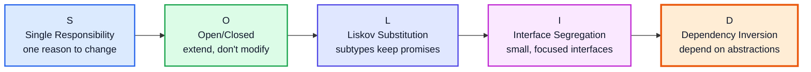
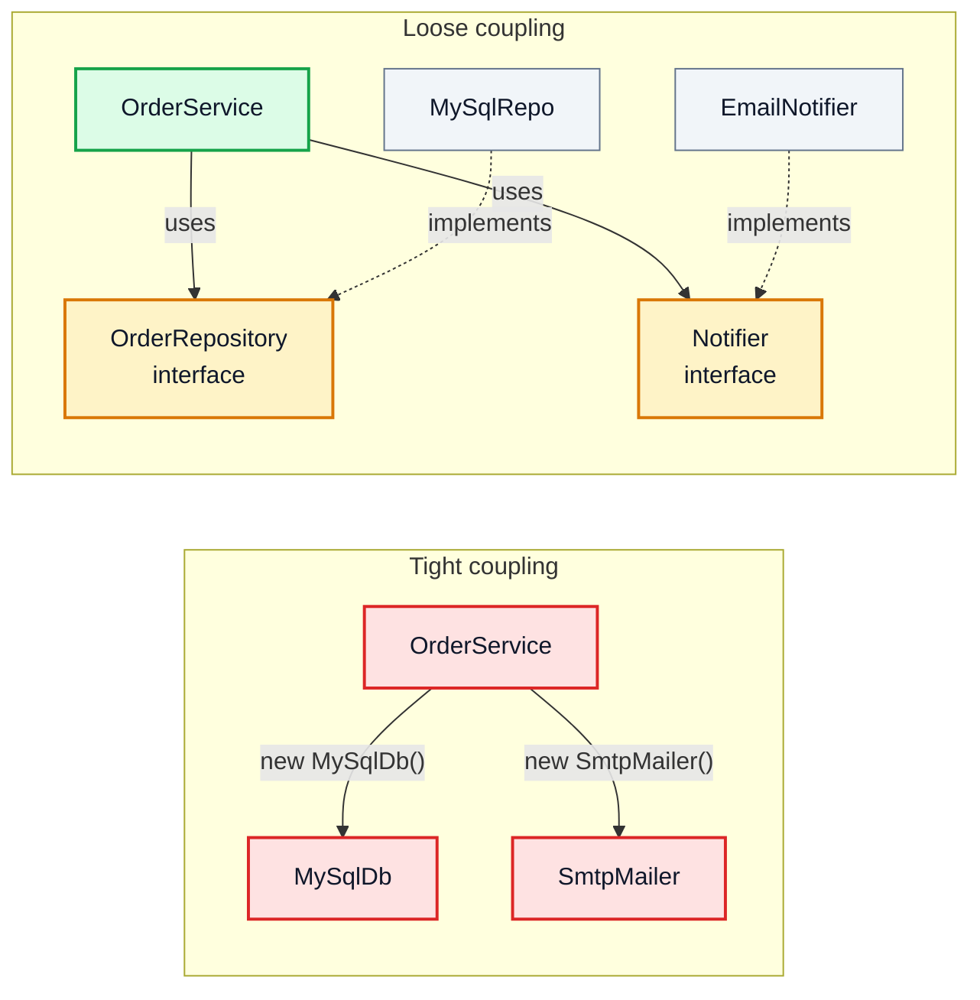
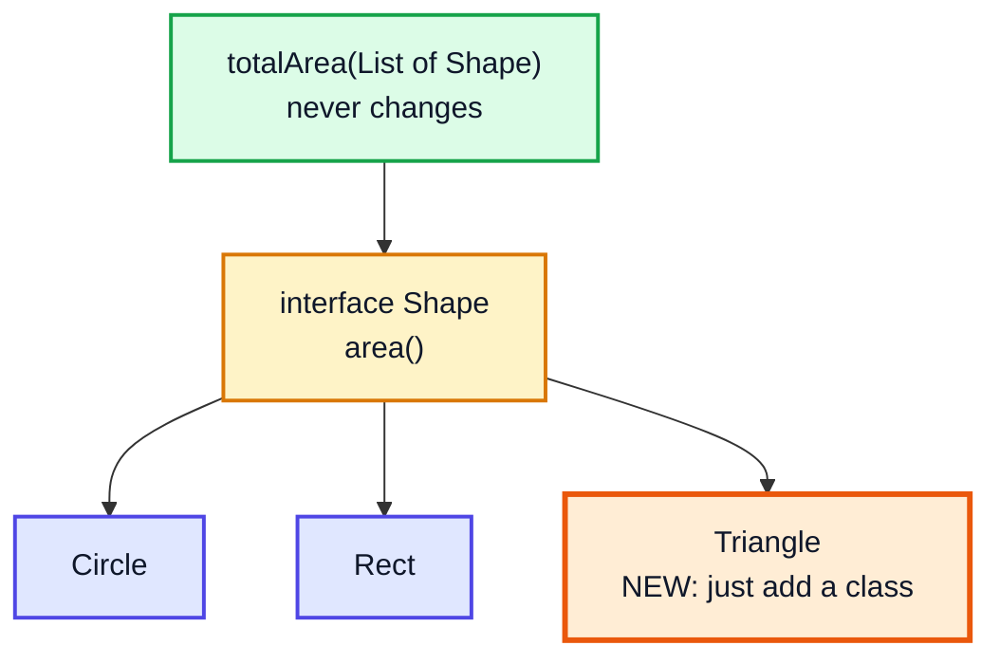
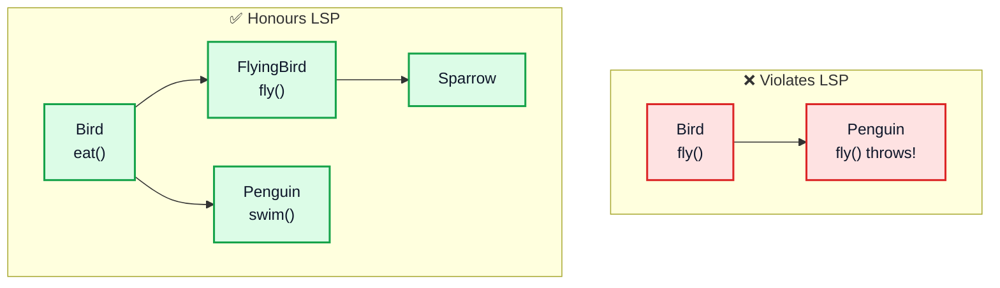
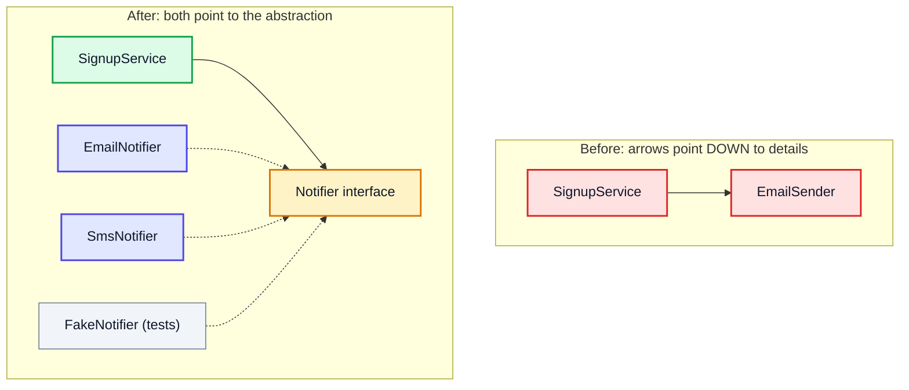
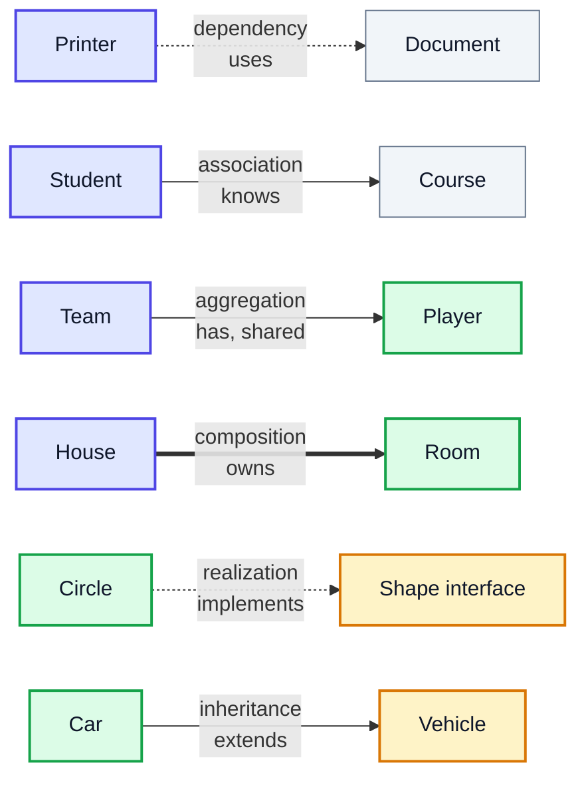
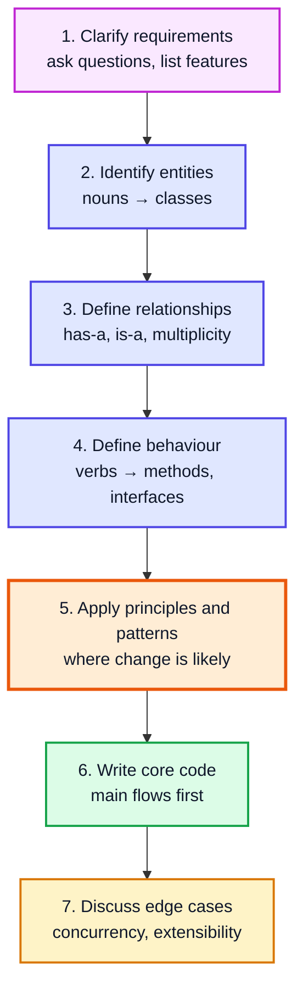
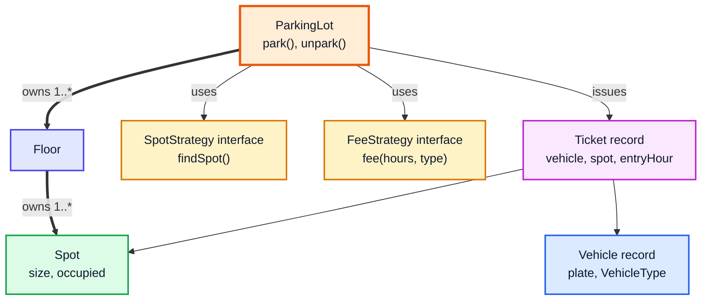

# SOLID Principles & Low-Level Design — Complete In-Depth Guide

**Java gap topic #5 of 12** · Priority 🟡 · from [topics_not_covered.md](../topics_not_covered.md)

The OOP videos (37–41) teach the *tools*: classes, inheritance, polymorphism, abstraction, interfaces. **SOLID** is five rules for using those tools so code stays easy to change. **Low-level design (LLD)** is the interview round where you design the classes for a system like a parking lot or a library. These notes cover each SOLID principle with a "bad → good" refactor, the other key principles (DRY, KISS, YAGNI, Law of Demeter), class relationships, and a step-by-step method for LLD rounds.

> [!NOTE]
> This topic isn't in the playlist, so there are no video timestamps. All code targets **Java 21**. The patterns that put these principles into practice are in [gap topic #4](java_gap_04_design_patterns.md).

---

## Table of Contents

| # | Topic (anchor link) | Level |
|---|---|---|
| 0 | [Why Design Principles](#0-why-design-principles) | Basics |
| 1 | [Cohesion and Coupling](#1-cohesion-and-coupling) | Basics |
| 2 | [S: Single Responsibility Principle](#2-s-single-responsibility-principle) | Core |
| 3 | [O: Open/Closed Principle](#3-o-openclosed-principle) | Core |
| 4 | [L: Liskov Substitution Principle](#4-l-liskov-substitution-principle) | Core |
| 5 | [I: Interface Segregation Principle](#5-i-interface-segregation-principle) | Core |
| 6 | [D: Dependency Inversion Principle](#6-d-dependency-inversion-principle) | Core |
| 7 | [Other Principles: DRY, KISS, YAGNI, Demeter](#7-other-principles-dry-kiss-yagni-demeter) | In depth |
| 8 | [Composition over Inheritance](#8-composition-over-inheritance) | In depth |
| 9 | [Class Relationships and UML](#9-class-relationships-and-uml) | In depth |
| 10 | [How to Approach an LLD Interview](#10-how-to-approach-an-lld-interview) | Interview |
| 11 | [Worked LLD: Parking Lot](#11-worked-lld-parking-lot) | Interview |
| 12 | [Other Common LLD Questions](#12-other-common-lld-questions) | Interview |

---

## 0. Why Design Principles

Code that works today will be **changed** many times: new features, new rules, bug fixes. Bad design makes each change risky and slow. The symptoms have names:

| Smell | What it feels like |
|---|---|
| **Rigidity** | One small change forces changes in many other places |
| **Fragility** | Changing one thing breaks something unrelated |
| **Immobility** | You can't reuse a piece because it's tangled with everything else |
| **Viscosity** | Doing it the right way is harder than hacking it |

SOLID, introduced by Robert C. Martin ("Uncle Bob"), targets exactly these:



---

## 1. Cohesion and Coupling

Every principle below is really about two measurements:

| | **Cohesion** | **Coupling** |
|---|---|---|
| Meaning | How closely the things *inside* one class belong together | How much one class *depends on* the internals of another |
| Want | **High** | **Low** |
| Bad example | `Utils` class with dates, emails, PDF export and sorting | `OrderService` creates `MySqlDatabase` directly and reads its fields |
| Good example | `InvoiceCalculator` that only computes invoice totals | `OrderService` takes an `OrderRepository` interface |



---

## 2. S: Single Responsibility Principle

> **A class should have only one reason to change.**

"Responsibility" means a reason to change, usually tied to one group of people who'd ask for the change (the accountants, the DBAs, the UI team).

### ❌ Before: one class, three reasons to change

```java
class Invoice {
    double amount;
    Invoice(double amount) { this.amount = amount; }

    double total() { return amount * 1.18; }                     // tax rules change → edit here
    void saveToDatabase() { /* SQL code */ }                     // DB changes → edit here
    String printPdf() { return "PDF: " + total(); }              // layout changes → edit here
}
```

### ✅ After: one class per responsibility

```java
public class SrpDemo {
    record Invoice(double amount) { }

    static class TaxCalculator {                        // changes when tax rules change
        double total(Invoice inv) { return inv.amount() * 1.18; }
    }
    static class InvoiceRepository {                    // changes when storage changes
        private final java.util.List<Invoice> rows = new java.util.ArrayList<>();
        void save(Invoice inv) { rows.add(inv); }
        int count() { return rows.size(); }
    }
    static class InvoicePrinter {                       // changes when the layout changes
        String print(Invoice inv, double total) { return "Invoice: base=" + inv.amount() + ", total=" + total; }
    }

    public static void main(String[] args) {
        Invoice inv = new Invoice(1000);
        double total = new TaxCalculator().total(inv);
        InvoiceRepository repo = new InvoiceRepository();
        repo.save(inv);
        System.out.println(new InvoicePrinter().print(inv, total));   // Invoice: base=1000.0, total=1180.0
        System.out.println("Saved rows: " + repo.count());            // Saved rows: 1
    }
}
```

> [!TIP]
> Quick test: describe the class in one sentence without "and". "It calculates tax **and** saves to the DB **and** prints PDFs" fails. Another test: if two different teams would ask you to change the same class for unrelated reasons, split it.

> [!WARNING]
> SRP doesn't mean "one method per class". Over-splitting creates dozens of tiny classes that are hard to follow. Group things that change together.

---

## 3. O: Open/Closed Principle

> **Software should be open for extension but closed for modification.**

You should be able to add new behaviour by **adding new code**, not by editing tested, working code.

### ❌ Before: every new shape means editing `AreaCalculator`

```java
class AreaCalculator {
    double area(Object shape) {
        if (shape instanceof Circle c) return Math.PI * c.r * c.r;
        else if (shape instanceof Rect r) return r.w * r.h;
        // adding Triangle → edit this method again, and retest everything
        throw new IllegalArgumentException();
    }
}
```

### ✅ After: polymorphism — new shapes are new classes

```java
import java.util.*;

public class OcpDemo {
    interface Shape { double area(); }
    record Circle(double r) implements Shape { public double area() { return Math.PI * r * r; } }
    record Rect(double w, double h) implements Shape { public double area() { return w * h; } }
    record Triangle(double b, double h) implements Shape { public double area() { return 0.5 * b * h; } } // added later, nothing else edited

    static double totalArea(List<Shape> shapes) {          // closed for modification
        return shapes.stream().mapToDouble(Shape::area).sum();
    }

    public static void main(String[] args) {
        List<Shape> shapes = List.of(new Rect(2, 3), new Triangle(4, 5), new Circle(1));
        System.out.printf("Total area: %.2f%n", totalArea(shapes));   // Total area: 19.14
    }
}
```



Patterns that implement OCP: **Strategy**, **Decorator**, **Template Method**, **Observer** ([gap topic #4](java_gap_04_design_patterns.md)).

> [!NOTE]
> **Modern Java nuance:** with `sealed` interfaces and pattern-matching `switch` (Java 21, [gap topic #7](java_gap_07_modern_java_features.md)), a `switch` over a *closed* set of types is checked by the compiler for completeness. That's a deliberate trade-off: easy to add new *operations*, harder to add new *types*. OCP-by-polymorphism is the opposite trade-off. Choose based on which one changes more often.

---

## 4. L: Liskov Substitution Principle

> **Objects of a subclass must be usable wherever the superclass is expected, without breaking the program.** (Barbara Liskov, 1987)

A subclass must keep the **promises** (the contract) of its parent: it can't demand more (stronger preconditions), can't deliver less (weaker postconditions), and can't throw surprising exceptions.

### ❌ The classic violation: Square extends Rectangle

```java
public class LspViolation {
    static class Rectangle {
        protected int w, h;
        void setWidth(int w)  { this.w = w; }
        void setHeight(int h) { this.h = h; }
        int area() { return w * h; }
    }
    static class Square extends Rectangle {               // "a square IS-A rectangle"... mathematically
        @Override void setWidth(int w)  { this.w = w; this.h = w; }
        @Override void setHeight(int h) { this.w = h; this.h = h; }
    }

    static void resize(Rectangle r) {                     // written for Rectangle
        r.setWidth(5);
        r.setHeight(4);
        System.out.println("Expected 20, got " + r.area());
    }

    public static void main(String[] args) {
        resize(new Rectangle());   // Expected 20, got 20
        resize(new Square());      // Expected 20, got 16  ❌ substitution broke the caller
    }
}
```

The caller assumed "setting height doesn't change width". `Square` broke that promise.

### ✅ Fix: model what the types actually share

```java
interface Shape { int area(); }
record Rectangle(int w, int h) implements Shape { public int area() { return w * h; } }
record Square(int side) implements Shape { public int area() { return side * side; } }
// Immutable, and neither pretends to be the other.
```

### Other LSP violations to recognise

| Violation | Example |
|---|---|
| Subclass throws `UnsupportedOperationException` for an inherited method | `class Penguin extends Bird { void fly() { throw ...; } }` |
| Subclass requires stricter input | Parent accepts any `int`; child rejects negatives |
| Subclass returns weaker results | Parent promises a sorted list; child returns unsorted |
| Subclass ignores a call | `ReadOnlyList.add()` silently does nothing |



> [!NOTE]
> The JDK itself bends LSP: `List.of(...)` returns a `List` whose `add` throws `UnsupportedOperationException`. The `List` docs mark mutators as "optional operations" to make that legal, but it still surprises people, which is exactly why LSP matters.

---

## 5. I: Interface Segregation Principle

> **Clients should not be forced to depend on methods they don't use.**

Prefer several small, role-based interfaces over one "fat" interface.

### ❌ Before: one fat interface

```java
interface Machine {
    void print(String doc);
    void scan(String doc);
    void fax(String doc);
}
class BasicPrinter implements Machine {
    public void print(String d) { System.out.println("Printing " + d); }
    public void scan(String d)  { throw new UnsupportedOperationException(); }   // forced to implement
    public void fax(String d)   { throw new UnsupportedOperationException(); }   // and violates LSP too
}
```

### ✅ After: small role interfaces

```java
public class IspDemo {
    interface Printer { String print(String doc); }
    interface Scanner { String scan(String doc); }
    interface Fax     { String fax(String doc); }

    static class BasicPrinter implements Printer {
        public String print(String d) { return "Printing " + d; }
    }
    static class OfficeMachine implements Printer, Scanner, Fax {      // implements what it supports
        public String print(String d) { return "Printing " + d; }
        public String scan(String d)  { return "Scanning " + d; }
        public String fax(String d)   { return "Faxing " + d; }
    }

    static void printAll(Printer p, String... docs) {                    // only needs Printer
        for (String d : docs) System.out.println(p.print(d));
    }

    public static void main(String[] args) {
        printAll(new BasicPrinter(), "a.txt");
        printAll(new OfficeMachine(), "b.txt");
        Scanner s = new OfficeMachine();
        System.out.println(s.scan("photo.png"));
    }
}
// Output:
// Printing a.txt
// Printing b.txt
// Scanning photo.png
```

**In the JDK:** `Comparable`, `Runnable`, `AutoCloseable`, `Iterable` are tiny one-method interfaces. `Collection` → `List`/`Set`/`Queue` split responsibilities by role.

---

## 6. D: Dependency Inversion Principle

> 1. **High-level modules should not depend on low-level modules. Both should depend on abstractions.**
> 2. **Abstractions should not depend on details. Details should depend on abstractions.**

The business logic (high level) shouldn't care whether data goes to MySQL or a file, or whether notifications go by email or SMS (low level).

### ❌ Before: high-level class creates low-level classes itself

```java
class EmailSender { void send(String to, String msg) { /* SMTP */ } }

class SignupService {
    private final EmailSender sender = new EmailSender();     // hard-wired: can't test, can't swap for SMS
    void signup(String user) { sender.send(user, "Welcome!"); }
}
```

### ✅ After: depend on an interface, get it from outside (dependency injection)

```java
import java.util.*;

public class DipDemo {
    interface Notifier { void send(String to, String msg); }                 // the abstraction

    static class EmailNotifier implements Notifier {
        public void send(String to, String msg) { System.out.println("EMAIL to " + to + ": " + msg); }
    }
    static class SmsNotifier implements Notifier {
        public void send(String to, String msg) { System.out.println("SMS to " + to + ": " + msg); }
    }
    static class FakeNotifier implements Notifier {                          // for unit tests
        final List<String> sent = new ArrayList<>();
        public void send(String to, String msg) { sent.add(to + ":" + msg); }
    }

    static class SignupService {
        private final Notifier notifier;
        SignupService(Notifier notifier) { this.notifier = notifier; }      // constructor injection
        void signup(String user) { notifier.send(user, "Welcome!"); }
    }

    public static void main(String[] args) {
        new SignupService(new EmailNotifier()).signup("asha@example.com");
        new SignupService(new SmsNotifier()).signup("+91-98xxxxxx");

        FakeNotifier fake = new FakeNotifier();
        new SignupService(fake).signup("test-user");
        System.out.println("Test captured: " + fake.sent);
    }
}
// Output:
// EMAIL to asha@example.com: Welcome!
// SMS to +91-98xxxxxx: Welcome!
// Test captured: [test-user:Welcome!]
```



| Term | Meaning |
|---|---|
| **Dependency Inversion** (principle) | Depend on abstractions, not concretions |
| **Dependency Injection** (technique) | Pass dependencies in (constructor, setter) instead of creating them inside |
| **Inversion of Control** (bigger idea) | A framework creates objects and wires them together for you (Spring's IoC container) |

> [!TIP]
> Prefer **constructor injection**: dependencies can be `final`, the object is never half-configured, and tests just call the constructor with fakes.

---

## 7. Other Principles: DRY, KISS, YAGNI, Demeter

| Principle | Says | Violation | Fix |
|---|---|---|---|
| **DRY** — Don't Repeat Yourself | Every piece of knowledge has one home | The 18% tax rate typed in 7 places | One `TAX_RATE` constant / one method |
| **KISS** — Keep It Simple | The simplest design that works wins | A plugin framework for two report types | Two classes |
| **YAGNI** — You Aren't Gonna Need It | Don't build for imagined future needs | Abstract factory "in case we add more databases" | Add it when the second DB actually appears |
| **Law of Demeter** — talk only to friends | A method should call methods on itself, its fields, its parameters, objects it creates | `order.getCustomer().getAddress().getCity().toUpperCase()` | `order.shippingCity()` |
| **Tell, don't ask** | Tell objects what to do instead of pulling data and deciding for them | `if (acc.getBalance() >= x) acc.setBalance(acc.getBalance() - x)` | `acc.withdraw(x)` |
| **Encapsulate what varies** | Isolate the parts likely to change | Pricing rules spread through checkout code | A `PricingStrategy` |

```java
public class TellDontAsk {
    static class Account {
        private int balance;
        Account(int b) { balance = b; }
        boolean withdraw(int amount) {           // the rule lives with the data
            if (amount <= 0 || amount > balance) return false;
            balance -= amount;
            return true;
        }
        int balance() { return balance; }
    }

    public static void main(String[] args) {
        Account a = new Account(100);
        System.out.println(a.withdraw(30) + " " + a.balance());   // true 70
        System.out.println(a.withdraw(500) + " " + a.balance());  // false 70
    }
}
```

> [!CAUTION]
> DRY is about duplicated **knowledge**, not duplicated-looking code. Two methods that happen to look alike today but represent different business rules should stay separate; merging them couples rules that will change for different reasons (and violates SRP).

---

## 8. Composition over Inheritance

Inheritance (*is-a*) is the strongest coupling in OOP: a subclass depends on the parent's internals. Composition (*has-a*) is usually more flexible.

```java
import java.util.*;

public class CompositionDemo {
    // ❌ Inheritance: "count how many items were added" by extending HashSet
    static class CountingSet<E> extends HashSet<E> {
        int added = 0;
        @Override public boolean add(E e) { added++; return super.add(e); }
        @Override public boolean addAll(Collection<? extends E> c) { added += c.size(); return super.addAll(c); }
    }

    // ✅ Composition: wrap a Set and forward calls
    static class CountingSet2<E> {
        private final Set<E> inner = new HashSet<>();
        int added = 0;
        boolean add(E e) { added++; return inner.add(e); }
        boolean addAll(Collection<? extends E> c) { boolean ch = false; for (E e : c) ch |= add(e); return ch; }
        int size() { return inner.size(); }
    }

    public static void main(String[] args) {
        CountingSet<String> s1 = new CountingSet<>();
        s1.addAll(List.of("a", "b", "c"));
        System.out.println("Inheritance count: " + s1.added);  // 6 ❌ HashSet.addAll calls add() internally

        CountingSet2<String> s2 = new CountingSet2<>();
        s2.addAll(List.of("a", "b", "c"));
        System.out.println("Composition count: " + s2.added);  // 3 ✅
    }
}
```

This is *Effective Java* item 18's famous example. `HashSet.addAll` (inherited from `AbstractCollection`) calls `add` for each element, so the subclass counts twice. The subclass broke because of a **hidden implementation detail** of the parent — the "fragile base class" problem.

| Use inheritance when | Use composition when |
|---|---|
| It's a true, permanent *is-a* relationship (LSP holds) | You want to reuse behaviour |
| You control both classes, or the parent is designed for extension (documented, `abstract`) | The behaviour should change at runtime |
| Template Method pattern | Strategy, Decorator, Proxy patterns |

---

## 9. Class Relationships and UML

LLD rounds often want a quick class diagram. These are the relationships, from weakest to strongest:

| Relationship | Meaning | Java shape | Example |
|---|---|---|---|
| **Dependency** | Uses temporarily | A parameter or local variable | `Printer.print(Document d)` |
| **Association** | Knows about, long-term | A field | `Student` has a `List<Course>` |
| **Aggregation** | Has-a, parts can live alone | A field set from outside | `Team` has `Player`s; players exist without the team |
| **Composition** | Owns, parts die with the whole | A field created inside | `House` creates its `Room`s |
| **Realization** | Implements an interface | `implements` | `Circle implements Shape` |
| **Inheritance** | Is-a | `extends` | `Car extends Vehicle` |



```java
import java.util.*;

class Room { final String name; Room(String n) { name = n; } }

class House {                                    // composition: creates and owns its rooms
    private final List<Room> rooms = new ArrayList<>();
    House(String... roomNames) { for (String n : roomNames) rooms.add(new Room(n)); }
    int roomCount() { return rooms.size(); }
}

class Player { final String name; Player(String n) { name = n; } }

class Team {                                     // aggregation: players come from outside
    private final List<Player> players = new ArrayList<>();
    void add(Player p) { players.add(p); }
    int size() { return players.size(); }
}

public class RelationshipsDemo {
    public static void main(String[] args) {
        House h = new House("kitchen", "bedroom");
        Player virat = new Player("Virat");
        Team rcb = new Team(), india = new Team();
        rcb.add(virat); india.add(virat);        // same player in two teams
        System.out.println(h.roomCount() + " rooms; teams " + rcb.size() + " and " + india.size());
    }
}
// Output:
// 2 rooms; teams 1 and 1
```

---

## 10. How to Approach an LLD Interview

LLD rounds usually last 45–60 minutes. Interviewers care about **clear thinking and extensibility**, not perfect code.



| Step | What to say/do | Tip |
|---|---|---|
| 1. Clarify | "How many floors? Vehicle types? Payment? Multiple entry gates?" | Write the agreed scope down; don't design features nobody asked for (YAGNI) |
| 2. Entities | Underline nouns: ParkingLot, Floor, Spot, Vehicle, Ticket, Gate, Payment | Each becomes a class, enum or record |
| 3. Relationships | Lot *has* Floors (composition); Ticket *references* Spot and Vehicle | State multiplicities: 1 lot → many floors |
| 4. Behaviour | `park(vehicle)`, `unpark(ticket)`, `calculateFee(ticket)` | Put each method on the class that owns the data (Tell, don't ask) |
| 5. Principles | Fee rules vary → Strategy; spot assignment varies → Strategy; one lot → Singleton? | Explain *why* each pattern is there |
| 6. Code | Interfaces + main classes + one happy-path flow | Use enums, records, `Optional` |
| 7. Extras | Thread safety when two cars grab the same spot; adding EV spots | Shows senior-level thinking |

---

## 11. Worked LLD: Parking Lot

**Agreed requirements:** several floors; spot sizes SMALL/MEDIUM/LARGE; vehicles BIKE/CAR/TRUCK (bike fits any spot, car fits medium or large, truck only large); issue a ticket on entry; compute the fee on exit with a pluggable pricing rule; report free spots.

### Entities and relationships



### Where each SOLID principle shows up

| Principle | In this design |
|---|---|
| **S** | `Spot` tracks occupancy; `FeeStrategy` only computes fees; `ParkingLot` only coordinates |
| **O** | New pricing (weekend, EV) = new `FeeStrategy` class; `ParkingLot` untouched |
| **L** | Every `FeeStrategy` returns a non-negative fee for any valid input; no strategy throws "unsupported" |
| **I** | `SpotStrategy` and `FeeStrategy` are separate tiny interfaces |
| **D** | `ParkingLot` receives strategies through its constructor; tests can pass fakes |

The full runnable version is the **Complete Example** at the end of this file.

---

## 12. Other Common LLD Questions

| System | Key entities | Patterns that fit | Tricky part |
|---|---|---|---|
| **Library management** | Book, BookCopy, Member, Loan, Librarian | Strategy (fine rules), Observer (reservation available) | Book vs physical copy |
| **Elevator system** | Elevator, Floor, Request, Controller | State (moving/idle/doors open), Strategy (scheduling) | Choosing which elevator answers |
| **Tic-Tac-Toe** ([video 48](../kunal-java-notes-claude/java_48_video_tic_tac_toe_game.md)) | Board, Player, Move, Game | Strategy (human/AI player) | O(1) win check with row/col/diagonal counters |
| **Snake and Ladder** | Board, Snake, Ladder, Dice, Player | Strategy (dice) | Turn order (a queue) |
| **Vending machine** | Machine, Product, Coin, Inventory | **State** | Refunds, out-of-stock |
| **ATM** | ATM, Card, Account, Transaction, CashDispenser | State, Chain of Responsibility (note dispenser 2000→500→100) | Concurrency on the account |
| **Splitwise** | User, Group, Expense, Split (Equal/Exact/Percent) | Strategy (split types), Factory | Simplifying debts (a graph problem) |
| **LRU cache** (LC 146) | Cache, Node, HashMap + doubly linked list | — | O(1) get/put |
| **Rate limiter** | Limiter, Bucket | Strategy (token bucket, sliding window) | Thread safety |
| **Logger** | Logger, Level, Appender | Singleton, Chain of Responsibility, Observer | Async writing |
| **BookMyShow** | Movie, Theatre, Show, Seat, Booking | Strategy (pricing) | Two users booking the same seat (locking) |

### Interview Q&A

| Question | Short answer |
|---|---|
| Explain SOLID in one line each | One reason to change; extend without modifying; subtypes must be substitutable; small focused interfaces; depend on abstractions. |
| SRP vs ISP? | SRP is about classes (one reason to change); ISP is about interfaces (clients shouldn't depend on methods they don't use). |
| Give an LSP violation | `Square extends Rectangle`; `Penguin.fly()` throwing. |
| DIP vs dependency injection? | DIP is the principle; DI is the technique of passing dependencies in. |
| How does OCP relate to patterns? | Strategy, Decorator, Observer and Template Method let you add behaviour without editing existing classes. |
| Aggregation vs composition? | Parts can outlive the whole vs parts are owned and die with it. |
| Why composition over inheritance? | Looser coupling, runtime flexibility, avoids fragile base classes. |
| What's high cohesion / low coupling? | Each class focuses on one thing / classes know little about each other's internals. |

---

## 🧩 Complete Example: Everything Together

The parking lot from Section 11, applying every SOLID principle: small interfaces, injected strategies, polymorphic fee rules, immutable records, and a `synchronized` `park` so two cars can't take the same spot.

```java
import java.util.*;

public class ParkingLotLLD {

    // ---------- Domain types ----------
    enum SpotSize { SMALL, MEDIUM, LARGE }

    enum VehicleType {
        BIKE(SpotSize.SMALL), CAR(SpotSize.MEDIUM), TRUCK(SpotSize.LARGE);
        final SpotSize minSize;
        VehicleType(SpotSize minSize) { this.minSize = minSize; }
        boolean fitsIn(SpotSize s) { return s.ordinal() >= minSize.ordinal(); }
    }

    record Vehicle(String plate, VehicleType type) { }

    static final class Spot {                                     // S: only tracks its own occupancy
        final String id; final SpotSize size;
        private Vehicle parked;
        Spot(String id, SpotSize size) { this.id = id; this.size = size; }
        boolean isFree() { return parked == null; }
        void occupy(Vehicle v) { parked = v; }
        void release() { parked = null; }
    }

    record Floor(int number, List<Spot> spots) { }

    record Ticket(int id, Vehicle vehicle, Spot spot, int entryHour) { }

    // ---------- I: two small interfaces; D: the lot depends on these ----------
    interface SpotStrategy { Optional<Spot> findSpot(List<Floor> floors, Vehicle v); }
    interface FeeStrategy  { int fee(int hours, VehicleType type); }

    // Smallest spot that fits, lowest floor first
    static final class BestFitStrategy implements SpotStrategy {
        public Optional<Spot> findSpot(List<Floor> floors, Vehicle v) {
            return floors.stream()
                    .flatMap(f -> f.spots().stream())
                    .filter(Spot::isFree)
                    .filter(s -> v.type().fitsIn(s.size))
                    .min(Comparator.comparingInt((Spot s) -> s.size.ordinal()));
        }
    }

    // O + L: new pricing rules are new classes, and all of them honour the same contract
    static final class HourlyFee implements FeeStrategy {
        private final Map<VehicleType, Integer> rate = Map.of(VehicleType.BIKE, 10, VehicleType.CAR, 30, VehicleType.TRUCK, 60);
        public int fee(int hours, VehicleType t) { return Math.max(1, hours) * rate.get(t); }
    }
    static final class FlatWeekendFee implements FeeStrategy {
        public int fee(int hours, VehicleType t) { return t == VehicleType.TRUCK ? 200 : 50; }
    }

    // ---------- The coordinator ----------
    static final class ParkingLot {
        private final List<Floor> floors;
        private final SpotStrategy spotStrategy;
        private final FeeStrategy feeStrategy;
        private final Map<Integer, Ticket> active = new HashMap<>();
        private int nextTicket = 1;

        ParkingLot(List<Floor> floors, SpotStrategy spotStrategy, FeeStrategy feeStrategy) {   // constructor injection
            this.floors = floors; this.spotStrategy = spotStrategy; this.feeStrategy = feeStrategy;
        }

        synchronized Optional<Ticket> park(Vehicle v, int hour) {
            Optional<Spot> spot = spotStrategy.findSpot(floors, v);
            if (spot.isEmpty()) return Optional.empty();
            spot.get().occupy(v);
            Ticket t = new Ticket(nextTicket++, v, spot.get(), hour);
            active.put(t.id(), t);
            return Optional.of(t);
        }

        synchronized int unpark(int ticketId, int hour) {
            Ticket t = active.remove(ticketId);
            if (t == null) throw new IllegalArgumentException("Unknown ticket " + ticketId);
            t.spot().release();
            return feeStrategy.fee(hour - t.entryHour(), t.vehicle().type());
        }

        Map<SpotSize, Long> freeSpots() {
            Map<SpotSize, Long> m = new EnumMap<>(SpotSize.class);
            for (SpotSize s : SpotSize.values()) m.put(s, 0L);
            floors.forEach(f -> f.spots().stream().filter(Spot::isFree).forEach(s -> m.merge(s.size, 1L, Long::sum)));
            return m;
        }
    }

    static Floor floor(int n, SpotSize... sizes) {
        List<Spot> spots = new ArrayList<>();
        for (int i = 0; i < sizes.length; i++) spots.add(new Spot("F" + n + "-" + (i + 1), sizes[i]));
        return new Floor(n, spots);
    }

    public static void main(String[] args) {
        List<Floor> floors = List.of(
                floor(0, SpotSize.SMALL, SpotSize.MEDIUM, SpotSize.LARGE),
                floor(1, SpotSize.MEDIUM, SpotSize.MEDIUM));

        ParkingLot lot = new ParkingLot(floors, new BestFitStrategy(), new HourlyFee());
        System.out.println("Free at start: " + lot.freeSpots());

        Vehicle bike = new Vehicle("KA-01-B", VehicleType.BIKE);
        Vehicle car1 = new Vehicle("KA-02-C", VehicleType.CAR);
        Vehicle car2 = new Vehicle("KA-03-C", VehicleType.CAR);
        Vehicle truck = new Vehicle("KA-04-T", VehicleType.TRUCK);
        Vehicle truck2 = new Vehicle("KA-05-T", VehicleType.TRUCK);

        List<Ticket> tickets = new ArrayList<>();
        for (Vehicle v : List.of(bike, car1, car2, truck, truck2)) {
            Optional<Ticket> t = lot.park(v, 9);
            t.ifPresentOrElse(
                    tk -> { tickets.add(tk); System.out.println("Parked " + v.plate() + " (" + v.type() + ") at " + tk.spot().id); },
                    () -> System.out.println("No spot for " + v.plate() + " (" + v.type() + ")"));
        }
        System.out.println("Free now: " + lot.freeSpots());

        System.out.println("Car KA-02-C pays " + lot.unpark(tickets.get(1).id(), 12));   // 3 hours
        System.out.println("Truck KA-04-T pays " + lot.unpark(tickets.get(3).id(), 9));  // under an hour → min 1 hour

        // Swap pricing without touching ParkingLot (OCP + DIP)
        ParkingLot weekend = new ParkingLot(List.of(floor(0, SpotSize.LARGE)), new BestFitStrategy(), new FlatWeekendFee());
        int id = weekend.park(truck2, 8).orElseThrow().id();
        System.out.println("Weekend truck pays " + weekend.unpark(id, 20));

        try {
            lot.unpark(999, 10);
        } catch (IllegalArgumentException e) {
            System.out.println("Error: " + e.getMessage());
        }
        System.out.println("Free at end: " + lot.freeSpots());
    }
}
```

**Expected Output:**
```
Free at start: {SMALL=1, MEDIUM=3, LARGE=1}
Parked KA-01-B (BIKE) at F0-1
Parked KA-02-C (CAR) at F0-2
Parked KA-03-C (CAR) at F1-1
Parked KA-04-T (TRUCK) at F0-3
No spot for KA-05-T (TRUCK)
Free now: {SMALL=0, MEDIUM=1, LARGE=0}
Car KA-02-C pays 90
Truck KA-04-T pays 60
Weekend truck pays 200
Error: Unknown ticket 999
Free at end: {SMALL=0, MEDIUM=2, LARGE=1}
```

---

## Quick Reference Cheat Sheet

| Concept | One-Line Summary |
|---|---|
| **SRP** | One reason to change per class |
| **OCP** | Add behaviour by adding code (polymorphism, strategies), not editing old code |
| **LSP** | A subclass must work anywhere its parent works; no surprise exceptions |
| **ISP** | Many small role interfaces beat one fat interface |
| **DIP** | High- and low-level code both depend on abstractions; inject dependencies |
| **Cohesion / coupling** | Want high cohesion inside a class, low coupling between classes |
| **DRY** | One home for each piece of knowledge |
| **KISS / YAGNI** | Simplest thing that works; don't build for imaginary needs |
| **Law of Demeter** | Don't chain through strangers: `a.getB().getC().do()` |
| **Tell, don't ask** | Put the logic with the data it uses |
| **Composition > inheritance** | Has-a is looser and more flexible than is-a |
| **Aggregation vs composition** | Shared parts vs owned parts |
| **LLD steps** | Clarify → entities → relationships → behaviour → patterns → code → edge cases |
