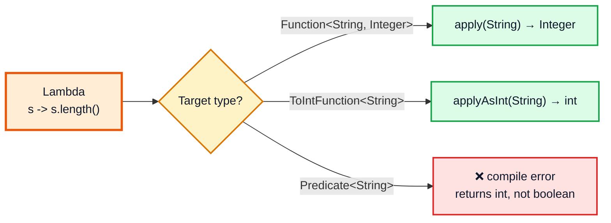
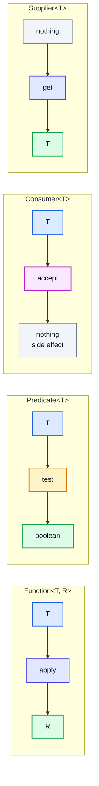
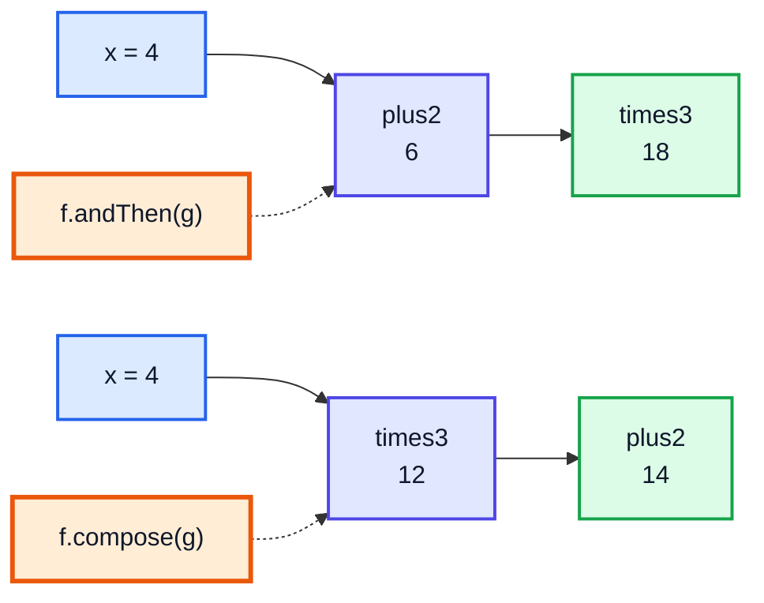
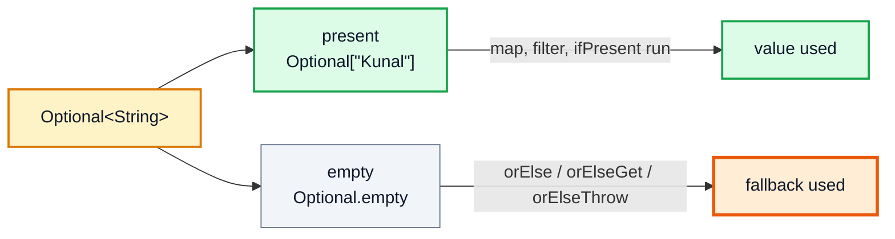

# Functional Interfaces & Optional — Complete In-Depth Guide

**Java gap topic #6 of 12** · Priority 🟡 · from [topics_not_covered.md](../topics_not_covered.md)

[Video 42](../kunal-java-notes-claude/java_42_video_generics_lambdas_exceptions_cloning.md) shows lambdas with a custom interface. Real Java code uses the ready-made interfaces in `java.util.function` — `Function`, `Predicate`, `Consumer`, `Supplier` and friends — everywhere: streams, collections, `Optional`, `CompletableFuture`, `Map.computeIfAbsent`. These notes cover all of them, method references, composing functions, and `Optional`, Java's tool for "a value that might be missing".

> [!NOTE]
> This topic isn't in the playlist, so there are no video timestamps. All code targets **Java 21**. Streams, the biggest user of these interfaces, have their own file: [gap topic #2](java_gap_02_streams_api.md).

---

## Table of Contents

| # | Topic (anchor link) | Level |
|---|---|---|
| 0 | [What a Functional Interface Is](#0-what-a-functional-interface-is) | Basics |
| 1 | [Lambdas Recap and Effectively Final](#1-lambdas-recap-and-effectively-final) | Basics |
| 2 | [The Big Four: Function, Predicate, Consumer, Supplier](#2-the-big-four-function-predicate-consumer-supplier) | Core |
| 3 | [Bi- and Operator Variants](#3-bi--and-operator-variants) | Core |
| 4 | [Primitive Specializations](#4-primitive-specializations) | Core |
| 5 | [Method References](#5-method-references) | Core |
| 6 | [Composing Functions](#6-composing-functions) | In depth |
| 7 | [Writing Your Own Functional Interface](#7-writing-your-own-functional-interface) | In depth |
| 8 | [Higher-Order Functions and Where the JDK Uses Them](#8-higher-order-functions-and-where-the-jdk-uses-them) | In depth |
| 9 | [Optional: Why It Exists](#9-optional-why-it-exists) | Core |
| 10 | [Creating and Reading an Optional](#10-creating-and-reading-an-optional) | Core |
| 11 | [Transforming Optionals: map, flatMap, filter](#11-transforming-optionals-map-flatmap-filter) | In depth |
| 12 | [Optional Best Practices and Anti-Patterns](#12-optional-best-practices-and-anti-patterns) | Pitfalls |
| 13 | [Common Interview Questions](#13-common-interview-questions) | Interview |

---

## 0. What a Functional Interface Is

A **functional interface** has exactly **one abstract method** (SAM = Single Abstract Method). Any lambda or method reference whose shape matches that method can be used where the interface is expected.

```java
@FunctionalInterface                       // optional, but the compiler then checks "exactly one abstract method"
interface Greeter {
    String greet(String name);             // the single abstract method

    default String greetAll(String... names) {   // default methods are allowed
        StringBuilder sb = new StringBuilder();
        for (String n : names) sb.append(greet(n)).append(" ");
        return sb.toString().trim();
    }
    static Greeter polite() { return n -> "Good day, " + n; }   // static methods too
}

public class FunctionalInterfaceDemo {
    public static void main(String[] args) {
        Greeter casual = name -> "Hi " + name;              // the lambda IS the greet() method
        System.out.println(casual.greet("Kunal"));          // Hi Kunal
        System.out.println(casual.greetAll("A", "B"));      // Hi A Hi B
        System.out.println(Greeter.polite().greet("Sir"));  // Good day, Sir
    }
}
```

| Allowed in a functional interface | Count |
|---|---|
| Abstract methods | **exactly 1** |
| `default` methods | any number |
| `static` methods | any number |
| Abstract methods that override `Object`'s public methods (`equals`, `toString`) | any number; they don't count |

That last rule is why `Comparator` is functional even though it declares `boolean equals(Object)`.



> [!NOTE]
> A lambda has **no type of its own**. Its type comes from the context (the *target type*): the variable, parameter or return type it's assigned to. The same lambda text can become a `Function` or a `ToIntFunction` depending on where you put it.

---

## 1. Lambdas Recap and Effectively Final

| Form | Example |
|---|---|
| No parameters | `() -> 42` |
| One parameter (parentheses optional) | `x -> x * 2` |
| Several parameters | `(a, b) -> a + b` |
| Explicit types | `(int a, int b) -> a + b` |
| `var` parameters (Java 11, allows annotations) | `(var a, var b) -> a + b` |
| Block body | `x -> { int y = x * 2; return y + 1; }` |
| Unused parameter (Java 22+ only) | `_ -> 0` — not in Java 21 |

### Captured variables must be effectively final

```java
import java.util.function.*;

public class CaptureDemo {
    public static void main(String[] args) {
        int base = 10;                              // never reassigned → effectively final
        IntUnaryOperator addBase = x -> x + base;   // OK: captures base
        System.out.println(addBase.applyAsInt(5));  // 15

        // base = 20;                               // ❌ would make the lambda above fail to compile

        int[] counter = {0};                        // workaround: the ARRAY reference is final, contents can change
        Runnable inc = () -> counter[0]++;
        inc.run(); inc.run();
        System.out.println(counter[0]);             // 2
    }
}
```

> [!IMPORTANT]
> Why the rule? A lambda may run later, on another thread, after the method that created it has returned and its stack frame is gone. Java copies the variable's **value** into the lambda, so it must never change, or the copy and the original would disagree. Mutating through an array or `AtomicInteger` works but is a smell; in streams, prefer `collect`/`reduce`.

### `this` inside a lambda vs an anonymous class

| | Lambda | Anonymous class |
|---|---|---|
| `this` refers to | The **enclosing** object | The anonymous class instance itself |
| Can shadow outer variables? | No | Yes |
| Creates a `.class` file? | No (uses `invokedynamic`) | Yes (`Outer$1.class`) |
| Can have state (fields)? | No | Yes |
| Can implement an interface with 2+ abstract methods? | No | Yes |

---

## 2. The Big Four: Function, Predicate, Consumer, Supplier



| Interface | Method | Shape | Typical use |
|---|---|---|---|
| `Function<T, R>` | `R apply(T t)` | T → R | `stream.map`, `Map.computeIfAbsent` |
| `Predicate<T>` | `boolean test(T t)` | T → boolean | `stream.filter`, `Collection.removeIf` |
| `Consumer<T>` | `void accept(T t)` | T → void | `forEach`, `Optional.ifPresent` |
| `Supplier<T>` | `T get()` | () → T | `Optional.orElseGet`, lazy values, factories |

```java
import java.util.*;
import java.util.function.*;

public class BigFour {
    public static void main(String[] args) {
        Function<String, Integer> length = s -> s.length();
        Predicate<String> isLong = s -> s.length() > 5;
        Consumer<String> shout = s -> System.out.println(s.toUpperCase() + "!");
        Supplier<List<String>> listMaker = ArrayList::new;

        System.out.println(length.apply("lambda"));      // 6
        System.out.println(isLong.test("java"));         // false
        shout.accept("hello");                           // HELLO!
        List<String> fresh = listMaker.get();
        fresh.add("new");
        System.out.println(fresh);                       // [new]

        // In real APIs
        List<String> words = new ArrayList<>(List.of("tree", "binary", "heap", "segment"));
        words.removeIf(isLong.negate());                 // removeIf takes a Predicate
        words.forEach(shout);                            // forEach takes a Consumer
        Map<Integer, List<String>> byLen = new HashMap<>();
        byLen.computeIfAbsent(6, k -> new ArrayList<>()).add("binary");   // a Function
        System.out.println(byLen);                       // {6=[binary]}
    }
}
// Output:
// 6
// false
// HELLO!
// [new]
// BINARY!
// SEGMENT!
// {6=[binary]}
```

### Supplier = laziness

```java
import java.util.function.Supplier;

public class LazyDemo {
    static String expensive() { System.out.println("  (computing default...)"); return "default"; }

    static String pick(String value, Supplier<String> fallback) {
        return value != null ? value : fallback.get();   // only calls the supplier if needed
    }

    public static void main(String[] args) {
        System.out.println(pick("given", LazyDemo::expensive));
        System.out.println(pick(null, LazyDemo::expensive));
    }
}
// Output:
// given
//   (computing default...)
// default
```

---

## 3. Bi- and Operator Variants

| Interface | Method | Shape | Example |
|---|---|---|---|
| `BiFunction<T, U, R>` | `R apply(T, U)` | (T, U) → R | `Map.merge`, `Map.compute` |
| `BiPredicate<T, U>` | `boolean test(T, U)` | (T, U) → boolean | `(s, n) -> s.length() == n` |
| `BiConsumer<T, U>` | `void accept(T, U)` | (T, U) → void | `Map.forEach((k, v) -> ...)` |
| `UnaryOperator<T>` | `T apply(T)` | T → T (same type) | `List.replaceAll`, `Stream.iterate` |
| `BinaryOperator<T>` | `T apply(T, T)` | (T, T) → T | `stream.reduce`, `BinaryOperator.minBy(cmp)` |

```java
import java.util.*;
import java.util.function.*;

public class BiAndOperators {
    public static void main(String[] args) {
        BiFunction<Integer, Integer, Integer> power = (b, e) -> (int) Math.pow(b, e);
        BiPredicate<String, Integer> hasLength = (s, n) -> s.length() == n;
        BiConsumer<String, Integer> printer = (k, v) -> System.out.println(k + " -> " + v);
        UnaryOperator<String> trimUpper = s -> s.trim().toUpperCase();
        BinaryOperator<Integer> max = BinaryOperator.maxBy(Comparator.naturalOrder());

        System.out.println(power.apply(2, 10));            // 1024
        System.out.println(hasLength.test("java", 4));     // true
        System.out.println(trimUpper.apply("  dsa "));     // DSA
        System.out.println(max.apply(7, 3));               // 7

        Map<String, Integer> stock = new TreeMap<>(Map.of("pen", 5, "ink", 2));
        stock.merge("pen", 3, Integer::sum);               // BinaryOperator as the merge function
        stock.forEach(printer);                            // ink -> 2, pen -> 8

        List<String> names = new ArrayList<>(List.of(" a ", " b "));
        names.replaceAll(trimUpper);                       // UnaryOperator
        System.out.println(names);                         // [A, B]
    }
}
```

> [!TIP]
> `UnaryOperator<T>` *extends* `Function<T, T>`, and `BinaryOperator<T>` *extends* `BiFunction<T, T, T>`. They're just shortcuts for "same type in and out". There's no `TriFunction` in the JDK; write your own (Section 7) if you need three arguments.

---

## 4. Primitive Specializations

Generics can't hold primitives, so `Function<Integer, Integer>` boxes every `int` into an `Integer` object. The primitive versions avoid that.

| Family | `int` versions | Also exist for |
|---|---|---|
| Function | `IntFunction<R>` (int → R), `ToIntFunction<T>` (T → int), `IntUnaryOperator` (int → int), `IntToLongFunction`, `IntToDoubleFunction` | long, double |
| Predicate | `IntPredicate` | long, double |
| Consumer | `IntConsumer`, `ObjIntConsumer<T>` | long, double |
| Supplier | `IntSupplier` | long, double, **`BooleanSupplier`** |
| Operator | `IntBinaryOperator` | long, double |
| Bi | `ToIntBiFunction<T, U>` | long, double |

```java
import java.util.function.*;
import java.util.stream.IntStream;

public class PrimitiveFunctions {
    public static void main(String[] args) {
        IntPredicate isEven = n -> n % 2 == 0;
        IntUnaryOperator square = n -> n * n;
        IntBinaryOperator gcd = (a, b) -> { while (b != 0) { int t = a % b; a = b; b = t; } return a; };
        ToIntFunction<String> len = String::length;
        IntFunction<String> stars = n -> "*".repeat(n);

        System.out.println(isEven.test(10));                          // true
        System.out.println(square.applyAsInt(9));                     // 81
        System.out.println(gcd.applyAsInt(48, 18));                   // 6
        System.out.println(len.applyAsInt("functional"));             // 10
        System.out.println(stars.apply(3));                           // ***
        System.out.println(IntStream.rangeClosed(1, 6).filter(isEven).map(square).sum());  // 56
    }
}
```

> [!NOTE]
> Method names change too: `applyAsInt`, `applyAsLong`, `getAsInt`, `getAsBoolean`. The `As` tells you the result is a primitive.

---

## 5. Method References

A method reference is a shorter lambda when the lambda **only calls one existing method**.

| Kind | Syntax | Equivalent lambda |
|---|---|---|
| Static method | `Integer::parseInt` | `s -> Integer.parseInt(s)` |
| Instance method of a **particular** object | `System.out::println` | `x -> System.out.println(x)` |
| Instance method of an **arbitrary** object of a type | `String::toUpperCase` | `s -> s.toUpperCase()` |
| ... with two parameters | `String::compareTo` | `(a, b) -> a.compareTo(b)` |
| Constructor | `ArrayList::new` | `() -> new ArrayList<>()` |
| Array constructor | `int[]::new` | `n -> new int[n]` |

```java
import java.util.*;
import java.util.function.*;

public class MethodRefs {
    record Point(int x, int y) { }

    public static void main(String[] args) {
        Function<String, Integer> parse = Integer::parseInt;            // static
        Consumer<Object> print = System.out::println;                   // particular object
        Function<String, String> upper = String::toUpperCase;           // arbitrary object
        BiFunction<String, String, Boolean> starts = String::startsWith; // (s, prefix) -> s.startsWith(prefix)
        Supplier<Map<String, Integer>> mapMaker = HashMap::new;         // constructor
        BiFunction<Integer, Integer, Point> pointMaker = Point::new;     // 2-arg constructor
        IntFunction<int[]> arrMaker = int[]::new;                       // array constructor

        print.accept(parse.apply("41") + 1);                            // 42
        print.accept(upper.apply("ref"));                               // REF
        print.accept(starts.apply("leetcode", "leet"));                 // true
        print.accept(mapMaker.get().size());                            // 0
        print.accept(pointMaker.apply(3, 4));                           // Point[x=3, y=4]
        print.accept(arrMaker.apply(5).length);                         // 5

        String prefix = "Mr. ";
        Function<String, String> addPrefix = prefix::concat;            // bound to the object `prefix`
        print.accept(addPrefix.apply("Bean"));                          // Mr. Bean
    }
}
```

> [!TIP]
> The "arbitrary object" form is the confusing one. In `String::toUpperCase` used as a `Function<String, String>`, the **first parameter becomes the object** the method is called on. In `String::compareTo` used as a `Comparator<String>`, `(a, b)` becomes `a.compareTo(b)`.

---

## 6. Composing Functions

The interfaces have `default` methods that combine small functions into bigger ones.

| Interface | Method | Meaning |
|---|---|---|
| `Function` | `f.andThen(g)` | first `f`, then `g`: `g(f(x))` |
| `Function` | `f.compose(g)` | first `g`, then `f`: `f(g(x))` |
| `Function` | `Function.identity()` | `x -> x` |
| `Predicate` | `p.and(q)`, `p.or(q)`, `p.negate()` | logical AND / OR / NOT (short-circuit) |
| `Predicate` | `Predicate.not(p)` (Java 11) | handy with method refs: `filter(Predicate.not(String::isBlank))` |
| `Predicate` | `Predicate.isEqual(x)` | `y -> Objects.equals(x, y)` |
| `Consumer` | `c1.andThen(c2)` | run `c1` then `c2` on the same input |
| `BinaryOperator` | `minBy(cmp)`, `maxBy(cmp)` | pick the smaller/larger |

```java
import java.util.*;
import java.util.function.*;

public class Composition {
    public static void main(String[] args) {
        Function<Integer, Integer> plus2 = x -> x + 2;
        Function<Integer, Integer> times3 = x -> x * 3;

        System.out.println(plus2.andThen(times3).apply(4));   // (4 + 2) * 3 = 18
        System.out.println(plus2.compose(times3).apply(4));   // (4 * 3) + 2 = 14

        Predicate<String> notEmpty = s -> !s.isEmpty();
        Predicate<String> startsWithA = s -> s.startsWith("a");
        Predicate<String> rule = notEmpty.and(startsWithA.negate()).or(s -> s.equals("admin"));
        System.out.println(List.of("", "apple", "banana", "admin").stream().filter(rule).toList()); // [banana, admin]

        List<String> lines = List.of("x", " ", "y", "");
        System.out.println(lines.stream().filter(Predicate.not(String::isBlank)).toList());       // [x, y]

        Consumer<StringBuilder> addHello = sb -> sb.append("Hello");
        Consumer<StringBuilder> addWorld = sb -> sb.append(" World");
        StringBuilder sb = new StringBuilder();
        addHello.andThen(addWorld).accept(sb);
        System.out.println(sb);                                                                   // Hello World

        // A pipeline built from a list of steps
        List<UnaryOperator<String>> steps = List.of(String::trim, String::toLowerCase, s -> s.replace(' ', '_'));
        Function<String, String> slugify = steps.stream()
                .<Function<String, String>>map(f -> f)
                .reduce(Function.identity(), Function::andThen);
        System.out.println(slugify.apply("  Hello Java World "));                                  // hello_java_world
    }
}
```



---

## 7. Writing Your Own Functional Interface

Use a built-in one when it fits (other developers know them). Write your own when you need:
- **three or more** parameters;
- a **checked exception** (the built-ins can't throw them);
- a **domain name** that makes code clearer (`PricingRule` reads better than `Function<Order, Money>`).

```java
import java.io.IOException;
import java.util.function.Function;

public class CustomFunctional {
    @FunctionalInterface
    interface TriFunction<A, B, C, R> { R apply(A a, B b, C c); }

    @FunctionalInterface
    interface ThrowingFunction<T, R> {
        R apply(T t) throws Exception;

        // Adapter: turn a throwing function into a normal Function
        static <T, R> Function<T, R> unchecked(ThrowingFunction<T, R> f) {
            return t -> {
                try { return f.apply(t); }
                catch (RuntimeException e) { throw e; }
                catch (Exception e) { throw new RuntimeException(e); }
            };
        }
    }

    static String readConfig(String key) throws IOException {
        if (key.isEmpty()) throw new IOException("empty key");
        return key + "=on";
    }

    public static void main(String[] args) {
        TriFunction<Integer, Integer, Integer, Integer> clamp = (v, lo, hi) -> Math.max(lo, Math.min(hi, v));
        System.out.println(clamp.apply(15, 0, 10));                      // 10

        Function<String, String> safeRead = ThrowingFunction.unchecked(CustomFunctional::readConfig);
        System.out.println(safeRead.apply("darkMode"));                  // darkMode=on
        try {
            safeRead.apply("");
        } catch (RuntimeException e) {
            System.out.println("Wrapped: " + e.getCause());              // Wrapped: java.io.IOException: empty key
        }
    }
}
```

---

## 8. Higher-Order Functions and Where the JDK Uses Them

A **higher-order function** takes a function as a parameter or returns one. This is the functional style from [video 5](../kunal-java-notes-claude/java_05_video_intro_programming.md) ("functions are first-class values").

```java
import java.util.*;
import java.util.function.*;

public class HigherOrder {
    // Takes a function
    static <T> List<T> applyTwice(List<T> list, UnaryOperator<T> f) {
        List<T> out = new ArrayList<>();
        for (T t : list) out.add(f.apply(f.apply(t)));
        return out;
    }

    // Returns a function (a "function factory")
    static IntUnaryOperator multiplier(int k) { return x -> x * k; }

    // Memoization: wraps a function with a cache (useful for recursion/DP later)
    static <T, R> Function<T, R> memoize(Function<T, R> f) {
        Map<T, R> cache = new HashMap<>();
        return t -> cache.computeIfAbsent(t, f);
    }

    public static void main(String[] args) {
        System.out.println(applyTwice(List.of(1, 2, 3), x -> x * 10));   // [100, 200, 300]
        IntUnaryOperator triple = multiplier(3);
        System.out.println(triple.applyAsInt(7));                        // 21

        int[] calls = {0};
        Function<Integer, Integer> slowSquare = n -> { calls[0]++; return n * n; };
        Function<Integer, Integer> fastSquare = memoize(slowSquare);
        fastSquare.apply(12); fastSquare.apply(12); fastSquare.apply(12);
        System.out.println("Computed " + calls[0] + " time(s)");         // Computed 1 time(s)
    }
}
```

| JDK API | Functional parameter |
|---|---|
| `Iterable.forEach` | `Consumer<T>` |
| `Collection.removeIf` | `Predicate<T>` |
| `List.replaceAll` | `UnaryOperator<T>` |
| `List.sort` | `Comparator<T>` |
| `Map.forEach` | `BiConsumer<K, V>` |
| `Map.computeIfAbsent` / `compute` / `merge` | `Function` / `BiFunction` |
| `Stream.map/filter/reduce/collect` | `Function` / `Predicate` / `BinaryOperator` / `Supplier` |
| `Optional.map/filter/orElseGet` | `Function` / `Predicate` / `Supplier` |
| `CompletableFuture.supplyAsync/thenApply` | `Supplier` / `Function` |
| `ThreadLocal.withInitial` | `Supplier<T>` |
| `Thread(Runnable)`, `ExecutorService.submit(Callable)` | `Runnable` / `Callable` (older functional interfaces) |

> [!WARNING]
> `memoize` with `computeIfAbsent` must **not** be used for recursive functions on a `HashMap` (e.g. memoized Fibonacci calling itself inside `computeIfAbsent`). Since Java 9, modifying the map during `computeIfAbsent` throws `ConcurrentModificationException`. For recursive DP, check the map, compute, then `put`.

---

## 9. Optional: Why It Exists

`null` is Java's most common bug source ("the billion-dollar mistake", Tony Hoare). A method returning `null` doesn't *say* it might, so callers forget to check.

```java
// Does this return null when there's no user? The signature doesn't tell you.
User findUser(String id);

// This one tells you, in the type, that the user may be absent:
Optional<User> findUser(String id);
```

`Optional<T>` is a container holding **either one value or nothing**.



> [!IMPORTANT]
> The JDK designers meant `Optional` mainly as a **return type** for methods that might have no result (`stream.findFirst()`, `max()`). It is not a general replacement for every `null` (see Section 12).

---

## 10. Creating and Reading an Optional

### Creating

| Method | Result | If the value is `null` |
|---|---|---|
| `Optional.of(v)` | present | throws `NullPointerException` |
| `Optional.ofNullable(v)` | present or empty | empty |
| `Optional.empty()` | empty | — |

### Reading

| Method | If present | If empty |
|---|---|---|
| `get()` | value | throws `NoSuchElementException` (avoid) |
| `orElseThrow()` (Java 10) | value | throws `NoSuchElementException` (same as `get`, but the name is honest) |
| `orElseThrow(supplier)` | value | throws your exception |
| `orElse(other)` | value | `other` (always evaluated!) |
| `orElseGet(supplier)` | value | `supplier.get()` (evaluated only when needed) |
| `isPresent()` / `isEmpty()` (Java 11) | `true` / `false` | `false` / `true` |
| `ifPresent(consumer)` | runs consumer | nothing |
| `ifPresentOrElse(consumer, runnable)` (Java 9) | runs consumer | runs runnable |
| `or(supplier)` (Java 9) | itself | another `Optional` from the supplier |
| `stream()` (Java 9) | 1-element stream | empty stream |

```java
import java.util.*;

public class OptionalBasics {
    static final Map<String, String> EMAILS = Map.of("kunal", "kunal@example.com");

    static Optional<String> findEmail(String user) {
        return Optional.ofNullable(EMAILS.get(user));       // null-safe wrap
    }

    static String slowDefault() { System.out.println("  (slowDefault called)"); return "none"; }

    public static void main(String[] args) {
        Optional<String> found = findEmail("kunal");
        Optional<String> missing = findEmail("rahul");

        System.out.println(found);                           // Optional[kunal@example.com]
        System.out.println(missing);                         // Optional.empty
        System.out.println(missing.isEmpty());               // true

        System.out.println(found.orElse("n/a"));             // kunal@example.com
        System.out.println(missing.orElse("n/a"));           // n/a

        System.out.println(found.orElse(slowDefault()));     // slowDefault runs even though not needed!
        System.out.println(found.orElseGet(OptionalBasics::slowDefault));   // not called

        found.ifPresent(e -> System.out.println("Send mail to " + e));
        missing.ifPresentOrElse(e -> System.out.println("Send"), () -> System.out.println("No email on file"));

        try {
            missing.orElseThrow(() -> new IllegalArgumentException("unknown user rahul"));
        } catch (IllegalArgumentException e) {
            System.out.println("Error: " + e.getMessage());
        }
    }
}
// Output:
// Optional[kunal@example.com]
// Optional.empty
// true
// kunal@example.com
// n/a
//   (slowDefault called)
// kunal@example.com
// kunal@example.com
// Send mail to kunal@example.com
// No email on file
// Error: unknown user rahul
```

> [!CAUTION]
> `orElse(x)` evaluates `x` **every time**, even when the Optional has a value, because Java evaluates method arguments before the call. Use `orElseGet(() -> ...)` when the fallback is expensive or has side effects (a DB call, creating an object, logging).

---

## 11. Transforming Optionals: map, flatMap, filter

`Optional` has the same transformation methods as a stream of at most one element. They let you chain steps without a single `if (x != null)`.

```java
import java.util.*;

public class OptionalChaining {
    record Address(String city, String pincode) { }
    record Customer(String name, Optional<Address> address) { }   // a field that may be absent (just for this demo)
    record Order(int id, Customer customer) { }

    static final Map<Integer, Order> DB = Map.of(
            1, new Order(1, new Customer("Asha", Optional.of(new Address("Pune", "411001")))),
            2, new Order(2, new Customer("Ben", Optional.empty())));

    static Optional<Order> findOrder(int id) { return Optional.ofNullable(DB.get(id)); }

    static String cityOf(int orderId) {
        return findOrder(orderId)                         // Optional<Order>
                .map(Order::customer)                     // Optional<Customer>
                .flatMap(Customer::address)               // Optional<Address>  (flatMap: address() already returns Optional)
                .map(Address::city)                       // Optional<String>
                .filter(c -> !c.isBlank())                // keep only non-blank
                .map(String::toUpperCase)
                .orElse("UNKNOWN");
    }

    public static void main(String[] args) {
        System.out.println(cityOf(1));   // PUNE
        System.out.println(cityOf(2));   // UNKNOWN  (no address)
        System.out.println(cityOf(3));   // UNKNOWN  (no order)

        // The same logic with null checks
        Order o = DB.get(1);
        String city = "UNKNOWN";
        if (o != null && o.customer() != null && o.customer().address().isPresent()) {
            city = o.customer().address().get().city().toUpperCase();
        }
        System.out.println(city);        // PUNE

        // Optional.stream(): drop empties from a list of Optionals
        List<Optional<String>> maybe = List.of(Optional.of("a"), Optional.empty(), Optional.of("b"));
        System.out.println(maybe.stream().flatMap(Optional::stream).toList());   // [a, b]

        // or(): try a second source
        Optional<String> cfg = Optional.<String>empty().or(() -> Optional.of("from-env"));
        System.out.println(cfg.get());   // from-env
    }
}
```

> [!NOTE]
> `Customer` stores an `Optional<Address>` field only to keep the demo short. Section 12 explains why real code should store a nullable field and return `Optional` from a getter instead.

| Method | When to use |
|---|---|
| `map(f)` | `f` returns a plain value (`T → R`); result is wrapped automatically |
| `flatMap(f)` | `f` already returns an `Optional<R>`; avoids `Optional<Optional<R>>` |
| `filter(p)` | keep the value only if it passes the test; otherwise empty |

> [!NOTE]
> If `map`'s function returns `null`, the result is `Optional.empty()`, not `Optional[null]`. An `Optional` can never contain `null`.

### Primitive Optionals

`OptionalInt`, `OptionalLong`, `OptionalDouble` come from primitive streams (`IntStream.max()`). They have `getAsInt()`, `orElse`, `ifPresent`, but **no** `map`/`filter`/`flatMap`.

---

## 12. Optional Best Practices and Anti-Patterns

| ✅ Do | ❌ Don't |
|---|---|
| Return `Optional<T>` from methods that may find nothing | Use `Optional` as a **field** (it isn't `Serializable`; use a nullable field + a getter that returns `Optional`) |
| Chain with `map` / `flatMap` / `filter` / `orElse*` | Write `if (opt.isPresent()) { opt.get() ... }` — that's just a slower null check |
| Use `orElseThrow()` instead of `get()` | Call `get()` without checking |
| Use `orElseGet` for expensive defaults | Use `orElse(expensiveCall())` |
| Return an **empty collection**, not `Optional<List<T>>` | Wrap collections in `Optional` |
| Use `OptionalInt` etc. for primitives | `Optional<Integer>` in hot loops (boxing) |
| | Pass `Optional` as a method **parameter** (use overloading or a nullable param) |
| | Return `null` from a method declared to return `Optional` (callers will NPE on the Optional itself!) |
| | Use `Optional` for identity-sensitive things (`==`, `synchronized` on it) |

```java
import java.util.*;

public class OptionalAntiPatterns {
    static Optional<String> lookup(String k) { return k.equals("a") ? Optional.of("apple") : Optional.empty(); }

    public static void main(String[] args) {
        Optional<String> opt = lookup("a");

        // ❌ Anti-pattern: isPresent + get
        if (opt.isPresent()) System.out.println(opt.get().length());

        // ✅ Idiomatic
        opt.map(String::length).ifPresent(System.out::println);

        // ❌ Anti-pattern: Optional of a collection
        // Optional<List<String>> names = ...;
        // ✅ Return List.of() when there's nothing
        List<String> names = List.of();
        System.out.println(names.isEmpty());

        // ✅ orElseThrow over get
        System.out.println(lookup("a").orElseThrow());
    }
}
// Output:
// 5
// 5
// true
// apple
```

---

## 13. Common Interview Questions

| Question | Short answer |
|---|---|
| What's a functional interface? | An interface with exactly one abstract method; lambdas and method references can implement it. |
| Is `@FunctionalInterface` required? | No; it just makes the compiler check the single-abstract-method rule. |
| Name the four core interfaces | `Function` (T→R), `Predicate` (T→boolean), `Consumer` (T→void), `Supplier` (()→T). |
| `Function` vs `UnaryOperator`? | `UnaryOperator<T>` is a `Function<T, T>`. |
| Why primitive specializations? | To avoid boxing (`IntPredicate` vs `Predicate<Integer>`). |
| Why must captured variables be effectively final? | The lambda captures a copy of the value; it may run later or on another thread. |
| Four kinds of method references? | Static, bound instance, unbound (arbitrary object) instance, constructor. |
| `andThen` vs `compose`? | `f.andThen(g)` = g(f(x)); `f.compose(g)` = f(g(x)). |
| Is `Runnable` a functional interface? | Yes (as are `Callable`, `Comparator`, `Comparable`). |
| What is `Optional`? | A container for zero or one value, used mainly as a return type to signal "may be absent". |
| `orElse` vs `orElseGet`? | `orElse` always evaluates its argument; `orElseGet` calls the supplier only when empty. |
| `map` vs `flatMap` on Optional? | Use `flatMap` when the function already returns an `Optional`. |
| `Optional.of` vs `ofNullable`? | `of(null)` throws NPE; `ofNullable(null)` gives empty. |
| Should fields be `Optional`? | No; it's not serializable and adds overhead. Return `Optional` from getters instead. |

---

## 🧩 Complete Example: Everything Together

A small "user directory" that uses every core functional interface, method references, composition, a custom functional interface, memoization and `Optional` chaining.

```java
import java.util.*;
import java.util.function.*;
import java.util.stream.*;

public class FunctionalShowcase {

    record User(int id, String name, String email, int age, Integer managerId) { }

    @FunctionalInterface
    interface Validator<T> {
        Optional<String> validate(T t);              // empty = valid, otherwise an error message

        default Validator<T> and(Validator<T> other) {
            return t -> this.validate(t).or(() -> other.validate(t));
        }
    }

    static final Map<Integer, User> USERS = new LinkedHashMap<>();
    static {
        Stream.of(new User(1, "Asha", "asha@corp.io", 41, null),
                  new User(2, "Ben", "ben@corp.io", 29, 1),
                  new User(3, "chen", "", 35, 1),
                  new User(4, "Dev", "dev@corp.io", 17, 2))
              .forEach(u -> USERS.put(u.id(), u));
    }

    static Optional<User> findUser(int id) { return Optional.ofNullable(USERS.get(id)); }

    public static void main(String[] args) {
        // Predicate + composition
        Predicate<User> adult = u -> u.age() >= 18;
        Predicate<User> hasEmail = u -> !u.email().isBlank();
        System.out.println("1. Adults with email: " +
                USERS.values().stream().filter(adult.and(hasEmail)).map(User::name).toList());
        System.out.println("   Minors or no email: " +
                USERS.values().stream().filter(adult.and(hasEmail).negate()).map(User::name).toList());

        // Function + andThen + method references
        Function<User, String> name = User::name;
        Function<String, String> capitalize = s -> Character.toUpperCase(s.charAt(0)) + s.substring(1);
        Function<User, String> displayName = name.andThen(capitalize).andThen(s -> "@" + s);
        System.out.println("2. Display names: " + USERS.values().stream().map(displayName).toList());

        // Consumer chaining
        List<String> audit = new ArrayList<>();
        Consumer<User> log = u -> audit.add("seen " + u.id());
        Consumer<User> greet = u -> audit.add("greeted " + u.name());
        findUser(2).ifPresent(log.andThen(greet));
        System.out.println("3. Audit: " + audit);

        // Supplier + orElseGet (lazy) vs orElse (eager)
        int[] supplierCalls = {0};
        Supplier<User> guest = () -> { supplierCalls[0]++; return new User(0, "guest", "", 0, null); };
        findUser(1).orElseGet(guest);
        findUser(99).orElseGet(guest);
        System.out.println("4. Guest supplier called " + supplierCalls[0] + " time(s)");

        // Optional chaining: manager's manager's name
        Function<Integer, String> skipLevelManager = id -> findUser(id)
                .map(User::managerId).flatMap(FunctionalShowcase::findUser)
                .map(User::managerId).flatMap(FunctionalShowcase::findUser)
                .map(User::name)
                .orElse("none");
        System.out.println("5. Skip-level manager of 4: " + skipLevelManager.apply(4)
                + ", of 2: " + skipLevelManager.apply(2) + ", of 42: " + skipLevelManager.apply(42));

        // BiFunction, BinaryOperator, UnaryOperator
        BiFunction<User, Integer, User> birthday = (u, years) -> new User(u.id(), u.name(), u.email(), u.age() + years, u.managerId());
        BinaryOperator<User> older = BinaryOperator.maxBy(Comparator.comparingInt(User::age));
        UnaryOperator<String> mask = e -> e.isBlank() ? "<missing>" : e.charAt(0) + "***" + e.substring(e.indexOf('@'));
        User oldest = USERS.values().stream().reduce(older).orElseThrow();
        System.out.println("6. Oldest: " + oldest.name() + ", after 2 birthdays: " + birthday.apply(oldest, 2).age());
        System.out.println("   Masked emails: " + USERS.values().stream().map(User::email).map(mask).toList());

        // Primitive functional interfaces
        ToIntFunction<User> ageOf = User::age;
        IntPredicate senior = a -> a >= 35;
        System.out.println("7. Seniors: " + USERS.values().stream().mapToInt(ageOf).filter(senior).count()
                + ", total age: " + USERS.values().stream().mapToInt(ageOf).sum());

        // Custom functional interface with a default combinator
        Validator<User> nameOk = u -> Character.isUpperCase(u.name().charAt(0)) ? Optional.empty() : Optional.of("name must be capitalized");
        Validator<User> emailOk = u -> hasEmail.test(u) ? Optional.empty() : Optional.of("email required");
        Validator<User> ageOk = u -> adult.test(u) ? Optional.empty() : Optional.of("must be 18+");
        Validator<User> all = nameOk.and(emailOk).and(ageOk);
        USERS.values().forEach(u -> System.out.println("8. " + u.name() + ": "
                + all.validate(u).orElse("valid")));

        // Memoized higher-order function
        Map<Integer, Long> cache = new HashMap<>();
        int[] computeCalls = {0};
        Function<Integer, Long> reportsUnder = new Function<>() {
            public Long apply(Integer mgr) {
                Long cached = cache.get(mgr);
                if (cached != null) return cached;
                computeCalls[0]++;
                long n = USERS.values().stream()
                        .filter(u -> Objects.equals(u.managerId(), mgr))
                        .mapToLong(u -> 1 + this.apply(u.id()))
                        .sum();
                cache.put(mgr, n);
                return n;
            }
        };
        System.out.println("9. People under Asha: " + reportsUnder.apply(1)
                + " (again: " + reportsUnder.apply(1) + ", computed " + computeCalls[0] + " times)");
    }
}
```

**Expected Output:**
```
1. Adults with email: [Asha, Ben]
   Minors or no email: [chen, Dev]
2. Display names: [@Asha, @Ben, @Chen, @Dev]
3. Audit: [seen 2, greeted Ben]
4. Guest supplier called 1 time(s)
5. Skip-level manager of 4: Asha, of 2: none, of 42: none
6. Oldest: Asha, after 2 birthdays: 43
   Masked emails: [a***@corp.io, b***@corp.io, <missing>, d***@corp.io]
7. Seniors: 2, total age: 122
8. Asha: valid
8. Ben: valid
8. chen: name must be capitalized
8. Dev: must be 18+
9. People under Asha: 3 (again: 3, computed 4 times)
```

---

## Quick Reference Cheat Sheet

| Concept | One-Line Summary |
|---|---|
| **Functional interface** | Exactly one abstract method; target for lambdas |
| **`@FunctionalInterface`** | Optional; compiler enforces the one-method rule |
| **`Function<T,R>`** | `apply`: T → R; `andThen`, `compose`, `identity` |
| **`Predicate<T>`** | `test`: T → boolean; `and`, `or`, `negate`, `Predicate.not` |
| **`Consumer<T>`** | `accept`: T → void; `andThen` |
| **`Supplier<T>`** | `get`: () → T; lazy values and factories |
| **`BiFunction` / `BiConsumer` / `BiPredicate`** | Two-argument versions |
| **`UnaryOperator` / `BinaryOperator`** | Same type in and out |
| **`IntPredicate`, `ToIntFunction`…** | Primitive versions, no boxing; `applyAsInt` |
| **Effectively final** | Lambdas can only capture variables that never change |
| **Method references** | `Type::static`, `obj::method`, `Type::instanceMethod`, `Type::new` |
| **`Optional.ofNullable`** | Wrap a maybe-null value |
| **`orElse` vs `orElseGet`** | Eager vs lazy fallback |
| **`orElseThrow()`** | Honest replacement for `get()` |
| **`map` / `flatMap` / `filter`** | Transform without null checks; `flatMap` when the function returns Optional |
| **`ifPresentOrElse`, `or`, `stream`** | Java 9 additions |
| **Optional rules** | Return type only; never a field/parameter; never return `null` from an Optional method |
