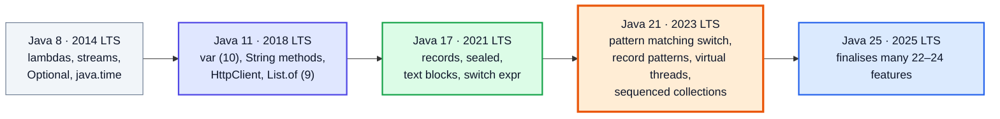
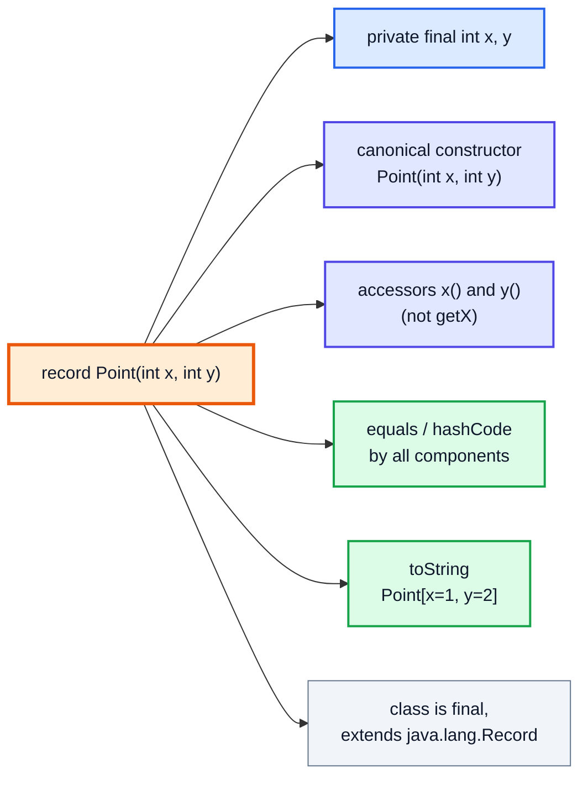
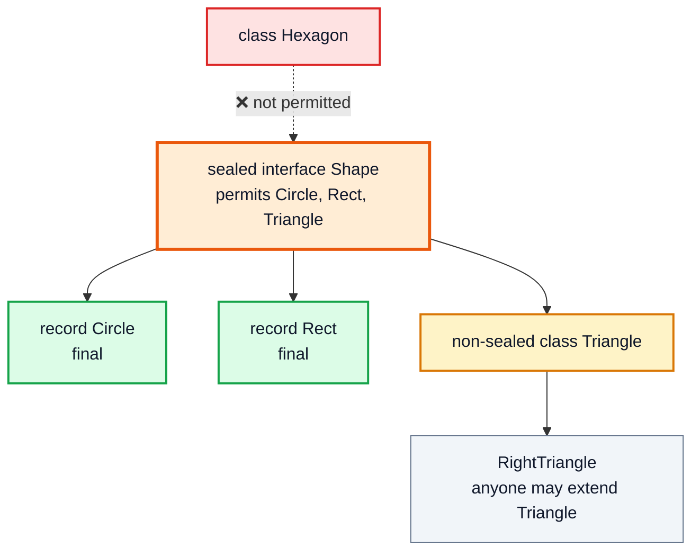
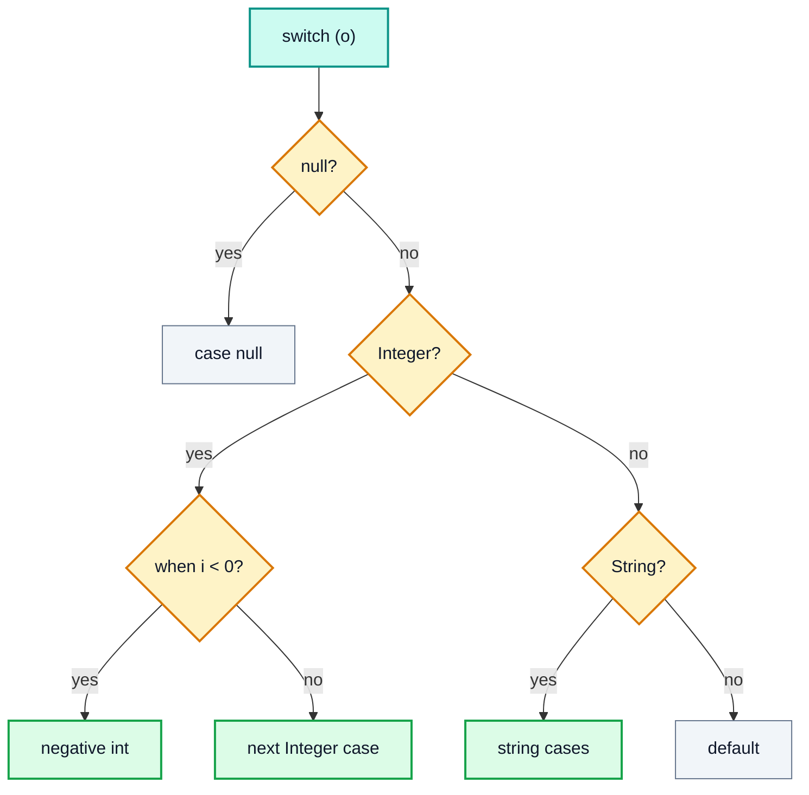
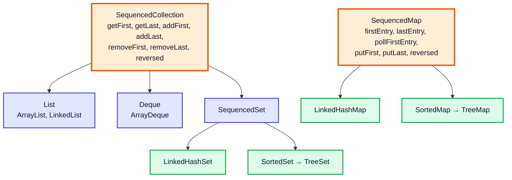

# Modern Java Features (Java 9–21) — Complete In-Depth Guide

**Java gap topic #7 of 10** · Priority 🟡 · from [topics_not_covered.md](../topics_not_covered.md)

The playlist was recorded with older Java and teaches the Java 8 way of writing code. Java has changed a lot since then: **records** replace boilerplate data classes, **sealed** types and **pattern matching** make `switch` far more powerful, `var` cuts noise, **text blocks** make multi-line strings readable, and Java 21 adds **virtual threads** and **sequenced collections**. These notes cover every feature you're likely to use or be asked about, with the version that introduced it.

> [!NOTE]
> This topic isn't in the playlist, so there are no video timestamps. All code compiles and runs on **Java 21** (the current LTS used throughout these notes) without preview flags. Features that were still in preview in Java 21 are marked as such.

---

## Table of Contents

| # | Topic (anchor link) | Version |
|---|---|---|
| 0 | [The Release Timeline](#0-the-release-timeline) | — |
| 1 | [var: Local Variable Type Inference](#1-var-local-variable-type-inference) | 10 |
| 2 | [Collection Factory Methods](#2-collection-factory-methods) | 9–10 |
| 3 | [New String Methods](#3-new-string-methods) | 11–15 |
| 4 | [Text Blocks](#4-text-blocks) | 15 |
| 5 | [Switch Expressions](#5-switch-expressions) | 14 |
| 6 | [Records](#6-records) | 16 |
| 7 | [Pattern Matching for instanceof](#7-pattern-matching-for-instanceof) | 16 |
| 8 | [Sealed Classes and Interfaces](#8-sealed-classes-and-interfaces) | 17 |
| 9 | [Pattern Matching for switch](#9-pattern-matching-for-switch) | 21 |
| 10 | [Record Patterns](#10-record-patterns) | 21 |
| 11 | [Sequenced Collections](#11-sequenced-collections) | 21 |
| 12 | [Virtual Threads](#12-virtual-threads) | 21 |
| 13 | [Smaller Improvements Worth Knowing](#13-smaller-improvements-worth-knowing) | 9–21 |
| 14 | [Beyond Java 21](#14-beyond-java-21) | 22+ |
| 15 | [Old Style vs Modern Style](#15-old-style-vs-modern-style) | Summary |

---

## 0. The Release Timeline

Since Java 10, a new version ships **every six months**. Every two years one of them is a **Long-Term Support (LTS)** release that companies standardise on.



| Term | Meaning |
|---|---|
| **Preview feature** | Fully built but may change; needs `--enable-preview` to compile and run |
| **Incubator** | An experimental API in a `jdk.incubator.*` module |
| **Final / standard** | Permanent part of the language |
| **JEP** | JDK Enhancement Proposal: the numbered document describing each feature |

---

## 1. var: Local Variable Type Inference

`var` (Java 10) lets the compiler infer a **local variable's** type from its initializer. Java is still statically typed: the type is fixed at compile time.

```java
import java.util.*;

public class VarDemo {
    public static void main(String[] args) {
        var count = 10;                                   // int
        var name = "Kunal";                               // String
        var scores = new HashMap<String, List<Integer>>(); // HashMap<String, List<Integer>>
        scores.put("math", new ArrayList<>(List.of(90, 85)));

        for (var entry : scores.entrySet()) {             // Map.Entry<String, List<Integer>>
            System.out.println(entry.getKey() + " " + entry.getValue());   // math [90, 85]
        }
        for (var i = 0; i < 2; i++) System.out.print(i + " ");             // 0 1
        System.out.println();

        // count = "ten";                                 // ❌ compile error: count is an int forever
        var list = new ArrayList<>();                     // ⚠️ ArrayList<Object> — diamond with var loses the type
        list.add(1); list.add("two");
        System.out.println(list);                         // [1, two]
    }
}
```

| ✅ Allowed | ❌ Not allowed |
|---|---|
| Local variables with an initializer | Fields, method parameters, return types |
| `for` and enhanced-`for` loop variables | `var x;` (no initializer) |
| try-with-resources variables | `var x = null;` (no type to infer) |
| Lambda parameters (Java 11): `(var a, var b) -> a + b` | Array initializer: `var a = {1, 2};` |
| | Lambdas: `var f = () -> 1;` (no target type) |

> [!TIP]
> Use `var` when the type is **obvious** from the right side (`var list = new ArrayList<String>()`) or long and noisy. Avoid it when it hides useful information (`var result = service.process(x);` — what type is that?). `var` is a *reserved type name*, not a keyword, so old code with a variable named `var` still compiles.

---

## 2. Collection Factory Methods

Java 9 added compact factories that create **unmodifiable** collections.

```java
import java.util.*;

public class FactoryMethods {
    public static void main(String[] args) {
        List<Integer> list = List.of(3, 1, 2);
        Set<String> set = Set.of("a", "b");
        Map<String, Integer> map = Map.of("one", 1, "two", 2);                  // up to 10 pairs
        Map<String, Integer> big = Map.ofEntries(Map.entry("x", 24), Map.entry("y", 25));

        System.out.println(list + " " + map.get("two") + " " + big.size());   // [3, 1, 2] 2 2

        try { list.add(4); } catch (UnsupportedOperationException e) { System.out.println("List.of is unmodifiable"); }
        try { List.of(1, null); } catch (NullPointerException e) { System.out.println("No nulls allowed"); }
        try { Set.of("a", "a"); } catch (IllegalArgumentException e) { System.out.println("Duplicate set element: " + e.getMessage()); }

        // Copy into an unmodifiable snapshot (Java 10)
        List<Integer> source = new ArrayList<>(List.of(1, 2));
        List<Integer> snapshot = List.copyOf(source);
        source.add(3);
        System.out.println(snapshot);                                         // [1, 2]

        // Need a mutable one? Wrap it.
        List<Integer> mutable = new ArrayList<>(List.of(5, 6));
        mutable.add(7);
        System.out.println(mutable);                                          // [5, 6, 7]
    }
}
```

| | `Arrays.asList(...)` | `Collections.unmodifiableList(l)` | `List.of(...)` / `List.copyOf` |
|---|---|---|---|
| Add/remove | ❌ | ❌ | ❌ |
| `set(i, x)` | ✅ (writes through to the array) | ❌ | ❌ |
| Nulls | ✅ | ✅ | ❌ NPE |
| Changes if the source changes | Yes (backed by array) | Yes (a *view*) | No (`copyOf` is a copy) |

> [!WARNING]
> `Set.of` and `Map.of` have **no defined iteration order**, and the order can change between JVM runs. Don't write tests that depend on it; use `LinkedHashMap`/`TreeMap` when order matters.

---

## 3. New String Methods

[Video 21](../kunal-java-notes-claude/java_21_video_strings_stringbuilder.md) covers the classic `String` API. These were added later:

| Method | Version | Example | Result |
|---|---|---|---|
| `isBlank()` | 11 | `"  ".isBlank()` | `true` (`isEmpty` would be `false`) |
| `strip()`, `stripLeading()`, `stripTrailing()` | 11 | `" hi ".strip()` | `"hi"` (Unicode-aware, unlike `trim`) |
| `repeat(n)` | 11 | `"ab".repeat(3)` | `"ababab"` |
| `lines()` | 11 | `"a\nb".lines().count()` | `2` |
| `indent(n)` | 12 | `"x".indent(2)` | `"  x\n"` |
| `transform(f)` | 12 | `"5".transform(Integer::parseInt)` | `5` |
| `formatted(args)` | 15 | `"%d%%".formatted(50)` | `"50%"` |
| `stripIndent()`, `translateEscapes()` | 15 | used by text blocks | |
| `chars()` (Java 9 for `CharSequence` default) | 8/9 | `"aab".chars().filter(c -> c == 'a').count()` | `2` |
| `splitWithDelimiters` | 21 | `"a,b".splitWithDelimiters(",", 0)` | `[a, ,, b]` |
| `indexOf(ch, from, to)` | 21 | bounded search | |

```java
public class StringMethods {
    public static void main(String[] args) {
        System.out.println("   ".isBlank() + " " + "   ".isEmpty());          // true false
        System.out.println("[" + "  java  ".strip() + "]");                   // [java]
        System.out.println("=".repeat(10));                                   // ==========
        System.out.println("line1\nline2\nline3".lines().count());            // 3
        System.out.println("Hello %s, you are %d".formatted("Kunal", 25));    // Hello Kunal, you are 25
        int n = "42".transform(Integer::parseInt);
        System.out.println(n + 1);                                            // 43
        System.out.println(String.join("|", "a,b;c".splitWithDelimiters("[,;]", 0)));  // a|,|b|;|c
    }
}
```

> [!NOTE]
> `trim()` removes characters `<= ' '` (ASCII space and control characters). `strip()` uses `Character.isWhitespace`, so it also removes Unicode spaces like the em-space ` `. Prefer `strip()` in new code.

---

## 4. Text Blocks

A text block (Java 15) is a multi-line string literal between `"""` delimiters. No more `"\n" +` chains or escaped quotes.

```java
public class TextBlocks {
    public static void main(String[] args) {
        // Old way
        String jsonOld = "{\n" +
                         "  \"name\": \"Kunal\",\n" +
                         "  \"course\": \"DSA\"\n" +
                         "}";

        // Text block
        String json = """
                {
                  "name": "Kunal",
                  "course": "DSA"
                }""";
        System.out.println(json.equals(jsonOld));        // true

        // Indentation is measured from the closing """ or the least-indented line
        String sql = """
            SELECT name, marks
            FROM students
            WHERE marks > %d
            """.formatted(80);
        System.out.print(sql);

        // Escapes: \ at line end joins lines, \s keeps a trailing space
        String oneLine = """
            This is a long sentence \
            written on two lines.""";
        System.out.println(oneLine);                     // This is a long sentence written on two lines.
    }
}
// Output:
// true
// SELECT name, marks
// FROM students
// WHERE marks > 80
// This is a long sentence written on two lines.
```

| Rule | Detail |
|---|---|
| Opening `"""` | Must be followed by a **line break** (content starts on the next line) |
| Incidental indentation | The common leading whitespace is removed automatically |
| Closing `"""` on its own line | Adds a trailing `\n`; its position also controls indentation |
| Closing `"""` right after text | No trailing newline |
| `\<newline>` | Join with the next line (no `\n`) |
| `\s` | A single space that won't be stripped |
| Line endings | Always normalised to `\n` |

---

## 5. Switch Expressions

[Video 10](../kunal-java-notes-claude/java_10_video_switch_statements.md) shows the classic `switch` statement and the newer arrow form. Java 14 made `switch` an **expression** that returns a value.

```java
public class SwitchExpressions {
    enum Day { MON, TUE, WED, THU, FRI, SAT, SUN }

    public static void main(String[] args) {
        Day day = Day.SAT;

        // Old statement: fall-through risk, needs break, assigns from outside
        String typeOld;
        switch (day) {
            case SAT:
            case SUN:
                typeOld = "weekend";
                break;
            default:
                typeOld = "weekday";
        }

        // New expression: arrows, no fall-through, several labels, returns a value
        String type = switch (day) {
            case SAT, SUN -> "weekend";
            case MON, TUE, WED, THU, FRI -> "weekday";   // no default needed: every enum constant covered
        };
        System.out.println(typeOld + " " + type);        // weekend weekend

        // yield: return a value from a block
        int letters = switch (day) {
            case MON, FRI, SUN -> 3;
            case TUE -> 7;
            default -> {
                String s = day.name().toLowerCase();
                yield s.length() * 2;                    // yield, not return
            }
        };
        System.out.println(letters);                     // 6

        // Works on strings and ints too
        String cmd = "stop";
        int code = switch (cmd) {
            case "start" -> 1;
            case "stop" -> 0;
            default -> throw new IllegalArgumentException("unknown " + cmd);
        };
        System.out.println(code);                        // 0
    }
}
```

| | Old `case X:` statement | `case X ->` (arrow) |
|---|---|---|
| Fall-through | Yes, unless you `break` | **Never** |
| Multiple labels | Stack `case A: case B:` | `case A, B ->` |
| As an expression | Yes with `yield` (`case A: yield 1;`) | Yes |
| Exhaustive | Not required for statements | **Required** for expressions (the compiler checks) |

> [!IMPORTANT]
> A switch **expression** must be exhaustive: cover every possible value, or add `default`. For enums and sealed types the compiler can prove all cases are covered, so you don't need `default`, and if someone adds a new constant later, the code stops compiling instead of silently doing nothing. That's a big safety win.

---

## 6. Records

A **record** (Java 16) is a concise, **immutable data carrier**. One line replaces a class with private final fields, a constructor, getters, `equals`, `hashCode` and `toString`.

```java
// Old way: ~40 lines for a 2-field data class
final class PointOld {
    private final int x, y;
    PointOld(int x, int y) { this.x = x; this.y = y; }
    int x() { return x; }
    int y() { return y; }
    @Override public boolean equals(Object o) {
        return o instanceof PointOld p && p.x == x && p.y == y;
    }
    @Override public int hashCode() { return java.util.Objects.hash(x, y); }
    @Override public String toString() { return "PointOld[x=" + x + ", y=" + y + "]"; }
}

// New way
record Point(int x, int y) { }
```



### Customising a record

```java
import java.util.*;

public class RecordsDemo {
    record Range(int lo, int hi) {
        Range {                                            // compact constructor: validation, no parameter list
            if (lo > hi) throw new IllegalArgumentException("lo > hi: " + lo + " > " + hi);
        }
        Range(int single) { this(single, single); }       // extra constructors must call the canonical one
        int length() { return hi - lo; }                   // instance methods are fine
        static Range of(int a, int b) { return new Range(Math.min(a, b), Math.max(a, b)); }  // static factory
    }

    record Student(String name, List<String> courses) {
        Student {
            Objects.requireNonNull(name);
            courses = List.copyOf(courses);               // defensive copy → truly immutable
        }
    }

    record Pair<A, B>(A first, B second) { }               // generic record

    interface Shape { double area(); }
    record Circle(double r) implements Shape {             // records can implement interfaces
        public double area() { return Math.PI * r * r; }
    }

    public static void main(String[] args) {
        Range r = new Range(2, 9);
        System.out.println(r + " length=" + r.length());   // Range[lo=2, hi=9] length=7
        System.out.println(new Range(5));                  // Range[lo=5, hi=5]
        System.out.println(Range.of(9, 2).equals(r));      // true  (value equality)
        try { new Range(9, 2); } catch (IllegalArgumentException e) { System.out.println(e.getMessage()); }

        List<String> list = new ArrayList<>(List.of("DSA"));
        Student s = new Student("Kunal", list);
        list.add("Java");
        System.out.println(s.courses());                   // [DSA]  (copy protects the record)

        Map<Pair<Integer, Integer>, String> grid = new HashMap<>();
        grid.put(new Pair<>(0, 1), "wall");
        System.out.println(grid.get(new Pair<>(0, 1)));    // wall  (records make great map keys)

        System.out.printf("%.2f%n", new Circle(1).area()); // 3.14

        record Temp(String city, double c) { }             // local record inside a method
        System.out.println(new Temp("Delhi", 41.5));       // Temp[city=Delhi, c=41.5]
    }
}
```

| Records CAN | Records CANNOT |
|---|---|
| Implement interfaces | Extend another class (they already extend `Record`) |
| Have static fields and methods | Have extra **instance** fields |
| Have instance methods | Be subclassed (they're `final`) |
| Have compact/extra constructors | Reassign their fields (they're `final`) |
| Be generic, nested, or local | |
| Override accessors, `equals`, `toString` | |

> [!TIP]
> Records are perfect for DTOs, map keys (like `(row, col)` in grid BFS problems), multiple return values, and stream intermediate data. They're **shallowly** immutable: a `List` component can still be modified unless you copy it with `List.copyOf` as above.

---

## 7. Pattern Matching for instanceof

Java 16 removed the "test, then cast" boilerplate.

```java
public class InstanceofPattern {
    static String describe(Object o) {
        // Old: test, then cast by hand
        if (o instanceof String) {
            String s = (String) o;
            return "String of length " + s.length();
        }
        // New: the pattern variable `n` is declared and cast for you
        if (o instanceof Integer n && n > 100) {            // n is usable right after &&
            return "Big integer " + n;
        }
        if (!(o instanceof Double d)) {
            return "Something else: " + o;
        }
        return "Double, rounded " + Math.round(d);          // d in scope here: flow scoping
    }

    public static void main(String[] args) {
        System.out.println(describe("hello"));    // String of length 5
        System.out.println(describe(500));        // Big integer 500
        System.out.println(describe(3.7));        // Double, rounded 4
        System.out.println(describe(7));          // Something else: 7
    }
}
```

> [!NOTE]
> **Flow scoping:** the pattern variable exists only where the compiler knows the test succeeded. `if (!(o instanceof Double d)) return ...;` means after the `if`, `d` is definitely a `Double`, so it's in scope. You can't use `n` after `||`, because the left side might have failed.

A nice side effect: `equals` becomes a one-liner, `return o instanceof Point p && p.x == x && p.y == y;`.

---

## 8. Sealed Classes and Interfaces

A **sealed** type (Java 17) lists exactly which classes may extend or implement it. It sits between `final` (no subclasses) and normal classes (anyone can extend).

```java
public class SealedDemo {
    sealed interface Shape permits Circle, Rect, Triangle { }

    record Circle(double r) implements Shape { }               // records are implicitly final
    record Rect(double w, double h) implements Shape { }
    non-sealed static class Triangle implements Shape {         // opens the hierarchy again below this point
        final double b, h;
        Triangle(double b, double h) { this.b = b; this.h = h; }
    }
    static class RightTriangle extends Triangle {               // allowed: Triangle is non-sealed
        RightTriangle(double a, double b) { super(a, b); }
    }

    // class Hexagon implements Shape { }                       // ❌ compile error: not in the permits list

    public static void main(String[] args) {
        Shape[] shapes = { new Circle(1), new Rect(2, 3), new RightTriangle(3, 4) };
        for (Shape s : shapes) System.out.println(s.getClass().getSimpleName());
        System.out.println(Shape.class.isSealed());              // true
    }
}
// Output:
// Circle
// Rect
// RightTriangle
// true
```



| Rule | Detail |
|---|---|
| Every permitted subclass must say what it is | `final`, `sealed` (with its own `permits`), or `non-sealed` |
| Location | Permitted classes must be in the same module (or the same package if unnamed module) |
| `permits` can be omitted | If all subclasses are in the same source file |
| Why | Model a **closed set** of alternatives (shapes, AST nodes, payment results) so the compiler can check `switch` completeness |

> [!TIP]
> **Records + sealed interfaces = algebraic data types.** "A `Result` is either `Success(value)` or `Failure(error)`" is two records sealed under one interface. Combined with pattern-matching `switch` (next section), this is the modern Java way to model data.

---

## 9. Pattern Matching for switch

Java 21 lets `case` labels be **type patterns**, with optional **guards** (`when`), and lets you handle `null` directly.

```java
public class SwitchPatterns {
    sealed interface Shape permits Circle, Square, Rect { }
    record Circle(double r) implements Shape { }
    record Square(double side) implements Shape { }
    record Rect(double w, double h) implements Shape { }

    static double area(Shape s) {
        return switch (s) {                               // exhaustive: no default needed
            case Circle c -> Math.PI * c.r() * c.r();
            case Square sq -> sq.side() * sq.side();
            case Rect r -> r.w() * r.h();
        };
    }

    static String classify(Object o) {
        return switch (o) {
            case null -> "null!";                          // null handled explicitly (otherwise NPE)
            case Integer i when i < 0 -> "negative int";   // guard
            case Integer i when i == 0 -> "zero";
            case Integer i -> "positive int " + i;
            case String s when s.isBlank() -> "blank string";
            case String s -> "string '" + s + "'";
            case int[] arr -> "int array of length " + arr.length;
            default -> "other: " + o.getClass().getSimpleName();
        };
    }

    public static void main(String[] args) {
        System.out.printf("%.2f %.1f %.1f%n", area(new Circle(1)), area(new Square(3)), area(new Rect(2, 5)));
        for (Object o : new Object[]{null, -5, 0, 42, "  ", "hi", new int[3], 2.5}) {
            System.out.println(classify(o));
        }
    }
}
// Output:
// 3.14 9.0 10.0
// null!
// negative int
// zero
// positive int 42
// blank string
// string 'hi'
// int array of length 3
// other: Double
```

| Rule | Detail |
|---|---|
| **Dominance** | A more general case can't come before a more specific one: `case Integer i` before `case Integer i when i > 0` is a compile error |
| **Guards** | `case Type t when condition ->` |
| **`null`** | Without `case null`, a `null` selector throws `NullPointerException` (old behaviour) |
| `case null, default ->` | Handle both together |
| **Exhaustiveness** | Required when switching on a sealed type or using patterns |



---

## 10. Record Patterns

Java 21 can **deconstruct** a record right in the pattern, pulling out its components, even nested ones.

```java
public class RecordPatterns {
    record Point(int x, int y) { }
    sealed interface Shape permits Line, Circle { }
    record Line(Point start, Point end) implements Shape { }
    record Circle(Point center, int radius) implements Shape { }

    static String describe(Shape s) {
        return switch (s) {
            case Line(Point(var x1, var y1), Point(var x2, var y2)) when x1 == x2 ->
                    "vertical line at x=" + x1 + " of length " + Math.abs(y2 - y1);
            case Line(Point p1, Point p2) ->
                    "line from " + p1 + " to " + p2;
            case Circle(Point(int x, int y), int r) ->
                    "circle at (" + x + "," + y + ") radius " + r;
        };
    }

    public static void main(String[] args) {
        System.out.println(describe(new Line(new Point(2, 1), new Point(2, 7))));
        System.out.println(describe(new Line(new Point(0, 0), new Point(3, 4))));
        System.out.println(describe(new Circle(new Point(5, 5), 2)));

        Object o = new Point(3, 4);
        if (o instanceof Point(int x, int y)) {                  // record pattern in instanceof
            System.out.println("distance = " + Math.sqrt(x * x + y * y));
        }
    }
}
// Output:
// vertical line at x=2 of length 6
// line from Point[x=0, y=0] to Point[x=3, y=4]
// circle at (5,5) radius 2
// distance = 5.0
```

> [!NOTE]
> The unnamed pattern `_` (e.g. `case Circle(Point _, int r)`) was a **preview** in Java 21 and became final in **Java 22**. In Java 21 without preview flags, write `var ignored` instead.

### Example: a tiny expression evaluator

This is where sealed + records + switch patterns shine, and it's a common interview "design an evaluator" question.

```java
public class ExprEval {
    sealed interface Expr permits Num, Add, Mul, Neg { }
    record Num(int value) implements Expr { }
    record Add(Expr left, Expr right) implements Expr { }
    record Mul(Expr left, Expr right) implements Expr { }
    record Neg(Expr inner) implements Expr { }

    static int eval(Expr e) {
        return switch (e) {
            case Num n -> n.value();
            case Add(var l, var r) -> eval(l) + eval(r);
            case Mul(var l, var r) -> eval(l) * eval(r);
            case Neg(var in) -> -eval(in);
        };
    }

    static String show(Expr e) {
        return switch (e) {
            case Num n -> String.valueOf(n.value());
            case Add(var l, var r) -> "(" + show(l) + " + " + show(r) + ")";
            case Mul(var l, var r) -> show(l) + " * " + show(r);
            case Neg(var in) -> "-" + show(in);
        };
    }

    public static void main(String[] args) {
        Expr e = new Mul(new Add(new Num(2), new Num(3)), new Neg(new Num(4)));
        System.out.println(show(e) + " = " + eval(e));   // (2 + 3) * -4 = -20
    }
}
```

The recursion is exactly the tree recursion from [video 49](../kunal-java-notes-claude/java_49_video_binary_trees_bst.md): each `Add`/`Mul` node has two children.

---

## 11. Sequenced Collections

Before Java 21, "get the last element" was different for every collection: `list.get(list.size() - 1)`, `deque.getLast()`, `sortedSet.last()`, and for a `LinkedHashSet`… iterate to the end. Java 21 adds three interfaces with one consistent API.



```java
import java.util.*;

public class SequencedDemo {
    public static void main(String[] args) {
        List<Integer> list = new ArrayList<>(List.of(1, 2, 3));
        System.out.println(list.getFirst() + " " + list.getLast());   // 1 3
        list.addFirst(0);
        list.removeLast();
        System.out.println(list + " reversed " + list.reversed());    // [0, 1, 2] reversed [2, 1, 0]

        LinkedHashSet<String> recent = new LinkedHashSet<>(List.of("a", "b", "c"));
        System.out.println(recent.getLast());                         // c (used to need a loop)
        recent.addFirst("c");                                         // moves "c" to the front
        System.out.println(recent);                                   // [c, a, b]

        LinkedHashMap<String, Integer> lhm = new LinkedHashMap<>();
        lhm.put("x", 1); lhm.put("y", 2); lhm.put("z", 3);
        System.out.println(lhm.firstEntry() + " " + lhm.lastEntry()); // x=1 z=3
        lhm.putFirst("z", 30);                                        // move/insert at front
        System.out.println(lhm + " reversed " + lhm.reversed());      // {z=30, x=1, y=2} reversed {y=2, x=1, z=30}
        System.out.println(lhm.pollFirstEntry() + " " + lhm);         // z=30 {x=1, y=2}
    }
}
```

> [!NOTE]
> `reversed()` returns a **view**, not a copy: changes to the view show up in the original. `addFirst`/`addLast` on `TreeSet` or `List.of(...)` throw `UnsupportedOperationException`, because their order is fixed by sorting or immutability.

> [!TIP]
> `LinkedHashMap` with `putLast` / `pollFirstEntry` gives an easy LRU cache (LC 146) — the access-order constructor `new LinkedHashMap<>(cap, 0.75f, true)` plus `removeEldestEntry` is the classic one-class solution.

---

## 12. Virtual Threads

Java 21's headline feature: lightweight threads managed by the JVM, so you can run a **million** blocking tasks with simple thread-per-task code.

```java
import java.util.concurrent.*;
import java.util.stream.IntStream;

public class VirtualThreadsBrief {
    public static void main(String[] args) {
        try (var ex = Executors.newVirtualThreadPerTaskExecutor()) {
            IntStream.range(0, 10_000).forEach(i -> ex.submit(() -> { Thread.sleep(500); return i; }));
        }   // waits for all 10,000 tasks: a few seconds in total, not 10,000 × 0.5 s
        System.out.println("done");
    }
}
```

Full coverage (carriers, pinning, when not to use them) is in [gap topic #1, section 15](java_gap_01_multithreading_concurrency.md#15-virtual-threads-java-21).

---

## 13. Smaller Improvements Worth Knowing

| Feature | Version | What it does |
|---|---|---|
| **Private interface methods** | 9 | Share code between `default` methods |
| **try-with-resources on effectively final variables** | 9 | `try (reader) { ... }` without redeclaring |
| **Diamond with anonymous classes** | 9 | `new Comparator<>() { ... }` |
| **`Optional.ifPresentOrElse`, `or`, `stream`** | 9 | See [gap topic #6](java_gap_06_functional_interfaces_optional.md) |
| **Stream `takeWhile`, `dropWhile`, `iterate(seed, hasNext, next)`** | 9 | See [gap topic #2](java_gap_02_streams_api.md) |
| **JShell** | 9 | Interactive REPL: run `jshell` and type Java line by line |
| **Module system (JPMS)** | 9 | `module-info.java` for strong encapsulation (mostly for large apps and the JDK itself) |
| **`HttpClient`** | 11 | Modern HTTP/2 client (`java.net.http`) |
| **Run a single source file** | 11 | `java Hello.java` compiles and runs in one step |
| **`Files.readString` / `writeString`** | 11 | One-line file I/O (update to [video 54](../kunal-java-notes-claude/java_54_video_file_handling.md)) |
| **`Collection.toArray(IntFunction)`** | 11 | `list.toArray(String[]::new)` |
| **Helpful NullPointerExceptions** | 14 (on by default 15) | Messages like `Cannot invoke "String.length()" because "user.name" is null` |
| **`Stream.toList()`** | 16 | Unmodifiable list |
| **`record` local classes, static members in inner classes** | 16 | |
| **`RandomGenerator` interface** | 17 | Unified API for random number algorithms |
| **UTF-8 by default** | 18 | `FileReader` etc. use UTF-8 regardless of the OS |
| **Simple web server** | 18 | `jwebserver` serves a folder over HTTP |
| **`Math.clamp`** | 21 | `Math.clamp(value, min, max)` |
| **`StringBuilder.repeat`** | 21 | `sb.repeat("ab", 3)` |
| **`Character.isEmoji`** | 21 | Emoji detection |

```java
import java.nio.file.*;
import java.util.*;

public class SmallFeatures {
    interface Greeter {
        default String hello(String n) { return wrap("Hello " + n); }
        default String bye(String n)   { return wrap("Bye " + n); }
        private String wrap(String s)  { return "<" + s + ">"; }       // private interface method (9)
    }

    public static void main(String[] args) throws Exception {
        Greeter g = new Greeter() { };
        System.out.println(g.hello("A") + " " + g.bye("B"));           // <Hello A> <Bye B>

        Path tmp = Files.createTempFile("demo", ".txt");
        Files.writeString(tmp, "line one\nline two");                  // 11
        System.out.println(Files.readString(tmp).lines().count());     // 2
        Files.delete(tmp);

        String[] arr = List.of("x", "y").toArray(String[]::new);       // 11
        System.out.println(arr.length);                                // 2

        System.out.println(Math.clamp(150, 0, 100));                   // 100  (21)
        System.out.println(new StringBuilder().repeat("ab", 3));       // ababab (21)

        record User(String name) { }
        User u = new User(null);
        try {
            u.name().length();
        } catch (NullPointerException e) {
            System.out.println(e.getMessage());   // Cannot invoke "String.length()" because the return value of "...User.name()" is null
        }
    }
}
```

---

## 14. Beyond Java 21

Not in Java 21, but you'll see these in newer code and articles:

| Feature | Status |
|---|---|
| Unnamed variables and patterns `_` | Preview in 21, **final in 22** |
| Unnamed classes / instance `main` (`void main() { ... }`) | Preview 21–24, **final in 25** as "compact source files" |
| String templates (`STR."Hello \{name}"`) | Preview 21–22, then **withdrawn** — don't learn it |
| Stream Gatherers (`stream.gather(...)`) | Preview 22–23, **final in 24** |
| Statements before `super(...)` in constructors | Preview 22–24, **final in 25** |
| Scoped values (a better `ThreadLocal`) | Preview 21–24, **final in 25** |
| Structured concurrency | Preview from 21, still evolving |
| Primitive types in patterns (`case int i`) | Preview from 23 |
| Module import declarations (`import module java.base;`) | **Final in 25** |
| `synchronized` no longer pins virtual threads | **Java 24** |
| Foreign Function & Memory API (replaces JNI) | **Final in 22** |

> [!NOTE]
> Java 25 (September 2025) is the LTS after 21. Everything in these notes still applies to it.

---

## 15. Old Style vs Modern Style

| Task | Java 8 style | Modern (17/21) style |
|---|---|---|
| Data class | 40-line class with getters, `equals`, `hashCode` | `record Point(int x, int y) { }` |
| Local variable | `Map<String, List<Integer>> m = new HashMap<>();` | `var m = new HashMap<String, List<Integer>>();` |
| Immutable list | `Collections.unmodifiableList(Arrays.asList(1, 2))` | `List.of(1, 2)` |
| Multi-line string | `"a\n" + "b\n"` | `"""` text block |
| Type check + cast | `if (o instanceof String) { String s = (String) o; }` | `if (o instanceof String s)` |
| Branch on type | `if/else instanceof` chains | `switch (o) { case Circle c -> ... }` |
| Closed hierarchy | Comments saying "don't extend this" | `sealed ... permits` |
| Switch that returns | Statement + `break` + assignment | `var x = switch (v) { case A -> 1; ... };` |
| Last element | `list.get(list.size() - 1)` | `list.getLast()` |
| Blank check | `s.trim().isEmpty()` | `s.isBlank()` |
| Repeat a string | Loop with `StringBuilder` | `"-".repeat(20)` |
| Read a file | `BufferedReader` loop | `Files.readString(path)` |
| Many blocking tasks | Thread pool sized carefully | Virtual thread per task |
| Collect to list | `collect(Collectors.toList())` | `.toList()` |

---

## 🧩 Complete Example: Everything Together

A mini "payment processing" program that uses records with validation, a sealed hierarchy, pattern-matching `switch` with guards and record patterns, `var`, text blocks with `formatted`, switch expressions with `yield`, sequenced collections, new `String` methods, `Math.clamp` and virtual threads.

```java
import java.util.*;
import java.util.concurrent.*;
import java.util.concurrent.atomic.*;

public class ModernJavaShowcase {

    record Money(long paise) {
        Money {
            if (paise < 0) throw new IllegalArgumentException("negative money");
        }
        static Money rupees(double r) { return new Money(Math.round(r * 100)); }
        Money plus(Money o) { return new Money(paise + o.paise); }
        @Override public String toString() { return "Rs %d.%02d".formatted(paise / 100, paise % 100); }
    }

    sealed interface Payment permits Upi, Card, Cash { }
    record Upi(String vpa, Money amount) implements Payment { }
    record Card(String last4, Money amount, boolean international) implements Payment { }
    record Cash(Money amount) implements Payment { }

    sealed interface Result permits Ok, Rejected { }
    record Ok(Payment payment, Money fee) implements Result { }
    record Rejected(Payment payment, String reason) implements Result { }

    enum Tier { BASIC, SILVER, GOLD }

    static Result process(Payment p) {
        return switch (p) {
            case Upi(var vpa, var amt) when !vpa.contains("@") -> new Rejected(p, "invalid VPA '" + vpa + "'");
            case Upi u -> new Ok(u, new Money(0));
            case Card(var last4, var amt, var intl) when intl -> new Ok(p, new Money(amt.paise() * 3 / 100));
            case Card c -> new Ok(c, new Money(Math.clamp(c.amount().paise() / 100, 500, 2_000)));
            case Cash(Money(long paise)) when paise > 20_000_000 -> new Rejected(p, "cash above Rs 2 lakh");
            case Cash c -> new Ok(c, new Money(0));
        };
    }

    static Money amountOf(Payment p) {
        return switch (p) {
            case Upi u -> u.amount();
            case Card c -> c.amount();
            case Cash c -> c.amount();
        };
    }

    static int cashbackPercent(Tier t, Money spent) {
        return switch (t) {
            case BASIC -> 0;
            case SILVER -> 1;
            case GOLD -> {
                var bonus = spent.paise() > 10_000_00 ? 1 : 0;
                yield 2 + bonus;
            }
        };
    }

    public static void main(String[] args) throws Exception {
        var payments = List.<Payment>of(
                new Upi("asha@okbank", Money.rupees(450)),
                new Upi("bad-vpa", Money.rupees(99)),
                new Card("4242", Money.rupees(12_000), false),
                new Card("1881", Money.rupees(800), true),
                new Card("0005", Money.rupees(150), false),
                new Cash(Money.rupees(250_000)),
                new Cash(Money.rupees(300)));

        // Pattern matching + sealed results
        var log = new LinkedHashMap<String, Result>();       // SequencedMap
        int i = 1;
        for (var p : payments) log.put("TXN-" + i++, process(p));

        Money total = new Money(0), fees = new Money(0);
        for (var e : log.entrySet()) {
            String line = switch (e.getValue()) {
                case Ok(var pay, var fee) -> {
                    total = total.plus(amountOf(pay));
                    fees = fees.plus(fee);
                    yield "OK   " + pay.getClass().getSimpleName() + " " + amountOf(pay) + " fee " + fee;
                }
                case Rejected(var pay, var reason) -> "FAIL " + pay.getClass().getSimpleName() + ": " + reason;
            };
            System.out.println(e.getKey() + " " + line);
        }

        // Sequenced collections
        System.out.println("First: " + log.firstEntry().getKey() + ", last: " + log.lastEntry().getKey());
        var rejectedIds = new ArrayList<String>();
        log.forEach((id, r) -> { if (r instanceof Rejected) rejectedIds.add(id); });
        System.out.println("Rejected (newest first): " + rejectedIds.reversed());

        // Text block + formatted
        var tier = Tier.GOLD;
        String receipt = """
                ===== RECEIPT =====
                Collected : %s
                Fees      : %s
                Cashback  : %d%% (%s tier)
                ===================""".formatted(total, fees, cashbackPercent(tier, total), tier);
        System.out.println(receipt);

        // New String methods
        String note = "   ";
        System.out.println("Note blank? " + note.isBlank() + " | " + "-".repeat(5) + " | " + "  trimmed  ".strip() + "|");

        // Record validation
        try {
            new Money(-1);
        } catch (IllegalArgumentException e) {
            System.out.println("Record rejected: " + e.getMessage());
        }

        // Virtual threads: verify 10,000 payments concurrently
        var verified = new AtomicInteger();
        try (var ex = Executors.newVirtualThreadPerTaskExecutor()) {
            for (int k = 0; k < 10_000; k++) {
                ex.submit(() -> {
                    Thread.sleep(5);                       // pretend to call a bank API
                    verified.incrementAndGet();
                    return null;
                });
            }
        }
        System.out.println("Verified on virtual threads: " + verified.get());
    }
}
```

**Expected Output:**
```
TXN-1 OK   Upi Rs 450.00 fee Rs 0.00
TXN-2 FAIL Upi: invalid VPA 'bad-vpa'
TXN-3 OK   Card Rs 12000.00 fee Rs 20.00
TXN-4 OK   Card Rs 800.00 fee Rs 24.00
TXN-5 OK   Card Rs 150.00 fee Rs 5.00
TXN-6 FAIL Cash: cash above Rs 2 lakh
TXN-7 OK   Cash Rs 300.00 fee Rs 0.00
First: TXN-1, last: TXN-7
Rejected (newest first): [TXN-6, TXN-2]
===== RECEIPT =====
Collected : Rs 13700.00
Fees      : Rs 49.00
Cashback  : 3% (GOLD tier)
===================
Note blank? true | ----- | trimmed|
Record rejected: negative money
Verified on virtual threads: 10000
```

---

## Quick Reference Cheat Sheet

| Feature | Version | One-Line Summary |
|---|---|---|
| **`List.of` / `Map.of` / `copyOf`** | 9 / 10 | Unmodifiable, no nulls |
| **`var`** | 10 | Inferred local variable type; still static typing |
| **`isBlank`, `strip`, `repeat`, `lines`** | 11 | Handy `String` methods |
| **`java File.java`** | 11 | Run a source file directly |
| **Switch expressions** | 14 | `case A, B ->`, no fall-through, `yield`, exhaustive |
| **Helpful NPEs** | 14/15 | NPE message names the null expression |
| **Text blocks** | 15 | `"""` multi-line strings; `formatted()` |
| **Records** | 16 | Immutable data class; compact constructor for validation |
| **`instanceof` patterns** | 16 | `if (o instanceof String s)` |
| **`Stream.toList()`** | 16 | Unmodifiable list from a stream |
| **Sealed types** | 17 | `sealed ... permits`; subclasses are `final`, `sealed` or `non-sealed` |
| **Switch patterns** | 21 | `case Circle c ->`, `when` guards, `case null` |
| **Record patterns** | 21 | `case Line(Point(var x, var y), var end) ->` |
| **Sequenced collections** | 21 | `getFirst`, `getLast`, `reversed`, `putFirst` everywhere |
| **Virtual threads** | 21 | Millions of cheap threads for blocking I/O |
| **`Math.clamp`, `StringBuilder.repeat`** | 21 | Small conveniences |
| **`_` unnamed patterns** | 22 | Preview in 21 only |
