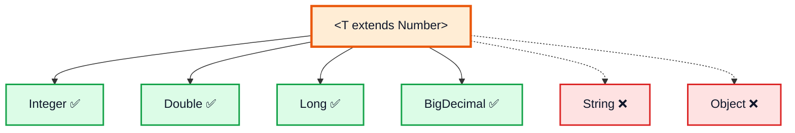
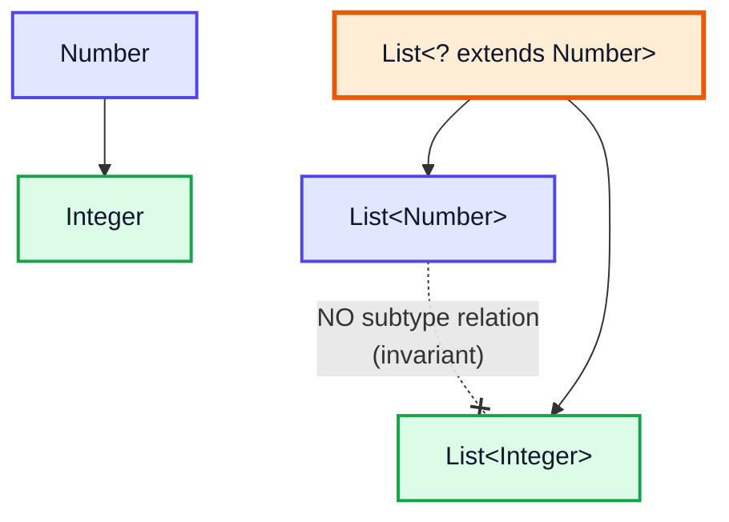
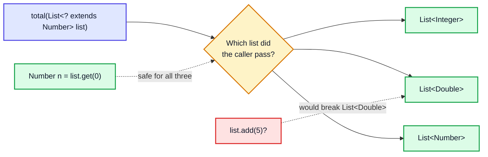
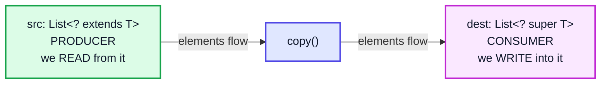
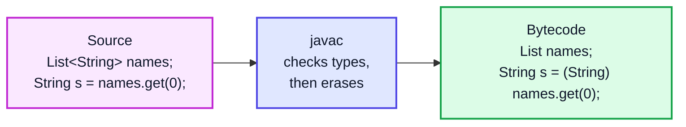

# Generics in Depth — Complete In-Depth Guide

**Java gap topic #8 of 10** · Priority 🟡 · from [topics_not_covered.md](../topics_not_covered.md)

[Video 42](../kunal-java-notes-claude/java_42_video_generics_lambdas_exceptions_cloning.md) shows the basics: a generic class `CustomArrayList<T>` and why `<T>` beats `Object`. Interviews and real code go further: **bounded types**, **wildcards** (`? extends`, `? super`), the **PECS** rule, **type erasure** and its consequences, generic methods, and why you can't write `new T[]`. These notes cover all of it.

> [!NOTE]
> This topic isn't in the playlist, so there are no video timestamps. All code targets **Java 21**.

---

## Table of Contents

| # | Topic (anchor link) | Level |
|---|---|---|
| 0 | [Why Generics: A Quick Recap](#0-why-generics-a-quick-recap) | Basics |
| 1 | [Generic Classes and Interfaces](#1-generic-classes-and-interfaces) | Basics |
| 2 | [Generic Methods](#2-generic-methods) | Core |
| 3 | [Bounded Type Parameters](#3-bounded-type-parameters) | Core |
| 4 | [Invariance: Why List of Integer Is Not a List of Number](#4-invariance-why-list-of-integer-is-not-a-list-of-number) | Core |
| 5 | [Wildcards](#5-wildcards) | Core |
| 6 | [PECS: Producer Extends, Consumer Super](#6-pecs-producer-extends-consumer-super) | In depth |
| 7 | [Type Erasure](#7-type-erasure) | In depth |
| 8 | [Restrictions Caused by Erasure](#8-restrictions-caused-by-erasure) | In depth |
| 9 | [Raw Types and Heap Pollution](#9-raw-types-and-heap-pollution) | In depth |
| 10 | [Recursive Bounds and Other Advanced Forms](#10-recursive-bounds-and-other-advanced-forms) | Advanced |
| 11 | [Generics in DSA Code](#11-generics-in-dsa-code) | DSA |
| 12 | [Common Interview Questions](#12-common-interview-questions) | Interview |

---

## 0. Why Generics: A Quick Recap

```java
import java.util.*;

public class WhyGenerics {
    public static void main(String[] args) {
        // Before Java 5: raw List of Object
        List raw = new ArrayList();
        raw.add("hello");
        raw.add(42);                         // compiles: anything goes
        try {
            String s = (String) raw.get(1);  // cast needed, and it fails at RUNTIME
        } catch (ClassCastException e) {
            System.out.println("Runtime crash: " + e.getMessage().split(" \\(")[0]);
        }

        // With generics
        List<String> names = new ArrayList<>();
        names.add("hello");
        // names.add(42);                    // ❌ compile error: caught BEFORE running
        String s = names.get(0);             // no cast needed
        System.out.println(s);
    }
}
// Output:
// Runtime crash: class java.lang.Integer cannot be cast to class java.lang.String
// hello
```

| Benefit | Meaning |
|---|---|
| **Type safety** | Wrong types are compile errors, not runtime `ClassCastException`s |
| **No casts** | `get` already returns the right type |
| **Reusable algorithms** | One `sort`, one `max`, one `Stack<T>` for every type |
| **Self-documenting** | `Map<String, List<Order>>` tells you exactly what's inside |

### Naming conventions

| Letter | Usually means |
|---|---|
| `T` | Type |
| `E` | Element (collections) |
| `K`, `V` | Key, Value (maps) |
| `N` | Number |
| `R` | Result / Return type |
| `S`, `U` | 2nd, 3rd types |

---

## 1. Generic Classes and Interfaces

```java
import java.util.*;

public class GenericClasses {
    // A generic class with one type parameter
    static class Box<T> {
        private T value;
        Box(T value) { this.value = value; }
        T get() { return value; }
        void set(T value) { this.value = value; }
        <R> Box<R> map(java.util.function.Function<T, R> f) { return new Box<>(f.apply(value)); }
    }

    // Two type parameters
    record Pair<K, V>(K key, V value) { }

    // A generic interface and two ways to implement it
    interface Container<E> { void add(E e); E get(int i); int size(); }

    static class StringBag implements Container<String> {          // fixes E = String
        private final List<String> items = new ArrayList<>();
        public void add(String e) { items.add(e); }
        public String get(int i) { return items.get(i); }
        public int size() { return items.size(); }
    }

    static class Bag<E> implements Container<E> {                   // stays generic
        private final List<E> items = new ArrayList<>();
        public void add(E e) { items.add(e); }
        public E get(int i) { return items.get(i); }
        public int size() { return items.size(); }
    }

    public static void main(String[] args) {
        Box<Integer> b = new Box<>(21);                 // diamond <> infers Integer
        Box<String> s = b.map(x -> "value=" + x * 2);
        System.out.println(s.get());                    // value=42

        Pair<String, Integer> p = new Pair<>("age", 25);
        System.out.println(p.key() + " " + p.value());  // age 25

        Container<Double> nums = new Bag<>();
        nums.add(1.5); nums.add(2.5);
        System.out.println(nums.size() + " " + nums.get(1));   // 2 2.5

        StringBag sb = new StringBag();
        sb.add("x");
        System.out.println(sb.get(0));                  // x
    }
}
```

> [!IMPORTANT]
> **Type arguments must be reference types.** `Box<int>` doesn't compile; use `Box<Integer>`. Autoboxing converts between `int` and `Integer` for you, but every element is an object on the heap (see [video 5](../kunal-java-notes-claude/java_05_video_intro_programming.md)). That's why `IntStream` and `int[]` are faster for big numeric data.

---

## 2. Generic Methods

A method can declare its **own** type parameters, written **before the return type**. It works even inside a non-generic class.

```java
import java.util.*;

public class GenericMethods {
    // <T> before the return type declares T for this method only
    static <T> void swap(T[] arr, int i, int j) {
        T tmp = arr[i]; arr[i] = arr[j]; arr[j] = tmp;
    }

    static <T> List<T> repeat(T item, int times) {
        List<T> out = new ArrayList<>();
        for (int i = 0; i < times; i++) out.add(item);
        return out;
    }

    static <K, V> Map<V, K> invert(Map<K, V> map) {
        Map<V, K> out = new HashMap<>();
        map.forEach((k, v) -> out.put(v, k));
        return out;
    }

    public static void main(String[] args) {
        String[] words = {"a", "b", "c"};
        swap(words, 0, 2);                                   // T inferred as String
        System.out.println(Arrays.toString(words));          // [c, b, a]

        Integer[] nums = {1, 2, 3};
        GenericMethods.<Integer>swap(nums, 0, 1);            // explicit type witness (rarely needed)
        System.out.println(Arrays.toString(nums));           // [2, 1, 3]

        System.out.println(repeat("hi", 3));                 // [hi, hi, hi]
        System.out.println(invert(Map.of("one", 1)));        // {1=one}

        List<String> empty = Collections.emptyList();        // T inferred from the target type
        System.out.println(empty.size());                    // 0
    }
}
```

> [!NOTE]
> **Type inference** picks `T` from the arguments and from where the result goes (the *target type*). When it can't, add a type witness: `Collections.<String>emptyList()`.

---

## 3. Bounded Type Parameters

An unbounded `T` could be anything, so you can only call `Object` methods on it. A **bound** restricts `T` and unlocks that type's methods.

```java
import java.util.*;

public class BoundedTypes {
    // T must be a Number (or subclass) → we can call doubleValue()
    static <T extends Number> double sum(List<T> list) {
        double total = 0;
        for (T x : list) total += x.doubleValue();
        return total;
    }

    // T must be comparable to itself → we can call compareTo()
    static <T extends Comparable<T>> T max(List<T> list) {
        T best = list.get(0);
        for (T x : list) if (x.compareTo(best) > 0) best = x;
        return best;
    }

    // Multiple bounds: a class first (if any), then interfaces, joined with &
    static <T extends Number & Comparable<T>> T clampMax(T a, T b) {
        return a.compareTo(b) >= 0 ? a : b;
    }

    public static void main(String[] args) {
        System.out.println(sum(List.of(1, 2, 3)));           // 6.0
        System.out.println(sum(List.of(1.5, 2.5)));          // 4.0
        System.out.println(max(List.of("pear", "apple", "zebra", "mango")));   // zebra
        System.out.println(max(List.of(4, 9, 2)));           // 9
        System.out.println(clampMax(7, 3));                  // 7
        // sum(List.of("a"));                                // ❌ String is not a Number
    }
}
```



| Syntax | Meaning |
|---|---|
| `<T extends Number>` | `T` is `Number` or a subclass |
| `<T extends Comparable<T>>` | `T` can compare itself to another `T` |
| `<T extends A & I1 & I2>` | `T` extends class `A` **and** implements `I1`, `I2` (class must come first) |
| `<T super X>` | ❌ **not allowed** — `super` is only for wildcards |

> [!NOTE]
> In bounds, `extends` means "is a subtype of" for **both** classes and interfaces. You never write `implements` inside `< >`.

---

## 4. Invariance: Why List of Integer Is Not a List of Number

This is the single most confusing thing about Java generics.

```java
import java.util.*;

public class Invariance {
    public static void main(String[] args) {
        Integer i = 5;
        Number n = i;                         // ✅ Integer IS-A Number

        List<Integer> ints = new ArrayList<>(List.of(1, 2));
        // List<Number> nums = ints;          // ❌ compile error! List<Integer> is NOT a List<Number>

        // Why? If it were allowed:
        // nums.add(3.14);                    // a Double goes into...
        // Integer x = ints.get(2);           // ...a list of Integers → ClassCastException

        // Arrays ARE covariant, and pay for it at runtime:
        Integer[] intArr = {1, 2};
        Number[] numArr = intArr;             // ✅ compiles
        try {
            numArr[0] = 3.14;                 // Java checks the real array type at runtime
        } catch (ArrayStoreException e) {
            System.out.println("ArrayStoreException: " + e.getMessage());
        }
    }
}
// Output:
// ArrayStoreException: java.lang.Double
```



| | Arrays | Generics |
|---|---|---|
| Variance | **Covariant**: `Integer[]` is a `Number[]` | **Invariant**: `List<Integer>` is not a `List<Number>` |
| Error detected | At runtime (`ArrayStoreException`) | At compile time |
| Element type at runtime | Known (reified) | Erased (Section 7) |

So how do you write a method that accepts `List<Integer>`, `List<Double>`, *and* `List<Number>`? **Wildcards.**

---

## 5. Wildcards

`?` means "some unknown type". Three forms:

| Wildcard | Read as | Accepts | You can **read** as | You can **add** |
|---|---|---|---|---|
| `List<?>` | list of *something* | any `List<X>` | `Object` | only `null` |
| `List<? extends Number>` | list of *some subtype of Number* | `List<Number>`, `List<Integer>`, `List<Double>` | `Number` | only `null` |
| `List<? super Integer>` | list of *some supertype of Integer* | `List<Integer>`, `List<Number>`, `List<Object>` | `Object` | `Integer` (and subtypes) |

```java
import java.util.*;

public class Wildcards {
    // Unbounded: only uses Object methods / size()
    static int countNonNull(List<?> list) {
        int c = 0;
        for (Object o : list) if (o != null) c++;
        return c;
    }

    // Upper bounded: READ as Number
    static double total(List<? extends Number> list) {
        double t = 0;
        for (Number n : list) t += n.doubleValue();
        // list.add(1);                   // ❌ could be a List<Double>; adding an Integer would corrupt it
        return t;
    }

    // Lower bounded: WRITE Integers
    static void fillWithSquares(List<? super Integer> list, int n) {
        for (int i = 1; i <= n; i++) list.add(i * i);
        Object first = list.get(0);       // reading only gives Object
    }

    public static void main(String[] args) {
        List<Integer> ints = new ArrayList<>(List.of(1, 2, 3));
        List<Double> doubles = List.of(1.5, 2.5);
        List<Number> numbers = new ArrayList<>();
        List<Object> objects = new ArrayList<>();

        System.out.println(countNonNull(Arrays.asList("a", null, "b")));  // 2
        System.out.println(total(ints) + " " + total(doubles));           // 6.0 4.0

        fillWithSquares(numbers, 3);
        fillWithSquares(objects, 2);
        fillWithSquares(ints, 2);
        System.out.println(numbers + " " + objects + " " + ints);        // [1, 4, 9] [1, 4] [1, 2, 3, 1, 4]
        // fillWithSquares(doubles, 2);   // ❌ Double is not a supertype of Integer
    }
}
```

### Why you can't add to `? extends`



The compiler doesn't know which one it is, so it only allows what's safe for **all** of them: reading as `Number`. With `? super Integer`, every possible list can hold an `Integer`, so adding Integers is safe, but reading only guarantees `Object`.

### `List<?>` vs `List<Object>` vs raw `List`

| | `List<Object>` | `List<?>` | raw `List` |
|---|---|---|---|
| Accepts a `List<String>` argument? | ❌ (invariance) | ✅ | ✅ (with a warning) |
| Can add a `String`? | ✅ | ❌ (only `null`) | ✅ (unsafe!) |
| Type-safe? | ✅ | ✅ | ❌ |

---

## 6. PECS: Producer Extends, Consumer Super

Joshua Bloch's rule from *Effective Java* tells you which wildcard to use:

> **P**roducer **E**xtends, **C**onsumer **S**uper.
> - If a parameter **produces** (gives you) `T`s that you read → `? extends T`
> - If a parameter **consumes** (takes in) `T`s that you write → `? super T`
> - If it does both → plain `T`, no wildcard

```java
import java.util.*;

public class Pecs {
    // src PRODUCES elements (we read) → extends; dest CONSUMES elements (we write) → super
    static <T> void copy(List<? super T> dest, List<? extends T> src) {
        for (T item : src) dest.add(item);
    }

    // Comparator CONSUMES T values (they're passed into compare) → super
    static <T> T maxBy(List<? extends T> items, Comparator<? super T> cmp) {
        T best = items.get(0);
        for (T x : items) if (cmp.compare(x, best) > 0) best = x;
        return best;
    }

    public static void main(String[] args) {
        List<Integer> ints = List.of(1, 2, 3);
        List<Number> nums = new ArrayList<>(List.of(0.5));
        copy(nums, ints);                                    // T = Integer: dest is List<Number> (super), src List<Integer>
        System.out.println(nums);                            // [0.5, 1, 2, 3]

        // A Comparator<Number> can compare Integers, thanks to ? super T
        Comparator<Number> byDouble = Comparator.comparingDouble(Number::doubleValue);
        System.out.println(maxBy(ints, byDouble));           // 3

        // The JDK itself:
        // Collections.copy(List<? super T> dest, List<? extends T> src)
        // Collections.sort(List<T> list, Comparator<? super T> c)
        // Collections.max(Collection<? extends T> coll)
        // stream.map(Function<? super T, ? extends R> mapper)
        List<Integer> sorted = new ArrayList<>(List.of(3, 1, 2));
        sorted.sort(byDouble);                               // List<Integer>.sort(Comparator<? super Integer>)
        System.out.println(sorted);                          // [1, 2, 3]
    }
}
```



> [!TIP]
> Wildcards belong in **method parameters** to make APIs flexible for callers. Don't use them in **return types**: returning `List<? extends Number>` forces every caller to deal with the wildcard.

---

## 7. Type Erasure

Generics exist **only at compile time**. After checking types, the compiler **erases** them:

1. Each type parameter is replaced by its **bound** (`T` → `Object`; `T extends Number` → `Number`).
2. Casts are inserted where needed.
3. **Bridge methods** are generated so overriding still works.

This kept Java 5 bytecode compatible with older code and JVMs.



| Source | After erasure |
|---|---|
| `class Box<T> { T value; }` | `class Box { Object value; }` |
| `class NumBox<T extends Number> { T value; }` | `class NumBox { Number value; }` |
| `<T extends Comparable<T>> T max(List<T>)` | `Comparable max(List)` |
| `String s = list.get(0);` | `String s = (String) list.get(0);` |

```java
import java.util.*;

public class ErasureDemo {
    public static void main(String[] args) {
        List<String> a = new ArrayList<>();
        List<Integer> b = new ArrayList<>();
        System.out.println(a.getClass() == b.getClass());     // true: both are just ArrayList at runtime
        System.out.println(a.getClass().getName());           // java.util.ArrayList

        // instanceof with a parameterized type isn't checkable
        Object o = a;
        // if (o instanceof List<String>) { }                // ❌ compile error (can't check at runtime)
        if (o instanceof List<?> list) System.out.println("It's some List, size " + list.size());   // ✅
    }
}
// Output:
// true
// java.util.ArrayList
// It's some List, size 0
```

### Bridge methods

```java
class Node<T> { T data; void setData(T d) { data = d; } }
class IntNode extends Node<Integer> {
    @Override void setData(Integer d) { super.setData(d); }
}
// After erasure Node has setData(Object), IntNode has setData(Integer): different signatures!
// So javac adds to IntNode a hidden "bridge":   void setData(Object d) { setData((Integer) d); }
// That keeps polymorphism working.
```

> [!NOTE]
> Some generic information **does** survive in the class file as metadata: the declared types of fields, method signatures, and superclasses (`class IntNode extends Node<Integer>`). Libraries like Jackson and Gson read it through reflection (the "super type token" trick: `new TypeToken<List<String>>() {}`). What's erased is the type argument of each **object** at runtime.

---

## 8. Restrictions Caused by Erasure

Because `T` doesn't exist at runtime, several things are forbidden:

| ❌ Not allowed | Why | Workaround |
|---|---|---|
| `new T()` | Runtime doesn't know `T` | Pass a `Supplier<T>` or `Class<T>` |
| `new T[n]` | Arrays need their element type at runtime | `(T[]) new Object[n]` (unchecked) or `Array.newInstance(cls, n)` |
| `new List<String>[10]` | Generic arrays can't be type-checked | `List<List<String>>` or `List<String>[]` via `new List[10]` (unchecked) |
| `obj instanceof List<String>` | Type argument erased | `instanceof List<?>` |
| `static T field` | One static field is shared by all `Box<X>` | Static generic **methods** are fine |
| `List<int>` | Type arguments must be objects | `List<Integer>` |
| `catch (T e)` / generic exception class | Can't catch an erased type | Throw a specific exception |
| Overloads that erase the same: `void f(List<String>)` and `void f(List<Integer>)` | Both become `f(List)` | Different method names |

```java
import java.lang.reflect.Array;
import java.util.*;
import java.util.function.Supplier;

public class ErasureWorkarounds {
    // 1. new T() → take a Supplier
    static <T> List<T> makeN(Supplier<T> factory, int n) {
        List<T> out = new ArrayList<>();
        for (int i = 0; i < n; i++) out.add(factory.get());
        return out;
    }

    // 2. new T[n] → Array.newInstance with a Class token
    @SuppressWarnings("unchecked")
    static <T> T[] newArray(Class<T> type, int n) {
        return (T[]) Array.newInstance(type, n);
    }

    // 3. Generic stack backed by Object[] (how ArrayList does it internally)
    static class Stack<E> {
        private Object[] data = new Object[2];
        private int size;
        void push(E e) {
            if (size == data.length) data = Arrays.copyOf(data, size * 2);
            data[size++] = e;
        }
        @SuppressWarnings("unchecked")
        E pop() {
            E e = (E) data[--size];      // safe: only E's were pushed
            data[size] = null;           // help the garbage collector
            return e;
        }
        boolean isEmpty() { return size == 0; }
    }

    public static void main(String[] args) {
        System.out.println(makeN(StringBuilder::new, 3).size());      // 3
        String[] arr = newArray(String.class, 4);
        System.out.println(arr.getClass().getSimpleName() + " " + arr.length);   // String[] 4

        Stack<String> st = new Stack<>();
        for (String s : List.of("a", "b", "c")) st.push(s);
        StringBuilder sb = new StringBuilder();
        while (!st.isEmpty()) sb.append(st.pop());
        System.out.println(sb);                                       // cba
    }
}
```

> [!WARNING]
> `(T[]) new Object[n]` is safe **only while the array stays inside your class**. If you return it to a caller expecting a `String[]`, they get a `ClassCastException`, because the real object is an `Object[]`. That's why `ArrayList` stores an `Object[]` internally and `toArray(T[] a)` takes an array from you.

---

## 9. Raw Types and Heap Pollution

A **raw type** is a generic type used without type arguments: `List` instead of `List<String>`. It exists only for compatibility with pre-2004 code.

```java
import java.util.*;

public class RawTypes {
    @SuppressWarnings({"rawtypes", "unchecked"})
    public static void main(String[] args) {
        List<String> strings = new ArrayList<>();
        List raw = strings;              // raw alias to the same list
        raw.add(42);                     // compiles with only a warning → HEAP POLLUTION

        System.out.println(strings.size());          // 1
        try {
            String s = strings.get(0);               // the hidden cast fails HERE, far from the bug
        } catch (ClassCastException e) {
            System.out.println("ClassCastException far from where the bug happened");
        }
    }
}
// Output:
// 1
// ClassCastException far from where the bug happened
```

**Heap pollution** = a variable of a parameterized type refers to an object that isn't of that type. The error shows up later, somewhere else, which makes it hard to debug.

### Varargs and `@SafeVarargs`

A generic varargs method creates a generic array behind the scenes, which can cause heap pollution. If your method only **reads** the array, mark it safe:

```java
import java.util.*;

public class SafeVarargsDemo {
    @SafeVarargs                                   // allowed on static, final, or private methods
    static <T> List<T> listOf(T... items) {
        return new ArrayList<>(Arrays.asList(items));   // only reads items → safe
    }

    public static void main(String[] args) {
        System.out.println(listOf("a", "b", "c"));      // [a, b, c]
    }
}
```

| Rule | |
|---|---|
| Never use raw types in new code | Use `List<?>` if you truly don't care about the type |
| Don't ignore unchecked warnings | Each one is a possible `ClassCastException` later |
| `@SuppressWarnings("unchecked")` | Use on the **smallest** scope possible, with a comment explaining why it's safe |
| Exceptions to "no raw types" | Class literals (`List.class`) and `instanceof List` |

---

## 10. Recursive Bounds and Other Advanced Forms

### `<T extends Comparable<? super T>>`

`Collections.sort` and `Collections.max` use this signature:

```java
public static <T extends Comparable<? super T>> void sort(List<T> list)
```

Why `? super T` and not just `Comparable<T>`? Because a class might inherit `compareTo` from its parent:

```java
import java.util.*;

public class RecursiveBound {
    static class Fruit implements Comparable<Fruit> {
        final int weight;
        Fruit(int w) { weight = w; }
        public int compareTo(Fruit o) { return Integer.compare(weight, o.weight); }
        public String toString() { return getClass().getSimpleName() + weight; }
    }
    static class Apple extends Fruit { Apple(int w) { super(w); } }   // Apple is Comparable<Fruit>, not Comparable<Apple>

    static <T extends Comparable<T>> T strictMax(List<T> list) { return Collections.max(list); }
    static <T extends Comparable<? super T>> T flexibleMax(List<T> list) { return Collections.max(list); }

    public static void main(String[] args) {
        List<Apple> apples = List.of(new Apple(150), new Apple(180), new Apple(120));
        // strictMax(apples);                           // ❌ Apple doesn't implement Comparable<Apple>
        System.out.println(flexibleMax(apples));        // Apple180
    }
}
```

### Self-referential generics: `Enum<E extends Enum<E>>` and fluent builders

`java.lang.Enum` is declared `class Enum<E extends Enum<E>> implements Comparable<E>`, which guarantees an enum can only be compared with constants of **its own** type. The same trick lets a builder hierarchy return the *subclass* type from inherited methods:

```java
public class SelfTypeBuilder {
    static abstract class Builder<B extends Builder<B>> {
        protected String name;
        @SuppressWarnings("unchecked")
        B name(String n) { this.name = n; return (B) this; }     // returns the subclass type
    }
    static class CarBuilder extends Builder<CarBuilder> {
        private int wheels;
        CarBuilder wheels(int w) { this.wheels = w; return this; }
        String build() { return name + " with " + wheels + " wheels"; }
    }

    public static void main(String[] args) {
        // name() returns CarBuilder, so wheels() is still available after it
        System.out.println(new CarBuilder().name("Swift").wheels(4).build());   // Swift with 4 wheels
    }
}
```

### Quick reference of advanced forms

| Form | Where you'll see it |
|---|---|
| `<T extends Comparable<? super T>>` | `Collections.sort`, `max`, `min` |
| `<E extends Enum<E>>` | `Enum`, `EnumSet`, `EnumMap` |
| `Function<? super T, ? extends R>` | `Stream.map`: flexible input and output |
| `<T, R> R reduce(...)` | Multiple type parameters on one method |
| `Class<T>` as a **type token** | `EnumMap(Class<K>)`, `Array.newInstance`, JSON libraries |
| `Map<String, ? extends List<?>>` | Nested wildcards (rare; usually a design smell) |

---

## 11. Generics in DSA Code

Writing data structures generically is what makes them reusable. Here's a generic min-heap (compare with the int heap in [video 56](../kunal-java-notes-claude/java_56_video_heaps_priority_queue.md)) and a generic binary search.

```java
import java.util.*;

public class GenericDSA {
    // Generic binary search: works for any Comparable type
    static <T extends Comparable<? super T>> int binarySearch(List<? extends T> list, T key) {
        int lo = 0, hi = list.size() - 1;
        while (lo <= hi) {
            int mid = lo + (hi - lo) / 2;                 // avoids overflow (video 14)
            int c = list.get(mid).compareTo(key);
            if (c == 0) return mid;
            if (c < 0) lo = mid + 1; else hi = mid - 1;
        }
        return -1;
    }

    // Generic heap with an optional comparator
    static class Heap<T> {
        private final List<T> a = new ArrayList<>();
        private final Comparator<? super T> cmp;

        Heap(Comparator<? super T> cmp) { this.cmp = cmp; }

        void push(T x) {
            a.add(x);
            int i = a.size() - 1;
            while (i > 0 && cmp.compare(a.get(i), a.get((i - 1) / 2)) < 0) {   // up-heap
                Collections.swap(a, i, (i - 1) / 2);
                i = (i - 1) / 2;
            }
        }

        T pop() {
            T top = a.get(0);
            T last = a.remove(a.size() - 1);
            if (!a.isEmpty()) {
                a.set(0, last);
                int i = 0;
                while (true) {                                                    // down-heap
                    int l = 2 * i + 1, r = l + 1, m = i;
                    if (l < a.size() && cmp.compare(a.get(l), a.get(m)) < 0) m = l;
                    if (r < a.size() && cmp.compare(a.get(r), a.get(m)) < 0) m = r;
                    if (m == i) break;
                    Collections.swap(a, i, m);
                    i = m;
                }
            }
            return top;
        }
        boolean isEmpty() { return a.isEmpty(); }
    }

    public static void main(String[] args) {
        System.out.println(binarySearch(List.of(2, 5, 8, 12, 16), 12));          // 3
        System.out.println(binarySearch(List.of("ant", "bee", "cat"), "cat"));   // 2

        Heap<String> h = new Heap<>(Comparator.comparing(String::length).thenComparing(Comparator.naturalOrder()));
        for (String s : List.of("banana", "fig", "apple", "kiwi")) h.push(s);
        StringBuilder sb = new StringBuilder();
        while (!h.isEmpty()) sb.append(h.pop()).append(' ');
        System.out.println(sb.toString().trim());                               // fig kiwi apple banana
    }
}
```

> [!TIP]
> In contest-style DSA code, `List<int[]>` and `PriorityQueue<int[]>` are common for pairs/tuples. A **record** (`record Cell(int r, int c)`, see [gap topic #7](java_gap_07_modern_java_features.md)) is clearer and works as a `HashMap` key; an `int[]` doesn't (arrays use identity `equals`).

---

## 12. Common Interview Questions

| Question | Short answer |
|---|---|
| What are generics for? | Compile-time type safety and reusable code without casts. |
| What is type erasure? | The compiler removes type arguments after checking, replacing them with bounds and inserting casts. |
| Why can't you do `new T()` or `new T[]`? | `T` is erased; the runtime doesn't know what to create. |
| Is `List<Integer>` a subtype of `List<Number>`? | No, generics are invariant. Use `List<? extends Number>`. |
| `? extends` vs `? super`? | Read-only producer of T (upper bound) vs write-only consumer of T (lower bound). |
| What is PECS? | Producer Extends, Consumer Super. |
| `List<?>` vs `List<Object>`? | `List<?>` accepts any list but you can't add; `List<Object>` only accepts `List<Object>` but you can add anything. |
| What's a raw type? | A generic type without type arguments; unsafe, only for legacy code. |
| What is heap pollution? | A parameterized-type variable pointing at an object of the wrong type, usually via raw types or varargs. |
| What's a bridge method? | A compiler-generated method that keeps overriding working after erasure. |
| Can you overload `f(List<String>)` and `f(List<Integer>)`? | No, both erase to `f(List)`. |
| Can static fields use the class's `T`? | No; one static field is shared by every parameterization. |
| Why are arrays covariant but generics not? | Arrays check element types at runtime (`ArrayStoreException`); generics are checked at compile time and erased. |
| What does `<T extends Comparable<? super T>>` mean? | T can be compared with itself or with one of its supertypes (e.g. `Apple` inheriting `compareTo(Fruit)`). |

---

## 🧩 Complete Example: Everything Together

A small generic toolkit: a bounded generic cache, a PECS `copy`, `? super` comparators, a wildcard sum, an erasure demonstration, a type-token array, a generic `Result` type, and a recursive-bound `max`.

```java
import java.lang.reflect.Array;
import java.util.*;
import java.util.function.*;

public class GenericsShowcase {

    // Generic class with a bounded type parameter
    static final class Stats<N extends Number & Comparable<N>> {
        private final List<N> values = new ArrayList<>();
        void add(N n) { values.add(n); }
        double mean() { return values.stream().mapToDouble(Number::doubleValue).average().orElse(0); }
        N max() { return Collections.max(values); }               // possible thanks to Comparable<N>
    }

    // Generic sealed result type
    sealed interface Result<T> permits Ok, Err { }
    record Ok<T>(T value) implements Result<T> { }
    record Err<T>(String error) implements Result<T> { }

    static <T, R> Result<R> mapResult(Result<T> r, Function<? super T, ? extends R> f) {
        return switch (r) {
            case Ok<T> ok -> new Ok<>(f.apply(ok.value()));
            case Err<T> err -> new Err<>(err.error());
        };
    }

    static Result<Integer> parse(String s) {
        try { return new Ok<>(Integer.parseInt(s.strip())); }
        catch (NumberFormatException e) { return new Err<>("not a number: '" + s + "'"); }
    }

    // PECS
    static <T> int copyMatching(List<? extends T> src, List<? super T> dest, Predicate<? super T> keep) {
        int n = 0;
        for (T t : src) if (keep.test(t)) { dest.add(t); n++; }
        return n;
    }

    // Upper-bounded wildcard
    static double sumAll(Collection<? extends Number> nums) {
        double s = 0;
        for (Number n : nums) s += n.doubleValue();
        return s;
    }

    // Recursive bound with ? super
    static <T extends Comparable<? super T>> T maxOf(Collection<? extends T> items) {
        Iterator<? extends T> it = items.iterator();
        T best = it.next();
        while (it.hasNext()) { T x = it.next(); if (x.compareTo(best) > 0) best = x; }
        return best;
    }

    // Type token to create T[]
    @SuppressWarnings("unchecked")
    static <T> T[] toArray(Collection<? extends T> items, Class<T> type) {
        T[] arr = (T[]) Array.newInstance(type, items.size());
        int i = 0;
        for (T t : items) arr[i++] = t;
        return arr;
    }

    static class Animal implements Comparable<Animal> {
        final String name; final int age;
        Animal(String name, int age) { this.name = name; this.age = age; }
        public int compareTo(Animal o) { return Integer.compare(age, o.age); }
        public String toString() { return name + "(" + age + ")"; }
    }
    static class Dog extends Animal { Dog(String n, int a) { super(n, a); } }

    public static void main(String[] args) {
        // 1. Bounded generic class
        Stats<Integer> scores = new Stats<>();
        for (int s : new int[]{72, 95, 88, 61}) scores.add(s);
        System.out.println("1. mean=" + scores.mean() + " max=" + scores.max());

        // 2. Generic Result + map with wildcards
        for (String in : List.of(" 21 ", "abc")) {
            Result<String> r = mapResult(parse(in), n -> "doubled to " + n * 2);
            String text = switch (r) {
                case Ok<String> ok -> "Ok: " + ok.value();
                case Err<String> err -> "Err: " + err.error();
            };
            System.out.println("2. " + text);
        }

        // 3. PECS: copy Integers into a List<Number> and a List<Object>
        List<Integer> ints = List.of(5, 12, 7, 20, 3);
        List<Number> bigNumbers = new ArrayList<>();
        List<Object> everything = new ArrayList<>(List.of("start"));
        Predicate<Number> big = n -> n.doubleValue() > 6;              // a Predicate<Number> works for Integers
        int copied = copyMatching(ints, bigNumbers, big);
        copyMatching(ints, everything, x -> true);
        System.out.println("3. copied " + copied + " -> " + bigNumbers + " | " + everything);

        // 4. Upper-bounded wildcard accepts mixed number lists
        System.out.println("4. sum ints=" + sumAll(ints) + ", sum doubles=" + sumAll(List.of(0.5, 1.25))
                + ", sum set=" + sumAll(new TreeSet<>(Set.of(1L, 2L))));

        // 5. Recursive bound: Dog inherits compareTo(Animal)
        List<Dog> dogs = List.of(new Dog("Rex", 4), new Dog("Bolt", 9), new Dog("Tommy", 2));
        System.out.println("5. oldest dog: " + maxOf(dogs) + ", max string: " + maxOf(List.of("kiwi", "plum", "fig")));

        // 6. Comparator<? super T>: sort Dogs with a Comparator<Animal>
        Comparator<Animal> byName = Comparator.comparing(a -> a.name);
        List<Dog> sortedDogs = new ArrayList<>(dogs);
        sortedDogs.sort(byName);
        System.out.println("6. dogs by name: " + sortedDogs);

        // 7. Type erasure: same runtime class
        List<String> a = new ArrayList<>();
        List<Dog> b = new ArrayList<>();
        System.out.println("7. same class at runtime: " + (a.getClass() == b.getClass()));

        // 8. Type token creates a real Dog[]
        Dog[] arr = toArray(dogs, Dog.class);
        System.out.println("8. array type: " + arr.getClass().getSimpleName() + ", length " + arr.length);

        // 9. Arrays are covariant (runtime check), generics are not (compile-time check)
        Object[] objs = new String[1];
        try {
            objs[0] = 1;
        } catch (ArrayStoreException e) {
            System.out.println("9. ArrayStoreException caught for Integer in String[]");
        }
    }
}
```

**Expected Output:**
```
1. mean=79.0 max=95
2. Ok: doubled to 42
2. Err: not a number: 'abc'
3. copied 3 -> [12, 7, 20] | [start, 5, 12, 7, 20, 3]
4. sum ints=47.0, sum doubles=1.75, sum set=3.0
5. oldest dog: Bolt(9), max string: plum
6. dogs by name: [Bolt(9), Rex(4), Tommy(2)]
7. same class at runtime: true
8. array type: Dog[], length 3
9. ArrayStoreException caught for Integer in String[]
```

---

## Quick Reference Cheat Sheet

| Concept | One-Line Summary |
|---|---|
| **Generic class** | `class Box<T>`; `new Box<>(x)` uses the diamond |
| **Generic method** | `static <T> T pick(T a, T b)`; `<T>` goes before the return type |
| **Bound** | `<T extends Number>`; multiple: `<T extends A & I1 & I2>` |
| **Invariance** | `List<Integer>` is **not** a `List<Number>` |
| **`List<?>`** | Any list; read as `Object`, add only `null` |
| **`? extends T`** | Producer: read as `T`, can't add |
| **`? super T`** | Consumer: add `T`, read as `Object` |
| **PECS** | Producer Extends, Consumer Super |
| **Wildcards** | In parameters, not return types |
| **Type erasure** | `T` → its bound; casts inserted; no runtime type arguments |
| **Bridge methods** | Compiler-generated to keep overriding working after erasure |
| **Can't** | `new T()`, `new T[]`, `instanceof List<String>`, `static T`, `List<int>` |
| **Workarounds** | `Supplier<T>`, `Class<T>` tokens, `Object[]` + unchecked cast inside the class |
| **Raw types** | Legacy only; cause heap pollution |
| **`@SafeVarargs`** | Promise that a generic varargs method doesn't misuse the array |
| **`<T extends Comparable<? super T>>`** | Lets subclasses that inherit `compareTo` work |
