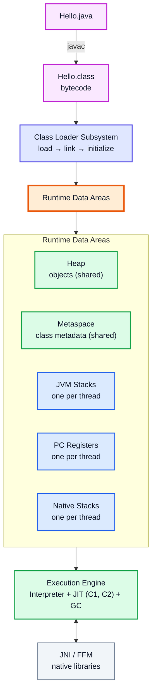
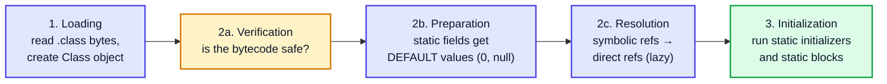
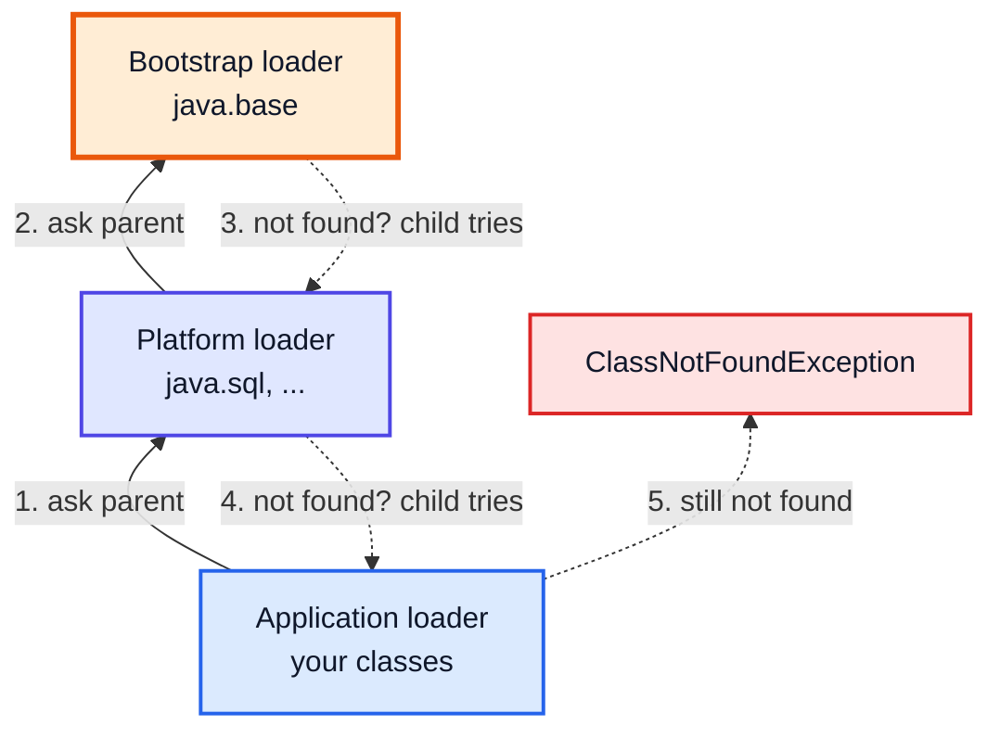
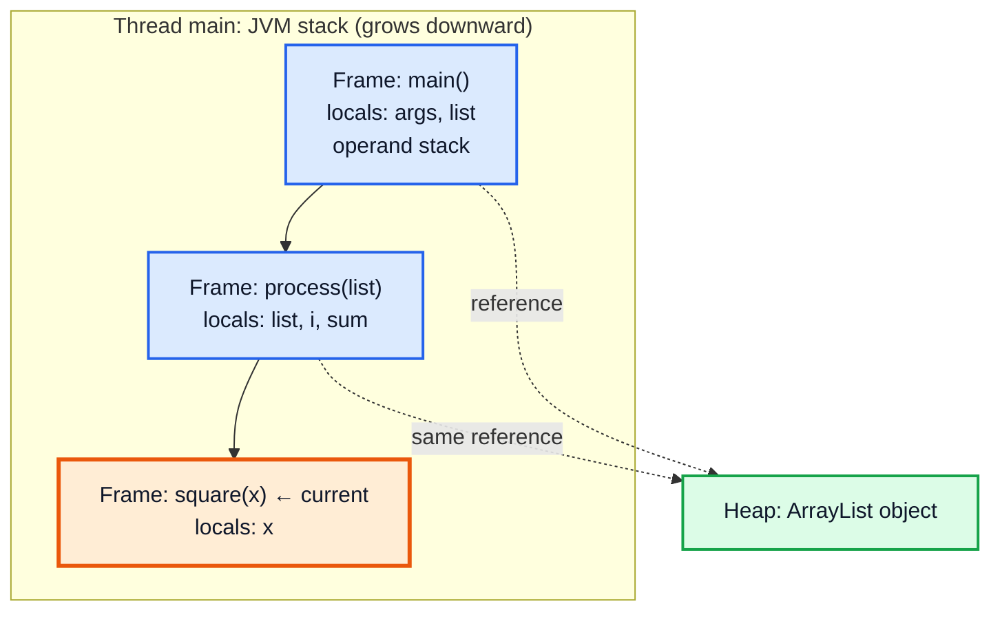
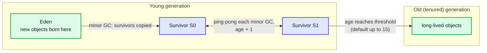
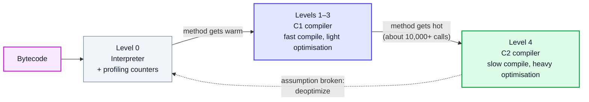
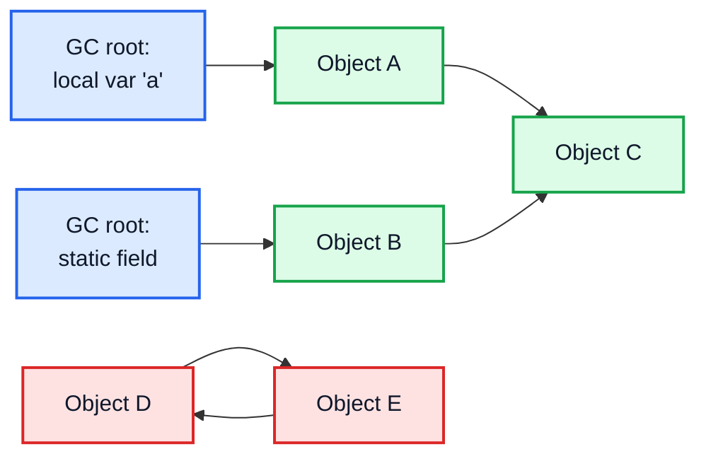
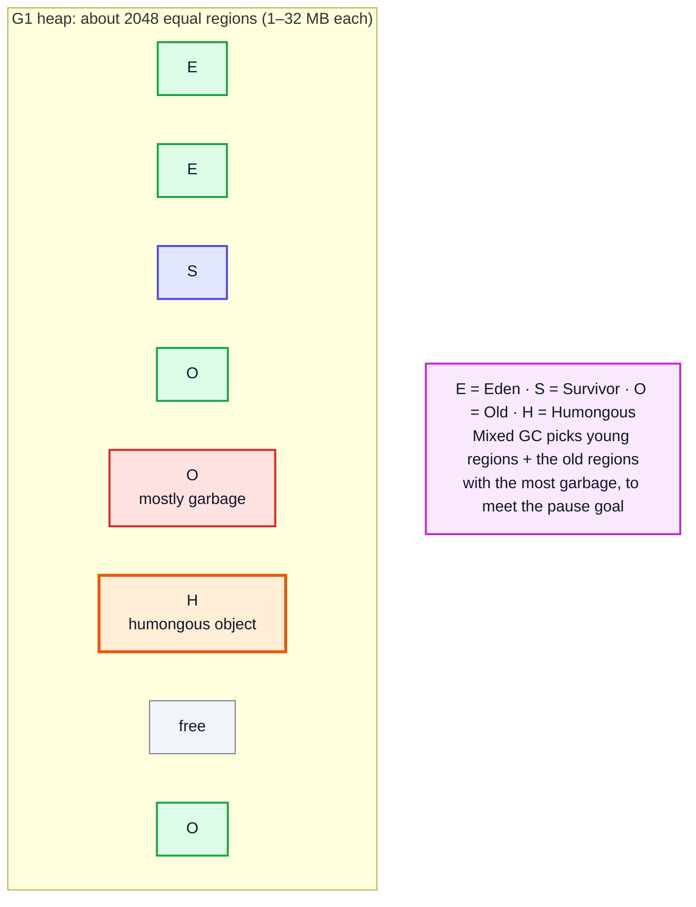
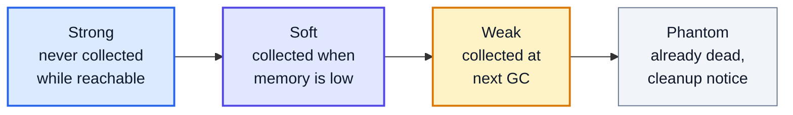

# JVM Internals & Garbage Collection — Complete In-Depth Guide

**Java gap topic #9 of 10** · Priority 🟡 · from [topics_not_covered.md](../topics_not_covered.md)

[Video 7](../kunal-java-notes-claude/java_07_video_java_architecture.md) introduces JDK, JRE and JVM, and [video 5](../kunal-java-notes-claude/java_05_video_intro_programming.md) explains stack, heap and garbage collection at a beginner level. These notes go under the hood: how classes are loaded, what memory areas the JVM really has, how the JIT compiler makes Java fast, how garbage collectors work (generations, G1, ZGC), reference types, memory leaks, `OutOfMemoryError`s, tuning flags and the diagnostic tools.

> [!NOTE]
> This topic isn't in the playlist, so there are no video timestamps. Details describe **HotSpot**, the JVM in Oracle JDK and OpenJDK, version **21**. Other JVMs (OpenJ9, GraalVM native image) differ in places.

---

## Table of Contents

| # | Topic (anchor link) | Level |
|---|---|---|
| 0 | [JVM Architecture Overview](#0-jvm-architecture-overview) | Basics |
| 1 | [Class Loading: Load, Link, Initialize](#1-class-loading-load-link-initialize) | Core |
| 2 | [Class Loaders and Parent Delegation](#2-class-loaders-and-parent-delegation) | Core |
| 3 | [Runtime Data Areas](#3-runtime-data-areas) | Core |
| 4 | [Inside the Heap and Object Layout](#4-inside-the-heap-and-object-layout) | In depth |
| 5 | [The Execution Engine and the JIT Compiler](#5-the-execution-engine-and-the-jit-compiler) | In depth |
| 6 | [How Garbage Collection Finds Garbage](#6-how-garbage-collection-finds-garbage) | Core |
| 7 | [Generational Collection](#7-generational-collection) | Core |
| 8 | [The HotSpot Garbage Collectors](#8-the-hotspot-garbage-collectors) | In depth |
| 9 | [Reference Types: Strong, Soft, Weak, Phantom](#9-reference-types-strong-soft-weak-phantom) | In depth |
| 10 | [Memory Leaks in Java](#10-memory-leaks-in-java) | In depth |
| 11 | [OutOfMemoryError and StackOverflowError](#11-outofmemoryerror-and-stackoverflowerror) | In depth |
| 12 | [JVM Flags and Tuning](#12-jvm-flags-and-tuning) | Advanced |
| 13 | [Diagnostic Tools](#13-diagnostic-tools) | Advanced |
| 14 | [Common Interview Questions](#14-common-interview-questions) | Interview |

---

## 0. JVM Architecture Overview



| Part | Job |
|---|---|
| **Class loader subsystem** | Finds `.class` files, verifies them, prepares and initializes classes |
| **Runtime data areas** | The memory the JVM manages while your program runs |
| **Execution engine** | Runs bytecode: interprets it, compiles hot code to machine code (JIT), and collects garbage |
| **Native interface** | Calls C/C++ code (JNI, or the Foreign Function & Memory API final in Java 22) |

"Write once, run anywhere" works because `javac` produces **platform-independent bytecode**, and each OS has its own JVM that turns that bytecode into native instructions.

```bash
javap -c Hello.class     # disassemble a class to see its bytecode
```

---

## 1. Class Loading: Load, Link, Initialize

A class isn't loaded when the program starts. It's loaded **lazily**, the first time it's needed.



| Phase | What happens | Can fail with |
|---|---|---|
| **Loading** | Find the bytes (file, JAR, network), create a `java.lang.Class` object | `ClassNotFoundException` / `NoClassDefFoundError` |
| **Verification** | Check bytecode can't corrupt the JVM (stack overflows, bad casts, jumps outside methods) | `VerifyError` |
| **Preparation** | Allocate static fields with default values | — |
| **Resolution** | Replace symbolic names with real memory references | `NoSuchMethodError`, `NoSuchFieldError` |
| **Initialization** | Run `static` field initializers and `static {}` blocks, top to bottom, **once**, thread-safely | `ExceptionInInitializerError` |

### When is a class initialized?

A class is initialized on its first **active use**:
- `new MyClass()`
- calling a static method
- reading or writing a static field (that isn't a compile-time constant)
- `Class.forName("MyClass")`
- initializing a subclass (the parent is initialized first)
- it's the class with `main`

```java
public class InitOrder {
    static class Parent {
        static { System.out.println("Parent static block"); }
        Parent() { System.out.println("Parent constructor"); }
    }
    static class Child extends Parent {
        static final int CONSTANT = 42;                 // compile-time constant: inlined, no init needed
        static int counter = initCounter();
        static { System.out.println("Child static block"); }
        { System.out.println("Child instance block"); }
        Child() { System.out.println("Child constructor"); }
        static int initCounter() { System.out.println("Child static field init"); return 1; }
    }
    static class Lazy {
        static { System.out.println("Lazy initialized"); }
        static void hello() { System.out.println("Lazy.hello()"); }
    }

    public static void main(String[] args) {
        System.out.println("main starts, CONSTANT = " + Child.CONSTANT);   // does NOT initialize Child
        System.out.println("--- first new Child() ---");
        new Child();
        System.out.println("--- second new Child() ---");
        new Child();                                                       // static parts don't run again
        System.out.println("--- Lazy not touched yet ---");
        Lazy.hello();
    }
}
// Output:
// main starts, CONSTANT = 42
// --- first new Child() ---
// Parent static block
// Child static field init
// Child static block
// Parent constructor
// Child instance block
// Child constructor
// --- second new Child() ---
// Parent constructor
// Child instance block
// Child constructor
// --- Lazy not touched yet ---
// Lazy initialized
// Lazy.hello()
```

> [!TIP]
> This lazy, thread-safe initialization is exactly why the **holder idiom** Singleton works ([gap topic #4](java_gap_04_design_patterns.md#1-singleton-revisited)): the inner `Holder` class isn't initialized until `getInstance()` first touches it, and the JVM guarantees only one thread runs its static initializer.

### `ClassNotFoundException` vs `NoClassDefFoundError`

| | `ClassNotFoundException` | `NoClassDefFoundError` |
|---|---|---|
| Type | Checked **exception** | **Error** |
| When | You load by name at runtime: `Class.forName("x.Y")`, `loadClass` | A class that **was present at compile time** is missing at runtime, or its static initializer failed earlier |
| Typical cause | Typo in the name, JAR not on the classpath | Missing dependency JAR in deployment; `ExceptionInInitializerError` the first time |

---

## 2. Class Loaders and Parent Delegation

Since Java 9, there are three built-in class loaders:

| Loader | Loads | `getClassLoader()` returns |
|---|---|---|
| **Bootstrap** (written in C++) | Core modules: `java.base` (`String`, `Object`, `ArrayList`…) | `null` |
| **Platform** (was "Extension" before Java 9) | Other JDK modules: `java.sql`, `java.xml`… | `PlatformClassLoader` |
| **Application / System** | Your classes and JARs on the classpath / module path | `AppClassLoader` |

### Parent delegation model

When a loader is asked for a class, it **first asks its parent**. Only if the parent can't find it does the loader try itself.



**Why delegate?**
1. **Security:** you can't replace `java.lang.String` with your own fake `String` class, because bootstrap always finds the real one first.
2. **Uniqueness:** a class is identified by **(its name + the loader that loaded it)**. Delegation means core classes are loaded exactly once.

```java
public class LoadersDemo {
    public static void main(String[] args) throws Exception {
        System.out.println(String.class.getClassLoader());                       // null  (bootstrap)
        System.out.println(java.sql.Connection.class.getClassLoader().getName()); // platform
        System.out.println(LoadersDemo.class.getClassLoader().getName());        // app
        System.out.println(LoadersDemo.class.getClassLoader().getParent().getName()); // platform

        Class<?> c = Class.forName("java.util.ArrayList");                      // load by name
        System.out.println(c.getSimpleName() + " " + c.getModule().getName());  // ArrayList java.base
        try {
            Class.forName("com.example.DoesNotExist");
        } catch (ClassNotFoundException e) {
            System.out.println("ClassNotFoundException: " + e.getMessage());
        }
    }
}
```

> [!NOTE]
> Application servers (Tomcat), plugin systems and hot-reload tools create **custom class loaders** (subclass `ClassLoader`, override `findClass`). Two web apps can then each load their own version of the same library. That's also why "the same class" loaded by two different loaders gives a confusing `ClassCastException: com.x.Foo cannot be cast to com.x.Foo`.

---

## 3. Runtime Data Areas

| Area | Per thread or shared? | Holds | Error when full |
|---|---|---|---|
| **Heap** | Shared | All objects and arrays (and, since Java 7, the String pool and static fields' *values* that are objects) | `OutOfMemoryError: Java heap space` |
| **Metaspace** (replaced PermGen in Java 8) | Shared, in **native** memory | Class metadata: method bytecode, field layouts, constant pools | `OutOfMemoryError: Metaspace` |
| **JVM stack** | Per thread | One **frame** per method call: local variables, operand stack, return address | `StackOverflowError` |
| **PC register** | Per thread | Address of the bytecode instruction being executed | — |
| **Native method stack** | Per thread | Frames for native (C) methods | `StackOverflowError` |
| **Code cache** | Shared, native | Machine code produced by the JIT | JIT stops compiling (warning) |

### A stack frame up close



Each frame has:
- a **local variable array** (slot 0 is `this` for instance methods, then parameters, then locals; `long` and `double` take two slots);
- an **operand stack** where bytecode does its work (`iload_1`, `iload_2`, `iadd`, `istore_3`);
- a reference to the class's **runtime constant pool**.

When the method returns, its frame is popped; that's why local variables need no garbage collection. This is the same call-stack picture as the recursion videos (23, 27).

> [!IMPORTANT]
> "Primitives live on the stack, objects on the heap" is a good beginner rule but not the full truth. A primitive **field** of an object lives inside that object on the heap. A `static int` lives with the class. Only **local** primitives (and local references) live in stack frames. And the JIT may even put a short-lived object on the stack or in registers (escape analysis, Section 5).

---

## 4. Inside the Heap and Object Layout

### Heap regions (generational collectors)



### What an object costs

Every object has a **header** before its fields. On a 64-bit JVM with compressed pointers (the default for heaps under 32 GB):

| Part | Size |
|---|---|
| Mark word (hash code, GC age, lock state) | 8 bytes |
| Class pointer (compressed) | 4 bytes |
| Fields | as declared (`int` 4, `long` 8, reference 4 with compressed oops) |
| Padding | Rounded up to a multiple of 8 bytes |

| Object | Approximate size |
|---|---|
| `new Object()` | 16 bytes (12 header + 4 padding) |
| `Integer` | 16 bytes (to hold a 4-byte int!) |
| `int[0]` | 16 bytes (header + 4-byte length) |
| `int[10]` | 56 bytes (16 + 40) |
| `ArrayList<Integer>` with 1,000 numbers | ~20 KB (each `Integer` is a separate 16-byte object + a 4-byte reference) vs `int[1000]` ≈ 4 KB |

> [!TIP]
> This is the real reason `int[]` beats `ArrayList<Integer>` in DSA problems with big inputs: no boxing, no per-element header, and the numbers sit next to each other in memory (cache friendly). `Integer.valueOf` caches -128..127, which also explains the `==` surprise from the playlist's wrapper-class discussion.

### TLABs: why `new` is fast

Each thread gets a **Thread-Local Allocation Buffer** inside Eden. Allocating an object is usually just "bump a pointer" in your own TLAB: no locking, a few CPU instructions. That's why creating many small short-lived objects in Java is cheap.

---

## 5. The Execution Engine and the JIT Compiler

The JVM starts by **interpreting** bytecode (slow but instant), counts how often each method and loop runs, and compiles the hot ones to native machine code.



This is **tiered compilation** (default since Java 8).

### Optimisations the JIT does

| Optimisation | What it does |
|---|---|
| **Inlining** | Copies a small method's body into the caller (getters cost nothing) — the most important one |
| **Escape analysis** | If an object never leaves a method, it may be broken into local variables (**scalar replacement**): no heap allocation at all |
| **Lock elision / coarsening** | Removes locks on objects only one thread can see; merges neighbouring locks |
| **Loop unrolling** | Does several iterations per loop pass |
| **Range check elimination** | Removes array bounds checks it can prove are unnecessary |
| **Devirtualization** | If only one implementation of an interface is loaded, calls it directly |
| **Dead code elimination** | Removes code whose result is never used |
| **Intrinsics** | Replaces methods like `Math.max`, `System.arraycopy`, `String.equals` with hand-tuned CPU instructions |

> [!WARNING]
> This is why **micro-benchmarks lie** when written by hand: the first runs are interpreted (slow), and the JIT may delete code whose result you don't use. Use **JMH** (Java Microbenchmark Harness) for real measurements. It's also why timings in Big-O experiments (like [video 24](../kunal-java-notes-claude/java_24_video_time_space_complexity.md)) need warm-up runs.

---

## 6. How Garbage Collection Finds Garbage

The JVM decides an object is garbage when it's **unreachable**: no chain of references leads to it from a **GC root**.

### GC roots

| GC root | Example |
|---|---|
| Local variables and parameters in active stack frames | `list` in `main` |
| Static fields of loaded classes | `static Map cache` |
| Active threads | Every running `Thread` object |
| JNI references | Objects held by native code |
| Monitors | Objects currently used in `synchronized` |



D and E point at **each other** but nothing reachable points at them, so both are garbage. Java uses **reachability (tracing)**, not reference counting, so cycles are no problem. (Python's reference counting needs an extra cycle detector.)

### The basic algorithms

| Algorithm | How | Pros | Cons |
|---|---|---|---|
| **Mark–Sweep** | Mark reachable objects, then free the rest | Simple | Leaves the heap **fragmented** |
| **Mark–Compact** | Mark, then slide live objects together | No fragmentation | Moving objects is slow |
| **Copying** | Copy live objects to an empty space, then wipe the old space | Very fast when most objects are dead; no fragmentation | Needs spare space (that's why there are 2 survivor spaces) |

### Stop-the-world (STW)

Some GC phases need all application threads paused at a **safepoint** so references don't change while the collector works. The length of these **pauses** is what most GC tuning is about. Modern collectors (G1, ZGC) do most of their work **concurrently**, while your threads run.

---

## 7. Generational Collection

The **weak generational hypothesis**: most objects die young (temporary strings, iterators, lambda captures), and the few that survive tend to live a long time (caches, configuration). So the heap is split and the young part is collected often and cheaply.

| Event | Collects | Frequency | Cost |
|---|---|---|---|
| **Minor GC** | Young gen (Eden + survivors) | Very often | Cheap: only live objects are copied, and few are live |
| **Major / old GC** | Old gen | Rarely | More expensive |
| **Full GC** | Whole heap (+ metaspace) | Should be rare | Longest pauses; frequent full GCs = a problem |

### An object's life

| Step | Where | What happens |
|---|---|---|
| 1 | Eden | `new` allocates in the thread's TLAB |
| 2 | Eden full | **Minor GC**: live Eden objects are copied to survivor S0 (age 1); Eden is wiped |
| 3 | Next minor GC | Live objects in Eden + S0 copied to S1 (age + 1); S0 wiped |
| 4 | Repeat | Objects ping-pong between S0 and S1 |
| 5 | Age ≥ threshold (or survivors full) | **Promoted** (tenured) to the old generation |
| 6 | Old gen fills | Old/mixed/full collection |

> [!NOTE]
> Old objects can point to young ones (a long-lived cache gets a new entry). So a minor GC doesn't have to scan the whole old generation, the JVM tracks old→young pointers with a **card table** (G1 uses *remembered sets*), updated by a small piece of code called a **write barrier** on each reference store.

---

## 8. The HotSpot Garbage Collectors

| Collector | Flag | Since | Design | Pause goal | Best for |
|---|---|---|---|---|---|
| **Serial** | `-XX:+UseSerialGC` | 1.x | One thread, stop-the-world | — | Tiny heaps, single-CPU containers |
| **Parallel** (throughput) | `-XX:+UseParallelGC` | 1.4 | Many threads, stop-the-world | Max throughput | Batch jobs where pauses don't matter |
| **CMS** | — | — | Concurrent mark-sweep | Low | **Removed in Java 14** |
| **G1** (Garbage-First) | `-XX:+UseG1GC` | 7 (**default since 9**) | Heap split into equal **regions**; collects the regions with the most garbage first; mostly concurrent marking | ~200 ms default (`MaxGCPauseMillis`) | General purpose, heaps from a few GB up |
| **ZGC** | `-XX:+UseZGC` (+ `-XX:+ZGenerational` in 21) | 15 (generational in 21, default mode in 23) | Concurrent everything, colored pointers + load barriers | **< 1 ms**, independent of heap size | Huge heaps (up to 16 TB), latency-critical services |
| **Shenandoah** | `-XX:+UseShenandoahGC` | 12 (OpenJDK builds) | Concurrent compaction | < 10 ms | Low-latency, from Red Hat |
| **Epsilon** | `-XX:+UseEpsilonGC` (experimental) | 11 | **Never collects** | none | Benchmarks, very short-lived jobs |

### G1 in a picture



| G1 term | Meaning |
|---|---|
| Region | A fixed-size chunk; each one is Eden, Survivor, Old, Humongous or free at any time |
| Humongous object | An object ≥ half a region (a huge array); gets its own contiguous regions |
| Young GC | Evacuates (copies out) all young regions |
| Concurrent marking | Finds live objects in old regions while the app runs |
| Mixed GC | Young regions + some old regions with the most garbage ("garbage first") |

### Throughput vs latency vs footprint

You can usually optimise two of these, not all three:

| Goal | Meaning | Collector |
|---|---|---|
| **Throughput** | % of time running your code (not GC) | Parallel |
| **Latency** | Short, predictable pauses | ZGC, Shenandoah, G1 |
| **Footprint** | Low memory use | Serial |

> [!TIP]
> `System.gc()` is only a **request**; the JVM may ignore it (and `-XX:+DisableExplicitGC` makes it a no-op). You can never force garbage collection, and you never need to in normal code. `finalize()` is deprecated for removal since Java 18; use try-with-resources or `java.lang.ref.Cleaner` for cleanup.

---

## 9. Reference Types: Strong, Soft, Weak, Phantom

Normal references are **strong**. `java.lang.ref` adds weaker kinds that let the GC collect an object while you still hold a special reference to it.

| Type | Collected when | `get()` returns | Use for |
|---|---|---|---|
| **Strong** (`Object o = ...`) | Never, while reachable | — | Everything normal |
| **`SoftReference`** | Only when memory is **low** (before an `OutOfMemoryError`) | the object until cleared | Memory-sensitive caches |
| **`WeakReference`** | At the **next GC** once no strong refs remain | the object until cleared | Canonicalizing maps, listeners, metadata attached to objects (`WeakHashMap`) |
| **`PhantomReference`** | After the object is finalized; you're notified via a `ReferenceQueue` | **always `null`** | Post-mortem cleanup of native resources (`Cleaner` uses these) |



```java
import java.lang.ref.*;
import java.util.*;

public class ReferencesDemo {
    public static void main(String[] args) throws Exception {
        Object strong = new Object();
        WeakReference<Object> weak = new WeakReference<>(strong);

        System.gc();
        System.out.println("While strongly reachable: " + (weak.get() != null));   // true

        strong = null;                                     // drop the only strong reference
        for (int i = 0; i < 10 && weak.get() != null; i++) { System.gc(); Thread.sleep(20); }
        System.out.println("After GC with no strong refs: " + (weak.get() == null)); // true (on HotSpot in practice)

        // WeakHashMap: entries vanish when the KEY is no longer strongly reachable
        Map<Object, String> meta = new WeakHashMap<>();
        Object key = new Object();
        meta.put(key, "metadata");
        key = null;
        for (int i = 0; i < 10 && !meta.isEmpty(); i++) { System.gc(); Thread.sleep(20); }
        System.out.println("WeakHashMap empty after GC: " + meta.isEmpty());        // true (on HotSpot in practice)
    }
}
```

> [!CAUTION]
> GC timing is **never guaranteed**. The demo loops a few times because `System.gc()` is only a hint; on HotSpot with default settings it clears weak references reliably, but don't write production logic that depends on exactly when a weak reference is cleared.

---

## 10. Memory Leaks in Java

GC frees **unreachable** objects. A Java memory leak is an object that's **still reachable but never used again**. The GC can't help, because you're still holding on to it.

| Leak | Why it leaks | Fix |
|---|---|---|
| **Growing static collection** | `static List<Order> history` that only ever grows | Bound it, evict old entries, or use a real cache (Caffeine) |
| **Cache with no eviction** | `HashMap` used as a cache | `LinkedHashMap` with `removeEldestEntry` (LRU), `WeakHashMap`, or a cache library |
| **Listeners never removed** | Subject keeps a list of observers ([Observer, gap #4](java_gap_04_design_patterns.md#12-observer)) | Always unsubscribe; or hold listeners weakly |
| **`ThreadLocal` in thread pools** | Pool threads live forever, so their `ThreadLocal` values do too | Call `threadLocal.remove()` in `finally` |
| **Non-static inner class / lambda capturing `this`** | Holds a hidden reference to the outer object | Use a `static` nested class |
| **Mutable keys in a `HashMap`** | Change a key's fields → wrong bucket → can never be found or removed | Use immutable keys (records) |
| **Unclosed resources** | Streams, connections, file handles | try-with-resources |
| **Old `substring` (Java 6)** | Shared the big parent `char[]` | Fixed in Java 7u6; substrings copy now |
| **Custom array-based stack** | `pop()` leaves the reference in the array | Null out the slot (see [gap #8](java_gap_08_generics_in_depth.md#8-restrictions-caused-by-erasure)) |

```java
import java.util.*;

public class LeakDemo {
    record Key(String id) { }                               // immutable → safe map key

    static class MutableKey {
        String id;
        MutableKey(String id) { this.id = id; }
        @Override public boolean equals(Object o) { return o instanceof MutableKey k && k.id.equals(id); }
        @Override public int hashCode() { return id.hashCode(); }
    }

    public static void main(String[] args) {
        Map<MutableKey, String> map = new HashMap<>();
        MutableKey k = new MutableKey("a");
        map.put(k, "value");
        k.id = "changed";                                   // key mutated after insertion
        System.out.println(map.get(k));                     // null: looks in the wrong bucket
        System.out.println(map.remove(k));                  // null: can't remove it either → leaked entry
        System.out.println(map.size());                     // 1

        // Bounded LRU cache instead of an ever-growing map
        int capacity = 3;
        Map<Key, String> lru = new LinkedHashMap<>(16, 0.75f, true) {
            @Override protected boolean removeEldestEntry(Map.Entry<Key, String> eldest) { return size() > capacity; }
        };
        for (String id : List.of("a", "b", "c", "d", "e")) lru.put(new Key(id), id.toUpperCase());
        System.out.println(lru.keySet());                   // [Key[id=c], Key[id=d], Key[id=e]]
    }
}
```

---

## 11. OutOfMemoryError and StackOverflowError

Both are `Error`s (not `Exception`s): you normally don't catch them; you fix the cause.

| Error message | Area | Common cause | First thing to try |
|---|---|---|---|
| `Java heap space` | Heap | Leak, or genuinely too much data | Heap dump + analyser; raise `-Xmx` if the data is legit |
| `GC overhead limit exceeded` | Heap | > 98% of time in GC, recovering < 2% | Same as above (almost out of heap) |
| `Metaspace` | Metaspace | Too many classes (class loader leaks in app servers, runtime-generated classes) | `-XX:MaxMetaspaceSize`, find the loader leak |
| `unable to create native thread` | OS | Too many platform threads | Use a thread pool or virtual threads |
| `Requested array size exceeds VM limit` | Heap | `new int[Integer.MAX_VALUE]` | Smaller arrays |
| `Direct buffer memory` | Native | `ByteBuffer.allocateDirect` leaks | `-XX:MaxDirectMemorySize`, release buffers |
| `StackOverflowError` | Thread stack | Infinite or very deep recursion | Fix the base case; convert to iteration; or `-Xss` for a bigger stack |

```java
public class StackOverflowDemo {
    static int depth = 0;

    static void recurse() { depth++; recurse(); }            // no base case

    static long sumTo(int n) { return n == 0 ? 0 : n + sumTo(n - 1); }   // correct, but 1 frame per number

    public static void main(String[] args) throws InterruptedException {
        try {
            recurse();
        } catch (StackOverflowError e) {
            System.out.println("StackOverflowError after " + depth + " calls");   // exact number varies
        }

        try {
            sumTo(1_000_000);                                // a million frames: too deep for the default stack
        } catch (StackOverflowError e) {
            System.out.println("sumTo(1,000,000) overflowed the default stack");
        }

        // Same call on a thread with a bigger stack (the 4th constructor argument)
        long[] result = {0};
        Thread big = new Thread(null, () -> result[0] = sumTo(1_000_000), "big-stack", 256L * 1024 * 1024);
        big.start();
        big.join();
        System.out.println("With a 256 MB stack: " + result[0]);   // 500000500000
    }
}
// Output (the first number depends on the JVM and OS):
// StackOverflowError after 23000 calls
// sumTo(1,000,000) overflowed the default stack
// With a 256 MB stack: 500000500000
```

> [!TIP]
> The second trick (a `Thread` with a big stack size) is a well-known workaround in competitive programming when a recursive DFS on 10⁵–10⁶ nodes overflows the default stack (usually 512 KB–1 MB).

---

## 12. JVM Flags and Tuning

| Flag | Meaning | Example |
|---|---|---|
| `-Xms<size>` | Initial heap | `-Xms512m` |
| `-Xmx<size>` | **Maximum heap** | `-Xmx4g` |
| `-Xss<size>` | Thread stack size | `-Xss2m` |
| `-XX:MaxMetaspaceSize` | Cap metaspace (unlimited by default) | `-XX:MaxMetaspaceSize=256m` |
| `-XX:+UseG1GC` / `UseZGC` / `UseParallelGC` / `UseSerialGC` | Choose a collector | `-XX:+UseZGC -XX:+ZGenerational` |
| `-XX:MaxGCPauseMillis` | G1 pause-time **goal** (a hint) | `-XX:MaxGCPauseMillis=100` |
| `-XX:MaxRAMPercentage` | Heap as % of container memory | `-XX:MaxRAMPercentage=75` |
| `-Xlog:gc*` | Unified GC logging (Java 9+) | `-Xlog:gc*:file=gc.log` |
| `-XX:+HeapDumpOnOutOfMemoryError` | Write a heap dump on OOM | with `-XX:HeapDumpPath=/tmp` |
| `-XX:+PrintFlagsFinal` | Print every flag's value | `java -XX:+PrintFlagsFinal -version` |
| `-XX:+PrintCompilation` | Show JIT compilations | debugging performance |
| `-verbose:class` | Print each class as it loads | debugging class loading |

```bash
java -Xms256m -Xmx1g -XX:+UseG1GC -Xlog:gc -XX:+HeapDumpOnOutOfMemoryError -jar app.jar
```

```bash
java -XX:+PrintFlagsFinal -version | findstr /i "UseG1GC MaxHeapSize"
```

### Defaults worth knowing (JDK 21)

| Setting | Default |
|---|---|
| Collector | **G1** (Serial if the machine has < 2 CPUs or < 1792 MB RAM) |
| Max heap (`-Xmx`) | **1/4 of physical RAM** (or of the container limit) |
| Initial heap (`-Xms`) | 1/64 of physical RAM |
| Thread stack | 1 MB on 64-bit Linux/macOS; on Windows taken from the executable (typically 1 MB) |

> [!WARNING]
> **Tuning rule #1: measure first.** Turn on GC logging, look at pause times and frequency, then change **one** thing. Most applications run fine with G1 defaults plus a sensible `-Xmx`. Setting `-Xms` equal to `-Xmx` avoids heap resizing in servers.

---

## 13. Diagnostic Tools

All ship with the JDK (in `bin/`):

| Tool | What it does | Example |
|---|---|---|
| `jps` | List running Java processes and their PIDs | `jps -l` |
| `jcmd` | Swiss-army knife: GC, heap info, thread dumps, JFR | `jcmd <pid> GC.heap_info`, `jcmd <pid> Thread.print` |
| `jstack` | Thread dump (find deadlocks, see what's stuck) | `jstack <pid>` |
| `jmap` | Heap histogram / heap dump | `jmap -histo:live <pid>`, `jmap -dump:live,format=b,file=heap.hprof <pid>` |
| `jstat` | GC statistics over time | `jstat -gcutil <pid> 1000` |
| `jinfo` | Show flags of a running JVM | `jinfo -flags <pid>` |
| `javap` | Disassemble bytecode | `javap -c -p MyClass` |
| **JFR** (Java Flight Recorder) | Low-overhead production profiler | `java -XX:StartFlightRecording=duration=60s,filename=rec.jfr ...` |
| **JMC** (Mission Control), **VisualVM** | GUIs for JFR recordings, live monitoring | separate downloads |
| **Eclipse MAT** | Analyse heap dumps: find what holds memory ("dominator tree") | separate download |

### From inside a program

```java
import java.lang.management.*;

public class RuntimeInfo {
    public static void main(String[] args) {
        Runtime rt = Runtime.getRuntime();
        long mb = 1024 * 1024;
        System.out.println("CPUs: " + rt.availableProcessors());
        System.out.println("Max heap: " + rt.maxMemory() / mb + " MB");
        System.out.println("Used heap: " + (rt.totalMemory() - rt.freeMemory()) / mb + " MB");

        for (GarbageCollectorMXBean gc : ManagementFactory.getGarbageCollectorMXBeans()) {
            System.out.println("GC: " + gc.getName() + ", collections so far: " + gc.getCollectionCount());
        }
        System.out.println("JVM: " + ManagementFactory.getRuntimeMXBean().getVmName());
    }
}
// Output (values depend on your machine), for example:
// CPUs: 8
// Max heap: 4040 MB
// Used heap: 3 MB
// GC: G1 Young Generation, collections so far: 0
// GC: G1 Concurrent GC, collections so far: 0
// GC: G1 Old Generation, collections so far: 0
// JVM: Java HotSpot(TM) 64-Bit Server VM
```

---

## 14. Common Interview Questions

| Question | Short answer |
|---|---|
| JDK vs JRE vs JVM? | JVM runs bytecode; JRE = JVM + libraries; JDK = JRE + compiler and tools. (Since Java 11 there's no separate JRE download.) |
| What are the JVM memory areas? | Heap, metaspace, JVM stacks, PC registers, native stacks (+ code cache). |
| PermGen vs Metaspace? | PermGen (≤ Java 7) was a fixed-size part of the heap; Metaspace (8+) is native memory and grows by default. |
| What are the phases of class loading? | Loading, linking (verify, prepare, resolve), initialization. |
| What's parent delegation? | A loader asks its parent first; protects core classes and keeps classes unique. |
| `ClassNotFoundException` vs `NoClassDefFoundError`? | Loading by name failed (checked) vs class present at compile time missing at runtime (error). |
| What is the JIT? | Compiles hot bytecode to native code at runtime (C1 quick, C2 optimising). |
| How does GC decide what to collect? | Objects unreachable from GC roots (tracing), so cycles are collected. |
| Why generations? | Most objects die young; collecting the young gen often is cheap. |
| Minor vs major vs full GC? | Young only / old gen / whole heap. |
| Default GC in Java 21? | G1. |
| What does ZGC offer? | Sub-millisecond pauses regardless of heap size. |
| Can you force GC? | No; `System.gc()` is just a hint. |
| Strong/soft/weak/phantom? | Never collected while reachable / collected when memory is low / collected at next GC / cleanup notification after death. |
| Can Java leak memory? | Yes: reachable-but-unused objects (static collections, listeners, ThreadLocals, caches). |
| What causes `StackOverflowError`? | Too-deep recursion; each call adds a frame to a fixed-size thread stack. |
| What is escape analysis? | JIT proves an object doesn't escape a method and avoids allocating it on the heap. |

---

## 🧩 Complete Example: Everything Together

A tour of the JVM from inside one program: class initialization order, class loaders and the delegation chain, lazy loading, stack depth with a custom thread stack size, a weak reference being cleared, a `WeakHashMap`, a leak caused by a mutable key, an LRU cache that bounds memory, and the GC MXBeans. Machine-dependent numbers are turned into true/false checks so the output is stable.

```java
import java.lang.management.*;
import java.lang.ref.*;
import java.util.*;

public class JvmShowcase {

    static final List<String> events = new ArrayList<>();

    static class Base {
        static { events.add("Base <clinit>"); }
        Base() { events.add("Base()"); }
    }
    static class Derived extends Base {
        static final String CONST = "inlined";               // compile-time constant
        static final List<String> NOT_CONST = List.of("x");  // NOT a constant: triggers init
        static { events.add("Derived <clinit>"); }
        Derived() { events.add("Derived()"); }
    }
    static class Holder {
        static { events.add("Holder <clinit>"); }
        static final Object INSTANCE = new Object();
    }

    static long sumTo(int n) { return n == 0 ? 0 : n + sumTo(n - 1); }

    static class MutableKey {
        int id;
        MutableKey(int id) { this.id = id; }
        @Override public boolean equals(Object o) { return o instanceof MutableKey k && k.id == id; }
        @Override public int hashCode() { return Integer.hashCode(id); }
    }

    public static void main(String[] args) throws Exception {
        // 1. Class initialization order and laziness
        events.add("main: CONST=" + Derived.CONST);   // no initialization
        new Derived();
        new Derived();
        events.add("main: Holder not yet used");
        Object h = Holder.INSTANCE;
        System.out.println("1. Init events: " + events);

        // 2. Class loaders
        System.out.println("2. String loaded by bootstrap: " + (String.class.getClassLoader() == null));
        ClassLoader app = JvmShowcase.class.getClassLoader();
        List<String> chain = new ArrayList<>();
        for (ClassLoader cl = app; cl != null; cl = cl.getParent()) chain.add(cl.getName());
        chain.add("bootstrap");
        System.out.println("   Delegation chain: " + String.join(" -> ", chain));
        try {
            Class.forName("does.not.Exist");
        } catch (ClassNotFoundException e) {
            System.out.println("   ClassNotFoundException for " + e.getMessage());
        }

        // 3. Deep recursion: overflows the default stack, works on a 256 MB stack
        String onMain;
        try { onMain = String.valueOf(sumTo(1_000_000)); } catch (StackOverflowError e) { onMain = "StackOverflowError"; }
        long[] onBig = {0};
        Thread t = new Thread(null, () -> onBig[0] = sumTo(1_000_000), "big", 256L * 1024 * 1024);
        t.start();
        t.join();
        System.out.println("3. sumTo(1,000,000) on main: " + onMain + ", on a 256 MB stack: " + onBig[0]);

        // 4. Weak reference cleared once the strong reference is gone
        byte[] big = new byte[10 * 1024 * 1024];
        WeakReference<byte[]> weak = new WeakReference<>(big);
        boolean aliveBefore = weak.get() != null;
        big = null;
        for (int i = 0; i < 20 && weak.get() != null; i++) { System.gc(); Thread.sleep(10); }
        System.out.println("4. Weak ref alive before: " + aliveBefore + ", cleared after GC: " + (weak.get() == null));

        // 5. WeakHashMap drops entries whose keys are unreachable
        Map<Object, String> attached = new WeakHashMap<>();
        Object k1 = new Object(), k2 = new Object();
        attached.put(k1, "kept");
        attached.put(k2, "dropped");
        k2 = null;
        for (int i = 0; i < 20 && attached.size() > 1; i++) { System.gc(); Thread.sleep(10); }
        System.out.println("5. WeakHashMap values left: " + attached.values() + " (k1 still used: " + (k1 != null) + ")");

        // 6. Leak: mutating a HashMap key
        Map<MutableKey, String> map = new HashMap<>();
        MutableKey mk = new MutableKey(1);
        map.put(mk, "orphan");
        mk.id = 2;
        System.out.println("6. After mutating key: get=" + map.get(mk) + ", remove=" + map.remove(mk) + ", size=" + map.size());

        // 7. Bounded LRU cache keeps memory flat
        Map<Integer, int[]> cache = new LinkedHashMap<>(16, 0.75f, true) {
            @Override protected boolean removeEldestEntry(Map.Entry<Integer, int[]> e) { return size() > 100; }
        };
        for (int i = 0; i < 100_000; i++) cache.put(i, new int[16]);
        System.out.println("7. LRU cache size after 100,000 puts: " + cache.size() + ", oldest key: " + cache.keySet().iterator().next());

        // 8. Runtime and GC info (turned into stable checks)
        Runtime rt = Runtime.getRuntime();
        List<String> gcNames = ManagementFactory.getGarbageCollectorMXBeans().stream()
                .map(GarbageCollectorMXBean::getName).toList();
        long totalCollections = ManagementFactory.getGarbageCollectorMXBeans().stream()
                .mapToLong(GarbageCollectorMXBean::getCollectionCount).sum();
        System.out.println("8. Using G1: " + gcNames.stream().anyMatch(n -> n.startsWith("G1"))
                + ", GCs ran: " + (totalCollections > 0)
                + ", max heap > used heap: " + (rt.maxMemory() > rt.totalMemory() - rt.freeMemory()));
    }
}
```

**Expected Output:**
```
1. Init events: [main: CONST=inlined, Base <clinit>, Derived <clinit>, Base(), Derived(), Base(), Derived(), main: Holder not yet used, Holder <clinit>]
2. String loaded by bootstrap: true
   Delegation chain: app -> platform -> bootstrap
   ClassNotFoundException for does.not.Exist
3. sumTo(1,000,000) on main: StackOverflowError, on a 256 MB stack: 500000500000
4. Weak ref alive before: true, cleared after GC: true
5. WeakHashMap values left: [kept] (k1 still used: true)
6. After mutating key: get=null, remove=null, size=1
7. LRU cache size after 100,000 puts: 100, oldest key: 99900
8. Using G1: true, GCs ran: true, max heap > used heap: true
```

---

## Quick Reference Cheat Sheet

| Concept | One-Line Summary |
|---|---|
| **JVM parts** | Class loader subsystem + runtime data areas + execution engine (interpreter, JIT, GC) |
| **Class loading** | Load → verify → prepare (defaults) → resolve → initialize (static blocks), lazily on first active use |
| **Class loaders** | Bootstrap (`null`) → Platform → Application; parent delegation first |
| **Heap** | Shared; all objects; young (Eden + 2 survivors) and old generations |
| **Metaspace** | Class metadata in native memory (replaced PermGen in Java 8) |
| **JVM stack** | One per thread; one frame per call; `StackOverflowError` when full |
| **Object header** | ~12 bytes (mark word + class pointer); `Integer` ≈ 16 bytes |
| **TLAB** | Per-thread allocation buffer: `new` is a pointer bump |
| **JIT** | Interpreter → C1 → C2 for hot code; inlining, escape analysis |
| **GC roots** | Stack locals, statics, threads, JNI refs, monitors |
| **Reachability** | Unreachable from roots = garbage; cycles are fine |
| **Generational** | Most objects die young; minor GCs are cheap |
| **G1** | Default; regions; garbage-first; pause goal 200 ms |
| **ZGC** | Sub-millisecond pauses, huge heaps |
| **Parallel / Serial** | Throughput / tiny footprint |
| **Soft / Weak / Phantom** | Low-memory cache / next-GC / post-mortem cleanup |
| **Java leaks** | Reachable but unused: static collections, listeners, ThreadLocals, mutable keys |
| **Key flags** | `-Xmx`, `-Xms`, `-Xss`, `-XX:+UseZGC`, `-Xlog:gc*`, `-XX:+HeapDumpOnOutOfMemoryError` |
| **Tools** | `jps`, `jcmd`, `jstack`, `jmap`, `jstat`, JFR, VisualVM, Eclipse MAT |
