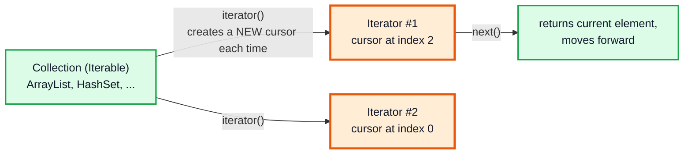
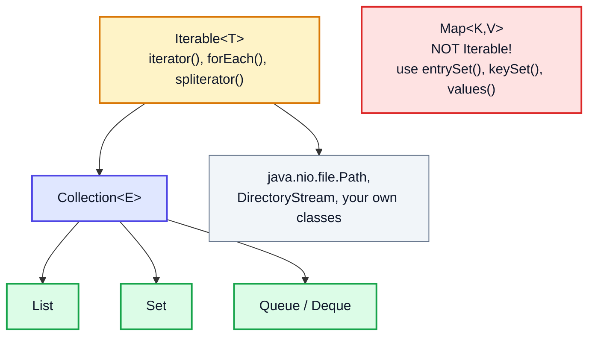
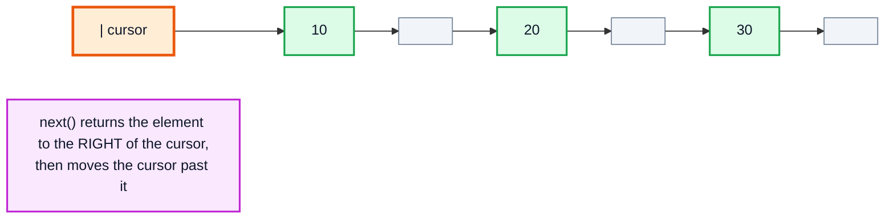
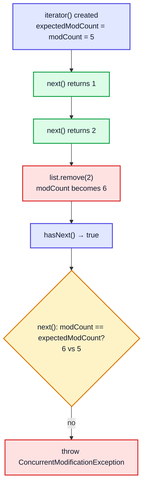
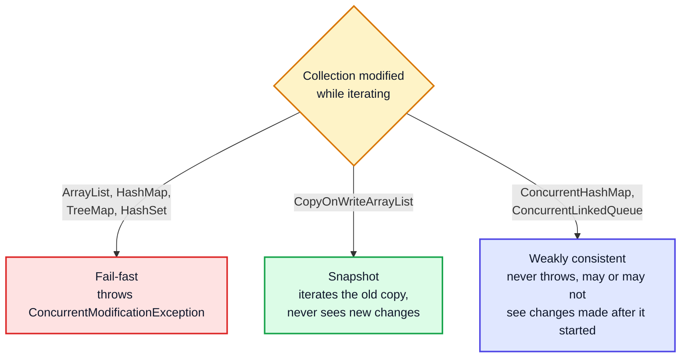

# Iterator, Iterable & Fail-Fast vs Fail-Safe — Complete In-Depth Guide

**Java gap topic #10 of 12** · Priority 🟡 · from [topics_not_covered.md](../topics_not_covered.md)

Every `for (x : list)` loop in the playlist secretly uses an **`Iterator`**. Knowing how iterators work explains the dreaded `ConcurrentModificationException`, the right way to remove elements while looping, how to make your own classes work with for-each, and the classic interview question "fail-fast vs fail-safe iterators". These notes also cover `ListIterator`, `Spliterator`, and the iterator-design problems on LeetCode (BST Iterator, Peeking Iterator, Flatten Nested List).

> [!NOTE]
> This topic isn't in the playlist, so there are no video timestamps. All code targets **Java 21**. It builds on the collections from [video 43](../kunal-java-notes-claude/java_43_video_collections_vector_enums.md) and the linked list from [video 44](../kunal-java-notes-claude/java_44_video_linked_list.md).

---

## Table of Contents

| # | Topic (anchor link) | Level |
|---|---|---|
| 0 | [Iterable and Iterator](#0-iterable-and-iterator) | Basics |
| 1 | [What for-each Really Does](#1-what-for-each-really-does) | Basics |
| 2 | [The Iterator Methods](#2-the-iterator-methods) | Core |
| 3 | [Making Your Own Class Iterable](#3-making-your-own-class-iterable) | Core |
| 4 | [ListIterator](#4-listiterator) | Core |
| 5 | [ConcurrentModificationException and modCount](#5-concurrentmodificationexception-and-modcount) | Core |
| 6 | [Removing Elements While Iterating](#6-removing-elements-while-iterating) | Core |
| 7 | [Fail-Fast vs Fail-Safe Iterators](#7-fail-fast-vs-fail-safe-iterators) | In depth |
| 8 | [Iterating Maps](#8-iterating-maps) | In depth |
| 9 | [Lazy and Infinite Iterators](#9-lazy-and-infinite-iterators) | In depth |
| 10 | [Spliterator and Enumeration](#10-spliterator-and-enumeration) | In depth |
| 11 | [Iterator Design Problems (LeetCode)](#11-iterator-design-problems-leetcode) | DSA |
| 12 | [Common Interview Questions](#12-common-interview-questions) | Interview |

---

## 0. Iterable and Iterator

Two separate interfaces with two separate jobs:

| Interface | Package | Job | Key method |
|---|---|---|---|
| `Iterable<T>` | `java.lang` | "I am something you can loop over" | `Iterator<T> iterator()` |
| `Iterator<T>` | `java.util` | "I am a cursor walking over it, one element at a time" | `hasNext()`, `next()`, `remove()` |



The collection holds the data; each iterator holds only a **position**. You can have several independent iterators over the same collection at once (that's how a nested loop over the same list works).



> [!NOTE]
> `Map` does **not** extend `Iterable` or `Collection`. You iterate one of its *views*: `entrySet()`, `keySet()` or `values()` (Section 8).

---

## 1. What for-each Really Does

The enhanced `for` loop is **syntactic sugar**. The compiler rewrites it.

```java
import java.util.*;

public class ForEachDesugar {
    public static void main(String[] args) {
        List<String> names = List.of("Kunal", "Rahul", "Priya");

        // What you write
        for (String n : names) System.out.print(n + " ");
        System.out.println();

        // What the compiler generates for an Iterable
        for (Iterator<String> it = names.iterator(); it.hasNext(); ) {
            String n = it.next();
            System.out.print(n + " ");
        }
        System.out.println();

        // For ARRAYS it generates a plain index loop instead (arrays aren't Iterable)
        int[] arr = {1, 2, 3};
        for (int x : arr) System.out.print(x + " ");          // becomes: for (int i = 0; i < arr.length; i++)
        System.out.println();
    }
}
// Output:
// Kunal Rahul Priya
// Kunal Rahul Priya
// 1 2 3
```

| Loop over | Compiles to |
|---|---|
| An `Iterable` (any collection) | `iterator()` + `hasNext()` + `next()` |
| An array | an index loop `for (int i = 0; i < a.length; i++)` |

> [!IMPORTANT]
> Since for-each on a collection *is* an iterator loop, everything about iterators — including `ConcurrentModificationException` — applies to every for-each you write.

---

## 2. The Iterator Methods

| Method | Meaning | Throws |
|---|---|---|
| `boolean hasNext()` | Is there another element? (doesn't move) | — |
| `E next()` | Return the next element **and move past it** | `NoSuchElementException` if none left |
| `void remove()` | Remove the element **last returned by `next()`** (optional operation) | `IllegalStateException` if `next()` wasn't called, or `remove()` was already called for it; `UnsupportedOperationException` if not supported |
| `void forEachRemaining(Consumer)` (Java 8) | Run an action on all remaining elements | — |

```java
import java.util.*;

public class IteratorMethods {
    public static void main(String[] args) {
        List<Integer> list = new ArrayList<>(List.of(10, 20, 30, 40));
        Iterator<Integer> it = list.iterator();

        System.out.println(it.next());           // 10
        System.out.println(it.hasNext());        // true (cursor is between 10 and 20)
        it.remove();                             // removes 10, the last element returned
        try {
            it.remove();                         // ❌ second remove for the same element
        } catch (IllegalStateException e) {
            System.out.println("IllegalStateException: remove() twice");
        }
        it.forEachRemaining(x -> System.out.print(x + " "));   // 20 30 40
        System.out.println();
        try {
            it.next();                           // ❌ nothing left
        } catch (NoSuchElementException e) {
            System.out.println("NoSuchElementException: no more elements");
        }
        System.out.println(list);                // [20, 30, 40]

        Iterator<Integer> immutable = List.of(1, 2).iterator();
        immutable.next();
        try {
            immutable.remove();
        } catch (UnsupportedOperationException e) {
            System.out.println("UnsupportedOperationException: List.of is unmodifiable");
        }
    }
}
```

### The cursor sits *between* elements



| Call | Cursor before | Returns | Cursor after |
|---|---|---|---|
| `next()` | before 10 | 10 | between 10 and 20 |
| `next()` | between 10 and 20 | 20 | between 20 and 30 |
| `hasNext()` | between 20 and 30 | `true` | unchanged |
| `next()` | between 20 and 30 | 30 | at the end |
| `hasNext()` | at the end | `false` | unchanged |

---

## 3. Making Your Own Class Iterable

Implement `Iterable<T>` and return an `Iterator<T>`, and your class works with for-each, `forEach`, and (via `spliterator`) streams.

### Example 1: a range of numbers (no storage at all)

```java
import java.util.*;

public class RangeDemo {
    record Range(int start, int end, int step) implements Iterable<Integer> {
        public Iterator<Integer> iterator() {
            return new Iterator<>() {
                private int current = start;                  // each iterator has its own cursor
                public boolean hasNext() { return step > 0 ? current < end : current > end; }
                public Integer next() {
                    if (!hasNext()) throw new NoSuchElementException();
                    int v = current;
                    current += step;
                    return v;
                }
            };
        }
    }

    public static void main(String[] args) {
        for (int x : new Range(0, 10, 3)) System.out.print(x + " ");    // 0 3 6 9
        System.out.println();
        for (int x : new Range(5, 0, -2)) System.out.print(x + " ");    // 5 3 1
        System.out.println();
        new Range(1, 4, 1).forEach(x -> System.out.print(x * x + " ")); // 1 4 9
        System.out.println();
    }
}
```

### Example 2: a custom linked list (from video 44) that supports for-each and `remove`

```java
import java.util.*;

public class MyLinkedList<T> implements Iterable<T> {
    private class Node { T val; Node next; Node(T v) { val = v; } }
    private Node head, tail;
    private int size;

    public void add(T v) {
        Node n = new Node(v);
        if (head == null) head = tail = n; else { tail.next = n; tail = n; }
        size++;
    }

    @Override
    public Iterator<T> iterator() {
        return new Iterator<T>() {
            private Node prev = null, curr = null, nextNode = head;   // curr = last returned
            private boolean canRemove = false;

            public boolean hasNext() { return nextNode != null; }

            public T next() {
                if (nextNode == null) throw new NoSuchElementException();
                if (curr != null && canRemove) prev = curr;            // curr survived, so it becomes prev
                curr = nextNode;
                nextNode = nextNode.next;
                canRemove = true;
                return curr.val;
            }

            public void remove() {
                if (!canRemove) throw new IllegalStateException();
                if (prev == null) head = nextNode; else prev.next = nextNode;  // unlink curr
                if (curr == tail) tail = prev;
                curr = prev;                                             // so the next next() doesn't set prev wrongly
                canRemove = false;
                size--;
            }
        };
    }

    public int size() { return size; }

    public static void main(String[] args) {
        MyLinkedList<Integer> list = new MyLinkedList<>();
        for (int i = 1; i <= 6; i++) list.add(i);

        Iterator<Integer> it = list.iterator();
        while (it.hasNext()) if (it.next() % 2 == 0) it.remove();      // remove evens safely

        StringBuilder sb = new StringBuilder();
        for (int x : list) sb.append(x).append(' ');                    // for-each works
        System.out.println(sb.toString().trim() + " (size " + list.size() + ")");   // 1 3 5 (size 3)
    }
}
```

> [!TIP]
> The iterator is usually an **inner class** (or anonymous class) so it can read the collection's private fields. Keep the iteration state (the cursor) **in the iterator**, never in the collection, or two loops over the same collection would interfere with each other.

---

## 4. ListIterator

`List.listIterator()` returns a more powerful, **bidirectional** iterator.

| Extra method | Meaning |
|---|---|
| `hasPrevious()`, `previous()` | Walk backwards |
| `nextIndex()`, `previousIndex()` | Index of the element `next()`/`previous()` would return |
| `set(e)` | Replace the element last returned |
| `add(e)` | Insert at the cursor position |
| `listIterator(n)` | Start with the cursor before index `n` |

```java
import java.util.*;

public class ListIteratorDemo {
    public static void main(String[] args) {
        List<String> words = new ArrayList<>(List.of("java", "is", "fun"));

        ListIterator<String> it = words.listIterator();
        while (it.hasNext()) {
            int i = it.nextIndex();
            String w = it.next();
            if (w.equals("is")) it.add("really");                  // insert after "is"
            else it.set(w.toUpperCase());                           // replace in place
            System.out.println("visited index " + i);
        }
        System.out.println(words);                                  // [JAVA, is, really, FUN]

        // Walk backwards from the end
        ListIterator<String> back = words.listIterator(words.size());
        StringBuilder sb = new StringBuilder();
        while (back.hasPrevious()) sb.append(back.previous()).append(' ');
        System.out.println(sb.toString().trim());                   // FUN really is JAVA
    }
}
// Output:
// visited index 0
// visited index 1
// visited index 3
// [JAVA, is, really, FUN]
// FUN really is JAVA
```

Index 2 is never visited: `add("really")` inserted it *before* the cursor, so the loop continues with `"fun"` at index 3.

| | `Iterator` | `ListIterator` |
|---|---|---|
| Works on | Any `Collection` | Only `List` |
| Direction | Forward | Forward and backward |
| Modify | `remove` | `remove`, `set`, `add` |
| Index | No | `nextIndex`, `previousIndex` |

---

## 5. ConcurrentModificationException and modCount

```java
import java.util.*;

public class CMEDemo {
    public static void main(String[] args) {
        List<Integer> nums = new ArrayList<>(List.of(1, 2, 3, 4, 5));
        try {
            for (Integer n : nums) {
                if (n == 2) nums.remove(n);                 // modifying the list during for-each
            }
        } catch (ConcurrentModificationException e) {
            System.out.println("ConcurrentModificationException!");
        }
        System.out.println(nums);                           // [1, 3, 4, 5]  (the removal happened, then the next next() threw)
    }
}
```

> [!NOTE]
> The name is misleading: **no threads are involved**. "Concurrent" here means "the collection was changed while an iterator was in the middle of walking it", even on a single thread.

### How the JDK detects it: `modCount`

`ArrayList` (via `AbstractList`) keeps an `int modCount` that increases on every **structural** change (add, remove, clear — anything that changes the size). Each iterator remembers the value when it was created (`expectedModCount`) and checks it on every `next()`.



A simplified version of `ArrayList`'s internal iterator:

```java
private class Itr implements Iterator<E> {
    int cursor;                        // index of next element to return
    int lastRet = -1;                  // index of last element returned; -1 if none
    int expectedModCount = modCount;

    public boolean hasNext() { return cursor != size; }

    public E next() {
        if (modCount != expectedModCount) throw new ConcurrentModificationException();
        int i = cursor;
        if (i >= size) throw new NoSuchElementException();
        cursor = i + 1;
        return (E) elementData[lastRet = i];
    }

    public void remove() {
        if (lastRet < 0) throw new IllegalStateException();
        if (modCount != expectedModCount) throw new ConcurrentModificationException();
        ArrayList.this.remove(lastRet);   // modCount++
        cursor = lastRet;
        lastRet = -1;
        expectedModCount = modCount;      // ← the iterator's own remove keeps them in sync
    }
}
```

### The surprising "second-to-last element" case

```java
import java.util.*;

public class CMESurprise {
    public static void main(String[] args) {
        List<String> list = new ArrayList<>(List.of("a", "b", "c"));
        for (String s : list) {
            if (s.equals("b")) list.remove(s);    // removing the SECOND-TO-LAST element
        }
        System.out.println(list);                 // [a, c]  — no exception, and "c" was never visited!
    }
}
```

After removing `"b"`, `size` drops to 2 and `cursor` is already 2, so `hasNext()` (`cursor != size`) returns `false`. The loop ends quietly **before** `next()` can check `modCount`, and `"c"` is skipped.

> [!CAUTION]
> Fail-fast behaviour is **best-effort, not guaranteed**. The JDK docs say you should never rely on `ConcurrentModificationException` for correctness, only use it to detect bugs. Modifying a collection during for-each is always a bug, even when it doesn't throw.

| Change during iteration | Structural? | Throws CME on `ArrayList`? |
|---|---|---|
| `list.add(x)` / `list.remove(x)` | ✅ | ✅ |
| `list.set(i, x)` | ❌ (size unchanged) | ❌ |
| `iterator.remove()` | ✅, but through the iterator | ❌ |
| `map.put(existingKey, newValue)` on `HashMap` | ❌ (just replaces) | ❌ |
| `map.put(newKey, v)` on `HashMap` | ✅ | ✅ |

---

## 6. Removing Elements While Iterating

Five correct ways, and the classic wrong one:

```java
import java.util.*;

public class SafeRemoval {
    public static void main(String[] args) {
        // ❌ WRONG: for-each + list.remove → ConcurrentModificationException (or silently skips)

        // ✅ 1. Iterator.remove()
        List<Integer> a = new ArrayList<>(List.of(1, 2, 3, 4, 5, 6));
        for (Iterator<Integer> it = a.iterator(); it.hasNext(); ) {
            if (it.next() % 2 == 0) it.remove();
        }
        System.out.println(a);                                  // [1, 3, 5]

        // ✅ 2. removeIf (Java 8) — clearest, and O(n) for ArrayList
        List<Integer> b = new ArrayList<>(List.of(1, 2, 3, 4, 5, 6));
        b.removeIf(x -> x % 2 == 0);
        System.out.println(b);                                  // [1, 3, 5]

        // ✅ 3. Index loop going BACKWARDS (removing shifts later elements, not earlier ones)
        List<Integer> c = new ArrayList<>(List.of(1, 2, 3, 4, 5, 6));
        for (int i = c.size() - 1; i >= 0; i--) {
            if (c.get(i) % 2 == 0) c.remove(i);                 // remove(int index)
        }
        System.out.println(c);                                  // [1, 3, 5]

        // ❌ Forward index loop skips elements: after removing index 1, the next element moves to index 1
        List<Integer> d = new ArrayList<>(List.of(2, 4, 5, 6));
        for (int i = 0; i < d.size(); i++) {
            if (d.get(i) % 2 == 0) d.remove(i);
        }
        System.out.println(d);                                  // [4, 5]  ← 4 was skipped!

        // ✅ 4. Build a new list (streams)
        List<Integer> e = List.of(1, 2, 3, 4, 5, 6).stream().filter(x -> x % 2 != 0).toList();
        System.out.println(e);                                  // [1, 3, 5]

        // ✅ 5. Collect removals first, then removeAll
        List<Integer> f = new ArrayList<>(List.of(1, 2, 3, 4, 5, 6));
        List<Integer> toRemove = new ArrayList<>();
        for (int x : f) if (x % 2 == 0) toRemove.add(x);
        f.removeAll(toRemove);
        System.out.println(f);                                  // [1, 3, 5]

        // Maps: remove through the view's iterator or removeIf on a view
        Map<String, Integer> stock = new HashMap<>(Map.of("pen", 0, "ink", 5, "pad", 0));
        stock.values().removeIf(q -> q == 0);
        System.out.println(stock);                              // {ink=5}
    }
}
```

| Method | Time on `ArrayList` | Notes |
|---|---|---|
| `Iterator.remove()` in a loop | O(n²) worst case (each remove shifts) | Works on any collection |
| `removeIf` | **O(n)** (one compaction pass) | Best default |
| Backward index loop | O(n²) worst case | No iterator needed |
| Stream `filter` | O(n) | Creates a new list |
| `removeAll(toRemove)` | O(n·m) with a `List`, O(n) with a `HashSet` | |

> [!TIP]
> **`list.remove(i)` vs `list.remove(Integer.valueOf(i))`**: on a `List<Integer>`, `remove(2)` removes the element at **index 2**, while `remove(Integer.valueOf(2))` removes the **value 2**. A frequent source of bugs.

---

## 7. Fail-Fast vs Fail-Safe Iterators

| | **Fail-fast** | **Fail-safe** (more precisely: *snapshot* or *weakly consistent*) |
|---|---|---|
| On modification during iteration | Throws `ConcurrentModificationException` (best effort) | **Never throws** |
| What it iterates | The live collection | A snapshot (copy) or the live structure with relaxed guarantees |
| Sees changes made after it started? | — (it fails) | Snapshot: **no**. Weakly consistent: **maybe** |
| Memory/time cost | None extra | Snapshot: copies the array on every write |
| Thread-safe? | No | Yes (they're from `java.util.concurrent`) |
| `iterator.remove()` | Supported (on mutable collections) | Snapshot: **unsupported**. Weakly consistent: supported |
| Examples | `ArrayList`, `LinkedList`, `HashMap`, `HashSet`, `TreeMap`, `ArrayDeque` | Snapshot: `CopyOnWriteArrayList`, `CopyOnWriteArraySet`. Weakly consistent: `ConcurrentHashMap`, `ConcurrentLinkedQueue`, `ConcurrentSkipListMap`, `LinkedBlockingQueue` |



```java
import java.util.*;
import java.util.concurrent.*;

public class FailFastVsSafe {
    public static void main(String[] args) {
        // Fail-fast
        Map<String, Integer> hm = new HashMap<>(Map.of("a", 1, "b", 2));
        try {
            for (String k : hm.keySet()) hm.put(k + "!", 0);
        } catch (ConcurrentModificationException e) {
            System.out.println("HashMap: ConcurrentModificationException");
        }

        // Snapshot (copy-on-write)
        List<String> cow = new CopyOnWriteArrayList<>(List.of("a", "b"));
        for (String s : cow) cow.add(s + "!");                 // iterates the ORIGINAL 2 elements only
        System.out.println("CopyOnWriteArrayList: " + cow);   // [a, b, a!, b!]
        Iterator<String> snapIt = cow.iterator();
        snapIt.next();
        try {
            snapIt.remove();
        } catch (UnsupportedOperationException e) {
            System.out.println("CopyOnWrite iterator.remove(): UnsupportedOperationException");
        }

        // Weakly consistent
        Map<String, Integer> chm = new ConcurrentHashMap<>(Map.of("a", 1, "b", 2));
        for (String k : chm.keySet()) {
            if (k.length() == 1) chm.put(k + k, 0);           // no exception; new keys may or may not be visited
        }
        System.out.println("ConcurrentHashMap size: " + chm.size());   // 4
    }
}
// Output:
// HashMap: ConcurrentModificationException
// CopyOnWriteArrayList: [a, b, a!, b!]
// CopyOnWrite iterator.remove(): UnsupportedOperationException
// ConcurrentHashMap size: 4
```

> [!WARNING]
> `CopyOnWriteArrayList` copies the **entire array on every add/remove**. Use it only when reads vastly outnumber writes (lists of listeners, configuration). For a write-heavy list shared between threads, use a lock or another structure (see [gap topic #1](java_gap_01_multithreading_concurrency.md#13-concurrent-collections)).

> [!NOTE]
> "Fail-safe" isn't an official Java term; the JDK docs say **"weakly consistent"** for `java.util.concurrent` iterators and describe `CopyOnWriteArrayList` iterators as **snapshot** iterators. Interviewers still use "fail-safe", so know both names.

### `Collections.synchronizedList` is still fail-fast

`Collections.synchronizedList(list)` and the legacy `Vector` lock each **method call**, but iterating takes many calls. You must lock the whole loop yourself, or another thread's `add` causes a CME:

```java
List<Integer> sync = Collections.synchronizedList(new ArrayList<>());
synchronized (sync) {                       // required by the Javadoc when iterating
    for (int x : sync) { /* ... */ }
}
```

---

## 8. Iterating Maps

```java
import java.util.*;

public class MapIteration {
    public static void main(String[] args) {
        Map<String, Integer> marks = new TreeMap<>(Map.of("Asha", 91, "Ben", 78, "Chen", 85));

        // 1. entrySet: key and value together (most efficient)
        for (Map.Entry<String, Integer> e : marks.entrySet()) {
            System.out.print(e.getKey() + "=" + e.getValue() + " ");
        }
        System.out.println();

        // 2. forEach with a BiConsumer
        marks.forEach((k, v) -> System.out.print(k.charAt(0) + ":" + v + " "));
        System.out.println();

        // 3. keySet / values when you need only one side
        System.out.println(marks.keySet() + " " + marks.values());

        // 4. Modify values while iterating: Entry.setValue is allowed (not structural)
        for (Map.Entry<String, Integer> e : marks.entrySet()) e.setValue(e.getValue() + 5);
        System.out.println(marks);

        // 5. Remove while iterating: through the entry iterator
        Iterator<Map.Entry<String, Integer>> it = marks.entrySet().iterator();
        while (it.hasNext()) if (it.next().getValue() < 90) it.remove();
        System.out.println(marks);

        // 6. replaceAll for bulk value updates
        marks.replaceAll((k, v) -> v * 10);
        System.out.println(marks);
    }
}
// Output:
// Asha=91 Ben=78 Chen=85
// A:91 B:78 C:85
// [Asha, Ben, Chen] [91, 78, 85]
// {Asha=96, Ben=83, Chen=90}
// {Asha=96, Chen=90}
// {Asha=960, Chen=900}
```

> [!TIP]
> Iterating `keySet()` and calling `map.get(key)` inside the loop does a second lookup per key. `entrySet()` gives both at once, which matters for `TreeMap` (each `get` is O(log n)).

| Map | Iteration order |
|---|---|
| `HashMap` | Unspecified (depends on hash codes and capacity) |
| `LinkedHashMap` | Insertion order (or access order) |
| `TreeMap` | Sorted by key |
| `Map.of(...)` | Unspecified, may differ between runs |

---

## 9. Lazy and Infinite Iterators

An iterator doesn't need the elements to exist ahead of time. It can **compute each element on demand**, which allows infinite sequences and saves memory.

```java
import java.util.*;
import java.util.function.*;

public class LazyIterators {
    // Infinite Fibonacci sequence: never stores more than two numbers
    static Iterator<Long> fibonacci() {
        return new Iterator<>() {
            long a = 0, b = 1;
            public boolean hasNext() { return true; }      // infinite
            public Long next() { long r = a; long t = a + b; a = b; b = t; return r; }
        };
    }

    // A filtering iterator that wraps another iterator (the Decorator pattern)
    static <T> Iterator<T> filter(Iterator<T> src, Predicate<T> keep) {
        return new Iterator<>() {
            T nextItem; boolean ready;
            public boolean hasNext() {
                while (!ready && src.hasNext()) {
                    T x = src.next();
                    if (keep.test(x)) { nextItem = x; ready = true; }
                }
                return ready;
            }
            public T next() {
                if (!hasNext()) throw new NoSuchElementException();
                ready = false;
                return nextItem;
            }
        };
    }

    public static void main(String[] args) {
        Iterator<Long> fib = fibonacci();
        for (int i = 0; i < 10; i++) System.out.print(fib.next() + " ");      // 0 1 1 2 3 5 8 13 21 34
        System.out.println();

        Iterator<Long> evenFib = filter(fibonacci(), x -> x % 2 == 0);
        for (int i = 0; i < 5; i++) System.out.print(evenFib.next() + " ");   // 0 2 8 34 144
        System.out.println();
    }
}
```

This is exactly how lazy **streams** ([gap topic #2](java_gap_02_streams_api.md#2-the-pipeline-and-laziness)) work under the hood: each stage pulls one element at a time from the stage before it.

---

## 10. Spliterator and Enumeration

### `Spliterator` (Java 8): an iterator that can split

Parallel streams need to divide work between threads. A `Spliterator` ("splittable iterator") can **split itself in half** with `trySplit()`, and reports **characteristics** (`SIZED`, `ORDERED`, `SORTED`, `DISTINCT`, `IMMUTABLE`…) that let streams optimise.

| Method | Meaning |
|---|---|
| `tryAdvance(action)` | Process one element if there is one (`hasNext` + `next` combined) |
| `forEachRemaining(action)` | Process the rest |
| `trySplit()` | Hand off roughly half the remaining elements as a new spliterator (or `null`) |
| `estimateSize()` | How many elements are left (exact if `SIZED`) |
| `characteristics()` | Bit flags describing the source |

```java
import java.util.*;
import java.util.stream.*;

public class SpliteratorDemo {
    public static void main(String[] args) {
        List<Integer> nums = IntStream.rangeClosed(1, 8).boxed().toList();
        Spliterator<Integer> right = nums.spliterator();
        Spliterator<Integer> left = right.trySplit();             // splits off the first half

        System.out.println("left size " + left.estimateSize() + ", right size " + right.estimateSize()); // 4, 4
        left.forEachRemaining(x -> System.out.print(x + " "));      // 1 2 3 4
        System.out.print("| ");
        right.forEachRemaining(x -> System.out.print(x + " "));     // 5 6 7 8
        System.out.println();
        System.out.println("SIZED? " + right.hasCharacteristics(Spliterator.SIZED));   // true

        // Turn any Iterable into a Stream
        Iterable<String> it = List.of("x", "y", "z");
        System.out.println(StreamSupport.stream(it.spliterator(), false).map(String::toUpperCase).toList()); // [X, Y, Z]
    }
}
```

### `Enumeration`: the legacy iterator

Before Java 1.2, `Vector` and `Hashtable` used `Enumeration` (`hasMoreElements()`, `nextElement()`), with no `remove`. You'll still meet it in old APIs.

| | `Enumeration` | `Iterator` |
|---|---|---|
| Since | 1.0 | 1.2 |
| Methods | `hasMoreElements`, `nextElement` | `hasNext`, `next`, `remove`, `forEachRemaining` |
| Remove? | ❌ | ✅ |
| Fail-fast? | `Vector.elements()`: ❌ no | ✅ for `java.util` collections |
| Convert | `enumeration.asIterator()` (Java 9), `Collections.list(enumeration)` | `Collections.enumeration(collection)` |

---

## 11. Iterator Design Problems (LeetCode)

Interviewers like these because they test whether you understand **lazy, stateful traversal**.

### Binary Search Tree Iterator (LC 173)

Return BST values in sorted order, with `next()` and `hasNext()` in **O(1) amortised time** and **O(h) memory** (h = tree height). The idea: an inorder traversal ([video 49](../kunal-java-notes-claude/java_49_video_binary_trees_bst.md)) with an explicit stack, paused between calls.

```java
import java.util.*;

public class BSTIterator implements Iterator<Integer> {
    static class TreeNode {
        int val; TreeNode left, right;
        TreeNode(int v) { val = v; }
        TreeNode(int v, TreeNode l, TreeNode r) { val = v; left = l; right = r; }
    }

    private final Deque<TreeNode> stack = new ArrayDeque<>();

    public BSTIterator(TreeNode root) { pushLeft(root); }

    private void pushLeft(TreeNode n) {           // push the whole left spine
        while (n != null) { stack.push(n); n = n.left; }
    }

    public boolean hasNext() { return !stack.isEmpty(); }

    public Integer next() {
        if (stack.isEmpty()) throw new NoSuchElementException();
        TreeNode n = stack.pop();                 // smallest unvisited node
        pushLeft(n.right);                        // its successor is the leftmost node of its right subtree
        return n.val;
    }

    public static void main(String[] args) {
        //        7
        //      /   \
        //     3     15
        //          /  \
        //         9    20
        TreeNode root = new TreeNode(7, new TreeNode(3), new TreeNode(15, new TreeNode(9), new TreeNode(20)));
        BSTIterator it = new BSTIterator(root);
        StringBuilder sb = new StringBuilder();
        while (it.hasNext()) sb.append(it.next()).append(' ');
        System.out.println(sb.toString().trim());  // 3 7 9 15 20
    }
}
```

**Dry run**

| Call | Popped | Pushed (left spine of popped.right) | Stack after (top first) | Returns |
|---|---|---|---|---|
| constructor | — | 7, 3 | [3, 7] | — |
| `next()` | 3 | (3 has no right) | [7] | 3 |
| `next()` | 7 | 15, 9 | [9, 15] | 7 |
| `next()` | 9 | — | [15] | 9 |
| `next()` | 15 | 20 | [20] | 15 |
| `next()` | 20 | — | [] | 20 |

Each node is pushed and popped exactly once → **O(n) total, O(1) amortised per call**; the stack holds at most **O(h)** nodes.

### Peeking Iterator (LC 284)

Add `peek()` (look at the next element without consuming it) on top of any iterator by caching one element.

```java
import java.util.*;

public class PeekingIterator<T> implements Iterator<T> {
    private final Iterator<T> it;
    private T peeked;
    private boolean hasPeeked;

    public PeekingIterator(Iterator<T> it) { this.it = it; }

    public T peek() {
        if (!hasPeeked) { peeked = it.next(); hasPeeked = true; }
        return peeked;
    }
    public T next() {
        if (hasPeeked) { hasPeeked = false; T r = peeked; peeked = null; return r; }
        return it.next();
    }
    public boolean hasNext() { return hasPeeked || it.hasNext(); }

    public static void main(String[] args) {
        PeekingIterator<Integer> p = new PeekingIterator<>(List.of(1, 2, 3).iterator());
        System.out.println(p.next() + " " + p.peek() + " " + p.peek() + " " + p.next() + " " + p.next() + " " + p.hasNext());
        // 1 2 2 2 3 false
    }
}
```

> [!TIP]
> `PeekingIterator` is handy whenever you need to **merge sorted streams**: peek at the heads of several iterators and take the smallest (the K-way merge pattern, LC 23).

### Flatten Nested List Iterator (LC 341)

Iterate `[1, [4, [6]], 2]` as `1 4 6 2`. Keep a **stack of iterators**; `hasNext()` does the work of descending into nested lists.

```java
import java.util.*;

public class NestedIterator implements Iterator<Integer> {
    private final Deque<Iterator<?>> stack = new ArrayDeque<>();
    private Integer nextVal;

    public NestedIterator(List<?> nested) { stack.push(nested.iterator()); }

    public boolean hasNext() {
        while (nextVal == null && !stack.isEmpty()) {
            Iterator<?> top = stack.peek();
            if (!top.hasNext()) { stack.pop(); continue; }
            Object o = top.next();
            if (o instanceof Integer i) nextVal = i;
            else if (o instanceof List<?> l) stack.push(l.iterator());     // go one level deeper
        }
        return nextVal != null;
    }

    public Integer next() {
        if (!hasNext()) throw new NoSuchElementException();
        Integer r = nextVal;
        nextVal = null;
        return r;
    }

    public static void main(String[] args) {
        List<Object> data = List.of(1, List.of(4, List.of(6)), List.of(), 2);
        NestedIterator it = new NestedIterator(data);
        StringBuilder sb = new StringBuilder();
        while (it.hasNext()) sb.append(it.next()).append(' ');
        System.out.println(sb.toString().trim());   // 1 4 6 2
    }
}
```

### More iterator problems

| Problem | Key idea |
|---|---|
| Zigzag Iterator (LC 281) | Queue of iterators; take one from the front, re-add it if it still has elements |
| Flatten 2D Vector (LC 251) | Two indices (outer, inner); skip empty rows in `hasNext` |
| RLE Iterator (LC 900) | Index into the encoding plus "how many used from the current run" |
| Iterator for Combination (LC 1286) | Generate the next combination on demand, or precompute with backtracking ([video 32](../kunal-java-notes-claude/java_32_video_recursion_subsets_strings.md)) |
| Design Compressed String Iterator (LC 604) | Parse lazily: current char + remaining count |

---

## 12. Common Interview Questions

| Question | Short answer |
|---|---|
| `Iterable` vs `Iterator`? | `Iterable` can produce iterators (`iterator()`); an `Iterator` is a one-pass cursor (`hasNext`, `next`, `remove`). |
| How does for-each work? | Calls `iterator()` then `hasNext()`/`next()` (for arrays, an index loop). |
| Why does `ConcurrentModificationException` happen? | A structural change was made to the collection outside the iterator; `modCount != expectedModCount`. |
| Does CME require multiple threads? | No; it happens on one thread too. |
| How do you remove while iterating? | `iterator.remove()`, `removeIf`, a backward index loop, or build a new collection. |
| Fail-fast vs fail-safe? | Fail-fast throws CME on modification (`ArrayList`, `HashMap`); fail-safe (snapshot/weakly consistent) never throws (`CopyOnWriteArrayList`, `ConcurrentHashMap`). |
| Is fail-fast guaranteed? | No, best effort. Don't rely on it for correctness. |
| Can a `CopyOnWriteArrayList` iterator remove? | No, `UnsupportedOperationException`. |
| `Iterator` vs `ListIterator`? | `ListIterator` goes both ways and can `set`/`add`; only for `List`s. |
| `Iterator` vs `Enumeration`? | `Iterator` is newer, shorter names, supports `remove`, and is fail-fast. |
| Is `Map` iterable? | No; iterate `entrySet()`, `keySet()` or `values()`. |
| Can you modify a value while iterating a `HashMap`? | Yes, `entry.setValue()` or `put` on an existing key isn't structural. |
| What is a `Spliterator`? | A splittable iterator used by (parallel) streams. |
| How do you make a class usable in for-each? | Implement `Iterable<T>` and return an `Iterator<T>`. |

---

## 🧩 Complete Example: Everything Together

A "playlist" class that implements `Iterable` with a fail-fast iterator of its own (using a `modCount` like the JDK), plus a reverse view, safe removal, a peeking iterator, `ListIterator` edits, fail-fast vs snapshot vs weakly consistent behaviour, a lazy filtering iterator, and a BST iterator.

```java
import java.util.*;
import java.util.concurrent.*;
import java.util.function.*;

public class IteratorShowcase {

    // A growable array-backed playlist with its own FAIL-FAST iterator
    static final class Playlist implements Iterable<String> {
        private String[] songs = new String[2];
        private int size;
        private int modCount;                                 // like AbstractList.modCount

        void add(String s) {
            if (size == songs.length) songs = Arrays.copyOf(songs, size * 2);
            songs[size++] = s;
            modCount++;
        }
        void removeAt(int i) {
            System.arraycopy(songs, i + 1, songs, i, size - i - 1);
            songs[--size] = null;
            modCount++;
        }
        int size() { return size; }

        @Override public Iterator<String> iterator() {
            return new Iterator<>() {
                int cursor = 0, lastRet = -1, expected = modCount;
                public boolean hasNext() { return cursor < size; }
                public String next() {
                    if (modCount != expected) throw new ConcurrentModificationException();
                    if (cursor >= size) throw new NoSuchElementException();
                    lastRet = cursor;
                    return songs[cursor++];
                }
                public void remove() {
                    if (lastRet < 0) throw new IllegalStateException();
                    if (modCount != expected) throw new ConcurrentModificationException();
                    removeAt(lastRet);
                    cursor = lastRet;
                    lastRet = -1;
                    expected = modCount;                      // stay in sync after our own removal
                }
            };
        }

        Iterable<String> reversed() {                          // a second, independent way to iterate
            return () -> new Iterator<>() {
                int i = size - 1;
                public boolean hasNext() { return i >= 0; }
                public String next() { if (i < 0) throw new NoSuchElementException(); return songs[i--]; }
            };
        }
    }

    // Lazy filter (decorator around any iterator)
    static <T> Iterator<T> filtering(Iterator<T> src, Predicate<? super T> keep) {
        return new Iterator<>() {
            T buf; boolean ready;
            public boolean hasNext() {
                while (!ready && src.hasNext()) { T x = src.next(); if (keep.test(x)) { buf = x; ready = true; } }
                return ready;
            }
            public T next() { if (!hasNext()) throw new NoSuchElementException(); ready = false; return buf; }
        };
    }

    record Node(int val, Node left, Node right) { }

    static Iterator<Integer> inorder(Node root) {
        Deque<Node> st = new ArrayDeque<>();
        for (Node n = root; n != null; n = n.left()) st.push(n);
        return new Iterator<>() {
            public boolean hasNext() { return !st.isEmpty(); }
            public Integer next() {
                Node n = st.pop();
                for (Node m = n.right(); m != null; m = m.left()) st.push(m);
                return n.val();
            }
        };
    }

    public static void main(String[] args) {
        // 1. Custom Iterable in for-each, plus a reverse view
        Playlist p = new Playlist();
        for (String s : List.of("Intro", "Ad Break", "Arrays", "Ad Break", "Recursion", "Outro")) p.add(s);
        StringJoiner fwd = new StringJoiner(", "), rev = new StringJoiner(", ");
        for (String s : p) fwd.add(s);
        for (String s : p.reversed()) rev.add(s);
        System.out.println("1. Forward: " + fwd);
        System.out.println("   Reverse: " + rev);

        // 2. Our fail-fast iterator detects outside modification
        try {
            for (String s : p) if (s.equals("Arrays")) p.add("Bonus");
        } catch (ConcurrentModificationException e) {
            System.out.println("2. Custom iterator threw ConcurrentModificationException");
        }

        // 3. Safe removal through the iterator
        for (Iterator<String> it = p.iterator(); it.hasNext(); ) if (it.next().startsWith("Ad")) it.remove();
        StringJoiner after = new StringJoiner(", ");
        p.forEach(after::add);                               // Iterable.forEach default method
        System.out.println("3. Without ads (" + p.size() + "): " + after);

        // 4. ListIterator: replace and insert in one pass
        List<String> topics = new ArrayList<>(List.of("bits", "maths", "dp"));
        for (ListIterator<String> li = topics.listIterator(); li.hasNext(); ) {
            String t = li.next();
            li.set(t.toUpperCase());
            if (t.equals("maths")) li.add("RECURSION");
        }
        System.out.println("4. ListIterator result: " + topics);

        // 5. Fail-fast vs snapshot vs weakly consistent
        List<Integer> plain = new ArrayList<>(List.of(1, 2, 3));
        String plainResult;
        try { for (int x : plain) if (x == 1) plain.add(99); plainResult = "no error"; }
        catch (ConcurrentModificationException e) { plainResult = "CME"; }

        List<Integer> cow = new CopyOnWriteArrayList<>(List.of(1, 2, 3));
        int visited = 0;
        for (int x : cow) { cow.add(x * 10); visited++; }

        Map<Integer, Integer> chm = new ConcurrentHashMap<>(Map.of(1, 1, 2, 2));
        for (int k : chm.keySet()) if (k < 10) chm.put(k + 100, 0);
        System.out.println("5. ArrayList: " + plainResult + " | CopyOnWrite visited " + visited
                + " of " + cow.size() + " | ConcurrentHashMap size " + chm.size());

        // 6. removeIf vs forward-index bug
        List<Integer> nums = new ArrayList<>(List.of(2, 4, 6, 7, 8));
        List<Integer> buggy = new ArrayList<>(nums);
        for (int i = 0; i < buggy.size(); i++) if (buggy.get(i) % 2 == 0) buggy.remove(i);
        nums.removeIf(x -> x % 2 == 0);
        System.out.println("6. removeIf: " + nums + " vs forward-index loop: " + buggy);

        // 7. Lazy filtering over an infinite source
        Iterator<Integer> naturals = new Iterator<>() {
            int n = 1;
            public boolean hasNext() { return true; }
            public Integer next() { return n++; }
        };
        Iterator<Integer> squaresOf3 = filtering(naturals, x -> Math.sqrt(x) % 1 == 0 && x % 3 == 0);
        List<Integer> firstFour = new ArrayList<>();
        for (int i = 0; i < 4; i++) firstFour.add(squaresOf3.next());
        System.out.println("7. First four perfect squares divisible by 3: " + firstFour);

        // 8. BST inorder iterator with an explicit stack
        Node bst = new Node(8, new Node(3, new Node(1, null, null), new Node(6, null, null)),
                               new Node(10, null, new Node(14, null, null)));
        StringJoiner sorted = new StringJoiner(" ");
        inorder(bst).forEachRemaining(v -> sorted.add(String.valueOf(v)));
        System.out.println("8. BST in sorted order: " + sorted);

        // 9. Map iteration with entry.setValue and iterator removal
        Map<String, Integer> views = new TreeMap<>(Map.of("arrays", 120, "dp", 40, "graphs", 75));
        for (Map.Entry<String, Integer> e : views.entrySet()) e.setValue(e.getValue() * 2);
        views.entrySet().removeIf(e -> e.getValue() < 100);
        System.out.println("9. Popular topics: " + views);
    }
}
```

**Expected Output:**
```
1. Forward: Intro, Ad Break, Arrays, Ad Break, Recursion, Outro
   Reverse: Outro, Recursion, Ad Break, Arrays, Ad Break, Intro
2. Custom iterator threw ConcurrentModificationException
3. Without ads (5): Intro, Arrays, Recursion, Outro, Bonus
4. ListIterator result: [BITS, MATHS, RECURSION, DP]
5. ArrayList: CME | CopyOnWrite visited 3 of 6 | ConcurrentHashMap size 4
6. removeIf: [7] vs forward-index loop: [4, 7]
7. First four perfect squares divisible by 3: [9, 36, 81, 144]
8. BST in sorted order: 1 3 6 8 10 14
9. Popular topics: {arrays=240, graphs=150}
```

---

## Quick Reference Cheat Sheet

| Concept | One-Line Summary |
|---|---|
| **`Iterable<T>`** | Has `iterator()`; works with for-each and `forEach` |
| **`Iterator<T>`** | One-pass cursor: `hasNext()`, `next()`, `remove()`, `forEachRemaining()` |
| **for-each** | Sugar for an iterator loop (an index loop for arrays) |
| **Cursor** | Sits between elements; `next()` returns the one after it |
| **`remove()`** | Removes the last element returned; once per `next()` |
| **`ListIterator`** | Both directions, `set`, `add`, indices; lists only |
| **CME** | Structural change outside the iterator; `modCount` check; single-threaded too |
| **Best-effort** | Fail-fast may not throw (e.g. removing the second-to-last element) |
| **Safe removal** | `iterator.remove()`, `removeIf`, backward index loop, new collection |
| **Fail-fast** | `ArrayList`, `HashMap`, `HashSet`, `TreeMap`: throw CME |
| **Snapshot** | `CopyOnWriteArrayList`: iterates a copy, no `remove()` |
| **Weakly consistent** | `ConcurrentHashMap`: never throws, may see recent changes |
| **Maps** | Not `Iterable`; use `entrySet()` (fastest), `keySet()`, `values()` |
| **Lazy iterators** | Compute elements on demand; can be infinite |
| **`Spliterator`** | Splittable iterator for (parallel) streams |
| **`Enumeration`** | Legacy (`Vector`, `Hashtable`); no `remove` |
| **BST iterator (LC 173)** | Stack of the left spine: O(1) amortised, O(h) space |
