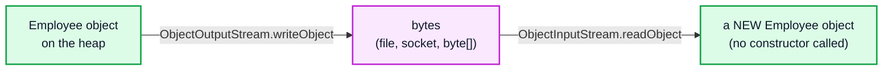
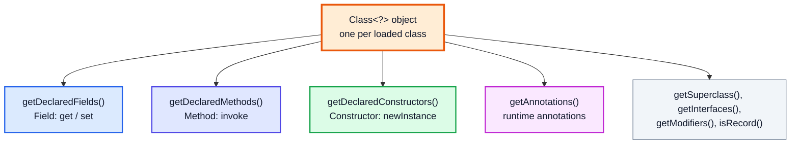
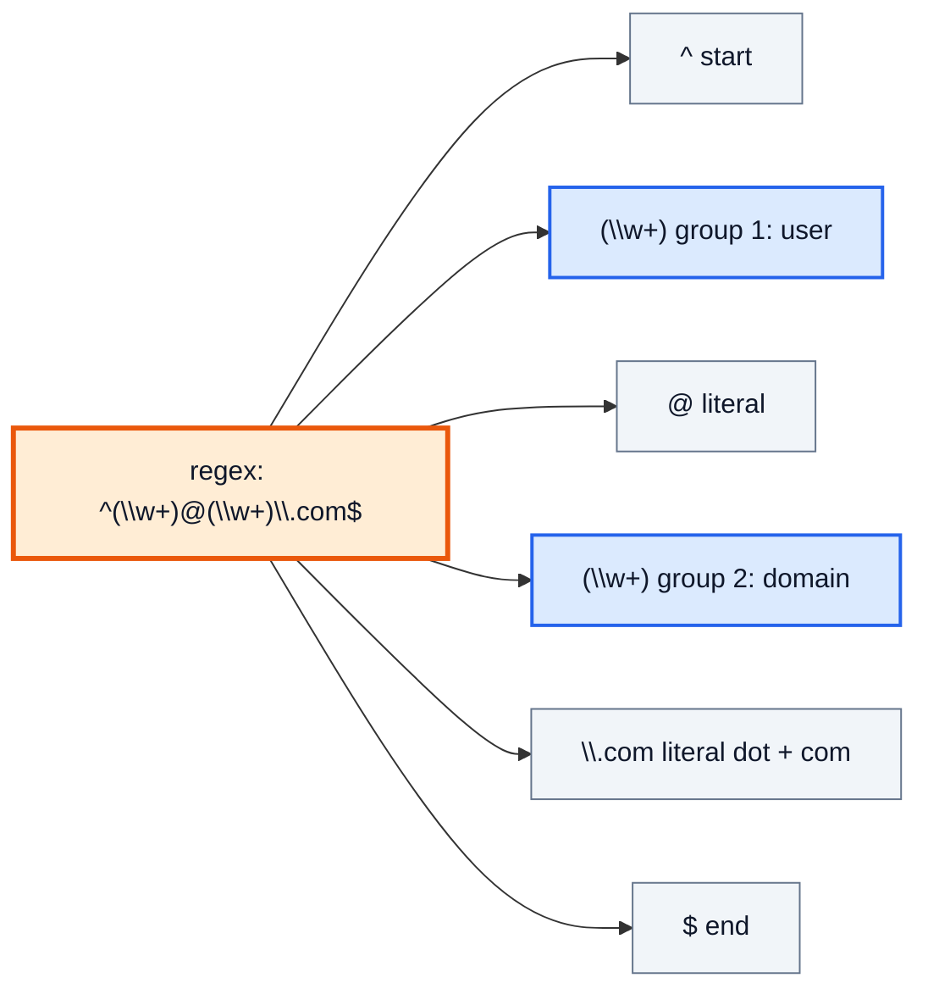
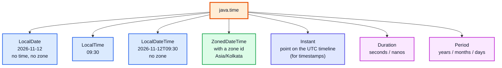

# Serialization, Reflection, Regex & java.time — Complete In-Depth Guide

**Java gap topic #11 of 12** · Priority 🟢 · from [topics_not_covered.md](../topics_not_covered.md)

Four practical parts of the standard library that the playlist doesn't cover:

| Part | What it does |
|---|---|
| **Serialization** | Turns objects into bytes and back |
| **Reflection** | Lets code inspect and call classes at runtime; it's how frameworks like Spring and JUnit work |
| **Regular expressions** | Match and extract text patterns |
| **`java.time`** | The modern date/time API that replaced the error-prone `Date` and `Calendar` |

They're asked less often than collections or concurrency, but you'll use all four in real projects, and interviewers like the classic traps: `transient`, `serialVersionUID`, greedy vs lazy regex, and `Period` vs `Duration`.

> [!NOTE]
> This topic isn't in the playlist, so there are no video timestamps. All code targets **Java 21**. It builds on file handling ([video 54](../kunal-java-notes-claude/java_54_video_file_handling.md)), OOP and interfaces ([videos 37–41](../kunal-java-notes-claude/java_41_video_abstract_classes_interfaces.md)), and the JVM's class loading ([gap Java #9](java_gap_09_jvm_internals_gc.md#1-class-loading-load-link-initialize)).

---

## Table of Contents

| # | Topic (anchor link) | Level |
|---|---|---|
| 0 | [Serialization Basics](#0-serialization-basics) | Basics |
| 1 | [transient, serialVersionUID and Custom Serialization](#1-transient-serialversionuid-and-custom-serialization) | Core |
| 2 | [Serialization Pitfalls and Alternatives](#2-serialization-pitfalls-and-alternatives) | In depth |
| 3 | [Reflection: Inspecting Classes](#3-reflection-inspecting-classes) | Core |
| 4 | [Reflection: Calling Methods, Annotations, Proxies](#4-reflection-calling-methods-annotations-proxies) | In depth |
| 5 | [Regex Syntax](#5-regex-syntax) | Core |
| 6 | [Pattern and Matcher in Java](#6-pattern-and-matcher-in-java) | Core |
| 7 | [Regex Pitfalls](#7-regex-pitfalls) | In depth |
| 8 | [java.time: The Main Classes](#8-javatime-the-main-classes) | Core |
| 9 | [Durations, Periods, Formatting and Time Zones](#9-durations-periods-formatting-and-time-zones) | In depth |
| 10 | [Common Interview Questions](#10-common-interview-questions) | Interview |

---

## 0. Serialization Basics

**Serialization** converts an object (and everything it references) into a byte stream; **deserialization** rebuilds it. Uses: saving objects to files, sending them over a network, caching in a different process.



A class opts in by implementing the **marker interface** `java.io.Serializable` (it has no methods).

```java
import java.io.*;
import java.util.*;

public class SerializationBasics {
    static class Employee implements Serializable {
        private static final long serialVersionUID = 1L;
        String name;
        int salary;
        List<String> skills;
        Employee(String name, int salary, List<String> skills) { this.name = name; this.salary = salary; this.skills = skills; }
        @Override public String toString() { return name + " " + salary + " " + skills; }
    }

    static byte[] serialize(Object o) throws IOException {
        ByteArrayOutputStream bytes = new ByteArrayOutputStream();
        try (ObjectOutputStream out = new ObjectOutputStream(bytes)) { out.writeObject(o); }
        return bytes.toByteArray();
    }

    static Object deserialize(byte[] data) throws IOException, ClassNotFoundException {
        try (ObjectInputStream in = new ObjectInputStream(new ByteArrayInputStream(data))) { return in.readObject(); }
    }

    public static void main(String[] args) throws Exception {
        Employee e = new Employee("Asha", 90000, new ArrayList<>(List.of("Java", "SQL")));
        byte[] data = serialize(e);
        Employee copy = (Employee) deserialize(data);
        System.out.println(copy);                     // Asha 90000 [Java, SQL]
        System.out.println(copy == e);                // false: a brand-new object
        copy.skills.add("Kafka");
        System.out.println(e.skills);                 // [Java, SQL]  (it's a DEEP copy)
    }
}
```

| Rule | Detail |
|---|---|
| Every field's type must be serializable too | Otherwise `NotSerializableException` (unless the field is `transient`) |
| `static` fields aren't serialized | They belong to the class, not the object |
| Constructors aren't run on deserialization | The first **non-serializable** superclass's no-arg constructor is called instead |
| Object graphs are handled | Shared references and cycles are preserved |
| Produces a deep copy | Serialize + deserialize is one (slow) way to deep-clone ([video 42](../kunal-java-notes-claude/java_42_video_generics_lambdas_exceptions_cloning.md)) |

---

## 1. transient, serialVersionUID and Custom Serialization

### `transient`: skip a field

Mark fields that must not be written (passwords, caches, open connections). After deserialization they hold the **default value** (`null`, 0, false).

### `serialVersionUID`: the class version

Each serializable class has a version number. When reading, Java checks that the stored version matches the current class; a mismatch throws `InvalidClassException`. If you don't declare one, the compiler **computes** it from the class's structure, so adding a method or field changes it and breaks old data. **Always declare it explicitly.**

### Custom `writeObject` / `readObject`

Private methods with these exact signatures let you control the format: encrypt a field, validate input, or rebuild a `transient` field.

```java
import java.io.*;

public class CustomSerialization {
    static class Account implements Serializable {
        private static final long serialVersionUID = 2L;
        String user;
        transient String password;              // never written
        transient int loginCount;               // reset after deserialization
        private int balance;

        Account(String user, String password, int balance) { this.user = user; this.password = password; this.balance = balance; }

        private void writeObject(ObjectOutputStream out) throws IOException {
            out.defaultWriteObject();                    // write non-transient fields
            out.writeInt(balance ^ 0x5A5A);              // a (toy) obfuscation of one field
        }

        private void readObject(ObjectInputStream in) throws IOException, ClassNotFoundException {
            in.defaultReadObject();
            balance = in.readInt() ^ 0x5A5A;
            if (balance < 0) throw new InvalidObjectException("negative balance");   // validate untrusted input
        }
    }

    public static void main(String[] args) throws Exception {
        Account a = new Account("asha", "s3cret", 500);
        a.loginCount = 7;
        ByteArrayOutputStream bos = new ByteArrayOutputStream();
        try (ObjectOutputStream out = new ObjectOutputStream(bos)) { out.writeObject(a); }
        try (ObjectInputStream in = new ObjectInputStream(new ByteArrayInputStream(bos.toByteArray()))) {
            Account b = (Account) in.readObject();
            System.out.println(b.user + " " + b.password + " " + b.loginCount + " " + b.balance);   // asha null 0 500
        }
    }
}
```

| Keyword / method | Effect |
|---|---|
| `transient` | Field skipped; default value after reading |
| `static` | Never serialized |
| `serialVersionUID` | Version check; declare it as `private static final long` |
| `writeObject` / `readObject` | Customise the stream for this class |
| `readResolve()` | Replace the deserialized object, e.g. return the existing Singleton instance |
| `Externalizable` | You write **everything** yourself (`writeExternal` / `readExternal`); needs a public no-arg constructor |

> [!TIP]
> A serializable **Singleton** ([video 38](../kunal-java-notes-claude/java_38_video_oop_static_packages_singleton.md)) breaks: each deserialization creates a new instance. Fix it with `private Object readResolve() { return INSTANCE; }`, or use an `enum` singleton, which Java serializes safely by name ([gap Java #4](java_gap_04_design_patterns.md#1-singleton-revisited)).

---

## 2. Serialization Pitfalls and Alternatives

> [!CAUTION]
> **Never deserialize untrusted data with `ObjectInputStream`.** A crafted byte stream can create objects from any class on the classpath and trigger code during deserialization ("gadget chains"). This has caused many real remote-code-execution vulnerabilities. If you must, use an **`ObjectInputFilter`** (Java 9+) to allow only specific classes.

```java
ObjectInputFilter filter = ObjectInputFilter.Config.createFilter("com.myapp.dto.*;java.util.*;!*");
in.setObjectInputFilter(filter);   // reject every class not in the allow-list
```

| Problem with Java serialization | Better alternative |
|---|---|
| Security risk with untrusted input | JSON (Jackson, Gson), Protocol Buffers |
| Java-only binary format | JSON / Protobuf / Avro work across languages |
| Fragile across class changes | Schema-based formats with explicit versioning |
| Slow and large | Protobuf, Kryo |

**Records** (Java 16, [gap Java #7](java_gap_07_modern_java_features.md#6-records)) are serialized through their **canonical constructor**, so validation in a compact constructor also runs on deserialization: safer than ordinary classes.

---

## 3. Reflection: Inspecting Classes

**Reflection** (`java.lang.reflect`) lets a program look at a class's structure at runtime and use it: list fields and methods, create instances, call methods, read annotations. Everything starts from a `Class<?>` object.



| Get a `Class` | Example |
|---|---|
| From a type | `String.class`, `int.class`, `int[].class` |
| From an object | `obj.getClass()` |
| From a name | `Class.forName("java.util.ArrayList")` |

| `getX()` vs `getDeclaredX()` | Returns |
|---|---|
| `getFields()` / `getMethods()` | **public** members, including inherited ones |
| `getDeclaredFields()` / `getDeclaredMethods()` | **all** members (any access) declared in **this** class only |

```java
import java.lang.reflect.*;
import java.util.*;

public class ReflectionInspect {
    static class Product {
        private final String name;
        private int stock;
        public static final String CATEGORY = "general";
        public Product(String name, int stock) { this.name = name; this.stock = stock; }
        public int getStock() { return stock; }
        private void restock(int n) { stock += n; }
    }

    public static void main(String[] args) throws Exception {
        Class<?> c = Product.class;
        System.out.println(c.getSimpleName() + ", superclass " + c.getSuperclass().getSimpleName());   // Product, superclass Object

        List<String> fields = new ArrayList<>();
        for (Field f : c.getDeclaredFields()) fields.add(Modifier.toString(f.getModifiers()) + " " + f.getType().getSimpleName() + " " + f.getName());
        Collections.sort(fields);                              // the JVM doesn't guarantee an order
        System.out.println(fields);   // [private final String name, private int stock, public static final String CATEGORY]

        List<String> methods = new ArrayList<>();
        for (Method m : c.getDeclaredMethods()) methods.add(m.getName() + Arrays.toString(m.getParameterTypes()));
        Collections.sort(methods);
        System.out.println(methods);  // [getStock[], restock[int]]

        Constructor<?> ctor = c.getConstructor(String.class, int.class);
        Object p = ctor.newInstance("pen", 10);                // create an instance by reflection
        Field stock = c.getDeclaredField("stock");
        stock.setAccessible(true);                             // bypass 'private'
        stock.setInt(p, 42);
        System.out.println(((Product) p).getStock());          // 42
    }
}
```

> [!WARNING]
> `setAccessible(true)` breaks encapsulation. Since Java 9's module system ([gap Java #7](java_gap_07_modern_java_features.md#13-smaller-improvements-worth-knowing)), it **fails** for private members of JDK classes (`InaccessibleObjectException`) unless the module is opened with `--add-opens`. Your own classes on the classpath are still accessible.

---

## 4. Reflection: Calling Methods, Annotations, Proxies

### Invoking methods and reading annotations

Annotations with `@Retention(RetentionPolicy.RUNTIME)` are visible to reflection. This is exactly how test frameworks find `@Test` methods ([gap Java #12](java_gap_12_junit_maven_gradle_jdbc.md)) and how Spring finds `@Autowired` fields.

```java
import java.lang.annotation.*;
import java.lang.reflect.*;
import java.util.*;

public class AnnotationsAndInvoke {
    @Retention(RetentionPolicy.RUNTIME)
    @Target(ElementType.METHOD)
    @interface Command { String value(); }                 // a custom annotation

    static class Shell {
        @Command("greet") public String hello(String who) { return "Hello, " + who; }
        @Command("shout") public String loud(String who) { return who.toUpperCase() + "!"; }
        public String notACommand(String s) { return s; }
    }

    public static void main(String[] args) throws Exception {
        Shell shell = new Shell();
        Map<String, Method> commands = new TreeMap<>();
        for (Method m : Shell.class.getDeclaredMethods()) {
            Command cmd = m.getAnnotation(Command.class);
            if (cmd != null) commands.put(cmd.value(), m);     // register annotated methods
        }
        System.out.println("Commands: " + commands.keySet());                       // Commands: [greet, shout]
        System.out.println(commands.get("greet").invoke(shell, "Kunal"));            // Hello, Kunal
        System.out.println(commands.get("shout").invoke(shell, "dsa"));              // DSA!
    }
}
```

### Dynamic proxies

`java.lang.reflect.Proxy` creates, at runtime, an object that implements any interfaces you choose and routes every call to an `InvocationHandler`. This is the **Proxy** pattern ([gap Java #4](java_gap_04_design_patterns.md#8-proxy)), used by Spring for `@Transactional` and by mocking libraries.

```java
import java.lang.reflect.*;
import java.util.*;

public class DynamicProxyDemo {
    interface Calculator { int add(int a, int b); int square(int x); }

    public static void main(String[] args) {
        Calculator real = new Calculator() {
            public int add(int a, int b) { return a + b; }
            public int square(int x) { return x * x; }
        };
        List<String> log = new ArrayList<>();
        Calculator logged = (Calculator) Proxy.newProxyInstance(
                Calculator.class.getClassLoader(),
                new Class<?>[]{Calculator.class},
                (proxy, method, methodArgs) -> {
                    Object result = method.invoke(real, methodArgs);          // forward to the real object
                    log.add(method.getName() + Arrays.toString(methodArgs) + " = " + result);
                    return result;
                });
        logged.add(2, 3);
        logged.square(7);
        System.out.println(log);   // [add[2, 3] = 5, square[7] = 49]
    }
}
```

| Reflection is used by | For |
|---|---|
| JUnit | Finding and running `@Test` methods |
| Spring | Dependency injection, `@Autowired`, proxies |
| Hibernate / JPA | Mapping fields to columns |
| Jackson / Gson | Reading and writing fields as JSON |
| IDEs and debuggers | Showing object contents |

| Downside | Why |
|---|---|
| Slower | Access checks, boxing of arguments, fewer JIT optimisations (much improved in recent JDKs) |
| No compile-time safety | Typos in method names fail at runtime |
| Breaks encapsulation | Can read/write private state |
| Harder to refactor | Renames don't update string-based lookups |

---

## 5. Regex Syntax

A **regular expression** describes a set of strings. Java's syntax (in `java.util.regex`) follows Perl's.

| Category | Syntax | Matches |
|---|---|---|
| Literal | `cat` | the text "cat" |
| Any character | `.` | any char except newline |
| Character class | `[aeiou]`, `[a-z0-9]`, `[^0-9]` | one of / a range / anything **not** listed |
| Predefined | `\d` digit, `\w` word char `[A-Za-z0-9_]`, `\s` whitespace; `\D \W \S` = negations | |
| Anchors | `^` start, `$` end, `\b` word boundary | positions, not characters |
| Quantifiers | `*` 0+, `+` 1+, `?` 0 or 1, `{3}`, `{2,5}`, `{2,}` | repeat the previous item |
| Lazy quantifiers | `*?`, `+?`, `??` | as **few** as possible |
| Groups | `(abc)` capture, `(?:abc)` no capture, `(?<name>abc)` named | |
| Alternation | `cat\|dog` | either |
| Lookaround | `(?=x)` followed by, `(?!x)` not followed by, `(?<=x)` preceded by, `(?<!x)` not preceded by | zero-width conditions |
| Back-reference | `\1`, `\k<name>` | the same text a group matched |

> [!IMPORTANT]
> In a Java **string literal**, every regex backslash must be doubled: the regex `\d+` is written `"\\d+"`, and a literal backslash `\\` in regex is `"\\\\"` in Java. Text blocks don't change this.



---

## 6. Pattern and Matcher in Java

| Method | Meaning |
|---|---|
| `Pattern.compile(regex, flags)` | Compile once, reuse (thread-safe) |
| `p.matcher(text)` | A `Matcher` for one input (not thread-safe) |
| `m.matches()` | Does the **whole** input match? |
| `m.find()` | Find the **next** match anywhere |
| `m.group()`, `m.group(1)`, `m.group("name")` | Text of the match / a group |
| `m.start()`, `m.end()` | Positions |
| `str.matches(regex)` | Shortcut for whole-string match (recompiles every call) |
| `str.replaceAll(regex, repl)` | Replace, with `$1` / `${name}` back-references |
| `str.split(regex)` | Split on matches |
| `m.results()` (Java 9) | Stream of all `MatchResult`s |

| Flag | Effect |
|---|---|
| `Pattern.CASE_INSENSITIVE` or `(?i)` | Ignore case |
| `Pattern.MULTILINE` or `(?m)` | `^` / `$` match at each line |
| `Pattern.DOTALL` or `(?s)` | `.` also matches newlines |
| `Pattern.COMMENTS` or `(?x)` | Whitespace and `#` comments allowed in the pattern |

```java
import java.util.*;
import java.util.regex.*;
import java.util.stream.*;

public class RegexDemo {
    public static void main(String[] args) {
        // 1. Validate whole strings
        Pattern pin = Pattern.compile("\\d{6}");
        System.out.println(pin.matcher("560001").matches() + " " + pin.matcher("56001").matches());   // true false

        // 2. Find all matches
        Matcher m = Pattern.compile("\\d+").matcher("Order 12 has 3 items costing 450");
        List<String> nums = new ArrayList<>();
        while (m.find()) nums.add(m.group());
        System.out.println(nums);                                                   // [12, 3, 450]

        // 3. Named groups: parse a log line
        Pattern log = Pattern.compile("(?<level>INFO|WARN|ERROR) \\[(?<thread>[\\w-]+)] (?<msg>.*)");
        Matcher lm = log.matcher("ERROR [worker-3] Disk almost full");
        if (lm.matches()) System.out.println(lm.group("level") + " | " + lm.group("thread") + " | " + lm.group("msg"));
        // ERROR | worker-3 | Disk almost full

        // 4. Replace with back-references: swap "Last, First" → "First Last"
        System.out.println("Kushwaha, Kunal".replaceAll("(\\w+), (\\w+)", "$2 $1"));    // Kunal Kushwaha

        // 5. Split on one or more commas/spaces
        System.out.println(Arrays.toString("a, b,,c   d".split("[,\\s]+")));         // [a, b, c, d]

        // 6. Lookahead: password needs a digit and an uppercase letter, 8+ chars
        Pattern strong = Pattern.compile("^(?=.*\\d)(?=.*[A-Z]).{8,}$");
        System.out.println(strong.matcher("Secret123").matches() + " " + strong.matcher("secret123").matches());   // true false

        // 7. Stream of matches (Java 9)
        System.out.println(Pattern.compile("#\\w+").matcher("Learn #java and #dsa today").results()
                .map(MatchResult::group).collect(Collectors.toList()));          // [#java, #dsa]

        // 8. Case-insensitive
        System.out.println(Pattern.compile("(?i)hello").matcher("HeLLo world").find());   // true
    }
}
```

---

## 7. Regex Pitfalls

### Greedy vs lazy

```java
public class GreedyLazy {
    public static void main(String[] args) {
        String html = "<b>bold</b> and <i>italic</i>";
        System.out.println(html.replaceAll("<.*>", "[]"));     // []             greedy: first < to LAST >
        System.out.println(html.replaceAll("<.*?>", "[]"));    // []bold[] and []italic[]   lazy: shortest
        System.out.println(html.replaceAll("<[^>]*>", ""));    // bold and italic   negated class: fastest and clearest
    }
}
```

| Pitfall | Fix |
|---|---|
| `matches()` vs `find()` | `matches()` needs the **entire** string to match; `find()` searches |
| `str.split(".")` returns an empty array | `.` means "any character"; escape it: `split("\\.")` |
| Special characters in user input | `Pattern.quote(userText)` makes it literal |
| `$` or `\` in the replacement string | `Matcher.quoteReplacement(repl)` |
| Recompiling in a loop (`str.matches(...)`) | Compile once into a `static final Pattern` |
| Greedy `.*` grabbing too much | Lazy `.*?` or a negated class `[^>]*` |
| **Catastrophic backtracking**: `(a+)+$` on `"aaaa…b"` takes exponential time | Avoid nested quantifiers; use possessive `++` / atomic groups `(?>…)`; limit input length |
| Validating emails / HTML fully with regex | Use a simple sanity check, or a real parser / library |

> [!CAUTION]
> Catastrophic backtracking is a real **denial-of-service** risk (ReDoS) when a regex runs on user input. A pattern like `^(\w+\s?)*$` can take seconds or hours on a 30-character string that almost matches.

---

## 8. java.time: The Main Classes

Before Java 8, dates used `java.util.Date` and `Calendar`: mutable, not thread-safe, months counted from **0**, and confusing time-zone handling. **`java.time`** (JSR-310, Java 8) replaced them. Its classes are **immutable** and **thread-safe**, and they separate "a date on a calendar" from "an instant on the timeline".



| Class | Use for | Example |
|---|---|---|
| `LocalDate` | Birthdays, due dates | `LocalDate.of(2026, 11, 12)` |
| `LocalTime` | Opening hours | `LocalTime.of(9, 30)` |
| `LocalDateTime` | A meeting in "local" time, without a zone | `LocalDateTime.of(2026, 11, 12, 9, 30)` |
| `ZonedDateTime` | A meeting in a **specific** zone (handles DST) | `...atZone(ZoneId.of("Europe/London"))` |
| `OffsetDateTime` | A fixed UTC offset (`+05:30`), common in APIs / databases | |
| `Instant` | Machine timestamps, logs, "when did this happen" | `Instant.now()` |
| `Duration` | Time-based amounts (hours, seconds) | `Duration.ofMinutes(90)` |
| `Period` | Date-based amounts (years, months, days) | `Period.ofMonths(3)` |

```java
import java.time.*;
import java.time.temporal.*;

public class JavaTimeBasics {
    public static void main(String[] args) {
        LocalDate d = LocalDate.of(2026, 1, 31);
        System.out.println(d.plusMonths(1));                         // 2026-02-28  (clamped to the month's last day)
        System.out.println(d.getDayOfWeek() + " " + d.isLeapYear()); // SATURDAY false
        System.out.println(d.with(TemporalAdjusters.firstDayOfNextMonth()));   // 2026-02-01
        System.out.println(d.with(TemporalAdjusters.next(DayOfWeek.MONDAY)));  // 2026-02-02

        LocalDate start = LocalDate.of(2024, 2, 10), end = LocalDate.of(2026, 11, 12);
        System.out.println(ChronoUnit.DAYS.between(start, end));    // 1006
        System.out.println(Period.between(start, end));             // P2Y9M2D

        LocalDateTime meeting = LocalDateTime.of(2026, 11, 12, 9, 30);
        System.out.println(meeting.plusHours(36).toLocalDate());    // 2026-11-13

        LocalDate imm = LocalDate.of(2026, 5, 1);
        imm.plusDays(10);                                           // returns a NEW object; imm is unchanged
        System.out.println(imm);                                    // 2026-05-01
    }
}
```

> [!WARNING]
> Every `java.time` object is **immutable**: `date.plusDays(1)` returns a new date. Forgetting to assign the result (`date = date.plusDays(1)`) is the most common bug, the same as with `String` methods ([video 21](../kunal-java-notes-claude/java_21_video_strings_stringbuilder.md)).

---

## 9. Durations, Periods, Formatting and Time Zones

### `Duration` vs `Period`

| | `Duration` | `Period` |
|---|---|---|
| Measures | Exact time: seconds + nanoseconds | Calendar amounts: years, months, days |
| Works with | `Instant`, `LocalTime`, `LocalDateTime`, `ZonedDateTime` | `LocalDate` |
| "1 day" means | Exactly 24 hours | One calendar day (can be 23 or 25 hours across a DST change) |
| Prints as | `PT1H30M` | `P1Y2M3D` (ISO-8601) |

### Formatting and parsing

```java
import java.time.*;
import java.time.format.*;
import java.util.Locale;

public class TimeFormattingZones {
    public static void main(String[] args) {
        DateTimeFormatter f = DateTimeFormatter.ofPattern("dd MMM yyyy, HH:mm", Locale.ENGLISH);
        LocalDateTime t = LocalDateTime.of(2026, 11, 12, 18, 5);
        System.out.println(t.format(f));                                     // 12 Nov 2026, 18:05
        System.out.println(LocalDate.parse("2026-11-12"));                   // 2026-11-12 (ISO format by default)
        System.out.println(LocalDate.parse("12/11/2026", DateTimeFormatter.ofPattern("dd/MM/yyyy")));   // 2026-11-12
        try {
            LocalDate.parse("31/02/2026", DateTimeFormatter.ofPattern("dd/MM/uuuu").withResolverStyle(ResolverStyle.STRICT));
        } catch (DateTimeParseException e) {
            System.out.println("Invalid date rejected");                    // Invalid date rejected
        }

        // Durations
        Duration lecture = Duration.ofMinutes(95);
        System.out.println(lecture + " = " + lecture.toHours() + "h " + lecture.toMinutesPart() + "m");   // PT1H35M = 1h 35m
        System.out.println(Duration.between(LocalTime.of(9, 0), LocalTime.of(17, 30)));                  // PT8H30M

        // Time zones: the same instant in two places
        ZonedDateTime india = ZonedDateTime.of(2026, 11, 12, 20, 0, 0, 0, ZoneId.of("Asia/Kolkata"));
        ZonedDateTime newYork = india.withZoneSameInstant(ZoneId.of("America/New_York"));
        System.out.println(newYork.toLocalDateTime() + " " + newYork.getOffset());   // 2026-11-12T09:30 -05:00

        // DST: in London on 2026-03-29 the clocks jump from 01:00 to 02:00
        ZonedDateTime beforeJump = ZonedDateTime.of(2026, 3, 29, 0, 30, 0, 0, ZoneId.of("Europe/London"));
        System.out.println(beforeJump.plusHours(1).toLocalTime());                                           // 02:30  (01:30 doesn't exist that day)
        System.out.println(Duration.between(beforeJump, beforeJump.plusDays(1)).toHours());                // 23  (that day is 23 hours long)

        Instant epoch = Instant.ofEpochSecond(1_700_000_000L);
        System.out.println(epoch);                                            // 2023-11-14T22:13:20Z
    }
}
```

| Pattern letter | Meaning | Example |
|---|---|---|
| `yyyy` / `uuuu` | Year (use `uuuu` with `STRICT`) | 2026 |
| `MM` / `MMM` / `MMMM` | Month number / short / full name | 11 / Nov / November |
| `dd` | Day of month | 12 |
| `HH` / `hh` + `a` | 24-hour / 12-hour + AM/PM | 18 / 06 PM |
| `mm` / `ss` | Minutes / seconds | 05 / 00 |
| `EEE` | Day of week | Thu |

> [!TIP]
> **Store `Instant` (UTC) in databases and logs; convert to `ZonedDateTime` only for display.** For testable code, pass a `Clock` (`Clock.fixed(...)` in tests) instead of calling `now()` directly.

### Converting legacy types

| From | To | Code |
|---|---|---|
| `java.util.Date` | `Instant` | `date.toInstant()` |
| `Instant` | `Date` | `Date.from(instant)` |
| `java.sql.Date` | `LocalDate` | `sqlDate.toLocalDate()` |
| `Calendar` | `ZonedDateTime` | `((GregorianCalendar) cal).toZonedDateTime()` |

---

## 10. Common Interview Questions

| Question | Short answer |
|---|---|
| What is serialization? | Converting an object graph to bytes (and back) via `Serializable` + `ObjectOutputStream`. |
| What does `transient` do? | Excludes a field; it gets its default value after deserialization. |
| Why declare `serialVersionUID`? | So harmless class changes don't break reading old data with `InvalidClassException`. |
| Are static fields serialized? | No. |
| Is the constructor called on deserialization? | No (only the no-arg constructor of the first non-serializable superclass). |
| `Serializable` vs `Externalizable`? | Automatic with optional hooks vs fully manual with a public no-arg constructor. |
| Why is Java deserialization dangerous? | Untrusted bytes can instantiate arbitrary classes and run gadget chains; use filters or JSON. |
| What is reflection used for? | Frameworks: DI, ORMs, JSON mappers, test runners, proxies. |
| `getMethods()` vs `getDeclaredMethods()`? | Public incl. inherited vs all declared in this class. |
| Greedy vs lazy quantifier? | `.*` takes as much as possible; `.*?` as little as possible. |
| `matches()` vs `find()`? | Whole input vs next occurrence. |
| Why is `java.time` better than `Date`? | Immutable, thread-safe, clear types, sane months (1–12), proper time zones. |
| `Duration` vs `Period`? | Exact time (seconds) vs calendar units (years/months/days). |
| `LocalDateTime` vs `ZonedDateTime` vs `Instant`? | No zone / with zone and DST rules / a UTC point on the timeline. |

---

## 🧩 Complete Example: Everything Together

A tiny "event log" tool. It parses log lines with a regex into records, computes durations with `java.time`, finds handler methods by reflection and annotations, and saves and reloads its state with serialization, including a `transient` cache that is rebuilt by `readObject`.

```java
import java.io.*;
import java.lang.annotation.*;
import java.lang.reflect.*;
import java.time.*;
import java.time.format.DateTimeFormatter;
import java.util.*;
import java.util.regex.*;

public class LibraryToolsShowcase {

    // ---------- Regex + java.time ----------
    record Event(LocalDateTime time, String level, String user, String action) implements Serializable { }

    static final Pattern LINE = Pattern.compile(
            "(?<ts>\\d{4}-\\d{2}-\\d{2} \\d{2}:\\d{2}) (?<level>INFO|WARN|ERROR) user=(?<user>\\w+) action=(?<action>[\\w-]+)");
    static final DateTimeFormatter TS = DateTimeFormatter.ofPattern("yyyy-MM-dd HH:mm");

    static Optional<Event> parse(String line) {
        Matcher m = LINE.matcher(line);
        if (!m.matches()) return Optional.empty();
        return Optional.of(new Event(LocalDateTime.parse(m.group("ts"), TS), m.group("level"), m.group("user"), m.group("action")));
    }

    // ---------- Serialization with a transient, rebuilt cache ----------
    static final class EventStore implements Serializable {
        private static final long serialVersionUID = 1L;
        private final List<Event> events = new ArrayList<>();
        private transient Map<String, Integer> countByUser = new TreeMap<>();   // derived data: not stored

        void add(Event e) { events.add(e); countByUser.merge(e.user(), 1, Integer::sum); }
        Map<String, Integer> counts() { return countByUser; }
        List<Event> events() { return events; }

        private void readObject(ObjectInputStream in) throws IOException, ClassNotFoundException {
            in.defaultReadObject();
            countByUser = new TreeMap<>();                                        // rebuild the transient cache
            for (Event e : events) countByUser.merge(e.user(), 1, Integer::sum);
        }
    }

    // ---------- Reflection: annotated report methods ----------
    @Retention(RetentionPolicy.RUNTIME) @Target(ElementType.METHOD) @interface Report { int order(); }

    static final class Reports {
        @Report(order = 2) public String errors(EventStore s) {
            return "errors: " + s.events().stream().filter(e -> e.level().equals("ERROR")).map(Event::action).toList();
        }
        @Report(order = 1) public String span(EventStore s) {
            Duration d = Duration.between(s.events().getFirst().time(), s.events().getLast().time());
            return "log span: " + d.toHours() + "h " + d.toMinutesPart() + "m";
        }
        @Report(order = 3) public String perUser(EventStore s) { return "events per user: " + s.counts(); }
        public String helper() { return "not a report"; }
    }

    public static void main(String[] args) throws Exception {
        String raw = """
                2026-11-12 09:05 INFO user=asha action=login
                2026-11-12 09:40 WARN user=ben action=retry-payment
                garbage line that should be ignored
                2026-11-12 11:15 ERROR user=asha action=export-failed
                2026-11-12 13:20 INFO user=chen action=logout
                """;

        EventStore store = new EventStore();
        int skipped = 0;
        for (String line : raw.lines().toList()) {
            Optional<Event> e = parse(line);
            if (e.isPresent()) store.add(e.get()); else skipped++;
        }
        System.out.println("Parsed " + store.events().size() + " events, skipped " + skipped);

        // Serialize and restore
        ByteArrayOutputStream bos = new ByteArrayOutputStream();
        try (ObjectOutputStream out = new ObjectOutputStream(bos)) { out.writeObject(store); }
        EventStore restored;
        try (ObjectInputStream in = new ObjectInputStream(new ByteArrayInputStream(bos.toByteArray()))) {
            restored = (EventStore) in.readObject();
        }
        System.out.println("Restored a different object: " + (restored != store) + ", events equal: " + restored.events().equals(store.events()));

        // Reflection: run every @Report method in order
        List<Method> reports = new ArrayList<>();
        for (Method m : Reports.class.getDeclaredMethods()) if (m.isAnnotationPresent(Report.class)) reports.add(m);
        reports.sort(Comparator.comparingInt(m -> m.getAnnotation(Report.class).order()));
        Reports r = Reports.class.getDeclaredConstructor().newInstance();
        for (Method m : reports) System.out.println("  " + m.getName() + " -> " + m.invoke(r, restored));

        // java.time extras
        LocalDate due = restored.events().getFirst().time().toLocalDate().plusMonths(3);
        System.out.println("Archive due: " + due + " (" + due.getDayOfWeek() + "), "
                + Period.between(LocalDate.of(2026, 11, 12), due).getMonths() + " months away");
        ZonedDateTime utc = restored.events().getFirst().time().atZone(ZoneId.of("Asia/Kolkata")).withZoneSameInstant(ZoneOffset.UTC);
        System.out.println("First event in UTC: " + utc.toLocalDateTime());

        // Regex replace: mask user names
        System.out.println("Masked: " + raw.lines().findFirst().orElse("").replaceAll("user=(\\w)\\w*", "user=$1***"));
    }
}
```

**Expected Output:**
```
Parsed 4 events, skipped 1
Restored a different object: true, events equal: true
  span -> log span: 4h 15m
  errors -> errors: [export-failed]
  perUser -> events per user: {asha=2, ben=1, chen=1}
Archive due: 2027-02-12 (FRIDAY), 3 months away
First event in UTC: 2026-11-12T03:35
Masked: 2026-11-12 09:05 INFO user=a*** action=login
```

---

## Quick Reference Cheat Sheet

| Concept | One-Line Summary |
|---|---|
| **Serializable** | Marker interface; `ObjectOutputStream.writeObject` / `ObjectInputStream.readObject` |
| **transient** | Not saved; default value after reading |
| **serialVersionUID** | Declare `private static final long serialVersionUID = 1L;` |
| **Custom hooks** | `writeObject` / `readObject` (private), `readResolve` for singletons |
| **Security** | Never deserialize untrusted data without an `ObjectInputFilter`; prefer JSON |
| **Class object** | `X.class`, `obj.getClass()`, `Class.forName(...)` |
| **Declared vs public** | `getDeclaredX` = all in this class; `getX` = public incl. inherited |
| **Private access** | `setAccessible(true)` (blocked for JDK internals by modules) |
| **Runtime annotations** | `@Retention(RUNTIME)` + `isAnnotationPresent` / `getAnnotation` |
| **Dynamic proxy** | `Proxy.newProxyInstance(loader, interfaces, handler)` |
| **Regex** | `Pattern.compile` once; `matches()` whole vs `find()` next; groups `(?<name>…)` |
| **Escaping** | Double backslashes in Java strings; `Pattern.quote` for user text |
| **Greedy vs lazy** | `.*` vs `.*?`; prefer negated classes `[^>]*` |
| **ReDoS** | Avoid nested quantifiers like `(a+)+` |
| **java.time** | Immutable: `LocalDate`, `LocalDateTime`, `ZonedDateTime`, `Instant` |
| **Duration vs Period** | Exact seconds vs calendar years/months/days |
| **Formatting** | `DateTimeFormatter.ofPattern("dd MMM yyyy")` |
| **Store** | `Instant` / UTC; convert to zones only for display |
