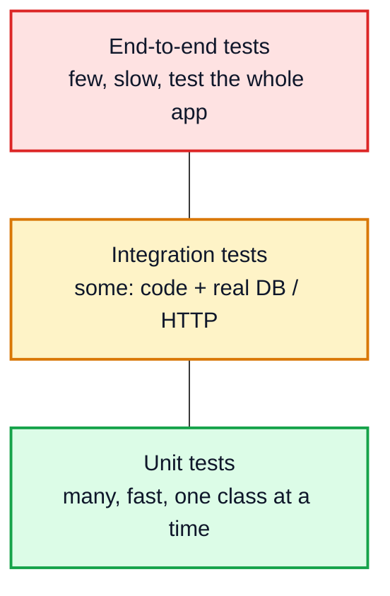
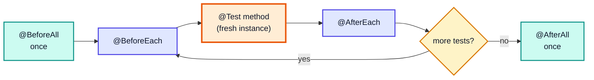
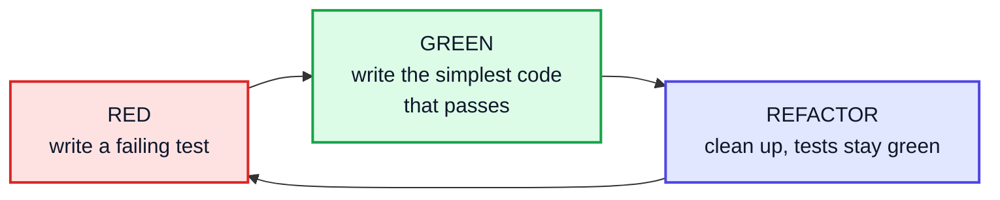
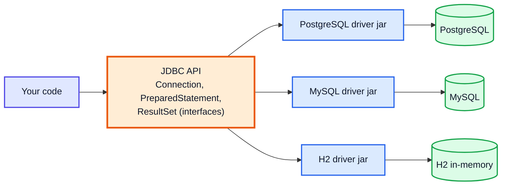
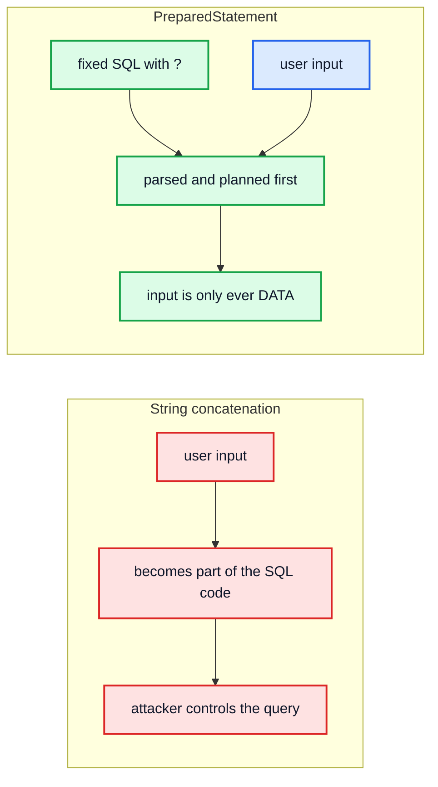
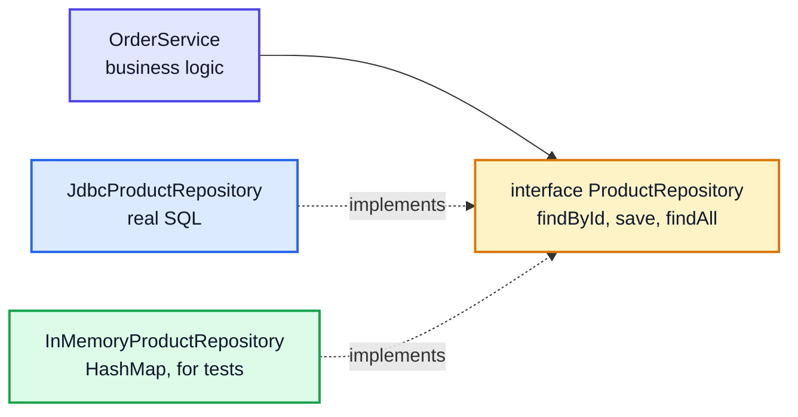

# Unit Testing (JUnit), Build Tools (Maven/Gradle) & JDBC — Complete In-Depth Guide

**Java gap topic #12 of 12** · Priority 🟢 · from [topics_not_covered.md](../topics_not_covered.md)

The playlist compiles single files with `javac` and `java`. Real Java projects add three things around the code:

| Tool | What it does |
|---|---|
| **Tests** | Prove the code works and keep it working (JUnit 5, with Mockito for fakes) |
| **Build tool** | Downloads libraries, compiles, runs the tests and packages the result (Maven or Gradle) |
| **Database access** | Talks to SQL databases (JDBC, the layer under Hibernate/JPA and Spring Data) |

These are "real-world development" topics rather than DSA, but they come up in internship and junior-developer interviews ("how would you test this?", "what's `PreparedStatement` for?"), and you need them for any project.

> [!NOTE]
> This topic isn't in the playlist, so there are no video timestamps. Code targets **Java 21**.
>
> **What was run:** JUnit, Mockito and JDBC drivers are **external libraries**, and none were downloaded for these notes. So:
> - snippets that use them are marked **(needs the library)** and were **not run**;
> - snippets using only the JDK were compiled and run;
> - the complete example is a small JUnit-style test runner built with reflection ([gap Java #11](java_gap_11_serialization_reflection_regex_time.md#4-reflection-calling-methods-annotations-proxies)), so it runs on the plain JDK.
>
> To run the real JUnit/JDBC code, create a Maven or Gradle project (Sections 6–8) and the tool downloads everything for you.

---

## Table of Contents

| # | Topic (anchor link) | Level |
|---|---|---|
| 0 | [Why Automated Tests](#0-why-automated-tests) | Basics |
| 1 | [JUnit 5 Basics](#1-junit-5-basics) | Core |
| 2 | [Assertions and Exceptions](#2-assertions-and-exceptions) | Core |
| 3 | [Lifecycle, Parameterized Tests and Naming](#3-lifecycle-parameterized-tests-and-naming) | In depth |
| 4 | [Test Doubles and Mockito](#4-test-doubles-and-mockito) | In depth |
| 5 | [Writing Testable Code and TDD](#5-writing-testable-code-and-tdd) | In depth |
| 6 | [Maven](#6-maven) | Core |
| 7 | [Gradle](#7-gradle) | Core |
| 8 | [Maven vs Gradle and Dependency Scopes](#8-maven-vs-gradle-and-dependency-scopes) | In depth |
| 9 | [JDBC Architecture](#9-jdbc-architecture) | Core |
| 10 | [PreparedStatement and SQL Injection](#10-preparedstatement-and-sql-injection) | Core |
| 11 | [Transactions, Batches and Connection Pools](#11-transactions-batches-and-connection-pools) | In depth |
| 12 | [DAO Pattern, JPA and Interview Questions](#12-dao-pattern-jpa-and-interview-questions) | Interview |

---

## 0. Why Automated Tests

| Without tests | With tests |
|---|---|
| You check by hand with `System.out.println` | A command checks everything in seconds |
| Fixing one bug silently breaks another | **Regressions** are caught immediately |
| Refactoring is scary | You can change code confidently |
| "It works on my machine" | Tests run the same way in CI on every push |



This is the **test pyramid**: lots of fast unit tests at the base, fewer slower tests higher up.

| Good unit tests are | Meaning |
|---|---|
| **Fast** | Milliseconds; no network, no real database |
| **Independent** | Any order, no shared mutable state |
| **Repeatable** | Same result every run (no `now()` or random without a seed) |
| **Self-checking** | Pass/fail automatically, no reading output |
| **Focused** | One behaviour per test, with a descriptive name |

---

## 1. JUnit 5 Basics

**JUnit 5 (Jupiter)** is the standard Java test framework. A test is a method annotated with `@Test` in a class under `src/test/java`. JUnit finds these methods by **reflection** and runs each on a fresh instance of the class.

**(needs the library)** `org.junit.jupiter:junit-jupiter`

```java
// src/main/java/com/example/Calculator.java
package com.example;

public class Calculator {
    public int add(int a, int b) { return a + b; }
    public int divide(int a, int b) {
        if (b == 0) throw new IllegalArgumentException("divide by zero");
        return a / b;
    }
}
```

```java
// src/test/java/com/example/CalculatorTest.java
package com.example;

import org.junit.jupiter.api.Test;
import static org.junit.jupiter.api.Assertions.*;

class CalculatorTest {
    private final Calculator calc = new Calculator();   // new instance per test method

    @Test
    void addsTwoNumbers() {
        // Arrange
        int a = 2, b = 3;
        // Act
        int result = calc.add(a, b);
        // Assert
        assertEquals(5, result);
    }

    @Test
    void divisionByZeroThrows() {
        IllegalArgumentException ex = assertThrows(IllegalArgumentException.class, () -> calc.divide(1, 0));
        assertEquals("divide by zero", ex.getMessage());
    }
}
```

Run with `mvn test` or `gradle test` (or the green ▶ button in an IDE).

> [!TIP]
> **Arrange–Act–Assert (AAA)**: set up the inputs, call the one thing being tested, then check the result. Keeping those three parts visible makes tests easy to read.

---

## 2. Assertions and Exceptions

| Assertion | Passes when |
|---|---|
| `assertEquals(expected, actual)` | `expected.equals(actual)` (note the order: **expected first**) |
| `assertEquals(0.3, x, 1e-9)` | Doubles within a tolerance (never compare doubles exactly) |
| `assertNotEquals`, `assertSame`, `assertNotSame` | Inequality / same reference |
| `assertTrue(cond)`, `assertFalse(cond)` | Boolean checks |
| `assertNull`, `assertNotNull` | Null checks |
| `assertArrayEquals(a, b)` | Arrays element by element |
| `assertIterableEquals(list1, list2)` | Collections element by element |
| `assertThrows(Type.class, () -> …)` | The lambda throws that exception (returns it for more checks) |
| `assertDoesNotThrow(() -> …)` | No exception |
| `assertTimeout(Duration.ofMillis(100), () -> …)` | Finishes in time |
| `assertAll(() -> …, () -> …)` | Runs **all** checks and reports every failure together |
| `fail("message")` | Always fails |

> [!WARNING]
> `assertEquals(actual, expected)` (swapped) still passes or fails correctly, but the failure message says "expected 3 but was 5" the wrong way round, which wastes debugging time. Put **expected first**.

---

## 3. Lifecycle, Parameterized Tests and Naming

| Annotation | Runs |
|---|---|
| `@BeforeEach` / `@AfterEach` | Before / after **every** test method |
| `@BeforeAll` / `@AfterAll` | Once for the class (`static` methods) |
| `@DisplayName("…")` | Readable name in reports |
| `@Disabled("reason")` | Skip a test |
| `@Nested` | Group related tests in an inner class |
| `@ParameterizedTest` + a source | Run the same test with many inputs |
| `@Tag("slow")` | Filter which tests run |



**(needs the library)** `junit-jupiter` (includes `junit-jupiter-params`)

```java
import org.junit.jupiter.api.*;
import org.junit.jupiter.params.ParameterizedTest;
import org.junit.jupiter.params.provider.*;
import java.util.*;
import static org.junit.jupiter.api.Assertions.*;

class StackTest {
    private Deque<Integer> stack;

    @BeforeEach
    void setUp() { stack = new ArrayDeque<>(); }          // every test gets an empty stack

    @Test
    @DisplayName("push then pop returns the same element")
    void pushPop() {
        stack.push(42);
        assertAll(
                () -> assertEquals(42, stack.pop()),
                () -> assertTrue(stack.isEmpty()));
    }

    @ParameterizedTest(name = "isPalindrome({0}) = {1}")
    @CsvSource({"racecar, true", "level, true", "java, false", "'', true"})
    void palindromes(String word, boolean expected) {
        assertEquals(expected, new StringBuilder(word).reverse().toString().equals(word));
    }

    @ParameterizedTest
    @ValueSource(ints = {2, 4, 8, 1024})
    void powersOfTwo(int n) { assertEquals(0, n & (n - 1)); }   // trick from video 25

    @Nested
    class WhenEmpty {
        @Test void popThrows() { assertThrows(NoSuchElementException.class, () -> stack.pop()); }
    }
}
```

> [!TIP]
> **Test names should describe behaviour**, e.g. `withdrawFailsWhenBalanceTooLow()`, not `test1()`. When it fails in CI, the name alone should tell you what broke.

---

## 4. Test Doubles and Mockito

A unit test shouldn't hit a real database, send real emails or call a real payment API. Replace those dependencies with **test doubles**.

| Double | What it is | Example |
|---|---|---|
| **Dummy** | Passed but never used | `null` or an empty object for an unused parameter |
| **Stub** | Returns canned answers | `findUser(1)` always returns Asha |
| **Fake** | A working but simplified implementation | In-memory repository instead of MySQL |
| **Spy** | Records how it was called | Counts emails "sent" |
| **Mock** | Pre-programmed expectations, verified afterwards | "`charge(500)` must be called exactly once" |

Test doubles only work if the class **receives** its dependencies instead of creating them: that's Dependency Inversion ([gap Java #5, section 6](java_gap_05_solid_low_level_design.md#6-d-dependency-inversion-principle)).

**(needs the library)** `org.mockito:mockito-junit-jupiter`

```java
import org.junit.jupiter.api.Test;
import org.junit.jupiter.api.extension.ExtendWith;
import org.mockito.*;
import org.mockito.junit.jupiter.MockitoExtension;
import static org.mockito.Mockito.*;
import static org.junit.jupiter.api.Assertions.*;

interface PaymentGateway { boolean charge(String user, int amount); }

class CheckoutService {
    private final PaymentGateway gateway;
    CheckoutService(PaymentGateway gateway) { this.gateway = gateway; }   // injected
    String checkout(String user, int amount) { return gateway.charge(user, amount) ? "PAID" : "DECLINED"; }
}

@ExtendWith(MockitoExtension.class)
class CheckoutServiceTest {
    @Mock PaymentGateway gateway;              // Mockito creates a fake implementation
    @InjectMocks CheckoutService service;      // and passes it to the constructor

    @Test
    void paysWhenGatewayAccepts() {
        when(gateway.charge("asha", 500)).thenReturn(true);        // stub
        assertEquals("PAID", service.checkout("asha", 500));
        verify(gateway, times(1)).charge("asha", 500);             // mock-style verification
    }

    @Test
    void declinedWhenGatewayRefuses() {
        when(gateway.charge(anyString(), anyInt())).thenReturn(false);
        assertEquals("DECLINED", service.checkout("ben", 9999));
    }
}
```

> [!NOTE]
> Under the hood, Mockito creates classes at runtime (byte-code generation, similar to the dynamic proxies in [gap Java #11](java_gap_11_serialization_reflection_regex_time.md#4-reflection-calling-methods-annotations-proxies)). Prefer **fakes** (simple in-memory implementations) for repositories and **mocks** for checking interactions like "an email was sent once".

---

## 5. Writing Testable Code and TDD

| Hard to test | Easy to test |
|---|---|
| `new MySqlRepository()` inside the class | Repository passed into the constructor |
| `LocalDate.now()` inside logic | A `Clock` parameter (`Clock.fixed` in tests) |
| Static singletons with state | Instances injected where needed |
| One 200-line method | Small methods with clear inputs and outputs |
| Printing results | Returning results |

### Test-Driven Development (TDD)



| Term | Meaning |
|---|---|
| **Code coverage** | % of lines/branches run by tests (JaCoCo). Useful signal, not a goal; 100% coverage doesn't mean correct |
| **Regression test** | A test added for a bug, so it can't come back |
| **Flaky test** | Sometimes passes, sometimes fails (timing, shared state, randomness); fix or delete it |
| **CI** | Tests run automatically on every push (GitHub Actions etc.) |

> [!TIP]
> DSA practice connects directly: the **brute-force cross-checks** at the end of the DSA gap notes ([e.g. sliding window](../DSA%20Topics%20Not%20Covered%20Notes/dsa_gap_01_sliding_window.md)) are **randomised property tests**: run a fast solution and an obviously-correct slow one on random inputs and compare. Libraries like jqwik do this inside JUnit.

---

## 6. Maven

Maven builds a project from a declarative **`pom.xml`** (Project Object Model). It downloads dependencies from **Maven Central** into `~/.m2/repository`, and every project uses the same folder layout and lifecycle.

### Standard directory layout (Maven and Gradle)

```
my-app/
├── pom.xml                      (or build.gradle.kts)
└── src/
    ├── main/
    │   ├── java/com/example/App.java
    │   └── resources/application.properties
    └── test/
        ├── java/com/example/AppTest.java
        └── resources/
```

### A minimal `pom.xml`

```xml
<project xmlns="http://maven.apache.org/POM/4.0.0">
  <modelVersion>4.0.0</modelVersion>

  <groupId>com.example</groupId>          <!-- organisation, reversed domain -->
  <artifactId>my-app</artifactId>          <!-- project name -->
  <version>1.0.0-SNAPSHOT</version>        <!-- SNAPSHOT = still in development -->

  <properties>
    <maven.compiler.release>21</maven.compiler.release>
    <project.build.sourceEncoding>UTF-8</project.build.sourceEncoding>
  </properties>

  <dependencies>
    <dependency>
      <groupId>org.junit.jupiter</groupId>
      <artifactId>junit-jupiter</artifactId>
      <version>5.10.2</version>
      <scope>test</scope>                  <!-- only on the test classpath -->
    </dependency>
    <dependency>
      <groupId>org.postgresql</groupId>
      <artifactId>postgresql</artifactId>
      <version>42.7.3</version>
      <scope>runtime</scope>               <!-- JDBC driver: needed only when running -->
    </dependency>
  </dependencies>

  <build>
    <plugins>
      <plugin>                             <!-- runs JUnit 5 tests during 'mvn test' -->
        <groupId>org.apache.maven.plugins</groupId>
        <artifactId>maven-surefire-plugin</artifactId>
        <version>3.2.5</version>
      </plugin>
    </plugins>
  </build>
</project>
```

A library is identified by its **coordinates** `groupId:artifactId:version` (often abbreviated "GAV").

### The build lifecycle

```mermaid
flowchart LR
    V["validate"]:::muted --> C["compile<br/>src/main/java"]:::process --> T["test<br/>runs unit tests"]:::good --> P["package<br/>target/my-app.jar"]:::highlight --> VE["verify<br/>integration checks"]:::process --> I["install<br/>into ~/.m2"]:::stack --> D["deploy<br/>to a remote repo"]:::io
    classDef muted fill:#f1f5f9,stroke:#64748b,stroke-width:1px,color:#0f172a
    classDef process fill:#e0e7ff,stroke:#4f46e5,stroke-width:2px,color:#0f172a
    classDef good fill:#dcfce7,stroke:#16a34a,stroke-width:2px,color:#0f172a
    classDef highlight fill:#ffedd5,stroke:#ea580c,stroke-width:3px,color:#0f172a
    classDef stack fill:#dbeafe,stroke:#2563eb,stroke-width:2px,color:#0f172a
    classDef io fill:#fae8ff,stroke:#c026d3,stroke-width:2px,color:#0f172a
```



Running a phase runs **every phase before it**: `mvn package` also validates, compiles and tests.

| Command | Does |
|---|---|
| `mvn compile` | Compile main code |
| `mvn test` | Compile and run unit tests |
| `mvn package` | Build the jar/war in `target/` |
| `mvn clean install` | Delete `target/`, build everything, put the jar in your local repository |
| `mvn -DskipTests package` | Package without running tests (use sparingly) |
| `mvn dependency:tree` | Show all direct and transitive dependencies |
| `./mvnw …` | The **Maven Wrapper**: uses the project's pinned Maven version |

---

## 7. Gradle

Gradle uses a **build script** written in Kotlin (`build.gradle.kts`) or Groovy (`build.gradle`) instead of XML. It's the standard for Android and popular for large projects, because of **incremental builds** and a **build cache** (unchanged tasks are skipped).

```kotlin
// build.gradle.kts
plugins {
    java
    application
}

group = "com.example"
version = "1.0.0"

java { toolchain { languageVersion.set(JavaLanguageVersion.of(21)) } }

repositories { mavenCentral() }

dependencies {
    testImplementation("org.junit.jupiter:junit-jupiter:5.10.2")
    testRuntimeOnly("org.junit.platform:junit-platform-launcher")
    runtimeOnly("org.postgresql:postgresql:42.7.3")
}

application { mainClass.set("com.example.App") }

tasks.test { useJUnitPlatform() }        // run JUnit 5 tests
```

| Command | Does |
|---|---|
| `./gradlew build` | Compile, test, package (`build/libs/`) |
| `./gradlew test` | Run tests |
| `./gradlew run` | Run the `application` main class |
| `./gradlew dependencies` | Show the dependency tree |
| `./gradlew clean` | Delete `build/` |

> [!TIP]
> Always run the **wrapper** (`./gradlew`, `./mvnw`, or `gradlew.bat` / `mvnw.cmd` on Windows) checked into the project, not a globally installed tool. Everyone, including CI, then uses exactly the same version.

---

## 8. Maven vs Gradle and Dependency Scopes

| | Maven | Gradle |
|---|---|---|
| Build file | `pom.xml` (XML, declarative) | `build.gradle.kts` (Kotlin/Groovy code) |
| Model | Fixed lifecycle phases | Graph of tasks |
| Speed | Good | Faster for big projects (incremental builds, build cache, daemon) |
| Flexibility | Conventions first; custom logic via plugins | Very flexible (scripts) |
| Learning curve | Gentle | Steeper |
| Typical use | Enterprise backends, Spring Boot | Android, large multi-module builds, also Spring Boot |
| Output folder | `target/` | `build/` |

### Dependency scopes / configurations

| Needed for | Maven scope | Gradle configuration | Example |
|---|---|---|---|
| Compile and run | `compile` (default) | `implementation` | Guava, Jackson |
| Tests only | `test` | `testImplementation` | JUnit, Mockito |
| Runtime only, not to compile | `runtime` | `runtimeOnly` | JDBC drivers |
| Compile only, provided by the server | `provided` | `compileOnly` | Servlet API, Lombok |

**Transitive dependencies:** if your project uses library A, and A depends on B, the build tool downloads B too. Conflicts (two versions of B) are resolved automatically (Maven: nearest wins; Gradle: highest wins). `mvn dependency:tree` / `gradle dependencies` show what was picked.

---

## 9. JDBC Architecture

**JDBC** (Java Database Connectivity, packages `java.sql` / `javax.sql`) is the standard API for SQL databases. Your code uses JDBC **interfaces**; a database-specific **driver** (a jar for PostgreSQL, MySQL, H2 …) implements them.



This is **programming to an interface** ([gap Java #4](java_gap_04_design_patterns.md#0-what-design-patterns-are)): switching databases mostly means changing the driver and the URL.

| Interface | Role |
|---|---|
| `DriverManager` / `DataSource` | Get a `Connection` (a `DataSource` is preferred: supports pooling) |
| `Connection` | A session with the database; creates statements; controls transactions |
| `PreparedStatement` | A precompiled SQL statement with `?` parameters |
| `ResultSet` | A cursor over query results (`next()`, `getString("col")`) |
| `SQLException` | Every JDBC error (checked) |

### The basic flow

**(needs a driver)** e.g. `com.h2database:h2` or `org.postgresql:postgresql`

```java
import java.sql.*;

public class JdbcBasics {
    static final String URL = "jdbc:h2:mem:shop";          // jdbc:postgresql://localhost:5432/shop for PostgreSQL

    public static void main(String[] args) {
        try (Connection conn = DriverManager.getConnection(URL, "sa", "")) {
            try (Statement st = conn.createStatement()) {
                st.execute("CREATE TABLE product (id INT PRIMARY KEY, name VARCHAR(50), price INT)");
            }
            try (PreparedStatement ins = conn.prepareStatement("INSERT INTO product VALUES (?, ?, ?)")) {
                ins.setInt(1, 1); ins.setString(2, "pen"); ins.setInt(3, 20); ins.executeUpdate();
                ins.setInt(1, 2); ins.setString(2, "book"); ins.setInt(3, 350); ins.executeUpdate();
            }
            try (PreparedStatement q = conn.prepareStatement("SELECT name, price FROM product WHERE price > ? ORDER BY price");
                 ResultSet rs = bind(q, 10).executeQuery()) {
                while (rs.next()) System.out.println(rs.getString("name") + " " + rs.getInt("price"));
            }
        } catch (SQLException e) {
            System.out.println("Database error: " + e.getMessage());
        }
    }

    static PreparedStatement bind(PreparedStatement ps, int minPrice) throws SQLException { ps.setInt(1, minPrice); return ps; }
}
// With the H2 driver on the classpath:
// pen 20
// book 350
//
// Without any driver (as when run for these notes, plain JDK only):
// Database error: No suitable driver found for jdbc:h2:mem:shop
```

> [!IMPORTANT]
> **Always use try-with-resources** for `Connection`, `Statement` and `ResultSet`. They hold database-side resources; leaking connections is one of the most common production bugs (the pool runs dry and the app hangs).

| `ResultSet` getter | SQL type |
|---|---|
| `getInt`, `getLong` | INTEGER, BIGINT (0 for NULL! check `rs.wasNull()`) |
| `getString` | VARCHAR, TEXT |
| `getBigDecimal` | DECIMAL / NUMERIC (use for money, [video 53](../kunal-java-notes-claude/java_53_video_biginteger_bigdecimal.md)) |
| `getObject(col, LocalDate.class)` | DATE → `java.time` ([gap Java #11](java_gap_11_serialization_reflection_regex_time.md#8-javatime-the-main-classes)) |
| `getBoolean` | BOOLEAN |

| Execute method | Use for | Returns |
|---|---|---|
| `executeQuery()` | `SELECT` | `ResultSet` |
| `executeUpdate()` | `INSERT`, `UPDATE`, `DELETE` | number of rows changed |
| `execute()` | DDL / anything | `true` if a `ResultSet` was produced |

---

## 10. PreparedStatement and SQL Injection

**SQL injection**: building SQL by string concatenation lets user input change the query itself.

```java
import java.util.*;

public class SqlInjectionDemo {
    // ❌ DANGEROUS: user input pasted into the SQL text
    static String unsafeQuery(String username) {
        return "SELECT * FROM users WHERE name = '" + username + "'";
    }

    // ✅ SAFE: the SQL text is fixed; the value is sent separately as a parameter
    static String safeQuery() { return "SELECT * FROM users WHERE name = ?"; }

    public static void main(String[] args) {
        System.out.println(unsafeQuery("asha"));
        System.out.println(unsafeQuery("' OR '1'='1"));            // returns EVERY user
        System.out.println(unsafeQuery("x'; DROP TABLE users; --")); // deletes the table on some databases
        System.out.println(safeQuery() + "   with parameter 1 = \"' OR '1'='1\" (treated as a plain name)");
    }
}
// Output:
// SELECT * FROM users WHERE name = 'asha'
// SELECT * FROM users WHERE name = '' OR '1'='1'
// SELECT * FROM users WHERE name = 'x'; DROP TABLE users; --'
// SELECT * FROM users WHERE name = ?   with parameter 1 = "' OR '1'='1" (treated as a plain name)
```



| | `Statement` | `PreparedStatement` |
|---|---|---|
| SQL injection | Vulnerable with concatenation | **Safe**: parameters are never parsed as SQL |
| Performance for repeated queries | Parsed every time | Precompiled once, reused |
| Types | You format values yourself | `setInt`, `setString`, `setObject(LocalDate)` |
| Use when | Fixed DDL with no input | **Always** when any value comes from outside |

> [!CAUTION]
> Placeholders work only for **values**, not for table or column names (`ORDER BY ?` doesn't do what you want). If a column name comes from the user, check it against a fixed allow-list.

---

## 11. Transactions, Batches and Connection Pools

### Transactions (ACID)

By default each statement commits immediately (**auto-commit**). To make several statements succeed or fail **together**, turn auto-commit off and commit or roll back yourself.

**(needs a driver)**

```java
static void transfer(Connection conn, int from, int to, int amount) throws SQLException {
    boolean oldAuto = conn.getAutoCommit();
    conn.setAutoCommit(false);
    try (PreparedStatement debit = conn.prepareStatement("UPDATE account SET balance = balance - ? WHERE id = ? AND balance >= ?");
         PreparedStatement credit = conn.prepareStatement("UPDATE account SET balance = balance + ? WHERE id = ?")) {
        debit.setInt(1, amount); debit.setInt(2, from); debit.setInt(3, amount);
        if (debit.executeUpdate() != 1) throw new SQLException("insufficient funds");
        credit.setInt(1, amount); credit.setInt(2, to);
        credit.executeUpdate();
        conn.commit();                                   // both or neither
    } catch (SQLException e) {
        conn.rollback();                                 // undo the debit
        throw e;
    } finally {
        conn.setAutoCommit(oldAuto);
    }
}
```

| ACID | Meaning |
|---|---|
| **Atomicity** | All statements in the transaction happen, or none do |
| **Consistency** | Constraints hold before and after |
| **Isolation** | Concurrent transactions don't see each other's half-done work (levels: READ COMMITTED, REPEATABLE READ, SERIALIZABLE) |
| **Durability** | Once committed, it survives a crash |

### Batch inserts

Sending 10,000 inserts one by one means 10,000 network round trips. Batch them:

```java
try (PreparedStatement ps = conn.prepareStatement("INSERT INTO log(msg) VALUES (?)")) {
    for (String m : messages) { ps.setString(1, m); ps.addBatch(); }
    ps.executeBatch();                                   // one (or a few) round trips
}
```

### Connection pools

Opening a database connection takes tens of milliseconds (TCP, authentication). A **connection pool** keeps a set of open connections and lends them out. `conn.close()` returns the connection to the pool instead of closing it. **HikariCP** is the standard pool (Spring Boot's default).

```java
// (needs com.zaxxer:HikariCP)
HikariConfig cfg = new HikariConfig();
cfg.setJdbcUrl("jdbc:postgresql://localhost:5432/shop");
cfg.setUsername(System.getenv("DB_USER"));               // never hard-code credentials
cfg.setPassword(System.getenv("DB_PASSWORD"));
cfg.setMaximumPoolSize(10);
DataSource ds = new HikariDataSource(cfg);
try (Connection c = ds.getConnection()) { /* ... */ }    // borrowed and returned
```

It's the same idea as a thread pool ([gap Java #1](java_gap_01_multithreading_concurrency.md#11-executorservice-and-thread-pools)): reuse expensive resources instead of creating them per request.

---

## 12. DAO Pattern, JPA and Interview Questions

### DAO / Repository pattern

Hide JDBC behind an interface so business code doesn't know (or care) how data is stored, and tests can use an in-memory **fake**.



### Higher-level options built on JDBC

| Layer | What it adds |
|---|---|
| **Plain JDBC** | Full control, more boilerplate |
| **Spring `JdbcTemplate`** | Removes try/catch/close boilerplate; still plain SQL |
| **JPA / Hibernate** (ORM) | Maps classes to tables (`@Entity`, `@Id`); generates SQL; lazy loading; caching |
| **Spring Data JPA** | Repository interfaces with methods like `findByEmail` generated for you |
| **jOOQ / MyBatis** | Type-safe or mapped SQL, a middle ground |

> [!WARNING]
> ORMs make the **N + 1 query problem** easy to create: loading 100 orders, then lazily loading each order's customer in a loop, runs 101 queries. Fix it with a join fetch. Knowing the SQL that runs underneath (JDBC) is what lets you spot this.

### Interview Q&A

| Question | Short answer |
|---|---|
| What is a unit test? | An automated check of one small unit (method/class) in isolation, fast and repeatable. |
| `@BeforeEach` vs `@BeforeAll`? | Before every test vs once per class (static). |
| How do you test that an exception is thrown? | `assertThrows(Type.class, () -> code())`. |
| Mock vs stub vs fake? | Mock verifies interactions; stub returns canned data; fake is a lightweight working implementation. |
| What is TDD? | Red (failing test) → green (make it pass) → refactor. |
| What does Maven do? | Dependency management + standard build lifecycle (compile, test, package, install). |
| What are Maven coordinates? | `groupId:artifactId:version`. |
| `mvn package` vs `mvn install`? | Build the jar in `target/` vs also copy it into the local `~/.m2` repository. |
| Maven vs Gradle? | XML + fixed lifecycle vs Kotlin/Groovy scripts + task graph, faster incremental builds. |
| What is JDBC? | The standard Java API for SQL databases; drivers implement it. |
| `Statement` vs `PreparedStatement`? | `PreparedStatement` uses parameters: prevents SQL injection and is precompiled. |
| How do you do a transaction in JDBC? | `setAutoCommit(false)`, run statements, `commit()`, `rollback()` on error. |
| Why a connection pool? | Opening connections is slow; a pool reuses them. |
| `executeQuery` vs `executeUpdate`? | Returns a `ResultSet` vs returns the number of affected rows. |

---

## 🧩 Complete Example: Everything Together

A mini **JUnit-style test framework** in plain Java: custom `@Test`, `@BeforeEach` and `@DisplayName` annotations, an assertion library, and a runner that finds test methods by **reflection**, creates a fresh instance per test, and reports passes and failures. It tests a `ProductService` that depends on a **repository interface**, using an **in-memory fake** (the DAO pattern) and a hand-written **spy**, and it checks that the SQL-building helper never concatenates user input. One test fails on purpose, to show what a failure report looks like.

```java
import java.lang.annotation.*;
import java.lang.reflect.*;
import java.util.*;

public class MiniTestFramework {

    // ---------- the "framework": annotations, assertions, runner ----------
    @Retention(RetentionPolicy.RUNTIME) @Target(ElementType.METHOD) @interface Test { }
    @Retention(RetentionPolicy.RUNTIME) @Target(ElementType.METHOD) @interface BeforeEach { }
    @Retention(RetentionPolicy.RUNTIME) @Target(ElementType.METHOD) @interface DisplayName { String value(); }

    static final class AssertionFailed extends RuntimeException { AssertionFailed(String m) { super(m); } }

    static void assertEquals(Object expected, Object actual) {
        if (!Objects.equals(expected, actual)) throw new AssertionFailed("expected <" + expected + "> but was <" + actual + ">");
    }
    static void assertTrue(boolean cond, String msg) { if (!cond) throw new AssertionFailed(msg); }
    static <T extends Throwable> T assertThrows(Class<T> type, Runnable code) {
        try { code.run(); }
        catch (Throwable t) {
            if (type.isInstance(t)) return type.cast(t);
            throw new AssertionFailed("expected " + type.getSimpleName() + " but got " + t.getClass().getSimpleName());
        }
        throw new AssertionFailed("expected " + type.getSimpleName() + " but nothing was thrown");
    }

    static int[] run(Class<?> testClass) throws Exception {
        List<Method> tests = new ArrayList<>(), befores = new ArrayList<>();
        for (Method m : testClass.getDeclaredMethods()) {
            if (m.isAnnotationPresent(Test.class)) tests.add(m);
            if (m.isAnnotationPresent(BeforeEach.class)) befores.add(m);
        }
        tests.sort(Comparator.comparing(Method::getName));          // deterministic order for the report
        int passed = 0, failed = 0;
        System.out.println(testClass.getSimpleName());
        for (Method t : tests) {
            Object instance = testClass.getDeclaredConstructor().newInstance();   // fresh instance per test
            String name = t.isAnnotationPresent(DisplayName.class) ? t.getAnnotation(DisplayName.class).value() : t.getName();
            try {
                for (Method b : befores) b.invoke(instance);
                t.invoke(instance);
                System.out.println("  PASS  " + name);
                passed++;
            } catch (InvocationTargetException e) {
                System.out.println("  FAIL  " + name + " -> " + e.getCause().getMessage());
                failed++;
            }
        }
        return new int[]{passed, failed};
    }

    // ---------- the code under test ----------
    record Product(int id, String name, int priceInPaise, int stock) { }

    interface ProductRepository {                                 // DAO interface
        Optional<Product> findById(int id);
        void save(Product p);
        List<Product> findAll();
    }

    static final class InMemoryProductRepository implements ProductRepository {   // FAKE for tests
        private final Map<Integer, Product> rows = new TreeMap<>();
        public Optional<Product> findById(int id) { return Optional.ofNullable(rows.get(id)); }
        public void save(Product p) { rows.put(p.id(), p); }
        public List<Product> findAll() { return new ArrayList<>(rows.values()); }
    }

    interface Notifier { void lowStock(Product p); }

    static final class ProductService {
        private final ProductRepository repo;
        private final Notifier notifier;
        ProductService(ProductRepository repo, Notifier notifier) { this.repo = repo; this.notifier = notifier; }   // injected

        Product sell(int id, int qty) {
            if (qty <= 0) throw new IllegalArgumentException("quantity must be positive");
            Product p = repo.findById(id).orElseThrow(() -> new NoSuchElementException("no product " + id));
            if (p.stock() < qty) throw new IllegalStateException("only " + p.stock() + " left");
            Product updated = new Product(p.id(), p.name(), p.priceInPaise(), p.stock() - qty);
            repo.save(updated);
            if (updated.stock() < 3) notifier.lowStock(updated);
            return updated;
        }

        long inventoryValue() { return repo.findAll().stream().mapToLong(p -> (long) p.priceInPaise() * p.stock()).sum(); }

        static String findByNameSql() { return "SELECT * FROM product WHERE name = ?"; }   // parameterised, never concatenated
    }

    // ---------- the tests ----------
    public static class ProductServiceTest {
        private InMemoryProductRepository repo;
        private List<String> notified;                            // a hand-written spy records calls
        private ProductService service;

        @BeforeEach void setUp() {
            repo = new InMemoryProductRepository();
            repo.save(new Product(1, "pen", 2000, 10));
            repo.save(new Product(2, "notebook", 5000, 4));
            notified = new ArrayList<>();
            service = new ProductService(repo, p -> notified.add(p.name() + ":" + p.stock()));
        }

        @Test @DisplayName("selling reduces stock")
        public void sellReducesStock() {
            assertEquals(7, service.sell(1, 3).stock());
            assertEquals(7, repo.findById(1).orElseThrow().stock());
        }

        @Test @DisplayName("low stock sends exactly one notification")
        public void lowStockNotifies() {
            service.sell(2, 2);
            assertEquals(List.of("notebook:2"), notified);
        }

        @Test @DisplayName("cannot sell more than in stock")
        public void oversellThrows() {
            IllegalStateException e = assertThrows(IllegalStateException.class, () -> service.sell(2, 5));
            assertEquals("only 4 left", e.getMessage());
        }

        @Test @DisplayName("quantity must be positive")
        public void zeroQuantityThrows() { assertThrows(IllegalArgumentException.class, () -> service.sell(1, 0)); }

        @Test @DisplayName("unknown product id")
        public void unknownProduct() { assertThrows(NoSuchElementException.class, () -> service.sell(99, 1)); }

        @Test @DisplayName("inventory value in paise")
        public void inventoryValue() { assertEquals(2000L * 10 + 5000L * 4, service.inventoryValue()); }

        @Test @DisplayName("SQL uses a placeholder, not concatenation")
        public void sqlIsParameterised() {
            String sql = ProductService.findByNameSql();
            assertTrue(sql.contains("?") && !sql.contains("'"), "query must use ? placeholders");
        }

        @Test @DisplayName("deliberately failing test (shows a failure report)")
        public void zzDeliberateFailure() { assertEquals(5, service.sell(1, 1).stock()); }   // real stock is 9
    }

    public static void main(String[] args) throws Exception {
        int[] r = run(ProductServiceTest.class);
        System.out.println(r[0] + " passed, " + r[1] + " failed");
    }
}
```

**Expected Output:**
```
ProductServiceTest
  PASS  inventory value in paise
  PASS  low stock sends exactly one notification
  PASS  cannot sell more than in stock
  PASS  selling reduces stock
  PASS  SQL uses a placeholder, not concatenation
  PASS  unknown product id
  PASS  quantity must be positive
  FAIL  deliberately failing test (shows a failure report) -> expected <5> but was <9>
7 passed, 1 failed
```

> [!NOTE]
> Real JUnit does the same things at a much larger scale: discovery by reflection, a fresh instance per test, lifecycle methods, assertion messages, and a pass/fail report. It adds parallel execution, extensions, parameterised sources and IDE integration.

---

## Quick Reference Cheat Sheet

| Concept | One-Line Summary |
|---|---|
| **Unit test** | Fast, isolated, repeatable check of one unit |
| **Test pyramid** | Many unit tests, fewer integration tests, few end-to-end tests |
| **JUnit 5** | `@Test`, `@BeforeEach`, `@ParameterizedTest`, `@Nested`, `@DisplayName` |
| **Assertions** | `assertEquals(expected, actual)`, `assertThrows`, `assertAll` |
| **AAA** | Arrange, Act, Assert |
| **Test doubles** | Dummy, stub, fake, spy, mock (Mockito: `when(...).thenReturn`, `verify`) |
| **Testable code** | Inject dependencies and `Clock`; return values instead of printing |
| **TDD** | Red → green → refactor |
| **Maven** | `pom.xml`, GAV coordinates, lifecycle `compile → test → package → install` |
| **Gradle** | `build.gradle.kts`, tasks, incremental builds; `./gradlew build` |
| **Wrapper** | Use `./mvnw` / `./gradlew` for a pinned version |
| **Scopes** | compile/implementation, test/testImplementation, runtime/runtimeOnly, provided/compileOnly |
| **JDBC** | `Connection` → `PreparedStatement` → `ResultSet`; driver jar implements the API |
| **SQL injection** | Never concatenate input; use `?` parameters |
| **Resources** | try-with-resources for Connection / Statement / ResultSet |
| **Transactions** | `setAutoCommit(false)`, `commit()`, `rollback()` |
| **Performance** | Batches (`addBatch`/`executeBatch`) and a pool (HikariCP) |
| **Above JDBC** | JdbcTemplate, JPA/Hibernate, Spring Data; watch for N + 1 queries |
