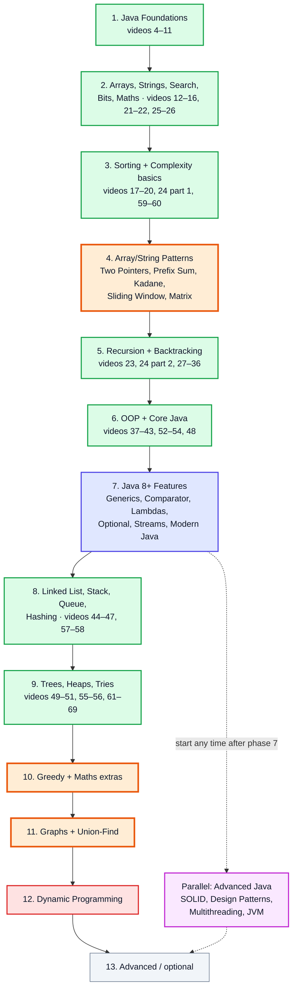
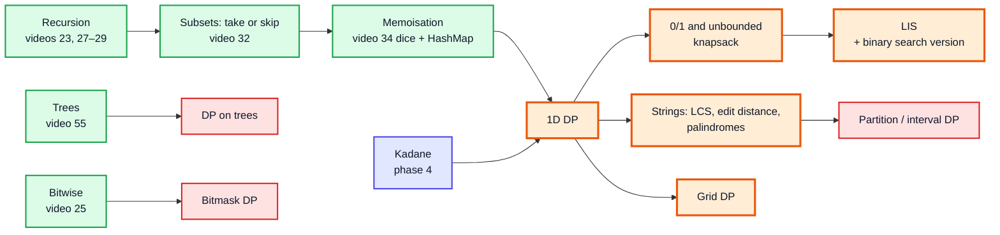
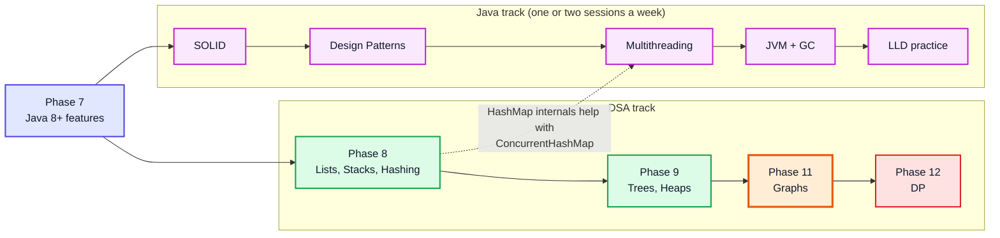

# Java + DSA Study Roadmap — Covered and Not-Covered Topics in One Order

**What this is:** one study order that mixes the **69 playlist videos** (notes in [`kunal-java-notes-claude/`](kunal-java-notes-claude/)) with the **topics the playlist doesn't teach** (from [topics_not_covered.md](topics_not_covered.md), notes in [`Java Topics Not Covered Notes/`](Java%20Topics%20Not%20Covered%20Notes/) and [`DSA Topics Not Covered Notes/`](DSA%20Topics%20Not%20Covered%20Notes/)). Each topic comes **after everything it depends on**, and Java and DSA topics are interleaved so that each Java feature is learned just before the DSA code that needs it.

> [!NOTE]
> The playlist's own order is mostly kept. Topics are moved only when a dependency demands it. For example, the second half of video 24 (recurrence relations) needs recursion, Sliding Window needs `HashMap`, and Top-K heap problems need `Comparator`. Every move is explained in the **Why here** column.

**Legend:**
| Mark | Meaning |
|---|---|
| 🎬 | Taught in the playlist; notes exist |
| 📘 | Not in the playlist; gap notes already written |
| ⬜ | Not in the playlist; no notes yet (learn from LeetCode / other sources) |
| 🔴 🟡 🟢 | Interview priority: very often / useful / nice to know |

---

## Table of Contents

| # | Phase | Track |
|---|---|---|
| 1 | [Phase 1: Java Foundations](#phase-1-java-foundations) | Java |
| 2 | [Phase 2: Arrays, Strings, Searching, Bits and Maths](#phase-2-arrays-strings-searching-bits-and-maths) | DSA + Java |
| 3 | [Phase 3: Sorting and Complexity Basics](#phase-3-sorting-and-complexity-basics) | DSA |
| 4 | [Phase 4: Array and String Patterns](#phase-4-array-and-string-patterns) | DSA (gap) |
| 5 | [Phase 5: Recursion and Backtracking](#phase-5-recursion-and-backtracking) | DSA |
| 6 | [Phase 6: OOP and Core Java](#phase-6-oop-and-core-java) | Java |
| 7 | [Phase 7: Java 8+ Features (before the hard DSA)](#phase-7-java-8-features-before-the-hard-dsa) | Java (gap) |
| 8 | [Phase 8: Linked Lists, Stacks, Queues, Hashing](#phase-8-linked-lists-stacks-queues-hashing) | DSA + Java |
| 9 | [Phase 9: Trees, Heaps and Tries](#phase-9-trees-heaps-and-tries) | DSA |
| 10 | [Phase 10: Greedy and Maths Extras](#phase-10-greedy-and-maths-extras) | DSA (gap) |
| 11 | [Phase 11: Graphs and Union-Find](#phase-11-graphs-and-union-find) | DSA (gap) |
| 12 | [Phase 12: Dynamic Programming](#phase-12-dynamic-programming) | DSA (gap) |
| 13 | [Parallel Track: Advanced Java](#parallel-track-advanced-java) | Java (gap) |
| 14 | [Phase 13: Advanced and Optional Topics](#phase-13-advanced-and-optional-topics) | Both |
| 15 | [Dependency Map: Which Java Topic Unlocks Which DSA Topic](#dependency-map-which-java-topic-unlocks-which-dsa-topic) | Reference |
| 16 | [Why This Order](#why-this-order) | Reference |
| 17 | [Progress Checklist](#progress-checklist) | Checklist |

---

## The Whole Path at a Glance

| Colour | Meaning |
|---|---|
| 🟩 Green | Mostly playlist videos |
| 🟧 Orange | Mostly not-covered DSA topics |
| 🟦 Indigo | Not-covered Java features (gap notes written) |
| 🟥 Red | The hardest phase (DP) — kept for when you're strongest |
| 🟪 Purple | Advanced Java, run alongside the DSA phases |

---

## Phase 1: Java Foundations

**Goal:** write, compile and run Java programs; understand memory (stack, heap, references) from day one.

| Order | Topic | Source | Why here |
|---|---|---|---|
| 1.1 | Git & GitHub | 🎬 [Video 4][v04] | Save your practice code from the start |
| 1.2 | Intro to programming: paradigms, stack vs heap, GC | 🎬 [Video 5][v05] | The memory model used in every later topic |
| 1.3 | Flowcharts & pseudocode | 🎬 [Video 6][v06] | Think before coding |
| 1.4 | JDK / JRE / JVM | 🎬 [Video 7][v07] | Know what `javac` and `java` do |
| 1.5 | First program: I/O, data types, casting | 🎬 [Video 8][v08] | |
| 1.6 | Conditionals & loops | 🎬 [Video 9][v09] | |
| 1.7 | Switch (+ the newer arrow syntax) | 🎬 [Video 10][v10] | The full Java 14 switch *expression* comes later in phase 7 |
| 1.8 | Functions / methods, scope, pass-by-value | 🎬 [Video 11][v11] | Needed before recursion and every DSA function |

✅ **Ready to move on when** you can write a method that takes an array, loops over it and returns a result, and explain why changing an array inside a method changes it for the caller.

---

## Phase 2: Arrays, Strings, Searching, Bits and Maths

| Order | Topic | Source | Why here |
|---|---|---|---|
| 2.1 | Arrays & ArrayList | 🎬 [Video 12][v12] | The base of almost every DSA problem |
| 2.2 | Strings & StringBuilder | 🎬 [Video 21][v21] | Moved earlier than in the playlist: string problems (palindromes, sliding window) need it, and it only depends on arrays |
| 2.3 | Patterns (nested loops) | 🎬 [Video 22][v22] | Pure loop practice; also moved earlier |
| 2.4 | Linear search | 🎬 [Video 13][v13] | |
| 2.5 | Binary search | 🎬 [Video 14][v14] | |
| 2.6 | Binary search questions (LC 35, 744, 34, 33, 153, 410…) | 🎬 [Video 15][v15] | |
| 2.7 | Binary search in 2D (LC 240, 74) | 🎬 [Video 16][v16] | |
| 2.8 | Bitwise operators & number systems | 🎬 [Video 25][v25] | Only needs loops; moved earlier so bit tricks are available later (bitmask DP uses them) |
| 2.9 | Maths: primes, sieve, sqrt, GCD/LCM, modulo | 🎬 [Video 26][v26] | Square root uses binary search (2.5), so it comes after it |

🧪 **Practice:** LC 704, 35, 69 (sqrt), 875 (Koko, binary search on the answer), 136 (Single Number), 191, 338, 204 (Count Primes).

---

## Phase 3: Sorting and Complexity Basics

| Order | Topic | Source | Why here |
|---|---|---|---|
| 3.1 | Bubble sort | 🎬 [Video 17][v17] | |
| 3.2 | Selection sort | 🎬 [Video 18][v18] | |
| 3.3 | Insertion sort | 🎬 [Video 19][v19] | |
| 3.4 | Cyclic sort (LC 268, 448, 287, 442, 645, 41) | 🎬 [Video 20][v20] | |
| 3.5 | Time & space complexity — **sections 0–12 only** (Big-O, Ω, Θ, space, sorting complexity) | 🎬 [Video 24][v24] | You now have loops and sorts to analyse. **Stop before section 13**: the recurrence-relation half needs recursion (phase 5) |
| 3.6 | Count sort | 🎬 [Video 59][v59] | Only needs arrays; a good contrast to comparison sorts |
| 3.7 | Radix sort | 🎬 [Video 60][v60] | Built on count sort |

> [!TIP]
> Merge sort and quick sort are in phase 5, because both are recursive.

---

## Phase 4: Array and String Patterns

**These patterns are not in the playlist** but are asked constantly. They only need arrays, strings, loops and a `HashMap`/`HashSet` — no recursion, no OOP — so they belong **early**, not after trees.

| Order | Topic | Source | Why here |
|---|---|---|---|
| 4.1 | `HashMap` / `HashSet` **usage** (put, get, getOrDefault, containsKey, merge) | 🎬 [Video 57, section 4][v57api] | Sliding window and prefix-sum problems count things in a map. Learn just the API now; how hashing works inside (the rest of video 57) comes in phase 8 |
| 4.2 | **Two Pointers** on arrays 🔴 | 📘 [DSA gap #2][d02] | Needs sorted arrays (phase 3). Same idea as binary search's `lo`/`hi` |
| 4.3 | **Prefix Sum / Difference Array** 🔴 | 📘 [DSA gap #3][d03] | Needs arrays + `HashMap` (for LC 560) |
| 4.4 | **Kadane's Algorithm** 🔴 | 📘 [DSA gap #4][d04] | A first taste of "best answer ending here", the core idea of DP later |
| 4.5 | **Sliding Window** — fixed size first, then variable size 🔴 | 📘 [DSA gap #1][d01] | Builds on two pointers (4.2) and map counting (4.1). Fixed windows are simple; variable windows need the "expand right, shrink left" idea |
| 4.6 | **Matrix traversal** (spiral, rotate, set zeroes) 🟡 | ⬜ | 2D arrays from phase 2. Flood fill / islands wait until phase 11 (they're graph BFS/DFS) |

🧪 **Practice in this order:**

| Pattern | Problems |
|---|---|
| Two pointers | LC 167, 26, 11, 15, 42 |
| Prefix sum | LC 303, 724, 238, 560 |
| Kadane | LC 53, 918, 152 |
| Sliding window (fixed) | LC 643, 1456 |
| Sliding window (variable) | LC 3, 424, 567, 76 |
| Matrix | LC 54, 48, 73 |

> [!IMPORTANT]
> **When to use a sliding window:** the question asks about a *contiguous* subarray or substring, and you can update the answer when one element enters on the right and one leaves on the left. If elements can be negative and you need an exact sum (LC 560), use **prefix sum + HashMap** instead: the window can't shrink correctly when sums go up and down.

---

## Phase 5: Recursion and Backtracking

| Order | Topic | Source | Why here |
|---|---|---|---|
| 5.1 | Recursion intro | 🎬 [Video 23][v23] | |
| 5.2 | Complexity of recursive programs — **sections 13–24** (recurrences, Akra-Bazzi, linear recurrences) | 🎬 [Video 24, from section 13][v24rec] | Now you have recursion to analyse |
| 5.3 | Recursion level 1 | 🎬 [Video 27][v27] | |
| 5.4 | Recursion on arrays | 🎬 [Video 28][v28] | |
| 5.5 | Recursion patterns + recursive bubble/selection sort | 🎬 [Video 29][v29] | |
| 5.6 | Merge sort | 🎬 [Video 30][v30] | Divide and conquer; its recurrence is from 5.2 |
| 5.7 | Quick sort | 🎬 [Video 31][v31] | |
| 5.8 | Subsets & subsequences | 🎬 [Video 32][v32] | Foundation for backtracking **and** for DP (the "take / don't take" choice) |
| 5.9 | Permutations | 🎬 [Video 33][v33] | |
| 5.10 | Dice & phone letters (LC 17, 1155) | 🎬 [Video 34][v34] | Contains the first memoised solution — remember it for DP |
| 5.11 | Backtracking: maze | 🎬 [Video 35][v35] | |
| 5.12 | N-Queens, N-Knights, Sudoku | 🎬 [Video 36][v36] | |
| 5.13 | **Combination-style backtracking** (Combination Sum, Word Search, Palindrome Partitioning) 🟡 | ⬜ | Same skeleton as 5.8–5.12, with a start index to avoid duplicates |

🧪 **Practice:** LC 78, 90, 46, 47, 39, 40, 79, 131, 51, 37.

---

## Phase 6: OOP and Core Java

| Order | Topic | Source | Why here |
|---|---|---|---|
| 6.1 | OOP 1: classes, objects, constructors | 🎬 [Video 37][v37] | Needed for linked lists and trees (`Node` classes) |
| 6.2 | OOP 2: packages, `static`, Singleton | 🎬 [Video 38][v38] | |
| 6.3 | OOP 3: inheritance, polymorphism, encapsulation, abstraction | 🎬 [Video 39][v39] | |
| 6.4 | OOP 4: access control, `Object` class | 🎬 [Video 40][v40] | `equals`/`hashCode` are needed before hashing (phase 8) |
| 6.5 | OOP 5: abstract classes & interfaces | 🎬 [Video 41][v41] | Interfaces are the basis of lambdas (phase 7) |
| 6.6 | OOP 6: generics (basics), Comparable/Comparator (basics), lambdas, exceptions, cloning | 🎬 [Video 42][v42] | |
| 6.7 | OOP 7: Collections framework, Vector, enums | 🎬 [Video 43][v43] | |
| 6.8 | StringBuffer & formatting | 🎬 [Video 52][v52] | Small, independent topics: do them now while Java is fresh |
| 6.9 | BigInteger & BigDecimal | 🎬 [Video 53][v53] | |
| 6.10 | File handling | 🎬 [Video 54][v54] | |
| 6.11 | Tic-Tac-Toe project | 🎬 [Video 48][v48] | Puts OOP into practice; also a common LLD question |

---

## Phase 7: Java 8+ Features (before the hard DSA)

**Why this phase sits here:** these Java topics are **easier than trees, graphs and DP**, they're asked in every Java interview, and the DSA phases after this one *use* them — `PriorityQueue` with a `Comparator` lambda, `Map.merge`, `computeIfAbsent`, records as map keys, generic node classes. Learning them now means the hard DSA phases don't also have new syntax.

| Order | Topic | Source | Why here |
|---|---|---|---|
| 7.1 | Generics in depth: bounds, wildcards, PECS, type erasure 🟡 | 📘 [Gap #8][g08] | Follows video 42's basics; needed to write generic data structures |
| 7.2 | Comparator & Comparable in depth 🔴 | 📘 [Gap #3][g03] | **Required before heaps (Top-K) and merge intervals.** Multi-key sorts, max-heaps, the `a - b` overflow bug |
| 7.3 | Functional interfaces & `Optional` 🟡 | 📘 [Gap #6][g06] | `Function`, `Predicate`, `Supplier`, method references: what lambdas really are |
| 7.4 | Streams API 🔴 | 📘 [Gap #2][g02] | Built on 7.3. `groupingBy` frequency counts show up in many string/hash problems |
| 7.5 | Modern Java (Java 9–21): `var`, `List.of`, records, text blocks, switch expressions, sealed types, pattern matching 🟡 | 📘 [Gap #7][g07] | Records need OOP (phase 6); `record Cell(int r, int c)` is the clean way to store grid coordinates in graph BFS later |
| 7.6 | **Merge Intervals** pattern 🔴 | 📘 [DSA gap #5][d05] | A DSA pattern that's mostly "sort with a comparator" (7.2), so it fits right here |

🧪 **Practice:** LC 56, 57, 435, 452 (watch the overflow), 179 (custom comparator), 49 (group anagrams with `groupingBy`).

> [!TIP]
> From here on, try writing DSA solutions with these features: `Map.merge(k, 1, Integer::sum)` for counting, `new PriorityQueue<>((a, b) -> Integer.compare(a[1], b[1]))` for heaps, `List.of(...)` for test inputs.

---

## Phase 8: Linked Lists, Stacks, Queues, Hashing

| Order | Topic | Source | Why here |
|---|---|---|---|
| 8.1 | Linked list | 🎬 [Video 44][v44] | Needs OOP (`Node` class) |
| 8.2 | Linked list questions: fast/slow pointers, reversal, merge | 🎬 [Video 45][v45] | Fast/slow pointers = the two-pointer idea from phase 4 |
| 8.3 | Iterator, Iterable, fail-fast vs fail-safe 🟡 | 📘 [Gap #10][g10] | Make your own linked list work with for-each; explains `ConcurrentModificationException` |
| 8.4 | Stacks & queues | 🎬 [Video 46][v46] | |
| 8.5 | Stack/queue questions (LC 232, 20, 84, 921, 1541) | 🎬 [Video 47][v47] | |
| 8.6 | **Monotonic Stack** in depth 🟡 | ⬜ | Video 47's histogram problem (LC 84) is the hardest one; these are the easier ones that should come first |
| 8.7 | **Monotonic Deque** (Sliding Window Maximum) 🟡 | ⬜ | Sliding window (phase 4) + deque (8.4) |
| 8.8 | HashMap & HashTable internals: hashing, chaining, open addressing | 🎬 [Video 57][v57] | The rest of video 57; needs `equals`/`hashCode` (video 40) |
| 8.9 | **LRU / LFU Cache** 🟡 | ⬜ | HashMap (8.8) + doubly linked list (8.1). Gap #7 also shows the `LinkedHashMap` shortcut |
| 8.10 | Karp-Rabin (rolling hash) | 🎬 [Video 58][v58] | Hashing applied to strings |

🧪 **Practice:** LC 206, 21, 141, 142, 876, 19, 155, 20, 739, 496, 503, 239, 146.

---

## Phase 9: Trees, Heaps and Tries

| Order | Topic | Source | Why here |
|---|---|---|---|
| 9.1 | Binary trees & BST | 🎬 [Video 49][v49] | Recursion (phase 5) + OOP (phase 6) |
| 9.2 | Binary tree questions: BFS Q1–9, DFS Q10–24 | 🎬 [Video 55][v55] | Moved right after 9.1 (the playlist puts AVL and segment trees in between). Tree BFS/DFS is far more common in interviews and is the base for graphs |
| 9.3 | Tree from preorder + inorder (LC 105) | 🎬 [Video 63][v63] | |
| 9.4 | Vertical order traversal (LC 987) | 🎬 [Video 64][v64] | Uses a `TreeMap` + comparator (phase 7) |
| 9.5 | Two Sum IV in a BST (LC 653) | 🎬 [Video 66][v66] | |
| 9.6 | Kth smallest in a BST (LC 230) | 🎬 [Video 67][v67] | |
| 9.7 | Binary tree to doubly linked list | 🎬 [Video 68][v68] | Trees + linked lists together |
| 9.8 | Recover BST (LC 99) | 🎬 [Video 69][v69] | |
| 9.9 | AVL trees | 🎬 [Video 50][v50] | Self-balancing; good to understand, rarely coded in interviews |
| 9.10 | Heaps & PriorityQueue | 🎬 [Video 56][v56] | |
| 9.11 | **Top-K, K-way merge** 🔴 (📘 [DSA gap #6][d06]) · **Two Heaps** 🟡 (⬜) | 📘 / ⬜ | Heaps (9.10) + comparators (7.2) |
| 9.12 | Huffman coding | 🎬 [Video 61][v61] | Heap + tree together; also your first greedy algorithm |
| 9.13 | **Trie** 🔴 | ⬜ | A tree with a map/array of children; needs trees + hashing |
| 9.14 | Segment trees | 🎬 [Video 51][v51] | Range queries; recursion on arrays as a tree |
| 9.15 | Sqrt decomposition & Mo's algorithm | 🎬 [Video 62][v62] | Another range-query technique; compare with 9.14 |

🧪 **Practice:** LC 104, 102, 226, 543, 236, 98, 230, 105, 297, 215, 347, 23, 295, 973, 208, 211, 307.

> [!NOTE]
> Word Ladder ([video 65][v65]) is a **graph** BFS problem disguised as a string problem, so it's in phase 11, not here.

---

## Phase 10: Greedy and Maths Extras

Placed **right before graphs and DP** on purpose: several graph algorithms *are* greedy (Dijkstra, Prim, Kruskal), and many DP problems are ones where greedy fails — you need to recognise the difference.

| Order | Topic | Source | Why here |
|---|---|---|---|
| 10.1 | **Greedy** in general: exchange argument, activity selection, interval scheduling 🟡 | ⬜ | Needs sorting with comparators (7.2) and heaps (9.10). Huffman (9.12) was a first example |
| 10.2 | **Maths extras**: fast power, modular inverse, nCr / Pascal's triangle 🟢 | ⬜ | Builds on video 26's modulo rules and video 25's bits (binary exponentiation). DP counting problems use `% 1_000_000_007` and nCr |

🧪 **Practice:** LC 455, 55, 45, 134, 763, 435 (again, now as greedy), 50 (Pow(x, n)), 118 (Pascal's triangle).

> [!TIP]
> **Greedy or DP?** Try to find a counter-example to the greedy choice. Coin change with coins {1, 3, 4} and amount 6: greedy takes 4 + 1 + 1 (3 coins), but 3 + 3 is 2 coins. When a local best choice can be wrong, it's DP.

---

## Phase 11: Graphs and Union-Find

| Order | Topic | Source | Why here |
|---|---|---|---|
| 11.1 | Graph representation (adjacency list / matrix) 🔴 | ⬜ | Uses `List<List<Integer>>` and generics (7.1) |
| 11.2 | BFS & DFS on graphs, connected components 🔴 | ⬜ | Same as tree BFS/DFS (9.2) plus a `visited` set |
| 11.3 | Grid graphs: flood fill, number of islands, rotting oranges | ⬜ | Matrix traversal (4.6) + BFS/DFS (11.2); `record Cell(int r, int c)` from 7.5 |
| 11.4 | Word Ladder (LC 127) | 🎬 [Video 65][v65] | The playlist's only graph problem: BFS on an implicit graph |
| 11.5 | Cycle detection (undirected and directed) | ⬜ | DFS with colours / parent tracking |
| 11.6 | **Topological sort** (Kahn's BFS and DFS) 🔴 | ⬜ | Needs directed cycle detection (11.5) |
| 11.7 | Bipartite check | ⬜ | BFS/DFS colouring |
| 11.8 | **Union-Find (DSU)**: union by rank, path compression 🔴 | ⬜ | Needed for Kruskal (11.10) |
| 11.9 | **Dijkstra** 🔴, Bellman-Ford, Floyd-Warshall | ⬜ | Dijkstra = BFS + a heap with a comparator (9.10, 7.2) and is greedy (10.1). Bellman-Ford and Floyd-Warshall are DP in disguise, a nice bridge to phase 12 |
| 11.10 | **MST**: Prim (heap) and Kruskal (DSU) 🔴 | ⬜ | Greedy + heap / DSU |
| 11.11 | SCC (Kosaraju/Tarjan), bridges & articulation points 🟢 | ⬜ | Advanced DFS; lower priority |

🧪 **Practice:** LC 733, 200, 994, 133, 547, 207, 210, 785, 684, 743, 787, 1584, 127.

> [!NOTE]
> [topics_not_covered.md](topics_not_covered.md) lists DP before Graphs because DP is the bigger interview gap. This roadmap puts **graphs first** because graph BFS/DFS follows directly from tree BFS/DFS, graph algorithms are easier to learn than DP, and a few DP topics (DP on DAGs, Bellman-Ford, Floyd-Warshall) are easier once you know graphs. If an interview is close and you can only do one, do DP.

---

## Phase 12: Dynamic Programming

**The hardest phase, done last on purpose.** You need recursion (phase 5), memoisation with maps or arrays (phases 4, 8), complexity analysis (video 24), and the "take / don't take" choice from subsets (video 32).

| Order | Topic | Source | Problems |
|---|---|---|---|
| 12.1 | Memoisation vs tabulation vs space optimisation | ⬜ | LC 509, 70 |
| 12.2 | 1D DP | ⬜ | LC 746, 198, 213, 91, 139 |
| 12.3 | 0/1 knapsack and subset sum | ⬜ | LC 416, 494 |
| 12.4 | Unbounded knapsack / coin change | ⬜ | LC 322, 518 |
| 12.5 | Grid DP | ⬜ | LC 62, 63, 64, 120 |
| 12.6 | LIS (O(n²), then O(n log n) with binary search from video 14) | ⬜ | LC 300, 354 |
| 12.7 | String DP: LCS, edit distance, palindromes | ⬜ | LC 1143, 72, 5, 516 |
| 12.8 | Partition / interval DP | ⬜ | LC 312, 1039, 132 |
| 12.9 | DP on trees | ⬜ | LC 337, 124 |
| 12.10 | Bitmask DP 🟢 | ⬜ | LC 698, 847 |

> [!IMPORTANT]
> Always solve a DP problem in three steps: **(1)** write the plain recursion (phase 5 style), **(2)** add memoisation, **(3)** convert to a bottom-up table and, if possible, keep only the last row or two. Jumping straight to a table is why DP feels hard.

---

## Parallel Track: Advanced Java

These are **Java-round topics**, not prerequisites for any DSA phase. Start them any time after phase 7, one or two sessions a week alongside phases 8–12. They're tough in a different way (concurrency bugs, design thinking), so spreading them out works better than one big block.

| Order | Topic | Source | Best time to start | Why |
|---|---|---|---|---|
| J.1 | SOLID & low-level design 🟡 | 📘 [Gap #5][g05] | After phase 7 | Uses interfaces and lambdas; improves all your later code |
| J.2 | Design patterns 🟡 | 📘 [Gap #4][g04] | After J.1 | SOLID explains *why* patterns work. Strategy = `Comparator`, Iterator = phase 8.3, Observer and Command use lambdas |
| J.3 | Multithreading & concurrency 🔴 | 📘 [Gap #1][g01] | After phase 8 | Needs collections, lambdas (`Runnable`), and `HashMap` internals to understand `ConcurrentHashMap` |
| J.4 | JVM internals & garbage collection 🟡 | 📘 [Gap #9][g09] | After J.3 | The Java Memory Model and GC build on threads; deepens videos 5 and 7 |
| J.5 | LLD practice: parking lot, library, elevator, LRU | 📘 [Gap #5, section 11][g05lld] | After J.2 | Combines OOP, SOLID and patterns |

---

## Phase 13: Advanced and Optional Topics

Do these after the main path, depending on your goals.

| Topic | Source | Priority | Depends on |
|---|---|---|---|
| String algorithms: KMP, Z-algorithm, Manacher | ⬜ | 🟢 | Karp-Rabin (8.10), DP-style thinking |
| Fenwick tree (BIT), lazy segment tree, sparse table | ⬜ | 🟢 | Segment trees (9.14), bits (2.8) |
| Serialization, Reflection, Regex, `java.time` | ⬜ | 🟢 | OOP, file handling (6.10) |
| JUnit, Maven/Gradle, JDBC | ⬜ | 🟢 | Real projects rather than interviews |

---

## Dependency Map: Which Java Topic Unlocks Which DSA Topic

| Java topic | Phase | Unlocks in DSA |
|---|---|---|
| Methods, pass-by-value (video 11) | 1 | Every DSA function; recursion |
| Arrays & ArrayList (video 12) | 2 | All array problems |
| Strings & StringBuilder (video 21) | 2 | String problems, sliding window on strings |
| `HashMap` API (video 57 §4) | 4 | Prefix sum (LC 560), sliding window counts, memoisation |
| Classes & objects (video 37) | 6 | Linked lists, trees, graph nodes |
| `equals` / `hashCode` (video 40) | 6 | Custom keys in `HashMap`/`HashSet` |
| Interfaces (video 41) | 6 | Lambdas, `Comparator`, `Iterable` |
| Generics (video 42 + gap #8) | 6–7 | Generic data structures, `List<List<Integer>>` adjacency lists |
| `Comparator` (gap #3) | 7 | Heaps (Top-K), merge intervals, greedy, Dijkstra, Kruskal |
| Lambdas & functional interfaces (gap #6) | 7 | One-line comparators, `computeIfAbsent`, `merge` |
| Streams (gap #2) | 7 | Quick frequency maps; **not** for hot loops (plain loops are faster) |
| Records (gap #7) | 7 | Grid coordinates and pairs as map keys in BFS / DP |
| `Iterator` (gap #10) | 8 | BST Iterator (LC 173), Flatten Nested List (LC 341), safe removal |
| `HashMap` internals (video 57) | 8 | LRU cache, Karp-Rabin, Trie with maps |
| Recursion depth / stack size (gap #9) | Parallel | Deep DFS on 10⁵+ nodes (big-stack `Thread` trick) |

---

## Why This Order

| Decision | Reason |
|---|---|
| Strings (21) and patterns (22) moved up to phase 2 | They only need arrays and loops, and string problems are needed for sliding window in phase 4 |
| Bitwise (25) and maths (26) moved up to phase 2 | Only need loops (and binary search for sqrt); bit tricks are used much later in bitmask DP |
| Video 24 split in two | Sections 0–12 analyse loops and sorts; sections 13+ analyse recursion, which you haven't learned yet in phase 3 |
| Array patterns (phase 4) before recursion | They're the most-asked interview topics and need nothing beyond arrays and a map |
| Java 8+ features (phase 7) **before** linked lists, trees, graphs and DP | Easier than the remaining DSA, needed for Java interviews anyway, and the later DSA code uses comparators, lambdas, generics and records |
| Tree questions (55) right after trees (49) | The playlist puts AVL (50) and segment trees (51) in between, but tree BFS/DFS is more important and leads straight to graphs |
| Greedy before graphs and DP | Dijkstra, Prim and Kruskal are greedy; DP is easiest to understand as "where greedy fails" |
| Graphs before DP | Graph traversal is a direct extension of tree traversal; DP is the hardest topic and benefits from all the earlier practice |
| Advanced Java as a parallel track | Not a prerequisite for any DSA topic; spreading it out avoids burnout |

---

## Progress Checklist

**Phase 1 — Java foundations**
- [ ] Videos 4, 5, 6, 7, 8, 9, 10, 11

**Phase 2 — Arrays, strings, searching, bits, maths**
- [ ] Videos 12, 21, 22, 13, 14, 15, 16, 25, 26

**Phase 3 — Sorting and complexity basics**
- [ ] Videos 17, 18, 19, 20
- [ ] Video 24 sections 0–12
- [ ] Videos 59, 60

**Phase 4 — Array and string patterns**
- [ ] HashMap/HashSet API (video 57 §4)
- [ ] DSA gap #2 Two pointers · #3 Prefix sum · #4 Kadane · #1 Sliding window (fixed, variable) · Matrix traversal

**Phase 5 — Recursion and backtracking**
- [ ] Video 23 · Video 24 sections 13–24
- [ ] Videos 27, 28, 29, 30, 31, 32, 33, 34, 35, 36
- [ ] Combination-style backtracking

**Phase 6 — OOP and core Java**
- [ ] Videos 37, 38, 39, 40, 41, 42, 43, 52, 53, 54, 48

**Phase 7 — Java 8+ features**
- [ ] Gap #8 Generics · Gap #3 Comparator · Gap #6 Functional & Optional · Gap #2 Streams · Gap #7 Modern Java
- [ ] Merge intervals

**Phase 8 — Linked lists, stacks, queues, hashing**
- [ ] Videos 44, 45 · Gap #10 Iterator · Videos 46, 47
- [ ] Monotonic stack · Monotonic deque
- [ ] Video 57 (full) · LRU/LFU · Video 58

**Phase 9 — Trees, heaps, tries**
- [ ] Videos 49, 55, 63, 64, 66, 67, 68, 69, 50, 56
- [ ] Top-K / K-way merge / Two heaps
- [ ] Video 61 · Trie · Videos 51, 62

**Phase 10 — Greedy and maths extras**
- [ ] Greedy · Fast power, modular inverse, nCr

**Phase 11 — Graphs**
- [ ] Representation · BFS/DFS · Grid graphs · Video 65 · Cycle detection · Topological sort · Bipartite
- [ ] Union-Find · Dijkstra / Bellman-Ford / Floyd-Warshall · MST · SCC & bridges

**Phase 12 — Dynamic programming**
- [ ] Memo vs tabulation · 1D · 0/1 knapsack · Unbounded knapsack · Grid · LIS · String DP · Partition DP · Tree DP · Bitmask DP

**Parallel — Advanced Java**
- [ ] Gap #5 SOLID · Gap #4 Design Patterns · Gap #1 Multithreading · Gap #9 JVM & GC · LLD practice

**Phase 13 — Optional**
- [ ] KMP / Z / Manacher · Fenwick / lazy segment tree / sparse table · Serialization, Reflection, Regex, `java.time` · JUnit, Maven, JDBC

[v04]: kunal-java-notes-claude/java_04_video_git_github.md
[v05]: kunal-java-notes-claude/java_05_video_intro_programming.md
[v06]: kunal-java-notes-claude/java_06_video_flowcharts_pseudocode.md
[v07]: kunal-java-notes-claude/java_07_video_java_architecture.md
[v08]: kunal-java-notes-claude/java_08_video_first_java_program.md
[v09]: kunal-java-notes-claude/java_09_video_conditionals_loops.md
[v10]: kunal-java-notes-claude/java_10_video_switch_statements.md
[v11]: kunal-java-notes-claude/java_11_video_functions_methods.md
[v12]: kunal-java-notes-claude/java_12_video_arrays_arraylist.md
[v13]: kunal-java-notes-claude/java_13_video_linear_search.md
[v14]: kunal-java-notes-claude/java_14_video_binary_search.md
[v15]: kunal-java-notes-claude/java_15_video_binary_search_questions.md
[v16]: kunal-java-notes-claude/java_16_video_binary_search_2d_arrays.md
[v17]: kunal-java-notes-claude/java_17_video_bubble_sort.md
[v18]: kunal-java-notes-claude/java_18_video_selection_sort.md
[v19]: kunal-java-notes-claude/java_19_video_insertion_sort.md
[v20]: kunal-java-notes-claude/java_20_video_cyclic_sort.md
[v21]: kunal-java-notes-claude/java_21_video_strings_stringbuilder.md
[v22]: kunal-java-notes-claude/java_22_video_patterns.md
[v23]: kunal-java-notes-claude/java_23_video_recursion_intro.md
[v24]: kunal-java-notes-claude/java_24_video_time_space_complexity.md
[v24rec]: kunal-java-notes-claude/java_24_video_time_space_complexity.md#13-complexity-analysis-recursive-programs-10557
[v25]: kunal-java-notes-claude/java_25_video_bitwise_number_systems.md
[v26]: kunal-java-notes-claude/java_26_video_maths_for_dsa.md
[v27]: kunal-java-notes-claude/java_27_video_recursion_level1.md
[v28]: kunal-java-notes-claude/java_28_video_recursion_arrays.md
[v29]: kunal-java-notes-claude/java_29_video_recursion_patterns_sorting.md
[v30]: kunal-java-notes-claude/java_30_video_merge_sort.md
[v31]: kunal-java-notes-claude/java_31_video_quick_sort.md
[v32]: kunal-java-notes-claude/java_32_video_recursion_subsets_strings.md
[v33]: kunal-java-notes-claude/java_33_video_recursion_permutations.md
[v34]: kunal-java-notes-claude/java_34_video_recursion_dice_phone_letters.md
[v35]: kunal-java-notes-claude/java_35_video_backtracking_maze.md
[v36]: kunal-java-notes-claude/java_36_video_nqueens_nknights_sudoku.md
[v37]: kunal-java-notes-claude/java_37_video_oops.md
[v38]: kunal-java-notes-claude/java_38_video_oop_static_packages_singleton.md
[v39]: kunal-java-notes-claude/java_39_video_oop_principles.md
[v40]: kunal-java-notes-claude/java_40_video_access_control_object_class.md
[v41]: kunal-java-notes-claude/java_41_video_abstract_classes_interfaces.md
[v42]: kunal-java-notes-claude/java_42_video_generics_lambdas_exceptions_cloning.md
[v43]: kunal-java-notes-claude/java_43_video_collections_vector_enums.md
[v44]: kunal-java-notes-claude/java_44_video_linked_list.md
[v45]: kunal-java-notes-claude/java_45_video_linkedlist_interview_questions.md
[v46]: kunal-java-notes-claude/java_46_video_stacks_queues.md
[v47]: kunal-java-notes-claude/java_47_video_stack_queue_questions.md
[v48]: kunal-java-notes-claude/java_48_video_tic_tac_toe_game.md
[v49]: kunal-java-notes-claude/java_49_video_binary_trees_bst.md
[v50]: kunal-java-notes-claude/java_50_video_avl_trees.md
[v51]: kunal-java-notes-claude/java_51_video_segment_trees.md
[v52]: kunal-java-notes-claude/java_52_video_stringbuffer_data_formatting.md
[v53]: kunal-java-notes-claude/java_53_video_biginteger_bigdecimal.md
[v54]: kunal-java-notes-claude/java_54_video_file_handling.md
[v55]: kunal-java-notes-claude/java_55_video_binary_tree_questions.md
[v56]: kunal-java-notes-claude/java_56_video_heaps_priority_queue.md
[v57]: kunal-java-notes-claude/java_57_video_hashmap_hashtable.md
[v57api]: kunal-java-notes-claude/java_57_video_hashmap_hashtable.md#4-hashmaps-in-java-10623
[v58]: kunal-java-notes-claude/java_58_video_karp_rabin.md
[v59]: kunal-java-notes-claude/java_59_video_count_sort.md
[v60]: kunal-java-notes-claude/java_60_video_radix_sort.md
[v61]: kunal-java-notes-claude/java_61_video_huffman_coding.md
[v62]: kunal-java-notes-claude/java_62_video_sqrt_decomposition_mos_algorithm.md
[v63]: kunal-java-notes-claude/java_63_video_construct_tree_preorder_inorder.md
[v64]: kunal-java-notes-claude/java_64_video_vertical_order_traversal.md
[v65]: kunal-java-notes-claude/java_65_video_word_ladder.md
[v66]: kunal-java-notes-claude/java_66_video_two_sum_bst.md
[v67]: kunal-java-notes-claude/java_67_video_kth_smallest_bst.md
[v68]: kunal-java-notes-claude/java_68_video_binary_tree_to_dll.md
[v69]: kunal-java-notes-claude/java_69_video_recover_bst.md
[g01]: Java%20Topics%20Not%20Covered%20Notes/java_gap_01_multithreading_concurrency.md
[g02]: Java%20Topics%20Not%20Covered%20Notes/java_gap_02_streams_api.md
[g03]: Java%20Topics%20Not%20Covered%20Notes/java_gap_03_comparator_comparable.md
[g04]: Java%20Topics%20Not%20Covered%20Notes/java_gap_04_design_patterns.md
[g05]: Java%20Topics%20Not%20Covered%20Notes/java_gap_05_solid_low_level_design.md
[g05lld]: Java%20Topics%20Not%20Covered%20Notes/java_gap_05_solid_low_level_design.md#11-worked-lld-parking-lot
[g06]: Java%20Topics%20Not%20Covered%20Notes/java_gap_06_functional_interfaces_optional.md
[g07]: Java%20Topics%20Not%20Covered%20Notes/java_gap_07_modern_java_features.md
[g08]: Java%20Topics%20Not%20Covered%20Notes/java_gap_08_generics_in_depth.md
[g09]: Java%20Topics%20Not%20Covered%20Notes/java_gap_09_jvm_internals_gc.md
[g10]: Java%20Topics%20Not%20Covered%20Notes/java_gap_10_iterator_fail_fast_fail_safe.md
[d01]: DSA%20Topics%20Not%20Covered%20Notes/dsa_gap_01_sliding_window.md
[d02]: DSA%20Topics%20Not%20Covered%20Notes/dsa_gap_02_two_pointers.md
[d03]: DSA%20Topics%20Not%20Covered%20Notes/dsa_gap_03_prefix_sum_difference_array.md
[d04]: DSA%20Topics%20Not%20Covered%20Notes/dsa_gap_04_kadanes_algorithm.md
[d05]: DSA%20Topics%20Not%20Covered%20Notes/dsa_gap_05_merge_intervals.md
[d06]: DSA%20Topics%20Not%20Covered%20Notes/dsa_gap_06_top_k_k_way_merge.md
