# Git & GitHub — Complete In-Depth Guide

**Video #4 of the Java + DSA playlist:** *Complete Git and GitHub Tutorial* (1:12:39)

A from-zero guide to version control with Git and collaboration with GitHub: the three areas (working directory, staging, history), commits, stash, remotes, branches, forks, pull requests, keeping a fork in sync, squashing, rebasing, hard resets and resolving merge conflicts. Every command is shown with what it does and the terminal output you should expect.

> [!NOTE]
> This is a tooling video, so the examples are **git / terminal commands** rather than Java code. On Windows, use **Git Bash** (installed with Git). Every command here works the same in Git Bash, macOS Terminal and Linux shells.

---

## Table of Contents

| # | Topic | Timestamp |
|---|---|---|
| 0 | [Introduction](#0-introduction-000) | 0:00 |
| 1 | [What is Git and GitHub?](#1-what-is-git-and-github-025) | 0:25 |
| 2 | [Why are we using Git and GitHub?](#2-why-are-we-using-git-and-github-345) | 3:45 |
| 3 | [Downloading Git](#3-downloading-git-515) | 5:15 |
| 4 | [Structure of the Tutorial](#4-structure-of-the-tutorial-600) | 6:00 |
| 5 | [Some basic Linux commands](#5-some-basic-linux-commands-618) | 6:18 |
| 6 | [Initializing a Git Repository](#6-initializing-a-git-repository-822) | 8:22 |
| 7 | [Making the first change](#7-making-the-first-change-948) | 9:48 |
| 8 | [Staging the first change](#8-staging-the-first-change-1343) | 13:43 |
| 9 | [Committing the first change](#9-committing-the-first-change-1440) | 14:40 |
| 10 | [Adding data to files](#10-adding-data-to-files-1612) | 16:12 |
| 11 | [Removing changes from stage](#11-removing-changes-from-stage-1724) | 17:24 |
| 12 | [Viewing the overall history of the project](#12-viewing-the-overall-history-of-the-project-1814) | 18:14 |
| 13 | [Making a few more commits](#13-making-a-few-more-commits-1852) | 18:52 |
| 14 | [Removing a commit from the history of a project](#14-removing-a-commit-from-the-history-of-a-project-1931) | 19:31 |
| 15 | [Stashing changes](#15-stashing-changes-2135) | 21:35 |
| 16 | [Popping Stash](#16-popping-stash-2425) | 24:25 |
| 17 | [Clearing Stash](#17-clearing-stash-2500) | 25:00 |
| 18 | [Starting GitHub](#18-starting-github-2526) | 25:26 |
| 19 | [Creating a new repository on GitHub](#19-creating-a-new-repository-on-github-2610) | 26:10 |
| 20 | [Connecting Remote Repository to Local Repository](#20-connecting-remote-repository-to-local-repository-2640) | 26:40 |
| 21 | [Pushing local changes to remote repository](#21-pushing-local-changes-to-remote-repository-2805) | 28:05 |
| 22 | [What are branches?](#22-what-are-branches-2843) | 28:43 |
| 23 | [Use of branches](#23-use-of-branches-3110) | 31:10 |
| 24 | [Making a new branch and switching to it (Learn Git Branching)](#24-making-a-new-branch-and-switching-to-it-learn-git-branching-3242) | 32:42 |
| 25 | [Merging branch to main (Learn Git Branching)](#25-merging-branch-to-main-learn-git-branching-3428) | 34:28 |
| 26 | [Pushing new changes to master branch](#26-pushing-new-changes-to-master-branch-3600) | 36:00 |
| 27 | [Working with Existing Projects](#27-working-with-existing-projects-3710) | 37:10 |
| 28 | [Why Fork and How to Fork?](#28-why-fork-and-how-to-fork-3738) | 37:38 |
| 29 | [Cloning the forked project to local](#29-cloning-the-forked-project-to-local-3900) | 39:00 |
| 30 | [What is Upstream and adding it to local](#30-what-is-upstream-and-adding-it-to-local-4010) | 40:10 |
| 31 | [What is a Pull Request?](#31-what-is-a-pull-request-4100) | 41:00 |
| 32 | [Never commit on main branch & creating our first pull request](#32-never-commit-on-main-branch--creating-our-first-pull-request-4528) | 45:28 |
| 33 | [Removing a commit from the pull request by force pushing to it](#33-removing-a-commit-from-the-pull-request-by-force-pushing-to-it-5104) | 51:04 |
| 34 | [Merging a Pull Request](#34-merging-a-pull-request-5256) | 52:56 |
| 35 | [Making forked project even with main project](#35-making-forked-project-even-with-main-project-5328) | 53:28 |
| 36 | [Instructions on how to try doing these on your own](#36-instructions-on-how-to-try-doing-these-on-your-own-5946) | 59:46 |
| 37 | [Squashing commits](#37-squashing-commits-10020) | 1:00:20 |
| 38 | [Using the Rebase command](#38-using-the-rebase-command-10159) | 1:01:59 |
| 39 | [Using the hard flag to reset](#39-using-the-hard-flag-to-reset-10435) | 1:04:35 |
| 40 | [Merge conflicts and how to resolve them?](#40-merge-conflicts-and-how-to-resolve-them-10511) | 1:05:11 |
| 41 | [What to do next?](#41-what-to-do-next-11100) | 1:11:00 |

---

## 0. Introduction (0:00)

This video teaches the two tools every developer uses daily, whatever the language:

1. **Git**: tracks every change to your code on your own machine.
2. **GitHub**: hosts that history online so you can back it up, share it and collaborate.

No prerequisites are needed. By the end you can manage your own projects and make your first open-source contribution.

> [!IMPORTANT]
> All code for this DSA course lives on GitHub. Knowing Git lets you clone the course repo, keep it updated, and push your own solutions so recruiters can see your work.

---

## 1. What is Git and GitHub? (0:25)

### Git

**Git** is a **distributed version control system (VCS)**. It records snapshots of your project over time so you can see what changed, who changed it, when, and why, and go back to any earlier version.

- Created by **Linus Torvalds** in 2005 to manage Linux kernel development.
- **Distributed**: every copy of a repository has the **full history**, so you can work offline.
- Runs **locally** on your computer as a command-line tool.

### GitHub

**GitHub** is a **website/cloud service** that hosts Git repositories and adds collaboration features on top: pull requests, issues, code review, Actions (CI/CD), Pages, and more.

### Git vs GitHub

| | **Git** | **GitHub** |
|---|---|---|
| What it is | Software (a tool) | Online service (a website) |
| Where it runs | Your computer | The cloud (github.com) |
| Needs internet? | No | Yes |
| Main job | Track versions of files | Host repos + collaboration |
| Owner | Open source (community) | Microsoft (since 2018) |
| Alternatives | Mercurial, SVN | GitLab, Bitbucket, Codeberg |

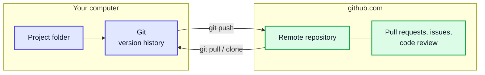

> [!TIP]
> Analogy: Git is like the **camera** that takes snapshots of your project; GitHub is like **Google Photos**, where those snapshots are stored, shared and commented on.

### Repository

A **repository (repo)** is a project folder that Git tracks. Git stores all its data in a hidden `.git` folder inside it.

---

## 2. Why are we using Git and GitHub? (3:45)

Without version control, you end up with folders like `project_final`, `project_final_v2`, `project_final_REALLY_final`. Git solves this properly.

| Problem without Git | How Git/GitHub solves it |
|---|---|
| "It worked yesterday, what did I change?" | `git log` and `git diff` show every change |
| Accidentally deleted code | Restore any earlier version |
| Two people edit the same file | Branches + merging combine work safely |
| Laptop crashes | The remote copy on GitHub is a backup |
| Want to try a risky idea | Do it on a branch; throw it away if it fails |
| Showing your work to recruiters | Public GitHub profile acts as a portfolio |
| Contributing to open source | Fork + pull request workflow |

> [!NOTE]
> Version control is not just for code. Any text-based project (notes, docs, configs, these Markdown notes) benefits from it.

---

## 3. Downloading Git (5:15)

Download from **https://git-scm.com/downloads**.

| OS | How to install |
|---|---|
| Windows | Installer from git-scm.com (includes **Git Bash**) or `winget install Git.Git` |
| macOS | `xcode-select --install` or `brew install git` |
| Linux (Debian/Ubuntu) | `sudo apt install git` |

Verify the installation:

```console
$ git --version
git version 2.43.0
```

### First-time configuration (do this once)

Every commit records an author. Set yours globally:

```console
$ git config --global user.name "your_name"
$ git config --global user.email "your_email@example.com"
$ git config --global init.defaultBranch main
$ git config --list
user.name=your_name
user.email=your_email@example.com
init.defaultbranch=main
```

> [!TIP]
> Use the **same email** as your GitHub account so commits are linked to your profile (and count in your contribution graph).

> [!NOTE]
> **Modern Git:** older Git versions (and the video) name the first branch `master`. GitHub has used `main` as the default since October 2020. Setting `init.defaultBranch main` keeps your local repos consistent with GitHub.

---

## 4. Structure of the Tutorial (6:00)

The video is in two halves:

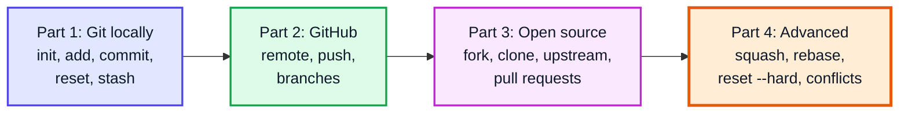

---

## 5. Some basic Linux commands (6:18)

Git is a command-line tool, so you need a few shell commands to move around.

| Command | Meaning | Example |
|---|---|---|
| `pwd` | Print working (current) directory | `pwd` → `/c/Users/you` |
| `ls` | List files | `ls -a` also shows hidden files like `.git` |
| `cd <dir>` | Change directory | `cd Desktop`, `cd ..` (go up), `cd ~` (home) |
| `mkdir <dir>` | Make a directory | `mkdir project` |
| `touch <file>` | Create an empty file | `touch names.txt` |
| `cat <file>` | Print a file's contents | `cat names.txt` |
| `echo "x" > f` | Write text to a file (overwrite) | `echo "Hello" > a.txt` |
| `echo "x" >> f` | Append text to a file | `echo "World" >> a.txt` |
| `rm <file>` | Delete a file | `rm a.txt` |
| `rm -rf <dir>` | Delete a folder and everything in it | use with care |
| `vi` / `nano` / `code .` | Open an editor | `code .` opens VS Code in this folder |
| `clear` | Clear the terminal | |

```console
$ mkdir project
$ cd project
$ pwd
/c/Users/you/project
$ touch names.txt
$ ls
names.txt
```

> [!CAUTION]
> `rm -rf` deletes **without** a recycle bin. Double-check the path before pressing Enter.

---

## 6. Initializing a Git Repository (8:22)

`git init` turns the current folder into a Git repository by creating a hidden `.git` directory.

```console
$ git init
Initialized empty Git repository in /c/Users/you/project/.git/
$ ls -a
.  ..  .git  names.txt
```

### What is inside `.git`?

| Item | Purpose |
|---|---|
| `objects/` | Compressed snapshots of every file version (blobs, trees, commits) |
| `refs/heads/` | One file per branch, holding the hash of its latest commit |
| `HEAD` | Points to the branch you are currently on |
| `config` | Repo-specific settings (remotes, etc.) |
| `index` | The staging area |

> [!WARNING]
> Never run `git init` in your home folder or `C:\` by accident; Git would then try to track your whole drive. If you do, just delete that `.git` folder.

> [!CAUTION]
> Deleting the `.git` folder deletes the **entire history** of the project (the files themselves stay).

---

## 7. Making the first change (9:48)

Create or edit a file, then ask Git what it sees with `git status`.

```console
$ echo "Hello Git" > names.txt
$ git status
On branch main

No commits yet

Untracked files:
  (use "git add <file>..." to include in what will be committed)
	names.txt

nothing added to commit but untracked files present (use "git add" to track)
```

### The three areas of Git

This is the single most important concept in the video.

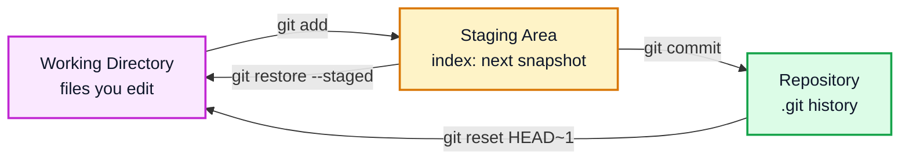

### File states

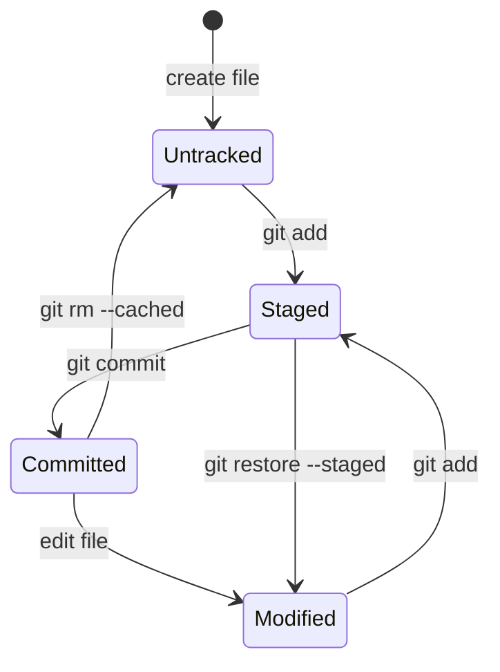

| `git status --short` code | Meaning |
|---|---|
| `??` | Untracked (new, Git has never seen it) |
| `A ` | Added to stage (new file) |
| ` M` | Modified, **not** staged |
| `M ` | Modified **and** staged |
| `D ` | Deleted and staged |

---

## 8. Staging the first change (13:43)

**Staging** means choosing which changes go into the next commit. Think of it as packing a box before sealing it.

```console
$ git add names.txt        # stage one file
$ git add .                # stage everything in this folder (and below)
$ git status --short
A  names.txt
```

| Command | Stages |
|---|---|
| `git add file.txt` | Just that file |
| `git add .` | All changes in the current directory tree |
| `git add -A` | All changes in the whole repo (including deletions) |
| `git add -p` | Interactively choose individual hunks (parts of a file) |

> [!TIP]
> Why have a staging area at all? It lets you make **small, focused commits**. If you changed five files for two different reasons, stage and commit them as two separate commits.

---

## 9. Committing the first change (14:40)

A **commit** is a permanent snapshot of the staged changes, with a message, an author and a timestamp. Each commit has a unique **SHA-1 hash** (e.g. `24c41db...`) and points to its parent commit.

```console
$ git commit -m "names.txt file added"
[main (root-commit) 24c41db] names.txt file added
 1 file changed, 1 insertion(+)
 create mode 100644 names.txt
```


### Writing good commit messages

| ❌ Bad | ✅ Good |
|---|---|
| `update` | `Add binary search solution` |
| `fixed stuff` | `Fix off-by-one error in bubble sort` |
| `asdf` | `Rename Main.java to LinearSearch.java` |

> [!NOTE]
> Convention: short (≤ 50 chars), imperative mood ("Add", not "Added"), and describes **why/what**, not how. Running `git commit` without `-m` opens an editor for a longer message.

---

## 10. Adding data to files (16:12)

Edit a tracked file and Git notices it as **modified**. `git diff` shows exactly what changed.

```console
$ echo "Kunal" >> names.txt
$ git status --short
 M names.txt
$ git diff
diff --git a/names.txt b/names.txt
index 0d5e8c0..b1f3a2e 100644
--- a/names.txt
+++ b/names.txt
@@ -1 +1,2 @@
 Hello Git
+Kunal
```

| Command | Compares |
|---|---|
| `git diff` | Working directory vs staging area (unstaged changes) |
| `git diff --staged` | Staging area vs last commit (what will be committed) |
| `git diff HEAD` | Working directory vs last commit (everything) |
| `git diff a1b2c3 d4e5f6` | Two commits |

> [!TIP]
> `git commit -am "msg"` stages **all modified tracked files** and commits in one step. It does **not** pick up brand-new (untracked) files.

---

## 11. Removing changes from stage (17:24)

Staged something by mistake? Unstage it. The change stays in your file; it just will not be in the next commit.

```console
$ git add .
$ git status --short
M  names.txt
$ git restore --staged names.txt
$ git status --short
 M names.txt
```

| Goal | Modern command (Git 2.23+) | Older equivalent |
|---|---|---|
| Unstage a file (keep edits) | `git restore --staged f` | `git reset HEAD f` |
| Discard edits in working dir | `git restore f` | `git checkout -- f` |
| Stop tracking a file (keep it on disk) | `git rm --cached f` | same |

> [!NOTE]
> `git rm --cached` is sometimes suggested for unstaging, but it actually **removes the file from tracking** (the next commit deletes it from the repo). For a normal "oops, unstage this", `git restore --staged` is the right tool.

> [!WARNING]
> `git restore f` (without `--staged`) **throws away** your uncommitted edits to `f`. They are not recoverable.

---

## 12. Viewing the overall history of the project (18:14)

```console
$ git log
commit 7b71aad... (HEAD -> main)
Author: Demo User <demo@example.com>
Date:   Mon Jan 1 10:00:00 2024 +0000

    kunal added to names

commit 24c41db...
Author: Demo User <demo@example.com>
Date:   Mon Jan 1 10:00:00 2024 +0000

    names.txt file added
```

Commits are listed **newest first**.

| Command | Shows |
|---|---|
| `git log` | Full history |
| `git log --oneline` | One line per commit (short hash + message) |
| `git log --oneline --graph --all` | ASCII graph of all branches |
| `git log -3` | Last 3 commits |
| `git log -p names.txt` | Every change to one file, with diffs |
| `git show <hash>` | One commit's details + diff |
| `git log --author="Kunal"` | Commits by one author |

Press `q` to exit the log pager.

---

## 13. Making a few more commits (18:52)

Repeat edit → add → commit. Each commit links to its parent, forming a chain.

```console
$ git add . && git commit -m "kunal added to names"
$ echo "Rahul" >> names.txt
$ git commit -am "rahul added to names"
$ git log --oneline
d083612 rahul added to names
7b71aad kunal added to names
24c41db names.txt file added
```

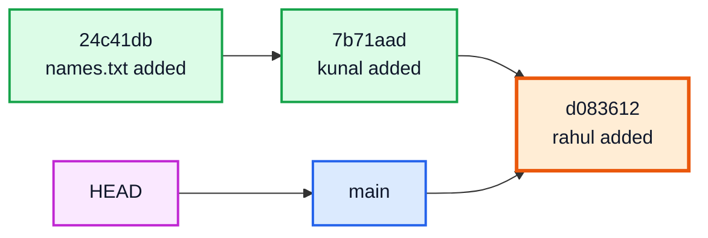

> [!NOTE]
> Internally each commit stores a pointer to its **parent** (arrows really point backwards, child → parent). Diagrams usually draw them left-to-right in time order for readability.

---

## 14. Removing a commit from the history of a project (19:31)

`git reset` moves the branch pointer back to an earlier commit. Commits after it disappear from history.

```console
$ git reset HEAD~1
Unstaged changes after reset:
M	names.txt
$ git log --oneline
7b71aad kunal added to names
24c41db names.txt file added
$ git status --short
 M names.txt
```

`HEAD~1` means "one commit before HEAD". You can also use a hash: `git reset 24c41db`.

### The three modes of reset

| Mode | Branch pointer | Staging area | Working directory | Use when |
|---|---|---|---|---|
| `--soft` | Moved back | **Kept** (changes staged) | Kept | Redo the commit message / squash |
| `--mixed` (default) | Moved back | Cleared (changes unstaged) | Kept | "Uncommit" but keep the work |
| `--hard` | Moved back | Cleared | **Discarded** | Throw the work away completely |

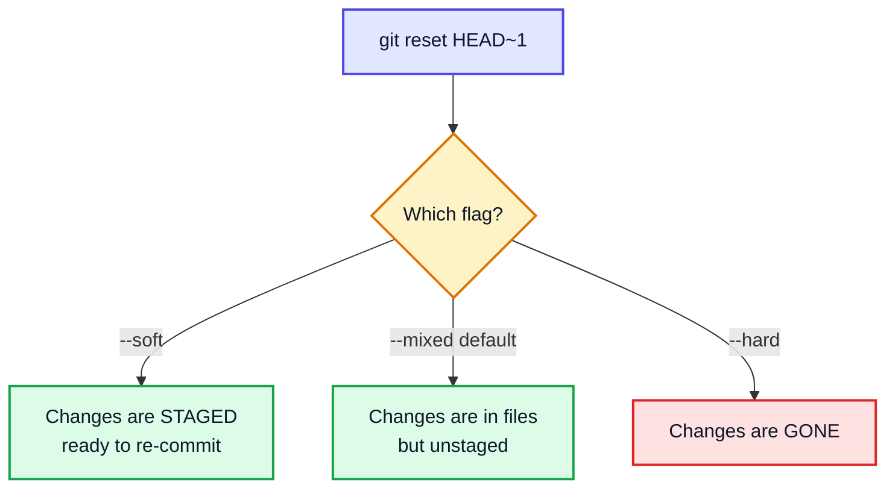

### reset vs revert

| | `git reset` | `git revert <hash>` |
|---|---|---|
| How | Moves the branch back, erasing commits | Adds a **new** commit that undoes an old one |
| History | Rewritten | Preserved |
| Safe on shared/pushed branches? | ❌ No (others still have the old commits) | ✅ Yes |

> [!IMPORTANT]
> Use `reset` only on commits that **you have not pushed** (or that live on your own PR branch). On shared branches like `main`, use `git revert`.

---

## 15. Stashing changes (21:35)

**Stash** = put your uncommitted work on a shelf, leaving a clean working directory. Useful when you must switch tasks (an urgent bug fix, pulling updates) but your current work is not ready to commit.

```console
$ git status --short
 M names.txt
$ git stash
Saved working directory and index state WIP on main: 7b71aad kunal added to names
$ git status --short
$ cat names.txt
Hello Git
Kunal
```

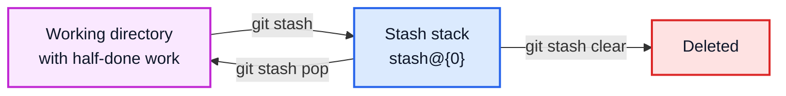

| Command | Does |
|---|---|
| `git stash` | Stash tracked changes (staged + unstaged) |
| `git stash -u` | Also stash untracked files |
| `git stash push -m "msg"` | Stash with a label |
| `git stash list` | Show all stashes (`stash@{0}` is the newest) |
| `git stash show -p stash@{1}` | See what is in a stash |

> [!NOTE]
> Modified **tracked** files are stashed directly. **Untracked** (brand-new) files are not stashed unless you stage them first (`git add .`) or use `git stash -u`.

---

## 16. Popping Stash (24:25)

```console
$ git stash pop
$ cat names.txt
Hello Git
Kunal
Rahul
```

| Command | Re-applies changes | Removes from stash? |
|---|---|---|
| `git stash pop` | ✅ | ✅ |
| `git stash apply` | ✅ | ❌ (keeps a copy) |
| `git stash pop stash@{2}` | ✅ a specific stash | ✅ |

> [!TIP]
> Stashes are a **stack** (LIFO): the most recent stash is popped first, just like a Java `Stack`.

---

## 17. Clearing Stash (25:00)

```console
$ git stash          # stash something
$ git stash clear    # delete ALL stashes
$ git stash list     # (empty)
```

| Command | Deletes |
|---|---|
| `git stash drop` | The newest stash only |
| `git stash drop stash@{1}` | One specific stash |
| `git stash clear` | All stashes |

> [!CAUTION]
> Cleared stashes are effectively gone. Only clear when you are sure you do not need that work.

---

## 18. Starting GitHub (25:26)

So far everything was **local**. Now we put the repo online.

1. Create a free account at **github.com**.
2. Set up authentication so `git push` can prove who you are.

| Method | How |
|---|---|
| HTTPS + Personal Access Token | GitHub → Settings → Developer settings → Tokens; paste the token when Git asks for a password (Git Credential Manager remembers it) |
| SSH key | `ssh-keygen -t ed25519 -C "you@example.com"`, add the `.pub` key in GitHub → Settings → SSH keys |
| GitHub CLI | `gh auth login` handles it interactively |

> [!NOTE]
> **Modern GitHub:** since August 2021 GitHub no longer accepts your **account password** for `git push` over HTTPS. Use a token, SSH, or `gh auth login`. On Windows, Git for Windows ships the Git Credential Manager, which opens a browser login the first time.

---

## 19. Creating a new repository on GitHub (26:10)

On GitHub: **+** (top right) → **New repository** → choose a name → Public/Private → **Create repository**.

> [!TIP]
> If you already have a local repo, **do not** tick "Add a README" / ".gitignore" / "license" when creating it. Starting with an empty remote avoids an unrelated-history conflict on your first push.

GitHub then shows the URL of your repo, e.g.:

```
https://github.com/<username>/<repo>.git     (HTTPS)
git@github.com:<username>/<repo>.git         (SSH)
```

---

## 20. Connecting Remote Repository to Local Repository (26:40)

A **remote** is a named URL of another copy of your repository. By convention the main one is called **`origin`**.

```console
$ git remote add origin https://github.com/<username>/project.git
$ git remote -v
origin	https://github.com/<username>/project.git (fetch)
origin	https://github.com/<username>/project.git (push)
```

| Command | Does |
|---|---|
| `git remote add <name> <url>` | Add a remote |
| `git remote -v` | List remotes with URLs |
| `git remote set-url origin <url>` | Change a remote's URL |
| `git remote remove <name>` | Remove a remote |

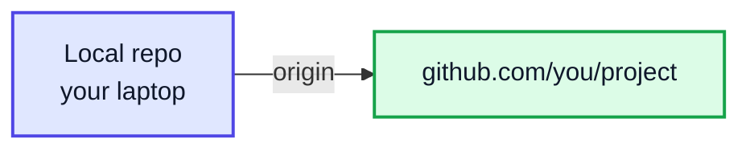

---

## 21. Pushing local changes to remote repository (28:05)

```console
$ git push -u origin main
Enumerating objects: 6, done.
...
To https://github.com/<username>/project.git
 * [new branch]      main -> main
branch 'main' set up to track 'origin/main'.
```

- `origin` = where to push, `main` = which branch.
- `-u` (`--set-upstream`) remembers this pairing, so afterwards a plain `git push` / `git pull` works.

```console
$ git branch -vv
* main 7b71aad [origin/main] kunal added to names
```

| Command | Direction | Does |
|---|---|---|
| `git push` | Local → remote | Upload commits |
| `git fetch` | Remote → local | Download commits, **do not** change your files |
| `git pull` | Remote → local | `fetch` + `merge` into your current branch |

> [!NOTE]
> The video pushes to `master`. If your local branch is `master`, push `master`; if it is `main`, push `main`. `git branch` shows which one you have.

---

## 22. What are branches? (28:43)

A **branch** is just a **movable pointer to a commit**. Creating a branch is instant and cheap: Git writes a 41-byte file containing a commit hash.

- `main` is the default branch.
- `HEAD` points to the branch you are currently on.
- When you commit, the current branch pointer moves forward to the new commit.

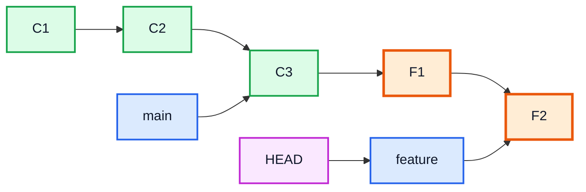

Here `feature` has two commits that `main` does not have yet. `main` is untouched.

---

## 23. Use of branches (31:10)

Branches let you work on several things **in parallel** without breaking the stable code.

| Scenario | Branch strategy |
|---|---|
| New feature | `feature/login` off `main`; merge when finished |
| Bug fix | `fix/null-pointer` off `main` |
| Experiment | `try-new-algo`; delete it if it fails, `main` never knew |
| Open-source contribution | One branch **per pull request** |
| Teams | Everyone works on their own branch; `main` stays deployable |

> [!IMPORTANT]
> Golden rule: `main` should always contain **working** code. Do your work on branches and merge only when it is ready.

---

## 24. Making a new branch and switching to it (Learn Git Branching) (32:42)

```console
$ git branch feature          # create (does not switch)
$ git switch feature          # switch to it
Switched to branch 'feature'

$ git switch -c feature       # create AND switch in one step
Switched to a new branch 'feature'

$ git branch                  # list branches; * marks the current one
* feature
  main
```

| Modern (Git 2.23+) | Older equivalent | Does |
|---|---|---|
| `git switch <b>` | `git checkout <b>` | Switch branch |
| `git switch -c <b>` | `git checkout -b <b>` | Create + switch |
| `git branch -d <b>` | same | Delete a merged branch |
| `git branch -D <b>` | same | Force-delete an unmerged branch |
| `git branch -m <new>` | same | Rename the current branch |

> [!NOTE]
> The video uses `git checkout`. `checkout` still works, but it does many unrelated jobs (switch branches, restore files, detach HEAD). `git switch` and `git restore` split those jobs into clearer commands.

> [!TIP]
> The video recommends **https://learngitbranching.js.org**, an interactive visual playground where you type real commands and watch the commit graph change. Highly recommended for practising branches, merges and rebases.

Files you commit on `feature` are not visible on `main` until you merge:

```console
$ git switch -c feature
$ echo "print(names)" > app.py && git add app.py && git commit -q -m "add app.py"
$ git switch main
$ ls
names.txt
```

---

## 25. Merging branch to main (Learn Git Branching) (34:28)

To bring a branch's work into `main`, **switch to `main`** first, then merge the other branch into it.

```console
$ git switch main
$ git merge feature
Updating 7b71aad..efa2dbe
Fast-forward
 app.py | 1 +
 1 file changed, 1 insertion(+)
$ ls
app.py  names.txt
```

### Two kinds of merge

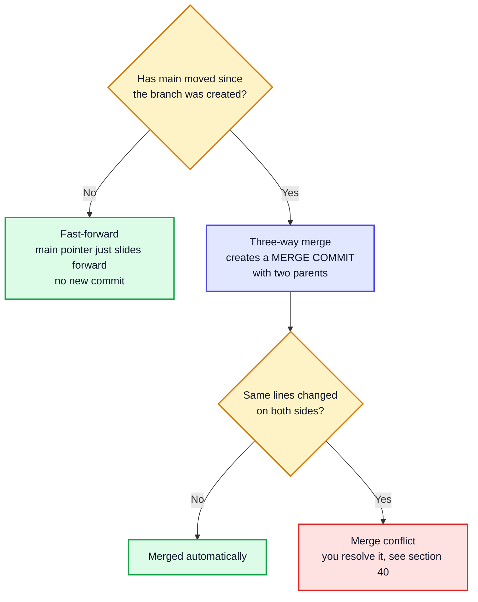

After a three-way merge the graph looks like this:

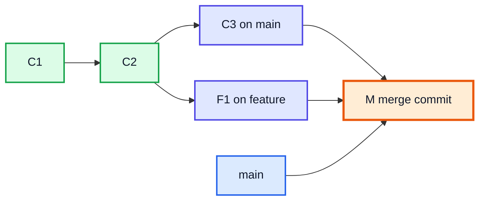

| Option | Effect |
|---|---|
| `git merge feature` | Fast-forward if possible, otherwise merge commit |
| `git merge --no-ff feature` | Always create a merge commit (keeps the branch visible in history) |
| `git merge --ff-only feature` | Refuse unless a fast-forward is possible |
| `git merge --abort` | Cancel a merge in progress (e.g. during a conflict) |

---

## 26. Pushing new changes to master branch (36:00)

After merging locally, push `main` so GitHub has the new commits:

```console
$ git push origin main
To https://github.com/<username>/project.git
   7b71aad..efa2dbe  main -> main
```

You can also push the branch itself (useful for backups or pull requests):

```console
$ git push -u origin feature
```

> [!NOTE]
> The video's branch is called `master`. The commands are identical; only the branch name differs.

---

## 27. Working with Existing Projects (37:10)

Most of your Git life is spent on projects that **already exist**: the course repo, your team's code, open-source projects. You usually **cannot push** directly to someone else's repository, so the workflow changes:

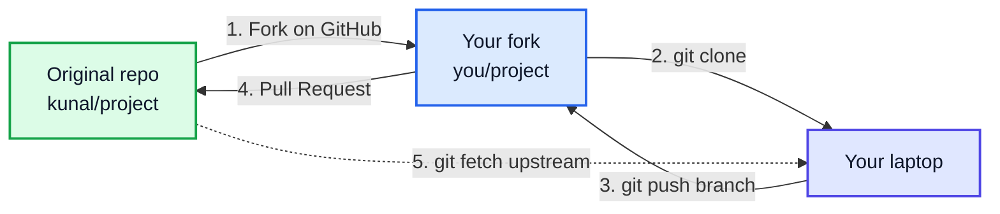

The next sections walk through each numbered step.

---

## 28. Why Fork and How to Fork? (37:38)

A **fork** is your own copy of someone else's repository **on GitHub**, under your account. You have full write access to the fork, even though you have none on the original.

**How:** open the repo on GitHub → click **Fork** (top right) → **Create fork**. It appears at `github.com/<you>/<repo>`.

| | Fork | Clone |
|---|---|---|
| Where the copy lives | GitHub (your account) | Your computer |
| Done with | GitHub button | `git clone` command |
| Purpose | Get a repo you can push to | Get files locally to work on |
| Needed for open source? | Yes (if you are not a collaborator) | Yes |

> [!NOTE]
> If you **are** a collaborator on a repo (e.g. your team's), you can skip forking: clone the original directly and push branches to it.

---

## 29. Cloning the forked project to local (39:00)

```console
$ git clone https://github.com/<you>/project.git
Cloning into 'project'...
$ cd project
$ git remote -v
origin	https://github.com/<you>/project.git (fetch)
origin	https://github.com/<you>/project.git (push)
```

`git clone` does everything at once: creates the folder, runs `git init`, downloads the full history, adds the `origin` remote and checks out the default branch.

> [!TIP]
> Clone **your fork**, not the original. That way `origin` points to a repo you can push to.

---

## 30. What is Upstream and adding it to local (40:10)

**`upstream`** is the conventional name for the **original** repository you forked from. You add it so you can pull in other people's new changes.

```console
$ git remote add upstream https://github.com/kunal-kushwaha/project.git
$ git remote -v
origin	https://github.com/<you>/project.git (fetch)
origin	https://github.com/<you>/project.git (push)
upstream	https://github.com/kunal-kushwaha/project.git (fetch)
upstream	https://github.com/kunal-kushwaha/project.git (push)
```

| Remote | Points to | You can push? | Used for |
|---|---|---|---|
| `origin` | Your fork | ✅ | Pushing your branches |
| `upstream` | Original project | ❌ (usually) | Fetching the latest changes |

---

## 31. What is a Pull Request? (41:00)

A **Pull Request (PR)** is a request on GitHub: *"Please pull the commits from my branch into your project."* It is where maintainers review, discuss, run automated checks and finally merge your contribution.

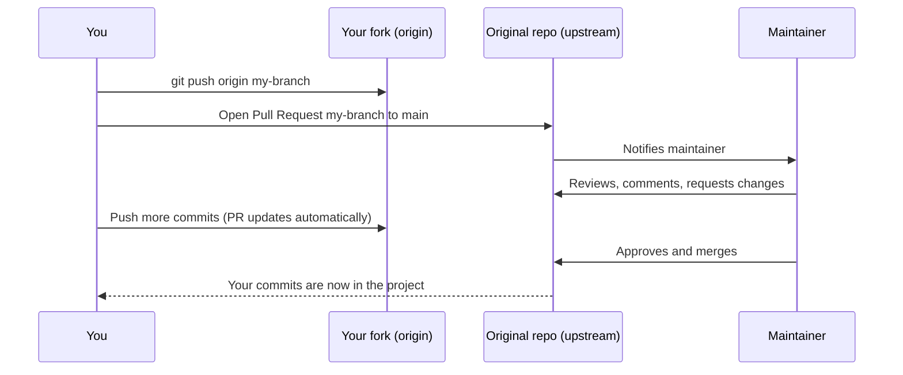

A good PR has:
- A **clear title** and description (what and why).
- A link to the **issue** it solves (`Fixes #42` closes the issue automatically on merge).
- **One** logical change. Small PRs get reviewed and merged faster.
- Respect for the project's `CONTRIBUTING.md` guidelines.

> [!IMPORTANT]
> A PR is tied to a **branch**, not to a snapshot. Every new commit you push to that branch automatically appears in the open PR.

---

## 32. Never commit on main branch & creating our first pull request (45:28)

Because a PR follows its branch, if you make the PR from your `main`, then **every** later commit on your `main` gets added to that PR. You also can no longer cleanly sync `main` with upstream. So: **one new branch per PR**.

```console
$ git switch -c fix-typo                 # new branch for this change
$ echo "Anuj" >> names.txt
$ git commit -am "anuj added"
$ git push -u origin fix-typo            # push the BRANCH to your fork
remote: Create a pull request for 'fix-typo' on GitHub by visiting:
remote:      https://github.com/<you>/project/pull/new/fix-typo
```

Then on GitHub: **Compare & pull request** → base repository `kunal/project` base `main` ← head `you/project` compare `fix-typo` → write a description → **Create pull request**.

With the GitHub CLI you can do it from the terminal:

```console
$ gh pr create --title "Add Anuj to names" --body "Adds a missing name."
```

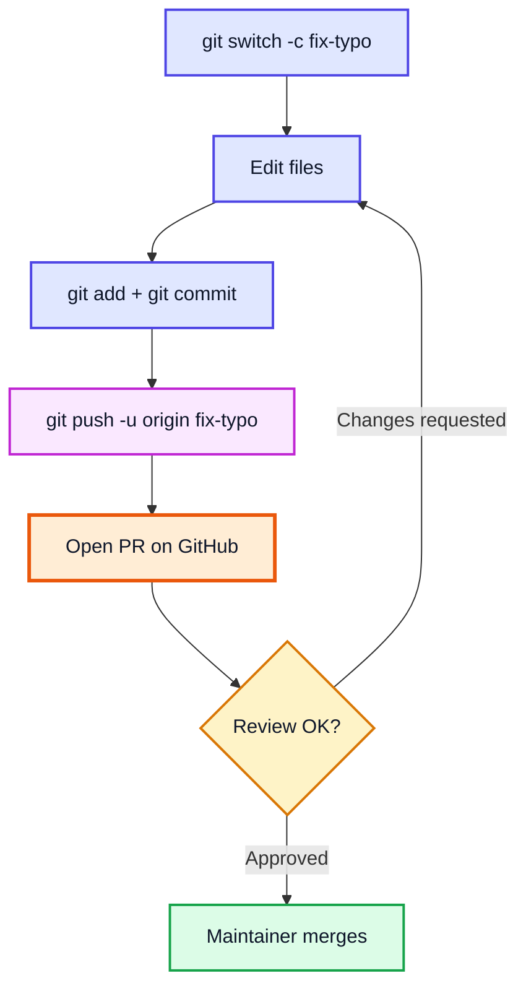

> [!WARNING]
> Committing on `main` and opening a PR from it is the #1 beginner mistake. It mixes unrelated changes into one PR and makes your fork drift from upstream.

---

## 33. Removing a commit from the pull request by force pushing to it (51:04)

Pushed a commit to your PR branch that should not be there? Remove it locally, then **force-push** so the remote branch (and therefore the PR) matches.

```console
$ git log --oneline -2
c3d4e5f another bad commit
6db7f90 anuj added
$ git reset --hard HEAD~1         # drop the bad commit locally
$ git push origin fix-typo
 ! [rejected]        fix-typo -> fix-typo (non-fast-forward)
$ git push -f origin fix-typo     # overwrite the remote branch
 + c3d4e5f...6db7f90 fix-typo -> fix-typo (forced update)
```

A normal push is rejected because the remote has a commit your local branch no longer has. `-f` (`--force`) tells GitHub to replace the remote branch with yours.

| Flag | Behaviour |
|---|---|
| `git push -f` | Overwrite the remote branch unconditionally |
| `git push --force-with-lease` | Overwrite **only if** nobody else pushed in the meantime (safer) |

> [!CAUTION]
> Never force-push to a **shared** branch like `main`: you would delete other people's commits from it. Force-pushing your **own PR branch** is normal and fine. Prefer `--force-with-lease` as a habit.

---

## 34. Merging a Pull Request (52:56)

The maintainer clicks **Merge pull request** on GitHub. GitHub offers three strategies:

| Button | Result in `main` | Typical use |
|---|---|---|
| **Create a merge commit** | All PR commits + one merge commit | Keep full history |
| **Squash and merge** | All PR commits combined into **one** commit | Tidy history, very common |
| **Rebase and merge** | PR commits replayed on top, no merge commit | Linear history |

After merging, GitHub offers to **delete the branch**. Do it; locally you can also run `git branch -d fix-typo`.

---

## 35. Making forked project even with main project (53:28)

Over time the original repo gets new commits from other contributors. Your fork does **not** update itself. GitHub shows *"This branch is N commits behind kunal:main"*.

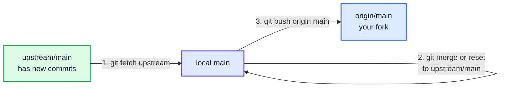

### Method 1: fetch + reset (what the video does)

```console
$ git switch main
$ git fetch --all --prune          # download from every remote; --prune drops deleted branches
$ git reset --hard upstream/main   # make local main identical to upstream's main
$ git push origin main             # update your fork on GitHub
```

### Method 2: pull from upstream

```console
$ git switch main
$ git pull upstream main           # fetch + merge (fast-forward if you never committed on main)
$ git push origin main
```

### Method 3: GitHub button

On your fork's page click **Sync fork → Update branch**, then locally `git pull origin main`. Or with the CLI: `gh repo sync`.

> [!TIP]
> This is exactly why you **never commit on main**: if your `main` only ever mirrors upstream, syncing is always a clean fast-forward or reset, with no conflicts.

> [!WARNING]
> `git reset --hard upstream/main` discards anything on your local `main` that is not in upstream. Make sure your work lives on feature branches first.

---

## 36. Instructions on how to try doing these on your own (59:46)

The video encourages hands-on practice. A safe exercise plan:

1. Create a repo on GitHub, clone it, make 3 commits, push.
2. Make a branch, add a file, merge it into `main`, push.
3. Fork a friend's repo (or a practice repo like `firstcontributions/first-contributions`), add `upstream`, open a PR from a branch.
4. Add a bad commit to the PR, then remove it with `reset` + force push.
5. Ask your friend to change `main`, then sync your fork.

> [!TIP]
> The **Complete Example** at the end of these notes runs all of these steps offline in one script, using local "fake GitHub" repositories, so you can practise without an account.

---

## 37. Squashing commits (1:00:20)

**Squashing** combines several commits into one. Maintainers often ask for it so a PR lands as a single clean commit instead of `fix`, `fix again`, `typo`, `really fixed`.

### Method 1: interactive rebase (video's method)

```console
$ git rebase -i HEAD~3
```

An editor opens listing the last 3 commits (**oldest first**):

```
pick c0e2379 add Rohit
pick 44fb4fb add Priya
pick fa26401 add Aman
```

Change the later ones to `s` (squash) and save:

```
pick c0e2379 add Rohit
s 44fb4fb add Priya
s fa26401 add Aman
```

Git then opens a second editor to write the combined commit message.

| Keyword | Meaning |
|---|---|
| `pick` / `p` | Keep the commit as is |
| `squash` / `s` | Merge into the previous commit, combine messages |
| `fixup` / `f` | Merge into the previous commit, **discard** this message |
| `reword` / `r` | Keep the commit, edit its message |
| `drop` / `d` | Delete the commit |
| `edit` / `e` | Stop here so you can amend it |

### Method 2: soft reset (same result, no editor)

```console
$ git log --oneline -4
fa26401 add Aman
44fb4fb add Priya
c0e2379 add Rohit
6db7f90 anuj added
$ git reset --soft HEAD~3          # uncommit 3 commits, keep their changes STAGED
$ git commit -m "add Rohit, Priya and Aman"
$ git log --oneline -2
835f46e add Rohit, Priya and Aman
6db7f90 anuj added
```

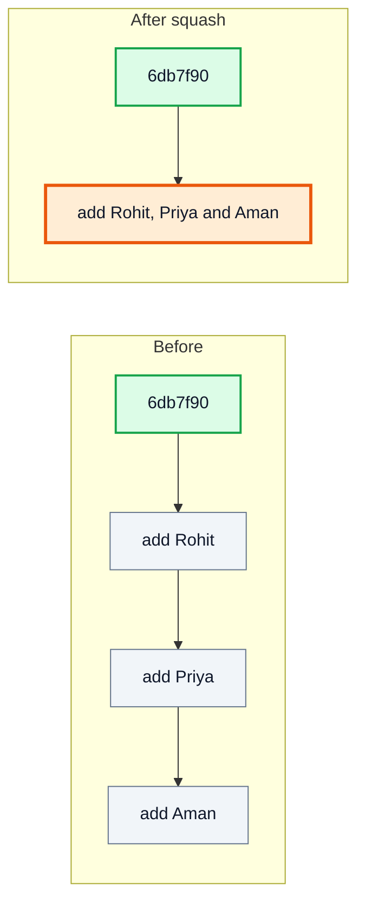

> [!IMPORTANT]
> Squashing **rewrites history** (new hash). If the commits were already pushed to your PR branch, you must `git push -f` (or `--force-with-lease`) afterwards.

---

## 38. Using the Rebase command (1:01:59)

`git rebase <base>` takes your branch's commits and **replays** them on top of `<base>`, as if you had started the branch from there. The result is a straight, linear history with no merge commit.

```console
$ git switch squash-demo
$ git rebase main
Successfully rebased and updated refs/heads/squash-demo.
$ git log --oneline --graph -3
* a0c684a add Rohit, Priya and Aman
* 3e00a10 add README
* 6db7f90 anuj added
```

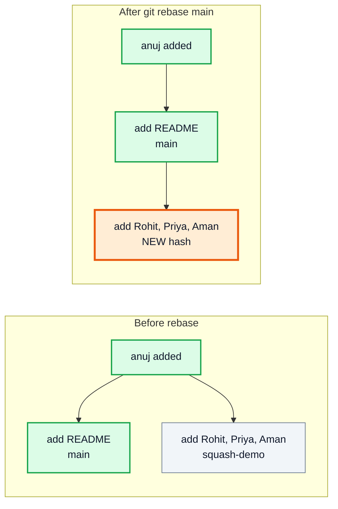

### Merge vs Rebase

| | `git merge main` | `git rebase main` |
|---|---|---|
| History | Keeps the true branching shape + merge commit | Linear, as if work happened in sequence |
| Rewrites commits? | ❌ No | ✅ Yes (new hashes) |
| Safe on shared branches? | ✅ | ❌ Only on your own branches |
| Conflicts | Resolved once | May be resolved per replayed commit |
| Typical use | Integrating finished work into `main` | Updating your feature/PR branch with latest `main` |

During a rebase conflict: fix the file, `git add` it, then `git rebase --continue` (or `git rebase --abort` to give up).

> [!CAUTION]
> The golden rule of rebasing: **never rebase commits that others have based work on** (e.g. public `main`). Rebase only your own local or PR branches.

---

## 39. Using the hard flag to reset (1:04:35)

`git reset --hard <commit>` moves the branch **and** wipes the staging area **and** the working directory to match that commit exactly.

```console
$ git reset --hard HEAD~1          # throw away the last commit and its changes
$ git reset --hard upstream/main   # make this branch identical to upstream's main
$ git reset --hard                 # discard ALL uncommitted changes (back to HEAD)
```

> [!WARNING]
> Uncommitted changes destroyed by `--hard` are **gone** (Git never saved them). Committed work that you reset away can usually be recovered for a while with `git reflog`:
> ```console
> $ git reflog
> 6db7f90 HEAD@{0}: reset: moving to HEAD~1
> c3d4e5f HEAD@{1}: commit: another bad commit
> $ git reset --hard c3d4e5f        # undo the reset
> ```

| Want to... | Command |
|---|---|
| Undo last commit, keep changes staged | `git reset --soft HEAD~1` |
| Undo last commit, keep changes in files | `git reset HEAD~1` |
| Undo last commit and delete its changes | `git reset --hard HEAD~1` |
| Undo a pushed commit on a shared branch | `git revert <hash>` |
| Fix the message of the last (unpushed) commit | `git commit --amend -m "new msg"` |

---

## 40. Merge conflicts and how to resolve them? (1:05:11)

A **merge conflict** happens when two branches change **the same lines** of the same file differently. Git cannot guess which version is right, so it stops and asks you.

```console
$ git merge branch-a
Auto-merging names.txt
CONFLICT (content): Merge conflict in names.txt
Automatic merge failed; fix conflicts and then commit the result.
```

Git writes **conflict markers** into the file:

```
<<<<<<< HEAD
Hello World
=======
Hello GitHub
>>>>>>> branch-a
```

| Marker | Meaning |
|---|---|
| `<<<<<<< HEAD` | Start of **your current branch's** version |
| `=======` | Divider |
| `>>>>>>> branch-a` | End of the **incoming branch's** version |

### Resolution steps

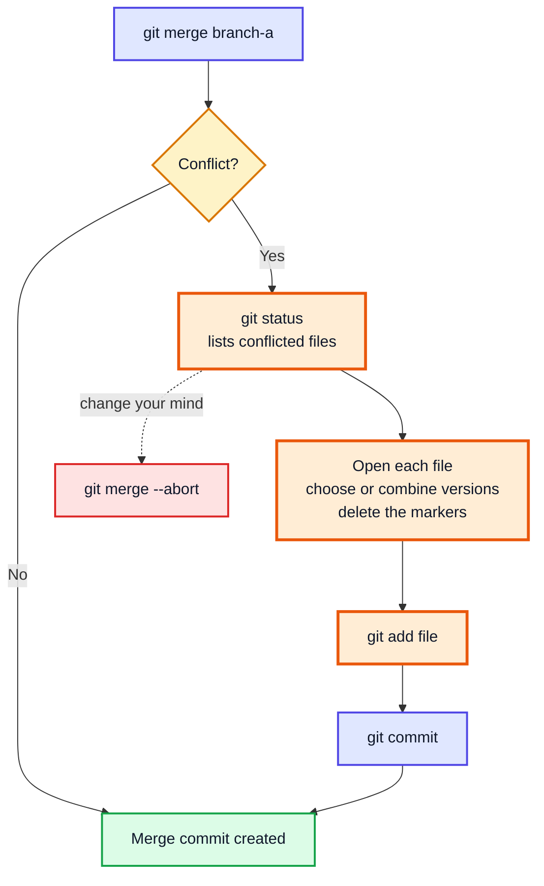

1. Edit the file so it contains exactly what you want (one side, the other, or a mix) and **no markers**.
2. `git add names.txt` to mark it resolved.
3. `git commit` to finish the merge (Git pre-fills the message).

```console
$ cat names.txt | head -2
Hello GitHub
Kunal
$ git add names.txt
$ git commit --no-edit
$ git log --oneline --graph -4
*   69ed21a Merge branch 'branch-a'
|\
| * b881f90 greeting: GitHub
* | 912d6ca greeting: World
|/
* 3e00a10 add README
```

| Shortcut | Effect |
|---|---|
| `git checkout --ours file` | Keep your branch's version of the whole file |
| `git checkout --theirs file` | Keep the incoming version of the whole file |
| VS Code | Shows "Accept Current / Incoming / Both" buttons above each conflict |

> [!TIP]
> Avoid conflicts by pulling/syncing often, keeping PRs small, and not reformatting whole files in unrelated PRs.

> [!NOTE]
> On GitHub, a PR with conflicts shows *"This branch has conflicts that must be resolved"*. Fix it locally: `git fetch upstream`, `git merge upstream/main` (or `git rebase upstream/main`) on your PR branch, resolve, then push.

---

## 41. What to do next? (1:11:00)

- Use Git for **every** assignment in this course; push your solutions to GitHub.
- Practise at **learngitbranching.js.org**.
- Keep the **GitHub Git cheat sheet** handy: https://education.github.com/git-cheat-sheet-education.pdf
- Make your first open-source contribution (start with issues labelled `good first issue`).
- Learn `.gitignore`: add `*.class`, `out/`, `.idea/` so compiled Java files and IDE settings are not committed.

```
# .gitignore for a Java project
*.class
out/
target/
.idea/
*.iml
.DS_Store
```

---

## 🧩 Complete Example: Everything Together

One bash script that runs the **whole workflow from this video**: config, init, add, commit, unstage, log, reset, stash, remotes, push, branches, merge, fork, clone, upstream, PR branch, force-push, syncing a fork, squash, rebase and a merge conflict resolution.

It runs **fully offline**: two local *bare* repositories play the role of GitHub (`github/kunal/project.git` is the original project, `github/you/project.git` is your fork). Identity and dates are pinned, so commit hashes come out identical on every machine.

Save as `git_workflow_demo.sh` and run with `bash git_workflow_demo.sh` (Git Bash on Windows).

```bash
#!/usr/bin/env bash
# Complete Git & GitHub workflow — runs entirely offline.
# Two local *bare* repositories stand in for GitHub:
#   github/kunal/project.git  -> the original project (the "upstream")
#   github/you/project.git    -> your fork            (your "origin")
set -e

# ---------- reproducible sandbox (fixed identity + dates => identical hashes) ----------
rm -rf sandbox && mkdir sandbox && cd sandbox
export HOME="$PWD/home" GIT_CONFIG_NOSYSTEM=1
export GIT_AUTHOR_DATE="2024-01-01T10:00:00+0000" GIT_COMMITTER_DATE="2024-01-01T10:00:00+0000"
mkdir -p "$HOME"
run() { echo "\$ $1"; eval "$1" 2>&1; }
section() { echo; echo "=== $1 ==="; }

section "0. One-time setup"
run 'git config --global user.name "Demo User"'
run 'git config --global user.email "demo@example.com"'
run 'git config --global init.defaultBranch main'

section "1. Create a repo and make the first commit"
run 'mkdir project && cd project'
run 'git init -q'
run 'echo "Hello Git" > names.txt'
run 'git status --short'
run 'git add names.txt'
run 'git status --short'
run 'git commit -q -m "names.txt file added"'
run 'git log --oneline'

section "2. Unstage a change, then commit for real"
run 'echo "Kunal" >> names.txt'
run 'git add .'
run 'git restore --staged names.txt'
run 'git status --short'
run 'git add . && git commit -q -m "kunal added to names"'
run 'echo "Rahul" >> names.txt && git commit -q -am "rahul added to names"'
run 'git log --oneline'

section "3. Remove the last commit from history (changes kept, unstaged)"
run 'git reset HEAD~1'
run 'git status --short'
run 'git log --oneline'

section "4. Stash: park work, come back to it, clear it"
run 'git stash'
run 'git status --short && cat names.txt'
run 'git stash pop -q'
run 'cat names.txt'
run 'git stash && git stash clear && git stash list'

section "5. Connect a remote (GitHub) and push"
run 'git init -q --bare ../github/kunal/project.git'
run 'git remote add origin ../github/kunal/project.git'
run 'git remote -v'
run 'git push -q -u origin main'
run 'git branch -vv'

section "6. Branch, commit on the branch, merge into main"
run 'git switch -c feature'
run 'echo "print(names)" > app.py && git add app.py && git commit -q -m "add app.py"'
run 'git switch main'
run 'ls'
run 'git merge -q feature'
run 'ls'
run 'git log --oneline --graph'
run 'git push -q origin main'
run 'cd ..'

section "7. Open source: fork, clone, add upstream"
run 'git clone -q --bare github/kunal/project.git github/you/project.git'   # = clicking "Fork" on GitHub
run 'git clone -q github/you/project.git my-fork && cd my-fork'
run 'git remote add upstream ../github/kunal/project.git'
run 'git remote'

section "8. Never commit on main: branch -> commit -> push -> Pull Request"
run 'git switch -c fix-typo'
run 'echo "Anuj" >> names.txt && git commit -q -am "anuj added"'
run 'echo "oops" >> names.txt && git commit -q -am "bad commit"'
run 'git reset -q --hard HEAD~1'                 # drop the bad commit ...
run 'git push -q -u origin fix-typo'
run 'git log --oneline -1'
run 'echo "debug" >> names.txt && git commit -q -am "another bad commit"'
run 'git push -q origin fix-typo'
run 'git reset -q --hard HEAD~1 && git push -q -f origin fix-typo'   # ... remove it from the open PR
run 'git log --oneline origin/fix-typo -1'

section "9. Maintainer merges the PR on GitHub (simulated)"
run 'git push -q upstream fix-typo:main'          # what the green "Merge" button does to upstream
run 'git -C ../github/kunal/project.git log --oneline -1 main'

section "10. Keep your fork even with upstream"
run 'git switch -q main'
run 'git fetch -q --all --prune'
run 'git reset -q --hard upstream/main'
run 'git push -q origin main'
run 'git log --oneline'

section "11. Squash three commits into one"
run 'git switch -q -c squash-demo'
run 'for n in Rohit Priya Aman; do echo $n >> names.txt; git commit -q -am "add $n"; done'
run 'git log --oneline -4'
run 'git reset --soft HEAD~3'                   # same result as "squash" in git rebase -i HEAD~3
run 'git commit -q -m "add Rohit, Priya and Aman"'
run 'git log --oneline -2'

section "12. Rebase a branch onto an updated main"
run 'git switch -q main'
run 'echo "# Project" > README.md && git add README.md && git commit -q -m "add README"'
run 'git switch -q squash-demo'
run 'git rebase -q main'
run 'git log --oneline --graph -3'

section "13. Merge conflict and how to resolve it"
run 'git switch -q main && git switch -q -c branch-a'
run 'sed -i "1s/.*/Hello GitHub/" names.txt && git commit -q -am "greeting: GitHub"'
run 'git switch -q main'
run 'sed -i "1s/.*/Hello World/" names.txt && git commit -q -am "greeting: World"'
run 'git merge branch-a || true'
run 'head -5 names.txt'
run 'sed -i "/^<<<<<<<\|^=======\|^>>>>>>>/d; /^Hello World$/d" names.txt'   # keep "Hello GitHub"
run 'head -2 names.txt'
run 'git add names.txt && git commit -q --no-edit'
run 'git log --oneline --graph -4'
run 'git status --short && echo "working tree clean"'
```

> [!NOTE]
> In real life you would resolve the conflict in an editor instead of `sed`, click **Fork** / **Merge pull request** on GitHub instead of the simulated pushes in steps 7 and 9, and use `git rebase -i` for squashing. The `-q` flags just keep the transcript short.

**Expected Output** (real output from running the script with Git 2.43):
```
=== 0. One-time setup ===
$ git config --global user.name "Demo User"
$ git config --global user.email "demo@example.com"
$ git config --global init.defaultBranch main

=== 1. Create a repo and make the first commit ===
$ mkdir project && cd project
$ git init -q
$ echo "Hello Git" > names.txt
$ git status --short
?? names.txt
$ git add names.txt
$ git status --short
A  names.txt
$ git commit -q -m "names.txt file added"
$ git log --oneline
24c41db names.txt file added

=== 2. Unstage a change, then commit for real ===
$ echo "Kunal" >> names.txt
$ git add .
$ git restore --staged names.txt
$ git status --short
 M names.txt
$ git add . && git commit -q -m "kunal added to names"
$ echo "Rahul" >> names.txt && git commit -q -am "rahul added to names"
$ git log --oneline
d083612 rahul added to names
7b71aad kunal added to names
24c41db names.txt file added

=== 3. Remove the last commit from history (changes kept, unstaged) ===
$ git reset HEAD~1
Unstaged changes after reset:
M	names.txt
$ git status --short
 M names.txt
$ git log --oneline
7b71aad kunal added to names
24c41db names.txt file added

=== 4. Stash: park work, come back to it, clear it ===
$ git stash
Saved working directory and index state WIP on main: 7b71aad kunal added to names
$ git status --short && cat names.txt
Hello Git
Kunal
$ git stash pop -q
$ cat names.txt
Hello Git
Kunal
Rahul
$ git stash && git stash clear && git stash list
Saved working directory and index state WIP on main: 7b71aad kunal added to names

=== 5. Connect a remote (GitHub) and push ===
$ git init -q --bare ../github/kunal/project.git
$ git remote add origin ../github/kunal/project.git
$ git remote -v
origin	../github/kunal/project.git (fetch)
origin	../github/kunal/project.git (push)
$ git push -q -u origin main
$ git branch -vv
* main 7b71aad [origin/main] kunal added to names

=== 6. Branch, commit on the branch, merge into main ===
$ git switch -c feature
Switched to a new branch 'feature'
$ echo "print(names)" > app.py && git add app.py && git commit -q -m "add app.py"
$ git switch main
Your branch is up to date with 'origin/main'.
Switched to branch 'main'
$ ls
names.txt
$ git merge -q feature
$ ls
app.py
names.txt
$ git log --oneline --graph
* efa2dbe add app.py
* 7b71aad kunal added to names
* 24c41db names.txt file added
$ git push -q origin main
$ cd ..

=== 7. Open source: fork, clone, add upstream ===
$ git clone -q --bare github/kunal/project.git github/you/project.git
$ git clone -q github/you/project.git my-fork && cd my-fork
$ git remote add upstream ../github/kunal/project.git
$ git remote
origin
upstream

=== 8. Never commit on main: branch -> commit -> push -> Pull Request ===
$ git switch -c fix-typo
Switched to a new branch 'fix-typo'
$ echo "Anuj" >> names.txt && git commit -q -am "anuj added"
$ echo "oops" >> names.txt && git commit -q -am "bad commit"
$ git reset -q --hard HEAD~1
$ git push -q -u origin fix-typo
$ git log --oneline -1
6db7f90 anuj added
$ echo "debug" >> names.txt && git commit -q -am "another bad commit"
$ git push -q origin fix-typo
$ git reset -q --hard HEAD~1 && git push -q -f origin fix-typo
$ git log --oneline origin/fix-typo -1
6db7f90 anuj added

=== 9. Maintainer merges the PR on GitHub (simulated) ===
$ git push -q upstream fix-typo:main
$ git -C ../github/kunal/project.git log --oneline -1 main
6db7f90 anuj added

=== 10. Keep your fork even with upstream ===
$ git switch -q main
$ git fetch -q --all --prune
$ git reset -q --hard upstream/main
$ git push -q origin main
$ git log --oneline
6db7f90 anuj added
efa2dbe add app.py
7b71aad kunal added to names
24c41db names.txt file added

=== 11. Squash three commits into one ===
$ git switch -q -c squash-demo
$ for n in Rohit Priya Aman; do echo $n >> names.txt; git commit -q -am "add $n"; done
$ git log --oneline -4
fa26401 add Aman
44fb4fb add Priya
c0e2379 add Rohit
6db7f90 anuj added
$ git reset --soft HEAD~3
$ git commit -q -m "add Rohit, Priya and Aman"
$ git log --oneline -2
835f46e add Rohit, Priya and Aman
6db7f90 anuj added

=== 12. Rebase a branch onto an updated main ===
$ git switch -q main
$ echo "# Project" > README.md && git add README.md && git commit -q -m "add README"
$ git switch -q squash-demo
$ git rebase -q main
$ git log --oneline --graph -3
* a0c684a add Rohit, Priya and Aman
* 3e00a10 add README
* 6db7f90 anuj added

=== 13. Merge conflict and how to resolve it ===
$ git switch -q main && git switch -q -c branch-a
$ sed -i "1s/.*/Hello GitHub/" names.txt && git commit -q -am "greeting: GitHub"
$ git switch -q main
$ sed -i "1s/.*/Hello World/" names.txt && git commit -q -am "greeting: World"
$ git merge branch-a || true
Auto-merging names.txt
CONFLICT (content): Merge conflict in names.txt
Automatic merge failed; fix conflicts and then commit the result.
$ head -5 names.txt
<<<<<<< HEAD
Hello World
=======
Hello GitHub
>>>>>>> branch-a
$ sed -i "/^<<<<<<<\|^=======\|^>>>>>>>/d; /^Hello World$/d" names.txt
$ head -2 names.txt
Hello GitHub
Kunal
$ git add names.txt && git commit -q --no-edit
$ git log --oneline --graph -4
*   69ed21a Merge branch 'branch-a'
|\  
| * b881f90 greeting: GitHub
* | 912d6ca greeting: World
|/  
* 3e00a10 add README
$ git status --short && echo "working tree clean"
working tree clean
```

---

## Quick Reference Cheat Sheet

| Concept | Command / One-Line Summary |
|---|---|
| **Git vs GitHub** | Git = local version-control tool; GitHub = online host + collaboration |
| **Set identity** | `git config --global user.name "x"` and `user.email "x"` |
| **New repo** | `git init` creates `.git` in the current folder |
| **Three areas** | Working directory → (`add`) → staging → (`commit`) → repository |
| **Status** | `git status` / `git status --short` |
| **Stage** | `git add file`, `git add .` |
| **Unstage** | `git restore --staged file` |
| **Commit** | `git commit -m "msg"`; `-am` stages tracked files too |
| **See changes** | `git diff` (unstaged), `git diff --staged` (staged) |
| **History** | `git log --oneline --graph --all` |
| **Uncommit** | `git reset HEAD~1` (`--soft` keep staged, `--hard` discard) |
| **Undo safely on shared branch** | `git revert <hash>` |
| **Stash** | `git stash`, `git stash pop`, `git stash list`, `git stash clear` |
| **Add remote** | `git remote add origin <url>`; list with `git remote -v` |
| **Push** | `git push -u origin main` first time, then `git push` |
| **Fetch vs pull** | `fetch` downloads only; `pull` = fetch + merge |
| **Branch** | Movable pointer to a commit; `git switch -c name` creates + switches |
| **Merge** | On `main`: `git merge feature` (fast-forward or merge commit) |
| **Fork** | Your copy of someone's repo on GitHub (button) |
| **Clone** | `git clone <url>` copies a repo to your machine |
| **upstream** | Remote pointing to the original repo: `git remote add upstream <url>` |
| **Pull request** | Ask maintainers to merge your branch; follows the branch automatically |
| **Never commit on main** | One branch per PR; keep `main` a mirror of upstream |
| **Remove commit from PR** | `git reset --hard HEAD~1` then `git push -f` (prefer `--force-with-lease`) |
| **Sync fork** | `git fetch upstream` → `git reset --hard upstream/main` → `git push origin main` |
| **Squash** | `git rebase -i HEAD~N` (pick/squash) or `git reset --soft HEAD~N` + commit |
| **Rebase** | `git rebase main` replays your commits on top of `main` (linear history) |
| **Recover lost commits** | `git reflog` then `git reset --hard <hash>` |
| **Merge conflict** | Edit file, remove `<<<<<<< ======= >>>>>>>`, `git add`, `git commit` |
| **Abort** | `git merge --abort`, `git rebase --abort` |
| **Ignore files** | List patterns in `.gitignore` (e.g. `*.class`, `out/`) |
