# Introduction to Programming — Complete In-Depth Guide

**Video #5 of the Java + DSA playlist:** *Introduction to Programming - Types of Languages, Memory Management* (39:02)

A deep-dive into what programming languages are, the different paradigms (Procedural, Functional, OOP), static vs dynamic typing, and how memory works in Java (Stack, Heap, References, Garbage Collection) — with memory diagrams and runnable code examples.

---

## Table of Contents

| # | Topic | Timestamp |
|---|---|---|
| 0 | [Introduction](#0-introduction-000) | 0:00 |
| 1 | [What are Programming Languages](#1-what-are-programming-languages-052) | 0:52 |
| 2 | [Types of Languages](#2-types-of-languages-251) | 2:51 |
| 3 | [Procedural Language](#3-procedural-language-301) | 3:01 |
| 4 | [Functional Language](#4-functional-language-438) | 4:38 |
| 5 | [Object Oriented Languages](#5-object-oriented-languages-901) | 9:01 |
| 6 | [Different Languages can be of Different Types](#6-different-languages-can-be-of-different-types-1408) | 14:08 |
| 7 | [Static vs Dynamic Languages](#7-static-vs-dynamic-languages-1620) | 16:20 |
| 8 | [Error in Dynamic Languages](#8-error-in-dynamic-languages-2144) | 21:44 |
| 9 | [Error in Static Languages](#9-error-in-static-languages-2253) | 22:53 |
| 10 | [Stack and Heap Memory](#10-stack-and-heap-memory-2448) | 24:48 |
| 11 | [Objects (Not Primitives!) and Reference Variables](#11-objects-not-primitives-and-reference-variables-2511) | 25:11 |
| 12 | [Important Example Memory](#12-important-example-memory-2719) | 27:19 |
| 13 | [Garbage Collection](#13-garbage-collection-3350) | 33:50 |
| 14 | [Outro](#14-outro-3800) | 38:00 |

---

## 0. Introduction (0:00)

This video lays the **foundation** for the whole course. Before writing any Java, you need to understand:

1. **What kind of language** Java is (paradigm + typing)
2. **How memory works** when your program runs (stack, heap, references)

> [!IMPORTANT]
> The memory concepts in this video (references, stack vs heap, objects being shared) come back in **every** later topic — arrays, functions, OOP, linked lists, trees. Master them now.

---

## 1. What are Programming Languages (0:52)

### What is a Programming Language?

A **programming language** is a set of rules and syntax that lets humans give **instructions** to a computer.

A computer only understands **machine code** — binary (`0`s and `1`s). Writing binary by hand is practically impossible, so we write in a human-readable language, and a **translator** converts it.

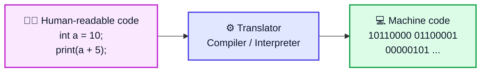

### Low-Level vs High-Level Languages

| | **Low-Level** | **High-Level** |
|---|---|---|
| Closeness to | Hardware | Human language |
| Examples | Machine code, Assembly | Java, Python, C++, JavaScript |
| Readability | Very hard | Easy |
| Speed | Very fast | Slightly slower (needs translation) |
| Portability | Tied to one CPU type | Runs on many machines |

### Compiler vs Interpreter

| | **Compiler** | **Interpreter** |
|---|---|---|
| How it works | Translates the **whole program** at once | Translates & runs **line by line** |
| Errors shown | All at once, before running | One at a time, while running |
| Output | Separate executable file | No separate file |
| Examples | C, C++, Go | Python, JavaScript (traditionally) |

### How Java Does It (Both!)

```java
// Hello.java
public class Hello {
    public static void main(String[] args) {
        System.out.println("Hello World");
    }
}
```

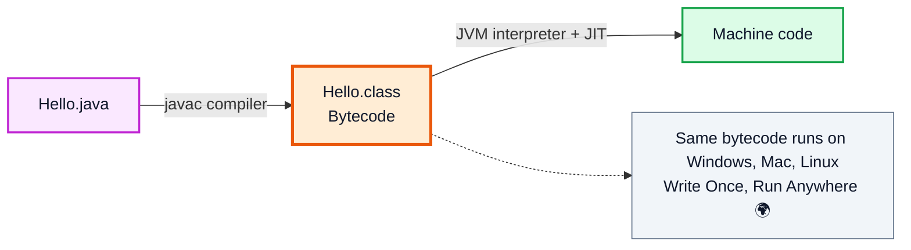

> [!NOTE]
> Java is **compiled** to bytecode, then the **JVM** interprets/JIT-compiles it. This is covered in depth in video #7 (Java Architecture).

---

## 2. Types of Languages (2:51)

Languages are classified by their **paradigm** — the *style* or *way of thinking* used to organize code.

| Paradigm | Core Idea | Analogy (making tea ☕) |
|---|---|---|
| **Procedural** | A sequence of steps | "Boil water → add tea → add milk → pour" |
| **Functional** | Data flows through pure functions | `pour(addMilk(addTea(boil(water))))` |
| **Object-Oriented** | Objects that hold data + behavior | A `TeaMaker` object with `water` and `brew()` |

There are three main paradigms covered in the video:

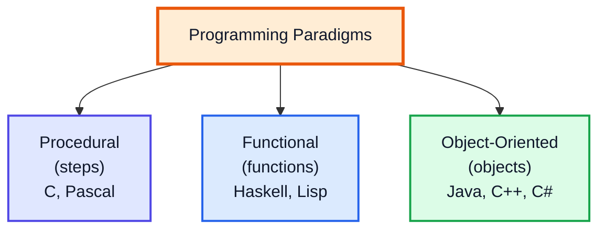

---

## 3. Procedural Language (3:01)

### What is Procedural Programming?

A **procedural** program is a **series of well-structured steps** to complete a task. Code is grouped into **procedures** (also called routines, subroutines, or functions).

- Follows a **top-down** approach
- **Data** and **functions** are kept **separate**
- Supports **reusability** through procedures

**Examples:** C, FORTRAN, Pascal, BASIC

### Example: Student Marks (Procedural Style)

```java
public class ProceduralDemo {

    // Procedure 1: calculate total
    static int calculateTotal(int[] marks) {
        int total = 0;
        for (int m : marks) {
            total += m;
        }
        return total;
    }

    // Procedure 2: calculate average
    static double calculateAverage(int total, int count) {
        return (double) total / count;
    }

    // Procedure 3: decide grade
    static char getGrade(double avg) {
        if (avg >= 90) return 'A';
        if (avg >= 75) return 'B';
        if (avg >= 50) return 'C';
        return 'F';
    }

    public static void main(String[] args) {
        int[] marks = {85, 92, 78};                     // DATA (separate)

        int total = calculateTotal(marks);              // Step 1
        double avg = calculateAverage(total, marks.length); // Step 2
        char grade = getGrade(avg);                     // Step 3

        System.out.println("Total: " + total);          // Total: 255
        System.out.println("Average: " + avg);          // Average: 85.0
        System.out.println("Grade: " + grade);          // Grade: B
    }
}
```

### Execution Flow

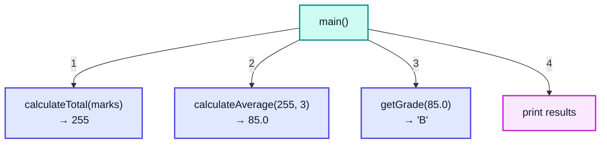

### Pros & Cons

| ✅ Pros | ❌ Cons |
|---|---|
| Simple and easy to follow | Hard to manage as programs grow |
| Fast — little overhead | Data is not protected (any function can change it) |
| Great for small scripts & algorithms | Hard to model real-world entities |

> [!WARNING]
> In large procedural programs, **global data** that any function can modify leads to bugs that are very hard to trace. This is one of the main reasons OOP was invented.

---

## 4. Functional Language (4:38)

### What is Functional Programming?

In **functional programming**, a program is built by **composing pure functions**. It focuses on *what* to compute rather than *how* (step-by-step).

**Examples:** Haskell, Lisp, Scala, Erlang, Clojure, F#. Java supports it since **Java 8** (lambdas, streams).

**Used when:** the same data needs to be processed through many transformations, and in parallel/concurrent systems.

### Key Concept 1: Pure Functions

A **pure function**:
1. Always returns the **same output** for the **same input**
2. Has **no side effects** (doesn't modify anything outside itself)

```java
public class PureDemo {
    // ✅ PURE — depends only on input, changes nothing outside
    static int add(int a, int b) {
        return a + b;
    }

    // ❌ IMPURE — modifies external state (side effect)
    static int total = 0;
    static int addToTotal(int x) {
        total += x;          // changes a variable outside the function
        return total;
    }

    public static void main(String[] args) {
        System.out.println(add(2, 3));        // 5
        System.out.println(add(2, 3));        // 5  ← always the same ✅

        System.out.println(addToTotal(5));    // 5
        System.out.println(addToTotal(5));    // 10 ← same input, different output ❌
    }
}
```

### Key Concept 2: First-Class Functions

Functions are treated like **values** — they can be stored in variables, passed as arguments, and returned from other functions.

```java
import java.util.function.Function;

public class FirstClassDemo {
    public static void main(String[] args) {
        // Function stored in a variable
        Function<Integer, Integer> square = x -> x * x;
        Function<Integer, Integer> addFive = x -> x + 5;

        System.out.println(square.apply(4));     // 16

        // Function composition: first square, then add 5
        Function<Integer, Integer> squareThenAdd = square.andThen(addFive);
        System.out.println(squareThenAdd.apply(4));  // 16 + 5 = 21

        // Passing a function as an argument
        System.out.println(applyTwice(addFive, 10)); // 10 → 15 → 20
    }

    static int applyTwice(Function<Integer, Integer> f, int value) {
        return f.apply(f.apply(value));
    }
}
```

### Key Concept 3: Immutability

In functional style, data is **not modified** — new data is created instead.

```java
import java.util.List;

public class StreamDemo {
    public static void main(String[] args) {
        List<Integer> nums = List.of(1, 2, 3, 4, 5, 6);   // immutable list

        int result = nums.stream()
                .filter(n -> n % 2 == 0)    // [2, 4, 6]
                .map(n -> n * n)            // [4, 16, 36]
                .reduce(0, Integer::sum);   // 56

        System.out.println(result);   // 56
        System.out.println(nums);     // [1, 2, 3, 4, 5, 6]  ← original untouched ✅
    }
}
```

### Procedural vs Functional — Same Task

```java
// Task: sum of squares of even numbers in {1..6}

// PROCEDURAL — tells HOW, step by step, mutating 'sum'
int sum = 0;
for (int n : new int[]{1, 2, 3, 4, 5, 6}) {
    if (n % 2 == 0) {
        sum += n * n;
    }
}

// FUNCTIONAL — tells WHAT, no mutation
int sum2 = List.of(1, 2, 3, 4, 5, 6).stream()
        .filter(n -> n % 2 == 0)
        .map(n -> n * n)
        .reduce(0, Integer::sum);
```

### Pros & Cons

| ✅ Pros | ❌ Cons |
|---|---|
| Easy to test (same input → same output) | Harder to learn at first |
| Safe for multithreading (no shared mutable state) | Creating new data can use more memory |
| Short, expressive code | Not natural for modeling stateful things |

---

## 5. Object Oriented Languages (9:01)

### What is OOP?

**Object-Oriented Programming** organizes code around **objects**. An object combines:
- **Data** (properties / fields / state)
- **Behavior** (methods)

A **class** is the blueprint; an **object** is an instance of that blueprint.

**Examples:** Java, C++, C#, Python, Ruby

### Why OOP Was Needed

```
Procedural (data scattered):            OOP (data + behavior bundled):
──────────────────────────              ───────────────────────────────
String s1Name = "Kunal";                Student s1 = new Student("Kunal", 90);
int s1Marks = 90;                       Student s2 = new Student("Rahul", 35);
String s2Name = "Rahul";
int s2Marks = 35;                       s1.display();
display(s1Name, s1Marks);               s2.hasPassed();
// 1000 students?? 😱                   // Clean and scalable ✅
```

### Example

```java
class Student {
    // ──── Data (properties) ────
    String name;
    int marks;

    // ──── Constructor ────
    Student(String name, int marks) {
        this.name = name;
        this.marks = marks;
    }

    // ──── Behavior (methods) ────
    boolean hasPassed() {
        return marks >= 40;
    }

    void display() {
        System.out.println(name + " → " + marks + (hasPassed() ? " (Pass)" : " (Fail)"));
    }
}

public class Main {
    public static void main(String[] args) {
        Student kunal = new Student("Kunal", 90);
        Student rahul = new Student("Rahul", 35);

        kunal.display();   // Kunal → 90 (Pass)
        rahul.display();   // Rahul → 35 (Fail)
    }
}
```

### The Four Pillars (Preview)

| Pillar | Meaning | Quick Java Example |
|---|---|---|
| **Encapsulation** | Wrap data + methods together, hide internals | `private int marks;` with getter/setter |
| **Abstraction** | Show only essential features | `interface Shape { double area(); }` |
| **Inheritance** | Child class reuses parent class | `class Dog extends Animal` |
| **Polymorphism** | One name, many forms | `animal.sound()` → "Bark" or "Meow" |

```java
class Animal { void sound() { System.out.println("Some sound"); } }
class Dog extends Animal { void sound() { System.out.println("Bark"); } }
class Cat extends Animal { void sound() { System.out.println("Meow"); } }

public class Main {
    public static void main(String[] args) {
        Animal a1 = new Dog();
        Animal a2 = new Cat();
        a1.sound();   // Bark   ← Inheritance + Polymorphism
        a2.sound();   // Meow
    }
}
```

> [!NOTE]
> OOP is covered in full detail from video #37 onwards (see `java_37_video_oops`). Here you only need to know **what** OOP is and **why** it exists.

---

## 6. Different Languages can be of Different Types (14:08)

A language is **not limited to one paradigm**. Most modern languages are **multi-paradigm**.

| Language | Procedural | Functional | OOP |
|---|---|---|---|
| **Java** | ✅ static methods | ✅ lambdas, streams (Java 8+) | ✅ core design |
| **Python** | ✅ | ✅ | ✅ |
| **JavaScript** | ✅ | ✅ | ✅ (prototype-based) |
| **C++** | ✅ | ✅ (lambdas) | ✅ |
| **C** | ✅ | ❌ | ❌ |
| **Haskell** | ❌ | ✅ (purely functional) | ❌ |

### Java Using All Three Paradigms in One Program

```java
import java.util.List;

class Student {
    String name;
    int marks;
    Student(String name, int marks) { this.name = name; this.marks = marks; }
    boolean hasPassed() { return marks >= 40; }
}

public class MultiParadigm {
    public static void main(String[] args) {
        // OOP — objects
        List<Student> students = List.of(
            new Student("A", 80),
            new Student("B", 30),
            new Student("C", 55)
        );

        // FUNCTIONAL — stream + method reference
        long passed = students.stream().filter(Student::hasPassed).count();
        System.out.println("Passed: " + passed);   // Passed: 2

        // PROCEDURAL — step-by-step loop
        int total = 0;
        for (Student s : students) {
            total += s.marks;
        }
        System.out.println("Total: " + total);     // Total: 165
    }
}
```

> [!TIP]
> When someone asks "Is Java OOP or functional?" — the correct answer is: **Java is primarily object-oriented, but it is multi-paradigm** and supports procedural and functional styles too.

---

## 7. Static vs Dynamic Languages (16:20)

This is about **when type checking happens**.

### Comparison Table

| | **Statically Typed** | **Dynamically Typed** |
|---|---|---|
| Type checking | At **compile time** | At **runtime** |
| Declaring type | Required: `int a = 10;` | Not required: `a = 10` |
| Variable can change type? | ❌ No | ✅ Yes |
| Type belongs to | The **variable** | The **value/object** |
| Errors caught | Early, before running | Late, while running |
| Performance | Usually faster (compiler optimizes) | Usually slower |
| Code verbosity | More code | Less code |
| Examples | Java, C, C++, Go, Rust, Kotlin | Python, JavaScript, Ruby, PHP |

### Static: Java

```java
int a = 10;        // a is an int — FOREVER
a = 20;            // ✅ still an int
a = "Kunal";       // ❌ COMPILE ERROR: incompatible types: String cannot be converted to int

String name = "Kunal";
name = 5;          // ❌ COMPILE ERROR
```

### Dynamic: Python

```python
a = 10          # a refers to an int
a = "Kunal"     # ✅ now a refers to a str
a = [1, 2, 3]   # ✅ now a refers to a list
```

### The Key Difference — Where the Type Lives

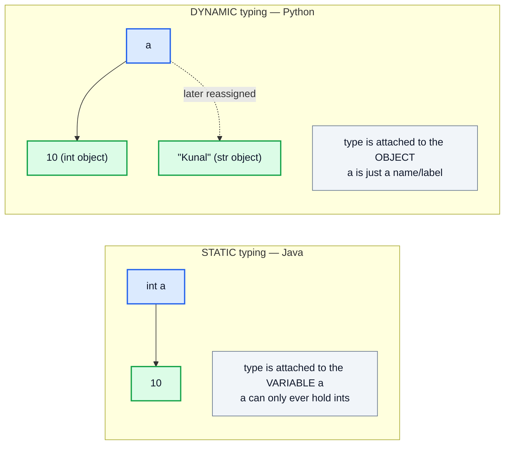

### What About `var` in Java?

```java
var x = 10;        // compiler INFERS x is int
x = 20;            // ✅
x = "hello";       // ❌ COMPILE ERROR — x is still int!
```

> [!IMPORTANT]
> `var` (Java 10+) is just **type inference**, not dynamic typing. The type is still decided and locked at **compile time**. Java remains a **statically typed** language.

### Bonus: Strongly vs Weakly Typed (Different Concept!)

Don't confuse *static/dynamic* with *strong/weak*:

| | Meaning | Example |
|---|---|---|
| **Strongly typed** | No surprising automatic type conversions | Python: `"5" + 5` → ❌ TypeError |
| **Weakly typed** | Silently converts types | JavaScript: `"5" + 5` → `"55"` |

Java is **static + strong**. Python is **dynamic + strong**. JavaScript is **dynamic + weak**.

---

## 8. Error in Dynamic Languages (21:44)

In dynamic languages, type errors are discovered **only when that line actually executes**.

```python
def calculate(flag):
    if flag:
        return "Total: " + 100     # 🐛 Bug: str + int
    return "No calculation"

print(calculate(False))   # ✅ "No calculation" — bug NOT detected!
print(calculate(True))    # 💥 TypeError: can only concatenate str (not "int") to str
```

### Timeline of a Dynamic Language Bug

```mermaid
flowchart LR
    w["Write code"]:::process --> r["Run program"]:::process --> s["Line with bug is SKIPPED"]:::decision --> ship["Ship to users 🚀"]:::startend --> u["User triggers that path"]:::io --> crash["💥 CRASH in production"]:::bad
    classDef process fill:#e0e7ff,stroke:#4f46e5,stroke-width:2px,color:#0f172a
    classDef decision fill:#fef3c7,stroke:#d97706,stroke-width:2px,color:#0f172a
    classDef startend fill:#ccfbf1,stroke:#0d9488,stroke-width:2px,color:#0f172a
    classDef io fill:#fae8ff,stroke:#c026d3,stroke-width:2px,color:#0f172a
    classDef bad fill:#fee2e2,stroke:#dc2626,stroke-width:2px,color:#0f172a
```

| ✅ Advantage | ❌ Disadvantage |
|---|---|
| Faster to write, less boilerplate | Bugs hide until runtime |
| Flexible variables | Needs more testing to be safe |
| Great for scripting & prototypes | IDEs can't help as much with autocomplete/refactoring |

---

## 9. Error in Static Languages (22:53)

In static languages, the **compiler checks all types before the program runs**. If there's a type mismatch anywhere — even in code that would never execute — the program **won't compile**.

```java
public class StaticError {
    static String calculate(boolean flag) {
        if (flag) {
            int total = "Total: " + 100;   // ❌ COMPILE ERROR: String cannot be converted to int
            return "done";
        }
        return "No calculation";
    }

    public static void main(String[] args) {
        System.out.println(calculate(false));
    }
}
// ❌ This program never runs until the bug is fixed —
//    even though flag = false would skip that line.
```

### Timeline of a Static Language Bug

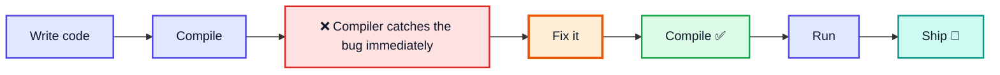

### ⚠️ Static Typing Doesn't Catch Everything

Some errors can only happen at **runtime**, even in Java. These are **exceptions**:

```java
int[] arr = new int[3];
arr[5] = 10;          // 💥 ArrayIndexOutOfBoundsException

int x = 10 / 0;       // 💥 ArithmeticException: / by zero

String s = null;
s.length();           // 💥 NullPointerException

Object o = "hello";
Integer i = (Integer) o;  // 💥 ClassCastException
```

### Compile-Time vs Runtime Errors (Java)

| | **Compile-Time Error** | **Runtime Error (Exception)** |
|---|---|---|
| When | During `javac` | While program runs |
| Cause | Wrong syntax, wrong types | Invalid operations on valid code |
| Example | `int a = "hi";` | `10 / 0`, `null.length()` |
| Program runs? | ❌ No | ✅ Yes, until it crashes |

---

## 10. Stack and Heap Memory (24:48)

When a Java program runs, the JVM divides memory into regions. The two most important are the **Stack** and the **Heap**.

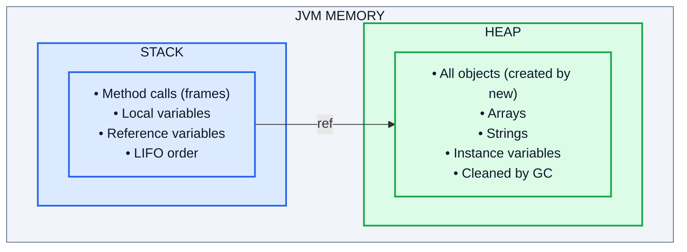

### Stack vs Heap — Comparison

| | **Stack** | **Heap** |
|---|---|---|
| Stores | Method frames, local primitives, reference variables | Objects, arrays, instance variables |
| Order | LIFO (Last In, First Out) | No order |
| Size | Small | Large |
| Speed | Very fast | Slower |
| Lifetime | Freed automatically when method returns | Freed by **Garbage Collector** |
| Shared? | Each thread has its **own** stack | **Shared** by all threads |
| Error when full | `StackOverflowError` | `OutOfMemoryError` |

### Example: What Goes Where

```java
public class MemoryDemo {
    public static void main(String[] args) {
        int age = 21;                       // primitive → STACK (value stored directly)
        double cgpa = 8.5;                  // primitive → STACK
        int[] marks = {90, 80, 70};         // 'marks' ref → STACK, array → HEAP
        String name = new String("Kunal");  // 'name' ref → STACK, String object → HEAP
    }
}
```

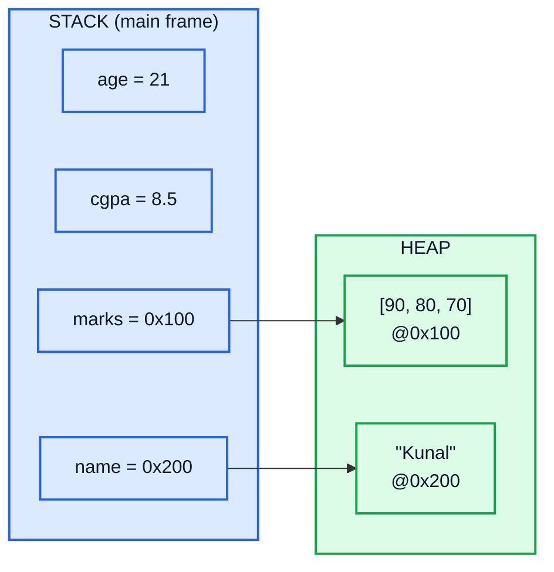

### Stack Frames — How Method Calls Use the Stack

Every time a method is called, a **frame** is pushed onto the stack. When the method returns, its frame is popped.

```java
public class FrameDemo {
    static void c() { int z = 3; System.out.println("in c"); }
    static void b() { int y = 2; c(); }
    static void a() { int x = 1; b(); }

    public static void main(String[] args) {
        a();
    }
}
```

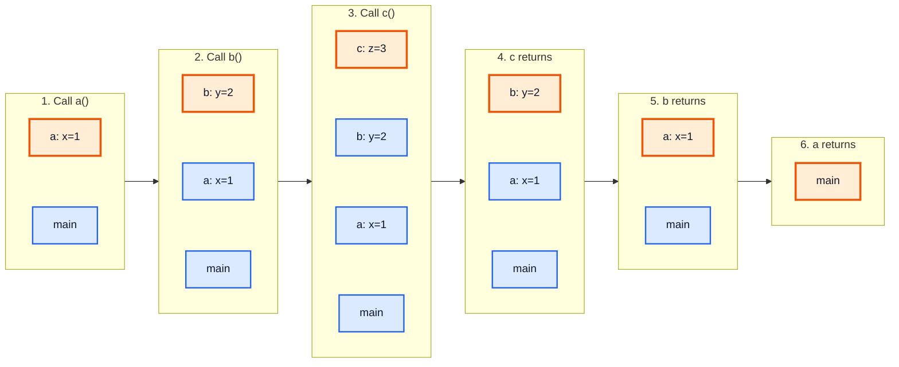

### StackOverflowError

```java
public class Overflow {
    static void infinite() {
        infinite();     // keeps pushing frames forever, never pops
    }
    public static void main(String[] args) {
        infinite();     // 💥 java.lang.StackOverflowError
    }
}
```

> [!NOTE]
> In the video, Kunal explains memory in a general way where **every value is an object in the heap** and the variable is a reference to it (this is exactly how Python works). In **Java specifically**, **local primitive variables** (`int`, `double`, `boolean`, ...) store their **value directly on the stack**. Only **objects** live in the heap.

---

## 11. Objects (Not Primitives!) and Reference Variables (25:11)

### Primitives vs Objects

Java has **8 primitive types** — they are **not objects** and hold the actual value:

| Primitive | Size | Example |
|---|---|---|
| `byte` | 1 byte | `byte b = 10;` |
| `short` | 2 bytes | `short s = 1000;` |
| `int` | 4 bytes | `int i = 42;` |
| `long` | 8 bytes | `long l = 99999L;` |
| `float` | 4 bytes | `float f = 3.14f;` |
| `double` | 8 bytes | `double d = 3.14159;` |
| `char` | 2 bytes | `char c = 'K';` |
| `boolean` | JVM-dependent | `boolean flag = true;` |

**Everything else** — `String`, arrays, `ArrayList`, your own classes — is an **object**, accessed through a **reference variable**.

### What is a Reference Variable?

A **reference variable** does **not** hold the object itself. It holds the **memory address** of the object in the heap.

```java
class Box {
    int value;
}

Box b = new Box();
// │        │
// │        └── new Box() → creates the OBJECT in the HEAP
// └── b → REFERENCE VARIABLE in the STACK, stores the object's ADDRESS

b.value = 5;   // follow the address in 'b' → reach the object → set its field
```

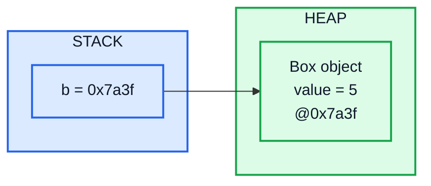

> Think of the reference as a **TV remote** and the object as the **TV**. The remote isn't the TV — it just controls it.

### Copying a Primitive vs Copying a Reference

```java
public class CopyDemo {
    public static void main(String[] args) {
        // ──── PRIMITIVES: the VALUE is copied ────
        int x = 10;
        int y = x;      // y gets its own copy of 10
        y = 50;
        System.out.println(x);  // 10 ← unaffected ✅

        // ──── REFERENCES: the ADDRESS is copied ────
        Box b1 = new Box();
        b1.value = 10;
        Box b2 = b1;    // ⚠️ b2 gets the SAME address — no new object!
        b2.value = 50;
        System.out.println(b1.value);  // 50 ← changed! 😲
    }
}
```

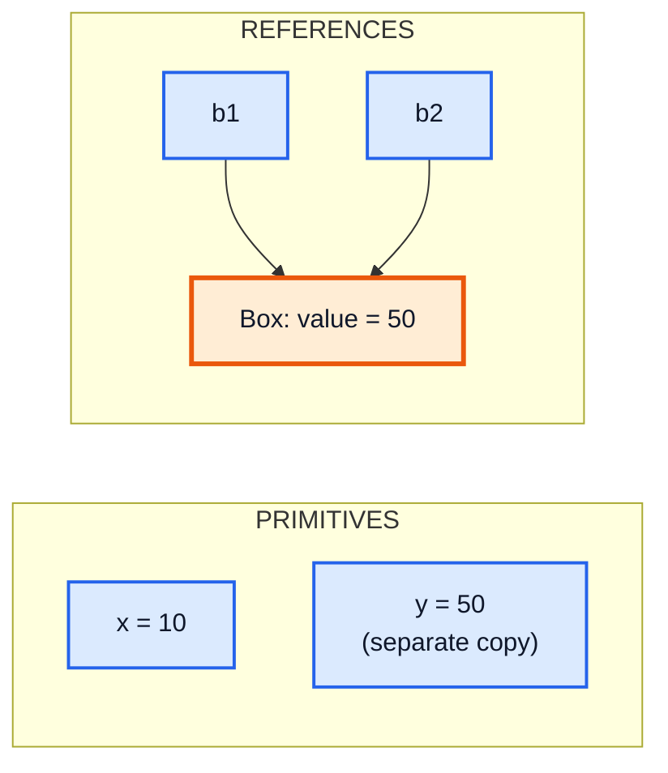

### Null Reference

A reference variable can point to **nothing** — that's `null`.

```java
Box b = null;          // b points to no object
System.out.println(b); // null
b.value = 5;           // 💥 NullPointerException — no object to modify!
```

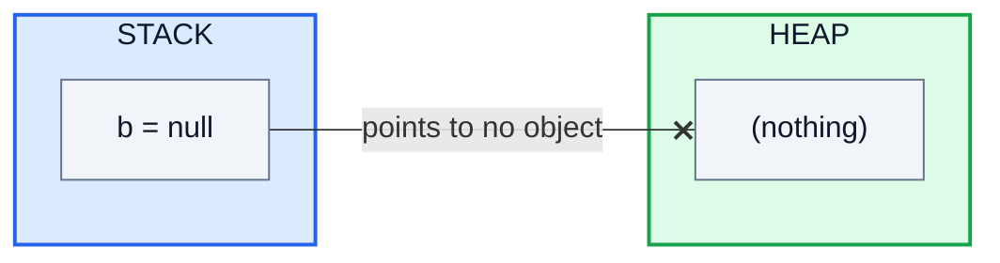

### `==` vs `.equals()` — A Direct Consequence

```java
String s1 = new String("hi");
String s2 = new String("hi");
String s3 = s1;

System.out.println(s1 == s2);       // false → different objects (different addresses)
System.out.println(s1 == s3);       // true  → same object (same address)
System.out.println(s1.equals(s2));  // true  → same CONTENT
```

> [!CAUTION]
> `==` on objects compares **references (addresses)**, not content. Always use `.equals()` to compare the **content** of objects like `String`.

---

## 12. Important Example Memory (27:19)

This is the **most important part** of the video: **multiple reference variables can point to the same object**.

### Example 1: Two References, One Object

```java
import java.util.Arrays;

public class SharedRef {
    public static void main(String[] args) {
        int[] a = {1, 3, 5, 9};
        int[] b = a;              // ⚠️ NOT a copy — b points to the SAME array

        a[0] = 99;                // change through 'a'
        System.out.println(Arrays.toString(b));  // [99, 3, 5, 9] ← 'b' sees it too!
    }
}
```

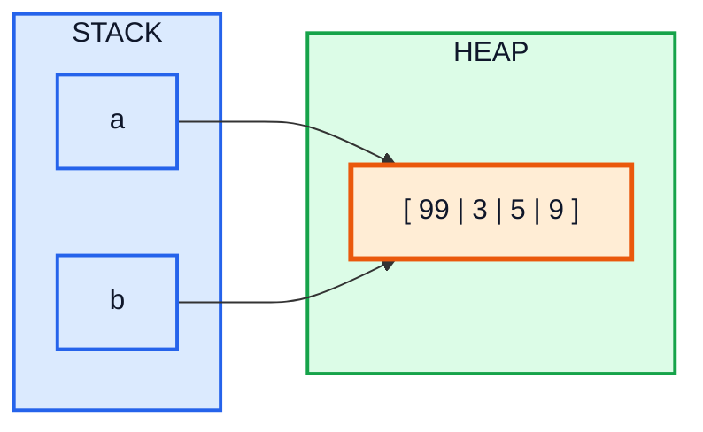

Changing the object through **any** reference is visible through **all** references, because there is only **one** object.

### Example 2: Reassigning a Reference Does NOT Affect the Other

```java
int[] a = {1, 2, 3};
int[] b = a;              // both point to {1, 2, 3}

b = new int[]{7, 8, 9};   // b now points to a NEW object
b[0] = 100;

System.out.println(Arrays.toString(a));  // [1, 2, 3]   ← unaffected ✅
System.out.println(Arrays.toString(b));  // [100, 8, 9]
```

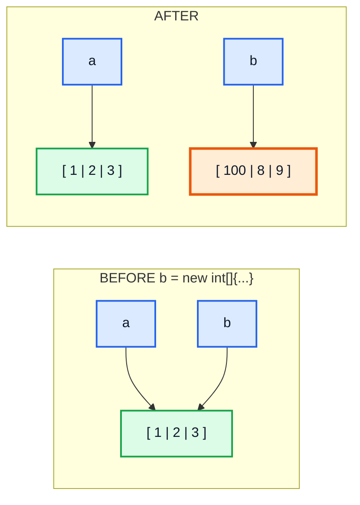

> [!IMPORTANT]
> **Modifying** the object (`b[0] = 100`) affects everyone sharing it.
> **Reassigning** the reference (`b = new ...`) only changes where *that one variable* points.

### Example 3: Passing References to Methods

Java is **always pass-by-value**. For objects, the "value" being passed is a **copy of the reference**.

```java
import java.util.Arrays;

public class PassDemo {
    static void modify(int[] arr) {
        arr[0] = 99;                 // modifies the ORIGINAL object ✅
    }

    static void reassign(int[] arr) {
        arr = new int[]{0, 0, 0};    // only changes the LOCAL copy of the reference
        arr[0] = -1;
    }

    static void changePrimitive(int n) {
        n = 1000;                    // only changes the local copy
    }

    public static void main(String[] args) {
        int[] nums = {1, 2, 3};

        modify(nums);
        System.out.println(Arrays.toString(nums));  // [99, 2, 3]

        reassign(nums);
        System.out.println(Arrays.toString(nums));  // [99, 2, 3] ← unchanged!

        int x = 5;
        changePrimitive(x);
        System.out.println(x);                      // 5
    }
}
```

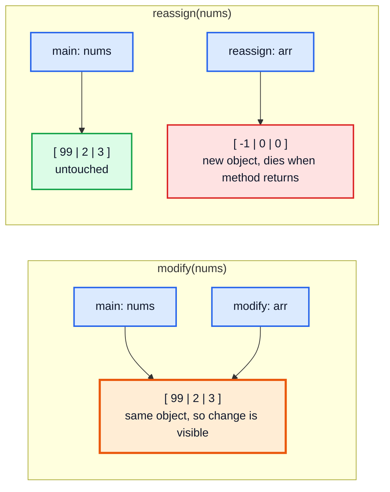

### Example 4: How to Make a REAL Copy

```java
int[] original = {1, 2, 3};

int[] copy1 = original.clone();
int[] copy2 = Arrays.copyOf(original, original.length);

copy1[0] = 99;
System.out.println(Arrays.toString(original));  // [1, 2, 3] ✅ independent
System.out.println(Arrays.toString(copy1));     // [99, 2, 3]
```

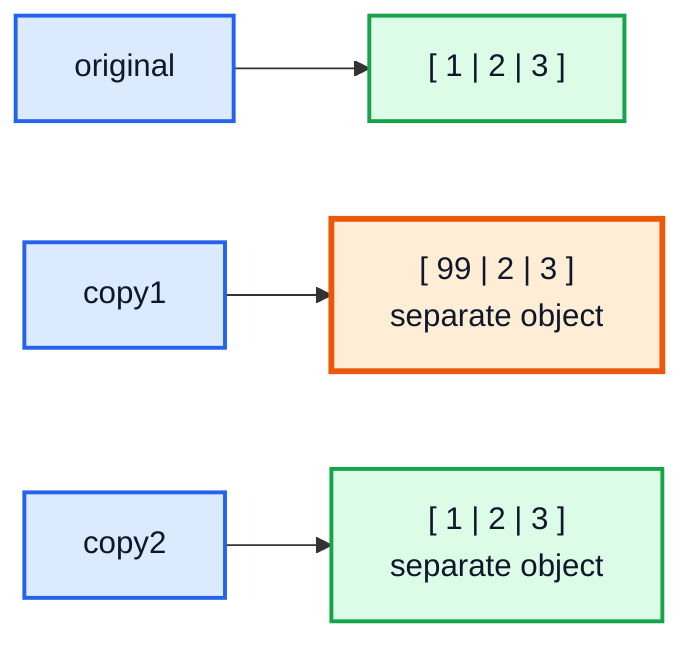

### Example 5: Strings Are Immutable

Strings *look* like they behave differently — because a `String` object can **never be changed**. Any "change" creates a **new** object.

```java
String a = "Kunal";
String b = a;            // both point to "Kunal"

b = b + " Kushwaha";     // creates a NEW String object; b now points to it

System.out.println(a);   // Kunal          ← unaffected
System.out.println(b);   // Kunal Kushwaha
```

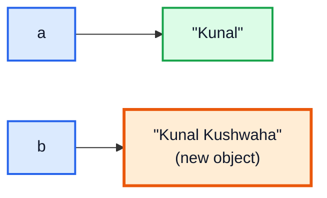

---

## 13. Garbage Collection (33:50)

### What is Garbage Collection?

When an object in the heap has **no reference pointing to it**, the program can never use it again. The **Garbage Collector (GC)** — a background process in the JVM — automatically **finds and deletes** such objects to free memory.

In C/C++ you must free memory manually (`free()` / `delete`). Forgetting causes **memory leaks**. Java does it **automatically**.

### Example From the Video

```java
int[] a = {1, 3, 5, 9};
a = new int[]{6, 7, 8};    // 'a' now points to a new array
```

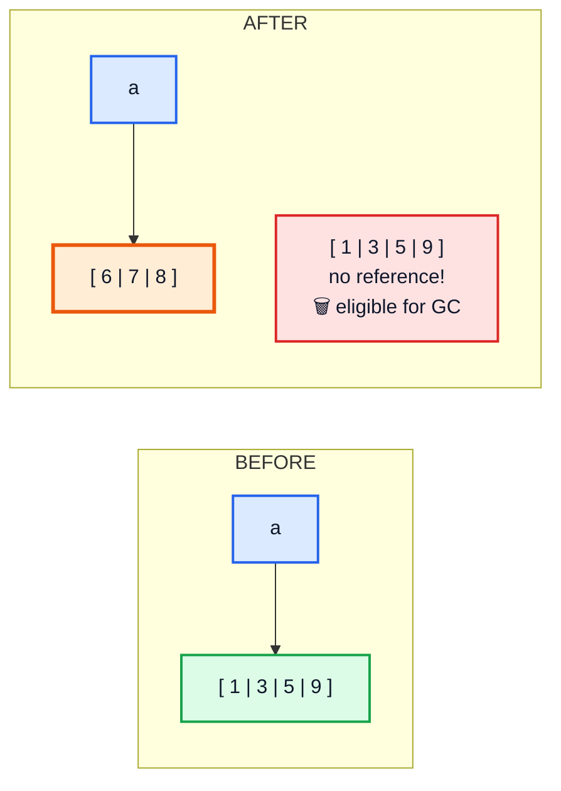

### When Does an Object Become Eligible for GC?

```java
class Box { int value; }

public class GCDemo {
    public static void main(String[] args) {
        // 1. Reference set to null
        Box b1 = new Box();
        b1 = null;                // Box → eligible for GC ✅

        // 2. Reference reassigned
        Box b2 = new Box();
        b2 = new Box();           // first Box → eligible for GC ✅

        // 3. Reference goes out of scope
        createBox();              // Box created inside → eligible after method returns ✅

        // 4. Anonymous object
        new Box();                // never assigned → eligible immediately ✅
    }

    static void createBox() {
        Box temp = new Box();     // 'temp' frame popped when method ends
    }
}
```

### How GC Works (Brief)

| Concept | Description |
|---|---|
| **Mark & Sweep** | GC **marks** every object reachable from the stack/static variables, then **sweeps** (deletes) the unmarked ones |
| **Generational GC** | New objects go to **Young Generation** (most die young, cleaned often); survivors move to **Old Generation** |
| **G1 (Garbage First)** | Default collector since Java 9 |
| **ZGC / Shenandoah** | Low-pause collectors for very large heaps |

### You Cannot Force GC

```java
System.gc();                // Only a REQUEST — the JVM may ignore it
Runtime.getRuntime().gc();  // Same thing
```

### Memory Leaks Can Still Happen in Java!

If you keep references to objects you no longer need, GC **can't** delete them.

```java
import java.util.ArrayList;
import java.util.List;

public class LeakDemo {
    static List<int[]> cache = new ArrayList<>();   // static → lives forever

    public static void main(String[] args) {
        while (true) {
            cache.add(new int[100_000]);   // never removed → 💥 OutOfMemoryError
        }
    }
}
```

> [!TIP]
> GC removes objects that are **unreachable**, not objects that are **unused**. If something still references an object, it stays in memory.

---

## 14. Outro (38:00)

Next video (#6) covers **Flow of Program — Flowcharts & Pseudocode**.

---

## 🧩 Complete Example: Everything Together

One program that uses **every concept** from this video:

```java
import java.util.Arrays;
import java.util.List;
import java.util.function.Function;

// ═══════ OOP: data + behavior bundled in an object ═══════
class Student {
    String name;
    int marks;

    Student(String name, int marks) {
        this.name = name;
        this.marks = marks;
    }

    boolean hasPassed() {
        return marks >= 40;
    }
}

public class Main {

    // ═══════ PROCEDURAL: step-by-step procedure ═══════
    static int sum(int[] arr) {
        int total = 0;
        for (int x : arr) {
            total += x;
        }
        return total;
    }

    // ═══════ REFERENCE PASSING ═══════
    static void modify(int[] a) {
        a[0] = 99;                  // changes the original object
    }

    static void reassign(int[] a) {
        a = new int[]{0, 0, 0};     // only changes local reference
    }

    public static void main(String[] args) {
        // 1. PROCEDURAL
        int[] marks = {80, 35, 90};
        System.out.println("Total (procedural): " + sum(marks));

        // 2. FUNCTIONAL — pure function + stream
        Function<Integer, Integer> doubleIt = x -> x * 2;
        int doubledTotal = List.of(80, 35, 90).stream()
                .map(doubleIt)
                .reduce(0, Integer::sum);
        System.out.println("Total doubled (functional): " + doubledTotal);

        // 3. OOP
        Student s1 = new Student("Kunal", 80);
        Student s2 = new Student("Rahul", 35);
        System.out.println(s1.name + " passed? " + s1.hasPassed());
        System.out.println(s2.name + " passed? " + s2.hasPassed());

        // 4. STATIC TYPING
        int x = 10;
        // x = "ten";               // ❌ compile error — type is fixed
        var y = 20;                 // inferred as int, still static

        // 5. STACK vs HEAP + REFERENCES
        int[] arr1 = {1, 2, 3};     // arr1 (stack) → array (heap)
        int[] arr2 = arr1;          // same object!
        arr2[0] = 50;
        System.out.println("arr1 after arr2[0]=50: " + Arrays.toString(arr1));

        modify(arr1);
        System.out.println("After modify(): " + Arrays.toString(arr1));

        reassign(arr1);
        System.out.println("After reassign(): " + Arrays.toString(arr1));

        // Primitives are copied by value
        int a = 5;
        int b = a;
        b = 100;
        System.out.println("a after b=100: " + a);

        // 6. GARBAGE COLLECTION
        Student temp = new Student("Temp", 0);
        temp = null;                // Student "Temp" is now eligible for GC
        arr2 = new int[]{7, 8, 9};  // arr2 moves away, but arr1 still holds the old array → NOT eligible

        System.out.println("Program complete!");
    }
}
```

**Expected Output:**
```
Total (procedural): 205
Total doubled (functional): 410
Kunal passed? true
Rahul passed? false
arr1 after arr2[0]=50: [50, 2, 3]
After modify(): [99, 2, 3]
After reassign(): [99, 2, 3]
a after b=100: 5
Program complete!
```

---

## Quick Reference Cheat Sheet

| Concept | One-Line Summary |
|---|---|
| **Programming Language** | Human-readable instructions translated into machine code |
| **Compiler vs Interpreter** | Whole program at once vs line by line; Java uses both (javac + JVM) |
| **Procedural** | Program = sequence of steps grouped into procedures (C, Pascal) |
| **Functional** | Program = pure functions with no side effects; functions are values (Haskell) |
| **Object-Oriented** | Program = objects bundling data + behavior (Java, C++) |
| **Multi-paradigm** | One language supports several styles — Java does all three |
| **Static Typing** | Types checked at compile time; variable's type is fixed (Java) |
| **Dynamic Typing** | Types checked at runtime; variable can hold any type (Python) |
| **Errors in Dynamic** | Show up only when that line runs — can reach production |
| **Errors in Static** | Caught by compiler before the program runs |
| **Stack** | Method frames, local primitives, reference variables; LIFO; auto-freed |
| **Heap** | All objects & arrays; shared; cleaned by GC |
| **Reference Variable** | Holds the address of an object, not the object itself |
| **`b = a` (objects)** | Copies the reference → both point to the SAME object |
| **Modify vs Reassign** | Modifying affects all references; reassigning affects only that variable |
| **Pass-by-value** | Java always passes copies — for objects, a copy of the reference |
| **`==` vs `.equals()`** | Compares addresses vs compares content |
| **Garbage Collection** | JVM automatically deletes objects with no references; can't be forced |
