# Flow of Program: Flowcharts & Pseudocode — Complete In-Depth Guide

**Video #6 of the Java + DSA playlist:** *Flow of Program - Flowcharts & Pseudocode* (26:44)

How to think through a problem **before** writing code: drawing the flow of a program as a **flowchart**, turning it into **pseudocode**, and then into **Java**. It covers conditions, loops, and checking whether a number is prime, first the simple way and then the optimised √n way.

---

## Table of Contents

| # | Topic | Timestamp |
|---|---|---|
| 0 | [Introduction](#0-introduction-000) | 0:00 |
| 1 | [Flowchart Symbols](#1-flowchart-symbols-044) | 0:44 |
| 2 | [Start/Stop](#2-startstop-057) | 0:57 |
| 3 | [Input/Output](#3-inputoutput-100) | 1:00 |
| 4 | [Processing](#4-processing-112) | 1:12 |
| 5 | [Conditions](#5-conditions-122) | 1:22 |
| 6 | [What are Flowcharts?](#6-what-are-flowcharts-212) | 2:12 |
| 7 | [Question-1 using Flowchart](#7-question-1-using-flowchart-313) | 3:13 |
| 8 | [Question-2 using Flowchart](#8-question-2-using-flowchart-413) | 4:13 |
| 9 | [Question-3 using Flowchart](#9-question-3-using-flowchart-540) | 5:40 |
| 10 | [What is Pseudocode](#10-what-is-pseudocode-1155) | 11:55 |
| 11 | [Pseudocode of Question-3](#11-pseudocode-of-question-3-1259) | 12:59 |
| 12 | [Pseudocode of Question-2](#12-pseudocode-of-question-2-1535) | 15:35 |
| 13 | [More Explanation of Question-3](#13-more-explanation-of-question-3-1713) | 17:13 |
| 14 | [Optimised Prime Solution](#14-optimised-prime-solution-2200) | 22:00 |
| 15 | [Outro](#15-outro-2644) | 26:44 |

---

## 0. Introduction (0:00)

A program runs as a **flow**: it starts, takes input, does some work, makes decisions, maybe repeats steps, and stops. Before you write code for a problem, it helps to **lay that flow out** where you can see it.

This video gives you two tools for that:

1. **Flowcharts**: a *visual* map of the logic
2. **Pseudocode**: a *text* version of the logic, written without any language's syntax

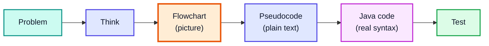

> [!IMPORTANT]
> Interviewers care more about your **approach** than your syntax. Being able to explain the flow (in a diagram or in pseudocode) before you code is a skill you will use for every DSA problem in this course.

---

## 1. Flowchart Symbols (0:44)

A flowchart is made of a few **standard shapes** joined by **arrows**. Each shape has one fixed meaning, so anyone can read your flowchart.

| Symbol | Shape | Meaning | Example |
|---|---|---|---|
| **Terminator** | Oval / rounded box | Start or end of the program | `Start`, `Stop` |
| **Input / Output** | Parallelogram | Read data in, or print data out | `Input num`, `Print "Hello"` |
| **Process** | Rectangle | Calculation or assignment | `sum = a + b`, `c = c + 1` |
| **Decision** | Diamond | A yes/no question that splits the flow | `num > 0 ?` |
| **Flow line** | Arrow | Direction the program moves in | `──▶` |
| **Connector** | Small circle | Joins parts of a large chart (optional) | `(A)` |

How the shapes are drawn in these notes:

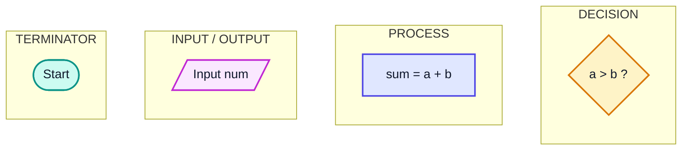

> [!NOTE]
> The shapes are a convention, not a rule enforced by any tool. What matters is that you stay consistent so the reader instantly knows "this is a decision" or "this is input".

---

## 2. Start/Stop (0:57)

The **oval (terminator)** marks where the program **begins** and where it **ends**.

- Every flowchart has **exactly one Start**.
- It can have **one or more Stop** points (for example, an early exit when an answer is found).
- Nothing flows *into* Start, and nothing flows *out of* Stop.

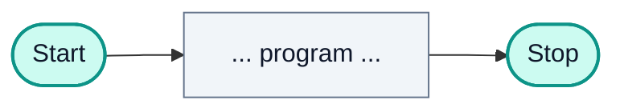

In Java, **Start** is entering `main()` and **Stop** is `main()` finishing (or a `return` from it).

```java
public class StartStop {
    public static void main(String[] args) {   // ◀── Start
        System.out.println("Running...");
    }                                          // ◀── Stop
}
// Output:
// Running...
```

---

## 3. Input/Output (1:00)

The **parallelogram** is used for anything that moves data **into** or **out of** the program.

| | Input | Output |
|---|---|---|
| Direction | Outside world ──▶ program | Program ──▶ outside world |
| Flowchart text | `Input num`, `Read name` | `Print sum`, `Output "Prime"` |
| Java | `Scanner.nextInt()`, `nextLine()` | `System.out.println(...)` |

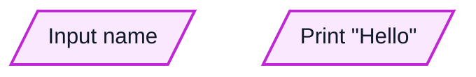

```java
import java.util.Scanner;

public class InputOutput {
    public static void main(String[] args) {
        Scanner in = new Scanner(System.in);
        int age = in.nextInt();                  // INPUT  (parallelogram)
        System.out.println("Age: " + age);       // OUTPUT (parallelogram)
    }
}
// Input:  21
// Output: Age: 21
```

---

## 4. Processing (1:12)

The **rectangle** is for **work done inside the program**: arithmetic, assignments, updating a counter. No decision is made here; the flow just goes in and comes out.

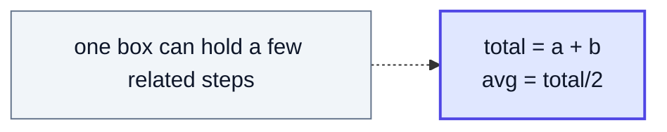

```java
int a = 10, b = 20;
int total = a + b;          // process
double avg = total / 2.0;   // process
System.out.println(avg);    // 15.0
```

> [!TIP]
> Keep process boxes small and specific. "Calculate result" tells the reader nothing; "result = price * qty" is clear.

---

## 5. Conditions (1:22)

The **diamond** asks a question whose answer is **Yes or No** (true or false). It is the only symbol with **two exits**, so it is where the flow **branches**.

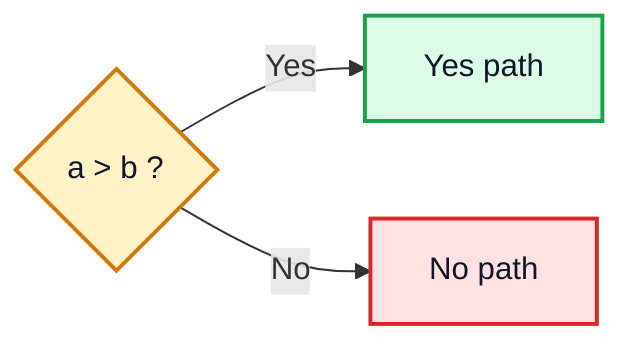

A diamond is used in two ways:

| Use | What happens | Java equivalent |
|---|---|---|
| **Branching** | Pick one of two paths, then continue | `if / else` |
| **Looping** | One path loops **back up** to an earlier step | `while`, `for` |

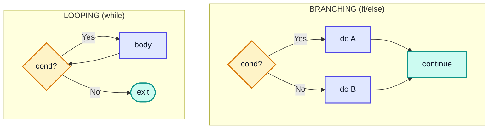

```java
int a = 7, b = 4;

// Branching
if (a > b) {
    System.out.println("a is bigger");     // a is bigger
} else {
    System.out.println("b is bigger");
}

// Looping: the diamond is checked again after every pass
int i = 1;
while (i <= 3) {
    System.out.println("i = " + i);        // i = 1, i = 2, i = 3
    i++;
}
```

> [!NOTE]
> The condition must be something that can only be true or false. In Java that means a `boolean` expression: `a > b`, `x % 2 == 0`, `flag`. Java will not accept `if (x)` for an `int x` the way C does.

---

## 6. What are Flowcharts? (2:12)

A **flowchart** is a diagram of an **algorithm**: the steps to solve a problem, in order, with the decisions and repetitions shown as arrows.

### Why bother drawing one?

| Benefit | Explanation |
|---|---|
| **Clarity** | You see the whole logic at once, including every branch |
| **Language-independent** | Same chart works for Java, C++, Python |
| **Finds bugs early** | Missing cases (like "what if num is 1?") show up as missing arrows |
| **Communication** | Easy to explain to a teammate or interviewer |
| **Easy translation** | Each shape maps directly to a line of code |

### The three building blocks of any flow

Every algorithm, however complex, is built from just three patterns:

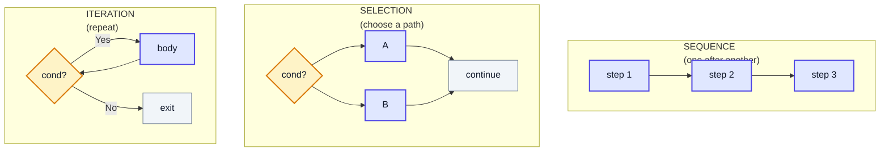

### Shape → Java mapping

| Flowchart | Java |
|---|---|
| Oval: Start / Stop | `main()` begins / ends, `return` |
| Parallelogram: Input | `scanner.nextInt()` etc. |
| Parallelogram: Output | `System.out.println()` |
| Rectangle: Process | assignment / arithmetic statements |
| Diamond with two forward exits | `if / else` |
| Diamond with an arrow going back up | `while` / `for` loop |

> [!WARNING]
> Flowcharts get messy quickly for large programs. They are best for understanding **small algorithms** and **tricky logic**. For bigger programs, pseudocode (section 10) scales much better.

---

## 7. Question-1 using Flowchart (3:13)

**Problem:** Take a name as input and print `Hello <name>`.

This is pure **sequence**: no decisions, no loops.

### Flowchart

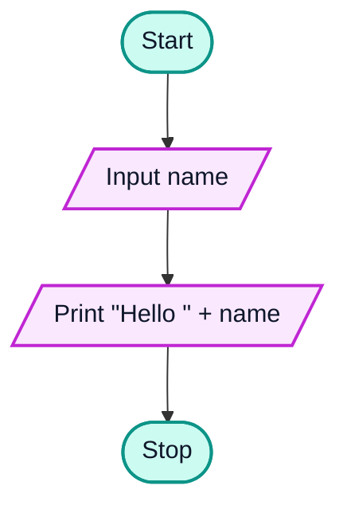

### Java

```java
import java.util.Scanner;

public class Greeting {
    public static void main(String[] args) {           // Start
        Scanner in = new Scanner(System.in);
        String name = in.nextLine();                    // Input name
        System.out.println("Hello " + name);            // Print "Hello " + name
    }                                                   // Stop
}
// Input:  Kunal
// Output: Hello Kunal
```

> [!TIP]
> Use `nextLine()` for names so that a full name like `Kunal Kushwaha` is read completely. `next()` stops at the first space and would read only `Kunal`.

---

## 8. Question-2 using Flowchart (4:13)

**Problem:** Take a salary as input. If salary > 10000, add a bonus of 2000; otherwise add 1000. Print the final salary.

This adds **selection** (a decision).

### Flowchart

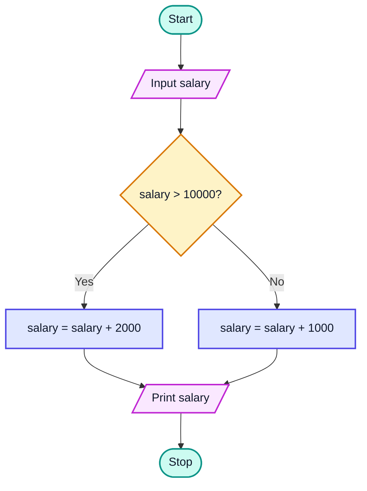

Notice that both branches **join back together** before the output. The print step happens no matter which branch ran, so it is drawn only once.

### Dry Run

| Input | `salary > 10000`? | Branch | Output |
|---|---|---|---|
| 8000 | false | +1000 | 9000 |
| 15000 | true | +2000 | 17000 |
| 10000 | **false** (not greater) | +1000 | 11000 |

> [!CAUTION]
> Boundary values trip people up. `10000 > 10000` is **false**, so exactly 10000 gets the smaller bonus. Always test the exact boundary value of a condition.

### Java

```java
import java.util.Scanner;

public class SalaryBonus {
    public static void main(String[] args) {
        Scanner in = new Scanner(System.in);
        int salary = in.nextInt();             // Input salary

        if (salary > 10000) {                  // Decision
            salary = salary + 2000;            // Yes branch
        } else {
            salary = salary + 1000;            // No branch
        }

        System.out.println(salary);            // Print salary (after branches join)
    }
}
// Input:  15000
// Output: 17000
```

The same logic can be written with the ternary operator, since it just picks one of two values:

```java
int bonus = (salary > 10000) ? 2000 : 1000;
salary += bonus;
```

---

## 9. Question-3 using Flowchart (5:40)

**Problem:** Take a number as input and print whether it is **prime**.

### What is a prime number?

A **prime** is a number **greater than 1** whose only divisors are **1 and itself**.

| Number | Divisors | Prime? |
|---|---|---|
| 1 | 1 | ❌ (must be > 1) |
| 2 | 1, 2 | ✅ (the only even prime) |
| 7 | 1, 7 | ✅ |
| 9 | 1, 3, 9 | ❌ |
| 12 | 1, 2, 3, 4, 6, 12 | ❌ |
| 13 | 1, 13 | ✅ |

### The idea

To check `num`, try every candidate divisor `c` from `2` up to `num - 1`.

- If any `c` divides `num` exactly (`num % c == 0`), `num` is **not prime**: stop immediately.
- If the loop reaches `c == num` without finding a divisor, `num` **is prime**.

This needs **iteration** (a loop) *and* **selection** (decisions).

### Flowchart

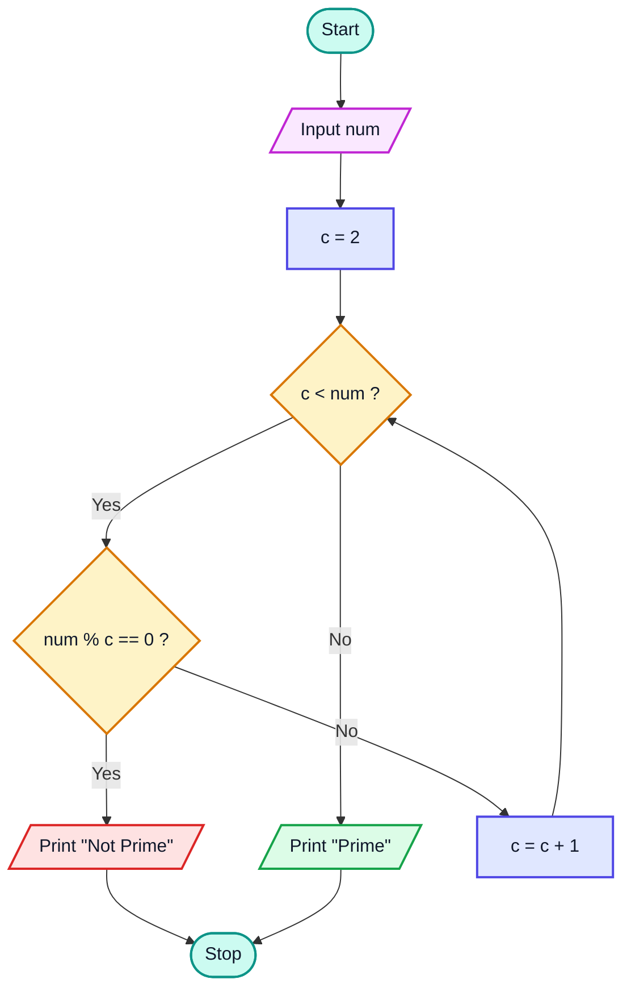

Reading it in words:

1. Read `num`, set `c = 2`.
2. **Loop diamond:** is `c < num`? If **No**, no divisor was found → print **Prime** → Stop.
3. If **Yes**, **divisor diamond:** does `c` divide `num`? If **Yes** → print **Not Prime** → Stop (early exit).
4. If **No**, increment `c` and go back to step 2.

> [!IMPORTANT]
> This flowchart has **two Stop paths**: an early stop as soon as a divisor is found, and a normal stop after the loop finishes. Exiting as soon as the answer is known is a key habit for efficient code.

### Java (first version, mirrors the flowchart)

```java
import java.util.Scanner;

public class PrimeBasic {
    public static void main(String[] args) {
        Scanner in = new Scanner(System.in);
        int num = in.nextInt();

        int c = 2;
        while (c < num) {
            if (num % c == 0) {
                System.out.println("Not Prime");
                return;                    // early Stop
            }
            c++;
        }
        System.out.println("Prime");       // normal Stop
    }
}
// Input: 13   Output: Prime
// Input: 12   Output: Not Prime
```

> [!WARNING]
> As drawn, this flowchart prints **Prime** for `num = 1` (and for 0 or negatives) because the loop never runs. That is wrong. Section 13 adds the missing `num <= 1` check.

---

## 10. What is Pseudocode (11:55)

**Pseudocode** is a step-by-step description of an algorithm written in **plain English mixed with programming-style structure**, with no real language's syntax.

- No semicolons, no types, no imports, no `public static void main`.
- Uses familiar keywords: `input`, `print`, `if`, `else`, `while`, `for`, `end`.
- Indentation shows what belongs inside an `if` or a loop.

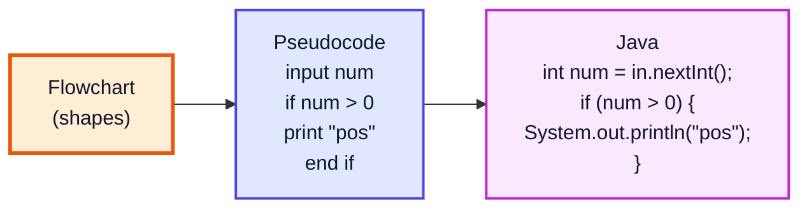

### Flowchart vs Pseudocode vs Code

| | Flowchart | Pseudocode | Java code |
|---|---|---|---|
| Form | Diagram | Structured text | Exact syntax |
| Runs on a computer? | ❌ | ❌ | ✅ |
| Speed to write | Slow (drawing) | Fast | Medium |
| Scales to big logic | Poorly | Well | Well |
| Syntax rules | Symbol conventions | Loose, readable | Strict, compiler-checked |
| Best for | Visualising branches & loops | Planning, interviews, whiteboards | Running the solution |

### Common pseudocode conventions

| Construct | Pseudocode |
|---|---|
| Input / output | `input x` / `print x` |
| Assignment | `x = 5` or `x ← 5` |
| Condition | `if cond ... else ... end if` |
| While loop | `while cond ... end while` |
| For loop | `for i = 1 to n ... end for` |
| Exit early | `exit` / `stop` / `return` |

> [!TIP]
> There is no single "correct" pseudocode format. The goal is that any programmer could read it and write the code in their own language. In interviews, writing quick pseudocode first shows the interviewer your plan before you get lost in syntax.

---

## 11. Pseudocode of Question-3 (12:59)

Converting the prime flowchart into pseudocode is mechanical: walk the shapes top to bottom.

```
start
    input num
    c = 2
    while c < num
        if num % c == 0
            print "Not Prime"
            exit
        end if
        c = c + 1
    end while
    print "Prime"
stop
```

### Shape-by-shape mapping

| Flowchart shape | Pseudocode line |
|---|---|
| Oval `Start` | `start` |
| Parallelogram `Input num` | `input num` |
| Rectangle `c = 2` | `c = 2` |
| Diamond `c < num?` with back-arrow | `while c < num ... end while` |
| Diamond `num % c == 0?` | `if num % c == 0 ... end if` |
| Parallelogram `Print "Not Prime"` + Stop | `print "Not Prime"` + `exit` |
| Rectangle `c = c + 1` | `c = c + 1` |
| Parallelogram `Print "Prime"` | `print "Prime"` |

### An alternative style: loop, then decide

Instead of exiting from inside the loop, you can let the loop stop **early** and then check **why** it stopped:

```
start
    input num
    c = 2
    while c < num
        if num % c == 0
            break
        end if
        c = c + 1
    end while
    if c == num
        print "Prime"
    else
        print "Not Prime"
    end if
stop
```

If the loop ran all the way, `c` ends up equal to `num` → prime. If it broke out early, `c` is a divisor smaller than `num` → not prime.

---

## 12. Pseudocode of Question-2 (15:35)

The salary flowchart has one diamond with two branches that join again:

```
start
    input salary
    if salary > 10000
        salary = salary + 2000
    else
        salary = salary + 1000
    end if
    print salary
stop
```

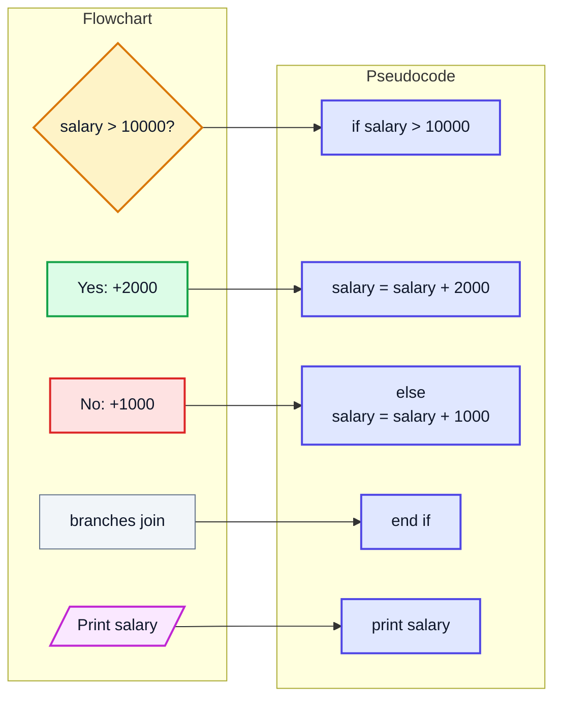

> [!NOTE]
> `print salary` is **outside** the `if/else` (not indented). That matches the flowchart, where both arrows merge before the print. Putting the print inside both branches would also work but duplicates code.

And for completeness, Question-1:

```
start
    input name
    print "Hello " + name
stop
```

---

## 13. More Explanation of Question-3 (17:13)

### Why start `c` at 2 and stop before `num`?

- **Every** number is divisible by **1** and by **itself**, so testing those tells you nothing.
- The useful candidates are exactly `2, 3, ..., num - 1`.

### Dry run: `num = 7` (prime)

| c | `c < 7`? | `7 % c` | Action |
|---|---|---|---|
| 2 | ✅ | 1 | c = 3 |
| 3 | ✅ | 1 | c = 4 |
| 4 | ✅ | 3 | c = 5 |
| 5 | ✅ | 2 | c = 6 |
| 6 | ✅ | 1 | c = 7 |
| 7 | ❌ | — | loop ends, `c == num` → **Prime** |

### Dry run: `num = 9` (not prime)

| c | `c < 9`? | `9 % c` | Action |
|---|---|---|---|
| 2 | ✅ | 1 | c = 3 |
| 3 | ✅ | **0** | divisor found → **Not Prime**, stop |

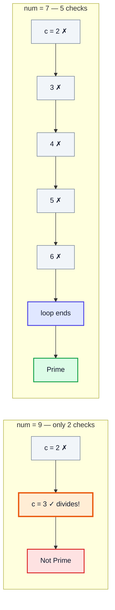

> [!NOTE]
> Composite numbers usually exit quickly (most have a small divisor like 2 or 3). **Primes are the worst case**: the loop must try every candidate before it can say "Prime".

### The missing edge cases

| Input | What the basic version does | Correct answer |
|---|---|---|
| `num = 1` | Loop never runs → "Prime" | Not prime |
| `num = 0` | Loop never runs → "Prime" | Not prime |
| `num = -5` | Loop never runs → "Prime" | Not prime |
| `num = 2` | Loop never runs → "Prime" | Prime ✅ (correct by luck) |

Fix: handle `num <= 1` **before** the loop.

```
start
    input num
    if num <= 1
        print "Not Prime"
        exit
    end if
    c = 2
    while c < num
        if num % c == 0
            print "Not Prime"
            exit
        end if
        c = c + 1
    end while
    print "Prime"
stop
```

### Java: as a reusable method

Putting the check in a method that **returns a boolean** is cleaner than printing from inside the loop: `return` gives you the early exit for free.

```java
public class PrimeMethod {

    static boolean isPrime(int num) {
        if (num <= 1) {
            return false;              // 0, 1, negatives
        }
        int c = 2;
        while (c < num) {
            if (num % c == 0) {
                return false;          // divisor found: early exit
            }
            c++;
        }
        return true;                   // no divisor in [2, num-1]
    }

    public static void main(String[] args) {
        System.out.println(isPrime(1));    // false
        System.out.println(isPrime(2));    // true
        System.out.println(isPrime(7));    // true
        System.out.println(isPrime(9));    // false
    }
}
```

### How much work does it do?

For a prime `num`, the loop body runs `num - 2` times. So the number of steps grows **linearly** with `num`:

```
   num          checks (worst case)
   ───          ───────────────────
   100          98
   10,000       9,998
   1,000,000    999,998
   10^9         ~10^9   ◀── roughly a second or more of pure looping
```

That is **O(n)** time. The next section cuts it down massively.

---

## 14. Optimised Prime Solution (22:00)

### The key observation: divisors come in pairs

If `c` divides `n`, then `n / c` also divides `n`, and `c × (n / c) = n`. List the pairs for `n = 36`:

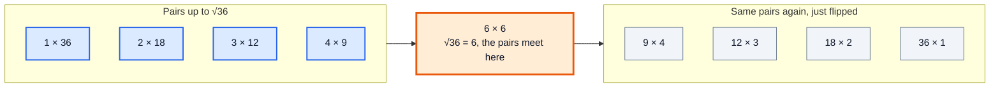

In every pair `a × b = n`, **at least one of `a`, `b` is ≤ √n**. They can't both be bigger, because then `a × b > √n × √n = n`.

So:

> If `n` has **any** divisor other than 1 and itself, it has one that is **≤ √n**.
> If nothing in `2 .. √n` divides `n`, then nothing above √n can either (its partner would have been found already). So `n` is prime.

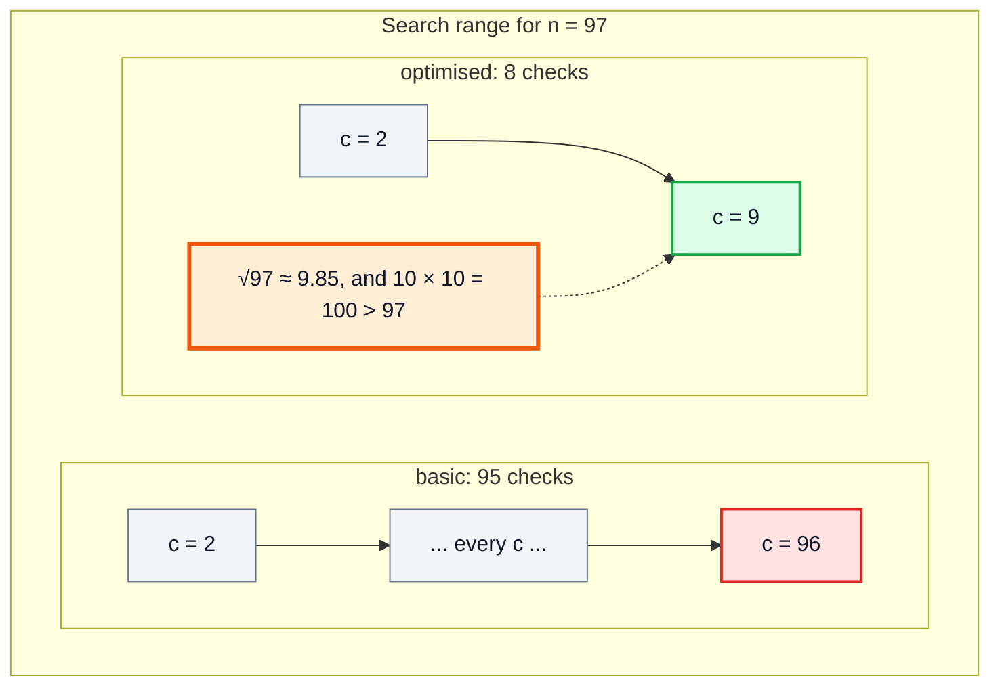

### Why `c * c <= n` instead of `c <= Math.sqrt(n)`

Both express "c is at most √n", but `c * c <= n`:

- avoids calling `Math.sqrt` (floating-point) in the loop,
- has no rounding issues, since it uses only integers.

Note the `<=`: for perfect squares like `25 = 5 × 5`, the divisor is exactly √n, so it must be checked.

| n | `c` values checked | Divisor found? | Result |
|---|---|---|---|
| 25 | 2, 3, 4, **5** | 5 (5×5 = 25) | Not Prime |
| 29 | 2, 3, 4, 5 (6×6 = 36 > 29, stop) | none | Prime |
| 49 | 2 … **7** | 7 | Not Prime |

> [!CAUTION]
> Writing `c * c < n` (strict) is a classic bug: it calls 25, 49 and every other square of a prime "prime".

### Pseudocode

```
start
    input num
    if num <= 1
        print "Not Prime"
        exit
    end if
    c = 2
    while c * c <= num
        if num % c == 0
            print "Not Prime"
            exit
        end if
        c = c + 1
    end while
    print "Prime"
stop
```

The only change from the basic version is the loop condition: `c < num` became `c * c <= num`.

### Java

```java
public class PrimeOptimised {

    static boolean isPrime(int n) {
        if (n <= 1) {
            return false;
        }
        long c = 2;                       // long so c*c can't overflow
        while (c * c <= n) {
            if (n % c == 0) {
                return false;
            }
            c++;
        }
        return true;
    }

    public static void main(String[] args) {
        System.out.println(isPrime(25));           // false
        System.out.println(isPrime(29));           // true
        System.out.println(isPrime(97));           // true
        System.out.println(isPrime(1_000_003));    // true  (only ~1000 checks)
        System.out.println(isPrime(2_147_483_647));// true  (Integer.MAX_VALUE is prime)
    }
}
```

> [!WARNING]
> If `c` is an `int`, `c * c` can **overflow** for `n` close to `Integer.MAX_VALUE` (2,147,483,647). Near the end of the loop `c` reaches 46,341, and `46341 * 46341` exceeds the `int` range and wraps to a negative number, which is "≤ n", so the loop would keep going with wrong results. Use a `long` counter, or write the condition as `c <= n / c`.

### Time complexity: O(n) vs O(√n)

| | Basic | Optimised |
|---|---|---|
| Loop condition | `c < n` | `c * c <= n` |
| Worst-case checks | about n | about √n |
| Time complexity | **O(n)** | **O(√n)** |
| Extra space | O(1) | O(1) |

```
   n                 O(n) checks        O(√n) checks
   ─────────────     ─────────────      ────────────
   100               ~100               ~10
   10,000            ~10,000            ~100
   1,000,000         ~1,000,000         ~1,000
   1,000,000,000     ~1,000,000,000     ~31,623
```

For a billion, that is about **30,000× less work**.

> [!TIP]
> **Related idea (beyond the video):** after checking 2, you can skip all even `c` (`c += 2` starting from 3), halving the work again. That is still O(√n), just with a smaller constant. To find **all** primes up to n, the **Sieve of Eratosthenes** is far faster than calling `isPrime` on each number; it is covered later in the course in the maths-for-DSA videos.

---

## 15. Outro (26:44)

You now have a repeatable process: **flowchart → pseudocode → code → dry run → optimise**. The next video (#7) looks at **Java architecture** and installing Java, after which these flowcharts become real programs.

---

## 🧩 Complete Example: Everything Together

One program covering all three questions, the basic vs optimised prime check (with a counter showing how many checks each one does), and the boundary cases. Inputs are hard-coded so the output is predictable.

```java
public class Main {

    // ═══════ Question 1: sequence ═══════
    static String greet(String name) {
        return "Hello " + name;
    }

    // ═══════ Question 2: selection (if / else) ═══════
    static int applyBonus(int salary) {
        if (salary > 10000) {
            salary = salary + 2000;
        } else {
            salary = salary + 1000;
        }
        return salary;
    }

    // Counters so we can SEE how many loop checks each version does
    static long naiveChecks = 0;
    static long fastChecks = 0;

    // ═══════ Question 3: iteration + selection, O(n) ═══════
    static boolean isPrimeNaive(int n) {
        if (n <= 1) return false;
        int c = 2;
        while (c < n) {
            naiveChecks++;
            if (n % c == 0) return false;
            c++;
        }
        return true;
    }

    // ═══════ Optimised: only up to sqrt(n), O(√n) ═══════
    static boolean isPrime(int n) {
        if (n <= 1) return false;
        long c = 2;
        while (c * c <= n) {
            fastChecks++;
            if (n % c == 0) return false;
            c++;
        }
        return true;
    }

    public static void main(String[] args) {
        // 1. Greeting
        System.out.println(greet("Kunal"));

        // 2. Salary bonus, including the boundary 10000
        int[] salaries = {8000, 15000, 10000};
        for (int s : salaries) {
            System.out.println("Salary " + s + " -> " + applyBonus(s));
        }

        // 3. Prime checks: basic vs optimised
        int[] nums = {1, 2, 9, 17, 25, 97, 1_000_003};
        for (int n : nums) {
            naiveChecks = 0;
            fastChecks = 0;
            boolean slow = isPrimeNaive(n);
            boolean fast = isPrime(n);
            String verdict = fast ? "prime" : "not prime";
            String agree = (slow == fast) ? "" : "  <-- MISMATCH";
            System.out.println(n + " -> " + verdict
                    + " | naive checks: " + naiveChecks
                    + " | sqrt checks: " + fastChecks + agree);
        }

        // 4. All primes up to 30 using the optimised check
        StringBuilder sb = new StringBuilder();
        for (int i = 1; i <= 30; i++) {
            if (isPrime(i)) {
                sb.append(i).append(' ');
            }
        }
        System.out.println("Primes up to 30: " + sb.toString().trim());
    }
}
```

**Expected Output:**
```
Hello Kunal
Salary 8000 -> 9000
Salary 15000 -> 17000
Salary 10000 -> 11000
1 -> not prime | naive checks: 0 | sqrt checks: 0
2 -> prime | naive checks: 0 | sqrt checks: 0
9 -> not prime | naive checks: 2 | sqrt checks: 2
17 -> prime | naive checks: 15 | sqrt checks: 3
25 -> not prime | naive checks: 4 | sqrt checks: 4
97 -> prime | naive checks: 95 | sqrt checks: 8
1000003 -> prime | naive checks: 1000001 | sqrt checks: 999
Primes up to 30: 2 3 5 7 11 13 17 19 23 29
```

How the check counts come out:

```
  9:        naive c=2,3 (3 divides)        → 2   | sqrt c=2,3 (9 ≤ 9)          → 2
  17:       naive c=2..16                  → 15  | sqrt c=2,3,4 (25 > 17 stops) → 3
  25:       naive c=2,3,4,5 (5 divides)    → 4   | sqrt c=2,3,4,5 (25 ≤ 25)    → 4
  97:       naive c=2..96                  → 95  | sqrt c=2..9 (100 > 97 stops) → 8
  1000003:  naive c=2..1000002             → 1000001 | sqrt c=2..1000             → 999
```

For composites with a small divisor both versions stop at the same place; the savings show up on **primes**, the worst case.

---

## Quick Reference Cheat Sheet

| Concept | One-Line Summary |
|---|---|
| **Oval (Terminator)** | Start / Stop; exactly one Start, one or more Stops |
| **Parallelogram** | Input or output (`Scanner` / `println`) |
| **Rectangle** | Processing: calculations and assignments |
| **Diamond** | Yes/No decision; two exits; becomes `if/else` or a loop |
| **Arrow** | Direction of flow; an arrow going back up means a loop |
| **Flowchart** | Visual map of an algorithm; great for small, tricky logic |
| **Pseudocode** | Plain-English, syntax-free steps; fast to write, easy to turn into code |
| **Sequence / Selection / Iteration** | The three building blocks of every algorithm |
| **Q1 (Greeting)** | Pure sequence: input name → print "Hello " + name |
| **Q2 (Salary)** | One decision: `> 10000` → +2000, else +1000; 10000 itself gets +1000 |
| **Prime number** | Greater than 1, divisible only by 1 and itself |
| **Basic prime check** | Try `c = 2 .. n-1`; any divisor → not prime; O(n) |
| **Edge cases** | `n <= 1` is never prime; 2 is the only even prime |
| **Divisor pairs** | In `a × b = n`, one of `a`, `b` is always ≤ √n |
| **Optimised prime check** | Loop `while c * c <= n`; O(√n) |
| **`<=` not `<`** | Needed so perfect squares like 25 and 49 are caught |
| **Overflow guard** | Use `long c` or `c <= n / c` when n can be near `Integer.MAX_VALUE` |
| **Early exit** | Stop as soon as the answer is known (`return false` on first divisor) |
