# Java Architecture & Installation — Complete In-Depth Guide

**Video #7 of the Java + DSA playlist:** *Introduction to Java - Architecture & Installation* (28:26)

A deep-dive into how a Java program goes from a human-readable `.java` file to running machine code: bytecode, platform independence, the JDK / JRE / JVM layers, class loading, linking, initialization, the interpreter and JIT compiler, and the tools you need to install to start coding.

---

## Table of Contents

| # | Topic | Timestamp |
|---|---|---|
| 0 | [Introduction](#0-introduction-000) | 0:00 |
| 1 | [Why we use Programming Languages](#1-why-we-use-programming-languages-047) | 0:47 |
| 2 | [How Java Executes?](#2-how-java-executes-133) | 1:33 |
| 3 | [.java file (Human Readable)](#3-java-file-human-readable-202) | 2:02 |
| 4 | [.class file (Byte Code)](#4-class-file-byte-code-216) | 2:16 |
| 5 | [Why Java is Platform Independent?](#5-why-java-is-platform-independent-358) | 3:58 |
| 6 | [More about Platform Independence](#6-more-about-platform-independence-514) | 5:14 |
| 7 | [Architecture of Java](#7-architecture-of-java-936) | 9:36 |
| 8 | [JDK](#8-jdk-1035) | 10:35 |
| 9 | [JRE](#9-jre-1212) | 12:12 |
| 10 | [Explanation of Some Terms](#10-explanation-of-some-terms-1348) | 13:48 |
| 11 | [Compile Time](#11-compile-time-1355) | 13:55 |
| 12 | [Runtime](#12-runtime-1403) | 14:03 |
| 13 | [How JVM Works? (Class Loader)](#13-how-jvm-works-class-loader-1410) | 14:10 |
| 14 | [JVM Execution](#14-jvm-execution-1907) | 19:07 |
| 15 | [Working of Java Architecture](#15-working-of-java-architecture-2130) | 21:30 |
| 16 | [JRE vs JVM](#16-jre-vs-jvm-2319) | 23:19 |
| 17 | [Tools Required to Start Programming in Java](#17-tools-required-to-start-programming-in-java-2446) | 24:46 |
| 18 | [Outro](#18-outro-2708) | 27:08 |

---

## 0. Introduction (0:00)

This video answers one question: **what actually happens between writing Java code and seeing output on the screen?**

By the end you should be able to explain:

1. Why Java uses an **intermediate bytecode** instead of compiling straight to machine code
2. What the **JDK**, **JRE** and **JVM** are, and how they nest inside each other
3. How the JVM **loads, links, initializes and executes** a class
4. Which tools to **install** to write and run Java

> [!IMPORTANT]
> "Explain JDK vs JRE vs JVM" and "Why is Java platform independent?" are among the most common Java interview questions. This video is the answer to both.

---

## 1. Why we use Programming Languages (0:47)

A CPU only understands **machine code**: binary instructions specific to its architecture (x86-64, ARM64, ...). Humans cannot realistically write programs in binary, so we write in a **high-level language** and let a tool translate it.

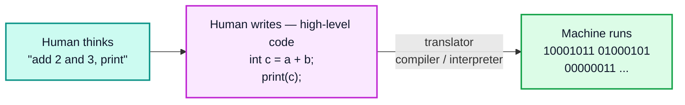

| | **Machine code** | **High-level language** |
|---|---|---|
| Readable by humans | No | Yes |
| Tied to a CPU type | Yes | No (the translator handles it) |
| Error-prone to write | Extremely | Much less |
| Example | `B8 05 00 00 00` | `int x = 5;` |

> [!NOTE]
> Video #5 covered compilers vs interpreters in detail. Java's twist is that it uses **both**: a compiler (`javac`) to produce bytecode, and an interpreter + JIT compiler inside the JVM to run it.

---

## 2. How Java Executes? (1:33)

Java execution is a **two-stage** process:

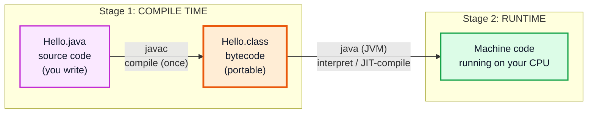

| Stage | Tool | Input | Output |
|---|---|---|---|
| 1. Compilation | `javac` (part of JDK) | `.java` source | `.class` bytecode |
| 2. Execution | `java` launcher → JVM | `.class` bytecode | Native instructions executed on the CPU |

```bash
javac Hello.java     # Stage 1 → creates Hello.class
java Hello           # Stage 2 → JVM loads Hello.class and runs main()
```

> [!TIP]
> Since **Java 11** you can run a single source file directly with `java Hello.java`. It still compiles behind the scenes (in memory, no `.class` file written) — the two stages have not disappeared, they are just hidden. Java 22+ extends this to programs made of multiple source files.

---

## 3. .java file (Human Readable) (2:02)

The `.java` file is plain text that you write. It is meant for **humans** (and the compiler), not for the CPU.

```java
// Hello.java
public class Hello {
    public static void main(String[] args) {
        System.out.println("Hello World");
    }
}
```

### Rules for a source file

| Rule | Example |
|---|---|
| Extension must be `.java` | `Hello.java` |
| A `public` class must live in a file with the **same name** | `public class Hello` → `Hello.java` |
| At most **one** `public` top-level class per file | Others must be package-private |
| Names are **case-sensitive** | `hello.java` ≠ `Hello.java` |
| Program entry point | `public static void main(String[] args)` |

```bash
# Class name and file name mismatch:
$ javac Main.java
Main.java:1: error: class Hello is public, should be declared in a file named Hello.java
public class Hello {
       ^
1 error
```

> [!NOTE]
> Java 25 finalized **compact source files and instance main methods**, so a beginner program can be just `void main() { IO.println("Hello"); }`. The course uses the classic `public static void main` form, which is still what you will see in interviews and most codebases.

---

## 4. .class file (Byte Code) (2:16)

When `javac` compiles `Hello.java`, it produces `Hello.class`, which contains **bytecode**: a compact instruction set for an imaginary machine — the **Java Virtual Machine**.

- Bytecode is **not** machine code for any real CPU
- It is the **same** on every operating system
- One `.class` file is produced **per class** (including nested/inner classes, e.g. `Outer$Inner.class`)

### Looking inside a `.class` file

Every class file starts with the "magic number" `CAFEBABE`, followed by the class file version:

```bash
$ xxd Hello.class | head -1        # (Git Bash / Linux / macOS)
00000000: cafe babe 0000 0041 001d 0a00 0200 0307  ................
#         ^^^^^^^^^ ^^^^ ^^^^
#         magic     minor major (0x41 = 65 → Java 21)
```

| Class file major version | Java release |
|---|---|
| 52 | Java 8 |
| 55 | Java 11 |
| 61 | Java 17 |
| 65 | Java 21 |
| 69 | Java 25 |

### Reading bytecode with `javap -c`

`javap` (a JDK tool) disassembles a `.class` file into readable bytecode instructions:

```bash
$ javap -c Hello.class
Compiled from "Hello.java"
public class Hello {
  public Hello();
    Code:
       0: aload_0
       1: invokespecial #1      // Method java/lang/Object."<init>":()V
       4: return

  public static void main(java.lang.String[]);
    Code:
       0: getstatic     #7      // Field java/lang/System.out:Ljava/io/PrintStream;
       3: ldc           #13     // String Hello World
       5: invokevirtual #15     // Method java/io/PrintStream.println:(Ljava/lang/String;)V
       8: return
}
```

| Instruction | Meaning |
|---|---|
| `getstatic` | Push the static field `System.out` onto the operand stack |
| `ldc` | Load a constant (`"Hello World"`) from the constant pool |
| `invokevirtual` | Call an instance method (`println`) |
| `invokespecial` | Call a constructor / super method (here: `Object()`) |
| `return` | Return `void` from the method |

> [!TIP]
> Notice the compiler added a constructor `public Hello()` you never wrote — the **default constructor**. `javap` is a great way to see what the compiler does for you (default constructors, string concatenation, autoboxing, enhanced-for loops...).

> [!WARNING]
> A `.class` compiled with a **newer** JDK cannot run on an **older** JVM:
> `UnsupportedClassVersionError: Hello has been compiled by a more recent version of the Java Runtime (class file version 65.0), this version of the Java Runtime only recognizes class file versions up to 61.0`.
> Use `javac --release 17 Hello.java` to target an older version.

---

## 5. Why Java is Platform Independent? (3:58)

A **platform** = operating system + CPU architecture (Windows/x86-64, macOS/ARM64, Linux/x86-64, ...).

In C/C++, the compiler produces a native executable for **one** platform. In Java, the compiler produces **bytecode** that any JVM can run.

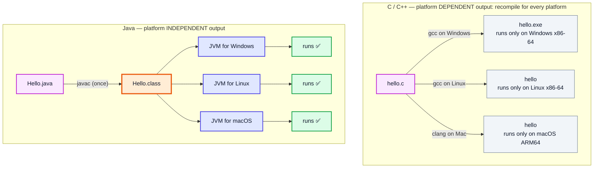

This is the famous slogan **WORA — "Write Once, Run Anywhere"**.

> [!IMPORTANT]
> **Bytecode is platform independent. The JVM is platform DEPENDENT.**
> You download a different JDK/JVM for Windows, macOS and Linux — but the `.class` files you produce work on all of them.

---

## 6. More about Platform Independence (5:14)

### Where the "dependence" moved to

Java did not eliminate platform-specific work — it moved it from **your program** into the **JVM**, which is written once per platform by the JDK vendor.

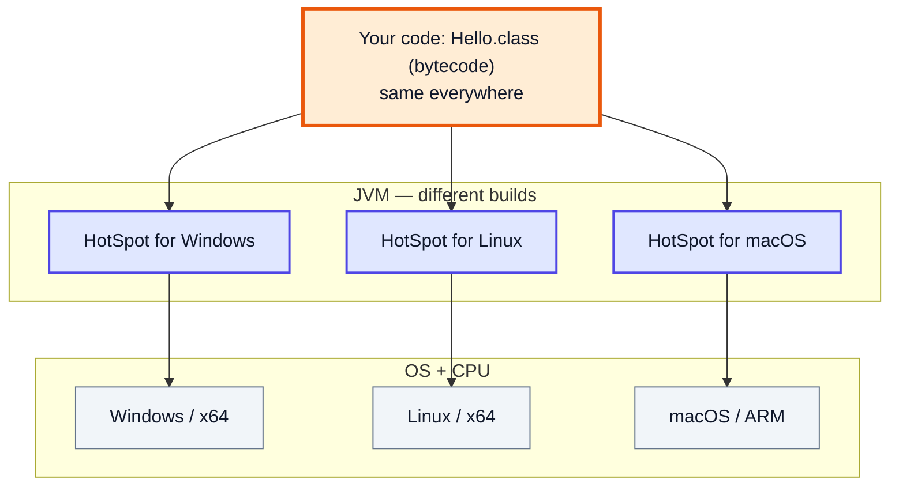

### Comparison

| | **C / C++** | **Java** |
|---|---|---|
| Compiler output | Native machine code | Bytecode |
| Output portable? | No | Yes |
| Needs a runtime to run? | No (just the OS) | Yes (a JVM) |
| Recompile per platform? | Yes | No |
| Startup speed | Very fast | Slightly slower (JVM startup, class loading, warm-up) |
| Peak speed | Very fast | Very close, thanks to JIT |

### Platform independence has limits

Bytecode is portable, but your **code's assumptions** might not be:

```java
import java.io.File;

public class PathDemo {
    public static void main(String[] args) {
        // ❌ Hard-coded Windows path — breaks on Linux/macOS
        // File f = new File("C:\\data\\input.txt");

        // ✅ Portable: let Java pick the separator
        File f = new File("data" + File.separator + "input.txt");
        System.out.println(f.getPath());              // data\input.txt (Windows) / data/input.txt (Linux, macOS)
        System.out.println(System.getProperty("os.name"));
        System.out.println(System.lineSeparator().length()); // 2 on Windows (\r\n), 1 on Linux/macOS (\n)
    }
}
```

> [!NOTE]
> Java is also **architecture-neutral** for primitive sizes: an `int` is **always 32 bits** and a `long` **always 64 bits** on every platform. In C, the size of `int`/`long` can vary between compilers and CPUs.

> [!CAUTION]
> Code that uses **native libraries** (JNI, `System.loadLibrary`) or OS commands (`Runtime.exec("cmd /c dir")`) is no longer platform independent — the native part must be built/written for each OS.

---

## 7. Architecture of Java (9:36)

The Java platform is built in **three nested layers**:

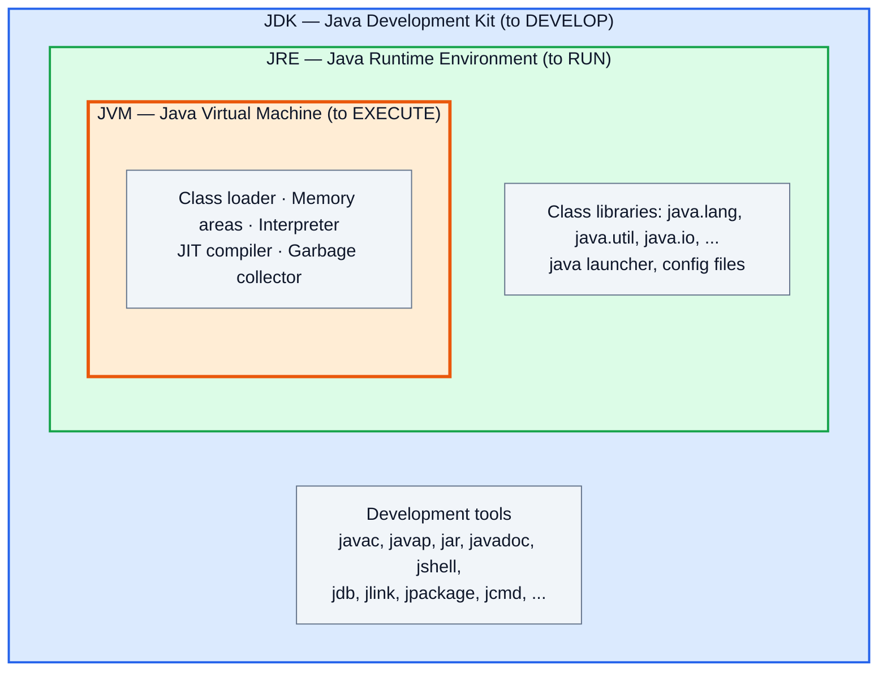

| Formula | Meaning |
|---|---|
| **JDK = JRE + development tools** | Everything needed to write, compile, debug and package Java |
| **JRE = JVM + class libraries** | Everything needed to run a compiled Java program |
| **JVM** | The engine that executes bytecode |

> [!NOTE]
> These formulas describe the **concepts**. Since Java 9 the JDK is modular and since Java 11 there is no separate `jre/` folder inside it — the JDK *is* a runtime plus tools. More on this in the JRE section.

---

## 8. JDK (10:35)

The **Java Development Kit** is what a developer installs. It provides the environment to **develop and run** Java programs.

### What's inside a JDK

| Component | Purpose |
|---|---|
| `javac` | Compiler: `.java` → `.class` |
| `java` | Launcher: starts the JVM and runs a class / JAR / source file |
| `javap` | Disassembler: shows bytecode and class structure |
| `jar` | Packages `.class` files + resources into a `.jar` archive |
| `javadoc` | Generates HTML documentation from `/** ... */` comments |
| `jdb` | Command-line debugger |
| `jshell` | Interactive REPL (Java 9+) — try code without a class or `main` |
| `jlink` | Builds a trimmed custom runtime image (Java 9+) |
| `jpackage` | Creates native installers `.exe/.msi/.dmg/.deb` (Java 14+) |
| `jcmd`, `jconsole`, `jfr` | Monitoring, diagnostics, profiling |
| Runtime (JVM + libraries) | So the JDK can also run what it compiles |

### Try a few JDK tools

```bash
$ javac -version
javac 21.0.5

$ jshell
|  Welcome to JShell -- Version 21.0.5
jshell> int x = 10 * 4
x ==> 40
jshell> "kunal".toUpperCase()
$2 ==> "KUNAL"
jshell> /exit

$ jar --create --file hello.jar --main-class Hello Hello.class
$ java -jar hello.jar
Hello World
```

### JDK distributions

Java is open source (**OpenJDK**). Many vendors build and ship it; all pass the same compatibility tests:

| Distribution | Notes |
|---|---|
| Eclipse **Temurin** (Adoptium) | Free, popular default choice |
| **Oracle JDK** | Free under Oracle's NFTC licence for recent versions |
| Amazon Corretto, Microsoft Build of OpenJDK, Azul Zulu | Free OpenJDK builds |

> [!TIP]
> Pick an **LTS (Long-Term Support)** version: **17, 21 or 25**. Everything in this course works on Java 17+.

---

## 9. JRE (12:12)

The **Java Runtime Environment** is what you need to **run** (not develop) Java programs. It contains:

- The **JVM**
- The **Java class libraries** (`java.lang.String`, `java.util.ArrayList`, `java.io.File`, ...)
- The `java` launcher and supporting files

It does **not** contain `javac` — you cannot compile with only a JRE.

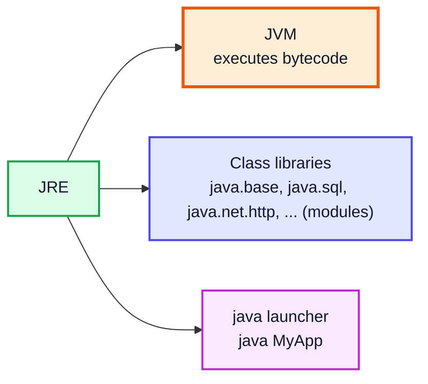

### When the JRE does its job

Running `java Hello` makes the JRE:

1. Start the JVM
2. Find `Hello.class` on the classpath
3. Load it plus every library class it uses (`String`, `System`, `PrintStream`, ...)
4. Execute `main()`

> [!IMPORTANT]
> **Modern Java update:** the video presents the JRE as a separate thing you might install. Since **Java 11**, Oracle and OpenJDK **no longer ship a standalone JRE**, and browser applets / Java Web Start (which older JREs bundled) are gone.
> - Developers simply install the **JDK** (it can run programs too).
> - To ship a small runtime with your app, use **`jlink`** to build a custom runtime containing only the modules you need.
> - Some vendors (e.g. Temurin) still offer JRE-only downloads for convenience, but conceptually it is just "the JDK without the dev tools".

```bash
# Build a minimal runtime containing only the java.base module
jlink --add-modules java.base --output myruntime
myruntime/bin/java -version      # works — but there is no javac in it
```

---

## 10. Explanation of Some Terms (13:48)

Before looking inside the JVM, two terms must be clear: **compile time** and **runtime**. Everything in Java happens in one of these two phases.

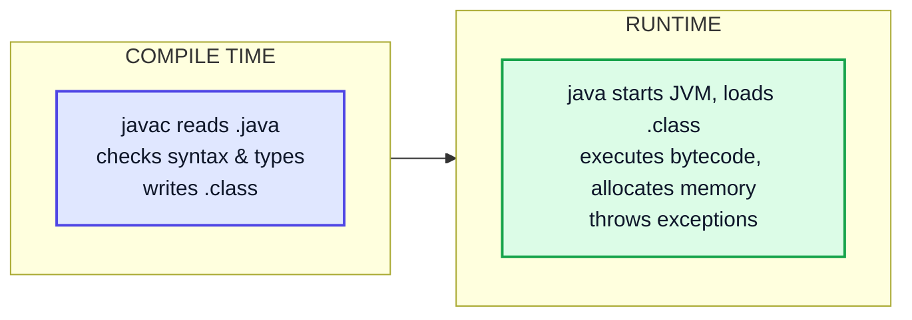

---

## 11. Compile Time (13:55)

**Compile time** = the period when `javac` converts source code into bytecode. **Nothing runs yet.**

What the compiler does:

| Step | Example of what it catches |
|---|---|
| Lexing / parsing (syntax) | Missing `;`, unmatched `{` |
| Name resolution | Using an undeclared variable `y` |
| Type checking | `int a = "hello";` |
| Definite assignment | Using a local variable before assigning it |
| Generating bytecode | Writes `.class` files |

```java
public class CompileErr {
    public static void main(String[] args) {
        int a = "hello";
        System.out.println(b)
    }
}
```

```bash
$ javac CompileErr.java
CompileErr.java:4: error: ';' expected
        System.out.println(b)
                             ^
1 error
# After fixing the ';', javac reports the next errors:
# error: incompatible types: String cannot be converted to int
# error: cannot find symbol  (symbol: variable b)
```

> [!NOTE]
> If compilation fails, **no `.class` file is produced** for that class, so there is nothing to run.

---

## 12. Runtime (14:03)

**Runtime** = the period when the JVM is actually executing your bytecode. Errors here are **exceptions** — the code was valid, but an operation failed with real data.

```java
public class RuntimeErr {
    public static void main(String[] args) {
        int[] arr = new int[3];
        System.out.println("Before");
        arr[5] = 10;                      // compiles fine...
        System.out.println("After");      // never reached
    }
}
```

```bash
$ javac RuntimeErr.java      # ✅ no errors
$ java RuntimeErr
Before
Exception in thread "main" java.lang.ArrayIndexOutOfBoundsException: Index 5 out of bounds for length 3
	at RuntimeErr.main(RuntimeErr.java:5)
```

| | **Compile time** | **Runtime** |
|---|---|---|
| Who works | `javac` | JVM |
| Input | `.java` | `.class` |
| Typical errors | Syntax, type, missing symbol | `NullPointerException`, `ArithmeticException`, `ArrayIndexOutOfBoundsException` |
| Memory allocated for objects? | No | Yes (heap, stack) |
| Class loading, JIT, GC? | No | Yes |

---

## 13. How JVM Works? (Class Loader) (14:10)

When you type `java Hello`, the JVM's **class loading subsystem** brings `Hello.class` into memory. This happens in three phases: **Loading → Linking → Initialization**.

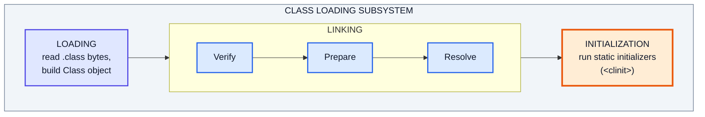

### Phase 1: Loading

A **class loader** finds the `.class` bytes (from disk, a JAR, the JDK's module image, the network...), parses them, and creates a `java.lang.Class` object representing the class in the **method area** (Metaspace).

Java has three built-in class loaders arranged in a hierarchy:

| Class loader | Loads | Notes |
|---|---|---|
| **Bootstrap** | Core platform classes: `java.lang.*`, `java.util.*` (module `java.base` etc.) | Written in native code; `getClassLoader()` returns `null` |
| **Platform** (formerly **Extension**) | Other Java SE / JDK modules such as `java.sql`, `java.net.http` | Renamed in Java 9; the old `jre/lib/ext` directory was removed |
| **Application** (a.k.a. **System**) | **Your** classes from the classpath (`-cp`) / module path | `ClassLoader.getSystemClassLoader()` |

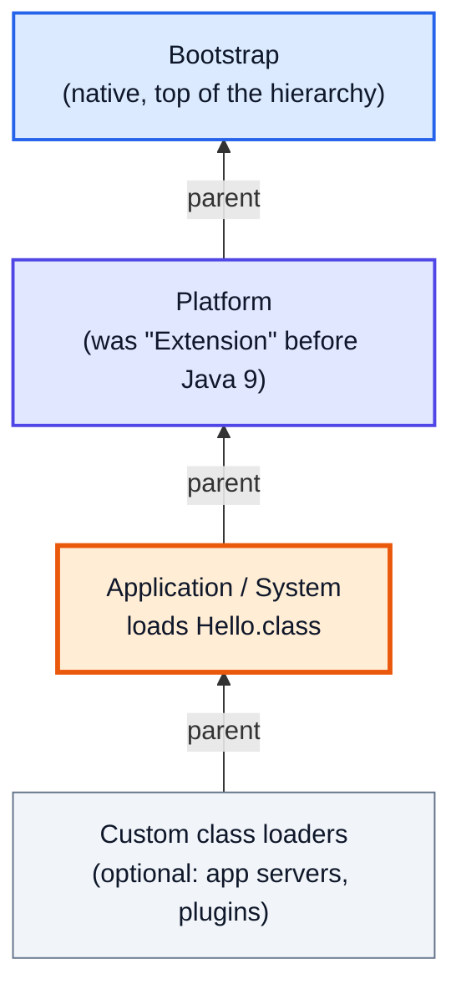

#### Delegation model (parent-first)

When asked to load a class, a loader **first delegates to its parent**. Only if the parent cannot find it does the loader try itself.

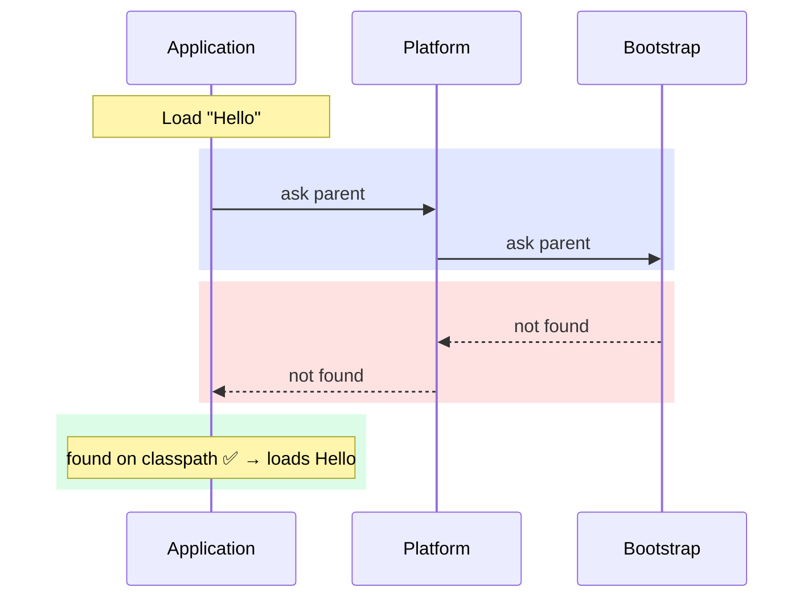

This prevents you from replacing core classes: if you write your own `java.lang.String`, Bootstrap has already loaded the real one, so yours is never used.

```java
public class LoaderDemo {
    public static void main(String[] args) {
        System.out.println(String.class.getClassLoader());              // null → Bootstrap
        System.out.println(java.sql.Connection.class.getClassLoader()); // ...PlatformClassLoader@...
        System.out.println(LoaderDemo.class.getClassLoader());          // ...AppClassLoader@...

        ClassLoader app = LoaderDemo.class.getClassLoader();
        System.out.println(app.getName() + " -> parent: " + app.getParent().getName());
        // app -> parent: platform
    }
}
```

```
null
jdk.internal.loader.ClassLoaders$PlatformClassLoader@5a07e868
jdk.internal.loader.ClassLoaders$AppClassLoader@251a69d7
app -> parent: platform
```

You can watch loading happen:

```bash
$ java -Xlog:class+load:file=load.txt Hello   # or the older: java -verbose:class Hello
# load.txt contains hundreds of lines like:
# [info][class,load] java.lang.Object source: shared objects file
# [info][class,load] Hello source: file:/C:/code/
```

### Phase 2: Linking

| Sub-step | What happens |
|---|---|
| **Verify** | The bytecode verifier checks the class is well-formed and safe: valid `CAFEBABE` header, correct stack usage, no jumping into the middle of an instruction, type-correct operations. Failure → `VerifyError`. |
| **Prepare** | Memory for **static fields** is allocated and set to **default values** (`0`, `false`, `null`). No user code runs yet. |
| **Resolve** | **Symbolic references** in the constant pool (e.g. `java/io/PrintStream.println`) are replaced with **direct references** (actual memory locations). HotSpot does this **lazily** — the first time each reference is used. |

> [!NOTE]
> Verification is a big part of Java's security story: even a hand-crafted or tampered `.class` file cannot corrupt the JVM's memory, because it is rejected before running.

### Phase 3: Initialization

The JVM runs the class's **static initializer** — a hidden method named `<clinit>` that the compiler builds from all `static` field assignments and `static { }` blocks, **in the order they appear in the source**.

Initialization happens **lazily**, the first time a class is actively used (creating an instance, calling a static method, reading a non-constant static field) — and **only once**.

```java
public class InitDemo {
    static int a = 10;                 // 1) prepared as 0, then set to 10 here
    static {
        System.out.println("static block: a = " + a);
        a = a * 2;
    }
    static int b = a + 5;              // runs after the static block

    public static void main(String[] args) {
        System.out.println("main: a = " + a + ", b = " + b);
        System.out.println("Helper not touched yet...");
        Helper.hello();                // Helper initialized NOW (lazily)
        Helper.hello();                // not initialized again
    }
}

class Helper {
    static { System.out.println("Helper initialized"); }
    static void hello() { System.out.println("hello from Helper"); }
}
```

```
static block: a = 10
main: a = 20, b = 25
Helper not touched yet...
Helper initialized
hello from Helper
hello from Helper
```

> [!TIP]
> `javap -c -p InitDemo.class` shows the compiler-generated `static {};` method — that is `<clinit>`, containing your field assignments and static block merged in source order.

---

## 14. JVM Execution (19:07)

After loading, the **execution engine** runs the bytecode, using the JVM's runtime memory areas.

### JVM internals

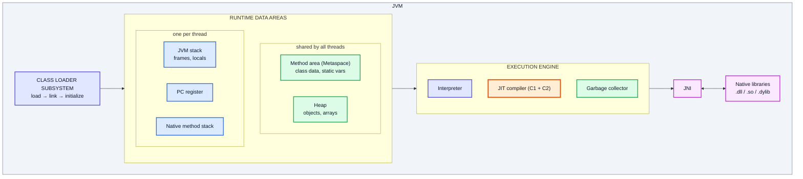

| Area | Stores | Shared? |
|---|---|---|
| **Method area / Metaspace** | Class metadata, method bytecode, constant pool, static variables* | All threads |
| **Heap** | Every object and array | All threads |
| **JVM stack** | One frame per method call: local variables, operand stack | Per thread |
| **PC register** | Address of the bytecode instruction currently executing | Per thread |
| **Native method stack** | Frames for native (C/C++) methods | Per thread |

\* In HotSpot, static field values are physically stored with the `Class` object on the heap since Java 8; conceptually they belong to the class.

### Interpreter vs JIT compiler

| | **Interpreter** | **JIT (Just-In-Time) compiler** |
|---|---|---|
| How | Reads and executes bytecode **one instruction at a time** | Compiles a whole **hot** method into **native machine code** |
| Starts working | Immediately | After a method is called/looped many times |
| Speed | Slower per execution | Very fast once compiled |
| Result cached? | No | Yes, in the **code cache** — reused every later call |

### How they cooperate (Tiered compilation in HotSpot)

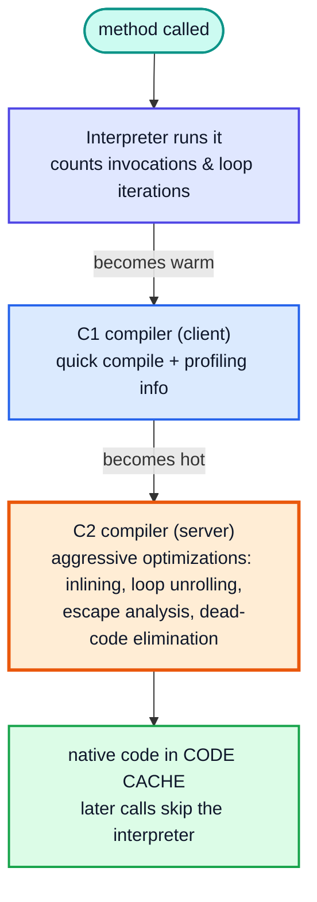

This is why the JVM is called **HotSpot**: it finds the hot spots of your program and compiles only those. Rarely used code is just interpreted — compiling it would cost more than it saves.

```bash
# Watch the JIT compile methods (illustrative output):
$ java -XX:+PrintCompilation Greeter
    ...
     98   41       3       Greeter::sumUpTo (22 bytes)
    101   45 %     4       Greeter::sumUpTo @ 4 (22 bytes)
    103   47       4       Greeter::sumUpTo (22 bytes)
#  columns: time(ms)  id  [%=on-stack replacement]  tier(3=C1, 4=C2)  method

# Disable the JIT to feel the difference (pure interpreter):
$ java -Xint Greeter
```

### Garbage collector

Part of the execution engine; automatically frees heap objects that are no longer reachable (covered in video #5). Default collector: **G1** (since Java 9); **ZGC** for very low pause times.

> [!NOTE]
> The video describes the execution engine at a high level (interpreter + JIT). Modern HotSpot uses **tiered compilation** (C1 then C2) by default, and newer JDKs also cache class data (**CDS**, and since Java 24, ahead-of-time class loading caches) to speed up startup.

---

## 15. Working of Java Architecture (21:30)

Putting all the pieces together, here is the full journey of a program:

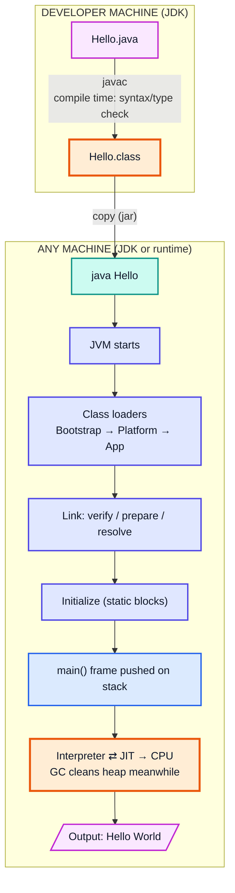

| Step | Component | Phase |
|---|---|---|
| 1. Write `Hello.java` | You / IDE | — |
| 2. `javac Hello.java` | JDK compiler | Compile time |
| 3. `java Hello` | Launcher starts JVM | Runtime |
| 4. Load `Hello` + library classes | Class loaders | Runtime |
| 5. Verify, prepare, resolve | Linker | Runtime |
| 6. Run static initializers | JVM | Runtime |
| 7. Execute `main` | Interpreter + JIT | Runtime |
| 8. Free unused objects | Garbage collector | Runtime |
| 9. `main` returns → JVM exits | JVM | Runtime |

---

## 16. JRE vs JVM (23:19)

| | **JVM** | **JRE** | **JDK** |
|---|---|---|---|
| Full form | Java Virtual Machine | Java Runtime Environment | Java Development Kit |
| What it is | The engine that executes bytecode | JVM + class libraries + launcher | JRE + development tools |
| Purpose | **Execute** | **Run** programs | **Develop** and run programs |
| Contains `javac`? | No | No | Yes |
| Contains `java.util.ArrayList` etc.? | No (libraries are separate) | Yes | Yes |
| Platform dependent? | Yes | Yes | Yes |
| Who needs it | — (always comes inside a JRE/JDK) | End users running Java apps (historically) | Developers |
| Exists standalone? | No — specification + implementation (e.g. HotSpot, OpenJ9) | Not from Oracle/OpenJDK since Java 11 | Yes |

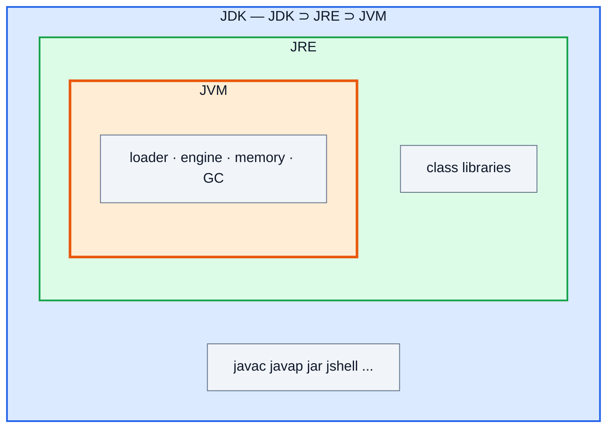

> [!TIP]
> Interview one-liner: **"JVM executes bytecode; JRE provides the JVM plus the libraries needed to run a program; JDK adds the tools to develop it. The JVM is platform dependent, which makes the bytecode platform independent."**

> [!NOTE]
> "JVM" means three things depending on context: a **specification** (the JVM Spec), an **implementation** (HotSpot, Eclipse OpenJ9, GraalVM), and a running **instance** (each `java` command starts one JVM process).

---

## 17. Tools Required to Start Programming in Java (24:46)

You need two things:

| Tool | Why |
|---|---|
| **JDK** (17, 21 or 25 LTS) | To compile (`javac`) and run (`java`) programs |
| **IDE — IntelliJ IDEA** | Editor with autocomplete, error highlighting, debugger, one-click run |

### Step 1: Install the JDK

```bash
# Windows (winget)
winget install EclipseAdoptium.Temurin.21.JDK

# macOS (Homebrew)
brew install --cask temurin@21

# Ubuntu / Debian
sudo apt install openjdk-21-jdk
```

Or download an installer from the Adoptium (Temurin) or Oracle website. On Windows, tick **"Set JAVA_HOME"** and **"Add to PATH"** in the installer.

### Step 2: Verify the installation

```bash
$ java -version
openjdk version "21.0.5" 2024-10-15 LTS
OpenJDK Runtime Environment Temurin-21.0.5+11 (build 21.0.5+11-LTS)
OpenJDK 64-Bit Server VM Temurin-21.0.5+11 (build 21.0.5+11-LTS, mixed mode, sharing)

$ javac -version
javac 21.0.5
```

> `mixed mode` = interpreter + JIT. `sharing` = class data sharing (CDS) is on.

> [!WARNING]
> If `java -version` works but `javac` is "not recognized", you have a runtime-only install or your **PATH** points at the wrong folder. `PATH` must include `<JDK folder>\bin`, and `JAVA_HOME` should point to the JDK folder itself (without `\bin`).

```powershell
# Windows PowerShell: check what is configured
echo $env:JAVA_HOME
where.exe java
where.exe javac
```

### Step 3: Install IntelliJ IDEA

1. Download IntelliJ IDEA from JetBrains (the free edition covers everything in this course; JetBrains now ships it as a single installer with the core features free).
2. **New Project → Java**, choose your installed JDK under *JDK*.
3. Create a class in `src`, type `psvm` + Tab to generate `main`, `sout` + Tab for `System.out.println`.
4. Click the green ▶ — IntelliJ runs `javac` and `java` for you and puts `.class` files in `out/` (or `target/`/`build/` with Maven/Gradle).

| IntelliJ shortcut | Generates / does |
|---|---|
| `psvm` / `main` + Tab | `public static void main(String[] args) {}` |
| `sout` + Tab | `System.out.println();` |
| `fori` + Tab | `for (int i = 0; i < ; i++) {}` |
| `Shift + F10` (Win) / `Ctrl + R` (Mac) | Run |
| `Alt + Enter` | Quick fix for the highlighted error |

> [!TIP]
> Before relying on the IDE, compile and run at least one program **by hand** with `javac` and `java`. Knowing what the green ▶ button does behind the scenes makes classpath and "class not found" errors much easier to debug later.

---

## 18. Outro (27:08)

With the JDK and IntelliJ installed, you're ready to write real programs. Next video (#8) covers the **first Java program**: input/output, data types and basic syntax.

---

## 🧩 Complete Example: Everything Together

A single program walked through every stage — JDK, class loader, linking, initialization, interpreter, JIT.

### Step 1 — Write `Greeter.java` (you + editor)

```java
public class Greeter {

    static int counter;                       // PREPARE: set to default 0

    static {                                  // INITIALIZATION: runs once, before main
        System.out.println("[init] static block runs, counter = " + counter);
        counter = 100;
    }

    // A "hot" method: called 20,000 times → JIT will compile it
    static long sumUpTo(int n) {
        long s = 0;
        for (int i = 1; i <= n; i++) {
            s += i;
        }
        return s;
    }

    public static void main(String[] args) {
        System.out.println("[main] counter = " + counter);

        // Which class loader loaded what?
        System.out.println("[loader] Greeter -> " + Greeter.class.getClassLoader().getName());
        System.out.println("[loader] String  -> " + String.class.getClassLoader());

        long total = 0;
        for (int i = 0; i < 20_000; i++) {
            total += sumUpTo(1000);           // 1000 * 1001 / 2 = 500500 each time
        }
        System.out.println("[result] total = " + total);

        System.out.println("[jvm] " + System.getProperty("java.vm.name")
                + " " + System.getProperty("java.version"));
    }
}
```

### Step 2 — Compile (JDK, compile time)

```bash
$ javac Greeter.java
$ ls
Greeter.class  Greeter.java
```

`javac` checked syntax and types and wrote **platform-independent bytecode**. No code has run yet; the static block has **not** executed.

### Step 3 — Inspect the bytecode (JDK tool `javap`)

```bash
$ javap -c -p Greeter.class
...
  static long sumUpTo(int);
    Code:
       0: lconst_0            // s = 0L
       1: lstore_1
       2: iconst_1            // i = 1
       3: istore_3
       4: iload_3             // loop: if (i > n) goto 20
       5: iload_0
       6: if_icmpgt     20
       9: lload_1             // s += (long) i
      10: iload_3
      11: i2l
      12: ladd
      13: lstore_1
      14: iinc          3, 1  // i++
      17: goto          4
      20: lload_1             // return s
      21: lreturn

  static {};                  // ← the <clinit> method built from the static block
    Code:
       0: getstatic     #...  // Field java/lang/System.out ...
       ...
```

This exact `.class` file can be copied to Windows, Linux or macOS and run unchanged.

### Step 4 — Run (JVM, runtime)

```bash
$ java Greeter
```

What happens inside:

| # | Component | Action |
|---|---|---|
| 1 | `java` launcher | Starts a JVM process |
| 2 | **Bootstrap loader** | Loads core classes: `Object`, `String`, `System`, `PrintStream`, ... |
| 3 | **Application loader** | Delegates to Platform → Bootstrap; neither finds `Greeter`, so it loads `Greeter.class` from the current directory |
| 4 | **Verify** | Checks `CAFEBABE`, version, and that the bytecode is type-safe |
| 5 | **Prepare** | Allocates `counter` and sets it to `0` |
| 6 | **Resolve** | Symbolic refs like `java/io/PrintStream.println` resolved lazily on first use |
| 7 | **Initialize** | Runs `<clinit>`: prints `counter = 0`, then sets it to `100` |
| 8 | Execution engine | Pushes a `main` frame onto the main thread's stack; **interpreter** starts executing |
| 9 | **JIT** | `sumUpTo` gets hot → compiled by C1, then C2, to native code in the code cache |
| 10 | **GC** | Reclaims temporary objects (e.g. the `String`s built for printing) |
| 11 | JVM exit | `main` returns, no non-daemon threads left → JVM shuts down |

**Expected Output:**
```
[init] static block runs, counter = 0
[main] counter = 100
[loader] Greeter -> app
[loader] String  -> null
[result] total = 10010000000
[jvm] OpenJDK 64-Bit Server VM 21.0.5
```

(The last line depends on your installed JDK.)

### Step 5 — Peek behind the curtain (optional)

```bash
# See class loading
$ java -Xlog:class+load Greeter | findstr Greeter        # Windows  (use grep on Linux/macOS)
[0.031s][info][class,load] Greeter source: file:/C:/code/

# See the JIT compiling the hot method
$ java -XX:+PrintCompilation Greeter | findstr sumUpTo
     98   41       3       Greeter::sumUpTo (22 bytes)
    103   47       4       Greeter::sumUpTo (22 bytes)

# Interpreter only (no JIT) — same output, slower
$ java -Xint Greeter

# Single-file source launch (Java 11+): compile in memory + run
$ java Greeter.java
```

---

## Quick Reference Cheat Sheet

| Concept | One-Line Summary |
|---|---|
| **Why languages** | CPUs only understand machine code; high-level languages are translated into it |
| **Java execution** | `.java` --javac--> `.class` (bytecode) --JVM--> machine code |
| **`.java` file** | Human-readable source; public class name must match file name |
| **`.class` file** | Bytecode for the JVM; starts with `CAFEBABE`; view with `javap -c` |
| **Platform independence** | Bytecode is portable; the JVM is platform specific — WORA |
| **JDK** | JRE + dev tools (`javac`, `javap`, `jar`, `jshell`, `jlink`, ...) — install this |
| **JRE** | JVM + class libraries; no standalone JRE from Oracle/OpenJDK since Java 11 (use `jlink`) |
| **JVM** | Loads, verifies and executes bytecode; manages memory and GC |
| **Compile time** | `javac` checks syntax/types and writes bytecode — compile errors |
| **Runtime** | JVM executes bytecode — exceptions like NPE, AIOOBE |
| **Class loaders** | Bootstrap → Platform (ex-Extension) → Application (System); parent-first delegation |
| **Linking** | Verify (safety) → Prepare (static defaults) → Resolve (symbolic → direct refs) |
| **Initialization** | Runs static field assignments + `static {}` blocks (`<clinit>`) once, lazily |
| **Runtime data areas** | Method area/Metaspace, Heap (shared); Stack, PC register, native stack (per thread) |
| **Interpreter** | Executes bytecode instruction by instruction; starts instantly |
| **JIT** | Compiles hot methods to native code (C1 → C2 tiered); cached in code cache |
| **JDK ⊃ JRE ⊃ JVM** | Develop ⊃ Run ⊃ Execute |
| **Setup** | Install JDK 17/21/25 LTS, set `JAVA_HOME` + `PATH`, verify `java -version` & `javac -version`, install IntelliJ IDEA |
