# First Java Program — Complete In-Depth Guide

**Video #8 of the Java + DSA playlist:** *First Java Program - Input/Output, Debugging and Datatypes* (1:32:23)

A ground-up walkthrough of writing, compiling and running your first Java program — every keyword of `public static void main(String[] args)` explained, then input/output with `Scanner`, the 8 primitive data types, type conversion & casting, automatic type promotion, Unicode `char`s, and the basics of `if`, `while` and `for` — finishing with a temperature conversion program.

---

## Table of Contents

| # | Topic | Timestamp |
|---|---|---|
| 0 | [Introduction](#0-introduction-000) | 0:00 |
| 1 | [Creating .java file](#1-creating-java-file-132) | 1:32 |
| 2 | [Setting Up Few Things](#2-setting-up-few-things-111) | 1:11 |
| 3 | [Structure of Java File](#3-structure-of-java-file-307) | 3:07 |
| 4 | [Creating Main Function](#4-creating-main-function-757) | 7:57 |
| 5 | [Writing First Line of Code (Printing "Hello Word!")](#5-writing-first-line-of-code-printing-hello-word-958) | 9:58 |
| 6 | [Converting .java to .class (Byte Code)](#6-converting-java-to-class-byte-code-1037) | 10:37 |
| 7 | [Running Main.class](#7-running-mainclass-1223) | 12:23 |
| 8 | [Explanation of words of the Program](#8-explanation-of-words-of-the-program-1240) | 12:40 |
| 9 | [What is 'public' (1st line)?](#9-what-is-public-1st-line-1259) | 12:59 |
| 10 | [What is 'class'?](#10-what-is-class-1312) | 13:12 |
| 11 | [What is 'Main' in this code](#11-what-is-main-in-this-code-1330) | 13:30 |
| 12 | [What is 'main function'?](#12-what-is-main-function-1356) | 13:56 |
| 13 | [What is 'public' (2nd line)?](#13-what-is-public-2nd-line-1435) | 14:35 |
| 14 | [What is 'static'?](#14-what-is-static-1506) | 15:06 |
| 15 | [What is 'void'?](#15-what-is-void-1824) | 18:24 |
| 16 | [Array and Arguments](#16-array-and-arguments-1907) | 19:07 |
| 17 | [Changing Location of Byte Code](#17-changing-location-of-byte-code-2100) | 21:00 |
| 18 | [Location of 'javac' and 'java'](#18-location-of-javac-and-java-2225) | 22:25 |
| 19 | [Environment Variable PATH](#19-environment-variable-path-2431) | 24:31 |
| 20 | [Starting with IntelliJ IDEA](#20-starting-with-intellij-idea-2725) | 27:25 |
| 21 | [Some Shortcuts](#21-some-shortcuts-2949) | 29:49 |
| 22 | [What is a 'package'?](#22-what-is-a-package-3017) | 30:17 |
| 23 | [What is 'System.out.println()'?](#23-what-is-systemoutprintln-3242) | 32:42 |
| 24 | [Outputs in Java](#24-outputs-in-java-3445) | 34:45 |
| 25 | [Inputs in Java](#25-inputs-in-java-3925) | 39:25 |
| 26 | [Primitive Data Types in Java](#26-primitive-data-types-in-java-4640) | 46:40 |
| 27 | [Comments in Java](#27-comments-in-java-5414) | 54:14 |
| 28 | [Int Input Program](#28-int-input-program-5508) | 55:08 |
| 29 | [Literals and Identifiers](#29-literals-and-identifiers-5947) | 59:47 |
| 30 | [String Input Program](#30-string-input-program-10118) | 1:01:18 |
| 31 | [Float Input Program](#31-float-input-program-10238) | 1:02:38 |
| 32 | [Sum of Two Numbers](#32-sum-of-two-numbers-10439) | 1:04:39 |
| 33 | [Type Conversion and Casting](#33-type-conversion-and-casting-10730) | 1:07:30 |
| 34 | [Type Conversion](#34-type-conversion-10748) | 1:07:48 |
| 35 | [Conditions for Type Conversion](#35-conditions-for-type-conversion-10839) | 1:08:39 |
| 36 | [Typecasting](#36-typecasting-11024) | 1:10:24 |
| 37 | [Automatic Type Promotion in Expressions](#37-automatic-type-promotion-in-expressions-11220) | 1:12:20 |
| 38 | [Java follows Unicode](#38-java-follows-unicode-11825) | 1:18:25 |
| 39 | [Rules for Type Promotion](#39-rules-for-type-promotion-11920) | 1:19:20 |
| 40 | [Example for thorough review of concepts](#40-example-for-thorough-review-of-concepts-12118) | 1:21:18 |
| 41 | [Basics of while loops and for loops](#41-basics-of-while-loops-and-for-loops-12500) | 1:25:00 |
| 42 | [if condition](#42-if-condition-12513) | 1:25:13 |
| 43 | [while loops](#43-while-loops-12600) | 1:26:00 |
| 44 | [for loops](#44-for-loops-12719) | 1:27:19 |
| 45 | [When to use - while loop and for loop](#45-when-to-use---while-loop-and-for-loop-12803) | 1:28:03 |
| 46 | [Temperature Conversion Program](#46-temperature-conversion-program-12845) | 1:28:45 |
| 47 | [Outro](#47-outro-13152) | 1:31:52 |

---

## 0. Introduction (0:00)

Until now the course was theory (flowcharts, pseudocode, how Java works internally). This video is where you **actually write and run Java code** — first with nothing but a text editor and the terminal, then with an IDE.

By the end you should be able to:

1. Write a `.java` file, compile it with `javac`, run it with `java`
2. Explain **every single word** in `public static void main(String[] args)`
3. Take input from the user with `Scanner` and print output
4. Know all **8 primitive types**, their sizes and ranges
5. Predict exactly what happens when types are **converted, cast and promoted**
6. Write basic `if`, `while` and `for` logic

> [!IMPORTANT]
> Doing it the "hard way" first (terminal + `javac` + `java`) is deliberate. IDEs hide these steps; understanding them makes compile errors, classpath problems and packages far less mysterious later.

---

## 1. Creating .java file (1:32)

A Java program starts life as a plain text file with the extension **`.java`**. Any editor works (Notepad, VS Code, Vim). The file holds **source code** — human-readable text that the compiler will translate.

```
Terminal (any OS):
  mkdir FirstJava
  cd FirstJava
  # create an empty file named Main.java (use any editor)
```

| Rule | Detail |
|---|---|
| Extension | Must be `.java` (not `.txt`, not `.java.txt` — watch out for Windows hiding extensions!) |
| Case-sensitive | `Main.java` and `main.java` are different names on Linux/macOS |
| Name vs class | If the file contains a `public class`, the file name **must** match that class name exactly |

> [!WARNING]
> On Windows, Notepad may silently save `Main.java` as `Main.java.txt`. Turn on **File name extensions** in Explorer's View menu, or save with the type set to "All Files".

---

## 2. Setting Up Few Things (1:11)

Before compiling anything, you need the **JDK** (Java Development Kit) installed — not just a JRE. The JDK contains:

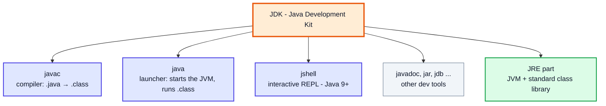

Verify the installation from a terminal:

```
> java -version
java version "21" 2023-09-19 LTS
...
> javac -version
javac 21
```

> [!TIP]
> Use an **LTS** release (17, 21 or 25). Everything in these notes works on Java 17+. If `javac` is "not recognized", the JDK's `bin` folder is not on your **PATH** — see [section 19](#19-environment-variable-path-2431).

---

## 3. Structure of Java File (3:07)

Java is **class-based**: every piece of executable code must live inside a **class**. A typical source file looks like this, from top to bottom:

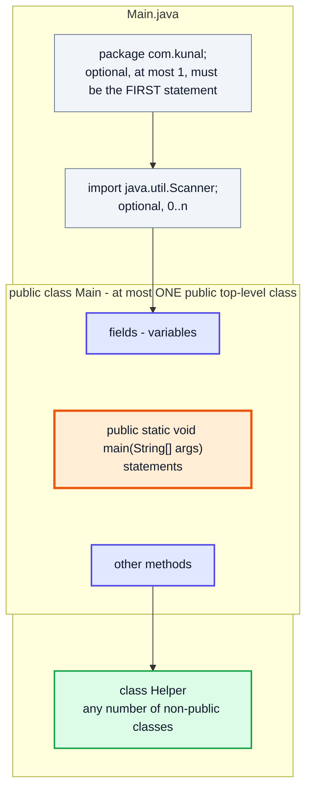

| Element | Required? | Rule |
|---|---|---|
| `package` | No | If present, must be the very first statement |
| `import` | No | After package, before classes |
| `public class X` | No, but usual | Max one per file; file must be named `X.java` |
| Other classes | No | Any number; each produces its own `.class` file |

```java
// File: Main.java
public class Main {          // public → file MUST be Main.java
    public static void main(String[] args) {
        System.out.println("Inside Main");
    }
}

class Helper {               // not public → name can be anything
}
// After javac: Main.class AND Helper.class are produced
```

> [!CAUTION]
> `public class Demo` inside a file named `Main.java` gives: `error: class Demo is public, should be declared in a file named Demo.java`.

---

## 4. Creating Main Function (7:57)

The JVM needs a fixed **entry point** — the first method it calls. That is the `main` method with this exact signature:

```java
public class Main {
    public static void main(String[] args) {
        // program execution starts here
    }
}
```

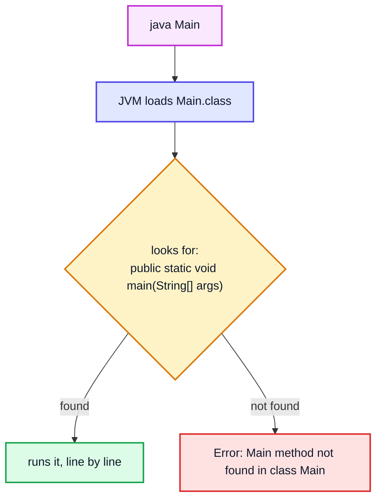

Allowed variations (all still valid entry points):

```java
public static void main(String[] args)     // standard
public static void main(String args[])     // C-style array syntax
public static void main(String... args)    // varargs
static public void main(String[] x)        // modifier order & parameter name don't matter
```

> [!NOTE]
> **Java 25** finalized *compact source files and instance main methods* (JEP 512), so a beginner file can be as short as `void main() { IO.println("Hi"); }`. The classic `public static void main(String[] args)` is still what you will see everywhere (and what the course uses), so learn it thoroughly.

---

## 5. Writing First Line of Code (Printing "Hello Word!") (9:58)

```java
public class Main {
    public static void main(String[] args) {
        System.out.println("Hello World!");
    }
}
// Output:
// Hello World!
```

Things to notice:

| Piece | Meaning |
|---|---|
| `"Hello World!"` | A **String literal** — text inside double quotes |
| `System.out.println(...)` | Prints its argument, then moves to a new line |
| `;` | Every statement ends with a semicolon |
| `{ }` | Braces group the body of the class and of the method |

> [!WARNING]
> Common first-day errors: `system.out.println` (lowercase `s` → *package system does not exist*), single quotes `'Hello'` (→ *unclosed character literal*), missing `;` (→ *';' expected*).

---

## 6. Converting .java to .class (Byte Code) (10:37)

The **compiler** `javac` checks your code for syntax/type errors and, if it's valid, produces **bytecode** in a `.class` file.

```
> javac Main.java
> dir            (or ls)
Main.class   Main.java
```

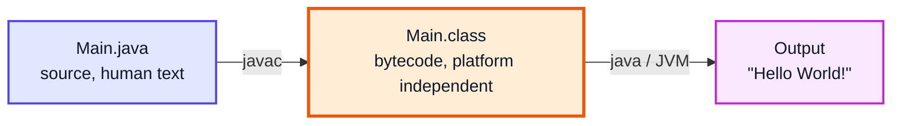

- Bytecode is **not** machine code — it's an instruction set for the **JVM**.
- The same `Main.class` runs on Windows, macOS and Linux.
- You can peek at bytecode with `javap -c Main`.

```
> javap -c Main
  public static void main(java.lang.String[]);
    Code:
       0: getstatic     #7    // Field java/lang/System.out:Ljava/io/PrintStream;
       3: ldc           #13   // String Hello World!
       5: invokevirtual #15   // Method java/io/PrintStream.println:(Ljava/lang/String;)V
       8: return
```

> [!NOTE]
> `javac` creates **one `.class` file per class**, not per source file. A file with 3 classes produces 3 `.class` files.

---

## 7. Running Main.class (12:23)

```
> java Main
Hello World!
```

| ✅ Correct | ❌ Wrong | Why |
|---|---|---|
| `java Main` | `java Main.class` | `java` takes a **class name**, not a file name |
| `javac Main.java` | `javac Main` | `javac` takes a **file name** |

> [!TIP]
> Since **Java 11** you can skip the separate compile step for single-file programs: `java Main.java` compiles in memory and runs immediately (no `.class` file left on disk). Great for quick experiments.

---

## 8. Explanation of words of the Program (12:40)

Every word in the program has a job. The next sections dissect them one by one:

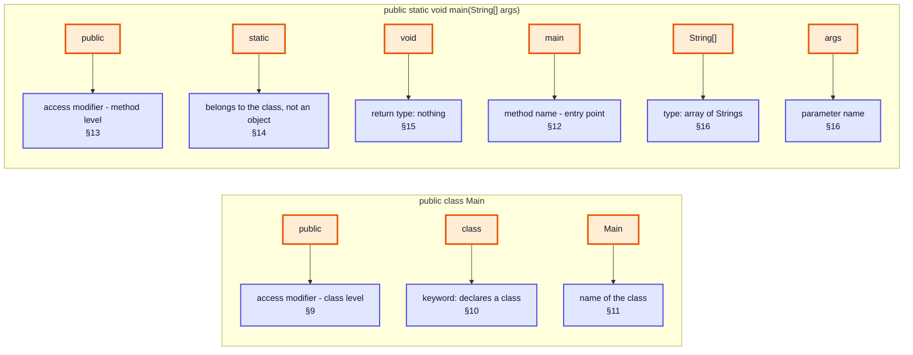

---

## 9. What is 'public' (1st line)? (12:59)

`public` before `class` is an **access modifier**: it makes the class accessible **from anywhere** — any other class, in any package.

| Class-level modifier | Visible from |
|---|---|
| `public` | Everywhere |
| *(none — package-private)* | Only classes in the **same package** |

Top-level classes can only be `public` or package-private (`private`/`protected` are allowed only for nested classes). And as seen in [section 3](#3-structure-of-java-file-307), a `public` class forces the file name.

---

## 10. What is 'class'? (13:12)

`class` is a **keyword** that declares a class — a named container (blueprint) that groups data (fields) and behaviour (methods). In Java, **all code lives inside classes**; there are no free-floating functions.

```java
class Calculator {               // a class...
    int lastResult;              // ...holds data
    int add(int a, int b) {      // ...and behaviour
        return a + b;
    }
}
```

> [!NOTE]
> Classes as blueprints for objects are covered in depth in the OOP videos (see `java_37_video_oops`). For now: "class = the box your code must live in".

---

## 11. What is 'Main' in this code (13:30)

`Main` is simply the **name** (identifier) of the class. It is not special — you could call it `Hello` or `FirstProgram`. Convention:

- Class names use **PascalCase** (`Main`, `StudentRecord`)
- Must match the file name if the class is `public`
- The name you pass to `java` is this class name: `java Main`

```java
public class FirstProgram {      // file must be FirstProgram.java
    public static void main(String[] args) {
        System.out.println("Name doesn't have to be Main");
    }
}
// > javac FirstProgram.java
// > java FirstProgram
// Name doesn't have to be Main
```

---

## 12. What is 'main function'? (13:56)

`main` is the **method the JVM calls first**. Without it, a class can be compiled but not *launched*.

```java
public class NoMain {
    static void hello() { System.out.println("hi"); }
}
// > javac NoMain.java   ✅ compiles
// > java NoMain
// Error: Main method not found in class NoMain, please define the main method as:
//    public static void main(String[] args)
```

| Term | Meaning |
|---|---|
| Function | A named block of reusable code |
| Method | A function that belongs to a class (in Java, every function is a method) |
| `main` | The specific method name the JVM searches for |

---

## 13. What is 'public' (2nd line)? (14:35)

The second `public` makes the **method** accessible from outside the class. The JVM is "outside code" — it must be able to reach `main` to call it.

| Method-level modifier | Visible from |
|---|---|
| `public` | Everywhere |
| `protected` | Same package + subclasses |
| *(none)* | Same package |
| `private` | Same class only |

```java
public class Main {
    private static void main(String[] args) { }   // compiles...
}
// > java Main
// Error: Main method not found in class Main ...   ← JVM can't see a private main
```

---

## 14. What is 'static'? (15:06)

### The Problem `static` Solves

Normally, a method belongs to an **object** — you must create one with `new` before calling it. But when the program starts, **no objects exist yet**. So how does the JVM call `main`?

`static` means the member belongs to the **class itself**, not to any object. A static method can be called using just the class name — no object needed.

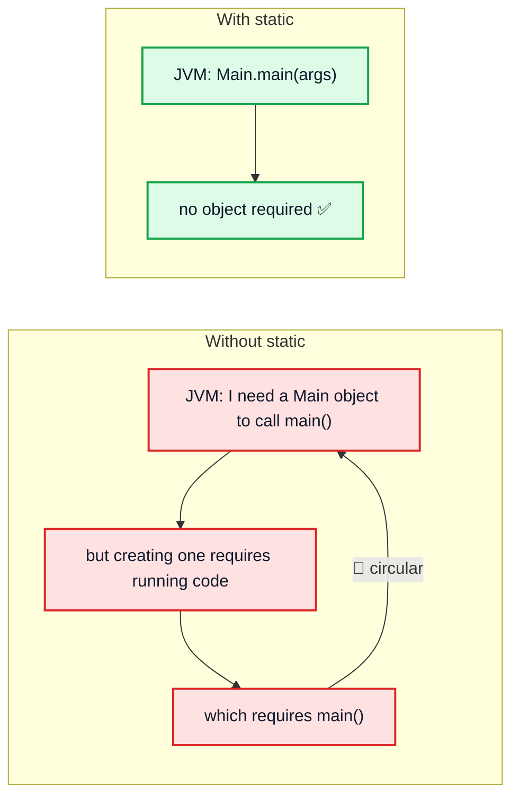

### Static vs Non-static

```java
public class Main {

    static int count = 0;        // ONE copy, shared by the class
    int id;                      // one copy PER object

    static void greet() {        // call as Main.greet()
        System.out.println("Hello from static");
    }

    void show() {                // needs an object: obj.show()
        System.out.println("id = " + id);
    }

    public static void main(String[] args) {
        greet();                 // ✅ static → static: direct call
        Main.greet();            // ✅ same thing, explicit

        // show();               // ❌ error: non-static method show() cannot be
                                 //    referenced from a static context

        Main obj = new Main();   // create an object first
        obj.id = 7;
        obj.show();              // ✅

        count++;
        System.out.println("count = " + count);
    }
}
// Output:
// Hello from static
// Hello from static
// id = 7
// count = 1
```

| | **static** | **non-static (instance)** |
|---|---|---|
| Belongs to | The class | Each object |
| Called via | `ClassName.method()` | `object.method()` |
| Copies of a field | One, shared | One per object |
| Can use `this`? | ❌ No | ✅ Yes |
| Can access instance members directly? | ❌ No | ✅ Yes |

> [!IMPORTANT]
> Since `main` is static, any helper method you call **directly** from `main` must also be `static` (until you start creating objects). This is why early DSA code is full of `static` methods.

---

## 15. What is 'void'? (18:24)

`void` is the **return type** meaning "this method returns nothing". The JVM doesn't expect a value back from `main`.

```java
static void sayHi() {            // returns nothing
    System.out.println("Hi");
}

static int square(int n) {       // returns an int
    return n * n;
}

public static void main(String[] args) {
    sayHi();                         // Hi
    int r = square(5);
    System.out.println(r);           // 25
    // int x = sayHi();              // ❌ error: incompatible types: void cannot be converted to int
}
```

> [!TIP]
> To signal success/failure to the operating system from `main`, use `System.exit(code)` — `0` means success, non-zero means error.

---

## 16. Array and Arguments (19:07)

`String[] args` is an **array of Strings** holding the **command-line arguments** — values typed after the class name when running the program.

```java
public class Main {
    public static void main(String[] args) {
        System.out.println("Number of args: " + args.length);
        for (int i = 0; i < args.length; i++) {
            System.out.println("args[" + i + "] = " + args[i]);
        }
    }
}
```

```
> java Main Kunal 22 "New Delhi"
Number of args: 3
args[0] = Kunal
args[1] = 22
args[2] = New Delhi

> java Main
Number of args: 0
```

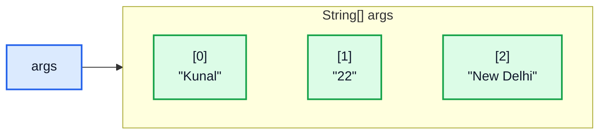

- Arguments are separated by spaces; quotes group words into one argument.
- Everything arrives as a **String** — `"22"` is text, not a number. Convert with `Integer.parseInt(args[1])`.
- With no arguments, `args` is an **empty array** (length 0), never `null`.

> [!CAUTION]
> Accessing `args[0]` when no arguments were passed throws `ArrayIndexOutOfBoundsException: Index 0 out of bounds for length 0`. Always check `args.length` first.

---

## 17. Changing Location of Byte Code (21:00)

By default `javac` puts `.class` files **next to the source**. In real projects, source and compiled output are kept separate using the `-d` (destination) flag.

```
> javac -d out Main.java          # put bytecode in ./out
> java -cp out Main               # tell the JVM where to look (classpath)
Hello World!
```

```
FirstJava/
 ├── Main.java          ← source
 └── out/
      └── Main.class    ← bytecode
```

| Flag | Tool | Meaning |
|---|---|---|
| `-d <dir>` | `javac` | Write `.class` files into `<dir>` (creates package sub-folders) |
| `-cp <dir>` / `-classpath` | `java`, `javac` | Where to search for classes |

> [!NOTE]
> If you run `java Main` from a folder that doesn't contain `Main.class` (and no `-cp` is given), you get `Error: Could not find or load main class Main`. The JVM searches the **classpath**, which defaults to the current directory.

---

## 18. Location of 'javac' and 'java' (22:25)

`javac` and `java` are ordinary executables inside the JDK's **`bin`** folder:

| OS | Typical location |
|---|---|
| Windows | `C:\Program Files\Java\jdk-21\bin\javac.exe` |
| macOS | `/Library/Java/JavaVirtualMachines/jdk-21.jdk/Contents/Home/bin/javac` |
| Linux | `/usr/lib/jvm/java-21-openjdk/bin/javac` |

Find which one your terminal is actually using:

```
Windows:        where java
macOS / Linux:  which java
```

You can always run them by **full path**, even without PATH configured:

```
> "C:\Program Files\Java\jdk-21\bin\javac" Main.java
```

---

## 19. Environment Variable PATH (24:31)

**PATH** is an environment variable containing a **list of folders**. When you type a command like `javac`, the shell searches those folders, in order, for an executable with that name.

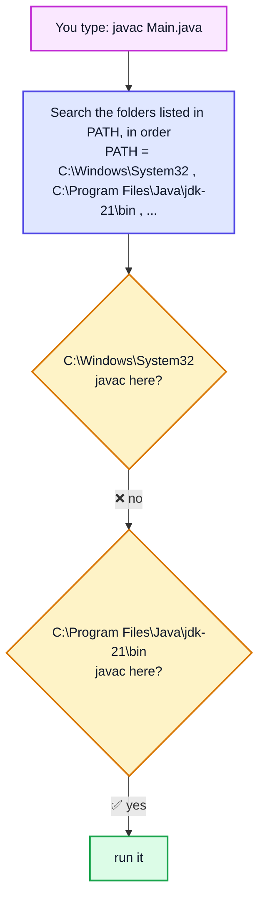

If no folder contains it: *'javac' is not recognized as an internal or external command* (Windows) / *command not found* (macOS/Linux).

| OS | How to add the JDK |
|---|---|
| Windows | Settings → "Edit the system environment variables" → Environment Variables → `Path` → New → `C:\Program Files\Java\jdk-21\bin` |
| macOS / Linux | In `~/.zshrc` or `~/.bashrc`: `export PATH="$JAVA_HOME/bin:$PATH"` |

> [!TIP]
> Also set **`JAVA_HOME`** to the JDK root folder (without `\bin`). Build tools like Maven and Gradle, and many IDEs, look for it. Open a **new** terminal after changing environment variables — existing terminals keep the old values.

---

## 20. Starting with IntelliJ IDEA (27:25)

An **IDE** (Integrated Development Environment) bundles editor + compiler + runner + debugger. IntelliJ IDEA (Community edition is free) is the course's choice.

```
New Project → Java → choose JDK → Create
 MyProject/
  ├── src/            ← your .java files go here
  │    └── Main.java
  ├── out/ (or build) ← IntelliJ writes .class files here
  └── .idea/          ← project settings
```

What IntelliJ does when you click ▶ Run:

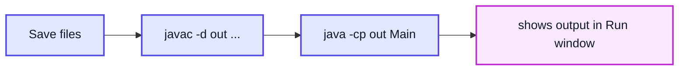

### Debugging (the "Debugging" part of the video title)

Debugging lets you **pause** the program and inspect variables line by line instead of guessing.

1. Click the gutter beside a line number → a red **breakpoint** dot appears
2. Click the 🐞 **Debug** button (not Run)
3. Execution stops at the breakpoint; the *Variables* panel shows current values
4. Use **Step Over** (F8) to run the next line, **Step Into** (F7) to enter a method call, **Resume** (F9) to continue to the next breakpoint

```java
public class DebugMe {
    public static void main(String[] args) {
        int sum = 0;
        for (int i = 1; i <= 5; i++) {
            sum += i;           // ← put a breakpoint here, watch i and sum change
        }
        System.out.println(sum); // 15
    }
}
```

| Iteration | `i` | `sum` after the line |
|---|---|---|
| 1 | 1 | 1 |
| 2 | 2 | 3 |
| 3 | 3 | 6 |
| 4 | 4 | 10 |
| 5 | 5 | 15 |

---

## 21. Some Shortcuts (29:49)

**Live templates** — type the abbreviation and press `Tab`/`Enter`:

| Type | Expands to |
|---|---|
| `psvm` or `main` | `public static void main(String[] args) { }` |
| `sout` | `System.out.println();` |
| `souf` | `System.out.printf("");` |
| `soutv` | Prints the nearest variable with its name |
| `fori` | `for (int i = 0; i < ; i++) { }` |

**Key shortcuts** (Windows/Linux; on macOS use ⌘ for Ctrl, ⌥ for Alt):

| Shortcut | Action |
|---|---|
| `Shift + F10` | Run |
| `Shift + F9` | Debug |
| `Ctrl + /` | Toggle line comment |
| `Ctrl + D` | Duplicate line |
| `Ctrl + Alt + L` | Reformat code |
| `Alt + Enter` | Quick fix (add import, fix error) |
| `Ctrl + Space` | Code completion |
| `Shift + Shift` | Search everywhere |

---

## 22. What is a 'package'? (30:17)

A **package** is a **folder-based namespace** that groups related classes. The `package` statement at the top of a file must match the folder the file is in.

```
src/
 └── com/
      └── kunal/
           ├── Main.java      →  package com.kunal;
           └── utils/
                └── Math.java →  package com.kunal.utils;
```

```java
package com.kunal;              // must be the first statement

public class Main {
    public static void main(String[] args) {
        System.out.println("In package com.kunal");
    }
}
```

Compile and run from the `src` folder using the **fully qualified name**:

```
> javac -d out com/kunal/Main.java
> java -cp out com.kunal.Main
In package com.kunal
```

Why packages matter:

| Benefit | Example |
|---|---|
| Avoid name clashes | `java.util.List` vs `java.awt.List` |
| Organization | `model`, `service`, `utils` packages |
| Access control | Package-private members are visible only within the package |

> [!NOTE]
> **`java.lang`** is imported automatically — that's why `String`, `System`, `Math` and `Integer` work without any `import`. Everything else (e.g. `java.util.Scanner`) needs an import or its full name.

---

## 23. What is 'System.out.println()'? (32:42)

Read it right to left by type:

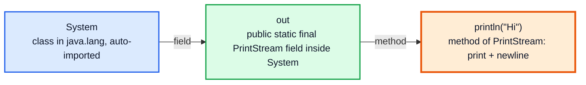

| Part | What it is |
|---|---|
| `System` | A final class in `java.lang` that gives access to system resources |
| `out` | A **static** field of type `PrintStream`, connected to standard output (the console) |
| `println` | An overloaded method of `PrintStream` — works for `int`, `double`, `char`, `String`, `Object`, ... |

Related streams:

```java
System.out.println("normal output");    // standard output
System.err.println("error output");     // standard error (often red in IDEs)
// System.in  → standard input (keyboard), used with Scanner
```

---

## 24. Outputs in Java (34:45)

### `print` vs `println` vs `printf`

```java
public class OutputDemo {
    public static void main(String[] args) {
        System.out.print("A");          // no newline
        System.out.print("B");
        System.out.println("C");        // newline AFTER printing
        System.out.println();           // empty line
        System.out.println(42);
        System.out.println(3.5);
        System.out.println('x');
        System.out.println(true);

        String name = "Kunal";
        int age = 22;
        System.out.printf("Name: %s, Age: %d%n", name, age);
        System.out.printf("%.2f%n", 98.6789);
    }
}
// Output:
// ABC
//
// 42
// 3.5
// x
// true
// Name: Kunal, Age: 22
// 98.68
```

| Method | Newline? | Use |
|---|---|---|
| `print(x)` | ❌ | Prompts, same-line output |
| `println(x)` | ✅ after | Most output |
| `printf(fmt, ...)` | Only with `%n` | Formatted output |

Common format specifiers: `%d` (integer), `%f` / `%.2f` (decimal), `%s` (string), `%c` (char), `%b` (boolean), `%n` (platform newline).

### String Concatenation with `+` — Evaluated Left to Right

```java
System.out.println("Sum: " + 2 + 3);     // Sum: 23   ← "Sum: 2" then + 3
System.out.println("Sum: " + (2 + 3));   // Sum: 5    ← parentheses first
System.out.println(2 + 3 + " is sum");   // 5 is sum  ← 2+3 = 5 first, then string
```

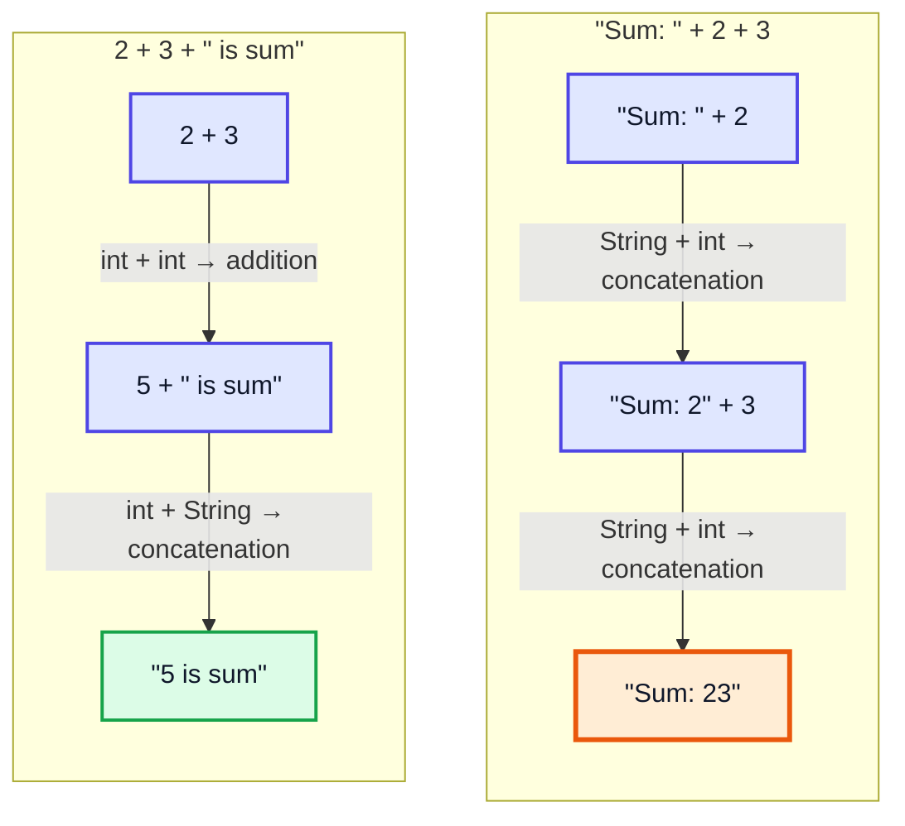

> [!IMPORTANT]
> Once the left operand of `+` is a `String`, every following `+` is **concatenation**, not addition. Use parentheses to force arithmetic.

### Escape Sequences

| Escape | Meaning |
|---|---|
| `\n` | New line |
| `\t` | Tab |
| `\"` | Double quote |
| `\'` | Single quote |
| `\\` | Backslash |

```java
System.out.println("Name:\tKunal\nSays: \"Hi\"");
// Name:	Kunal
// Says: "Hi"
```

---

## 25. Inputs in Java (39:25)

Input is read with **`Scanner`** from `java.util`, wrapping `System.in` (the keyboard stream).

```java
import java.util.Scanner;

public class InputDemo {
    public static void main(String[] args) {
        Scanner in = new Scanner(System.in);

        System.out.print("Enter a number: ");
        int n = in.nextInt();
        System.out.println("You entered " + n);
    }
}
// Enter a number: 7
// You entered 7
```

### Scanner Methods

| Method | Reads | Stops at |
|---|---|---|
| `nextInt()` | `int` | Whitespace (leaves the `\n` in the buffer) |
| `nextLong()`, `nextDouble()`, `nextFloat()`, `nextBoolean()` | That type | Whitespace |
| `next()` | One **word** (token) | Whitespace |
| `nextLine()` | Rest of the **line** (spaces included) | Newline (and consumes it) |
| `next().charAt(0)` | A single `char` | — (there is no `nextChar()`) |
| `hasNextInt()` | Checks if the next token is an int | — |

### `next()` vs `nextLine()`

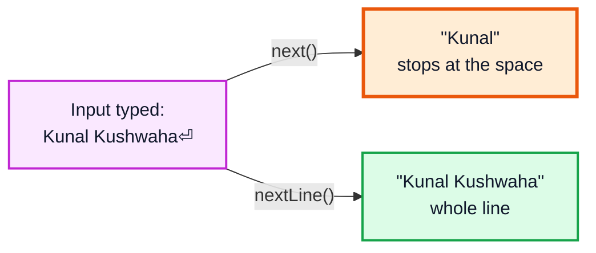

### ⚠️ The Classic `nextInt()` → `nextLine()` Pitfall

```java
Scanner in = new Scanner(System.in);
System.out.print("Age: ");
int age = in.nextInt();          // user types 22⏎ — reads 22, leaves '\n' in buffer
System.out.print("Name: ");
String name = in.nextLine();     // reads the leftover '\n' → name = "" instantly!
System.out.println("[" + name + "]");
// Age: 22
// Name: []           ← user never got a chance to type
```

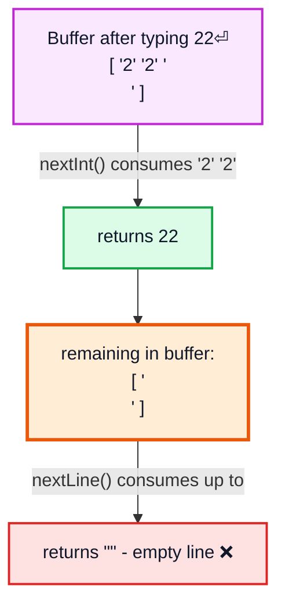

**Fix:** add an extra `in.nextLine();` after `nextInt()` to throw away the leftover newline (or read everything with `nextLine()` and convert using `Integer.parseInt`).

```java
int age = in.nextInt();
in.nextLine();                   // ✅ consume the leftover '\n'
String name = in.nextLine();     // now waits for real input
```

> [!CAUTION]
> Typing letters when `nextInt()` expects a number throws `java.util.InputMismatchException`. Use `hasNextInt()` to validate input if needed.

---

## 26. Primitive Data Types in Java (46:40)

Java has exactly **8 primitive types**. They store raw values directly (not objects) and have **fixed sizes on every platform** — part of Java's portability.

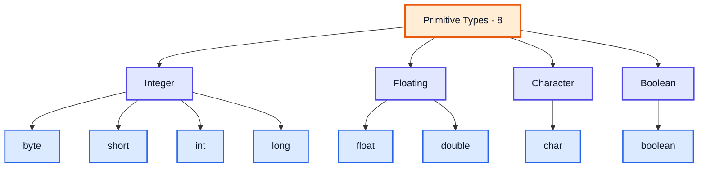

| Type | Size | Range | Default (fields) | Example |
|---|---|---|---|---|
| `byte` | 1 byte (8 bits) | -128 to 127 | `0` | `byte b = 100;` |
| `short` | 2 bytes (16 bits) | -32,768 to 32,767 | `0` | `short s = 30000;` |
| `int` | 4 bytes (32 bits) | -2,147,483,648 to 2,147,483,647 (≈ ±2.1 × 10⁹) | `0` | `int i = 42;` |
| `long` | 8 bytes (64 bits) | -9,223,372,036,854,775,808 to 9,223,372,036,854,775,807 (≈ ±9.2 × 10¹⁸) | `0L` | `long l = 9_000_000_000L;` |
| `float` | 4 bytes (32 bits) | ≈ ±3.4 × 10³⁸, ~6–7 significant digits | `0.0f` | `float f = 3.14f;` |
| `double` | 8 bytes (64 bits) | ≈ ±1.8 × 10³⁰⁸, ~15–16 significant digits | `0.0` | `double d = 3.14159;` |
| `char` | 2 bytes (16 bits) | `'\u0000'` to `'\uffff'` (0 to 65,535, unsigned) | `'\u0000'` | `char c = 'K';` |
| `boolean` | JVM-dependent (logically 1 bit) | `true` / `false` | `false` | `boolean ok = true;` |

Integer ranges follow the formula **-2ⁿ⁻¹ to 2ⁿ⁻¹ − 1** for *n* bits (one bit is the sign). `char` is the only **unsigned** type.

```java
public class Ranges {
    public static void main(String[] args) {
        System.out.println(Byte.MIN_VALUE + " " + Byte.MAX_VALUE);     // -128 127
        System.out.println(Short.MAX_VALUE);                           // 32767
        System.out.println(Integer.MIN_VALUE);                         // -2147483648
        System.out.println(Long.MAX_VALUE);                            // 9223372036854775807
        System.out.println(Float.MAX_VALUE);                           // 3.4028235E38
        System.out.println(Double.MAX_VALUE);                          // 1.7976931348623157E308
        System.out.println((int) Character.MAX_VALUE);                 // 65535
    }
}
```

### Literal Suffixes: `L` and `f`

```java
int a = 2147483647;          // ✅ max int
// int b = 2147483648;       // ❌ error: integer number too large
long c = 2147483648L;        // ✅ L makes it a long literal
// long d = 3000000000;      // ❌ still an error! the literal itself is an int without L

double e = 3.14;             // decimal literals are double by default
// float f = 3.14;           // ❌ error: possible lossy conversion from double to float
float g = 3.14f;             // ✅ f makes it a float literal
```

> [!IMPORTANT]
> Whole-number literals are **`int`** by default; decimal literals are **`double`** by default. Use `L` for long (uppercase — lowercase `l` looks like `1`) and `f`/`F` for float.

### Overflow — Integers Wrap Around Silently

```java
int max = Integer.MAX_VALUE;
System.out.println(max + 1);      // -2147483648  ← wraps to MIN, no error!
```

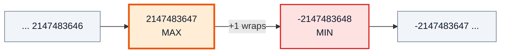

### Floating-Point Is Approximate

```java
System.out.println(0.1 + 0.2);    // 0.30000000000000004
System.out.println(10 / 3);       // 3                   (int division truncates)
System.out.println(10 / 3.0);     // 3.3333333333333335  (double)
System.out.println(10 / 3.0f);    // 3.3333333           (float: fewer digits)
```

> [!WARNING]
> Never use `float`/`double` for money — use `long` (paise/cents) or `java.math.BigDecimal`. And `String` is **not** a primitive; it's a class (an object).

---

## 27. Comments in Java (54:14)

Comments are ignored by the compiler; they explain *why* the code does something.

```java
// Single-line comment

/*
   Multi-line comment
   spanning several lines
*/

/**
 * Javadoc comment — used to generate HTML documentation.
 * @param a first number
 * @param b second number
 * @return the sum
 */
static int add(int a, int b) {
    return a + b;   // comments can follow code on the same line
}
```

| Type | Syntax | Use |
|---|---|---|
| Single-line | `// ...` | Short notes, disabling a line |
| Multi-line | `/* ... */` | Longer explanations (cannot be nested) |
| Documentation | `/** ... */` | Public API docs, read by `javadoc` and IDE tooltips |

> [!TIP]
> In IntelliJ, `Ctrl + /` toggles `//` on the selected lines and `Ctrl + Shift + /` wraps a selection in `/* */`.

---

## 28. Int Input Program (55:08)

```java
import java.util.Scanner;

public class IntInput {
    public static void main(String[] args) {
        Scanner in = new Scanner(System.in);

        System.out.print("Enter your roll number: ");
        int rollNo = in.nextInt();

        System.out.println("Your roll number is " + rollNo);
    }
}
// Enter your roll number: 15
// Your roll number is 15
```

What happens with bad input:

| User types | Result |
|---|---|
| `15` | ✅ `rollNo = 15` |
| `   15   ` | ✅ leading/trailing spaces ignored |
| `15.5` | 💥 `InputMismatchException` |
| `abc` | 💥 `InputMismatchException` |
| `3000000000` | 💥 `InputMismatchException` (out of int range — use `nextLong()`) |

---

## 29. Literals and Identifiers (59:47)

```java
int age = 22;
//  │      │
//  │      └── LITERAL: the fixed value written in code
//  └───────── IDENTIFIER: the name you give the variable
```

### Literals

| Kind | Examples |
|---|---|
| Integer | `10`, `-5`, `1_000_000` (underscores for readability) |
| Long | `10L`, `9_000_000_000L` |
| Hex / Binary / Octal | `0x1F` (31), `0b1010` (10), `017` (15) |
| Floating | `3.14`, `2.5f`, `1e3` (1000.0), `6.02e23` |
| Character | `'A'`, `'\n'`, `'\u0041'` (also `'A'`) |
| String | `"Hello"`, `""` |
| Boolean | `true`, `false` |
| Null | `null` (for references only) |

```java
System.out.println(0x1F + " " + 0b1010 + " " + 017 + " " + 1_000_000);
// 31 10 15 1000000
```

> [!WARNING]
> A leading `0` makes an integer literal **octal**: `int x = 010;` is **8**, not 10.

### Identifiers — Naming Rules

| Rule | ✅ Valid | ❌ Invalid |
|---|---|---|
| Letters, digits, `_`, `$` only | `marks2`, `_temp`, `$price` | `my-name`, `a b` |
| Cannot start with a digit | `a1` | `1a` |
| Cannot be a keyword | `className` | `class`, `int`, `static` |
| Case-sensitive | `age` ≠ `Age` | — |
| `_` alone is not allowed (Java 9+) | `_x` | `_` |

**Conventions:** variables/methods `camelCase` (`studentName`), classes `PascalCase` (`StudentRecord`), constants `UPPER_SNAKE_CASE` (`MAX_SIZE`), packages lowercase (`com.kunal`).

---

## 30. String Input Program (1:01:18)

```java
import java.util.Scanner;

public class StringInput {
    public static void main(String[] args) {
        Scanner in = new Scanner(System.in);

        System.out.print("Enter first name: ");
        String first = in.next();            // one word

        in.nextLine();                       // discard rest of that line

        System.out.print("Enter full name: ");
        String full = in.nextLine();         // whole line

        System.out.println("First: " + first);
        System.out.println("Full : " + full);
    }
}
// Enter first name: Kunal
// Enter full name: Kunal Kushwaha
// First: Kunal
// Full : Kunal Kushwaha
```

> [!NOTE]
> If the user typed `Kunal Kushwaha` at the first prompt, `next()` would take `"Kunal"`, and the `in.nextLine()` that follows would quietly throw away `" Kushwaha"`. Without that discard line, `full` would become `" Kushwaha"` immediately.

---

## 31. Float Input Program (1:02:38)

```java
import java.util.Scanner;

public class FloatInput {
    public static void main(String[] args) {
        Scanner in = new Scanner(System.in);

        System.out.print("Enter marks: ");
        float marks = in.nextFloat();

        System.out.println("Marks: " + marks);
    }
}
// Enter marks: 85
// Marks: 85.0          ← an int-looking input is accepted and widened to float

// Enter marks: 85.4
// Marks: 85.4
```

> [!NOTE]
> `Scanner` is **locale-sensitive**. On a system with a locale that uses a comma as decimal separator (e.g. German), `85.4` throws `InputMismatchException` and `85,4` is expected. Force a dot with `new Scanner(System.in).useLocale(java.util.Locale.US)`.

---

## 32. Sum of Two Numbers (1:04:39)

```java
import java.util.Scanner;

public class Sum {
    public static void main(String[] args) {
        Scanner in = new Scanner(System.in);

        System.out.print("Enter first number: ");
        int a = in.nextInt();
        System.out.print("Enter second number: ");
        int b = in.nextInt();

        int sum = a + b;
        System.out.println("Sum = " + sum);
        System.out.println("Sum = " + a + b);      // ⚠️ concatenation trap
    }
}
// Enter first number: 10
// Enter second number: 20
// Sum = 30
// Sum = 1020
```

Both numbers can even be typed on one line (`10 20⏎`) — `nextInt()` reads token by token, separated by any whitespace.

> [!TIP]
> If decimals are possible, use `double` and `nextDouble()`. For huge values, `long` + `nextLong()`. `int + int` can overflow: `2_000_000_000 + 2_000_000_000` = `-294967296`.

---

## 33. Type Conversion and Casting (1:07:30)

Java is **statically typed**, so assigning a value of one type to a variable of another type requires a **conversion**. There are two kinds:

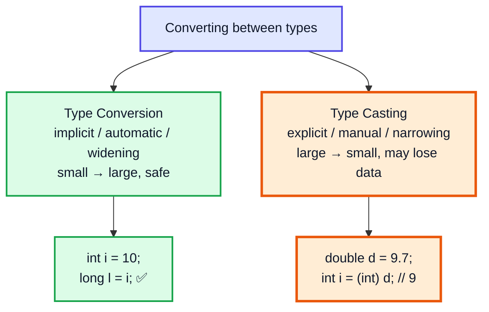

---

## 34. Type Conversion (1:07:48)

**Type conversion** (widening) happens **automatically** when a value of a smaller type is stored in a larger, compatible type. No data is lost (for integers), so the compiler does it silently.

```java
byte  b = 10;
short s = b;      // byte  → short
int   i = s;      // short → int
long  l = i;      // int   → long
float f = l;      // long  → float
double d = f;     // float → double

char c = 'A';
int code = c;     // char → int  : 65

System.out.println(d);     // 10.0
System.out.println(code);  // 65
```

### Widening Order

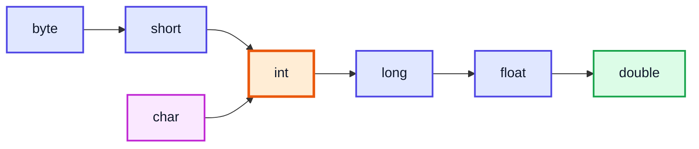

> [!WARNING]
> `int → float` and `long → float/double` are widening, but can **lose precision** (float has only ~7 significant digits):
> ```java
> int big = 123456789;
> float f = big;
> System.out.println(f);          // 1.23456792E8
> System.out.println((int) f);    // 123456792   ← not 123456789!
> ```

---

## 35. Conditions for Type Conversion (1:08:39)

Automatic conversion happens only if **both** conditions are true:

1. The two types are **compatible** (numeric ↔ numeric; `boolean` is compatible with nothing else)
2. The **destination type is larger** (can hold every value of the source type)

| From → To | Automatic? | Why |
|---|---|---|
| `int` → `long` | ✅ | Compatible, larger |
| `int` → `double` | ✅ | Compatible, larger range |
| `char` → `int` | ✅ | Every char (0–65535) fits in int |
| `long` → `int` | ❌ | Smaller — needs a cast |
| `double` → `float` | ❌ | Smaller — needs a cast |
| `byte` → `char` | ❌ | `char` can't hold negatives |
| `short` ↔ `char` | ❌ | Same size, but different ranges (signed vs unsigned) |
| `int` ↔ `boolean` | ❌ never | Incompatible — not even with a cast |
| `int` → `String` | ❌ | Not a primitive conversion; use `String.valueOf(i)` or `"" + i` |

```java
int i = 100;
// boolean flag = i;              // ❌ incompatible types: int cannot be converted to boolean
// boolean flag = (boolean) i;    // ❌ also an error
boolean flag = i != 0;            // ✅ the correct way
```

> [!NOTE]
> **Constant exception:** a compile-time constant `int` *can* be assigned to `byte`/`short`/`char` without a cast if the value fits: `byte b = 100;` ✅ but `byte b = 200;` ❌ (*possible lossy conversion from int to byte*).

---

## 36. Typecasting (1:10:24)

**Typecasting** (narrowing) is an **explicit** conversion from a larger type to a smaller one, written as `(targetType) value`. You are telling the compiler: *"I know data may be lost — do it anyway."*

```java
double d = 9.99;
int i = (int) d;
System.out.println(i);          // 9  ← fraction TRUNCATED (not rounded)

System.out.println((int) -3.99);         // -3  ← truncates toward zero
System.out.println(Math.round(9.99));    // 10  ← use Math.round to round
```

### Narrowing Integers — Keeps Only the Low Bits

When casting to a smaller integer type, Java **chops off** the high-order bits. For `byte` this behaves like *value mod 256*, then reinterpreted as signed (-128..127).

```java
System.out.println((byte) 257);     // 1
System.out.println((byte) 200);     // -56
System.out.println((byte) -129);    // 127
System.out.println((short) 70000);  // 4464
System.out.println((int) 3_000_000_000L);  // -1294967296
```

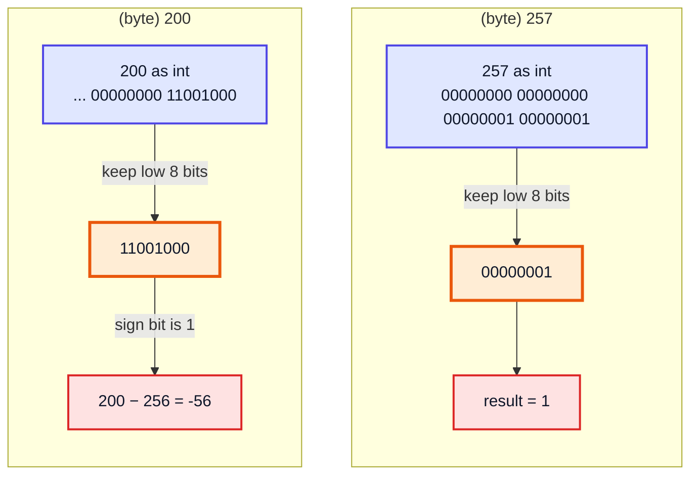

| Cast | Result | Calculation |
|---|---|---|
| `(byte) 257` | `1` | 257 − 256 |
| `(byte) 200` | `-56` | 200 − 256 |
| `(byte) -129` | `127` | -129 + 256 |
| `(short) 70000` | `4464` | 70000 − 65536 |
| `(char) 65` | `'A'` | Unicode 65 |
| `(int) 'a'` | `97` | Unicode of 'a' |

### Floating → Integer Edge Cases

```java
System.out.println((int) 1e20);          // 2147483647   ← clamps to int MAX
System.out.println((long) 1e20);         // 9223372036854775807
System.out.println((int) Double.NaN);    // 0
```

> [!CAUTION]
> Narrowing never throws an error at runtime — it **silently produces a wrong value**. Double-check every cast to `byte`, `short` or `int` from a larger type.

---

## 37. Automatic Type Promotion in Expressions (1:12:20)

When an expression combines values, Java first **promotes** the operands to a common type, *then* computes. The surprising part: **`byte`, `short` and `char` are always promoted to `int`** in arithmetic — even when both operands are `byte`.

```java
byte a = 40;
byte b = 50;
// byte c = a * b;        // ❌ error: possible lossy conversion from int to byte
int c = a * b;            // ✅ 2000 — a and b were promoted to int
byte d = (byte) (a * b);  // ✅ compiles, but 2000 doesn't fit → -48
```

Why? So that intermediate results don't overflow tiny types: `40 * 50 = 2000` would never fit in a byte.

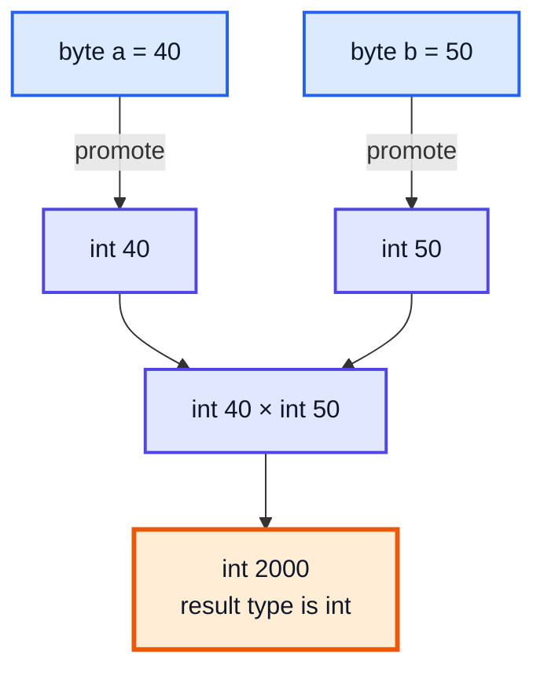

### Even `b = b + 1` Fails

```java
byte b = 10;
// b = b + 1;     // ❌ b + 1 is an int
b = (byte) (b + 1); // ✅ explicit cast
b += 1;           // ✅ compound assignment casts implicitly
b++;              // ✅ also fine
System.out.println(b);   // 13
```

> [!IMPORTANT]
> Compound operators (`+=`, `-=`, `*=`, `++` ...) include a **hidden cast** back to the variable's type. That's why `b += 1` compiles but `b = b + 1` does not. The hidden cast can overflow silently: `byte x = 50; x *= 3;` gives `-106`.

### Mixed Types

```java
int i = 10;
double d = 2.5;
System.out.println(i * d);      // 25.0  ← int promoted to double

long l = 5L;
System.out.println(i + l);      // 15    ← result is long

System.out.println(7 / 2 * 2.0);   // 6.0  ← 7/2 = 3 (int!) then 3 * 2.0
System.out.println(7 / 2.0 * 2);   // 7.0  ← 7/2.0 = 3.5 then 3.5 * 2
```

> [!WARNING]
> Promotion happens **per operation**, left to right — not once for the whole expression. In `7 / 2 * 2.0`, the integer division happens *before* the double ever appears.

---

## 38. Java follows Unicode (1:18:25)

Unlike C (where `char` is 1-byte ASCII), Java's `char` is a **16-bit Unicode** (UTF-16) code unit, so it can represent characters from almost every language. A `char` is really a **number** — its Unicode code point — which is why it participates in arithmetic.

| Char | Unicode (decimal) | Escape |
|---|---|---|
| `'0'` | 48 | `'\u0030'` |
| `'A'` | 65 | `'\u0041'` |
| `'a'` | 97 | `'\u0061'` |
| `'अ'` (Hindi) | 2309 | `'\u0905'` |

```java
public class UnicodeDemo {
    public static void main(String[] args) {
        char c = 'a';
        System.out.println(c + 1);            // 98   ← char promoted to int
        System.out.println((char) (c + 1));   // b
        System.out.println('a' + 'b');        // 195  ← 97 + 98, numeric!
        System.out.println("" + 'a' + 'b');   // ab   ← String first → concatenation
        System.out.println('a' + 'b' + "");   // 195  ← addition happens first
        System.out.println((int) 'A');        // 65
        System.out.println((char) 65);        // A

        char ch = 'A';
        ch++;                                  // compound → stays char
        System.out.println(ch);               // B

        char hindi = '\u0905';
        System.out.println(hindi);            // अ  (if the console supports UTF-8)
    }
}
```

> [!TIP]
> Handy tricks that rely on Unicode ordering: `ch - 'a'` gives the alphabet index (0–25), `ch - '0'` converts a digit character to its numeric value (`'7' - '0'` = `7`). You'll use these constantly in string DSA problems.

> [!NOTE]
> Some characters (most emoji, e.g. 😀) are outside the 16-bit range and need **two** `char`s (a surrogate pair) in a `String`. A single `char` can't hold them.

---

## 39. Rules for Type Promotion (1:19:20)

For binary arithmetic (`+ - * / %`) the compiler applies these rules **in order**:

| Step | Rule |
|---|---|
| 1 | All `byte`, `short` and `char` operands are promoted to **`int`** |
| 2 | If either operand is **`long`**, the whole operation is `long` |
| 3 | If either operand is **`float`**, the whole operation is `float` |
| 4 | If either operand is **`double`**, the whole operation is `double` |

(The "largest" type present wins: `int < long < float < double`.)

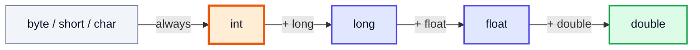

| Expression | Operand types | Result type |
|---|---|---|
| `byte + byte` | int, int | `int` |
| `short * char` | int, int | `int` |
| `int + long` | long, long | `long` |
| `long + float` | float, float | `float` |
| `float * double` | double, double | `double` |
| `char + double` | double, double | `double` |

> [!NOTE]
> These rules also apply to comparisons (`<`, `==`) and to the ternary `? :` operator, but **not** to `String` concatenation — with a `String` operand, `+` converts the other side to text instead.

---

## 40. Example for thorough review of concepts (1:21:18)

A single expression mixing six types — trace each sub-expression's type:

```java
public class Promotion {
    public static void main(String[] args) {
        byte b = 42;
        char c = 'a';            // 97
        short s = 1024;
        int i = 50000;
        float f = 5.67f;
        double d = 0.1234;

        double result = (f * b) + (i / c) - (d * s);

        System.out.println((f * b) + " " + (i / c) + " " + (d * s));
        System.out.println("result = " + result);
    }
}
// Output:
// 238.14 515 126.3616
// result = 626.7784146484375
```

```mermaid
flowchart TD
    FB["(f * b)<br/>float × byte → byte promoted → float<br/>= 238.14f"]
    IC["(i / c)<br/>int / char → char promoted → int<br/>= 50000 / 97 = 515 (truncated!)"]
    DS["(d * s)<br/>double × short → short promoted → double<br/>= 126.3616"]
    SUM["(f*b) + (i/c)<br/>float + int → float<br/>= 753.14f"]
    RES["... - (d*s)<br/>float - double → double<br/>= 626.778..."]
    FB --> SUM
    IC --> SUM
    SUM --> RES
    DS --> RES
    classDef process fill:#e0e7ff,stroke:#4f46e5,stroke-width:2px,color:#0f172a
    classDef bad fill:#fee2e2,stroke:#dc2626,stroke-width:2px,color:#0f172a
    classDef highlight fill:#ffedd5,stroke:#ea580c,stroke-width:3px,color:#0f172a
    classDef good fill:#dcfce7,stroke:#16a34a,stroke-width:2px,color:#0f172a
    class FB,DS process
    class IC bad
    class SUM highlight
    class RES good
```

| Sub-expression | Type | Value |
|---|---|---|
| `f * b` | `float` | `238.14` |
| `i / c` | `int` | `515` (not 515.46 — integer division) |
| `d * s` | `double` | `126.3616` |
| final | `double` | `626.7784146484375` |

> [!IMPORTANT]
> Mathematically the answer is `626.7784`. The extra digits `...146484375` come from the **float** intermediate `753.14f`, which can't be represented exactly. Any expression is only as precise as its *least precise* intermediate step. Also note: the result must be stored in a `double` (or wider) — `float result = ...` would be a compile error.

---

## 41. Basics of while loops and for loops (1:25:00)

Programs need two kinds of control besides "run the next line":

```mermaid
flowchart LR
    subgraph DEC["Decision - if/else"]
        direction TB
        C1{"condition?"} -->|"true"| BA["block A"]
        C1 -->|"false"| BB["block B"]
    end
    subgraph REP["Repetition - loops"]
        direction TB
        C2{"condition?"} -->|"true"| BODY["body"]
        BODY --> C2
        C2 -->|"false"| EXIT["exit"]
    end
    classDef decision fill:#fef3c7,stroke:#d97706,stroke-width:2px,color:#0f172a
    classDef process fill:#e0e7ff,stroke:#4f46e5,stroke-width:2px,color:#0f172a
    classDef startend fill:#ccfbf1,stroke:#0d9488,stroke-width:2px,color:#0f172a
    class C1,C2 decision
    class BA,BB,BODY process
    class EXIT startend
```

| Construct | Purpose |
|---|---|
| `if` / `else` | Choose **whether** to run code |
| `while` | Repeat **while** a condition holds (unknown count) |
| `for` | Repeat a **known** number of times |

---

## 42. if condition (1:25:13)

```java
if (condition) {
    // runs when condition is true
} else if (otherCondition) {
    // runs when first is false and this is true
} else {
    // runs when all are false
}
```

The condition **must be a `boolean`** — Java does not treat `0`/`1` as false/true like C does.

```java
public class Salary {
    public static void main(String[] args) {
        int salary = 25400;

        if (salary > 10000) {
            salary = salary + 2000;      // bonus
        } else {
            salary = salary + 1000;
        }
        System.out.println(salary);      // 27400

        int marks = 72;
        if (marks >= 90) {
            System.out.println("A");
        } else if (marks >= 70) {
            System.out.println("B");     // B  ← first true branch wins
        } else {
            System.out.println("C");
        }
    }
}
```

> [!WARNING]
> `if (x = 5)` is a compile error in Java (int is not boolean) — a mistake C silently allows. Use `==` for comparison. For `String`s, use `.equals()` instead of `==`.

---

## 43. while loops (1:26:00)

```java
while (condition) {
    // body — runs again and again while condition is true
}
```

```java
public class WhileDemo {
    public static void main(String[] args) {
        int count = 1;
        while (count <= 5) {
            System.out.print(count + " ");
            count++;                         // update — forget it → infinite loop!
        }
        System.out.println();
        System.out.println("After loop, count = " + count);
    }
}
// Output:
// 1 2 3 4 5
// After loop, count = 6
```

| Step | `count` | `count <= 5`? | Prints |
|---|---|---|---|
| 1 | 1 | ✅ | `1` |
| 2 | 2 | ✅ | `2` |
| 3 | 3 | ✅ | `3` |
| 4 | 4 | ✅ | `4` |
| 5 | 5 | ✅ | `5` |
| 6 | 6 | ❌ exit | — |

> [!TIP]
> `do { ... } while (cond);` is a variant that runs the body **at least once** before checking — useful for menus and input validation.

---

## 44. for loops (1:27:19)

```java
for (initialization; condition; update) {
    // body
}
```

```mermaid
flowchart TD
    INIT["① initialization<br/>runs once"] --> COND{"② condition?"}
    COND -->|"true"| BODY["③ body"]
    BODY --> UPD["④ update"]
    UPD -->|"back to ②"| COND
    COND -->|"false"| EXIT["exit loop"]
    classDef startend fill:#ccfbf1,stroke:#0d9488,stroke-width:2px,color:#0f172a
    classDef decision fill:#fef3c7,stroke:#d97706,stroke-width:2px,color:#0f172a
    classDef process fill:#e0e7ff,stroke:#4f46e5,stroke-width:2px,color:#0f172a
    class INIT startend
    class COND decision
    class BODY,UPD process
    class EXIT startend
```

```java
public class ForDemo {
    public static void main(String[] args) {
        for (int i = 1; i <= 5; i++) {
            System.out.print(i * i + " ");
        }
        System.out.println();

        for (int i = 10; i > 0; i -= 3) {
            System.out.print(i + " ");
        }
        System.out.println();
        // System.out.println(i);   // ❌ i only exists inside the loop
    }
}
// Output:
// 1 4 9 16 25
// 10 7 4 1
```

---

## 45. When to use - while loop and for loop (1:28:03)

Both are equally powerful (any `for` can be rewritten as a `while`). Pick the one that reads more naturally:

| Use **`for`** when... | Use **`while`** when... |
|---|---|
| You know the number of iterations in advance | You don't know how many iterations are needed |
| Iterating over a range or array index | Looping until some event/condition (input = 0, number becomes 0) |
| `for (int i = 0; i < n; i++)` | `while (n > 0) { n /= 10; }` |

```java
// Known count → for
for (int i = 1; i <= 10; i++) {
    System.out.println("5 x " + i + " = " + (5 * i));
}

// Unknown count → while: how many digits in n?
int n = 98765, digits = 0;
while (n > 0) {
    n /= 10;
    digits++;
}
System.out.println(digits);   // 5
```

---

## 46. Temperature Conversion Program (1:28:45)

**Problem:** read a temperature in Celsius and print it in Fahrenheit.

Formula: **F = (C × 9 / 5) + 32**

```java
import java.util.Scanner;

public class TempConvert {
    public static void main(String[] args) {
        Scanner in = new Scanner(System.in);

        System.out.print("Enter temperature in Celsius: ");
        float celsius = in.nextFloat();

        float fahrenheit = (celsius * 9 / 5) + 32;

        System.out.println(celsius + " C = " + fahrenheit + " F");
    }
}
// Enter temperature in Celsius: 37.5
// 37.5 C = 99.5 F

// Enter temperature in Celsius: 100
// 100.0 C = 212.0 F
```

### The Integer Division Trap

```java
int c = 37;
System.out.println(c * 9 / 5 + 32);     // 98    ← 333 / 5 = 66 (int), + 32
System.out.println(c * 9.0 / 5 + 32);   // 98.6  ← 9.0 forces double
System.out.println(9 / 5 * c + 32);     // 69    ← 9 / 5 = 1 !!! then 1 * 37 + 32
```

> [!CAUTION]
> Writing `(9 / 5) * c` is a classic bug: `9 / 5` is integer division = `1`, so the formula silently becomes `c + 32`. Either keep a floating-point operand in the expression (`9.0 / 5`, a `float` celsius) or multiply before dividing.

Reverse conversion: **C = (F − 32) × 5 / 9**.

---

## 47. Outro (1:31:52)

You can now write, compile, run and debug Java programs, read input, and reason precisely about types. Next videos cover **conditionals and loops in depth**, followed by **switch statements** and **functions/methods**.

---

## 🧩 Complete Example: Everything Together

One program that uses **every concept** from this video: `Scanner` input (including the `nextLine` pitfall fix), data types & literals, casting, type promotion, `char` arithmetic, `if`, `while`, `for`, and temperature conversion.

```java
import java.util.Scanner;

public class Main {
    public static void main(String[] args) {
        Scanner in = new Scanner(System.in);

        // ═══════ 1. INPUT (Scanner) ═══════
        System.out.print("Enter your name: ");
        String name = in.nextLine();              // whole line, spaces allowed

        System.out.print("Enter your age: ");
        int age = in.nextInt();                   // reads only the number
        in.nextLine();                            // consume the leftover '\n' (pitfall fix!)

        System.out.print("Enter your city: ");
        String city = in.nextLine();

        System.out.print("Enter body temperature in Celsius: ");
        float celsius = in.nextFloat();

        System.out.print("How many rows in the conversion table? ");
        int rows = in.nextInt();

        // ═══════ 2. DATA TYPES & LITERALS ═══════
        long worldPopulation = 8_000_000_000L;    // needs L — too big for int
        char grade = 'A';
        boolean isAdult = age >= 18;

        System.out.println();
        System.out.println("Hello, " + name + " from " + city + "!");
        System.out.println("World population: " + worldPopulation);

        // ═══════ 3. IF CONDITION ═══════
        if (isAdult) {
            System.out.println(name + " is an adult.");
        } else {
            System.out.println(name + " is a minor.");
        }

        // ═══════ 4. TYPE CASTING (narrowing) ═══════
        double price = 99.99;
        int rupees = (int) price;                 // fraction truncated
        byte wrapped = (byte) 257;                // 257 - 256 = 1
        System.out.println("(int) 99.99 = " + rupees);
        System.out.println("(byte) 257  = " + wrapped);

        // ═══════ 5. TYPE PROMOTION ═══════
        byte b = 10;
        short s = 20;
        char c = 'a';                             // Unicode 97
        int promoted = b + s + c;                 // all promoted to int
        char nextGrade = (char) (grade + 1);      // 'A'(65) + 1 = 66 → 'B'
        System.out.println("byte + short + char = " + promoted);
        System.out.println("Next grade after A = " + nextGrade);

        // ═══════ 6. WHILE LOOP: count digits of age ═══════
        int temp = age;
        int digits = 0;
        while (temp > 0) {
            temp = temp / 10;
            digits++;
        }
        System.out.println("Digits in age: " + digits);

        // ═══════ 7. TEMPERATURE CONVERSION ═══════
        float fahrenheit = (celsius * 9 / 5) + 32;
        System.out.println(celsius + " C = " + fahrenheit + " F");

        if (fahrenheit > 99.0) {
            System.out.println("Status: Fever");
        } else {
            System.out.println("Status: Normal");
        }

        // ═══════ 8. FOR LOOP: conversion table ═══════
        System.out.println("Celsius -> Fahrenheit");
        for (int i = 0; i < rows; i++) {
            int cel = i * 50;
            double fah = cel * 9.0 / 5 + 32;      // 9.0 forces double arithmetic
            System.out.println(cel + " -> " + fah);
        }

        in.close();
    }
}
```

**Sample Input** (one value per line):
```
Kunal Kushwaha
22
New Delhi
37.5
3
```

**Trace of the key values:**

| Step | Computation | Value |
|---|---|---|
| `isAdult` | `22 >= 18` | `true` |
| `rupees` | `(int) 99.99` → truncate | `99` |
| `wrapped` | `(byte) 257` → 257 − 256 | `1` |
| `promoted` | `10 + 20 + 97` (all as `int`) | `127` |
| `nextGrade` | `(char) (65 + 1)` | `'B'` |
| `digits` | `22 → 2 → 0` (two divisions) | `2` |
| `fahrenheit` | `37.5f * 9 = 337.5`, `/ 5 = 67.5`, `+ 32` | `99.5` |
| fever? | `99.5 > 99.0` | `true` → `Fever` |
| table rows | `i = 0, 1, 2` → `cel = 0, 50, 100` | `32.0, 122.0, 212.0` |

**Expected Output:**
```
Enter your name: Kunal Kushwaha
Enter your age: 22
Enter your city: New Delhi
Enter body temperature in Celsius: 37.5
How many rows in the conversion table? 3

Hello, Kunal Kushwaha from New Delhi!
World population: 8000000000
Kunal Kushwaha is an adult.
(int) 99.99 = 99
(byte) 257  = 1
byte + short + char = 127
Next grade after A = B
Digits in age: 2
37.5 C = 99.5 F
Status: Fever
Celsius -> Fahrenheit
0 -> 32.0
50 -> 122.0
100 -> 212.0
```

> [!NOTE]
> The input values shown after each prompt are what the user types (echoed by the terminal). Without the `in.nextLine();` after `nextInt()`, `city` would be read as an empty string and the program would jump straight to the temperature prompt.

---

## Quick Reference Cheat Sheet

| Concept | One-Line Summary |
|---|---|
| **Compile / Run** | `javac Main.java` → `Main.class`; `java Main` (class name, no extension); `java Main.java` runs directly (Java 11+) |
| **File structure** | `package` → `import`s → classes; max one `public` class, file named after it |
| **`public`** | Accessible from anywhere (JVM must reach `main`) |
| **`class`** | Container for all code in Java |
| **`static`** | Belongs to the class — callable without an object |
| **`void`** | Method returns nothing |
| **`String[] args`** | Command-line arguments; always Strings; empty array if none |
| **`-d` / `-cp`** | Choose where `.class` files go / where the JVM looks for them |
| **PATH** | List of folders the shell searches for `javac`/`java`; add `JDK\bin` |
| **package** | Folder-based namespace; run with fully-qualified name `com.kunal.Main` |
| **`System.out.println`** | `System` class → static `PrintStream out` → `println` method |
| **`print` / `println` / `printf`** | No newline / newline / formatted (`%d %s %.2f %n`) |
| **`"a" + 1 + 2`** | `"a12"` — String on the left makes `+` concatenate |
| **Scanner** | `nextInt()`, `nextFloat()`, `next()` (word), `nextLine()` (line) |
| **`nextInt()` then `nextLine()`** | Leftover `\n` → empty string; add an extra `nextLine()` |
| **8 primitives** | `byte`1 `short`2 `int`4 `long`8 `float`4 `double`8 `char`2 `boolean` |
| **Ranges** | byte −128..127, short −32768..32767, int ≈ ±2.1×10⁹, long ≈ ±9.2×10¹⁸, char 0..65535 |
| **Literal defaults** | Whole number → `int`; decimal → `double`; use `L` for long, `f` for float |
| **Overflow** | `Integer.MAX_VALUE + 1` = `Integer.MIN_VALUE` — silent wrap |
| **Widening (auto)** | byte → short → int → long → float → double; char → int |
| **Conversion conditions** | Compatible types AND destination larger; `boolean` never converts |
| **Narrowing (cast)** | `(int) 9.99` = 9 (truncate); `(byte) 257` = 1; `(byte) 200` = −56 |
| **Promotion rule 1** | byte/short/char → `int` in every arithmetic expression |
| **Promotion rules 2–4** | Any `long` → long; any `float` → float; any `double` → double |
| **`b = b + 1` vs `b += 1`** | First fails for byte (int result); compound operators cast implicitly |
| **Unicode `char`** | 16-bit; `'a'` = 97, `'A'` = 65, `'0'` = 48; `'a' + 'b'` = 195 |
| **`if`** | Condition must be `boolean`; first true branch runs |
| **`while` vs `for`** | Unknown iteration count vs known count |
| **Celsius → Fahrenheit** | `F = C * 9 / 5 + 32` — avoid `9 / 5` integer division (= 1) |
