# Conditionals and Loops — Complete In-Depth Guide

**Video #9 of the Java + DSA playlist:** *Conditionals and Loops + Calculator Program* (1:02:35)

A deep-dive into decision making (`if`, `else`, `else if`) and repetition (`for`, `while`, `do-while`) in Java — with flow diagrams, iteration-by-iteration trace tables, five classic practice questions solved in multiple ways, and a complete menu-driven calculator program.

---

## Table of Contents

| # | Topic | Timestamp |
|---|---|---|
| 0 | [Introduction](#0-introduction-000) | 0:00 |
| 1 | [Creating New Project](#1-creating-new-project-043) | 0:43 |
| 2 | [Conditions](#2-conditions-128) | 1:28 |
| 3 | [Syntax of if-else statements](#3-syntax-of-if-else-statements-215) | 2:15 |
| 4 | [E1 : if-else statements](#4-e1--if-else-statements-254) | 2:54 |
| 5 | [Multiple if-else statements](#5-multiple-if-else-statements-456) | 4:56 |
| 6 | [Loops](#6-loops-720) | 7:20 |
| 7 | [Syntax of a "for loop"](#7-syntax-of-a-for-loop-846) | 8:46 |
| 8 | [E2 : for loop](#8-e2--for-loop-928) | 9:28 |
| 9 | [E3 : for loop](#9-e3--for-loop-1240) | 12:40 |
| 10 | [Syntax of a "while loop"](#10-syntax-of-a-while-loop-1423) | 14:23 |
| 11 | [E4 : while loop](#11-e4--while-loop-1448) | 14:48 |
| 12 | [When to use "for loop" and "while loop"](#12-when-to-use-for-loop-and-while-loop-1700) | 17:00 |
| 13 | [Syntax of a "do while loop"](#13-syntax-of-a-do-while-loop-1757) | 17:57 |
| 14 | [E5 : do while loop](#14-e5--do-while-loop-1822) | 18:22 |
| 15 | ["while loop" vs "do while loop"](#15-while-loop-vs-do-while-loop-1857) | 18:57 |
| 16 | [Solving Questions](#16-solving-questions-2044) | 20:44 |
| 17 | [Q1 : Largest number](#17-q1--largest-number-2051) | 20:51 |
| 18 | [Q2 : Alphabet case check](#18-q2--alphabet-case-check-2812) | 28:12 |
| 19 | [Q3 : Fibonacci numbers](#19-q3--fibonacci-numbers-3503) | 35:03 |
| 20 | [Q4 : Counting occurrences](#20-q4--counting-occurrences-4300) | 43:00 |
| 21 | [Q5 : Reverse](#21-q5--reverse-4914) | 49:14 |
| 22 | [Calculator program](#22-calculator-program-5307) | 53:07 |
| 23 | [Outro](#23-outro-10154) | 1:01:54 |

---

## 0. Introduction (0:00)

So far, every program we have written runs **top to bottom, exactly once**. Real programs need two more abilities:

1. **Decision making** — run a block of code *only if* some condition is true → **conditionals** (`if`, `else if`, `else`)
2. **Repetition** — run a block of code *many times* → **loops** (`for`, `while`, `do-while`)

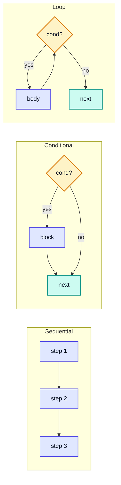

> [!IMPORTANT]
> With just **sequence + selection (if) + iteration (loops)** you can express *any* algorithm. Every DSA topic ahead — arrays, searching, sorting, recursion — is built on the patterns in this video. The digit-extraction trick (`% 10` and `/ 10`) from Q4/Q5 alone appears in dozens of interview problems.

---

## 1. Creating New Project (0:43)

The video starts a fresh IntelliJ IDEA project to keep each topic's code organized.

### Steps in IntelliJ IDEA

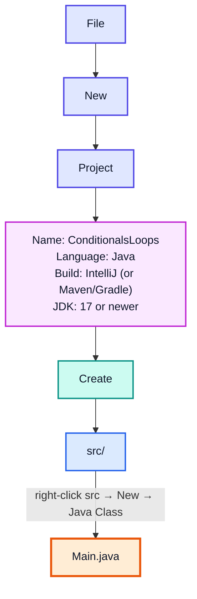

### Starter Template

Every example in these notes fits in a class like this:

```java
import java.util.Scanner;

public class Main {
    public static void main(String[] args) {
        Scanner in = new Scanner(System.in);   // for reading user input
        // your code here
    }
}
```

> [!TIP]
> In IntelliJ, typing `psvm` + Tab generates `public static void main(String[] args)`, and `sout` + Tab generates `System.out.println();`. Typing `fori` + Tab generates a complete `for` loop skeleton.

> [!NOTE]
> Since **Java 11** you can run a single file directly without compiling first: `java Main.java`. Useful for quick practice outside an IDE.

---

## 2. Conditions (1:28)

### What is a Condition?

A **condition** is any expression that evaluates to a **`boolean`** — either `true` or `false`. Conditionals use this result to decide which code runs.

```java
int age = 20;
boolean isAdult = age >= 18;   // condition → true
```

### Relational (Comparison) Operators

| Operator | Meaning | Example (`a = 10`, `b = 5`) | Result |
|---|---|---|---|
| `==` | equal to | `a == b` | `false` |
| `!=` | not equal to | `a != b` | `true` |
| `>` | greater than | `a > b` | `true` |
| `<` | less than | `a < b` | `false` |
| `>=` | greater than or equal | `a >= 10` | `true` |
| `<=` | less than or equal | `b <= 4` | `false` |

### Logical Operators — Combining Conditions

| Operator | Name | True when… | Example |
|---|---|---|---|
| `&&` | AND | **both** sides are true | `age >= 18 && hasId` |
| `\|\|` | OR | **at least one** side is true | `day == 6 \|\| day == 7` |
| `!` | NOT | the operand is false | `!isRaining` |

### Truth Table

| `A` | `B` | `A && B` | `A \|\| B` | `!A` |
|---|---|---|---|---|
| true | true | true | true | false |
| true | false | false | true | false |
| false | true | false | true | true |
| false | false | false | false | true |

### Short-Circuit Evaluation

`&&` and `||` stop evaluating as soon as the answer is known:

```java
public class ShortCircuit {
    public static void main(String[] args) {
        int x = 0;

        // && : left side is false → right side is NEVER evaluated (no division by zero!)
        if (x != 0 && 10 / x > 1) {
            System.out.println("big");
        } else {
            System.out.println("safe");      // safe
        }

        // || : left side is true → right side is skipped
        boolean result = (x == 0) || (10 / x > 1);
        System.out.println(result);          // true
    }
}
```

> [!CAUTION]
> In Java, a condition **must** be a `boolean`. Unlike C/C++, `if (1)` or `if (x)` with an `int` is a **compile error**. And `if (x = 5)` (assignment instead of `==`) also fails to compile for `int` — Java protects you from this classic bug.

> [!WARNING]
> Never compare **Strings** with `==` — it compares references (addresses), not content. Use `s1.equals(s2)`. `==` is correct for primitives (`int`, `char`, `double`, `boolean`).

---

## 3. Syntax of if-else statements (2:15)

### The Basic Forms

```java
// 1. if only — do something or nothing
if (condition) {
    // runs when condition is true
}

// 2. if-else — choose between exactly two paths
if (condition) {
    // runs when condition is true
} else {
    // runs when condition is false
}
```

### Flow Diagram

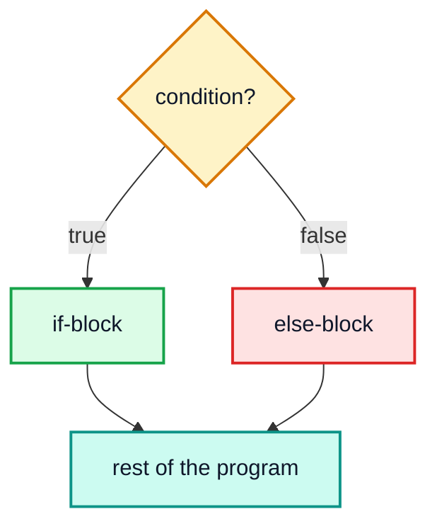

Exactly **one** of the two blocks runs — never both, never neither.

### Braces Are Optional for One Statement (but use them!)

```java
if (marks >= 40)
    System.out.println("Pass");
else
    System.out.println("Fail");
```

> [!WARNING]
> Without braces, only the **very next statement** belongs to the `if`. Adding a second line later is a silent bug:
> ```java
> if (marks >= 40)
>     System.out.println("Pass");
>     System.out.println("Congrats!");   // ALWAYS runs — not part of the if!
> ```
> Always using `{ }` avoids this entirely.

### The Ternary Operator — a Compact if-else for Values

```java
// condition ? valueIfTrue : valueIfFalse
int marks = 72;
String result = (marks >= 40) ? "Pass" : "Fail";
System.out.println(result);   // Pass
```

| | `if-else` | Ternary `? :` |
|---|---|---|
| Is a… | statement | expression (produces a value) |
| Best for | running blocks of code | choosing between two values |
| Readability | good for any size | good only when short |

---

## 4. E1 : if-else statements (2:54)

### Example: Salary Bonus

A company gives a bonus of ₹2000 if the salary is more than ₹10,000, otherwise ₹1000.

```java
public class SalaryBonus {
    public static void main(String[] args) {
        int salary = 25400;

        if (salary > 10000) {
            salary = salary + 2000;   // shorthand: salary += 2000;
        } else {
            salary = salary + 1000;
        }

        System.out.println(salary);   // 27400
    }
}
```

### Trace

| Step | Expression | Value | Branch taken |
|---|---|---|---|
| 1 | `salary` | 25400 | — |
| 2 | `salary > 10000` | `true` | if-block |
| 3 | `salary += 2000` | 27400 | — |
| 4 | print | `27400` | — |

### Another Example: Even or Odd

```java
public class EvenOdd {
    public static void main(String[] args) {
        int n = 17;
        if (n % 2 == 0) {
            System.out.println(n + " is even");
        } else {
            System.out.println(n + " is odd");   // 17 is odd
        }
    }
}
```

> [!TIP]
> `n % 2 == 0` is the standard even check. For negative odd numbers `n % 2` is `-1`, not `1` — so prefer `n % 2 != 0` over `n % 2 == 1` when checking for odd.

---

## 5. Multiple if-else statements (4:56)

### The else-if Ladder

When there are **more than two** possible paths, chain conditions with `else if`:

```java
if (condition1) {
    // block 1
} else if (condition2) {
    // block 2
} else if (condition3) {
    // block 3
} else {
    // default block (none matched)
}
```

Conditions are checked **top to bottom**; the **first** true one wins and the rest are skipped.

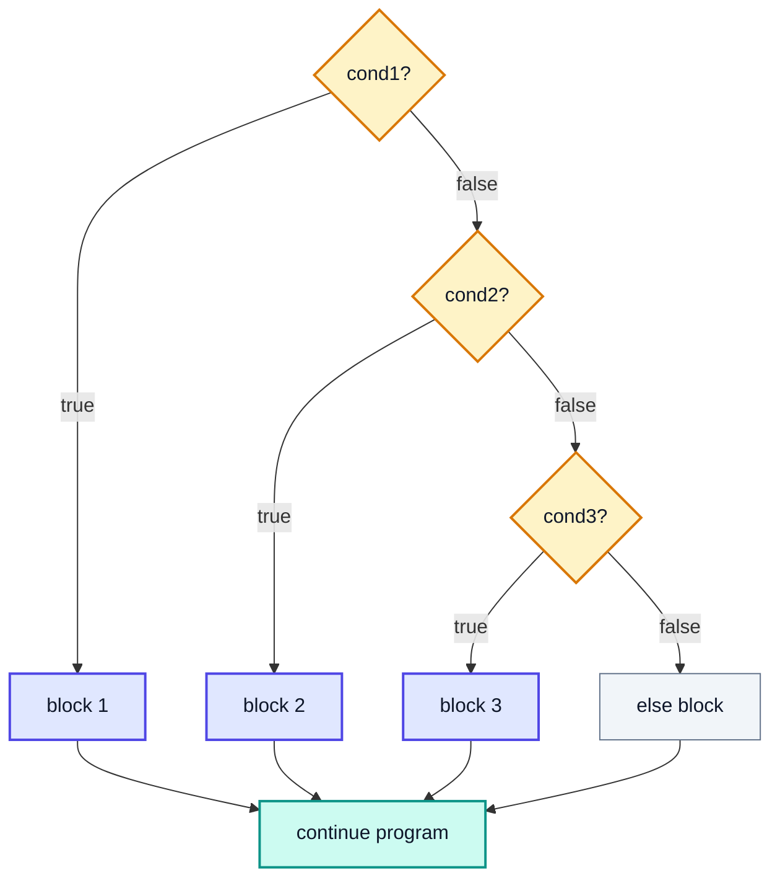

### Example: Tiered Salary Bonus

```java
public class TieredBonus {
    public static void main(String[] args) {
        int salary = 25400;

        if (salary > 20000) {
            salary += 3000;
        } else if (salary > 10000) {
            salary += 2000;
        } else {
            salary += 1000;
        }

        System.out.println(salary);   // 28400
    }
}
```

### Order Matters!

| salary | `> 20000`? | `> 10000`? | Bonus | Final |
|---|---|---|---|---|
| 25400 | ✅ true | (skipped) | 3000 | 28400 |
| 15000 | ❌ false | ✅ true | 2000 | 17000 |
| 8000 | ❌ false | ❌ false | 1000 (else) | 9000 |

> [!CAUTION]
> If you write the **broader** condition first, the narrower one is unreachable:
> ```java
> if (salary > 10000)       salary += 2000;   // 25400 matches HERE
> else if (salary > 20000)  salary += 3000;   // can never be reached for >20000!
> ```
> Rule: in a ladder of ranges, check the **most specific / extreme** range first.

### Separate `if`s vs an `else-if` Ladder

```java
int x = 25;

// Separate ifs: EVERY condition is checked independently
if (x > 10) System.out.println("A");   // A
if (x > 20) System.out.println("B");   // B

// Ladder: only the FIRST match runs
if (x > 10)      System.out.println("C");   // C
else if (x > 20) System.out.println("D");   // skipped
```

| | Separate `if`s | `else-if` ladder |
|---|---|---|
| Blocks that can run | 0, 1 or many | at most 1 (exactly 1 with `else`) |
| Use when | conditions are independent | conditions are mutually exclusive |

### Example: Grade Calculator

```java
public class Grade {
    public static void main(String[] args) {
        int marks = 82;
        char grade;

        if (marks >= 90)      grade = 'A';
        else if (marks >= 75) grade = 'B';
        else if (marks >= 50) grade = 'C';
        else                  grade = 'F';

        System.out.println("Grade: " + grade);   // Grade: B
    }
}
```

> [!NOTE]
> Java's compiler tracks **definite assignment**: because every path of the ladder above (including the final `else`) assigns `grade`, it's safe to print it. Remove the final `else` and you get *"variable grade might not have been initialized"*.

### Nested if

An `if` can live inside another `if`:

```java
int age = 25;
boolean hasLicense = true;

if (age >= 18) {
    if (hasLicense) {
        System.out.println("Can drive");        // Can drive
    } else {
        System.out.println("Get a license first");
    }
} else {
    System.out.println("Too young");
}
```

> [!TIP]
> Deep nesting hurts readability. `if (age >= 18 && hasLicense)` often replaces a nested `if`. When you compare one variable against many fixed values, a `switch` (covered in the next video) is cleaner than a long ladder.

---

## 6. Loops (7:20)

### Why Loops?

Suppose you need to print numbers 1 to 5:

```java
System.out.println(1);
System.out.println(2);
System.out.println(3);
System.out.println(4);
System.out.println(5);
// ...now do it for 1 to 1,000,000 😱
```

A **loop** repeats a block of code while a condition stays true:

```java
for (int i = 1; i <= 1_000_000; i++) {
    System.out.println(i);
}
```

### The Four Ingredients of Every Loop

| Ingredient | Purpose | Example |
|---|---|---|
| **Initialization** | set the starting state | `int i = 1` |
| **Condition** | decide whether to run the body again | `i <= 5` |
| **Body** | the work to repeat | `System.out.println(i)` |
| **Update** | move toward the end | `i++` |

> [!WARNING]
> If the **update** never makes the condition false, you get an **infinite loop** — the program hangs forever. In IntelliJ, stop it with the red ■ Stop button (or Ctrl+F2).

### Java's Loop Types

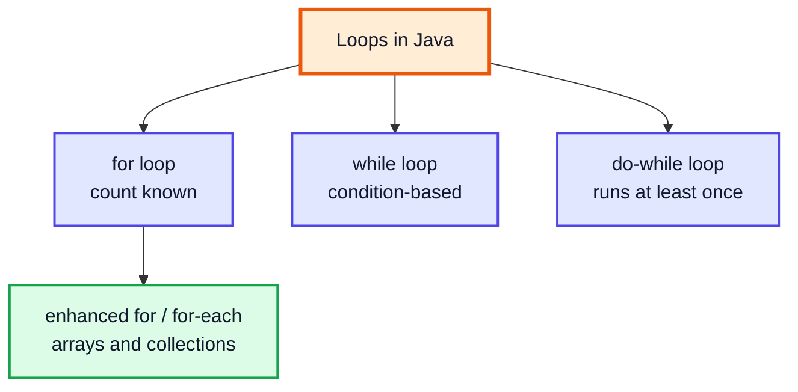

**Terminology:** one execution of the loop body is called an **iteration**.

---

## 7. Syntax of a "for loop" (8:46)

### Syntax

```java
for (initialization; condition; update) {
    // body
}
```

### Execution Order

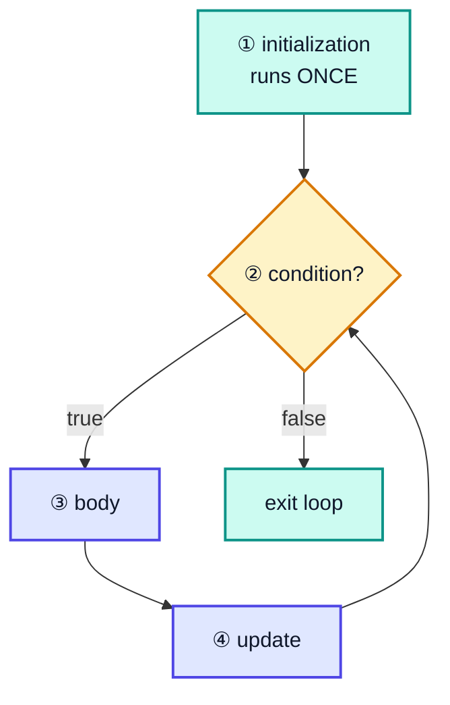

Order: **init → (check → body → update) → (check → body → update) → … → check fails → exit.**

### Facts About the `for` Loop

| Fact | Example |
|---|---|
| The loop variable is **scoped** to the loop | `i` doesn't exist after the closing `}` |
| Any part may be omitted | `for (;;) { }` is an infinite loop |
| Multiple variables allowed | `for (int i = 0, j = 10; i < j; i++, j--)` |
| Can count down | `for (int i = 5; i >= 1; i--)` |
| Can step by any amount | `for (int i = 0; i <= 20; i += 5)` |

```java
public class ForVariants {
    public static void main(String[] args) {
        for (int i = 5; i >= 1; i--) System.out.print(i + " ");
        System.out.println();                                  // 5 4 3 2 1

        for (int i = 0; i <= 20; i += 5) System.out.print(i + " ");
        System.out.println();                                  // 0 5 10 15 20

        for (int i = 0, j = 4; i < j; i++, j--) System.out.print("(" + i + "," + j + ") ");
        System.out.println();                                  // (0,4) (1,3)
    }
}
```

> [!NOTE]
> `i++` and `++i` behave identically in the update part of a `for` loop — the value of the expression is thrown away; only the side effect (incrementing) matters.

---

## 8. E2 : for loop (9:28)

### Example: Print Numbers 1 to 5

```java
public class ForDemo {
    public static void main(String[] args) {
        for (int num = 1; num <= 5; num++) {
            System.out.println(num);
        }
    }
}
```

**Output:**
```
1
2
3
4
5
```

### Iteration Trace

| Iteration | `num` | `num <= 5`? | Action | After update |
|---|---|---|---|---|
| 1 | 1 | ✅ | print 1 | 2 |
| 2 | 2 | ✅ | print 2 | 3 |
| 3 | 3 | ✅ | print 3 | 4 |
| 4 | 4 | ✅ | print 4 | 5 |
| 5 | 5 | ✅ | print 5 | 6 |
| — | 6 | ❌ | **exit loop** | — |

The condition is checked **6 times** but the body runs only **5 times**.

### `print` vs `println`

```java
for (int num = 1; num <= 5; num++) {
    System.out.print(num + " ");    // stays on the same line
}
System.out.println();               // move to the next line
// Output: 1 2 3 4 5
```

| Method | Adds newline? |
|---|---|
| `System.out.print(x)` | ❌ No |
| `System.out.println(x)` | ✅ Yes |

### Example: Sum of 1 to 10

```java
int sum = 0;
for (int i = 1; i <= 10; i++) {
    sum += i;
}
System.out.println(sum);   // 55
```

| `i` | 1 | 2 | 3 | 4 | 5 | 6 | 7 | 8 | 9 | 10 |
|---|---|---|---|---|---|---|---|---|---|---|
| `sum` after | 1 | 3 | 6 | 10 | 15 | 21 | 28 | 36 | 45 | 55 |

> [!TIP]
> The pattern "start an **accumulator** (`sum = 0`, `product = 1`, `count = 0`) before the loop and update it inside" is one of the most common in all of programming.

---

## 9. E3 : for loop (12:40)

### Example: Print 1 to n (n from user)

The loop's upper bound doesn't have to be a constant — it can come from input.

```java
import java.util.Scanner;

public class PrintN {
    public static void main(String[] args) {
        Scanner in = new Scanner(System.in);
        System.out.print("Enter n: ");
        int n = in.nextInt();

        for (int num = 1; num <= n; num++) {
            System.out.print(num + " ");
        }
        System.out.println();
    }
}
```

**Sample run:**
```
Enter n: 7
1 2 3 4 5 6 7
```

### Example: Multiplication Table

```java
import java.util.Scanner;

public class Table {
    public static void main(String[] args) {
        Scanner in = new Scanner(System.in);
        System.out.print("Enter a number: ");
        int n = in.nextInt();

        for (int i = 1; i <= 10; i++) {
            System.out.println(n + " x " + i + " = " + (n * i));
        }
    }
}
```

**Sample run (input 7):**
```
Enter a number: 7
7 x 1 = 7
7 x 2 = 14
7 x 3 = 21
...
7 x 10 = 70
```

> [!CAUTION]
> Parentheses matter in string concatenation. `"= " + n * i` works (multiplication binds tighter than `+`), but `"Sum: " + a + b` with `a=2, b=3` prints `Sum: 23`, not `Sum: 5` — `+` is evaluated left to right and the left side is already a String. Write `"Sum: " + (a + b)`.

### What if n = 0 or negative?

The condition `num <= n` is false on the very first check → the body runs **zero** times. A `for` loop may not execute at all.

---

## 10. Syntax of a "while loop" (14:23)

### Syntax

```java
initialization;
while (condition) {
    // body
    update;
}
```

The `while` loop has the **same four ingredients**, just placed differently — the initialization goes **before** the loop and the update goes **inside** the body.

### Flow Diagram

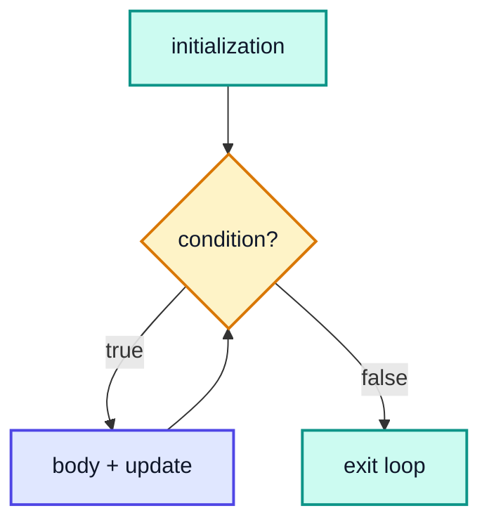

### for ↔ while Equivalence

```
for (int i = 1; i <= 5; i++) {          int i = 1;
    System.out.println(i);       ≡      while (i <= 5) {
}                                           System.out.println(i);
                                            i++;
                                        }
```

> [!NOTE]
> One difference: in the `while` version, `i` is still in scope **after** the loop (its value would be `6`). In the `for` version, `i` disappears when the loop ends.

---

## 11. E4 : while loop (14:48)

### Example: Print 1 to 5

```java
public class WhileDemo {
    public static void main(String[] args) {
        int num = 1;
        while (num <= 5) {
            System.out.println(num);
            num += 1;
        }
        System.out.println("After loop, num = " + num);
    }
}
```

**Output:**
```
1
2
3
4
5
After loop, num = 6
```

### Iteration Trace

| Iteration | `num` before | `num <= 5`? | Printed | `num` after |
|---|---|---|---|---|
| 1 | 1 | ✅ | 1 | 2 |
| 2 | 2 | ✅ | 2 | 3 |
| 3 | 3 | ✅ | 3 | 4 |
| 4 | 4 | ✅ | 4 | 5 |
| 5 | 5 | ✅ | 5 | 6 |
| — | 6 | ❌ | exit | — |

### Example Where `while` Shines: Count Digits

We don't know in advance how many times to loop — we loop **until** the number becomes 0.

```java
public class CountDigits {
    public static void main(String[] args) {
        int n = 45821;
        int digits = 0;
        while (n > 0) {
            n = n / 10;      // chop off the last digit
            digits++;
        }
        System.out.println(digits);   // 5
    }
}
```

| Iteration | `n` before | `n / 10` | `digits` |
|---|---|---|---|
| 1 | 45821 | 4582 | 1 |
| 2 | 4582 | 458 | 2 |
| 3 | 458 | 45 | 3 |
| 4 | 45 | 4 | 4 |
| 5 | 4 | 0 | 5 |
| — | 0 | exit | — |

> [!WARNING]
> Forgetting the update is the #1 `while` bug:
> ```java
> int num = 1;
> while (num <= 5) {
>     System.out.println(num);   // prints 1 forever — num never changes!
> }
> ```

---

## 12. When to use "for loop" and "while loop" (17:00)

Both loops are equally powerful — anything one can do, the other can too. The choice is about **clarity**.

| Situation | Best loop | Why |
|---|---|---|
| You know how many times to repeat | `for` | init, condition, update all in one line |
| Iterating over a range / array indices | `for` | `for (int i = 0; i < arr.length; i++)` |
| Repeat **until** something happens | `while` | count of iterations unknown |
| Processing digits of a number | `while` | `while (n > 0)` |
| Reading input until a sentinel value | `while` / `do-while` | depends on user |
| Body must run at least once (menus) | `do-while` | condition checked at the end |

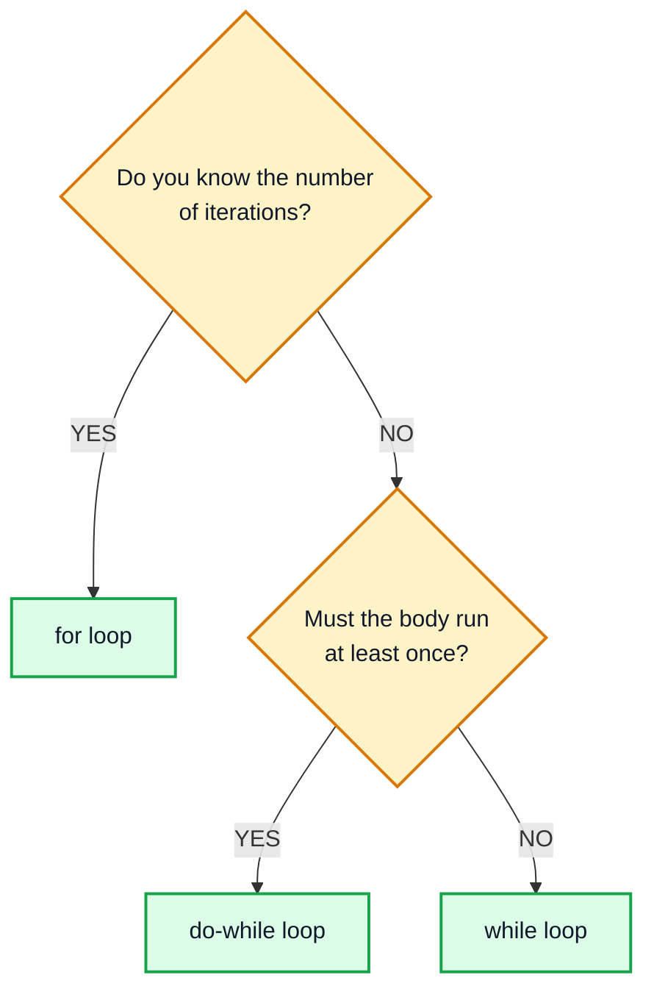

### Bonus: `break` and `continue`

| Keyword | Effect |
|---|---|
| `break` | exit the loop immediately |
| `continue` | skip the rest of this iteration, go to the next one |

```java
for (int i = 1; i <= 10; i++) {
    if (i % 2 == 0) continue;   // skip even numbers
    if (i > 7) break;           // stop entirely after 7
    System.out.print(i + " ");
}
// Output: 1 3 5 7
```

> [!TIP]
> In a `for` loop, `continue` still runs the **update** (`i++`). In a `while` loop, `continue` jumps straight to the condition — if your update is *after* the `continue`, you'll create an infinite loop.

---

## 13. Syntax of a "do while loop" (17:57)

### Syntax

```java
do {
    // body
} while (condition);   // ← note the semicolon!
```

### Flow Diagram

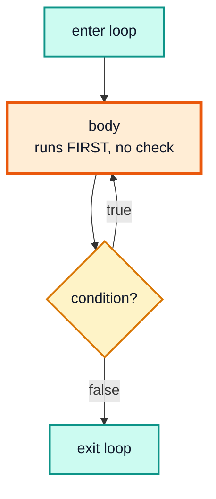

The condition is checked **after** the body → the body always runs **at least once**.

| Loop | Condition checked | Type |
|---|---|---|
| `for` / `while` | **before** the body | entry-controlled |
| `do-while` | **after** the body | exit-controlled |

> [!CAUTION]
> The semicolon after `while (condition);` is **required** in a `do-while`. But putting a semicolon after a regular `while (condition);` creates an empty loop body — usually an infinite loop. Same symbol, opposite meaning!

---

## 14. E5 : do while loop (18:22)

### Example: Print 1 to 5

```java
public class DoWhileDemo {
    public static void main(String[] args) {
        int n = 1;
        do {
            System.out.println(n);
            n++;
        } while (n <= 5);
    }
}
```

**Output:**
```
1
2
3
4
5
```

### Iteration Trace

| Iteration | Printed | `n` after `n++` | `n <= 5`? (checked after) |
|---|---|---|---|
| 1 | 1 | 2 | ✅ repeat |
| 2 | 2 | 3 | ✅ repeat |
| 3 | 3 | 4 | ✅ repeat |
| 4 | 4 | 5 | ✅ repeat |
| 5 | 5 | 6 | ❌ exit |

### Real Use: Input Validation

`do-while` is perfect when you must ask **at least once** and repeat only if the answer is bad:

```java
import java.util.Scanner;

public class Validate {
    public static void main(String[] args) {
        Scanner in = new Scanner(System.in);
        int age;
        do {
            System.out.print("Enter age (1-120): ");
            age = in.nextInt();
        } while (age < 1 || age > 120);
        System.out.println("Valid age: " + age);
    }
}
```

**Sample run:**
```
Enter age (1-120): -4
Enter age (1-120): 300
Enter age (1-120): 21
Valid age: 21
```

---

## 15. "while loop" vs "do while loop" (18:57)

### The Key Difference — When the Condition Is False from the Start

```java
public class WhileVsDoWhile {
    public static void main(String[] args) {
        int n = 1;

        while (n != 1) {
            System.out.println("while body");     // never runs
        }

        do {
            System.out.println("do-while body");  // runs once
        } while (n != 1);
    }
}
```

**Output:**
```
do-while body
```

### Side by Side

| | `while` | `do-while` |
|---|---|---|
| Condition checked | before each iteration | after each iteration |
| Minimum executions | **0** | **1** |
| Semicolon after `while(...)` | ❌ no (would break it) | ✅ required |
| Control type | entry-controlled | exit-controlled |
| Typical use | digit processing, unknown repetitions | menus, input validation, "play again?" |

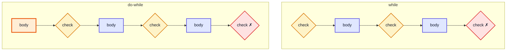

> [!IMPORTANT]
> When the condition is **true initially**, `while` and `do-while` behave identically. They differ only when the condition is **false on the first check**: `while` runs 0 times, `do-while` runs 1 time.

---

## 16. Solving Questions (20:44)

Time to apply everything. For each question we'll follow the same approach used in interviews:

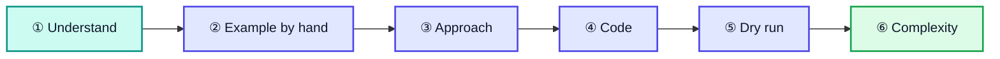

| # | Question | Concepts used |
|---|---|---|
| Q1 | Largest of three numbers | if-else, `Math.max`, ternary |
| Q2 | Is a character uppercase or lowercase? | char comparisons, `Character` class |
| Q3 | n-th Fibonacci number | `while`/`for` loop, swapping variables |
| Q4 | Count occurrences of a digit | `while`, `% 10`, `/ 10` |
| Q5 | Reverse a number | `while`, `% 10`, `/ 10`, building a number |

> [!TIP]
> Always **dry run** your code on paper with a small input before running it. It builds the mental model interviewers look for and catches off-by-one errors.

---

## 17. Q1 : Largest number (20:51)

**Problem:** Take three numbers as input and print the largest.

```
Input:  12  45  29
Output: 45
```

### Approach 1: Assume-and-Update (if)

Assume the first number is the max, then compare it with each of the others.

```java
import java.util.Scanner;

public class Largest {
    public static void main(String[] args) {
        Scanner in = new Scanner(System.in);
        int a = in.nextInt();
        int b = in.nextInt();
        int c = in.nextInt();

        int max = a;
        if (b > max) {
            max = b;
        }
        if (c > max) {
            max = c;
        }
        System.out.println(max);   // input 12 45 29 → 45
    }
}
```

| Step | Comparison | Result | `max` |
|---|---|---|---|
| start | `max = a` | — | 12 |
| 1 | `45 > 12` | ✅ | 45 |
| 2 | `29 > 45` | ❌ | 45 |

> [!NOTE]
> These are **two separate `if`s**, not an `else-if` — we need to check *both* `b` and `c`. This approach scales nicely: for N numbers it becomes a loop (`for` each element, update `max`), which is exactly how you find the max of an array.

### Approach 2: if-else-if with `&&`

```java
int max;
if (a >= b && a >= c) {
    max = a;
} else if (b >= a && b >= c) {
    max = b;
} else {
    max = c;
}
```

| `a, b, c` | `a>=b && a>=c` | `b>=a && b>=c` | max |
|---|---|---|---|
| 12, 45, 29 | false | **true** | 45 |
| 50, 50, 10 | **true** | — | 50 |
| 3, 7, 9 | false | false | 9 (else) |

> [!WARNING]
> Use `>=`, not `>`. With `a > b && a > c`, equal values like `50, 50, 10` fail both the first and second checks and fall into `else`, wrongly printing `10`.

### Approach 3: Nested if-else

```java
int max;
if (a > b) {
    max = (a > c) ? a : c;
} else {
    max = (b > c) ? b : c;
}
```

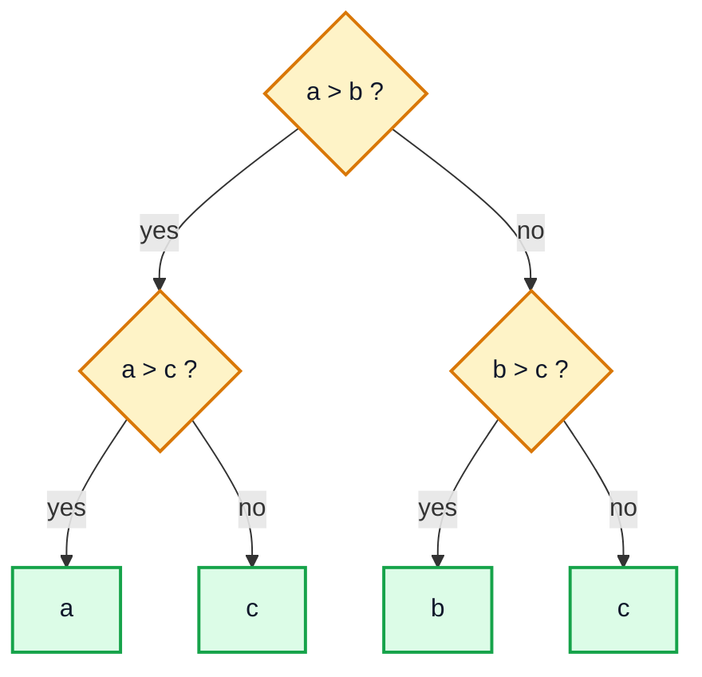

### Approach 4: `Math.max` (one-liner)

```java
int max = Math.max(a, Math.max(b, c));
System.out.println(max);   // 45
```

`Math.max(b, c)` → `max(45, 29)` = 45, then `Math.max(12, 45)` = **45**.

### Comparison

| Approach | Comparisons | Readability | Scales to N numbers? |
|---|---|---|---|
| Assume-and-update | 2 | ✅ great | ✅ becomes a loop |
| `&&` ladder | up to 4 | okay | ❌ explodes |
| Nested if | 2 | okay | ❌ |
| `Math.max` | 2 | ✅ best for 2–3 values | ✅ via loop |

**Time complexity:** O(1) — a fixed number of comparisons. **Space:** O(1).

---

## 18. Q2 : Alphabet case check (28:12)

**Problem:** Take a character as input and print whether it is **lowercase** or **uppercase**.

```
Input: k   →  Output: Lowercase
Input: K   →  Output: Uppercase
```

### Reading a Single Character with Scanner

`Scanner` has no `nextChar()`. Read a token and take its first character:

```java
char ch = in.next().trim().charAt(0);
```

| Part | Does |
|---|---|
| `in.next()` | reads the next whitespace-separated token as a `String` |
| `.trim()` | removes leading/trailing spaces (defensive; `next()` already skips them) |
| `.charAt(0)` | takes the character at index 0 |

### Key Idea: Characters Are Numbers

Every `char` is stored as a number (its Unicode / ASCII code). Letters are **contiguous**:

```
'A' = 65   'B' = 66   ...   'Z' = 90
'a' = 97   'b' = 98   ...   'z' = 122
'0' = 48   ...               '9' = 57
```

So `ch >= 'a' && ch <= 'z'` asks "is the code of `ch` between 97 and 122?"

### Approach 1: Range Comparison

```java
import java.util.Scanner;

public class CaseCheck {
    public static void main(String[] args) {
        Scanner in = new Scanner(System.in);
        char ch = in.next().trim().charAt(0);

        if (ch >= 'a' && ch <= 'z') {
            System.out.println("Lowercase");
        } else if (ch >= 'A' && ch <= 'Z') {
            System.out.println("Uppercase");
        } else {
            System.out.println("Not an English letter");
        }
    }
}
```

### Dry Run

| Input `ch` | Code | `'a'..'z'`? (97–122) | `'A'..'Z'`? (65–90) | Output |
|---|---|---|---|---|
| `k` | 107 | ✅ | — | Lowercase |
| `K` | 75 | ❌ | ✅ | Uppercase |
| `5` | 53 | ❌ | ❌ | Not an English letter |
| `@` | 64 | ❌ | ❌ | Not an English letter |

> [!CAUTION]
> A tempting shortcut is `if (ch >= 'a') lowercase else uppercase`. It labels `'5'`, `'@'`, `'['` (91) and others incorrectly. Always check **both ends** of the range and handle the "neither" case.

### Approach 2: `Character` Wrapper Class Methods

```java
char ch = 'K';
if (Character.isUpperCase(ch)) {
    System.out.println("Uppercase");          // Uppercase
} else if (Character.isLowerCase(ch)) {
    System.out.println("Lowercase");
} else {
    System.out.println("Not a letter");
}
```

Useful `Character` helpers:

| Method | `'K'` | `'k'` | `'7'` |
|---|---|---|---|
| `Character.isUpperCase(c)` | true | false | false |
| `Character.isLowerCase(c)` | false | true | false |
| `Character.isLetter(c)` | true | true | false |
| `Character.isDigit(c)` | false | false | true |
| `Character.toUpperCase(c)` | `'K'` | `'K'` | `'7'` |
| `Character.toLowerCase(c)` | `'k'` | `'k'` | `'7'` |

### Range Check vs `Character` Methods

| | Range comparison | `Character.isUpperCase` |
|---|---|---|
| Covers | only English A–Z / a–z | all Unicode letters (`'É'`, `'Ω'`, …) |
| Shows understanding of ASCII | ✅ | ❌ hidden |
| Interview preference | often asked to write it manually | fine in production code |

> [!TIP]
> Since letters are contiguous, you can convert case with arithmetic: `(char)(ch - 'a' + 'A')` turns lowercase into uppercase (`'k'` → 107 − 97 + 65 = 75 → `'K'`). The difference between cases is always **32**.

**Time complexity:** O(1). **Space:** O(1).

---

## 19. Q3 : Fibonacci numbers (35:03)

**Problem:** Print the **n-th Fibonacci number**.

### What is the Fibonacci Series?

Each number is the sum of the previous two, starting from 0 and 1:

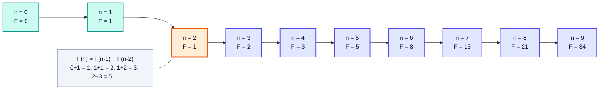

**F(0) = 0, F(1) = 1, F(n) = F(n−1) + F(n−2)**

### Approach: Two Variables Walking Forward (Iterative)

We only ever need the **last two** numbers. Keep them in `p` (previous) and `q` (current), and slide forward:

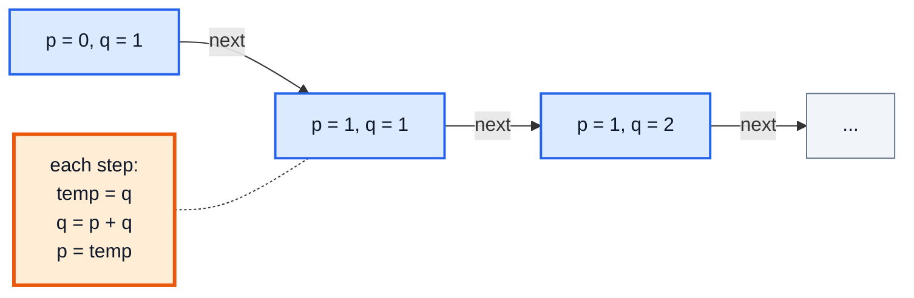

```java
import java.util.Scanner;

public class Fibonacci {
    public static void main(String[] args) {
        Scanner in = new Scanner(System.in);
        int n = in.nextInt();

        if (n <= 1) {                 // F(0) = 0, F(1) = 1
            System.out.println(n);
            return;
        }

        int p = 0;                    // F(0)
        int q = 1;                    // F(1)
        int count = 2;                // next index to compute

        while (count <= n) {
            int temp = q;
            q = q + p;                // new current = sum of last two
            p = temp;                 // old current becomes previous
            count++;
        }
        System.out.println(q);        // input 7 → 13
    }
}
```

### Dry Run (n = 7)

| `count` | `temp` (old q) | new `q = q + p` | new `p` | Meaning |
|---|---|---|---|---|
| start | — | 1 | 0 | F(1), F(0) |
| 2 | 1 | 1 + 0 = **1** | 1 | F(2) = 1 |
| 3 | 1 | 1 + 1 = **2** | 1 | F(3) = 2 |
| 4 | 2 | 2 + 1 = **3** | 2 | F(4) = 3 |
| 5 | 3 | 3 + 2 = **5** | 3 | F(5) = 5 |
| 6 | 5 | 5 + 3 = **8** | 5 | F(6) = 8 |
| 7 | 8 | 8 + 5 = **13** | 8 | F(7) = 13 |
| 8 | — | `8 <= 7` ❌ exit | — | answer = **13** |

> [!IMPORTANT]
> The `temp` variable is essential. If you write `q = q + p; p = q;`, then `p` gets the **new** `q`, not the old one — the series breaks. Whenever two variables must update "simultaneously", save one in a temp first.

> [!NOTE]
> Without the `n <= 1` guard, input `0` would print `1` (the loop never runs and `q` is still 1). Edge cases like `0` and `1` are exactly what interviewers test.

### Variant: `for` Loop Printing the First n Terms

```java
public class FibSeries {
    public static void main(String[] args) {
        int n = 10;
        int p = 0, q = 1;
        for (int i = 1; i <= n; i++) {
            System.out.print(p + " ");
            int next = p + q;
            p = q;
            q = next;
        }
        System.out.println();
        // Output: 0 1 1 2 3 5 8 13 21 34
    }
}
```

| `i` | printed `p` | `next` | new `p` | new `q` |
|---|---|---|---|---|
| 1 | 0 | 1 | 1 | 1 |
| 2 | 1 | 2 | 1 | 2 |
| 3 | 1 | 3 | 2 | 3 |
| 4 | 2 | 5 | 3 | 5 |
| 5 | 3 | 8 | 5 | 8 |
| … | … | … | … | … |
| 10 | 34 | 89 | 55 | 89 |

### Overflow Warning

| Type | Largest Fibonacci that fits |
|---|---|
| `int` | F(46) = 1,836,311,903 |
| `long` | F(92) = 7,540,113,804,746,346,429 |
| `BigInteger` | unlimited |

> [!WARNING]
> F(47) overflows an `int` and silently becomes a **negative** number. Use `long` for larger n, or `java.math.BigInteger` beyond n = 92.

**Time complexity:** O(n) — one loop iteration per index. **Space:** O(1) — just three variables. (The naive recursive version, covered in the recursion videos, is O(2ⁿ).)

---

## 20. Q4 : Counting occurrences (43:00)

**Problem:** Given a number and a digit, count how many times the digit appears in the number.

```
n = 13533, digit = 3   →  3    (1 3 5 3 3)
n = 45535, digit = 5   →  3    (4 5 5 3 5)
n = 13523, digit = 3   →  2
```

### The Two Magic Operations

| Operation | Effect | `13533` → |
|---|---|---|
| `n % 10` | gives the **last digit** | `3` |
| `n / 10` | **removes** the last digit (integer division) | `1353` |

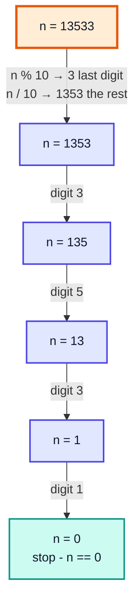

### Approach

1. While `n > 0`: take `rem = n % 10`.
2. If `rem == digit`, increment `count`.
3. Chop the last digit: `n = n / 10`.

```java
public class CountDigit {
    public static void main(String[] args) {
        int n = 13533;
        int digit = 3;
        int count = 0;

        int temp = n;                 // keep the original n intact
        while (temp > 0) {
            int rem = temp % 10;
            if (rem == digit) {
                count++;
            }
            temp = temp / 10;
        }
        System.out.println("Count of " + digit + " in " + n + " = " + count);
        // Count of 3 in 13533 = 3
    }
}
```

### Dry Run (n = 13533, digit = 3)

| Iteration | `temp` | `rem = temp % 10` | `rem == 3`? | `count` | `temp / 10` |
|---|---|---|---|---|---|
| 1 | 13533 | 3 | ✅ | 1 | 1353 |
| 2 | 1353 | 3 | ✅ | 2 | 135 |
| 3 | 135 | 5 | ❌ | 2 | 13 |
| 4 | 13 | 3 | ✅ | 3 | 1 |
| 5 | 1 | 1 | ❌ | 3 | 0 |
| — | 0 | loop ends | — | **3** | — |

> [!NOTE]
> The digits come out **right to left** (units first). For counting this doesn't matter; for reversing (Q5) it's exactly what we want.

### Edge Cases

| Input | Issue | Fix |
|---|---|---|
| `n = 0, digit = 0` | `while (0 > 0)` never runs → returns 0, but answer is 1 | `if (n == 0) count = (digit == 0) ? 1 : 0;` |
| `n = -4434, digit = 4` | `temp > 0` is false immediately | use `temp = Math.abs(n)` |

> [!TIP]
> This "peel off digits with `% 10` and `/ 10`" loop is a template. Change what you do with `rem` and you get: sum of digits, product of digits, count of digits, largest digit, Armstrong numbers, palindrome numbers, and more.

**Time complexity:** O(d) where d = number of digits = ⌊log₁₀ n⌋ + 1, i.e. **O(log n)**. **Space:** O(1).

---

## 21. Q5 : Reverse (49:14)

**Problem:** Reverse the digits of a number.

```
Input: 23597   →  Output: 79532
```

### Approach

Peel digits from the right (same as Q4) and **append** each one to a new number `ans`:

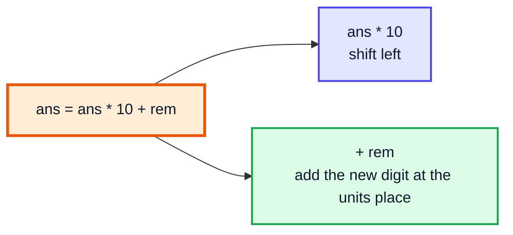

```java
public class ReverseNumber {
    public static void main(String[] args) {
        int n = 23597;
        int ans = 0;

        int temp = n;
        while (temp > 0) {
            int rem = temp % 10;
            ans = ans * 10 + rem;
            temp /= 10;
        }
        System.out.println("Reverse of " + n + " = " + ans);
        // Reverse of 23597 = 79532
    }
}
```

### Dry Run (n = 23597)

| Iteration | `temp` | `rem = temp % 10` | `ans = ans * 10 + rem` | `temp / 10` |
|---|---|---|---|---|
| 1 | 23597 | 7 | 0 × 10 + 7 = **7** | 2359 |
| 2 | 2359 | 9 | 7 × 10 + 9 = **79** | 235 |
| 3 | 235 | 5 | 79 × 10 + 5 = **795** | 23 |
| 4 | 23 | 3 | 795 × 10 + 3 = **7953** | 2 |
| 5 | 2 | 2 | 7953 × 10 + 2 = **79532** | 0 |
| — | 0 | exit | **79532** | — |

### Alternative: Using Strings

```java
int n = 23597;
String reversed = new StringBuilder(String.valueOf(n)).reverse().toString();
int ans = Integer.parseInt(reversed);
System.out.println(ans);   // 79532
```

| | Math (`% 10`) | `StringBuilder` |
|---|---|---|
| Extra memory | O(1) | O(d) for the string |
| Speed | faster | slower (object creation, parsing) |
| Interview | ✅ expected | usually "do it without strings" |

### Edge Cases

| Input | Output | Note |
|---|---|---|
| `1200` | `21` | trailing zeros vanish (`0021` as an int is `21`) |
| `7` | `7` | single digit |
| `-123` | `0` with this code | handle sign: reverse `Math.abs(n)`, then reapply `-` |
| `1999999999` | overflow! | reverse 9999999991 > `Integer.MAX_VALUE` (2,147,483,647) → use `long` |

> [!TIP]
> **Palindrome number check** comes for free: a number is a palindrome if `reverse(n) == n` (e.g. 12321).

**Time complexity:** O(log n) — one iteration per digit. **Space:** O(1).

---

## 22. Calculator program (53:07)

**Goal:** Build a calculator that keeps running — repeatedly ask for an operator and two numbers, print the result — until the user types **`x`** to exit.

### Plan

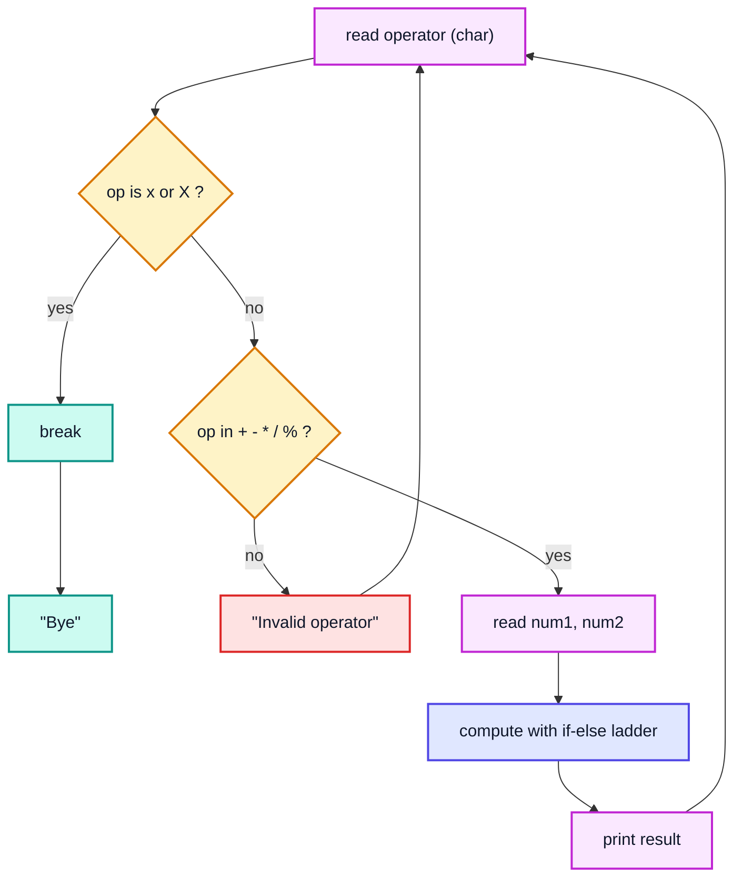

Because we don't know how many calculations the user wants, this is a `while (true)` loop with a `break` — the "repeat until a sentinel value" pattern.

### Version 1: if-else Ladder (as in the video's approach)

```java
import java.util.Scanner;

public class Calculator {
    public static void main(String[] args) {
        Scanner in = new Scanner(System.in);

        while (true) {
            System.out.print("Enter operator (+ - * / %) or x to exit: ");
            char op = in.next().trim().charAt(0);

            if (op == 'x' || op == 'X') {
                System.out.println("Calculator closed. Bye!");
                break;                                   // leave the loop
            }

            if (op == '+' || op == '-' || op == '*' || op == '/' || op == '%') {
                System.out.print("Enter two numbers: ");
                int num1 = in.nextInt();
                int num2 = in.nextInt();
                int ans = 0;

                if (op == '+') {
                    ans = num1 + num2;
                } else if (op == '-') {
                    ans = num1 - num2;
                } else if (op == '*') {
                    ans = num1 * num2;
                } else {                                 // '/' or '%'
                    if (num2 == 0) {
                        System.out.println("Error: cannot divide by zero");
                        continue;                        // skip printing, ask again
                    }
                    ans = (op == '/') ? num1 / num2 : num1 % num2;
                }
                System.out.println("Result: " + ans);
            } else {
                System.out.println("Invalid operator!");
            }
        }
        in.close();
    }
}
```

**Sample session:**
```
Enter operator (+ - * / %) or x to exit: +
Enter two numbers: 10 5
Result: 15
Enter operator (+ - * / %) or x to exit: *
Enter two numbers: 7 6
Result: 42
Enter operator (+ - * / %) or x to exit: /
Enter two numbers: 9 0
Error: cannot divide by zero
Enter operator (+ - * / %) or x to exit: %
Enter two numbers: 17 5
Result: 2
Enter operator (+ - * / %) or x to exit: ^
Invalid operator!
Enter operator (+ - * / %) or x to exit: x
Calculator closed. Bye!
```

### Trace of the Session

| Round | `op` | Valid? | `num1`, `num2` | Branch | Printed |
|---|---|---|---|---|---|
| 1 | `+` | ✅ | 10, 5 | `+` | Result: 15 |
| 2 | `*` | ✅ | 7, 6 | `*` | Result: 42 |
| 3 | `/` | ✅ | 9, 0 | divide-by-zero guard → `continue` | Error: cannot divide by zero |
| 4 | `%` | ✅ | 17, 5 | `%` | Result: 2 |
| 5 | `^` | ❌ | — (not read) | else | Invalid operator! |
| 6 | `x` | exit | — | `break` | Calculator closed. Bye! |

### Why Validate the Operator Before Reading Numbers?

If the operator is invalid, we don't waste the user's time asking for numbers. It also keeps the input stream in sync: we only call `nextInt()` when we actually need numbers.

> [!CAUTION]
> Integer division by zero (`9 / 0` or `9 % 0`) throws **`ArithmeticException`** and crashes the program. (With `double`, `9.0 / 0` gives `Infinity` instead.) Always guard the divisor.

> [!WARNING]
> If the user types a letter where a number is expected, `nextInt()` throws `InputMismatchException`. Production code would check `in.hasNextInt()` first or wrap the read in `try-catch` (exception handling comes later in the course).

### Version 2: Modern `switch` Expression (Java 14+)

The same logic, more compact. The arrow form `->` never falls through, so no `break` is needed inside the `switch`:

```java
import java.util.Scanner;

public class CalculatorSwitch {
    public static void main(String[] args) {
        Scanner in = new Scanner(System.in);

        while (true) {
            System.out.print("Operator (+ - * / %) or x: ");
            char op = in.next().charAt(0);
            if (op == 'x' || op == 'X') break;

            if ("+-*/%".indexOf(op) == -1) {          // not one of the 5 operators
                System.out.println("Invalid operator!");
                continue;
            }

            System.out.print("Two numbers: ");
            double a = in.nextDouble();
            double b = in.nextDouble();

            double ans = switch (op) {
                case '+' -> a + b;
                case '-' -> a - b;
                case '*' -> a * b;
                case '/' -> a / b;     // double: 5 / 0 → Infinity, no crash
                case '%' -> a % b;
                default  -> throw new IllegalStateException("unreachable");
            };
            System.out.println("= " + ans);
        }
        System.out.println("Bye!");
    }
}
```

**Sample session:**
```
Operator (+ - * / %) or x: /
Two numbers: 7 2
= 3.5
Operator (+ - * / %) or x: x
Bye!
```

| | Version 1 (if-else, `int`) | Version 2 (`switch`, `double`) |
|---|---|---|
| Decimal results | ❌ `7 / 2 = 3` | ✅ `7 / 2 = 3.5` |
| Divide by zero | crashes unless guarded | `Infinity` / `NaN` |
| Lines of code | more | fewer |
| Java version | any | 14+ (switch expressions) |

> [!NOTE]
> `while (true) { ... break; }` and `do { ... } while (op != 'x');` are two ways to write the same menu loop. `while (true)` + `break` is often cleaner when the exit check sits in the **middle** of the body (we must read the operator before deciding to exit).

---

## 23. Outro (1:01:54)

### What We Covered

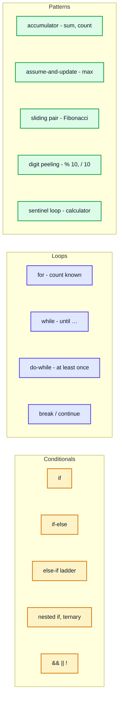

### Practice Before the Next Video

| # | Problem | Hint |
|---|---|---|
| 1 | Sum of digits of a number | Q4 template, `sum += rem` |
| 2 | Check palindrome number | `reverse(n) == n` |
| 3 | Factorial of n | `for`, `product *= i` (use `long`) |
| 4 | Check if a number is prime | loop `i` from 2 while `i * i <= n` |
| 5 | Armstrong number (153 = 1³+5³+3³) | count digits, then sum powers |
| 6 | Print all even numbers 1–100 | `i += 2` or `if (i % 2 == 0)` |
| 7 | Leap year check | `(y % 4 == 0 && y % 100 != 0) \|\| y % 400 == 0` |

> [!IMPORTANT]
> The next video covers **switch statements and nested switch** — a cleaner alternative to long `else-if` ladders when matching one value against many constants (like our calculator's operator).

---

## 🧩 Complete Example: Everything Together

One program using `if-else`, an `else-if` ladder, `for`, for-each, `while`, `do-while` and a `switch` expression, with hard-coded inputs so the output is deterministic.

```java
public class Main {
    public static void main(String[] args) {

        // ═══════ 1. if: Largest of three ═══════
        System.out.println("=== 1. if-else: Largest of three ===");
        int a = 12, b = 45, c = 29;
        int max = a;
        if (b > max) {
            max = b;
        }
        if (c > max) {
            max = c;
        }
        System.out.println("Largest of " + a + ", " + b + ", " + c + " = " + max);
        System.out.println("Using Math.max = " + Math.max(a, Math.max(b, c)));

        // ═══════ 2. else-if ladder: Grade ═══════
        System.out.println("=== 2. if-else-if ladder: Grade ===");
        int marks = 82;
        char grade;
        if (marks >= 90)      grade = 'A';
        else if (marks >= 75) grade = 'B';
        else if (marks >= 50) grade = 'C';
        else                  grade = 'F';
        System.out.println("Marks " + marks + " -> Grade " + grade);

        // ═══════ 3. for-each + if: Character case ═══════
        System.out.println("=== 3. Character case check ===");
        char[] letters = {'g', 'K', '7'};
        for (char ch : letters) {
            if (ch >= 'a' && ch <= 'z') {
                System.out.println(ch + " is lowercase");
            } else if (ch >= 'A' && ch <= 'Z') {
                System.out.println(ch + " is uppercase");
            } else {
                System.out.println(ch + " is not a letter");
            }
        }

        // ═══════ 4. for: First 10 Fibonacci numbers ═══════
        System.out.println("=== 4. for loop: First 10 Fibonacci ===");
        int p = 0, q = 1;
        for (int i = 1; i <= 10; i++) {
            System.out.print(p);
            if (i < 10) {
                System.out.print(" ");       // no trailing space after the last term
            }
            int next = p + q;
            p = q;
            q = next;
        }
        System.out.println();

        // ═══════ 5. while: Count occurrences of a digit ═══════
        System.out.println("=== 5. while loop: Count digit ===");
        int num = 13533, target = 3, count = 0;
        int temp = num;
        while (temp > 0) {
            if (temp % 10 == target) {
                count++;
            }
            temp /= 10;
        }
        System.out.println("Occurrences of " + target + " in " + num + " = " + count);

        // ═══════ 6. while: Reverse a number ═══════
        System.out.println("=== 6. while loop: Reverse number ===");
        int original = 23597, n = original, rev = 0;
        while (n > 0) {
            rev = rev * 10 + n % 10;
            n /= 10;
        }
        System.out.println("Reverse of " + original + " = " + rev);

        // ═══════ 7. do-while: Calculator with scripted operators ═══════
        System.out.println("=== 7. do-while: Calculator ===");
        char[] ops = {'+', '-', '*', '/', '%', '^', 'x'};
        int num1 = 20, num2 = 6;
        int idx = 0;
        char op;
        do {
            op = ops[idx++];
            switch (op) {
                case '+' -> System.out.println(num1 + " + " + num2 + " = " + (num1 + num2));
                case '-' -> System.out.println(num1 + " - " + num2 + " = " + (num1 - num2));
                case '*' -> System.out.println(num1 + " * " + num2 + " = " + (num1 * num2));
                case '/' -> System.out.println(num1 + " / " + num2 + " = " + (num1 / num2));
                case '%' -> System.out.println(num1 + " % " + num2 + " = " + (num1 % num2));
                case 'x' -> System.out.println("Exiting calculator. Bye!");
                default  -> System.out.println("Invalid operator: " + op);
            }
        } while (op != 'x');
    }
}
```

**Expected Output:**
```
=== 1. if-else: Largest of three ===
Largest of 12, 45, 29 = 45
Using Math.max = 45
=== 2. if-else-if ladder: Grade ===
Marks 82 -> Grade B
=== 3. Character case check ===
g is lowercase
K is uppercase
7 is not a letter
=== 4. for loop: First 10 Fibonacci ===
0 1 1 2 3 5 8 13 21 34
=== 5. while loop: Count digit ===
Occurrences of 3 in 13533 = 3
=== 6. while loop: Reverse number ===
Reverse of 23597 = 79532
=== 7. do-while: Calculator ===
20 + 6 = 26
20 - 6 = 14
20 * 6 = 120
20 / 6 = 3
20 % 6 = 2
Invalid operator: ^
Exiting calculator. Bye!
```

---

## Quick Reference Cheat Sheet

| Concept | One-Line Summary |
|---|---|
| **Condition** | Any expression that evaluates to `boolean` (`true`/`false`) — Java won't accept an `int` |
| **Relational operators** | `==  !=  >  <  >=  <=` compare values; use `.equals()` for Strings |
| **Logical operators** | `&&` (both), `\|\|` (either), `!` (not); `&&`/`\|\|` short-circuit |
| **`if`** | Runs a block only when the condition is true |
| **`if-else`** | Exactly one of two blocks runs |
| **`else-if` ladder** | First true condition wins; put the most specific range first |
| **Ternary `? :`** | Expression form of if-else: `x = cond ? a : b;` |
| **`for` loop** | `for (init; cond; update)` — best when the iteration count is known |
| **`while` loop** | Checks before each iteration; can run 0 times; best for "until" logic |
| **`do-while` loop** | Checks after each iteration; runs at least once; needs `;` after `while(...)` |
| **`break` / `continue`** | Exit the loop / skip to the next iteration |
| **Infinite loop** | Condition never becomes false — usually a missing update |
| **Largest of 3** | Assume `max = a`, update with two `if`s — or `Math.max(a, Math.max(b, c))` |
| **Case check** | `ch >= 'a' && ch <= 'z'` or `Character.isLowerCase(ch)`; read with `in.next().charAt(0)` |
| **Fibonacci** | Keep two variables, `temp = q; q += p; p = temp;` — O(n) time, O(1) space |
| **Last digit / drop digit** | `n % 10` / `n / 10` — loop `while (n > 0)` runs O(log n) times |
| **Count a digit** | `if (n % 10 == d) count++; n /= 10;` |
| **Reverse a number** | `ans = ans * 10 + n % 10; n /= 10;` — watch for `int` overflow |
| **Calculator / menu** | `while (true)` + `break` on sentinel `'x'`; guard division by zero |
