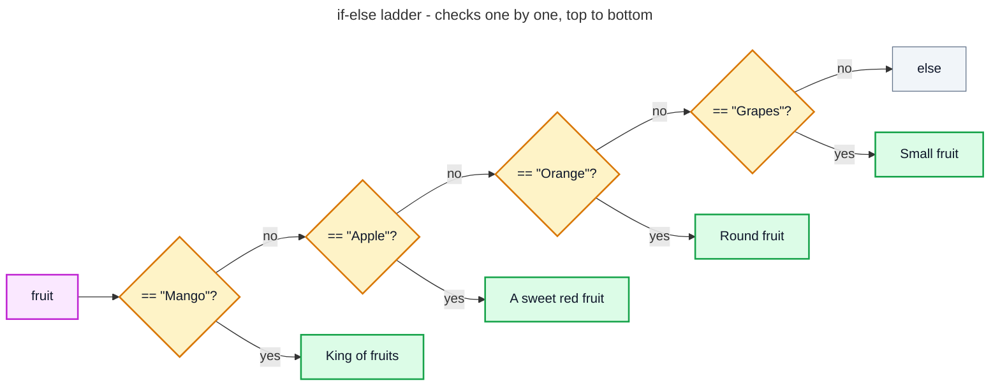
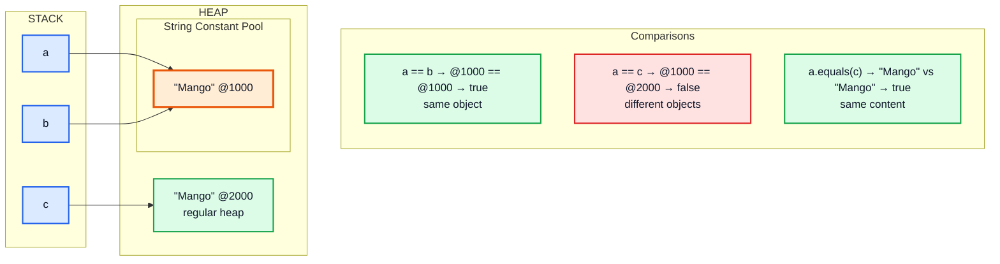
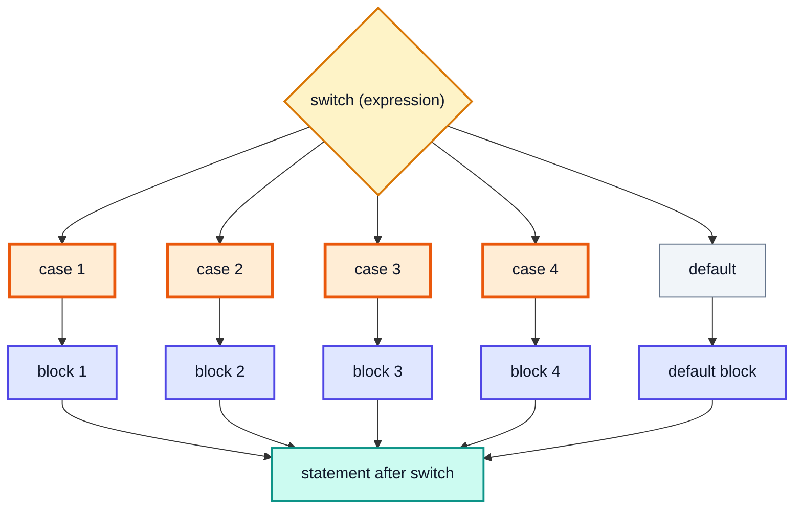
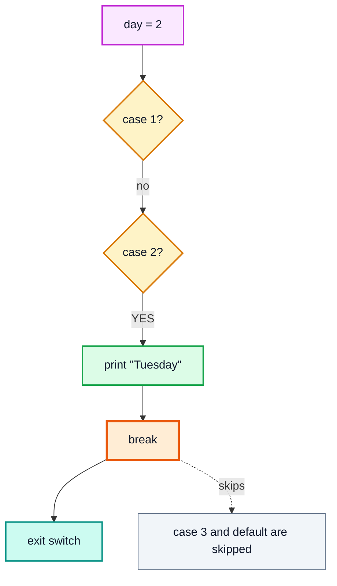
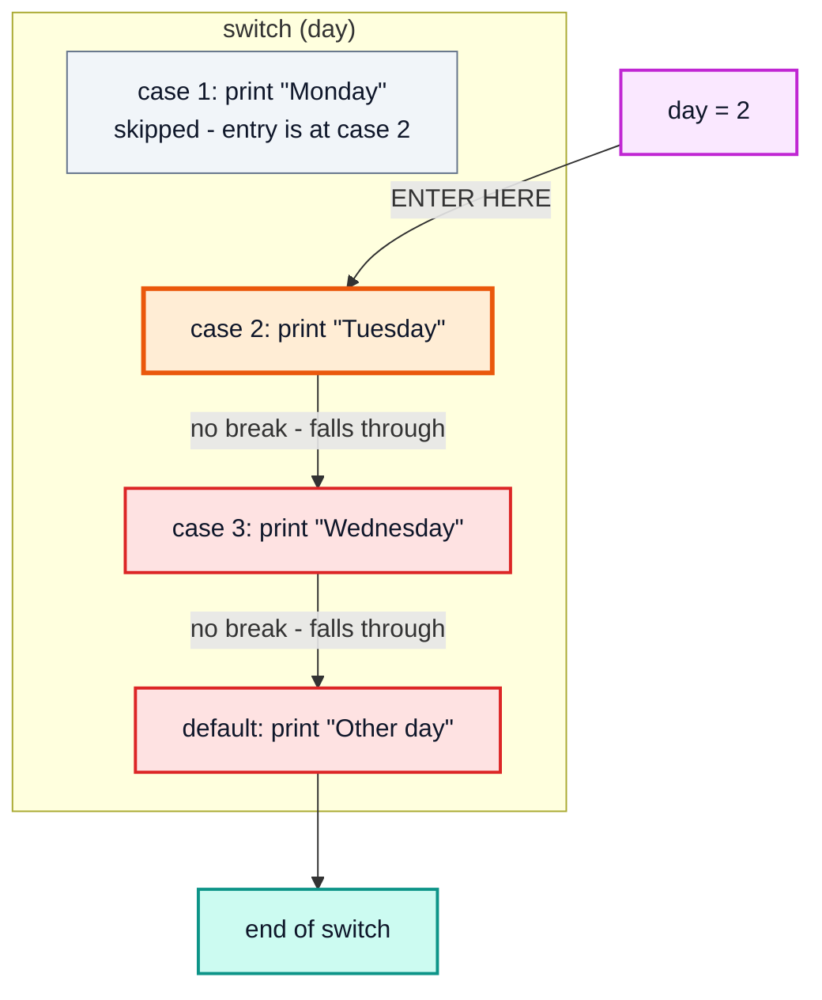
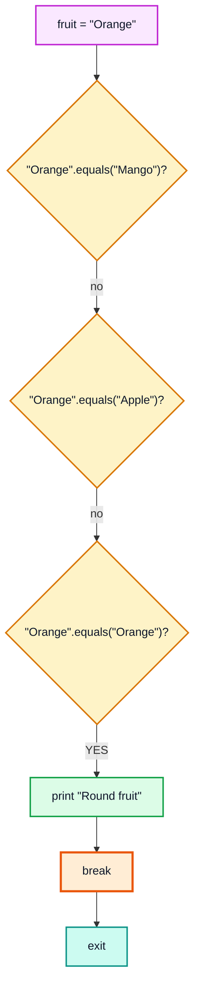
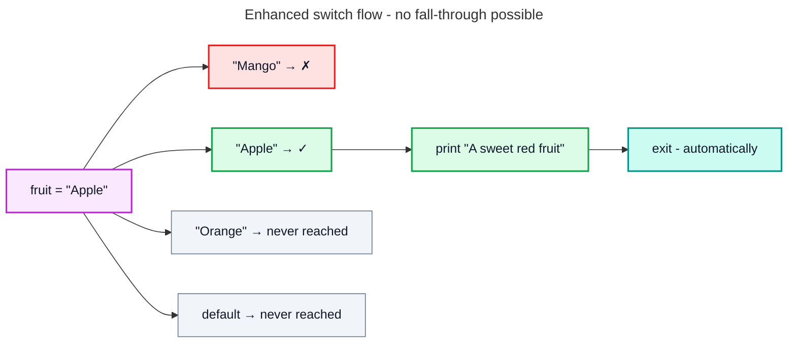
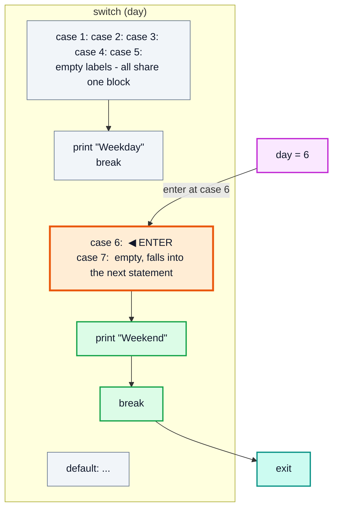
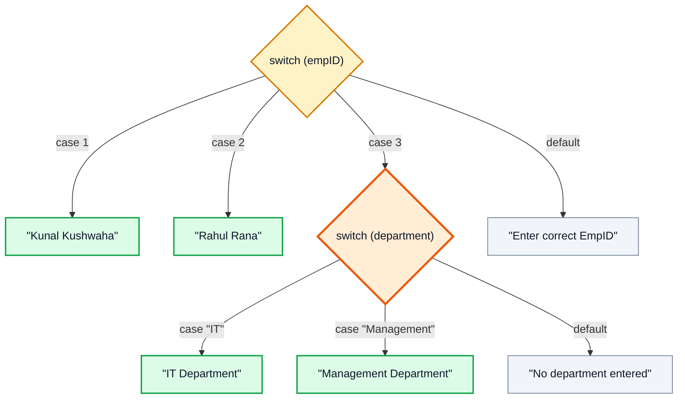
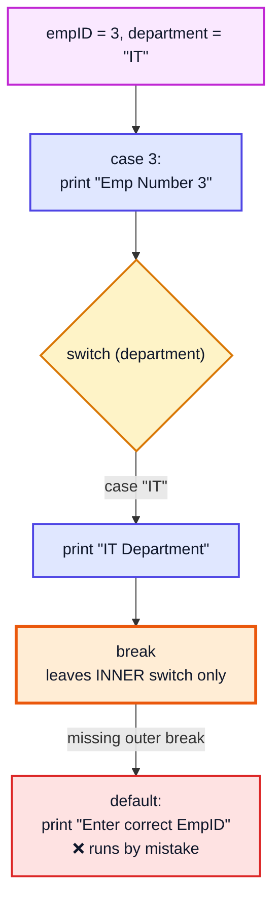

# Switch Statements in Java — Complete In-Depth Guide

**Video #10 of the Java + DSA playlist:** *Switch Statements + Nested Case in Java* (26:11)

A deep-dive into making decisions with `switch` in Java: why `==` fails for String comparison (and why `.equals()` is the fix), the classic `switch` with `break` and fall-through, the enhanced arrow syntax and switch expressions with `yield` (Java 14+), and nested switch cases. Includes memory diagrams, flow diagrams and runnable programs.

---

## Table of Contents

| # | Topic | Timestamp |
|---|---|---|
| 0 | [Introduction](#0-introduction-000) | 0:00 |
| 1 | [Example](#1-example-057) | 0:57 |
| 2 | [`==` vs `.equals()`](#2--vs-equals-240) | 2:40 |
| 3 | [Switch Statements](#3-switch-statements-649) | 6:49 |
| 4 | [Syntax for Switch Statements](#4-syntax-for-switch-statements-656) | 6:56 |
| 5 | [Some Notes for Switch Statements](#5-some-notes-for-switch-statements-808) | 8:08 |
| 6 | [Program 1: Describe Fruit](#6-program-1-describe-fruit-900) | 9:00 |
| 7 | [Enhanced Switch](#7-enhanced-switch-1338) | 13:38 |
| 8 | [Program 2: Display Day Name b/w 1 & 7](#8-program-2-display-day-name-bw-1--7-1518) | 15:18 |
| 9 | [Program 3: Weekdays and Weekends](#9-program-3-weekdays-and-weekends-1747) | 17:47 |
| 10 | [Nested Switch Case](#10-nested-switch-case-1937) | 19:37 |
| 11 | [Outro](#11-outro-2502) | 25:02 |

---

## 0. Introduction (0:00)

In the previous videos you made decisions with `if`, `else if` and `else`. That works, but when you compare **one variable against many fixed values**, an `if-else` ladder becomes long, repetitive and hard to read.

The `switch` statement solves exactly this problem:

1. You write the variable to check **once**.
2. You list each possible value as a **case**.
3. Java jumps straight to the matching case.

This video covers:

- Why comparing Strings with `==` is a bug, and what `.equals()` does instead
- The **classic** `switch` (with `:` and `break`)
- The **enhanced** `switch` (with `->`, Java 14+) and switch **expressions**
- **Nested** switch statements

> [!IMPORTANT]
> `switch` is used constantly in real code: menu-driven programs, command parsers, state machines, and handling enum values. It also comes up in interviews as "what does this print?" questions about **fall-through**. Learn both syntaxes.

---

## 1. Example (0:57)

### The Problem: A Long if-else Ladder

Suppose the user types a fruit name and we print a description. With `if-else`:

```java
import java.util.Scanner;

public class FruitIfElse {
    public static void main(String[] args) {
        Scanner in = new Scanner(System.in);
        String fruit = in.next();

        if (fruit.equals("Mango")) {
            System.out.println("King of fruits");
        } else if (fruit.equals("Apple")) {
            System.out.println("A sweet red fruit");
        } else if (fruit.equals("Orange")) {
            System.out.println("Round fruit");
        } else if (fruit.equals("Grapes")) {
            System.out.println("Small fruit");
        } else {
            System.out.println("please enter a valid fruit");
        }
    }
}
// Input:  Apple
// Output: A sweet red fruit
```

It works, but notice the repetition: `fruit.equals(...)` is written **four times**. Add 20 fruits and the code becomes a wall of `else if`.



### Why `.equals()` and Not `==`?

A beginner's first attempt usually looks like this:

```java
if (fruit == "Mango") {   // ❌ Looks right, but is a bug
    System.out.println("King of fruits");
}
```

If `fruit` came from a `Scanner`, this condition is **false even when the user types `Mango`**. Understanding why needs a quick look at how Strings are stored in memory — that is the next section.

### if-else vs switch — When to Use Which

| Situation | Better choice |
|---|---|
| One variable compared against many **exact, fixed values** | `switch` |
| Ranges (`marks >= 90`, `age < 18`) | `if-else` |
| Conditions involving several variables (`a > b && c != 0`) | `if-else` |
| Comparing `long`, `double`, `float`, `boolean` | `if-else` (classic switch does not accept these) |
| Handling every constant of an `enum` | `switch` |

---

## 2. `==` vs `.equals()` (2:40)

### What Each One Compares

| Operator / Method | Compares | Used for |
|---|---|---|
| `==` on primitives (`int`, `char`, ...) | The actual **values** | `5 == 5` → `true` |
| `==` on objects (`String`, arrays, ...) | The **references** (memory addresses) | "Are these the *same object*?" |
| `.equals()` on `String` | The **content** (character by character) | "Do these have the *same text*?" |

`String` is an **object**, not a primitive. A `String` variable holds a **reference** to a String object (recall stack vs heap from video #5). So `==` asks *"do both variables point to the same object?"* — not *"do they contain the same characters?"*.

### The String Pool

Java keeps a special area inside the heap called the **String Constant Pool**. String **literals** (text written directly in quotes) are stored there, and **identical literals are shared** — Java creates `"Mango"` only once and every literal `"Mango"` reuses it.

`new String("Mango")` is different: it **always** creates a brand-new object in the regular heap, outside the pool.

```java
String a = "Mango";               // literal → goes to the pool
String b = "Mango";               // same literal → reuses the pooled object
String c = new String("Mango");   // new → forces a NEW object in the heap
```



```java
public class StringCompare {
    public static void main(String[] args) {
        String a = "Mango";
        String b = "Mango";
        String c = new String("Mango");

        System.out.println(a == b);        // true  → both point to the pooled "Mango"
        System.out.println(a == c);        // false → c is a separate heap object
        System.out.println(a.equals(c));   // true  → same characters
        System.out.println(a.equals(b));   // true
    }
}
```

### Why the Scanner Example Fails

`Scanner.next()` builds a **new String object at runtime** from what the user typed. It is not the pooled literal, so:

```java
String fruit = in.next();          // user types: Mango  → new object, e.g. @3000
System.out.println(fruit == "Mango");       // false  (@3000 vs @1000)
System.out.println(fruit.equals("Mango"));  // true
```

### Tricky Cases: Compile-Time vs Runtime Strings

The compiler joins **constant expressions** ahead of time, so they end up in the pool. Anything computed at runtime does not.

```java
public class PoolTricks {
    public static void main(String[] args) {
        String s = "Mango";

        String t1 = "Man" + "go";          // both literals → joined at compile time → pooled
        System.out.println(s == t1);       // true

        String part = "Man";
        String t2 = part + "go";           // 'part' is a normal variable → built at runtime
        System.out.println(s == t2);       // false

        final String fpart = "Man";
        String t3 = fpart + "go";          // final + literal = constant expression → pooled
        System.out.println(s == t3);       // true

        String t4 = t2.intern();           // intern() returns the pooled copy
        System.out.println(s == t4);       // true
    }
}
```

> [!WARNING]
> Never rely on `==` for String content, even if it "happens to work" in a small test with literals. The moment a String comes from user input, a file, a network call or concatenation at runtime, `==` returns `false`.

### Useful Comparison Methods

```java
String fruit = "mango";

fruit.equals("Mango");             // false → case-sensitive
fruit.equalsIgnoreCase("Mango");   // true  → ignores upper/lower case

String maybeNull = null;
// maybeNull.equals("Mango");      // 💥 NullPointerException
"Mango".equals(maybeNull);         // false → safe: call equals on the literal
java.util.Objects.equals(maybeNull, "Mango");  // false → null-safe on both sides
```

> [!TIP]
> Write `"Mango".equals(fruit)` instead of `fruit.equals("Mango")` when `fruit` might be `null`. The literal is never `null`, so this form can't throw.

> [!NOTE]
> A `switch` on a `String` uses `.equals()` (internally `hashCode()` + `equals()`) to match cases, **not** `==`. So `switch (fruit)` works correctly with Scanner input. That's one reason switch is pleasant for String menus.

---

## 3. Switch Statements (6:49)

### What is a Switch Statement?

A `switch` statement evaluates **one expression** (the *selector*) and transfers control to the `case` label whose value **matches** it. If nothing matches, the optional `default` block runs.

Think of it like a building's lift panel: you press one number, and the lift goes **directly** to that floor instead of stopping at every floor to ask "is this the one?".



### if-else Ladder vs switch

| Feature | if-else ladder | switch |
|---|---|---|
| Checks | Any boolean condition | Equality against constant values |
| Readability with many values | Gets messy | Clean, table-like |
| Ranges (`x > 10`) | ✅ Yes | ❌ No (classic) |
| Selector evaluated | In every condition | **Once** |
| Performance with many int cases | Checks one by one | Compiler may use a jump table (lookup by value) |

> [!NOTE]
> For dense `int` cases, the compiler generates a `tableswitch` bytecode instruction (a direct index lookup); for sparse values it uses `lookupswitch`. You don't need this for coding, but it explains why switch is described as "jumping" to a case.

---

## 4. Syntax for Switch Statements (6:56)

### Classic Syntax

```java
switch (expression) {
    case value1:
        // statements
        break;
    case value2:
        // statements
        break;
    // ... any number of cases
    default:
        // statements when no case matches
}
```

| Part | Meaning |
|---|---|
| `switch (expression)` | The value being tested (the selector) |
| `case value:` | A label; execution starts here if `expression` equals `value` |
| statements | Code to run for that case (no `{ }` needed) |
| `break;` | Exits the switch immediately |
| `default:` | Runs when no case matches (optional) |

### How Execution Flows (with break)

```java
int day = 2;
switch (day) {
    case 1:
        System.out.println("Monday");
        break;
    case 2:
        System.out.println("Tuesday");
        break;
    case 3:
        System.out.println("Wednesday");
        break;
    default:
        System.out.println("Other day");
}
// Output: Tuesday
```



### Fall-Through: What Happens Without break

`case` labels are only **entry points**. Once Java enters a case, it keeps executing **every statement below it** — through the following cases — until it hits a `break` (or the end of the switch). This is called **fall-through**.

```java
int day = 2;
switch (day) {
    case 1:
        System.out.println("Monday");
    case 2:
        System.out.println("Tuesday");
    case 3:
        System.out.println("Wednesday");
    default:
        System.out.println("Other day");
}
// Output:
// Tuesday
// Wednesday
// Other day
```



> [!CAUTION]
> Forgetting `break` is the **#1 switch bug**. The code compiles fine and silently runs extra cases. Compile with `javac -Xlint:fallthrough` to get warnings for it, or use the enhanced `->` syntax (section 7), which never falls through.

### Intentional Fall-Through (Grouping Cases)

Fall-through is sometimes useful: stacking empty case labels lets several values share one block.

```java
char grade = 'B';
switch (grade) {
    case 'A':
    case 'B':
        System.out.println("Excellent / Good");
        break;
    case 'C':
        System.out.println("Average");
        break;
    default:
        System.out.println("Needs improvement");
}
// Output: Excellent / Good
```

### Exiting a Switch: break vs return

| Statement | Effect inside a switch |
|---|---|
| `break;` | Leaves the switch; continues with the code after it |
| `return ...;` | Leaves the whole **method** (so no `break` is needed after it) |
| `continue;` (inside a loop) | Leaves the switch and jumps to the next loop iteration |
| `throw ...;` | Leaves via an exception |

---

## 5. Some Notes for Switch Statements (8:08)

### Note 1: Allowed Selector Types

| ✅ Allowed (classic switch) | ❌ Not allowed (classic switch) |
|---|---|
| `byte`, `short`, `char`, `int` | `long` |
| `Byte`, `Short`, `Character`, `Integer` (auto-unboxed) | `float`, `double` |
| `String` (Java 7+) | `boolean` |
| `enum` types | Arbitrary objects (allowed only with Java 21 patterns) |

```java
long big = 10L;
// switch (big) { ... }        // ❌ compile error: long not allowed

double price = 9.99;
// switch (price) { ... }      // ❌ compile error

boolean flag = true;
// switch (flag) { ... }       // ❌ compile error → just use if-else

int bigAsInt = (int) big;      // ✅ cast first if the value fits in int
switch (bigAsInt) {
    case 10: System.out.println("ten"); break;
}
```

> [!WARNING]
> Switching on a wrapper (`Integer`, `Character`) or `String` that is `null` throws a **`NullPointerException`** at runtime, because Java must unbox it / call `hashCode()` on it. Check for `null` first (or use Java 21's `case null`, see section 7).

### Note 2: Case Values Must Be Compile-Time Constants

Each case label must be a **constant expression**: a literal, an enum constant, or a `final` variable initialized with a constant.

```java
final int ONE = 1;     // constant variable ✅
int two = 2;           // ordinary variable ❌

switch (x) {
    case ONE:          // ✅ OK
        break;
    case 1 + 2:        // ✅ OK — constant expression, evaluated at compile time (3)
        break;
    // case two:       // ❌ error: constant expression required
}
```

### Note 3: Duplicate Case Values Are Not Allowed

```java
switch (x) {
    case 1: System.out.println("one"); break;
    // case 1: System.out.println("uno"); break;   // ❌ error: duplicate case label
    // case 2 - 1: ...                              // ❌ also a duplicate (evaluates to 1)
}
```

### Note 4: Case Values Must Match the Selector Type

```java
byte b = 10;
switch (b) {
    case 10:  break;    // ✅ fits in byte
    // case 200: break; // ❌ 200 doesn't fit in byte (-128..127)
}

String s = "A";
switch (s) {
    case "A": break;    // ✅
    // case 'A': break; // ❌ char is not a String
}
```

### Note 5: `default` Is Optional and Can Go Anywhere

`default` can appear anywhere in the switch, but it is **always checked last** (only when no case matches). If it is not the last block, it still needs a `break`, otherwise it falls through.

```java
int n = 5;
switch (n) {
    case 1:
        System.out.println("One");
        break;
    default:
        System.out.println("Default");   // no break here!
    case 2:
        System.out.println("Two");
        break;
}
// Output:
// Default
// Two        ← fell through from default into case 2
```

> [!TIP]
> Put `default` at the end. It's the convention, and it avoids the surprise above.

### Note 6: Variable Scope Inside a Classic Switch

The whole switch body is **one block**, so a variable declared in one case is visible in later cases. Redeclaring it is an error. Wrap a case in `{ }` to give it its own scope.

```java
switch (x) {
    case 1:
        int msg = 10;
        break;
    case 2:
        // int msg = 20;   // ❌ error: variable msg is already defined
        break;
}

switch (x) {
    case 1: {
        int msg = 10;     // ✅ scoped to this block
        break;
    }
    case 2: {
        int msg = 20;     // ✅ different block
        break;
    }
}
```

### Summary of Rules

| Rule | Result if broken |
|---|---|
| Selector must be `byte/short/char/int` (or wrappers), `String`, or `enum` | Compile error |
| Case values must be constants | Compile error |
| No duplicate case values | Compile error |
| Case values must fit the selector type | Compile error |
| `break` is needed to stop fall-through | **No error** — wrong output (logic bug) |
| `null` selector | Runtime `NullPointerException` |

---

## 6. Program 1: Describe Fruit (9:00)

**Task:** Read a fruit name and print a short description.

| Input | Output |
|---|---|
| Mango | King of fruits |
| Apple | A sweet red fruit |
| Orange | Round fruit |
| Grapes | Small fruit |
| anything else | please enter a valid fruit |

### Classic Switch Version

```java
import java.util.Scanner;

public class DescribeFruit {
    public static void main(String[] args) {
        Scanner in = new Scanner(System.in);
        System.out.print("Enter a fruit: ");
        String fruit = in.next();

        switch (fruit) {
            case "Mango":
                System.out.println("King of fruits");
                break;
            case "Apple":
                System.out.println("A sweet red fruit");
                break;
            case "Orange":
                System.out.println("Round fruit");
                break;
            case "Grapes":
                System.out.println("Small fruit");
                break;
            default:
                System.out.println("please enter a valid fruit");
        }
    }
}
// Enter a fruit: Mango
// King of fruits

// Enter a fruit: Banana
// please enter a valid fruit
```

### Dry Run (Input: `Orange`)



### What If We Forget the breaks?

```java
String fruit = "Apple";
switch (fruit) {
    case "Mango":  System.out.println("King of fruits");
    case "Apple":  System.out.println("A sweet red fruit");
    case "Orange": System.out.println("Round fruit");
    case "Grapes": System.out.println("Small fruit");
    default:       System.out.println("please enter a valid fruit");
}
// Output:
// A sweet red fruit
// Round fruit
// Small fruit
// please enter a valid fruit
```

Everything **from the matching case down** runs. This is why every case in Program 1 needs its own `break`.

### Making It Case-Insensitive

`switch` on a String is **case-sensitive** (`"mango"` won't match `"Mango"`). Normalize the input first:

```java
String fruit = in.next().toLowerCase();   // "MANGO" → "mango"

switch (fruit) {
    case "mango":  System.out.println("King of fruits"); break;
    case "apple":  System.out.println("A sweet red fruit"); break;
    case "orange": System.out.println("Round fruit"); break;
    case "grapes": System.out.println("Small fruit"); break;
    default:       System.out.println("please enter a valid fruit");
}
```

> [!NOTE]
> `in.next()` reads only one word. For multi-word input like `"Dragon Fruit"`, use `in.nextLine()` (and remember to consume any leftover newline after `nextInt()`).

---

## 7. Enhanced Switch (13:38)

Java 14 made a new, safer form of `switch` standard (it was a preview in Java 12 and 13). It uses **arrow labels** `case X ->`.

### Arrow Syntax

```java
switch (fruit) {
    case "Mango"  -> System.out.println("King of fruits");
    case "Apple"  -> System.out.println("A sweet red fruit");
    case "Orange" -> System.out.println("Round fruit");
    case "Grapes" -> System.out.println("Small fruit");
    default       -> System.out.println("please enter a valid fruit");
}
```

Key differences:

| Feature | Classic (`case X:`) | Enhanced (`case X ->`) |
|---|---|---|
| Fall-through | Yes, by default | **Never** |
| Needs `break` | Yes | No |
| Multiple values per case | Stack labels: `case 1: case 2:` | Comma list: `case 1, 2 ->` |
| Body | Any number of statements | One expression, one `{ block }`, or a `throw` |
| Variable scope | Shared across whole switch | Each `{ block }` has its own scope |
| Can be used as an expression | Yes (with `yield`) | Yes (directly) |
| Available since | Java 1.0 | Java 14 |



### Arrow With a Block

If a case needs more than one statement, use braces:

```java
int marks = 85;
char grade = 'B';

switch (grade) {
    case 'A' -> System.out.println("Outstanding");
    case 'B' -> {
        System.out.println("Very good");
        System.out.println("Marks: " + marks);
    }
    default -> throw new IllegalArgumentException("Unknown grade: " + grade);
}
// Output:
// Very good
// Marks: 85
```

### Multiple Labels in One Case

```java
char ch = 'e';
switch (ch) {
    case 'a', 'e', 'i', 'o', 'u' -> System.out.println("Vowel");
    default -> System.out.println("Consonant");
}
// Output: Vowel
```

> [!CAUTION]
> You cannot mix `:` and `->` in the same switch. `case 1 -> ...; case 2: ...` is a compile error ("different case kinds used in the switch"). Pick one style per switch.

### Switch as an Expression

A **switch expression** *produces a value* that you can assign, return, or pass to a method. Notice the semicolon after the closing brace — the whole switch is part of an assignment statement.

```java
String fruit = "Grapes";

String description = switch (fruit) {
    case "Mango"  -> "King of fruits";
    case "Apple"  -> "A sweet red fruit";
    case "Orange" -> "Round fruit";
    case "Grapes" -> "Small fruit";
    default       -> "please enter a valid fruit";
};   // ← semicolon required

System.out.println(description);   // Small fruit
```

### `yield` — Returning a Value From a Block

When a case in a switch expression needs a block, use `yield` to give back the value (`return` would try to exit the whole method, which isn't allowed here).

```java
int month = 2;
boolean isLeap = true;

int days = switch (month) {
    case 4, 6, 9, 11 -> 30;
    case 2 -> {
        System.out.println("Checking leap year...");
        yield isLeap ? 29 : 28;
    }
    case 1, 3, 5, 7, 8, 10, 12 -> 31;
    default -> throw new IllegalArgumentException("Invalid month: " + month);
};
System.out.println(days);
// Output:
// Checking leap year...
// 29
```

`yield` also works with **classic colon labels** inside a switch expression (fall-through still applies there):

```java
int day = 7;
String type = switch (day) {
    case 1: case 2: case 3: case 4: case 5:
        yield "Weekday";
    case 6: case 7:
        yield "Weekend";
    default:
        yield "Invalid";
};
System.out.println(type);   // Weekend
```

| Keyword | Inside a switch **statement** | Inside a switch **expression** |
|---|---|---|
| `break` | Exits the switch | ❌ Not allowed to exit the expression |
| `yield value` | ❌ Not allowed | Produces the result of the expression |
| `return` | Exits the method | ❌ Not allowed |

### Switch Expressions Must Be Exhaustive

A switch **expression** must produce a value for **every possible input**, so you need a `default` — unless you cover all the constants of an `enum` (or all subtypes of a sealed type).

```java
enum Level { LOW, MEDIUM, HIGH }

Level level = Level.MEDIUM;

String action = switch (level) {   // no default needed: all 3 constants covered
    case LOW    -> "Relax";
    case MEDIUM -> "Stay alert";
    case HIGH   -> "Act now!";
};
System.out.println(action);   // Stay alert

int x = 3;
// String s = switch (x) { case 1 -> "one"; };   // ❌ error: does not cover all possible input values
```

> [!NOTE]
> Enum case labels use the bare constant name: `case LOW`, not `case Level.LOW` (the qualified form is only accepted from Java 21 onward). Exhaustive enum switches are a big win: if someone later adds `CRITICAL` to the enum, every switch expression on it fails to compile until it's handled.

> [!TIP]
> `yield` is a *contextual* keyword, not fully reserved — it has special meaning only inside a switch expression. Still, don't name a variable `yield`.

### Brief Note: Pattern Matching for switch (Java 21)

Java 21 extends `switch` far beyond constants: you can switch on **any object type**, match by **type**, add **`when` guards**, and handle **`case null`** explicitly. This is a later topic; here's a taste:

```java
static String describe(Object obj) {
    return switch (obj) {
        case null                  -> "It's null";
        case Integer i when i > 100 -> "Big integer " + i;
        case Integer i             -> "Integer " + i;
        case String s              -> "String of length " + s.length();
        default                    -> "Something else";
    };
}
// describe(500)     → "Big integer 500"
// describe(7)       → "Integer 7"
// describe("Hello") → "String of length 5"
// describe(null)    → "It's null"
// describe(3.14)    → "Something else"
```

> [!NOTE]
> Pattern matching does **not** add `long`, `float`, `double` or `boolean` as constant case labels for normal code in Java 21. Primitive patterns are only a preview feature in later releases, so for those types keep using `if-else`.

---

## 8. Program 2: Display Day Name b/w 1 & 7 (15:18)

**Task:** Read a number from 1 to 7 and print the matching day name; anything else is invalid.

### Classic Version

```java
import java.util.Scanner;

public class DayNameClassic {
    public static void main(String[] args) {
        Scanner in = new Scanner(System.in);
        int day = in.nextInt();

        switch (day) {
            case 1:
                System.out.println("Monday");
                break;
            case 2:
                System.out.println("Tuesday");
                break;
            case 3:
                System.out.println("Wednesday");
                break;
            case 4:
                System.out.println("Thursday");
                break;
            case 5:
                System.out.println("Friday");
                break;
            case 6:
                System.out.println("Saturday");
                break;
            case 7:
                System.out.println("Sunday");
                break;
            default:
                System.out.println("Please enter a number between 1 and 7");
        }
    }
}
// Input: 5  → Friday
// Input: 9  → Please enter a number between 1 and 7
```

### Enhanced Version (Same Logic, Half the Lines)

```java
import java.util.Scanner;

public class DayNameEnhanced {
    public static void main(String[] args) {
        Scanner in = new Scanner(System.in);
        int day = in.nextInt();

        switch (day) {
            case 1 -> System.out.println("Monday");
            case 2 -> System.out.println("Tuesday");
            case 3 -> System.out.println("Wednesday");
            case 4 -> System.out.println("Thursday");
            case 5 -> System.out.println("Friday");
            case 6 -> System.out.println("Saturday");
            case 7 -> System.out.println("Sunday");
            default -> System.out.println("Please enter a number between 1 and 7");
        }
    }
}
// Input: 3  → Wednesday
```

### As a Reusable Method (Switch Expression)

```java
static String dayName(int day) {
    return switch (day) {
        case 1 -> "Monday";
        case 2 -> "Tuesday";
        case 3 -> "Wednesday";
        case 4 -> "Thursday";
        case 5 -> "Friday";
        case 6 -> "Saturday";
        case 7 -> "Sunday";
        default -> "Invalid day";
    };
}
// dayName(1) → "Monday"
// dayName(0) → "Invalid day"
```

| Version | Lines (body) | Fall-through risk | Returns a value |
|---|---|---|---|
| Classic | ~23 | Yes (if a `break` is missed) | No |
| Enhanced statement | 8 | None | No |
| Switch expression | 9 | None | Yes |

> [!TIP]
> In production code, Java already has this built in: `java.time.DayOfWeek.of(day)` returns `MONDAY`..`SUNDAY` for 1..7 (and throws for anything else). Writing it by hand is still a great switch exercise.

---

## 9. Program 3: Weekdays and Weekends (17:47)

**Task:** For a day number 1–7, print whether it's a **weekday** (1–5) or a **weekend** (6–7).

Writing seven separate cases with the same output would be wasteful. Instead, **group** the cases.

### Classic: Stacked Labels (Intentional Fall-Through)

```java
int day = 6;
switch (day) {
    case 1:
    case 2:
    case 3:
    case 4:
    case 5:
        System.out.println("Weekday");
        break;
    case 6:
    case 7:
        System.out.println("Weekend");
        break;
    default:
        System.out.println("Invalid day");
}
// Output: Weekend
```



### Enhanced: Comma-Separated Labels

```java
int day = 3;
switch (day) {
    case 1, 2, 3, 4, 5 -> System.out.println("Weekday");
    case 6, 7          -> System.out.println("Weekend");
    default            -> System.out.println("Invalid day");
}
// Output: Weekday
```

### Full Program

```java
import java.util.Scanner;

public class WeekdayWeekend {
    public static void main(String[] args) {
        Scanner in = new Scanner(System.in);
        System.out.print("Enter day number (1-7): ");
        int day = in.nextInt();

        String type = switch (day) {
            case 1, 2, 3, 4, 5 -> "Weekday";
            case 6, 7          -> "Weekend";
            default            -> "Invalid day";
        };
        System.out.println(type);
    }
}
// Enter day number (1-7): 7
// Weekend
```

> [!IMPORTANT]
> Grouping is the **one legitimate use** of fall-through in classic switch. The enhanced syntax expresses the same idea explicitly (`case 6, 7 ->`) with zero risk, so prefer it in modern Java.

---

## 10. Nested Switch Case (19:37)

### What is a Nested Switch?

A **nested switch** is a `switch` placed **inside a case** of another `switch`. Use it when a decision depends on a second value **only after** the first value is known.

**Example:** A company directory. Read an employee ID:

- ID `1` → "Kunal Kushwaha"
- ID `2` → "Rahul Rana"
- ID `3` → ask for the **department**, then:
  - `"IT"` → "IT Department"
  - `"Management"` → "Management Department"
  - anything else → "No department entered"
- Any other ID → "Enter correct EmpID"



### Classic Nested Switch

```java
import java.util.Scanner;

public class NestedSwitch {
    public static void main(String[] args) {
        Scanner in = new Scanner(System.in);
        int empID = in.nextInt();
        String department = in.next();

        switch (empID) {
            case 1:
                System.out.println("Kunal Kushwaha");
                break;
            case 2:
                System.out.println("Rahul Rana");
                break;
            case 3:
                System.out.println("Emp Number 3");
                switch (department) {
                    case "IT":
                        System.out.println("IT Department");
                        break;          // exits ONLY the inner switch
                    case "Management":
                        System.out.println("Management Department");
                        break;
                    default:
                        System.out.println("No department entered");
                }
                break;                  // exits the outer switch
            default:
                System.out.println("Enter correct EmpID");
        }
    }
}
// Input: 3 IT
// Output:
// Emp Number 3
// IT Department

// Input: 1 IT
// Output:
// Kunal Kushwaha
```

> [!WARNING]
> A `break` inside the inner switch exits **only the inner switch**. You still need a separate `break` after the inner switch, otherwise case `3` falls through into the outer `default` and prints "Enter correct EmpID" as well.

### What Goes Wrong Without the Outer break



### Enhanced Nested Switch

The arrow syntax removes all the `break` bookkeeping. You can even nest a switch **expression** inside another:

```java
public class NestedSwitchEnhanced {
    public static void main(String[] args) {
        int empID = 3;
        String department = "Management";

        String result = switch (empID) {
            case 1 -> "Kunal Kushwaha";
            case 2 -> "Rahul Rana";
            case 3 -> switch (department) {
                case "IT"         -> "IT Department";
                case "Management" -> "Management Department";
                default           -> "No department entered";
            };
            default -> "Enter correct EmpID";
        };

        System.out.println(result);   // Management Department
    }
}
```

### Labeled break (Bonus)

A **labeled** `break` can exit the outer switch directly from inside the inner one:

```java
int empID = 3;
String department = "HR";

outer:
switch (empID) {
    case 3:
        switch (department) {
            case "HR":
                System.out.println("HR found, stopping everything");
                break outer;            // jumps past the OUTER switch
            default:
                System.out.println("Other department");
        }
        System.out.println("This line is skipped for HR");
        break;
    default:
        System.out.println("Unknown employee");
}
// Output: HR found, stopping everything
```

> [!TIP]
> Nesting deeper than two levels quickly becomes unreadable. If you find yourself writing a switch inside a switch inside a switch, move the inner logic into a separate **method** (e.g. `describeDepartment(String dept)`) and call it from the case.

---

## 11. Outro (25:02)

You now know both ways to write a `switch` in Java and when each one fits:

- Use `.equals()` (never `==`) to compare String content.
- In classic switch, every case needs a `break` unless you deliberately want fall-through.
- Prefer the enhanced `->` syntax and switch expressions in modern Java (17/21): no fall-through, less code, and the compiler checks exhaustiveness.

Next video (#11) moves on to **functions / methods** in Java.

---

## 🧩 Complete Example: Everything Together

One program that uses **every concept** from this video, with hard-coded inputs so the output is always the same:

```java
public class SwitchMaster {

    enum Level { LOW, MEDIUM, HIGH }

    // 1. Classic switch with break (Program 1)
    static String describeFruit(String fruit) {
        String result;
        switch (fruit) {
            case "Mango":
                result = "King of fruits";
                break;
            case "Apple":
                result = "A sweet red fruit";
                break;
            case "Orange":
                result = "Round fruit";
                break;
            case "Grapes":
                result = "Small fruit";
                break;
            default:
                result = "please enter a valid fruit";
        }
        return result;
    }

    // 2. Enhanced switch expression (Program 2)
    static String dayName(int day) {
        return switch (day) {
            case 1 -> "Monday";
            case 2 -> "Tuesday";
            case 3 -> "Wednesday";
            case 4 -> "Thursday";
            case 5 -> "Friday";
            case 6 -> "Saturday";
            case 7 -> "Sunday";
            default -> "Invalid day";
        };
    }

    // 3. Multiple labels per case (Program 3)
    static String dayType(int day) {
        return switch (day) {
            case 1, 2, 3, 4, 5 -> "Weekday";
            case 6, 7 -> "Weekend";
            default -> "Invalid day";
        };
    }

    // 4. Fall-through in classic switch
    static String fallThrough(int n) {
        StringBuilder sb = new StringBuilder();
        switch (n) {
            case 1:
                sb.append("one ");
            case 2:
                sb.append("two ");
            case 3:
                sb.append("three ");
                break;
            default:
                sb.append("other ");
        }
        return sb.toString().trim();
    }

    // 5. Switch expression with a block + yield
    static int daysInMonth(int month, boolean leap) {
        return switch (month) {
            case 2 -> {
                int d = leap ? 29 : 28;
                yield d;
            }
            case 4, 6, 9, 11 -> 30;
            case 1, 3, 5, 7, 8, 10, 12 -> 31;
            default -> throw new IllegalArgumentException("Invalid month: " + month);
        };
    }

    // 6. Nested switch (expression inside expression)
    static String employeeInfo(int empId, String dept) {
        return switch (empId) {
            case 1 -> "Kunal Kushwaha";
            case 2 -> "Rahul Rana";
            case 3 -> switch (dept) {
                case "IT" -> "Emp 3, IT Department";
                case "Management" -> "Emp 3, Management Department";
                default -> "Emp 3, No department entered";
            };
            default -> "Enter correct EmpID";
        };
    }

    // 7. Exhaustive enum switch (no default needed)
    static String levelMessage(Level level) {
        return switch (level) {
            case LOW -> "Relax";
            case MEDIUM -> "Stay alert";
            case HIGH -> "Act now!";
        };
    }

    // 8. char selector with grouped labels
    static boolean isVowel(char c) {
        return switch (Character.toLowerCase(c)) {
            case 'a', 'e', 'i', 'o', 'u' -> true;
            default -> false;
        };
    }

    public static void main(String[] args) {
        // == vs .equals()
        String a = "Mango";
        String b = "Mango";
        String c = new String("Mango");
        System.out.println("a == b      : " + (a == b));
        System.out.println("a == c      : " + (a == c));
        System.out.println("a.equals(c) : " + a.equals(c));

        // Program 1: Describe Fruit
        String[] fruits = {"Mango", "Apple", "Orange", "Grapes", "Banana"};
        for (String f : fruits) {
            System.out.println(f + " -> " + describeFruit(f));
        }

        // Program 2 + 3: Day name and weekday/weekend
        int[] days = {1, 4, 6, 7, 9};
        for (int d : days) {
            System.out.println("Day " + d + " -> " + dayName(d) + " / " + dayType(d));
        }

        // Fall-through
        System.out.println("fallThrough(1): " + fallThrough(1));
        System.out.println("fallThrough(3): " + fallThrough(3));
        System.out.println("fallThrough(5): " + fallThrough(5));

        // yield
        System.out.println("Feb (leap)     : " + daysInMonth(2, true));
        System.out.println("Feb (non-leap) : " + daysInMonth(2, false));
        System.out.println("April          : " + daysInMonth(4, false));
        System.out.println("December       : " + daysInMonth(12, false));

        // Nested switch
        System.out.println(employeeInfo(1, ""));
        System.out.println(employeeInfo(3, "IT"));
        System.out.println(employeeInfo(3, "HR"));
        System.out.println(employeeInfo(5, "IT"));

        // Enum switch
        for (Level l : Level.values()) {
            System.out.println(l + " -> " + levelMessage(l));
        }

        // char switch
        System.out.println("'E' is vowel? " + isVowel('E'));
        System.out.println("'k' is vowel? " + isVowel('k'));
    }
}
```

**Expected Output:**
```
a == b      : true
a == c      : false
a.equals(c) : true
Mango -> King of fruits
Apple -> A sweet red fruit
Orange -> Round fruit
Grapes -> Small fruit
Banana -> please enter a valid fruit
Day 1 -> Monday / Weekday
Day 4 -> Thursday / Weekday
Day 6 -> Saturday / Weekend
Day 7 -> Sunday / Weekend
Day 9 -> Invalid day / Invalid day
fallThrough(1): one two three
fallThrough(3): three
fallThrough(5): other
Feb (leap)     : 29
Feb (non-leap) : 28
April          : 30
December       : 31
Kunal Kushwaha
Emp 3, IT Department
Emp 3, No department entered
Enter correct EmpID
LOW -> Relax
MEDIUM -> Stay alert
HIGH -> Act now!
'E' is vowel? true
'k' is vowel? false
```

---

## Quick Reference Cheat Sheet

| Concept | One-Line Summary |
|---|---|
| **`==` on Strings** | Compares references (same object?), not text |
| **String pool** | Identical literals share one object; `new String(...)` always makes a new one |
| **`.equals()`** | Compares String content; `equalsIgnoreCase()` ignores case |
| **Null-safe compare** | `"Mango".equals(x)` or `Objects.equals(x, y)` |
| **switch** | Jumps to the case matching one selector value |
| **Classic syntax** | `case X:` ... `break;` ... `default:` |
| **break** | Exits the switch; without it execution falls through |
| **Fall-through** | Runs every following case until a `break`; useful only for grouping |
| **default** | Runs when nothing matches; optional; can be anywhere (put it last) |
| **Allowed types** | `byte`, `short`, `char`, `int`, their wrappers, `String`, `enum` |
| **Not allowed** | `long`, `float`, `double`, `boolean` (use if-else) |
| **Case values** | Must be compile-time constants, unique, and fit the selector type |
| **null selector** | Throws `NullPointerException` (unless Java 21 `case null`) |
| **Arrow syntax (Java 14+)** | `case X -> ...` — no fall-through, no `break` |
| **Multiple labels** | `case 1, 2, 3 -> ...` |
| **Switch expression** | `var r = switch (x) { case 1 -> "a"; default -> "b"; };` |
| **yield** | Returns a value from a block inside a switch expression |
| **Exhaustiveness** | Switch expressions need `default` unless all enum constants are covered |
| **Mixing `:` and `->`** | Not allowed in the same switch |
| **Nested switch** | A switch inside a case; inner `break` exits only the inner switch |
| **Labeled break** | `break outer;` exits an outer switch/loop directly |
| **Pattern matching (Java 21)** | `case Integer i when i > 0 ->`, `case null ->` on any object |
