# Functions / Methods in Java — Complete In-Depth Guide

**Video #11 of the Java + DSA playlist:** *Functions / Methods in Java* (1:30:31)

Everything about methods from scratch: why we need them, syntax, return types, parameters vs arguments, how Java passes values (and why swap "fails"), scope (method, block, loop), shadowing, varargs and method overloading, finished with three classic problems (prime check, Armstrong check, all 3-digit Armstrong numbers), with memory diagrams, traces and runnable code.

---

## Table of Contents

| # | Topic | Timestamp |
|---|---|---|
| 0 | [Introduction](#0-introduction-000) | 0:00 |
| 1 | [Problem Statement](#1-problem-statement-158) | 1:58 |
| 2 | [Methods](#2-methods-531) | 5:31 |
| 3 | [Syntax of a Method](#3-syntax-of-a-method-541) | 5:41 |
| 4 | [Program: Sum of two numbers](#4-program-sum-of-two-numbers-640) | 6:40 |
| 5 | [Program: Greetings](#5-program-greetings-911) | 9:11 |
| 6 | [Returning Values](#6-returning-values-1118) | 11:18 |
| 7 | [Returning a String](#7-returning-a-string-1431) | 14:31 |
| 8 | [Parameters (Integer Function)](#8-parameters-integer-function-1742) | 17:42 |
| 9 | [Parameters (String Function)](#9-parameters-string-function-2036) | 20:36 |
| 10 | [Program: Swap two numbers](#10-program-swap-two-numbers-2503) | 25:03 |
| 11 | [Program: Pass Value](#11-program-pass-value-2525) | 25:25 |
| 12 | [Internal Working of Swapping Program](#12-internal-working-of-swapping-program-2939) | 29:39 |
| 13 | [Program: Change Value](#13-program-change-value-4133) | 41:33 |
| 14 | [Scope](#14-scope-4641) | 46:41 |
| 15 | [Method Scope](#15-method-scope-4700) | 47:00 |
| 16 | [Block Scope](#16-block-scope-4946) | 49:46 |
| 17 | [Loop Scope](#17-loop-scope-5532) | 55:32 |
| 18 | [Shadowing](#18-shadowing-5944) | 59:44 |
| 19 | [Variable Arguments (Varargs)](#19-variable-arguments-varargs-10653) | 1:06:53 |
| 20 | [Method Overloading](#20-method-overloading-11207) | 1:12:07 |
| 21 | [Questions](#21-questions-11925) | 1:19:25 |
| 22 | [Q1: Prime Number](#22-q1-prime-number-12001) | 1:20:01 |
| 23 | [Q2: Check Armstrong Number](#23-q2-check-armstrong-number-12352) | 1:23:52 |
| 24 | [Q3: Print All 3 Digit Armstrong Numbers](#24-q3-print-all-3-digit-armstrong-numbers-12827) | 1:28:27 |
| 25 | [Outro](#25-outro-13018) | 1:30:18 |

---

## 0. Introduction (0:00)

So far every program has been one long `main` method. Real programs are built from many small, named, reusable pieces called **methods** (often called **functions** in other languages).

This video covers:

1. Writing, calling and returning from methods.
2. **How arguments are passed** in Java (the most asked interview topic here).
3. **Scope** and **shadowing**: where a variable can be seen.
4. **Varargs** and **overloading**.
5. Three problems that use methods: prime and Armstrong numbers.

> [!IMPORTANT]
> The "pass by value" section builds directly on the stack/heap/reference ideas from video #5. If those are fuzzy, revisit them: they explain every "surprising" result in this video.

---

## 1. Problem Statement (1:58)

Suppose you need to add two numbers taken from the user, in **three different places** in your program. Without methods you copy-paste the same code three times:

```java
import java.util.Scanner;

public class NoMethods {
    public static void main(String[] args) {
        Scanner in = new Scanner("3 4 10 20 7 8");   // hard-coded input for a deterministic demo

        int a = in.nextInt(), b = in.nextInt();
        System.out.println(a + b);                    // 7

        int c = in.nextInt(), d = in.nextInt();
        System.out.println(c + d);                    // 30

        int e = in.nextInt(), f = in.nextInt();
        System.out.println(e + f);                    // 15
    }
}
```

| Problem with copy-paste | Consequence |
|---|---|
| Repetition | Longer, harder-to-read code |
| A bug in the logic | Must be fixed in **every** copy |
| A change in requirement | Edit every copy, easy to miss one |
| No name for the idea | Reader must work out what each block does |

**Solution:** write the logic **once**, give it a name, and **call** it wherever needed. That named block is a **method**.

> [!TIP]
> DRY principle: **D**on't **R**epeat **Y**ourself. If you write the same code twice, consider a method.

---

## 2. Methods (5:31)

A **method** is a named block of code that performs a specific task, runs only when **called**, can take **inputs** (parameters) and can give back an **output** (return value).

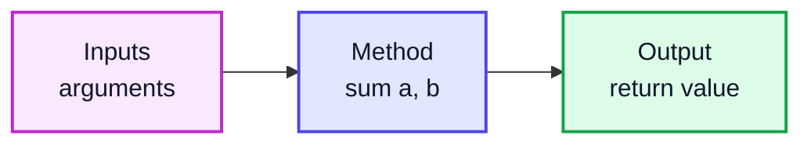

| Benefit | Why |
|---|---|
| **Reusability** | Write once, call many times |
| **Readability** | `isPrime(n)` explains itself |
| **Maintainability** | Fix a bug in one place |
| **Testability** | Each method can be tested on its own |
| **Abstraction** | Callers need to know *what* it does, not *how* |

### Method vs Function

| Term | Meaning |
|---|---|
| **Function** | General programming term for a named reusable block |
| **Method** | A function that belongs to a **class** (or object) |

In Java **every** function lives inside a class, so technically they are all **methods**. People use both words interchangeably.

---

## 3. Syntax of a Method (5:41)

```java
accessModifier static returnType methodName(paramType1 param1, paramType2 param2) {
    // body
    return value;      // required unless returnType is void
}
```

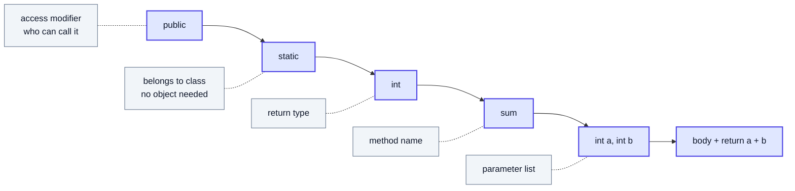

| Part | Example | Notes |
|---|---|---|
| Access modifier | `public`, `private`, (none) | Covered in the OOP videos |
| `static` | `static` | Lets `main` (also static) call it without creating an object |
| Return type | `int`, `String`, `void` | `void` = returns nothing |
| Name | `sum`, `isPrime` | camelCase verb; booleans often start with `is`/`has` |
| Parameters | `(int a, int b)` | Zero or more, each with a type |
| Body | `{ ... }` | The code that runs |

**Method signature** = name + parameter types, e.g. `sum(int, int)`. The return type is **not** part of the signature (this matters for overloading, section 20).

> [!NOTE]
> Why `static` for now? `main` is `static`, and a static method can call other static methods directly. Non-static (instance) methods need an object (`new Something().method()`), which comes in the OOP videos.

---

## 4. Program: Sum of two numbers (6:40)

### Version 1: method does everything (input + print)

```java
import java.util.Scanner;

public class SumV1 {
    public static void main(String[] args) {
        sum();          // call #1
        sum();          // call #2
    }

    static void sum() {
        Scanner in = new Scanner("10 20");      // pretend user typed 10 and 20
        int num1 = in.nextInt();
        int num2 = in.nextInt();
        int total = num1 + num2;
        System.out.println("The sum is " + total);
    }
}
// Output:
// The sum is 30
// The sum is 30
```

### What happens on a call

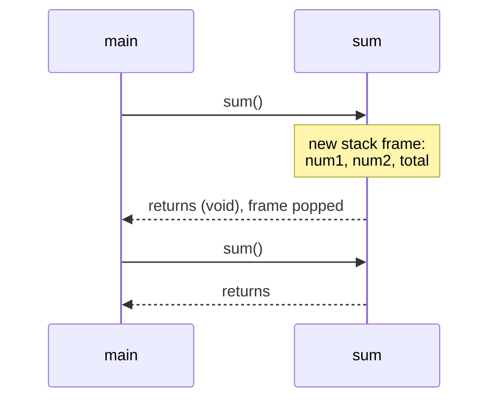

Each call creates a **new stack frame** with fresh local variables; when the method ends, the frame is destroyed.

> [!NOTE]
> In real programs use `new Scanner(System.in)` to read from the keyboard. These notes pass a fixed string to `Scanner` so the output is deterministic.

---

## 5. Program: Greetings (9:11)

The simplest kind of method: no parameters, no return value.

```java
public class Greetings {
    public static void main(String[] args) {
        greeting();
        greeting();
    }

    static void greeting() {
        System.out.println("Hello World");
    }
}
// Output:
// Hello World
// Hello World
```

| Shape | Example |
|---|---|
| No params, no return | `void greeting()` |
| Params, no return | `void greet(String name)` |
| No params, return | `int readNumber()` |
| Params + return | `int sum(int a, int b)` |

---

## 6. Returning Values (11:18)

Printing inside a method is limiting: the caller cannot **use** the result. `return` sends a value back to the caller.

```java
public class ReturnDemo {
    public static void main(String[] args) {
        int ans = sum2();                 // value comes back and is stored
        System.out.println(ans);          // 30
        System.out.println(ans * 2);      // 60  ← caller can reuse it
    }

    static int sum2() {
        int a = 10, b = 20;
        return a + b;                     // send 30 back
        // System.out.println("x");       // ❌ compile error: unreachable statement
    }
}
```

### Rules of `return`

| Rule | Example |
|---|---|
| Returned value must match the return type | `int` method can't `return "hi";` |
| A non-void method must return on **every** path | `if (x) return 1;` alone → ❌ "missing return statement" |
| `return` **ends** the method immediately | Code after it is unreachable |
| `void` methods may use `return;` to exit early | `if (n < 0) return;` |
| Only **one** value can be returned | Return an array/object to give back several |

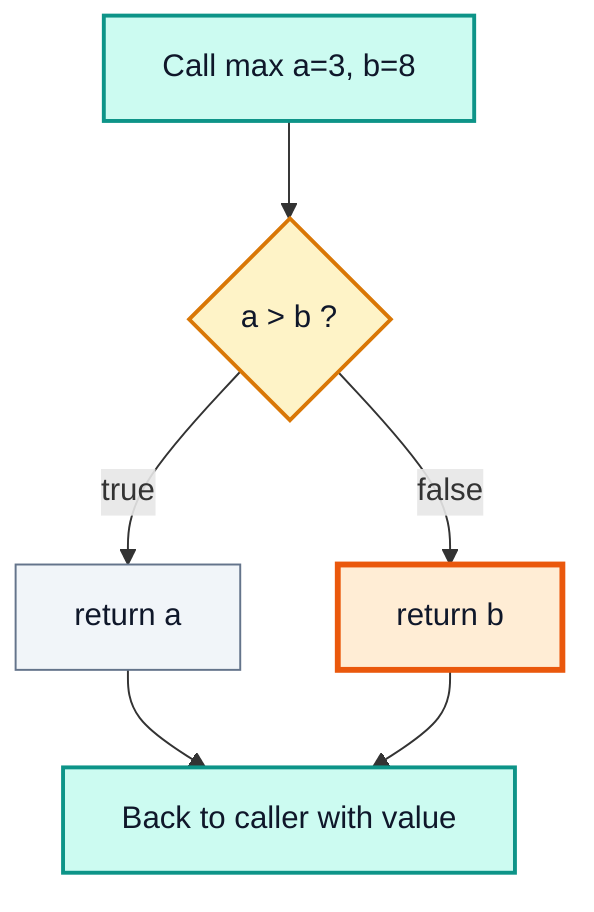

```java
public class MaxDemo {
    static int max(int a, int b) {
        if (a > b) {
            return a;
        }
        return b;            // every path returns ✅
    }

    public static void main(String[] args) {
        System.out.println(max(3, 8));   // 8
    }
}
```

> [!TIP]
> Need two results? Return an array (`return new int[]{min, max};`) or, in modern Java (16+), a small **record**: `record MinMax(int min, int max) {}`.

---

## 7. Returning a String (14:31)

Any type can be returned, including objects like `String`.

```java
public class ReturnString {
    public static void main(String[] args) {
        String message = greet();
        System.out.println(message);      // how are you
    }

    static String greet() {
        String greeting = "how are you";
        return greeting;                  // returns a reference to the String object
    }
}
```

> [!NOTE]
> For objects, `return` hands back a **reference**. The `String` object lives on the heap; the local variable `greeting` dies with the frame, but the object survives because `message` now refers to it.

---

## 8. Parameters (Integer Function) (17:42)

Hard-coding values inside a method makes it useless for other inputs. **Parameters** let the caller supply the data.

```java
public class SumParams {
    public static void main(String[] args) {
        int ans = sum3(20, 30);           // 20 and 30 are ARGUMENTS
        System.out.println(ans);          // 50
        System.out.println(sum3(5, -2));  // 3
    }

    static int sum3(int a, int b) {       // a and b are PARAMETERS
        return a + b;
    }
}
```

### Parameter vs Argument

| | **Parameter** | **Argument** |
|---|---|---|
| Where | In the method **definition** | In the method **call** |
| What | A variable placeholder | The actual value passed |
| Example | `int a, int b` | `20, 30` |
| Also called | Formal parameter | Actual parameter |

Arguments are matched to parameters **by position**, and types must be compatible:

```java
sum3(10, 20);      // ✅
sum3(10);          // ❌ wrong number of arguments
sum3("10", 20);    // ❌ String cannot be converted to int
sum3('A', 1);      // ✅ compiles! char widens to int → 65 + 1 = 66
```

> [!WARNING]
> Automatic **widening** (`char`/`byte`/`short` → `int` → `long` → `float` → `double`) happens silently for arguments, which can hide mistakes like the `'A'` example above.

---

## 9. Parameters (String Function) (20:36)

```java
public class GreetName {
    public static void main(String[] args) {
        String personalised = myGreet("Kunal");
        System.out.println(personalised);         // Hello Kunal
        System.out.println(myGreet("Rahul"));     // Hello Rahul
    }

    static String myGreet(String name) {
        return "Hello " + name;
    }
}
```

Parameters + return value = a **reusable, input → output** method. This is the shape you will use for almost every DSA solution (`int search(int[] arr, int target)`).

---

## 10. Program: Swap two numbers (25:03)

Swapping two variables **inside `main`** works with a temporary variable:

```java
public class SwapInMain {
    public static void main(String[] args) {
        int a = 10, b = 20;
        int temp = a;
        a = b;
        b = temp;
        System.out.println(a + " " + b);   // 20 10 ✅
    }
}
```

| Step | `a` | `b` | `temp` |
|---|---|---|---|
| start | 10 | 20 | — |
| `temp = a` | 10 | 20 | 🟧 10 |
| `a = b` | 🟧 20 | 20 | 10 |
| `b = temp` | 20 | 🟧 10 | 10 |

Now try to move that into a method...

---

## 11. Program: Pass Value (25:25)

```java
public class SwapMethod {
    public static void main(String[] args) {
        int a = 10, b = 20;
        swap(a, b);
        System.out.println(a + " " + b);   // 10 20  ❌ NOT swapped!
    }

    static void swap(int num1, int num2) {
        int temp = num1;
        num1 = num2;
        num2 = temp;
        System.out.println(num1 + " " + num2);   // 20 10 (only inside swap)
    }
}
// Output:
// 20 10
// 10 20
```

The swap happened, but only to `swap`'s **own copies**. The caller's `a` and `b` never changed.

> [!IMPORTANT]
> **Java is always pass-by-value.** A method receives a **copy** of each argument's value. For primitives that is a copy of the number. For objects it is a copy of the **reference** (the address), never the object itself. Java has **no** pass-by-reference.

---

## 12. Internal Working of Swapping Program (29:39)

### Primitives: separate copies on the stack

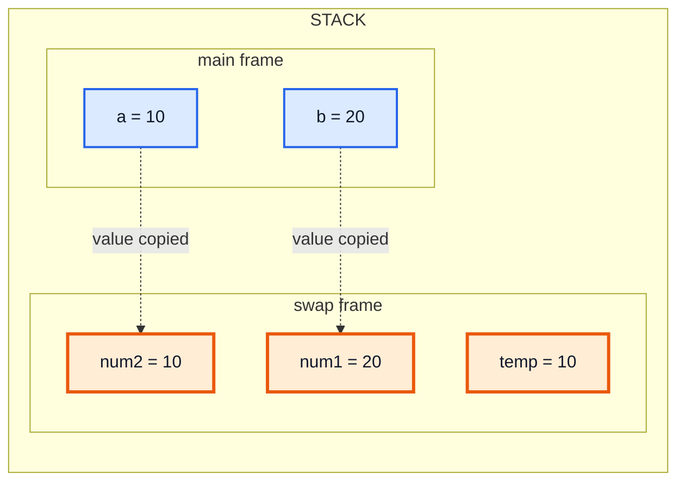

(Values shown after the swap: `swap`'s variables changed, `main`'s did not. When `swap` returns, its frame, with the swapped values, is destroyed.)

### Swapping with objects: still does not swap the caller's variables

```java
public class SwapStrings {
    public static void main(String[] args) {
        String name = "Kunal Kushwaha";
        changeName(name);
        System.out.println(name);          // Kunal Kushwaha (unchanged)
    }

    static void changeName(String naam) {
        naam = "Rahul Rana";               // creates/points to a NEW object; caller unaffected
    }
}
```

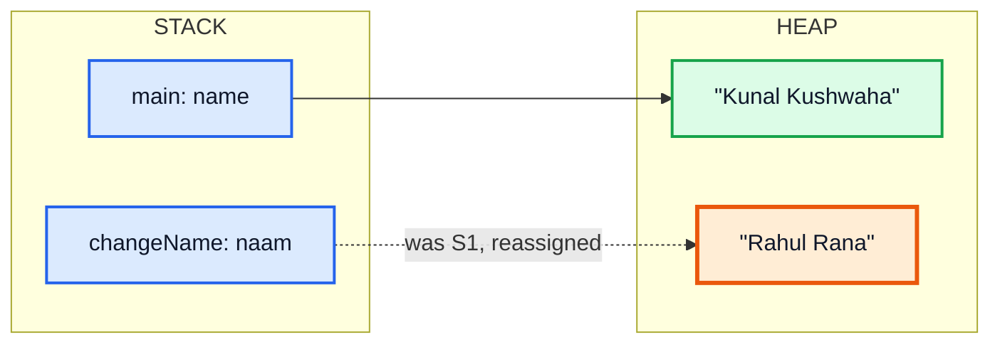

`naam` started as a copy of the address in `name`. Assigning `naam = "Rahul Rana"` only changes **where `naam` points**. `name` still points to the original object.

> [!NOTE]
> Strings are also **immutable**: there is no method on `String` that changes its characters, so a method can never alter the caller's `String`. It can only return a new one.

### So how do you write a working swap?

| Approach | Example |
|---|---|
| Swap **elements of an array** (the array is shared) | `swap(int[] arr, int i, int j)` |
| Return the swapped values | `return new int[]{b, a};` |
| Swap fields of an object | `pair.swap()` modifies the object's fields |

```java
public class SwapArray {
    static void swap(int[] arr, int i, int j) {
        int temp = arr[i];
        arr[i] = arr[j];
        arr[j] = temp;
    }

    public static void main(String[] args) {
        int[] nums = {10, 20};
        swap(nums, 0, 1);
        System.out.println(nums[0] + " " + nums[1]);   // 20 10 ✅
    }
}
```

This array-swap helper is used in almost every sorting algorithm later in the course.

---

## 13. Program: Change Value (41:33)

Passing an **array** (an object) gives the method a copy of the reference, so both point to the **same heap object**. Modifying the object through either reference is visible to both.

```java
import java.util.Arrays;

public class ChangeValue {
    public static void main(String[] args) {
        int[] arr = {1, 3, 2, 45, 6};
        change(arr);
        System.out.println(Arrays.toString(arr));   // [99, 3, 2, 45, 6] ✅ changed!

        reassign(arr);
        System.out.println(Arrays.toString(arr));   // [99, 3, 2, 45, 6]  not replaced
    }

    static void change(int[] nums) {
        nums[0] = 99;                  // modifies the shared object
    }

    static void reassign(int[] nums) {
        nums = new int[]{0, 0, 0};     // only the local copy now points elsewhere
    }
}
```

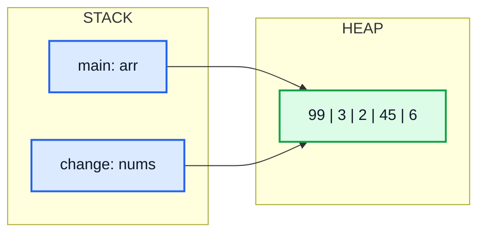

### Summary: what a method can and cannot do to its arguments

| Argument type | Change contents/fields | Reassign the parameter | Caller sees... |
|---|---|---|---|
| Primitive (`int`, `char`...) | n/a | ✅ allowed | ❌ nothing |
| Mutable object (array, `ArrayList`, custom object) | ✅ | ✅ allowed | ✅ content changes, ❌ reassignment |
| Immutable object (`String`, `Integer`) | ❌ impossible | ✅ allowed | ❌ nothing |

> [!TIP]
> Interview one-liner: *"Java passes everything by value. For objects the value is a reference, so a method can mutate the object but cannot make the caller's variable point to a different object."*

---

## 14. Scope (46:41)

**Scope** = the region of code where a variable is **visible** (can be used). In Java, scope is decided by **curly braces `{ }`**: a variable exists from its declaration to the end of the block it was declared in.

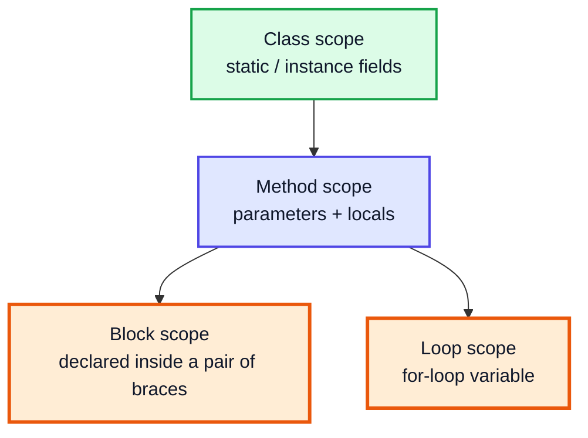

**Rule of thumb:** inner scopes can see outer variables; outer scopes cannot see inner variables.

---

## 15. Method Scope (47:00)

Variables declared in a method (including its parameters) are **local** to that method. Other methods, including `main`, cannot see them.

```java
public class MethodScope {
    public static void main(String[] args) {
        int a = 10;
        int b = 20;
        // System.out.println(num);   // ❌ cannot find symbol: num belongs to random()
    }

    static void random(int marks) {
        int num = 67;
        System.out.println(num);
        System.out.println(marks);
        // System.out.println(a);     // ❌ cannot find symbol: a belongs to main()
    }
}
```

> [!NOTE]
> This is why the swap failed: `num1`/`num2` and `a`/`b` live in **different method scopes** (different stack frames). Same-named variables in different methods are completely unrelated.

---

## 16. Block Scope (49:46)

A **block** is any code between `{` and `}`, e.g. an `if`, a loop body, or just a bare block.

```java
public class BlockScope {
    public static void main(String[] args) {
        int a = 10;
        int b = 20;

        {
            // int a = 5;          // ❌ compile error: variable a is already defined
            a = 100;               // ✅ outer variable can be USED and CHANGED inside
            int c = 99;            // c exists only inside this block
            System.out.println(a + " " + c);   // 100 99
        }

        System.out.println(a);     // 100  ← change made in block persists
        // System.out.println(c);  // ❌ cannot find symbol: c is out of scope

        int c = 5;                 // ✅ allowed: the old c no longer exists
        System.out.println(c);     // 5
    }
}
```

| Inside the block you can... | ✅ / ❌ |
|---|---|
| Read an outer variable | ✅ |
| Modify an outer variable (change persists) | ✅ |
| Re-declare a variable with an outer **local's** name | ❌ compile error |
| Use a block's variable after the block | ❌ |
| Declare a new variable with that name **after** the block | ✅ |

---

## 17. Loop Scope (55:32)

A variable declared in the `for` header, or in the loop body, exists only inside the loop.

```java
public class LoopScope {
    public static void main(String[] args) {
        int a = 10;

        for (int i = 0; i < 3; i++) {
            int square = i * i;        // re-created every iteration
            a += square;               // ✅ outer variable accessible
        }

        System.out.println(a);         // 10 + 0 + 1 + 4 = 15
        // System.out.println(i);      // ❌ i is out of scope
        // System.out.println(square); // ❌ square is out of scope

        int i;                          // need i after the loop? declare it outside
        for (i = 0; i < 5; i++) { }
        System.out.println(i);         // 5
    }
}
```

| Iteration | `i` | `square` | `a` |
|---|---|---|---|
| start | — | — | 10 |
| 1 | 0 | 0 | 10 |
| 2 | 1 | 1 | 11 |
| 3 | 2 | 4 | 🟩 15 |

> [!TIP]
> Declare variables in the **smallest scope** that works. It prevents accidental reuse and makes code easier to read.

---

## 18. Shadowing (59:44)

**Shadowing** happens when a variable in an inner scope has the **same name** as a variable in an outer scope (a class field). The inner one **hides** the outer one within its scope.

```java
public class Shadowing {
    static int x = 90;                      // class-level (static) variable

    public static void main(String[] args) {
        System.out.println(x);              // 90 (only the static x exists so far)

        int x = 40;                         // local x SHADOWS the static x
        System.out.println(x);              // 40
        System.out.println(Shadowing.x);    // 90 (reach the hidden one explicitly)

        fun();                              // 90
    }

    static void fun() {
        System.out.println(x);              // 90 (no local x here)
    }
}
```

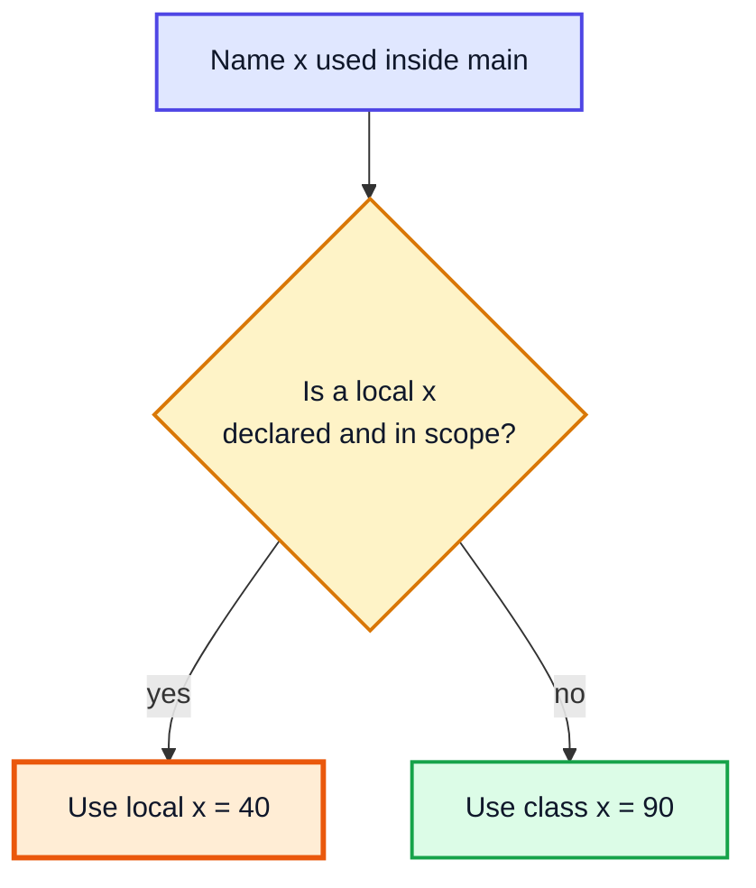

| Case | Allowed? |
|---|---|
| Local variable shadows a **field** (static or instance) | ✅ |
| Parameter shadows a field (`this.name = name;`) | ✅ (very common in constructors) |
| Local in an inner block shadows a local of the **same method** | ❌ compile error |
| Lambda parameter shadows an enclosing local | ❌ compile error |

> [!WARNING]
> Shadowing is legal but can cause confusing bugs. Outside of constructors/setters (`this.x = x`), prefer distinct names.

---

## 19. Variable Arguments (Varargs) (1:06:53)

Sometimes you do not know how many arguments will be passed. **Varargs** (`type... name`) let a method accept **zero or more** values; inside the method they arrive as an **array**.

```java
import java.util.Arrays;

public class Varargs {
    public static void main(String[] args) {
        fun();                                  // []
        fun(2, 3, 4, 5, 6, 7);                  // [2, 3, 4, 5, 6, 7]
        fun(new int[]{1, 2});                   // [1, 2]  (an array also works)

        multiple(2, 3, "Kunal", "Rahul", "Sahil");
        // 2 3 [Kunal, Rahul, Sahil]
    }

    static void fun(int... v) {
        System.out.println(Arrays.toString(v)); // v is an int[]
    }

    static void multiple(int a, int b, String... names) {
        System.out.println(a + " " + b + " " + Arrays.toString(names));
    }
}
```

### Rules

| Rule | Example |
|---|---|
| Only **one** varargs parameter per method | `f(int... a, String... b)` ❌ |
| It must be the **last** parameter | `f(String... s, int a)` ❌ |
| Zero arguments is allowed | `fun()` → empty array, not `null` |
| Inside, it is a normal array | `v.length`, `v[0]`, for-each |

> [!NOTE]
> You already use varargs: `System.out.printf(String format, Object... args)` and `String.format(...)` are varargs methods. Even `main` may be written `public static void main(String... args)`.

---

## 20. Method Overloading (1:12:07)

**Overloading** = several methods with the **same name** but **different parameter lists** in the same class. The compiler picks the right one at **compile time** based on the arguments (compile-time / static polymorphism).

```java
public class Overloading {
    public static void main(String[] args) {
        fun(67);                 // int version: 67
        fun("Kunal");            // String version: Kunal
        System.out.println(sum(2, 3));        // 5
        System.out.println(sum(2, 3, 4));     // 9
        System.out.println(sum(2.5, 3.5));    // 6.0
    }

    static void fun(int a)       { System.out.println("int version: " + a); }
    static void fun(String name) { System.out.println("String version: " + name); }

    static int sum(int a, int b)         { return a + b; }
    static int sum(int a, int b, int c)  { return a + b + c; }
    static double sum(double a, double b) { return a + b; }
}
```

### What makes a valid overload?

| Difference between methods | Valid overload? |
|---|---|
| Number of parameters | ✅ |
| Types of parameters | ✅ |
| Order of parameter types (`f(int, String)` vs `f(String, int)`) | ✅ |
| **Only** the return type | ❌ "method already defined" |
| **Only** parameter names | ❌ |
| Only access modifier / `static` | ❌ |

### How the compiler chooses

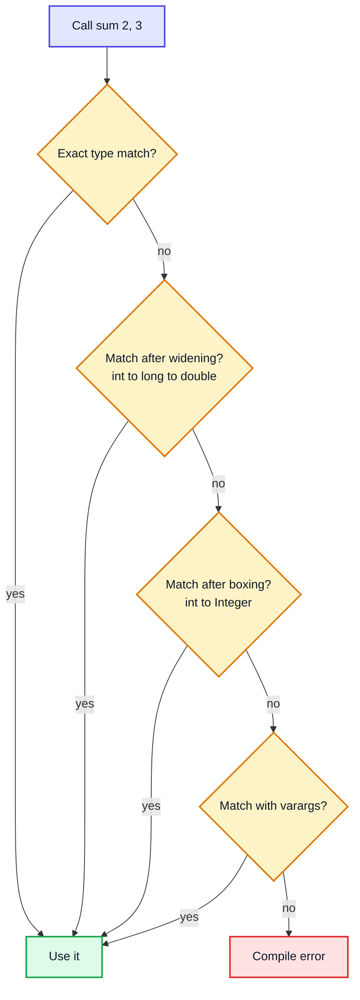

### Ambiguity with varargs

```java
static void demo(int... v)    { }
static void demo(String... v) { }

demo(1, 2);     // ✅ int version
demo("a");      // ✅ String version
demo();         // ❌ compile error: reference to demo is ambiguous
```

With no arguments, both methods match equally well, so the compiler refuses.

> [!NOTE]
> **Overloading vs Overriding**: overloading = same name, different parameters, same class, resolved at compile time. Overriding = same signature in a subclass, resolved at runtime. Overriding comes in the OOP videos.

---

## 21. Questions (1:19:25)

Now apply methods to classic problems. Each one becomes a **reusable method** that `main` calls, which is exactly how you will write LeetCode solutions (the platform calls your method).

| # | Problem | Related LeetCode |
|---|---|---|
| Q1 | Check if a number is prime | Building block of **204. Count Primes** |
| Q2 | Check if a number is an Armstrong number | **1134. Armstrong Number** (premium) |
| Q3 | Print all 3-digit Armstrong numbers | Uses Q2 in a loop |

---

## 22. Q1: Prime Number (1:20:01)

A **prime** is a number **greater than 1** whose only divisors are 1 and itself. Examples: 2, 3, 5, 7, 11, 13. Note: 1 is **not** prime; 2 is the only even prime.

### Approach 1: brute force (check 2 to n-1)

If any `c` in `2..n-1` divides `n`, it is not prime. Correct, but `O(n)`.

### Approach 2 (video): check only up to √n

If `n = a × b` and both `a` and `b` were greater than `√n`, then `a × b > n`, a contradiction. So **at least one factor is ≤ √n**. If no number from 2 to √n divides `n`, it is prime.

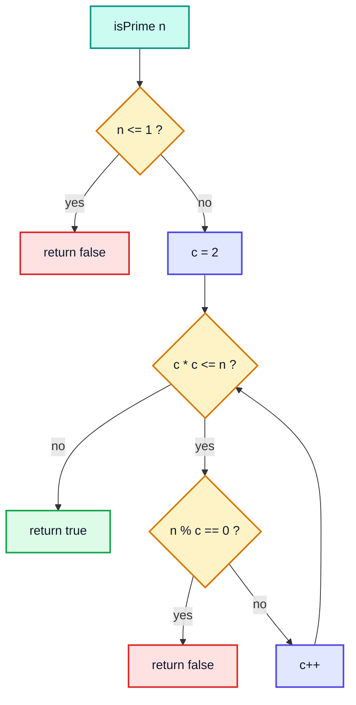

```java
public class PrimeCheck {
    public static void main(String[] args) {
        int[] tests = {1, 2, 17, 25, 29, 97, 100};
        for (int n : tests) {
            System.out.println(n + " -> " + isPrime(n));
        }
    }

    static boolean isPrime(int n) {
        if (n <= 1) {
            return false;
        }
        int c = 2;
        while ((long) c * c <= n) {   // same as c <= sqrt(n), without floating point
            if (n % c == 0) {
                return false;
            }
            c++;
        }
        return true;
    }
}
// Output:
// 1 -> false
// 2 -> true
// 17 -> true
// 25 -> false
// 29 -> true
// 97 -> true
// 100 -> false
```

### Dry run: `isPrime(25)` and `isPrime(29)`

| n | c | c·c ≤ n? | n % c | Action |
|---|---|---|---|---|
| 25 | 2 | 4 ≤ 25 ✅ | 1 | c++ |
| 25 | 3 | 9 ≤ 25 ✅ | 1 | c++ |
| 25 | 4 | 16 ≤ 25 ✅ | 1 | c++ |
| 25 | 5 | 25 ≤ 25 ✅ | 🟥 0 | return **false** |
| 29 | 2 | 4 ≤ 29 ✅ | 1 | c++ |
| 29 | 3 | 9 ≤ 29 ✅ | 2 | c++ |
| 29 | 4 | 16 ≤ 29 ✅ | 1 | c++ |
| 29 | 5 | 25 ≤ 29 ✅ | 4 | c++ |
| 29 | 6 | 36 ≤ 29 ❌ | — | 🟩 return **true** |

> [!IMPORTANT]
> The condition must be `c * c <= n` (with `<=`), not `<`. With `<`, `isPrime(25)` would stop at `c = 5` before testing it and wrongly return `true`.

> [!NOTE]
> `(long) c * c` avoids `int` overflow when `n` is close to `Integer.MAX_VALUE`; `c * c` alone can overflow and go negative, giving an infinite loop. For small inputs (as in the video) plain `c * c` is fine.

### Complexity

| Approach | Time | Space |
|---|---|---|
| Check 2 to n-1 | O(n) | O(1) |
| Check 2 to √n | **O(√n)** | O(1) |
| Check 2, then odd numbers to √n | O(√n / 2) | O(1) |
| Sieve of Eratosthenes (many queries up to N) | O(N log log N) once, then O(1) per query | O(N) |

The **Sieve of Eratosthenes** is covered later in the course in the maths videos; it is the standard solution for LeetCode 204.

---

## 23. Q2: Check Armstrong Number (1:23:52)

An **Armstrong number** (narcissistic number) equals the **sum of its digits, each raised to the power of the number of digits**.

- 153 (3 digits): 1³ + 5³ + 3³ = 1 + 125 + 27 = **153** ✅
- 9474 (4 digits): 9⁴ + 4⁴ + 7⁴ + 4⁴ = 6561 + 256 + 2401 + 256 = **9474** ✅
- 123: 1³ + 2³ + 3³ = 36 ❌

### Approach: extract digits with `% 10` and `/ 10`

| Operation | Gives | Example on 153 |
|---|---|---|
| `n % 10` | Last digit | 3 |
| `n / 10` | Number without last digit | 15 |

```java
public class ArmstrongCheck {
    public static void main(String[] args) {
        System.out.println(isArmstrong(153));    // true
        System.out.println(isArmstrong(370));    // true
        System.out.println(isArmstrong(123));    // false
        System.out.println(isArmstrong3(371));   // true  (video's 3-digit version)
    }

    // Video's version: cubes, correct for 3-digit numbers
    static boolean isArmstrong3(int n) {
        int original = n;
        int sum = 0;
        while (n > 0) {
            int rem = n % 10;
            n = n / 10;
            sum = sum + rem * rem * rem;
        }
        return sum == original;
    }

    // General version: power = number of digits (works for any length)
    static boolean isArmstrong(int n) {
        int digits = String.valueOf(n).length();
        int original = n, sum = 0;
        while (n > 0) {
            int d = n % 10;
            sum += (int) Math.pow(d, digits);
            n /= 10;
        }
        return sum == original;
    }
}
```

### Dry run: `isArmstrong3(153)`

| Iteration | n (before) | rem = n % 10 | rem³ | sum | n (after) |
|---|---|---|---|---|---|
| 1 | 153 | 3 | 27 | 27 | 15 |
| 2 | 15 | 5 | 125 | 152 | 1 |
| 3 | 1 | 1 | 1 | 🟩 153 | 0 |

`sum (153) == original (153)` → **true**.

> [!WARNING]
> Save `original = n` **before** the loop. The loop destroys `n` (it ends at 0), so comparing `sum == n` at the end would always be wrong.

> [!NOTE]
> The video uses cubes because it deals with 3-digit numbers. The general definition uses the digit count as the power, which is what LeetCode 1134 expects. With cubes, 4-digit Armstrong numbers such as 1634 and 9474 would wrongly be reported as not Armstrong.

### Complexity

| Version | Time | Space |
|---|---|---|
| Digit loop | O(d) = O(log₁₀ n) | O(1) |

Alternative for counting digits without a `String`: `(int) Math.log10(n) + 1` (for n > 0), or a separate `while (n > 0) { count++; n /= 10; }` loop.

---

## 24. Q3: Print All 3 Digit Armstrong Numbers (1:28:27)

Reuse Q2: loop over every 3-digit number (100 to 999) and print those where `isArmstrong` is true. This is the payoff of methods: the check is written **once** and called 900 times.

```java
public class AllArmstrong {
    public static void main(String[] args) {
        for (int i = 100; i < 1000; i++) {
            if (isArmstrong(i)) {
                System.out.print(i + " ");
            }
        }
        System.out.println();
    }

    static boolean isArmstrong(int n) {
        int original = n, sum = 0;
        while (n > 0) {
            int rem = n % 10;
            sum += rem * rem * rem;
            n /= 10;
        }
        return sum == original;
    }
}
// Output:
// 153 370 371 407
```

| Number | Check | Result |
|---|---|---|
| 153 | 1 + 125 + 27 | 🟩 153 |
| 370 | 27 + 343 + 0 | 🟩 370 |
| 371 | 27 + 343 + 1 | 🟩 371 |
| 407 | 64 + 0 + 343 | 🟩 407 |

**Complexity:** 900 numbers × 3 digits each = O(900 × 3), effectively constant. For a range of size N with d-digit numbers, O(N · d).

---

## 25. Outro (1:30:18)

Methods are the building block of everything ahead: every DSA solution is a method, recursion is a method calling itself, and OOP is built around methods on objects. Next up are arrays, where "objects are passed by reference value" matters constantly.

---

## 🧩 Complete Example: Everything Together

One program that uses **every concept** from this video: void and returning methods, parameters, pass-by-value with primitives vs objects, scope, shadowing, varargs, overloading, and the three questions.

```java
import java.util.Arrays;

public class FunctionsDemo {

    // ═══════ Class-level (static) variable, used to show shadowing ═══════
    static int x = 90;

    // ═══════ 1. Method with parameters + return value ═══════
    static int sum(int a, int b) {
        return a + b;
    }

    // ═══════ 2. void method (no return value) ═══════
    static void greet() {
        System.out.println("Hello from greet()");
    }

    // ═══════ 3. Returning a String ═══════
    static String personalGreeting(String name) {
        return "Hello, " + name + "!";
    }

    // ═══════ 4. Pass by value: swapping primitives does NOT work ═══════
    static void swap(int a, int b) {
        int temp = a;
        a = b;
        b = temp;
        System.out.println("  inside swap(): a=" + a + ", b=" + b);
    }

    // ═══════ 5. Changing an object through a copied reference DOES work ═══════
    static void changeArray(int[] arr) {
        arr[0] = 99;              // modifies the shared heap object
    }

    static void reassignString(String s) {
        s = "Rahul";              // only the local copy of the reference changes
    }

    // ═══════ 6. Varargs ═══════
    static int sumAll(int... nums) {
        int total = 0;
        for (int n : nums) {
            total += n;
        }
        return total;
    }

    static String describe(String label, int... nums) {
        return label + " -> " + Arrays.toString(nums);
    }

    // ═══════ 7. Overloading: same name, different parameter lists ═══════
    static int area(int side)                  { return side * side; }
    static int area(int length, int breadth)   { return length * breadth; }
    static double area(double radius)          { return Math.PI * radius * radius; }

    // ═══════ 8. Q1: Prime check, O(sqrt n) ═══════
    static boolean isPrime(int n) {
        if (n <= 1) return false;
        for (int c = 2; (long) c * c <= n; c++) {
            if (n % c == 0) return false;
        }
        return true;
    }

    // ═══════ 9. Q2: Armstrong check (general: power = number of digits) ═══════
    static boolean isArmstrong(int n) {
        int digits = String.valueOf(n).length();
        int original = n, sum = 0;
        while (n > 0) {
            int d = n % 10;
            sum += (int) Math.pow(d, digits);
            n /= 10;
        }
        return sum == original;
    }

    public static void main(String[] args) {
        System.out.println("== Methods & return values ==");
        System.out.println("sum(10, 20) = " + sum(10, 20));
        greet();
        System.out.println(personalGreeting("Kunal"));

        System.out.println("== Pass by value ==");
        int a = 10, b = 20;
        swap(a, b);
        System.out.println("  after swap(): a=" + a + ", b=" + b);

        int[] arr = {1, 2, 3};
        changeArray(arr);
        System.out.println("  after changeArray(): " + Arrays.toString(arr));

        String name = "Kunal";
        reassignString(name);
        System.out.println("  after reassignString(): " + name);

        System.out.println("== Scope ==");
        int outer = 5;
        {
            outer = 6;                    // outer variable visible and changeable in block
            int inner = 7;                // exists only inside this block
            System.out.println("  in block: outer=" + outer + ", inner=" + inner);
        }
        // System.out.println(inner);     // ❌ compile error: cannot find symbol
        int loopTotal = 0;
        for (int i = 1; i <= 3; i++) {    // i is scoped to the loop
            loopTotal += i;
        }
        System.out.println("  after block/loop: outer=" + outer + ", loopTotal=" + loopTotal);

        System.out.println("== Shadowing ==");
        System.out.println("  class x = " + x);
        int x = 40;                        // local x shadows the static x
        System.out.println("  local x = " + x + ", FunctionsDemo.x = " + FunctionsDemo.x);

        System.out.println("== Varargs ==");
        System.out.println("  sumAll() = " + sumAll());
        System.out.println("  sumAll(1, 2, 3, 4) = " + sumAll(1, 2, 3, 4));
        System.out.println("  " + describe("marks", 90, 85, 77));

        System.out.println("== Overloading ==");
        System.out.println("  area(4) = " + area(4));
        System.out.println("  area(4, 5) = " + area(4, 5));
        System.out.printf("  area(1.5) = %.2f%n", area(1.5));

        System.out.println("== Q1: Primes up to 30 ==");
        StringBuilder primes = new StringBuilder();
        for (int n = 1; n <= 30; n++) {
            if (isPrime(n)) primes.append(n).append(' ');
        }
        System.out.println("  " + primes.toString().trim());

        System.out.println("== Q2: Armstrong checks ==");
        for (int n : new int[]{153, 370, 123, 9474}) {
            System.out.println("  " + n + " -> " + isArmstrong(n));
        }

        System.out.println("== Q3: All 3-digit Armstrong numbers ==");
        StringBuilder arm = new StringBuilder();
        for (int n = 100; n <= 999; n++) {
            if (isArmstrong(n)) arm.append(n).append(' ');
        }
        System.out.println("  " + arm.toString().trim());
    }
}
```

**Expected Output:**
```
== Methods & return values ==
sum(10, 20) = 30
Hello from greet()
Hello, Kunal!
== Pass by value ==
  inside swap(): a=20, b=10
  after swap(): a=10, b=20
  after changeArray(): [99, 2, 3]
  after reassignString(): Kunal
== Scope ==
  in block: outer=6, inner=7
  after block/loop: outer=6, loopTotal=6
== Shadowing ==
  class x = 90
  local x = 40, FunctionsDemo.x = 90
== Varargs ==
  sumAll() = 0
  sumAll(1, 2, 3, 4) = 10
  marks -> [90, 85, 77]
== Overloading ==
  area(4) = 16
  area(4, 5) = 20
  area(1.5) = 7.07
== Q1: Primes up to 30 ==
  2 3 5 7 11 13 17 19 23 29
== Q2: Armstrong checks ==
  153 -> true
  370 -> true
  123 -> false
  9474 -> true
== Q3: All 3-digit Armstrong numbers ==
  153 370 371 407
```

---

## Quick Reference Cheat Sheet

| Concept | One-Line Summary |
|---|---|
| **Method** | Named, reusable block of code inside a class; runs only when called |
| **Syntax** | `access static returnType name(type p1, type p2) { ... }` |
| **Signature** | Name + parameter types; return type is NOT part of it |
| **`void`** | Method returns nothing; `return;` can exit early |
| **`return`** | Sends one value back and ends the method; every path must return |
| **Parameter vs Argument** | Placeholder in definition vs actual value in call |
| **Stack frame** | Each call gets its own frame of locals, destroyed on return |
| **Pass-by-value** | Java always copies the argument's value; no pass-by-reference |
| **Primitives passed** | Method gets a copy; caller's variable never changes (swap fails) |
| **Objects passed** | Method gets a copy of the reference; can mutate the object, cannot repoint caller's variable |
| **Strings** | Immutable; a method cannot change the caller's String |
| **Working swap** | Swap array elements: `swap(arr, i, j)` |
| **Scope** | Variable visible from declaration to end of its `{ }` block |
| **Method scope** | Locals/params visible only in their method |
| **Block scope** | Outer vars usable inside; inner vars gone after `}`; can't redeclare outer local |
| **Loop scope** | `for (int i...)` → `i` exists only in the loop |
| **Shadowing** | Local/param with a field's name hides the field; use `ClassName.x` / `this.x` |
| **Varargs** | `type... v` = zero or more args as an array; only one, must be last |
| **Overloading** | Same name, different parameter list; chosen at compile time |
| **Invalid overload** | Differing only in return type or parameter names |
| **Varargs ambiguity** | `f(int...)` + `f(String...)` → `f()` doesn't compile |
| **Prime check** | Test divisors `2..√n` with `c * c <= n`; O(√n) |
| **Armstrong number** | Sum of digits^(digit count) equals the number; digits via `% 10`, `/ 10` |
| **3-digit Armstrong** | 153, 370, 371, 407 |
