# Arrays and ArrayList in Java — Complete In-Depth Guide

**Video #12 of the Java + DSA playlist:** *Introduction to Arrays and ArrayList in Java* (1:45:52)

A deep-dive into storing many values under one name: how arrays are declared, created and laid out in memory, what `null` really is, input/output with loops, arrays of objects, passing arrays to functions, 2D and jagged arrays, and the resizable `ArrayList` — finishing with the classic swap, max and reverse questions.

---

## Table of Contents

| # | Topic | Timestamp |
|---|---|---|
| 0 | [Introduction](#0-introduction-000) | 0:00 |
| 1 | [Why We Need Arrays?](#1-why-we-need-arrays-122) | 1:22 |
| 2 | [What is an Array?](#2-what-is-an-array-258) | 2:58 |
| 3 | [Syntax of an Array](#3-syntax-of-an-array-313) | 3:13 |
| 4 | [Direct Hit Program: Store 5 Roll Numbers](#4-direct-hit-program-store-5-roll-numbers-426) | 4:26 |
| 5 | [How Does an Array Work?](#5-how-does-an-array-work-644) | 6:44 |
| 6 | [Internal Working of an Array](#6-internal-working-of-an-array-842) | 8:42 |
| 7 | [Dynamic Memory Allocation](#7-dynamic-memory-allocation-1032) | 10:32 |
| 8 | [Internal Representation of Array](#8-internal-representation-of-array-1200) | 12:00 |
| 9 | [Continuity of an Array](#9-continuity-of-an-array-1306) | 13:06 |
| 10 | [Index of an Array](#10-index-of-an-array-1625) | 16:25 |
| 11 | [String Array](#11-string-array-1953) | 19:53 |
| 12 | [What is null in Java?](#12-what-is-null-in-java-2042) | 20:42 |
| 13 | [null is Used as a Default](#13-null-is-used-as-a-default-2330) | 23:30 |
| 14 | [Array Input](#14-array-input-2755) | 27:55 |
| 15 | [for-each Loop](#15-for-each-loop-3119) | 31:19 |
| 16 | [toString() Method](#16-tostring-method-3315) | 33:15 |
| 17 | [Array of Objects](#17-array-of-objects-3452) | 34:52 |
| 18 | [Storage of Objects in Heap](#18-storage-of-objects-in-heap-3625) | 36:25 |
| 19 | [Array Passing in Function](#19-array-passing-in-function-4021) | 40:21 |
| 20 | [Multidimensional Arrays](#20-multidimensional-arrays-4232) | 42:32 |
| 21 | [Syntax of a 2D Array](#21-syntax-of-a-2d-array-4336) | 43:36 |
| 22 | [Internal Working of a 2D Array](#22-internal-working-of-a-2d-array-4520) | 45:20 |
| 23 | [2D Array Input](#23-2d-array-input-5016) | 50:16 |
| 24 | [2D Array Output](#24-2d-array-output-10106) | 1:01:06 |
| 25 | [Dynamic Arrays](#25-dynamic-arrays-10705) | 1:07:05 |
| 26 | [Array Functions](#26-array-functions-11722) | 1:17:22 |
| 27 | [Internal Working of ArrayList](#27-internal-working-of-arraylist-12108) | 1:21:08 |
| 28 | [Questions](#28-questions-13321) | 1:33:21 |
| 29 | [Q1: Swapping Values in an Array](#29-q1-swapping-values-in-an-array-13330) | 1:33:30 |
| 30 | [Q2: Maximum Value of an Array](#30-q2-maximum-value-of-an-array-13520) | 1:35:20 |
| 31 | [Q3: Reversing an Array](#31-q3-reversing-an-array-14045) | 1:40:45 |
| 32 | [Outro](#32-outro-14420) | 1:44:20 |

---

## 0. Introduction (0:00)

Up to now every variable held **one** value. Real programs deal with collections: the marks of a class, the prices in a cart, the pixels of an image. This video introduces the two most-used tools for that in Java:

1. **Arrays** — fixed-size, fast, built into the language
2. **ArrayList** — a resizable list from the Collections Framework, built *on top of* an array

What you'll learn:

- Syntax, creation, indexing and memory layout of arrays
- `null`, default values, and how reference types behave
- Input/output with `for`, for-each and `Arrays.toString()`
- Arrays of objects and passing arrays to methods
- 2D arrays (including jagged arrays)
- `ArrayList`: methods, internal growth and 2D lists
- Three warm-up questions: swap, max and reverse

> [!IMPORTANT]
> Arrays are the foundation of almost every DSA topic that follows — searching, sorting, two pointers, sliding window, dynamic programming, heaps and hash tables are all built on them. Understanding *how an array lives in memory* pays off for the whole course.

---

## 1. Why We Need Arrays? (1:22)

### The Problem

Suppose you need to store the roll numbers of 5 students. With plain variables:

```java
int rno1 = 23;
int rno2 = 12;
int rno3 = 45;
int rno4 = 32;
int rno5 = 15;
```

Now imagine **500** students. You would need 500 variable names, and you could not loop over them — there is no way to write "variable number `i`".

### The Solution

An array gives **one name** to a whole group of values and lets you reach each one by a number (its **index**):

```java
int[] rnos = {23, 12, 45, 32, 15};
System.out.println(rnos[2]);   // 45
```

| Separate variables | Array |
|---|---|
| One name per value | One name for all values |
| Cannot loop over them | `for (int i = 0; i < rnos.length; i++)` |
| Adding a value = new variable + code changes | Just a bigger size |
| Passing them all to a method = many parameters | Pass one reference |

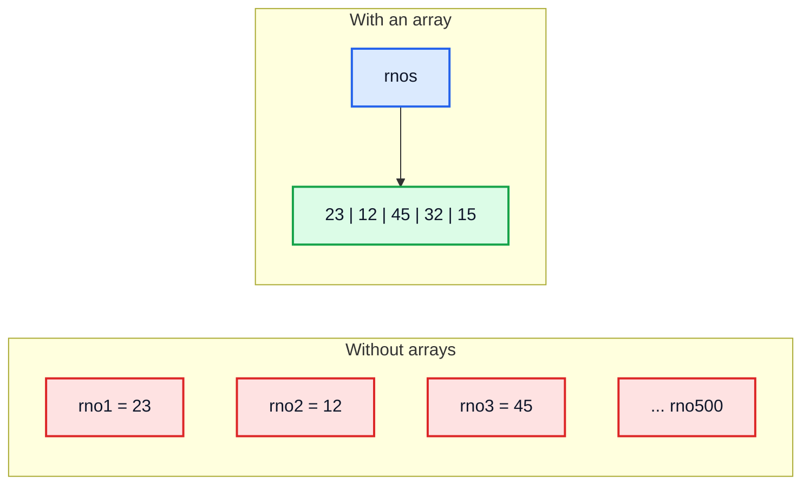

---

## 2. What is an Array? (2:58)

An **array** is a collection of values of the **same data type**, stored under one name, with a **fixed size** decided when it is created.

Key properties:

| Property | Meaning |
|---|---|
| **Homogeneous** | All elements have the same type (`int[]` holds only `int`s) |
| **Fixed size** | Size is set at creation; it can never grow or shrink |
| **Indexed** | Elements are numbered `0` to `length - 1` |
| **Object** | In Java an array is an object, created on the heap |
| **Random access** | Any element can be read in O(1) time using its index |

> [!NOTE]
> Because every element has the same type, the JVM knows exactly how many bytes each element takes. That is what makes `arr[i]` a constant-time operation (see section 10).

---

## 3. Syntax of an Array (3:13)

### General Form

```java
datatype[] variableName = new datatype[size];
```

```java
int[] rnos = new int[5];          // 5 ints, all 0
double[] prices = new double[3];  // 3 doubles, all 0.0
String[] names = new String[4];   // 4 references, all null
```

### Ways to Create an Array

```java
// 1. Declare, then create
int[] a;            // declaration: only a reference variable, no array yet
a = new int[5];     // creation: the array object is made on the heap

// 2. Declare + create in one line
int[] b = new int[5];

// 3. Declare + create + initialise with values (size is inferred: 5)
int[] c = {23, 12, 45, 32, 15};

// 4. Anonymous array (useful when passing to a method or reassigning)
int[] d;
d = new int[]{1, 2, 3};
// d = {1, 2, 3};   // ❌ compile error: the {} shortcut only works in a declaration
```

### Syntax Variations

| Form | Valid? | Note |
|---|---|---|
| `int[] arr;` | ✅ | Preferred Java style — type is "array of int" |
| `int arr[];` | ✅ | C-style, allowed but discouraged |
| `int[] a, b;` | ✅ | Both are arrays |
| `int a[], b;` | ✅ | Only `a` is an array, `b` is an `int` — confusing ⚠️ |
| `int[5] arr;` | ❌ | Size never goes in the declaration |
| `new int[]` | ❌ | Size (or initialiser) is required |
| `new int[0]` | ✅ | An empty array with `length == 0` |
| `new int[-1]` | ❌ at runtime | `NegativeArraySizeException` |

> [!TIP]
> Since Java 10 you can write `var arr = new int[5];` for local variables. You cannot write `var arr = {1, 2, 3};` because the compiler has no type to infer from the bare braces.

---

## 4. Direct Hit Program: Store 5 Roll Numbers (4:26)

```java
public class RollNumbers {
    public static void main(String[] args) {
        int[] rnos = new int[5];

        rnos[0] = 23;
        rnos[1] = 12;
        rnos[2] = 45;
        rnos[3] = 32;
        rnos[4] = 15;

        System.out.println(rnos[0]);       // 23
        System.out.println(rnos[3]);       // 32
        System.out.println(rnos.length);   // 5

        // Or all at once:
        int[] rnos2 = {23, 12, 45, 32, 15};
        System.out.println(rnos2[4]);      // 15
    }
}
```

> [!NOTE]
> `length` is a **field** of the array, not a method: `rnos.length` (no parentheses). For a `String` it is a method, `str.length()`, and for an `ArrayList` it is `list.size()`. Mixing these up is a very common compile error.

| Type | How to get the size |
|---|---|
| Array | `arr.length` |
| String | `str.length()` |
| ArrayList / any Collection | `list.size()` |

---

## 5. How Does an Array Work? (6:44)

A statement like `int[] rnos = new int[5];` is really **two** things joined by `=`:

| Part | Happens at | What it does |
|---|---|---|
| `int[] rnos` | **Compile time** (declaration) | Creates a reference variable `rnos` on the **stack**. The compiler checks that only `int[]` can be assigned to it |
| `new int[5]` | **Runtime** (creation) | Allocates an object for 5 ints on the **heap** and returns its reference |
| `=` | Runtime | Stores that reference in `rnos` |

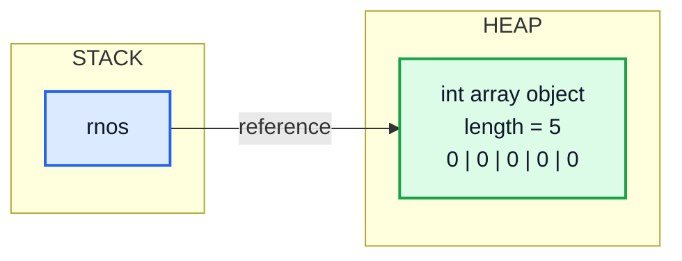

So `rnos` itself is **not** the array. It is a reference that **points to** the array object — exactly the stack/heap model from video #5.

---

## 6. Internal Working of an Array (8:42)

Walk through what happens step by step:

```java
int[] rnos;            // (1)
rnos = new int[5];     // (2)
rnos[1] = 12;          // (3)
```

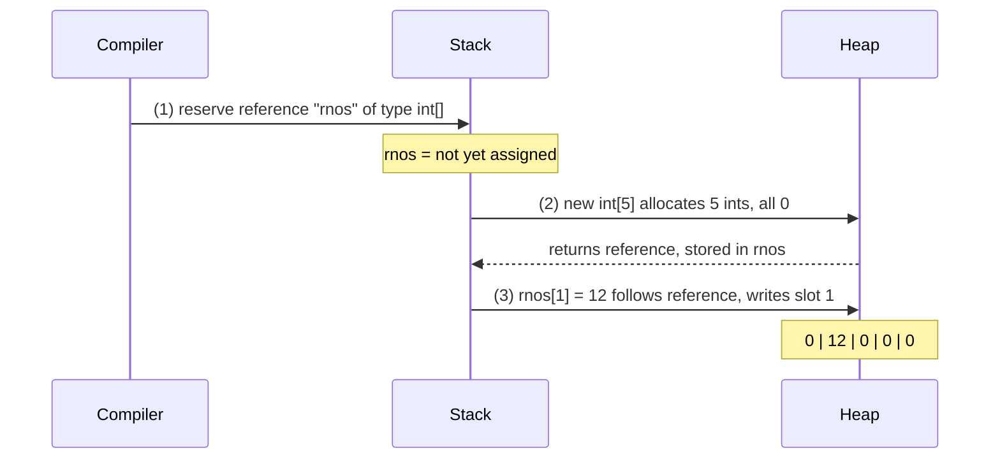

### Every Array Object Contains

| Piece | Purpose |
|---|---|
| **Object header** | Class pointer (the JVM knows it is an `int[]`) and GC/lock info |
| **length** | Stored once at creation, read by `arr.length`, used for bounds checks |
| **Elements** | The actual values (primitives) or references (objects) |

> [!NOTE]
> Every access `arr[i]` is **bounds-checked**: if `i < 0` or `i >= arr.length` Java throws `ArrayIndexOutOfBoundsException` instead of reading random memory as C would. This is a big safety difference between Java and C/C++.

---

## 7. Dynamic Memory Allocation (10:32)

"Dynamic" means memory is allocated **while the program runs**, not decided by the compiler. In Java, **every** `new` is a dynamic allocation on the heap.

That is why the size can come from a variable or from user input:

```java
import java.util.Scanner;

public class DynamicSize {
    public static void main(String[] args) {
        Scanner in = new Scanner("4");     // pretend the user typed 4
        int n = in.nextInt();
        int[] arr = new int[n];            // size known only at runtime ✅
        System.out.println(arr.length);    // 4
    }
}
```

| | Static allocation | Dynamic allocation |
|---|---|---|
| When | Compile time | Runtime |
| Where (in Java) | — (Java has no stack-allocated arrays) | Heap |
| Size from a variable? | No | Yes |
| Freed by | Leaving scope | Garbage collector, once unreachable |
| Java example | Local `int x = 5;` (a primitive on the stack) | `new int[n]`, `new Student()` |

> [!IMPORTANT]
> "Dynamic memory allocation" (size chosen at runtime) is **not** the same as a "dynamic array" (an array that can **grow**). A Java array is dynamically allocated but its size is still **fixed** after creation. Growing needs `ArrayList` (section 25).

---

## 8. Internal Representation of Array (12:00)

For a primitive array, the values live **inside** the array object:

```java
int[] arr = {23, 12, 45, 32, 15};
```

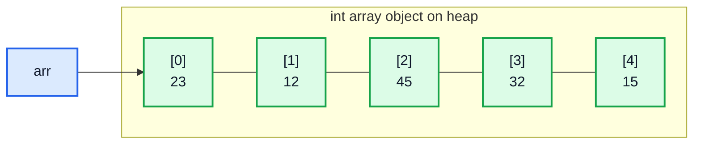

For an array of objects (e.g. `String[]`), the array holds **references**, and each reference points to a separate object elsewhere on the heap (section 18).

### Memory Size (HotSpot, 64-bit, compressed references — typical)

| Array | Header | Elements | Total (rounded to 8 bytes) |
|---|---|---|---|
| `new int[5]` | 16 bytes | 5 × 4 = 20 | 40 bytes |
| `new long[5]` | 16 bytes | 5 × 8 = 40 | 56 bytes |
| `new byte[5]` | 16 bytes | 5 × 1 = 5 | 24 bytes |
| `new String[5]` | 16 bytes | 5 × 4 (references) | 40 bytes + the String objects |

> [!NOTE]
> These numbers are an implementation detail of the HotSpot JVM, not part of the Java language. They are useful for intuition: an array of 1 million `int`s takes about 4 MB.

---

## 9. Continuity of an Array (13:06)

### The Video's Point

In C/C++, an array is **guaranteed** to be one contiguous block of memory, and you can use pointer arithmetic on it. Kunal points out that in Java:

- The Java Language Specification **does not promise** how objects are laid out in memory.
- Java has **no pointers** you can do arithmetic on, so you can never observe the addresses.
- Heap objects are managed by the JVM, which may **move** them during garbage collection.

So "is a Java array continuous?" depends on the JVM implementation.

### What Happens in Practice (Modern Java)

> [!NOTE]
> In the standard HotSpot JVM (OpenJDK 17/21), an array object **is allocated as one contiguous block** — header, length and all elements side by side. That is why arrays are so cache-friendly and fast to iterate. The JVM may move the whole block during GC, but it moves it as a unit. What is **not** contiguous is the set of *objects* an object array points to.

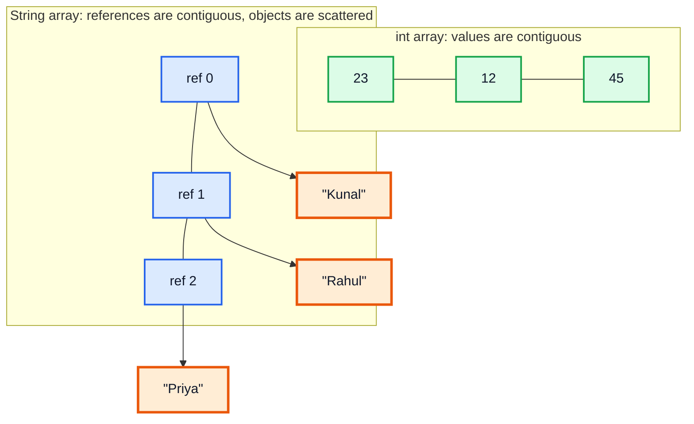

| Language | Contiguous? | Can you see addresses? |
|---|---|---|
| C / C++ | Guaranteed | Yes (pointers) |
| Java (spec) | Not specified | No |
| Java (HotSpot in practice) | Yes, for the array object itself | No |

---

## 10. Index of an Array (16:25)

### Zero-Based Indexing

The first element is at index `0`, the last at index `length - 1`.

| Index | 0 | 1 | 2 | 3 | 4 |
|---|---|---|---|---|---|
| Value | 23 | 12 | 45 | 32 | 15 |
| | 🟩 first | | | | 🟧 last = `length - 1` |

### Why Start at 0?

The index is an **offset** from the start. Conceptually:

```
address of arr[i] = base address + i × (size of one element)
```

`arr[0]` is at offset 0, i.e. the start itself. One multiplication and one addition — that is why access is **O(1)** no matter how big the array is.

### Reading, Writing and Going Out of Bounds

```java
public class IndexDemo {
    public static void main(String[] args) {
        int[] arr = {23, 12, 45, 32, 15};

        System.out.println(arr[0]);              // 23
        System.out.println(arr[arr.length - 1]); // 15

        arr[2] = 100;                            // overwrite
        System.out.println(arr[2]);              // 100

        try {
            System.out.println(arr[5]);          // index 5 does not exist
        } catch (ArrayIndexOutOfBoundsException e) {
            System.out.println(e.getMessage());  // Index 5 out of bounds for length 5
        }
    }
}
```

> [!CAUTION]
> The classic off-by-one bug is `for (int i = 0; i <= arr.length; i++)`. The last iteration uses `i == arr.length`, which is out of bounds. Use `i < arr.length`.

---

## 11. String Array (19:53)

```java
String[] names = new String[3];
names[0] = "Kunal";
names[1] = "Rahul";
// names[2] is still null
```

A `String[]` does **not** contain characters. It contains **references** to `String` objects:

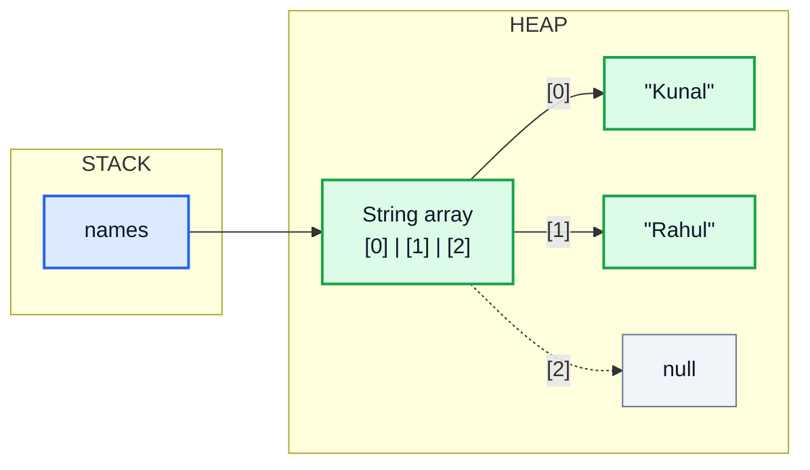

```java
public class StringArrayDemo {
    public static void main(String[] args) {
        String[] names = {"Kunal", "Rahul", "Priya"};
        names[1] = "Aman";                    // the slot now points to a different String
        System.out.println(names[1]);         // Aman
        System.out.println(names[0].length()); // 5
    }
}
```

> [!NOTE]
> `names[1] = "Aman"` does not modify `"Rahul"` (Strings are immutable). It makes slot 1 point at a different String object. The old `"Rahul"` becomes eligible for garbage collection if nothing else refers to it (literals stay in the String pool).

---

## 12. What is null in Java? (20:42)

`null` is a special **literal** that means "this reference points to **no object**".

| Fact | Detail |
|---|---|
| Type | `null` has its own special "null type"; it can be assigned to **any reference type** |
| Primitives | `int x = null;` ❌ compile error — primitives always hold a value |
| Is it an object? | No. `null instanceof Object` is `false` |
| Is it a keyword? | Technically a literal (like `true`), but you can't use it as a name |
| Using it | Calling a method or field on `null` throws `NullPointerException` |

```java
public class NullDemo {
    public static void main(String[] args) {
        String s = null;
        Integer boxed = null;                       // ✅ wrapper class is a reference type
        // int x = null;                            // ❌ incompatible types

        System.out.println(s);                      // null   (println handles it)
        System.out.println(s == null);              // true
        System.out.println(s instanceof String);    // false

        try {
            System.out.println(s.length());         // 💥
        } catch (NullPointerException e) {
            System.out.println("NPE caught");       // NPE caught
        }
    }
}
```

> [!TIP]
> Since Java 14, `NullPointerException` messages are "helpful": they say exactly what was null, e.g. *Cannot invoke "String.length()" because "s" is null*. Read them — they save a lot of debugging time.

> [!WARNING]
> Unboxing a `null` wrapper also throws: `Integer boxed = null; int y = boxed;` → `NullPointerException`. This is a common surprise with `ArrayList<Integer>`.

---

## 13. null is Used as a Default (23:30)

When an array is created with `new`, **every element gets a default value** — Java never leaves memory uninitialised.

| Element type | Default |
|---|---|
| `byte`, `short`, `int`, `long` | `0` |
| `float`, `double` | `0.0` |
| `char` | `'\u0000'` (the null character, prints as nothing visible) |
| `boolean` | `false` |
| Any reference type (`String`, `Integer`, `int[]`, `Student`) | `null` |

```java
import java.util.Arrays;

public class Defaults {
    public static void main(String[] args) {
        System.out.println(Arrays.toString(new int[3]));      // [0, 0, 0]
        System.out.println(Arrays.toString(new double[2]));   // [0.0, 0.0]
        System.out.println(Arrays.toString(new boolean[2]));  // [false, false]
        System.out.println(Arrays.toString(new String[2]));   // [null, null]
        char[] chars = new char[1];
        System.out.println((int) chars[0]);                   // 0
    }
}
```

> [!IMPORTANT]
> Defaults apply to **array elements** and **fields** (instance/static variables). **Local variables** get no default — `int x; System.out.println(x);` is a compile error ("variable x might not have been initialized").

---

## 14. Array Input (27:55)

Use a loop with a `Scanner`. The loop runs `arr.length` times, filling one index per iteration.

```java
import java.util.Arrays;
import java.util.Scanner;

public class ArrayInput {
    public static void main(String[] args) {
        // For a deterministic demo we read from a String; use new Scanner(System.in) for real input
        Scanner in = new Scanner("5\n10 20 30 40 50");

        int n = in.nextInt();
        int[] arr = new int[n];

        for (int i = 0; i < arr.length; i++) {
            arr[i] = in.nextInt();
        }

        System.out.println(Arrays.toString(arr));   // [10, 20, 30, 40, 50]
    }
}
```

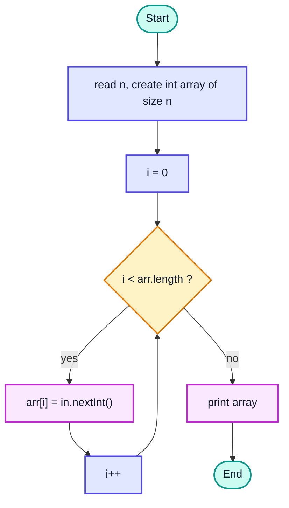

> [!TIP]
> For large inputs in competitive programming, `Scanner` is slow. `BufferedReader` + `StringTokenizer` (or `split`) is several times faster. For this course, `Scanner` is perfectly fine.

---

## 15. for-each Loop (31:19)

The **enhanced for loop** visits every element without an index variable:

```java
int[] arr = {10, 20, 30};

for (int num : arr) {          // "for each num in arr"
    System.out.print(num + " "); // 10 20 30
}
```

### for vs for-each

| | Classic `for` | for-each |
|---|---|---|
| Access to index | ✅ `i` | ❌ |
| Can modify elements of a primitive array | ✅ `arr[i] = ...` | ❌ `num` is a copy |
| Can go backwards / skip | ✅ | ❌ always forward, every element |
| Readability | OK | ✅ Very clean |
| Works on | Arrays | Arrays and anything `Iterable` (`ArrayList`, `Set`...) |

```java
import java.util.Arrays;

public class ForEachTrap {
    public static void main(String[] args) {
        int[] arr = {1, 2, 3};
        for (int num : arr) {
            num = num * 10;                       // changes only the local copy
        }
        System.out.println(Arrays.toString(arr)); // [1, 2, 3]  ← unchanged

        for (int i = 0; i < arr.length; i++) {
            arr[i] = arr[i] * 10;                 // changes the array
        }
        System.out.println(Arrays.toString(arr)); // [10, 20, 30]
    }
}
```

> [!WARNING]
> In for-each, the loop variable is a **copy** of each element. For primitives, assigning to it has no effect on the array. For objects, the copy is a reference, so `student.name = "X"` *does* change the object (but `student = new Student()` does not change the array).

---

## 16. toString() Method (33:15)

Printing an array directly does **not** print its contents:

```java
int[] arr = {1, 2, 3};
System.out.println(arr);                    // [I@1b6d3586  (type code + hash)
System.out.println(java.util.Arrays.toString(arr)); // [1, 2, 3]
```

`[I@1b6d3586` means: `[` = array, `I` = int, `@` + hexadecimal identity hash code. Arrays inherit `Object.toString()`, which prints this.

| Method | Use for | Output |
|---|---|---|
| `Arrays.toString(arr)` | 1D array | `[1, 2, 3]` |
| `Arrays.deepToString(arr2D)` | Nested arrays | `[[1, 2], [3, 4]]` |
| `Arrays.toString(arr2D)` | ⚠️ 2D array | `[[I@..., [I@...]` (the row references) |
| `list.toString()` / `println(list)` | ArrayList | `[1, 2, 3]` (ArrayList overrides `toString`) |

> [!TIP]
> Other `java.util.Arrays` helpers worth knowing: `Arrays.sort(arr)`, `Arrays.fill(arr, -1)`, `Arrays.copyOf(arr, newLen)`, `Arrays.copyOfRange(arr, from, to)`, `Arrays.equals(a, b)` (content compare — `a.equals(b)` only compares references), `Arrays.asList(...)`, and `Arrays.stream(arr).sum()`.

---

## 17. Array of Objects (34:52)

An array can hold any reference type, including your own classes:

```java
import java.util.Arrays;

public class ObjectArray {
    static class Student {
        String name;
        int rollNo;

        Student(String name, int rollNo) {
            this.name = name;
            this.rollNo = rollNo;
        }

        @Override
        public String toString() {
            return name + "(" + rollNo + ")";
        }
    }

    public static void main(String[] args) {
        Student[] students = new Student[3];          // 3 references, all null
        System.out.println(Arrays.toString(students)); // [null, null, null]

        students[0] = new Student("Kunal", 1);
        students[1] = new Student("Rahul", 2);
        System.out.println(Arrays.toString(students)); // [Kunal(1), Rahul(2), null]

        // students[2].name  → 💥 NullPointerException: no Student was created there
    }
}
```

> [!IMPORTANT]
> `new Student[3]` creates **one array** with 3 empty slots. It does **not** create any `Student` objects. You must create each object yourself with `new Student(...)`.

---

## 18. Storage of Objects in Heap (36:25)

```java
Student[] students = new Student[3];
students[0] = new Student("Kunal", 1);
students[1] = new Student("Rahul", 2);
```

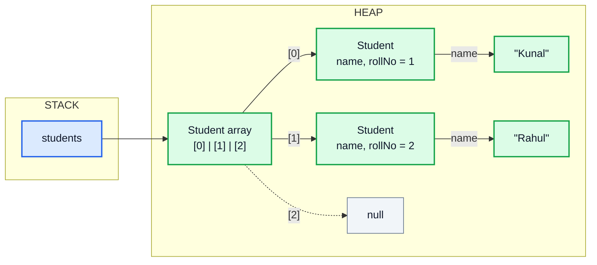

Notice the **levels of indirection**: stack reference → array → Student → String. Each arrow is a reference.

### Shared References

Two slots (or two variables) can point to the **same** object:

```java
Student s = new Student("Kunal", 1);
Student[] group = {s, s};
group[0].name = "Changed";
System.out.println(group[1].name);   // Changed  ← same object
```

### Mutable Arrays vs Immutable Strings

| | Array | String |
|---|---|---|
| Can elements be changed after creation? | ✅ Yes, `arr[0] = 5` | ❌ No — every "change" creates a new String |
| Size can change? | ❌ | ❌ |
| Effect of a method changing it | Caller sees the change | Caller never sees a change |

---

## 19. Array Passing in Function (40:21)

Java is **always pass-by-value**. For an array, the *value* passed is the **reference**. So the method receives a copy of the reference that points to the **same array object**.

```java
import java.util.Arrays;

public class PassArray {
    static void change(int[] arr) {
        arr[0] = 99;                 // follows the reference → modifies the shared object
    }

    static void reassign(int[] arr) {
        arr = new int[]{-1, -1, -1}; // only the local copy now points to a new array
        arr[0] = 500;
    }

    static void changeString(String s) {
        s = "changed";               // Strings are immutable; only the local reference moves
    }

    public static void main(String[] args) {
        int[] nums = {1, 2, 3};
        change(nums);
        System.out.println(Arrays.toString(nums));   // [99, 2, 3]

        reassign(nums);
        System.out.println(Arrays.toString(nums));   // [99, 2, 3]  ← unchanged

        String name = "Kunal";
        changeString(name);
        System.out.println(name);                    // Kunal
    }
}
```

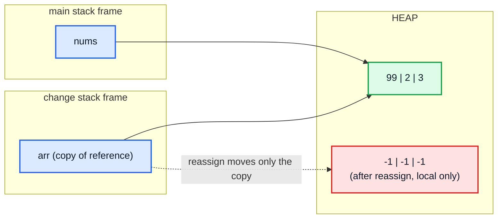

> [!IMPORTANT]
> Rule of thumb: **modifying through** the reference (`arr[i] = ...`) is visible to the caller; **reassigning** the reference (`arr = new ...`) is not. If a method must give back a new array, **return** it.

> [!TIP]
> To protect an array from being changed by a method, pass a copy: `process(arr.clone())` or `Arrays.copyOf(arr, arr.length)`. `clone()` on a 1D primitive array is a full copy; on an object or 2D array it is **shallow** (only the outer references are copied).

---

## 20. Multidimensional Arrays (42:32)

A **multidimensional array** is an **array of arrays**. A 2D array is the natural model for anything with rows and columns: a matrix, a chessboard, a seating chart, an image.

| | col 0 | col 1 | col 2 |
|---|---|---|---|
| **row 0** | 1 | 2 | 3 |
| **row 1** | 4 | 5 | 🟧 6 |
| **row 2** | 7 | 8 | 9 |

You read `arr[row][col]`: `arr[1][2]` is `6` (highlighted).

| Dimensions | Declaration | Example use |
|---|---|---|
| 1D | `int[] a` | List of marks |
| 2D | `int[][] m` | Matrix, grid, board |
| 3D | `int[][][] c` | Cube of voxels, `[day][hour][sensor]` |

> [!NOTE]
> Java has no true "rectangular block" 2D array like C's `int m[3][3]`. A Java 2D array is a 1D array whose elements are references to other 1D arrays. That has real consequences (jagged rows, separate objects) covered in section 22.

---

## 21. Syntax of a 2D Array (43:36)

```java
// rows and columns
int[][] matrix = new int[3][4];     // 3 rows, each with 4 columns, all 0

// only rows: the row count is mandatory, the column count is optional
int[][] jagged = new int[3][];      // 3 row slots, each null for now
jagged[0] = new int[2];
jagged[1] = new int[5];
jagged[2] = new int[1];

// with values
int[][] arr = {
    {1, 2, 3},     // row 0
    {4, 5},        // row 1  (jagged — different length is allowed)
    {6, 7, 8, 9}   // row 2
};
```

| Form | Valid? | Why |
|---|---|---|
| `new int[3][4]` | ✅ | Both sizes given |
| `new int[3][]` | ✅ | Rows known; each row created later |
| `new int[][4]` | ❌ | The outer array must exist before the inner ones |
| `new int[][]` | ❌ | At least the first size is needed |

```java
System.out.println(arr.length);      // 3  → number of rows
System.out.println(arr[1].length);   // 2  → columns in row 1
System.out.println(arr[2][3]);       // 9
```

> [!WARNING]
> Never assume `arr[0].length` is the column count of **every** row. With jagged arrays, always use `arr[row].length` inside the loop.

---

## 22. Internal Working of a 2D Array (45:20)

```java
int[][] arr = {
    {1, 2, 3},
    {4, 5},
    {6, 7, 8, 9}
};
```

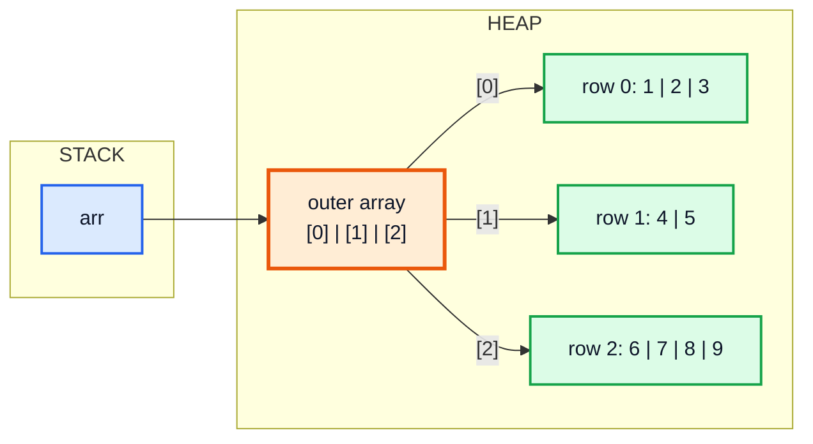

Consequences:

| Consequence | Example |
|---|---|
| Rows can have different lengths (**jagged**) | `arr[1].length == 2`, `arr[2].length == 4` |
| A whole row can be replaced | `arr[1] = new int[]{10, 20, 30};` |
| A row can be shared by two 2D arrays or two indices | `arr[0] = arr[2];` — changing one changes "both" |
| `new int[3][4]` creates **4 objects** | 1 outer + 3 rows |
| Row-by-row iteration is fastest | Each row is contiguous; jumping between rows is not |

```java
import java.util.Arrays;

public class RowSharing {
    public static void main(String[] args) {
        int[][] m = new int[2][];
        int[] shared = {1, 2};
        m[0] = shared;
        m[1] = shared;
        m[0][0] = 100;
        System.out.println(Arrays.deepToString(m)); // [[100, 2], [100, 2]]
    }
}
```

---

## 23. 2D Array Input (50:16)

Use **nested loops**: the outer loop picks the row, the inner loop fills the columns of that row.

```java
import java.util.Arrays;
import java.util.Scanner;

public class Input2D {
    public static void main(String[] args) {
        Scanner in = new Scanner("1 2 3 4 5 6 7 8 9");   // stand-in for System.in
        int[][] arr = new int[3][3];

        for (int row = 0; row < arr.length; row++) {
            for (int col = 0; col < arr[row].length; col++) {
                arr[row][col] = in.nextInt();
            }
        }

        System.out.println(Arrays.deepToString(arr));  // [[1, 2, 3], [4, 5, 6], [7, 8, 9]]
    }
}
```

### Trace (first 5 inputs)

| row | col | `arr[row].length` | value read | array after |
|---|---|---|---|---|
| 0 | 0 | 3 | 1 | 🟧`1` . . / . . . / . . . |
| 0 | 1 | 3 | 2 | 1 🟧`2` . / . . . / . . . |
| 0 | 2 | 3 | 3 | 1 2 🟧`3` / . . . / . . . |
| 1 | 0 | 3 | 4 | 1 2 3 / 🟧`4` . . / . . . |
| 1 | 1 | 3 | 5 | 1 2 3 / 4 🟧`5` . / . . . |

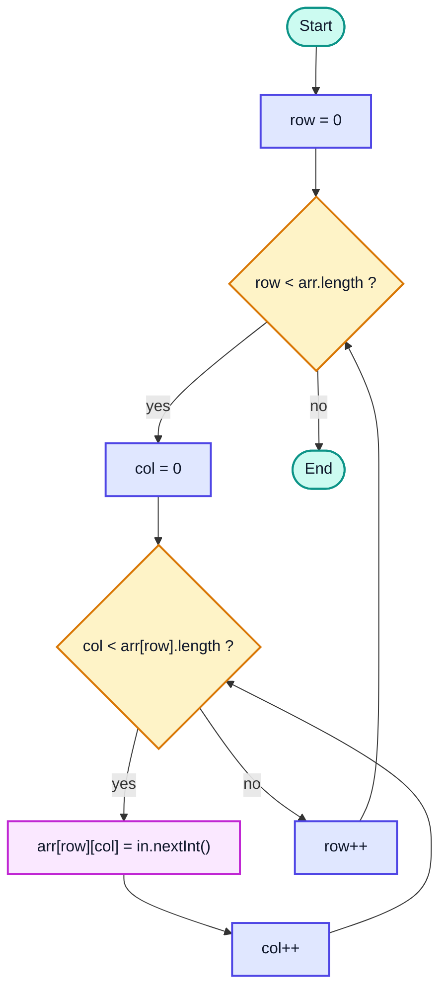

**Time:** O(rows × cols). **Space:** O(rows × cols) for the array itself.

> [!TIP]
> Using `arr[row].length` (not a fixed `3`) in the inner condition makes the same loop work for jagged arrays too.

---

## 24. 2D Array Output (1:01:06)

Three ways to print, from most manual to least:

```java
import java.util.Arrays;

public class Output2D {
    public static void main(String[] args) {
        int[][] arr = {
            {1, 2, 3},
            {4, 5},
            {6, 7, 8, 9}
        };

        // 1. Nested classic for loops
        for (int row = 0; row < arr.length; row++) {
            for (int col = 0; col < arr[row].length; col++) {
                System.out.print(arr[row][col] + " ");
            }
            System.out.println();
        }
        // 1 2 3
        // 4 5
        // 6 7 8 9

        // 2. One loop over rows + Arrays.toString per row
        for (int row = 0; row < arr.length; row++) {
            System.out.println(Arrays.toString(arr[row]));
        }
        // [1, 2, 3]
        // [4, 5]
        // [6, 7, 8, 9]

        // 3. Enhanced for over rows (each row is an int[])
        for (int[] a : arr) {
            System.out.println(Arrays.toString(a));
        }
        // same as 2

        // 4. Everything at once
        System.out.println(Arrays.deepToString(arr));   // [[1, 2, 3], [4, 5], [6, 7, 8, 9]]
    }
}
```

> [!NOTE]
> In `for (int[] a : arr)`, the loop variable's type is `int[]` because each element of an `int[][]` **is** an `int[]`. Nested for-each: `for (int[] row : arr) for (int x : row) ...`.

---

## 25. Dynamic Arrays (1:07:05)

### The Limitation of Arrays

Once created, an array's size is fixed. If you don't know how many items you'll get (e.g. reading until the user types `-1`), a plain array is awkward: too small and you overflow, too big and you waste memory.

### ArrayList — a Resizable Array

`ArrayList` (in `java.util`) is a class from the **Collections Framework** that behaves like an array that **grows automatically**.

```java
import java.util.ArrayList;

public class ArrayListIntro {
    public static void main(String[] args) {
        ArrayList<Integer> list = new ArrayList<>(10);   // initial capacity 10 (optional)

        list.add(67);
        list.add(234);
        list.add(654);
        list.add(43);

        System.out.println(list);          // [67, 234, 654, 43]
        System.out.println(list.size());   // 4
    }
}
```

### Syntax Breakdown

| Part | Meaning |
|---|---|
| `ArrayList<Integer>` | A list whose elements are `Integer` objects (the `<>` part is a **generic** type argument) |
| `new ArrayList<>(10)` | The diamond `<>` lets Java infer `Integer`; `10` is the initial **capacity**, not the size |
| `list.add(x)` | Appends to the end, growing if needed |

> [!IMPORTANT]
> Generics accept only **reference types**: `ArrayList<int>` ❌, `ArrayList<Integer>` ✅. Java automatically **autoboxes** `int → Integer` on `add` and **unboxes** on `get`. The wrapper classes are `Integer`, `Long`, `Double`, `Character`, `Boolean`, `Byte`, `Short`, `Float`.

### Array vs ArrayList

| | Array | ArrayList |
|---|---|---|
| Size | Fixed | Grows/shrinks automatically |
| Element types | Primitives or objects | Objects only (wrappers for primitives) |
| Syntax | `arr[i]`, `arr[i] = x` | `list.get(i)`, `list.set(i, x)` |
| Length | `arr.length` | `list.size()` |
| Printing | `Arrays.toString(arr)` | `System.out.println(list)` |
| Memory | Compact (an `int` = 4 bytes) | Heavier (each `Integer` is an object, ~16 bytes + 4-byte reference) |
| Speed | Fastest | Slightly slower (boxing, method calls) |
| Multi-dimensional | `int[][]` | `ArrayList<ArrayList<Integer>>` |

> [!TIP]
> Modern style declares the variable with the **interface**: `List<Integer> list = new ArrayList<>();`. That lets you switch implementations later. For quick immutable lists, Java 9+ has `List.of(1, 2, 3)` (cannot be modified — `add` throws `UnsupportedOperationException`).

---

## 26. Array Functions (1:17:22)

The most-used `ArrayList` methods:

```java
import java.util.ArrayList;

public class ArrayListMethods {
    public static void main(String[] args) {
        ArrayList<Integer> list = new ArrayList<>();
        list.add(10);
        list.add(20);
        list.add(30);
        list.add(1, 15);                        // insert at index 1 → shifts the rest right
        System.out.println(list);               // [10, 15, 20, 30]

        System.out.println(list.get(2));        // 20
        list.set(0, 99);                        // replace index 0
        System.out.println(list);               // [99, 15, 20, 30]

        System.out.println(list.contains(20));  // true
        System.out.println(list.indexOf(30));   // 3
        System.out.println(list.indexOf(500));  // -1

        list.remove(1);                         // remove by INDEX (int argument)
        System.out.println(list);               // [99, 20, 30]

        list.remove(Integer.valueOf(30));       // remove by VALUE (Integer argument)
        System.out.println(list);               // [99, 20]

        System.out.println(list.size());        // 2
        System.out.println(list.isEmpty());     // false

        for (int x : list) {                    // for-each with auto-unboxing
            System.out.print(x + " ");          // 99 20
        }
        System.out.println();

        list.clear();
        System.out.println(list);               // []
    }
}
```

| Method | Does | Time |
|---|---|---|
| `add(x)` | Append at end | O(1) amortised |
| `add(i, x)` | Insert at index `i` (shifts right) | O(n) |
| `get(i)` | Read index `i` | O(1) |
| `set(i, x)` | Replace index `i`, returns the old value | O(1) |
| `remove(int i)` | Remove at index (shifts left), returns the element | O(n) |
| `remove(Object o)` | Remove first occurrence of value | O(n) |
| `contains(x)` / `indexOf(x)` | Linear search using `equals()` | O(n) |
| `size()`, `isEmpty()` | Count / empty check | O(1) |
| `clear()` | Remove all | O(n) |

> [!CAUTION]
> `list.remove(1)` on an `ArrayList<Integer>` removes the element **at index 1**, not the value `1`, because the `remove(int)` overload wins. To remove the value, write `list.remove(Integer.valueOf(1))`.

### Input into an ArrayList

```java
import java.util.ArrayList;
import java.util.Scanner;

public class ListInput {
    public static void main(String[] args) {
        Scanner in = new Scanner("4 8 15 16 23 -1");
        ArrayList<Integer> list = new ArrayList<>();
        int x;
        while ((x = in.nextInt()) != -1) {   // read until -1: no need to know the count
            list.add(x);
        }
        System.out.println(list);            // [4, 8, 15, 16, 23]
    }
}
```

---

## 27. Internal Working of ArrayList (1:21:08)

An `ArrayList` is a wrapper around a **plain array** (a field called `elementData`) plus a counter `size`.

- **Capacity** = length of the internal array (how much it *can* hold right now).
- **Size** = how many elements you have actually added.

When `size == capacity` and you call `add`, the list:

1. creates a **bigger** internal array,
2. **copies** all old elements into it,
3. drops the old array (garbage collected),
4. adds the new element.

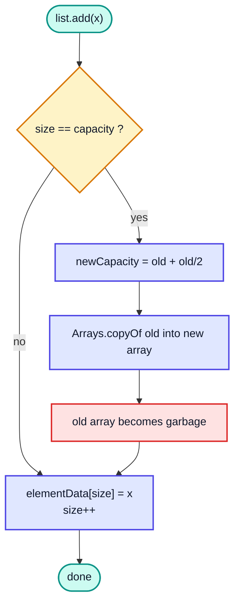

> [!NOTE]
> The video describes the new array as roughly **double** the size — that's the textbook dynamic-array idea (and what C++ `vector` often does). OpenJDK's `ArrayList` actually grows by **1.5×** (`newCapacity = oldCapacity + (oldCapacity >> 1)`). Also, `new ArrayList<>()` starts with an **empty** internal array and allocates capacity 10 on the first `add` (since Java 8). The idea and the complexity are the same either way.

### Capacity Growth Trace (default constructor)

| Elements added | Capacity before add | Grows? | Capacity after |
|---|---|---|---|
| 1st | 0 | ✅ (first add) | 10 |
| 2nd – 10th | 10 | ❌ | 10 |
| 11th | 10 | ✅ | 15 |
| 16th | 15 | ✅ | 22 |
| 23rd | 22 | ✅ | 33 |
| 34th | 33 | ✅ | 49 |

### Why `add` is Still O(1) "Amortised"

Most adds just write one slot: O(1). Occasionally one add copies everything: O(n). But because the capacity grows by a **constant factor**, those copies happen rarely enough that the **total** cost of `n` adds is O(n), i.e. O(1) **per add on average** — called **amortised O(1)**.

| Operation | Typical | Worst single call | Amortised |
|---|---|---|---|
| `add(x)` at end | O(1) | O(n) (resize) | O(1) |
| `get(i)` / `set(i, x)` | O(1) | O(1) | O(1) |
| `add(0, x)` / `remove(0)` | O(n) | O(n) | O(n) |

> [!TIP]
> If you know roughly how many elements are coming, pass it as the initial capacity: `new ArrayList<>(100_000)`. That avoids repeated resizing. `list.trimToSize()` shrinks capacity down to size; `ensureCapacity(n)` grows it in advance.

### Multidimensional ArrayList

```java
import java.util.ArrayList;
import java.util.Scanner;

public class List2D {
    public static void main(String[] args) {
        Scanner in = new Scanner("1 2 3 4 5 6 7 8 9");
        ArrayList<ArrayList<Integer>> list = new ArrayList<>();

        // initialise: the inner lists do NOT exist automatically
        for (int i = 0; i < 3; i++) {
            list.add(new ArrayList<>());
        }

        // input
        for (int i = 0; i < 3; i++) {
            for (int j = 0; j < 3; j++) {
                list.get(i).add(in.nextInt());
            }
        }

        System.out.println(list);   // [[1, 2, 3], [4, 5, 6], [7, 8, 9]]
    }
}
```

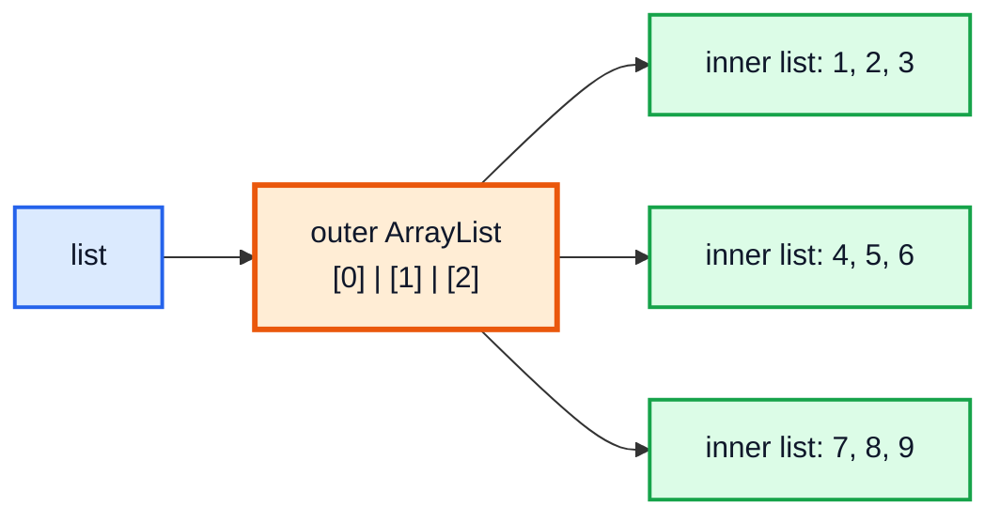

> [!WARNING]
> Forgetting the initialisation loop and calling `list.get(0).add(...)` on an empty outer list throws `IndexOutOfBoundsException` — there is no row 0 yet.

---

## 28. Questions (1:33:21)

Three warm-up problems that build the core array skills: **swapping two positions**, **scanning for an extreme value**, and **two pointers moving towards each other**.

| # | Problem | Technique | Time | Space |
|---|---|---|---|---|
| Q1 | Swap two values | Temporary variable | O(1) | O(1) |
| Q2 | Maximum value | Linear scan | O(n) | O(1) |
| Q3 | Reverse an array | Two pointers + swap | O(n) | O(1) |

---

## 29. Q1: Swapping Values in an Array (1:33:30)

**Problem:** Given an array and two indices, swap the elements at those indices.

### Approach

You can't do `arr[i] = arr[j]; arr[j] = arr[i];` — the first line destroys `arr[i]`'s value. Save it first in a temporary variable.

```java
import java.util.Arrays;

public class Swap {
    static void swap(int[] arr, int index1, int index2) {
        int temp = arr[index1];
        arr[index1] = arr[index2];
        arr[index2] = temp;
    }

    public static void main(String[] args) {
        int[] arr = {1, 3, 23, 9, 18};
        swap(arr, 0, 4);
        System.out.println(Arrays.toString(arr));   // [18, 3, 23, 9, 1]
    }
}
```

### Dry Run: `swap(arr, 0, 4)` on `[1, 3, 23, 9, 18]`

| Step | Statement | temp | arr |
|---|---|---|---|
| 1 | `temp = arr[0]` | 1 | 🟧1, 3, 23, 9, 18 |
| 2 | `arr[0] = arr[4]` | 1 | 🟧18, 3, 23, 9, 18 |
| 3 | `arr[4] = temp` | 1 | 18, 3, 23, 9, 🟧1 ✅ |

The swap works inside a method **because** the method receives a reference to the same array (section 19). A method `swap(int a, int b)` on two `int`s could **not** swap the caller's variables.

**Time:** O(1). **Space:** O(1).

### Alternatives

| Approach | Code | Caveat |
|---|---|---|
| Temp variable ✅ | as above | Clear, safe — always prefer it |
| Arithmetic | `a = a + b; b = a - b; a = a - b;` | Can overflow (it happens to wrap back correctly for `int`, but it is unreadable) |
| XOR | `a ^= b; b ^= a; a ^= b;` | **Zeroes the value if `i == j`** (same slot); hard to read |
| Generic | `static <T> void swap(T[] arr, int i, int j)` | Works for any object array; `Collections.swap(list, i, j)` for lists |

> [!CAUTION]
> The XOR trick with `i == j` does `arr[i] ^= arr[i]`, which sets it to `0`. No modern JVM makes XOR swap faster than a temp variable — don't use it in real code.

---

## 30. Q2: Maximum Value of an Array (1:35:20)

**Problem:** Return the largest element in an array (and, as an extension, in a range `[start, end]`).

### Approach

Assume the first element is the max. Walk through the rest; whenever you see something bigger, update the max.

```java
public class MaxValue {
    static int max(int[] arr) {
        if (arr.length == 0) {
            throw new IllegalArgumentException("empty array");
        }
        int maxVal = arr[0];
        for (int i = 1; i < arr.length; i++) {
            if (arr[i] > maxVal) {
                maxVal = arr[i];
            }
        }
        return maxVal;
    }

    static int maxRange(int[] arr, int start, int end) {
        if (end < start || arr == null) {
            return -1;
        }
        int maxVal = arr[start];
        for (int i = start; i <= end; i++) {
            if (arr[i] > maxVal) {
                maxVal = arr[i];
            }
        }
        return maxVal;
    }

    public static void main(String[] args) {
        int[] arr = {1, 3, 23, 9, 18, 56};
        System.out.println(max(arr));             // 56
        System.out.println(maxRange(arr, 1, 3));  // 23
    }
}
```

### Dry Run: `[1, 3, 23, 9, 18, 56]`

| i | arr[i] | `arr[i] > maxVal`? | maxVal after |
|---|---|---|---|
| — | — | (start) | 1 |
| 1 | 3 | ✅ | 3 |
| 2 | 23 | ✅ | 23 |
| 3 | 9 | ❌ | 23 |
| 4 | 18 | ❌ | 23 |
| 5 | 56 | ✅ | 🟩 56 |

**Time:** O(n) — every element must be looked at once (you can't know the max without seeing everything). **Space:** O(1).

> [!WARNING]
> Starting with `maxVal = 0` is a bug for arrays of all-negative numbers (`[-5, -2, -9]` would return `0`). Start with `arr[0]` or `Integer.MIN_VALUE`.

### Alternatives

| Approach | Code | Notes |
|---|---|---|
| Linear scan ✅ | above | O(n), O(1) |
| `Math.max` in the loop | `maxVal = Math.max(maxVal, arr[i]);` | Same complexity, shorter |
| Streams | `Arrays.stream(arr).max().getAsInt()` | Concise; slightly slower; throws on empty |
| Sort then take last | `Arrays.sort(arr); arr[arr.length-1]` | ❌ O(n log n) and modifies the array |
| ArrayList | `Collections.max(list)` | For lists |

---

## 31. Q3: Reversing an Array (1:40:45)

**Problem:** Reverse the array **in place**: `[1, 2, 3, 4, 5]` → `[5, 4, 3, 2, 1]`. (The same idea solves **LeetCode 344 — Reverse String**, which reverses a `char[]` in place.)

### Approach — Two Pointers

Put one pointer at the start and one at the end. Swap them, then move both towards the middle. Stop when they meet or cross.

```java
import java.util.Arrays;

public class Reverse {
    static void swap(int[] arr, int i, int j) {
        int temp = arr[i];
        arr[i] = arr[j];
        arr[j] = temp;
    }

    static void reverse(int[] arr) {
        int start = 0;
        int end = arr.length - 1;
        while (start < end) {
            swap(arr, start, end);
            start++;
            end--;
        }
    }

    public static void main(String[] args) {
        int[] arr = {1, 2, 3, 4, 5};
        reverse(arr);
        System.out.println(Arrays.toString(arr));   // [5, 4, 3, 2, 1]

        int[] even = {10, 20, 30, 40};
        reverse(even);
        System.out.println(Arrays.toString(even));  // [40, 30, 20, 10]
    }
}
```

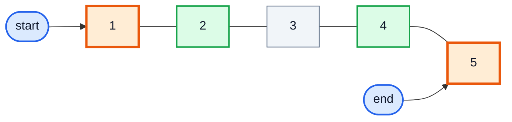

### Dry Run: `[1, 2, 3, 4, 5]`

| Iteration | start | end | `start < end`? | Action | Array after |
|---|---|---|---|---|---|
| 1 | 0 | 4 | ✅ | swap 1 ↔ 5 | 🟧5, 2, 3, 4, 🟧1 |
| 2 | 1 | 3 | ✅ | swap 2 ↔ 4 | 5, 🟧4, 3, 🟧2, 1 |
| 3 | 2 | 2 | ❌ | stop (middle stays) | 5, 4, 3, 2, 1 ✅ |

**Time:** O(n) — n/2 swaps. **Space:** O(1) — in place.

> [!TIP]
> Why `start < end` and not `start <= end`? When they are equal they point at the same middle element; swapping it with itself is harmless but useless. With `!=` instead of `<`, an even-length array would let the pointers **cross** and never be equal → they'd keep going and throw `ArrayIndexOutOfBoundsException`.

### Alternatives

| Approach | Time | Space | Notes |
|---|---|---|---|
| Two pointers (in place) ✅ | O(n) | O(1) | Best |
| `for (i = 0; i < n/2; i++) swap(arr, i, n-1-i)` | O(n) | O(1) | Same thing with one index |
| New array copy | O(n) | O(n) | `rev[i] = arr[n-1-i]`; leaves the original untouched |
| `Collections.reverse(list)` | O(n) | O(1) | For `ArrayList` |
| Recursion `reverse(arr, s+1, e-1)` | O(n) | O(n) stack | Good recursion practice (later videos) |

---

## 32. Outro (1:44:20)

You now know how arrays are created, stored and passed around, how 2D arrays are really arrays of arrays, and how `ArrayList` gives you a growable array. The next video uses these arrays for the first real algorithm: **Linear Search**.

> [!TIP]
> Practice: solve the array assignments in the course's GitHub repo (DSA-Bootcamp-Java), e.g. LeetCode 1480 (Running Sum of 1d Array), 1470 (Shuffle the Array), 1672 (Richest Customer Wealth) and 1929 (Concatenation of Array).

---

## 🧩 Complete Example: Everything Together

One program that uses every concept from this video. Input is read from a hard-coded `Scanner` source so the output is deterministic.

```java
import java.util.ArrayList;
import java.util.Arrays;
import java.util.Scanner;

public class Main {

    // ═══════ Array of objects ═══════
    static class Student {
        String name;
        int rollNo;

        Student(String name, int rollNo) {
            this.name = name;
            this.rollNo = rollNo;
        }

        @Override
        public String toString() {
            return name + "(" + rollNo + ")";
        }
    }

    // ═══════ Passing an array to a function (reference is copied) ═══════
    static void change(int[] arr) {
        arr[0] = 99;              // visible to the caller: same object
    }

    static void reassign(int[] arr) {
        arr = new int[]{-1, -1};  // NOT visible: only the local copy now points elsewhere
    }

    // ═══════ Q1: swap ═══════
    static void swap(int[] arr, int i, int j) {
        int temp = arr[i];
        arr[i] = arr[j];
        arr[j] = temp;
    }

    // ═══════ Q2: max (whole array and in a range) ═══════
    static int max(int[] arr) {
        if (arr.length == 0) {
            throw new IllegalArgumentException("empty array");
        }
        int maxVal = arr[0];
        for (int i = 1; i < arr.length; i++) {
            if (arr[i] > maxVal) {
                maxVal = arr[i];
            }
        }
        return maxVal;
    }

    static int maxInRange(int[] arr, int start, int end) {
        int maxVal = arr[start];
        for (int i = start; i <= end; i++) {
            if (arr[i] > maxVal) {
                maxVal = arr[i];
            }
        }
        return maxVal;
    }

    // ═══════ Q3: reverse in place (two pointers) ═══════
    static void reverse(int[] arr) {
        int start = 0;
        int end = arr.length - 1;
        while (start < end) {
            swap(arr, start, end);
            start++;
            end--;
        }
    }

    public static void main(String[] args) {
        // 1. Declaration + initialisation, indexing, length
        int[] rnos = {23, 12, 45, 32, 15};
        System.out.println("rnos[2]      : " + rnos[2]);
        System.out.println("length       : " + rnos.length);

        // 2. Default values
        int[] nums = new int[3];
        String[] names = new String[2];
        System.out.println("int default  : " + Arrays.toString(nums));
        System.out.println("String def.  : " + Arrays.toString(names));

        // 3. "Input" from a hard-coded Scanner source (deterministic)
        Scanner in = new Scanner("10 20 30 40 50");
        int[] input = new int[5];
        for (int i = 0; i < input.length; i++) {
            input[i] = in.nextInt();
        }
        System.out.print("for-each     :");
        for (int num : input) {
            System.out.print(" " + num);
        }
        System.out.println();
        System.out.println("toString     : " + Arrays.toString(input));

        // 4. Array of objects
        Student[] students = {new Student("Kunal", 1), new Student("Rahul", 2)};
        System.out.println("students     : " + Arrays.toString(students));

        // 5. Passing arrays to functions
        int[] data = {1, 2, 3};
        change(data);
        reassign(data);
        System.out.println("after calls  : " + Arrays.toString(data));

        // 6. 2D arrays (regular + jagged)
        int[][] matrix = {
            {1, 2, 3},
            {4, 5, 6},
            {7, 8, 9}
        };
        int[][] jagged = {
            {1, 2},
            {3, 4, 5},
            {6}
        };
        System.out.println("matrix       : " + Arrays.deepToString(matrix));
        System.out.print("jagged rows  :");
        for (int[] row : jagged) {
            System.out.print(" " + row.length);
        }
        System.out.println();

        // 7. ArrayList
        ArrayList<Integer> list = new ArrayList<>(10);
        for (int i = 1; i <= 5; i++) {
            list.add(i * 10);
        }
        list.set(0, 99);
        list.remove(Integer.valueOf(30));   // removes the value 30
        list.remove(0);                     // removes index 0
        System.out.println("list         : " + list + " size=" + list.size());
        System.out.println("contains 40? : " + list.contains(40));

        // 8. 2D ArrayList
        ArrayList<ArrayList<Integer>> grid = new ArrayList<>();
        for (int i = 0; i < 3; i++) {
            grid.add(new ArrayList<>());
            for (int j = 0; j <= i; j++) {
                grid.get(i).add(i + j);
            }
        }
        System.out.println("grid         : " + grid);

        // 9. Questions
        int[] arr = {1, 3, 23, 9, 18, 56};
        swap(arr, 0, 4);
        System.out.println("swap(0,4)    : " + Arrays.toString(arr));
        System.out.println("max          : " + max(arr));
        System.out.println("max in [1,3] : " + maxInRange(arr, 1, 3));
        reverse(arr);
        System.out.println("reversed     : " + Arrays.toString(arr));
    }
}
```

**Expected Output:**

```
rnos[2]      : 45
length       : 5
int default  : [0, 0, 0]
String def.  : [null, null]
for-each     : 10 20 30 40 50
toString     : [10, 20, 30, 40, 50]
students     : [Kunal(1), Rahul(2)]
after calls  : [99, 2, 3]
matrix       : [[1, 2, 3], [4, 5, 6], [7, 8, 9]]
jagged rows  : 2 3 1
list         : [20, 40, 50] size=3
contains 40? : true
grid         : [[0], [1, 2], [2, 3, 4]]
swap(0,4)    : [18, 3, 23, 9, 1, 56]
max          : 56
max in [1,3] : 23
reversed     : [56, 1, 9, 23, 3, 18]
```

---

## Quick Reference Cheat Sheet

| Concept | One-Line Summary |
|---|---|
| **Array** | Fixed-size collection of same-type values, indexed from 0 |
| **Declare + create** | `int[] arr = new int[5];` — reference on stack, object on heap |
| **Initialise** | `int[] arr = {1, 2, 3};` (declaration only) or `new int[]{1, 2, 3}` |
| **Length** | `arr.length` (field) · `str.length()` · `list.size()` |
| **Index** | `0` to `length - 1`; outside → `ArrayIndexOutOfBoundsException` |
| **Access time** | O(1) — address = base + index × element size |
| **Dynamic allocation** | Every `new` allocates at runtime on the heap; size may come from a variable |
| **Continuity** | Spec doesn't promise it; HotSpot allocates each array as one block; objects it points to are scattered |
| **Defaults** | `0`, `0.0`, `false`, `'\u0000'`, `null` for references (not for local variables) |
| **null** | "No object"; only for reference types; using it → `NullPointerException` |
| **String array** | Holds references to String objects |
| **Array of objects** | `new Student[3]` makes 3 null slots, not 3 Students |
| **for-each** | `for (int x : arr)` — read-only copy, no index |
| **Print** | `Arrays.toString(arr)`, `Arrays.deepToString(arr2D)` |
| **Passing to method** | Reference is copied: `arr[i] = x` is visible, `arr = new ...` is not |
| **2D array** | Array of arrays: `int[][] m = new int[rows][cols];` |
| **Jagged array** | `new int[3][]` then each row its own size |
| **2D loops** | `for row < m.length`, `for col < m[row].length` |
| **ArrayList** | `ArrayList<Integer> list = new ArrayList<>();` — resizable, objects only |
| **Key methods** | `add`, `add(i,x)`, `get`, `set`, `remove(int)`, `remove(Object)`, `contains`, `size` |
| **Growth** | Full → new array ~1.5× (OpenJDK), copy over; `add` is amortised O(1) |
| **2D ArrayList** | `ArrayList<ArrayList<Integer>>`; add inner lists before using them |
| **Swap** | `temp = a[i]; a[i] = a[j]; a[j] = temp;` — O(1) |
| **Max** | Start at `arr[0]`, scan and update — O(n) |
| **Reverse** | Two pointers `start < end`, swap, move inward — O(n), O(1) space |
