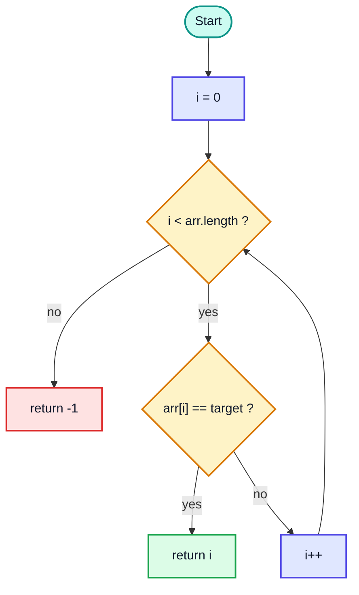
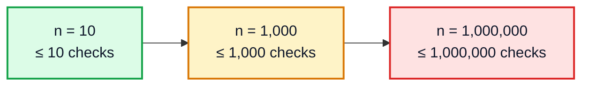
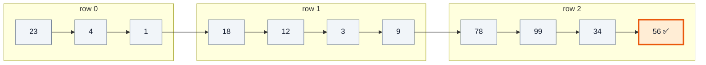
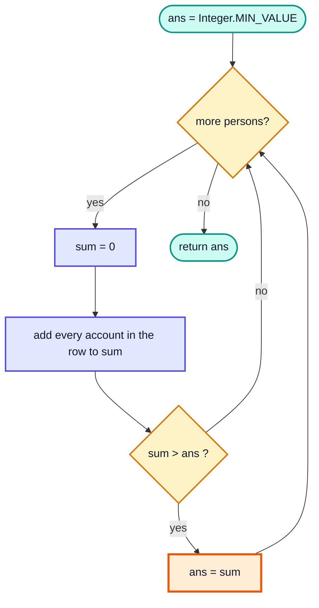

# Linear Search Algorithm — Complete In-Depth Guide

**Video #13 of the Java + DSA playlist:** *Linear Search Algorithm - Theory + Code + Questions* (1:15:44)

The first real algorithm of the course: checking elements one by one until the target is found. This guide covers how linear search works, its best/worst/average time complexity, several ways to code it, and six practice questions — including LeetCode 1295 (Find Numbers with Even Number of Digits) and LeetCode 1672 (Richest Customer Wealth).

---

## Table of Contents

| # | Topic | Timestamp |
|---|---|---|
| 0 | [Introduction](#0-introduction-000) | 0:00 |
| 1 | [What is Searching?](#1-what-is-searching-035) | 0:35 |
| 2 | [Linear Search](#2-linear-search-132) | 1:32 |
| 3 | [Code for Linear Search](#3-code-for-linear-search-1550) | 15:50 |
| 4 | [Questions](#4-questions-2530) | 25:30 |
| 5 | [Q1: Search in String](#5-q1-search-in-string-2552) | 25:52 |
| 6 | [Q2: Search in Range](#6-q2-search-in-range-3030) | 30:30 |
| 7 | [Q3: Minimum Number](#7-q3-minimum-number-3335) | 33:35 |
| 8 | [Q4: Search in 2D Arrays](#8-q4-search-in-2d-arrays-3726) | 37:26 |
| 9 | [Q5: Even Digits](#9-q5-even-digits-4915) | 49:15 |
| 10 | [Optimized Solution for Q5](#10-optimized-solution-for-q5-10027) | 1:00:27 |
| 11 | [Q6: Max Wealth](#11-q6-max-wealth-10405) | 1:04:05 |
| 12 | [Outro](#12-outro-11447) | 1:14:47 |

---

## 0. Introduction (0:00)

With arrays in hand (video #12), the natural next question is: **"Is this value in my array, and where?"** Linear search is the simplest answer, and it works on **any** array — sorted or not.

This video covers:

- What searching means and why it matters
- How linear search works, step by step
- Its time and space complexity (best, worst, average case)
- Code variations: return the index, the element, or a boolean
- Six questions that apply the same idea to strings, ranges, minimums, 2D arrays and digit counting

> [!IMPORTANT]
> Linear search is also the template for a huge family of "scan everything once" problems: finding a min/max, counting matches, summing, checking a condition. Recognising that pattern is the real lesson.

---

## 1. What is Searching? (0:35)

**Searching** means finding whether a target value exists in a collection and, usually, **where** it is.

Everyday examples: finding a contact in your phone, a word in a document (Ctrl + F), a roll number in a list.

| Search algorithm | Needs sorted data? | Time (worst) | Covered in |
|---|---|---|---|
| **Linear search** | ❌ No | O(n) | This video |
| Binary search | ✅ Yes | O(log n) | Next video |
| Hashing (`HashSet`, `HashMap`) | ❌ No | O(1) average | Later |

What a search can return:

| Return | Meaning when found | Meaning when not found |
|---|---|---|
| Index (`int`) | Position of the target | `-1` (not a valid index) |
| Element | The target itself | A sentinel such as `Integer.MAX_VALUE` |
| `boolean` | `true` | `false` |

---

## 2. Linear Search (1:32)

### The Idea

Start at index `0`. Compare each element with the target. If it matches, stop and report it. If you reach the end without a match, the target isn't there.



### Example: Find `19` in `[18, 12, 9, 14, 77, 50, 19]`

| Index | 0 | 1 | 2 | 3 | 4 | 5 | 6 |
|---|---|---|---|---|---|---|---|
| Value | 18 | 12 | 9 | 14 | 77 | 50 | 19 |
| Checked | ❌ | ❌ | ❌ | ❌ | ❌ | ❌ | ✅ found |

7 comparisons — the target was the last element.

### Time Complexity

Time complexity measures how the **number of operations grows** as the input size `n` grows — not the seconds on a clock (that depends on the machine).

| Case | When | Comparisons | Complexity |
|---|---|---|---|
| **Best** | Target is the first element | 1 | **O(1)** |
| **Worst** | Target is last, or absent | n | **O(n)** |
| **Average** | Target equally likely anywhere | about n/2 | **O(n)** (constants are dropped) |



The work grows **linearly** with `n` — hence the name.

### Space Complexity

Only a loop variable and the target are stored, no matter how big the array is: **O(1)** extra space. (The input array itself is not counted as *extra* space.)

> [!NOTE]
> Big-O describes the **worst case upper bound** by convention when people say "linear search is O(n)". The best case is O(1), but we design for the worst case because that's the guarantee. Full complexity analysis (Big-O, Big-Ω, Big-Θ) gets its own video later in the course.

### When Linear Search is the Right Tool

| ✅ Good choice | ❌ Poor choice |
|---|---|
| Unsorted data | Large sorted data (use binary search) |
| Small arrays | Repeated lookups on the same big data (use a `HashSet`) |
| Searching once | Performance-critical hot loops |
| Linked lists (no random access) | — |

---

## 3. Code for Linear Search (15:50)

### Version 1 — Return the Index

```java
public class LinearSearch {
    // returns the index of target, or -1 if not found
    static int linearSearch(int[] arr, int target) {
        if (arr == null || arr.length == 0) {
            return -1;
        }
        for (int index = 0; index < arr.length; index++) {
            if (arr[index] == target) {
                return index;
            }
        }
        return -1;   // only reached if the loop never returned
    }

    public static void main(String[] args) {
        int[] nums = {23, 45, 1, 2, 8, 19, -3, 16, -11, 28};
        System.out.println(linearSearch(nums, 19));    // 5
        System.out.println(linearSearch(nums, 100));   // -1
        System.out.println(linearSearch(new int[0], 5)); // -1
    }
}
```

### Dry Run: `linearSearch(nums, 19)`

| index | arr[index] | `== 19`? | Action |
|---|---|---|---|
| 0 | 23 | ❌ | continue |
| 1 | 45 | ❌ | continue |
| 2 | 1 | ❌ | continue |
| 3 | 2 | ❌ | continue |
| 4 | 8 | ❌ | continue |
| 5 | 19 | ✅ | 🟩 `return 5` |

### Version 2 — Return the Element

```java
static int linearSearchElement(int[] arr, int target) {
    for (int element : arr) {
        if (element == target) {
            return element;
        }
    }
    return Integer.MAX_VALUE;   // sentinel meaning "not found"
}
```

> [!WARNING]
> A sentinel like `Integer.MAX_VALUE` is ambiguous if that value could legitimately be in the array. Returning an index (`-1`) or a `boolean` avoids this. Modern Java can also return `OptionalInt` (`OptionalInt.empty()` when not found).

### Version 3 — Return a boolean

```java
static boolean contains(int[] arr, int target) {
    for (int element : arr) {
        if (element == target) {
            return true;
        }
    }
    return false;
}
```

### Comparison of Versions

| Version | Loop | Returns | Best for |
|---|---|---|---|
| Index | Classic `for` (needs `index`) | `int`, `-1` if absent | When the position matters |
| Element | for-each | value or sentinel | Rarely — mostly for practice |
| boolean | for-each | `true` / `false` | "Does it exist?" |

> [!TIP]
> The **early `return`** inside the loop is what gives the O(1) best case — once found, there's no reason to look further. Writing the loop to always run to the end (and storing the answer in a variable) is correct but wastes work.

### Built-in Equivalents

| Data | Built-in linear search |
|---|---|
| `ArrayList` | `list.indexOf(x)`, `list.contains(x)` |
| `String` | `str.indexOf(ch)`, `str.contains("sub")` |
| `int[]` | `IntStream.of(arr).anyMatch(x -> x == target)` |

---

## 4. Questions (25:30)

All six questions reuse the same skeleton: **loop over every element, check a condition, update or return.**

| # | Question | Twist on linear search | Time |
|---|---|---|---|
| Q1 | Search in String | Elements are `char`s | O(n) |
| Q2 | Search in Range | Loop only from `start` to `end` | O(end − start + 1) |
| Q3 | Minimum Number | Track the best seen so far instead of matching | O(n) |
| Q4 | Search in 2D Array | Nested loops, return `{row, col}` | O(R × C) |
| Q5 | Even Digits (LC 1295) | Count digits of each number | O(n × d) → O(n) |
| Q6 | Max Wealth (LC 1672) | Sum each row, track the max | O(R × C) |

---

## 5. Q1: Search in String (25:52)

**Problem:** Given a string and a character, return `true` if the character appears in the string.

### Approach

A `String` is a sequence of `char`s. Loop over them with `charAt(i)` or convert to a `char[]` with `toCharArray()` and use for-each.

```java
import java.util.Arrays;

public class SearchInString {
    // Version 1: index-based with charAt
    static boolean search(String str, char target) {
        if (str == null || str.isEmpty()) {
            return false;
        }
        for (int i = 0; i < str.length(); i++) {
            if (target == str.charAt(i)) {
                return true;
            }
        }
        return false;
    }

    // Version 2: for-each over toCharArray()
    static boolean search2(String str, char target) {
        if (str == null || str.isEmpty()) {
            return false;
        }
        for (char ch : str.toCharArray()) {
            if (ch == target) {
                return true;
            }
        }
        return false;
    }

    public static void main(String[] args) {
        String name = "Kunal";
        System.out.println(search(name, 'u'));                // true
        System.out.println(search2(name, 'z'));               // false
        System.out.println(Arrays.toString(name.toCharArray())); // [K, u, n, a, l]
        System.out.println(name.indexOf('a'));                // 3  (built-in)
    }
}
```

### Dry Run: `search("Kunal", 'n')`

| i | `str.charAt(i)` | `== 'n'`? |
|---|---|---|
| 0 | `K` | ❌ |
| 1 | `u` | ❌ |
| 2 | `n` | ✅ → `return true` |

**Time:** O(n), n = string length. **Space:** O(1) for `charAt`; **O(n)** for `toCharArray()` because it creates a copy of the characters.

> [!NOTE]
> `char` comparisons with `==` are fine: `char` is a primitive. For comparing **Strings** you still need `.equals()` (video #10). Also note `'u'` (char, single quotes) vs `"u"` (String, double quotes).

### Alternatives

| Approach | Notes |
|---|---|
| `str.indexOf(target) != -1` | Built-in; same O(n) linear scan internally |
| `str.contains(String.valueOf(target))` | Works on substrings too |
| `str.chars().anyMatch(c -> c == target)` | Stream version |

---

## 6. Q2: Search in Range (30:30)

**Problem:** Search for `target` only between indices `start` and `end` (both inclusive). Return its index or `-1`.

### Approach

Identical to linear search, but the loop starts at `start` and stops at `end` instead of `0` and `length - 1`.

```java
public class SearchInRange {
    static int searchInRange(int[] arr, int target, int start, int end) {
        if (arr == null || arr.length == 0) {
            return -1;
        }
        start = Math.max(start, 0);                 // defensive clamping
        end = Math.min(end, arr.length - 1);
        for (int index = start; index <= end; index++) {
            if (arr[index] == target) {
                return index;
            }
        }
        return -1;
    }

    public static void main(String[] args) {
        int[] arr = {18, 12, -7, 3, 14, 28};
        System.out.println(searchInRange(arr, 3, 1, 4));   // 3
        System.out.println(searchInRange(arr, 18, 1, 4));  // -1  (index 0 is outside the range)
    }
}
```

### Dry Run: `searchInRange(arr, 3, 1, 4)`

| Index | 0 | 1 | 2 | 3 | 4 | 5 |
|---|---|---|---|---|---|---|
| Value | 18 | 12 | -7 | 3 | 14 | 28 |
| Status | ⬜ skipped | ❌ | ❌ | ✅ found | ⬜ not reached | ⬜ skipped |

**Time:** O(end − start + 1), i.e. O(n) in the worst case. **Space:** O(1).

> [!TIP]
> "Search in a range" is the building block of **binary search** (next video), where `start` and `end` move after every comparison to shrink the range.

---

## 7. Q3: Minimum Number (33:35)

**Problem:** Return the smallest number in an array.

### Approach

Assume `arr[0]` is the minimum. Scan the rest and replace the answer whenever a smaller value appears. This is linear search where the "condition" is *"is this smaller than the best so far?"*.

```java
public class MinNumber {
    static int min(int[] arr) {
        if (arr.length == 0) {
            throw new IllegalArgumentException("empty array");
        }
        int ans = arr[0];
        for (int i = 1; i < arr.length; i++) {
            if (arr[i] < ans) {
                ans = arr[i];
            }
        }
        return ans;
    }

    public static void main(String[] args) {
        int[] arr = {18, 12, 7, 3, 14, 28};
        System.out.println(min(arr));                       // 3
        System.out.println(min(new int[]{-4, -9, -2}));     // -9
    }
}
```

### Dry Run: `[18, 12, 7, 3, 14, 28]`

| i | arr[i] | `arr[i] < ans`? | ans after |
|---|---|---|---|
| — | — | start | 18 |
| 1 | 12 | ✅ | 12 |
| 2 | 7 | ✅ | 7 |
| 3 | 3 | ✅ | 🟩 3 |
| 4 | 14 | ❌ | 3 |
| 5 | 28 | ❌ | 3 |

**Time:** O(n) — there is no early exit, since any later element could be smaller. **Space:** O(1).

> [!WARNING]
> Don't start with `ans = 0`: for `[5, 8, 2]` the answer would wrongly be `0`. Use `arr[0]` or `Integer.MAX_VALUE`.

### Alternatives

| Approach | Notes |
|---|---|
| `ans = Math.min(ans, arr[i])` | Same logic, shorter |
| `Arrays.stream(arr).min().getAsInt()` | Concise; throws on empty |
| Sort and take `arr[0]` | ❌ O(n log n), and changes the array |

---

## 8. Q4: Search in 2D Arrays (37:26)

**Problem:** Search for `target` in a 2D array and return its position as `{row, col}`, or `{-1, -1}` if absent.

### Approach

Recall from video #12 that a 2D array is an array of rows. Use an outer loop over rows and an inner loop over the columns **of that row** (`arr[row].length`, so jagged arrays work too).

```java
import java.util.Arrays;

public class Search2D {
    static int[] search(int[][] arr, int target) {
        for (int row = 0; row < arr.length; row++) {
            for (int col = 0; col < arr[row].length; col++) {
                if (arr[row][col] == target) {
                    return new int[]{row, col};
                }
            }
        }
        return new int[]{-1, -1};
    }

    // Bonus from the video: maximum element in a 2D array
    static int max(int[][] arr) {
        int max = Integer.MIN_VALUE;
        for (int[] row : arr) {
            for (int element : row) {
                if (element > max) {
                    max = element;
                }
            }
        }
        return max;
    }

    public static void main(String[] args) {
        int[][] arr = {
            {23, 4, 1},
            {18, 12, 3, 9},
            {78, 99, 34, 56},
            {18, 12}
        };
        System.out.println(Arrays.toString(search(arr, 56)));  // [2, 3]
        System.out.println(Arrays.toString(search(arr, 7)));   // [-1, -1]
        System.out.println(max(arr));                          // 99
    }
}
```

### Search Order



### Dry Run: `search(arr, 56)` (abridged)

| row | col | arr[row][col] | Match? |
|---|---|---|---|
| 0 | 0–2 | 23, 4, 1 | ❌ ❌ ❌ |
| 1 | 0–3 | 18, 12, 3, 9 | ❌ ❌ ❌ ❌ |
| 2 | 0 | 78 | ❌ |
| 2 | 1 | 99 | ❌ |
| 2 | 2 | 34 | ❌ |
| 2 | 3 | 56 | ✅ → `return {2, 3}` |

**Time:** O(R × C) — every cell may be checked (for an N × N matrix, O(N²)). **Space:** O(1) (the 2-element result array is constant size).

> [!NOTE]
> Returning `int[]` is a simple way to return two values. Printing it needs `Arrays.toString(...)`, otherwise you'd see something like `[I@6d06d69c`. In modern Java a small `record Position(int row, int col) {}` is a cleaner, self-describing alternative.

> [!TIP]
> If the matrix is **sorted** row-wise and column-wise (LeetCode 240), you can search in O(R + C) by starting at the top-right corner. Fully sorted matrices (LeetCode 74) allow binary search in O(log(R × C)). Both come later in the course.

---

## 9. Q5: Even Digits (49:15)

**LeetCode 1295 — Find Numbers with Even Number of Digits.** Given an array `nums`, return how many of its numbers have an **even** number of digits.

Example: `nums = [12, 345, 2, 6, 7896]` → `12` (2 digits) and `7896` (4 digits) → answer **2**.

### Approach

Break it into two small problems:

1. `digits(num)` — count the digits of one number.
2. Loop over `nums`, call `digits`, and count those where the result is even.

Counting digits: keep dividing by 10 (integer division drops the last digit) until the number becomes 0; count how many divisions it took.

```java
public class EvenDigits {
    static int findNumbers(int[] nums) {
        int count = 0;
        for (int num : nums) {
            if (even(num)) {
                count++;
            }
        }
        return count;
    }

    static boolean even(int num) {
        return digits(num) % 2 == 0;
    }

    static int digits(int num) {
        if (num < 0) {
            num = num * -1;     // the minus sign is not a digit
        }
        if (num == 0) {
            return 1;           // 0 has one digit; the loop below would return 0
        }
        int count = 0;
        while (num > 0) {
            count++;
            num = num / 10;
        }
        return count;
    }

    public static void main(String[] args) {
        System.out.println(findNumbers(new int[]{12, 345, 2, 6, 7896}));   // 2
        System.out.println(findNumbers(new int[]{555, 901, 482, 1771}));   // 1
        System.out.println(digits(0));        // 1
        System.out.println(digits(-1234));    // 4
    }
}
```

### Dry Run: `digits(7896)`

| Iteration | num before | count | num after `/ 10` |
|---|---|---|---|
| 1 | 7896 | 1 | 789 |
| 2 | 789 | 2 | 78 |
| 3 | 78 | 3 | 7 |
| 4 | 7 | 4 | 0 → stop |

Result 4 → even ✅.

### Dry Run: `findNumbers([12, 345, 2, 6, 7896])`

| num | digits | Even? | count |
|---|---|---|---|
| 12 | 2 | ✅ | 1 |
| 345 | 3 | ❌ | 1 |
| 2 | 1 | ❌ | 1 |
| 6 | 1 | ❌ | 1 |
| 7896 | 4 | ✅ | 🟩 2 |

**Time:** O(n × d), where d is the number of digits of the largest number (at most 10 for an `int`). **Space:** O(1).

> [!CAUTION]
> Two edge cases break naive digit counting: **0** (the `while` loop never runs → 0 digits) and **negative numbers** (`while (num > 0)` never runs). Handle both explicitly. Also, `Math.abs(Integer.MIN_VALUE)` and `-Integer.MIN_VALUE` both overflow back to a negative number — irrelevant for LeetCode 1295 (constraint `1 <= nums[i] <= 10^5`) but worth knowing.

---

## 10. Optimized Solution for Q5 (1:00:27)

### Counting Digits with a Logarithm

For a positive integer `num`, the number of digits is:

```
digits = floor(log10(num)) + 1
```

Why: `log10` tells you which power of 10 the number sits between.

| num | log10(num) | floor | + 1 = digits |
|---|---|---|---|
| 7 | 0.845 | 0 | 1 |
| 12 | 1.079 | 1 | 2 |
| 345 | 2.537 | 2 | 3 |
| 7896 | 3.897 | 3 | 4 |
| 10000 | 4.0 | 4 | 5 |

```java
public class EvenDigitsLog {
    static int digits(int num) {
        if (num < 0) {
            num = -num;
        }
        if (num == 0) {
            return 1;                        // log10(0) is -Infinity
        }
        return (int) Math.log10(num) + 1;    // cast truncates = floor for positives
    }

    static int findNumbers(int[] nums) {
        int count = 0;
        for (int num : nums) {
            if (digits(num) % 2 == 0) {
                count++;
            }
        }
        return count;
    }

    public static void main(String[] args) {
        System.out.println(digits(7896));                                   // 4
        System.out.println(findNumbers(new int[]{12, 345, 2, 6, 7896}));    // 2
    }
}
```

**Time:** O(n) — each digit count is a single `Math.log10` call instead of a loop. **Space:** O(1).

> [!NOTE]
> Strictly speaking, the loop version is also O(n) for `int` input, because `d ≤ 10` is a constant. The log version is "optimized" in that it does a constant amount of work per number regardless of size. In practice both are extremely fast; `Math.log10` on `int` values is exact enough at every power of 10 (it returns exactly `k` for `10^k`), so this is safe for `int`.

### All Approaches Compared

| Approach | Digit count per number | Overall | Extra space | Notes |
|---|---|---|---|---|
| Divide by 10 loop | O(d) | O(n × d) | O(1) | Clear, no floating point |
| `(int) Math.log10(num) + 1` | O(1) | O(n) | O(1) | Handle 0 and negatives |
| `String.valueOf(num).length()` | O(d) | O(n × d) | O(d) per number | Simplest to write, creates Strings; subtract 1 for a minus sign |
| Range checks (LC constraint ≤ 10^5) | O(1) | O(n) | O(1) | `(num >= 10 && num < 100) \|\| (num >= 1000 && num < 10000) \|\| num == 100000` — fastest but tied to the constraint |

---

## 11. Q6: Max Wealth (1:04:05)

**LeetCode 1672 — Richest Customer Wealth.** `accounts[i][j]` is the money the `i`th customer has in the `j`th bank. A customer's wealth is the sum of their row. Return the wealth of the richest customer.

Example: `accounts = [[1, 5], [7, 3], [3, 5]]` → wealths `6, 10, 8` → answer **10**.

### Approach

- Each **row** = one person; each **column** = one bank account.
- For every row, compute the sum.
- Keep the largest sum seen (the "max" pattern from Q3, applied to row sums).



```java
public class MaxWealth {
    static int maximumWealth(int[][] accounts) {
        int ans = Integer.MIN_VALUE;
        for (int person = 0; person < accounts.length; person++) {
            int sum = 0;                                     // reset for each person
            for (int account = 0; account < accounts[person].length; account++) {
                sum += accounts[person][account];
            }
            if (sum > ans) {
                ans = sum;
            }
        }
        return ans;
    }

    public static void main(String[] args) {
        System.out.println(maximumWealth(new int[][]{{1, 5}, {7, 3}, {3, 5}}));          // 10
        System.out.println(maximumWealth(new int[][]{{1, 2, 3}, {3, 2, 1}}));            // 6
        System.out.println(maximumWealth(new int[][]{{2, 8, 7}, {7, 1, 3}, {1, 9, 5}})); // 17
    }
}
```

### Dry Run: `[[1, 5], [7, 3], [3, 5]]`

| person | accounts | sum | `sum > ans`? | ans after |
|---|---|---|---|---|
| — | — | — | start | MIN_VALUE |
| 0 | 1, 5 | 6 | ✅ | 6 |
| 1 | 7, 3 | 10 | ✅ | 🟩 10 |
| 2 | 3, 5 | 8 | ❌ | 10 |

**Time:** O(R × C) — every account is visited once (R persons, C banks). **Space:** O(1).

> [!WARNING]
> Declaring `int sum = 0;` **outside** the outer loop is a classic bug: the sum would keep accumulating across people. It must be reset for every row.

### Alternatives

| Approach | Code |
|---|---|
| for-each | `for (int[] person : accounts) { int sum = 0; for (int m : person) sum += m; ans = Math.max(ans, sum); }` |
| Streams | `Arrays.stream(accounts).mapToInt(r -> Arrays.stream(r).sum()).max().getAsInt()` |

> [!NOTE]
> Starting `ans` at `Integer.MIN_VALUE` is safe in general. For this problem `0` would also work because wealth is never negative (`1 <= accounts[i][j] <= 100`), but `MIN_VALUE` keeps the code correct for any input.

---

## 12. Outro (1:14:47)

Linear search is simple, works on any data, and costs O(n). Every question here was the same loop with a different condition. The next video covers **Binary Search**, which uses the fact that data is **sorted** to cut the work down to O(log n).

> [!TIP]
> Practice more "linear scan" problems: LeetCode 1480 (Running Sum), 1365 (How Many Numbers Are Smaller Than the Current Number), 1920 (Build Array from Permutation), 1512 (Number of Good Pairs) and 2011 (Final Value of Variable After Performing Operations).

---

## 🧩 Complete Example: Everything Together

One program that runs linear search and all six questions on hard-coded inputs.

```java
import java.util.Arrays;

public class Main {

    // ═══════ Linear search: index of target, or -1 ═══════
    static int linearSearch(int[] arr, int target) {
        for (int index = 0; index < arr.length; index++) {
            if (arr[index] == target) {
                return index;
            }
        }
        return -1;
    }

    // ═══════ Q1: search a character in a String ═══════
    static boolean searchInString(String str, char target) {
        if (str == null || str.isEmpty()) {
            return false;
        }
        for (char ch : str.toCharArray()) {
            if (ch == target) {
                return true;
            }
        }
        return false;
    }

    // ═══════ Q2: search only inside [start, end] ═══════
    static int searchInRange(int[] arr, int target, int start, int end) {
        for (int i = start; i <= end; i++) {
            if (arr[i] == target) {
                return i;
            }
        }
        return -1;
    }

    // ═══════ Q3: minimum element ═══════
    static int min(int[] arr) {
        int ans = arr[0];
        for (int i = 1; i < arr.length; i++) {
            if (arr[i] < ans) {
                ans = arr[i];
            }
        }
        return ans;
    }

    // ═══════ Q4: search in a 2D array → {row, col} ═══════
    static int[] search2D(int[][] matrix, int target) {
        for (int row = 0; row < matrix.length; row++) {
            for (int col = 0; col < matrix[row].length; col++) {
                if (matrix[row][col] == target) {
                    return new int[]{row, col};
                }
            }
        }
        return new int[]{-1, -1};
    }

    // ═══════ Q5: LeetCode 1295 — numbers with an even digit count ═══════
    static int digitsLoop(int num) {
        if (num < 0) {
            num = -num;
        }
        if (num == 0) {
            return 1;
        }
        int count = 0;
        while (num > 0) {
            count++;
            num /= 10;
        }
        return count;
    }

    static int digitsLog(int num) {
        if (num < 0) {
            num = -num;
        }
        if (num == 0) {
            return 1;
        }
        return (int) Math.log10(num) + 1;
    }

    static int findNumbers(int[] nums) {
        int count = 0;
        for (int num : nums) {
            if (digitsLog(num) % 2 == 0) {
                count++;
            }
        }
        return count;
    }

    // ═══════ Q6: LeetCode 1672 — richest customer wealth ═══════
    static int maximumWealth(int[][] accounts) {
        int ans = Integer.MIN_VALUE;
        for (int[] person : accounts) {
            int sum = 0;
            for (int money : person) {
                sum += money;
            }
            ans = Math.max(ans, sum);
        }
        return ans;
    }

    public static void main(String[] args) {
        int[] nums = {23, 45, 1, 2, 8, 19, -3, 16, -11, 28};

        System.out.println("search 19         : " + linearSearch(nums, 19));
        System.out.println("search 100        : " + linearSearch(nums, 100));
        System.out.println("'u' in \"Kunal\"    : " + searchInString("Kunal", 'u'));
        System.out.println("'z' in \"Kunal\"    : " + searchInString("Kunal", 'z'));
        System.out.println("16 in range [1,4] : " + searchInRange(nums, 16, 1, 4));
        System.out.println("16 in range [1,8] : " + searchInRange(nums, 16, 1, 8));
        System.out.println("minimum           : " + min(nums));

        int[][] matrix = {
            {23, 4, 1},
            {18, 12, 3, 9},
            {78, 99, 34, 56},
            {18, 12}
        };
        System.out.println("search2D 56       : " + Arrays.toString(search2D(matrix, 56)));
        System.out.println("search2D 7        : " + Arrays.toString(search2D(matrix, 7)));

        int[] digitsTest = {12, 345, 2, 6, 7896, 0, -1234};
        System.out.print("digits (loop/log) :");
        for (int n : digitsTest) {
            System.out.print(" " + n + "=" + digitsLoop(n) + "/" + digitsLog(n));
        }
        System.out.println();
        System.out.println("findNumbers       : " + findNumbers(new int[]{12, 345, 2, 6, 7896}));

        int[][] accounts = {{1, 5}, {7, 3}, {3, 5}};
        System.out.println("maximumWealth     : " + maximumWealth(accounts));
    }
}
```

**Expected Output:**

```
search 19         : 5
search 100        : -1
'u' in "Kunal"    : true
'z' in "Kunal"    : false
16 in range [1,4] : -1
16 in range [1,8] : 7
minimum           : -11
search2D 56       : [2, 3]
search2D 7        : [-1, -1]
digits (loop/log) : 12=2/2 345=3/3 2=1/1 6=1/1 7896=4/4 0=1/1 -1234=4/4
findNumbers       : 2
maximumWealth     : 10
```

---

## Quick Reference Cheat Sheet

| Concept | One-Line Summary |
|---|---|
| **Searching** | Find whether / where a target exists in a collection |
| **Linear search** | Check elements one by one from the start until found or the end |
| **Works on** | Any array — sorted or unsorted, also linked lists |
| **Best case** | O(1) — target at index 0 |
| **Worst / average case** | O(n) — target last or absent / about n/2 checks |
| **Space** | O(1) extra |
| **Not found** | Return `-1` (index), `false`, or a sentinel / `OptionalInt.empty()` |
| **Early return** | `return` inside the loop as soon as it matches |
| **Search in String** | Loop with `charAt(i)` (O(1) space) or `toCharArray()` (O(n) copy) |
| **Search in range** | `for (i = start; i <= end; i++)` |
| **Min / max** | Start at `arr[0]` (or `MAX_VALUE` / `MIN_VALUE`), update while scanning — never start at 0 |
| **2D search** | Nested loops, `arr[row].length` for columns, return `new int[]{row, col}` — O(R × C) |
| **Count digits (loop)** | `while (num > 0) { count++; num /= 10; }` — handle 0 and negatives |
| **Count digits (log)** | `(int) Math.log10(num) + 1` for `num > 0` |
| **LC 1295** | Count numbers whose digit count is even |
| **LC 1672** | Max of row sums; reset `sum` for every row |
| **Built-ins** | `list.indexOf`, `list.contains`, `str.indexOf`, `str.contains` are linear searches |
