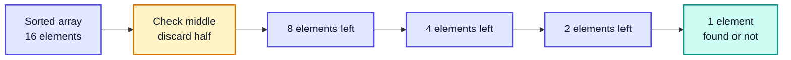
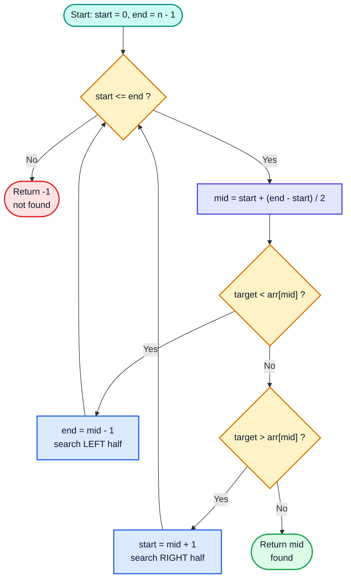
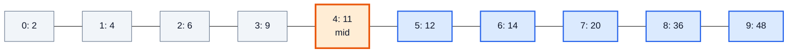
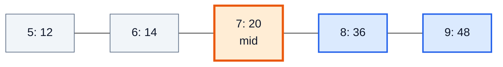
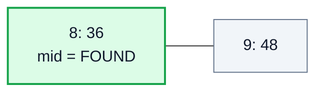
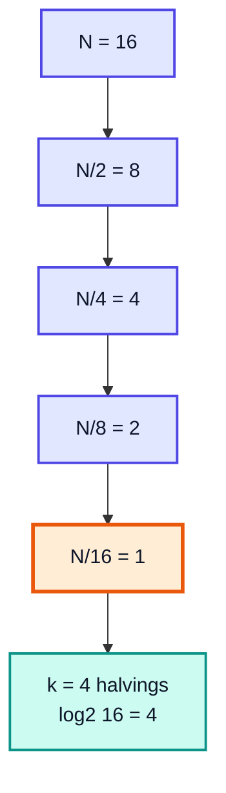
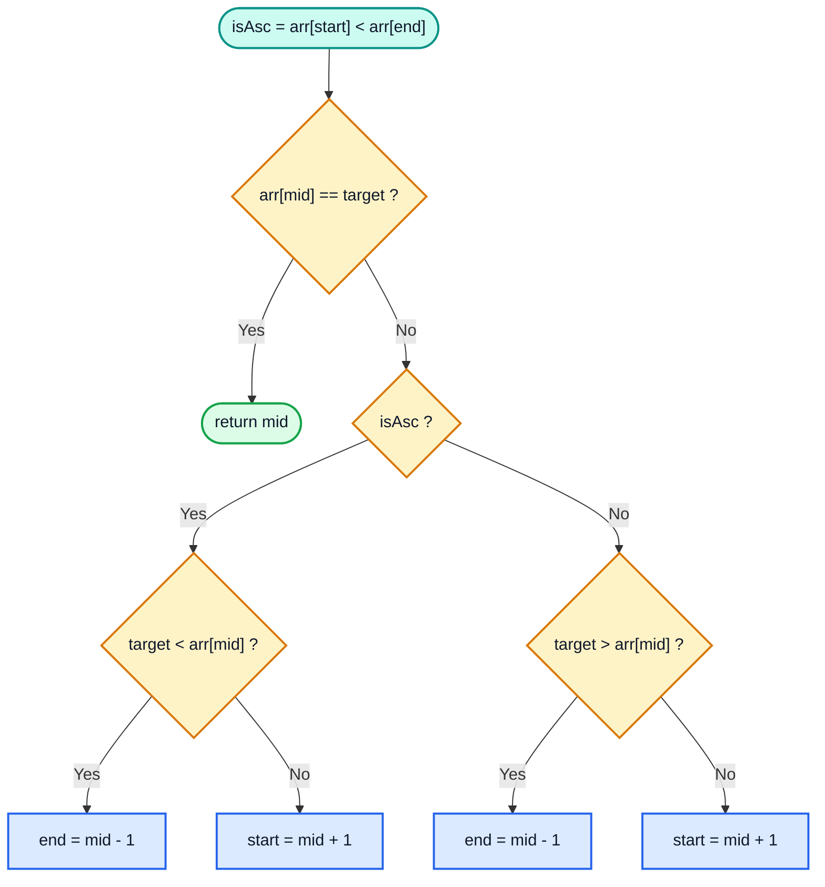

# Binary Search — Complete In-Depth Guide

**Video #14 of the Java + DSA playlist:** *Binary Search Algorithm - Theory + Code* (58:15)

The first of a two-part series on binary search: what it is, why it beats linear search on sorted data, how its O(log N) complexity is derived, a clean Java implementation, and order-agnostic binary search, which works on both ascending and descending arrays.

---

## Table of Contents

| # | Topic | Timestamp |
|---|---|---|
| 0 | [Introduction](#0-introduction-000) | 0:00 |
| 1 | [DSAwithKunal](#1-dsawithkunal-057) | 0:57 |
| 2 | [What is Binary Search?](#2-what-is-binary-search-235) | 2:35 |
| 3 | [Binary Search Algorithm](#3-binary-search-algorithm-720) | 7:20 |
| 4 | [Why Binary Search?](#4-why-binary-search-2110) | 21:10 |
| 5 | [Code for Binary Search](#5-code-for-binary-search-2921) | 29:21 |
| 6 | [Order-Agnostic Binary Search](#6-order-agnostic-binary-search-4148) | 41:48 |
| 7 | [Code for Order-Agnostic Binary Search](#7-code-for-order-agnostic-binary-search-4900) | 49:00 |
| 8 | [Outro](#8-outro-5742) | 57:42 |

---

## 0. Introduction (0:00)

The previous searching video (#13) covered **linear search**, which checks every element one by one. This video introduces **binary search**, the first "smart" searching algorithm in the course and probably the one you'll use most in interviews.

What you will learn:

1. The **idea** behind binary search (halving the search space)
2. The **algorithm**, step by step
3. **Why** it is faster, with a proper derivation of `O(log N)`
4. The **Java code**, including the overflow-safe `mid` formula
5. **Order-agnostic** binary search, for when you don't know whether the array is ascending or descending

> [!IMPORTANT]
> Binary search is not just "a search algorithm". It is a **pattern**: any time you have a **sorted** (or *monotonic*) search space and can discard half of it after one check, binary search applies. Video #15 is a full 4-hour session of interview questions built on this one idea.

---

## 1. DSAwithKunal (0:57)

A short segment about the **#DSAwithKunal** learning-in-public initiative: post what you learn on LinkedIn or Twitter with the hashtag.

> [!TIP]
> Writing a short post after each video ("Today I learned binary search; here's why it is O(log N)") is a great way to check that you actually understood it. If you can't explain it in 5 lines, rewatch the section.

---

## 2. What is Binary Search? (2:35)

### The Basic Idea

**Binary search** finds a target in a **sorted** array by repeatedly comparing it with the **middle** element and throwing away the half where the target cannot be.

Real-world analogy: looking up a word in a **dictionary**. You don't start at page 1. You open it in the middle, see that "Java" comes after "Hello", and ignore the entire first half.



### The One Requirement: Sorted Data

| Array | Can we use binary search? | Why |
|---|---|---|
| `[2, 4, 6, 9, 11, 12, 14, 20, 36, 48]` | ✅ Yes | Sorted ascending |
| `[90, 75, 18, 12, 6, 4, 3, 1]` | ✅ Yes (order-agnostic) | Sorted descending |
| `[5, 1, 9, 3, 7]` | ❌ No | Unsorted: discarding a half might throw away the answer |

> [!WARNING]
> Binary search on an **unsorted** array does not throw an error. It simply returns **wrong answers** (often `-1` for elements that exist). Java's `Arrays.binarySearch` documents this as "the results are undefined".

### Linear vs Binary at a Glance

| | **Linear Search** | **Binary Search** |
|---|---|---|
| Requirement | None | Array must be sorted |
| How it works | Check every element left to right | Check middle, discard half |
| Best case | `O(1)` (first element) | `O(1)` (middle element) |
| Worst case | `O(N)` | `O(log N)` |
| 1 billion elements, worst case | 1,000,000,000 comparisons | ~30 comparisons |

---

## 3. Binary Search Algorithm (7:20)

### The Steps

Given a sorted ascending array `arr` and a `target`:

1. Set `start = 0` and `end = arr.length - 1`.
2. While `start <= end`:
   1. Find the middle index `mid`.
   2. If `target > arr[mid]` → the answer can only be **right** of `mid`, so `start = mid + 1`.
   3. If `target < arr[mid]` → the answer can only be **left** of `mid`, so `end = mid - 1`.
   4. Otherwise `target == arr[mid]` → **found**, return `mid`.
3. If the loop ends (`start > end`), the element is **not present**: return `-1`.



### Why `mid ± 1` and Not `mid`?

We've already compared `arr[mid]` with the target and know it isn't the answer. Keeping `mid` in the range would waste a comparison and, worse, can cause an **infinite loop** when `start == end - 1` (with integer division, `mid` stays equal to `start` forever).

### Visual Walkthrough: Find `36`

Array: `[2, 4, 6, 9, 11, 12, 14, 20, 36, 48]`, target = `36`

**Iteration 1:** `start = 0`, `end = 9`, `mid = 4` → `arr[4] = 11`. `36 > 11`, go right.



**Iteration 2:** `start = 5`, `end = 9`, `mid = 7` → `arr[7] = 20`. `36 > 20`, go right.



**Iteration 3:** `start = 8`, `end = 9`, `mid = 8` → `arr[8] = 36`. Found at index **8** ✅



### Trace Table

| Iteration | `start` | `end` | `mid` | `arr[mid]` | Compare | Action |
|---|---|---|---|---|---|---|
| 1 | 0 | 9 | 4 | 11 | 36 > 11 | `start = 5` |
| 2 | 5 | 9 | 7 | 20 | 36 > 20 | `start = 8` |
| 3 | 8 | 9 | 8 | 36 | equal ✅ | return `8` |

Linear search would have needed **9** comparisons; binary search needed **3**.

### Trace When the Element is Missing: Find `10`

| Iteration | `start` | `end` | `mid` | `arr[mid]` | Compare | Action |
|---|---|---|---|---|---|---|
| 1 | 0 | 9 | 4 | 11 | 10 < 11 | `end = 3` |
| 2 | 0 | 3 | 1 | 4 | 10 > 4 | `start = 2` |
| 3 | 2 | 3 | 2 | 6 | 10 > 6 | `start = 3` |
| 4 | 3 | 3 | 3 | 9 | 10 > 9 | `start = 4` |
| — | 4 | 3 | — | — | `start > end` ❌ | return `-1` |

> [!NOTE]
> When the loop ends, `start` holds the index where the target **would be inserted** (here `4`, between `9` and `11`). This tiny fact is the key to the **Ceiling** and **Floor** questions in video #15.

---

## 4. Why Binary Search? (21:10)

### Basics: Comparisons in the Worst Case

In the worst case, binary search keeps halving until **one** element remains.

| Array size | Linear search (worst) | Binary search (worst) |
|---|---|---|
| 10 | 10 | 4 |
| 1,000 | 1,000 | 10 |
| 1,000,000 | 1,000,000 | 20 |
| 1,000,000,000 | 1,000,000,000 | 30 |

Doubling the array size adds only **one** extra step for binary search.

### In Depth: Deriving `O(log N)`

Each iteration divides the size of the search space by 2:

| After iteration | Elements left |
|---|---|
| 0 | `N` |
| 1 | `N / 2` |
| 2 | `N / 4` = `N / 2²` |
| 3 | `N / 8` = `N / 2³` |
| k | `N / 2ᵏ` |

The search stops when one element is left:

```text
N / 2^k = 1
N       = 2^k
log2(N) = log2(2^k)
log2(N) = k
```

So the number of iterations `k` is **`log₂ N`** (plus one for the final comparison), giving a time complexity of **`O(log N)`**.



### Complexity Summary

| Case | Time | When |
|---|---|---|
| Best | `O(1)` | Target is at the first `mid` |
| Average | `O(log N)` | Typical |
| Worst | `O(log N)` | Target at an edge, or absent |
| Space (iterative) | `O(1)` | Only `start`, `end`, `mid` |
| Space (recursive) | `O(log N)` | One stack frame per halving |

> [!TIP]
> In Big-O, the base of the log doesn't matter (`log₂ N` and `log₁₀ N` differ only by a constant factor), so we just write `O(log N)`.

### The Catch: Sorting Costs Something

If the data is **unsorted** and you search it only **once**, sorting first (`O(N log N)`) and then binary searching is slower than one linear search (`O(N)`). Binary search pays off when:

- the data is **already sorted**, or
- you sort once and search **many** times.

---

## 5. Code for Binary Search (29:21)

### Iterative Implementation

```java
public class BinarySearch {

    // Returns the index of target in a sorted ascending array, or -1
    static int binarySearch(int[] arr, int target) {
        int start = 0;
        int end = arr.length - 1;

        while (start <= end) {
            // int mid = (start + end) / 2;   // ⚠️ may overflow for huge indices
            int mid = start + (end - start) / 2;

            if (target < arr[mid]) {
                end = mid - 1;
            } else if (target > arr[mid]) {
                start = mid + 1;
            } else {
                return mid;              // found
            }
        }
        return -1;                       // not found
    }

    public static void main(String[] args) {
        int[] arr = {-18, -12, -4, 0, 2, 3, 4, 15, 16, 18, 22, 45, 89};
        System.out.println(binarySearch(arr, 22));   // 10
        System.out.println(binarySearch(arr, -18));  // 0
        System.out.println(binarySearch(arr, 89));   // 12
        System.out.println(binarySearch(arr, 7));    // -1
    }
}
```

### The `mid` Overflow Bug

`int` holds values up to `2,147,483,647` (`Integer.MAX_VALUE`). If `start` and `end` are both large, `start + end` exceeds that and wraps around to a **negative** number.

```java
public class OverflowDemo {
    public static void main(String[] args) {
        int start = 2_000_000_000;
        int end   = 2_100_000_000;

        int badMid  = (start + end) / 2;           // overflow!
        int goodMid = start + (end - start) / 2;   // safe
        int shiftMid = (start + end) >>> 1;        // also safe (unsigned shift)

        System.out.println(badMid);    // -97483648
        System.out.println(goodMid);   // 2050000000
        System.out.println(shiftMid);  // 2050000000
    }
}
```

| Formula | Safe? | Notes |
|---|---|---|
| `(start + end) / 2` | ❌ | Overflows when `start + end > Integer.MAX_VALUE` |
| `start + (end - start) / 2` | ✅ | The version used in the course |
| `(start + end) >>> 1` | ✅ | Used inside the JDK's own `Arrays.binarySearch` |

> [!NOTE]
> This exact bug sat in the JDK's `Arrays.binarySearch` (and many textbooks) for about 9 years until it was reported in 2006. Arrays that big are rare, but in "binary search on the answer" problems `start` and `end` are **values**, not indices, and can easily be large.

### Edge Cases to Test

| Input | Expected | Why it matters |
|---|---|---|
| Empty array `[]` | `-1` | `end = -1`, loop never runs |
| One element, present | `0` | `start == end` must still be checked (`<=`, not `<`) |
| Target smaller than all | `-1` | `end` walks below `0` |
| Target larger than all | `-1` | `start` walks past `n - 1` |
| Duplicates `[1, 2, 2, 2, 3]`, target `2` | any of `1..3` | Plain binary search finds **an** occurrence, not necessarily the first (see video #15, Q4) |

> [!CAUTION]
> Writing `while (start < end)` instead of `while (start <= end)` silently skips the last remaining element. `[5]` with target `5` would return `-1`.

### Recursive Version

```java
public class RecursiveBS {
    static int search(int[] arr, int target, int start, int end) {
        if (start > end) return -1;                 // base case: empty range
        int mid = start + (end - start) / 2;
        if (arr[mid] == target) return mid;
        if (target < arr[mid]) return search(arr, target, start, mid - 1);
        return search(arr, target, mid + 1, end);
    }

    public static void main(String[] args) {
        int[] arr = {2, 4, 6, 9, 11, 12, 14, 20, 36, 48};
        System.out.println(search(arr, 36, 0, arr.length - 1));  // 8
        System.out.println(search(arr, 5, 0, arr.length - 1));   // -1
    }
}
```

The iterative version is preferred in practice: same time, but `O(1)` space instead of `O(log N)` stack frames. (Recursion gets its own videos later in the playlist.)

### Using the Standard Library

```java
import java.util.Arrays;
import java.util.Collections;
import java.util.List;

public class LibraryBS {
    public static void main(String[] args) {
        int[] arr = {2, 4, 6, 9, 11};
        System.out.println(Arrays.binarySearch(arr, 9));    // 3
        System.out.println(Arrays.binarySearch(arr, 5));    // -3  → insertion point 2 → -(2) - 1

        List<Integer> list = List.of(1, 3, 5, 7);
        System.out.println(Collections.binarySearch(list, 7)); // 3
    }
}
```

| Method | Returns when found | Returns when missing |
|---|---|---|
| `Arrays.binarySearch(arr, key)` | index | `-(insertionPoint) - 1` (always negative) |
| `Collections.binarySearch(list, key)` | index | `-(insertionPoint) - 1` |

> [!TIP]
> In interviews, write it yourself; the library call is for production code. Knowing the `-(insertionPoint) - 1` convention is still handy, because it gives you ceiling and floor for free.

---

## 6. Order-Agnostic Binary Search (41:48)

### The Problem

You are given a sorted array, but you **don't know** whether it is sorted ascending or descending. Find the target.

```text
[-4, 2, 4, 11, 12, 20, 36]   ← ascending
[90, 75, 18, 12, 6, 4, 3, 1] ← descending
```

In a **descending** array the comparison logic flips: if `target > arr[mid]`, the target is to the **left** (bigger numbers are at the beginning).

### Detecting the Order

Compare the **first** and **last** elements:

| Condition | Order |
|---|---|
| `arr[start] < arr[end]` | Ascending |
| `arr[start] > arr[end]` | Descending |
| `arr[start] == arr[end]` | All elements equal (for a sorted array): either branch works |

> [!NOTE]
> Comparing `arr[0]` with `arr[1]` would also work for strictly sorted arrays, but fails for something like `[2, 2, 2, 5]` (looks "not ascending"). First vs last is the robust choice.

### Decision Logic



### Comparison Table

| Situation | Ascending | Descending |
|---|---|---|
| `target < arr[mid]` | go **left** (`end = mid - 1`) | go **right** (`start = mid + 1`) |
| `target > arr[mid]` | go **right** (`start = mid + 1`) | go **left** (`end = mid - 1`) |
| `target == arr[mid]` | found | found |

---

## 7. Code for Order-Agnostic Binary Search (49:00)

```java
public class OrderAgnosticBS {

    static int orderAgnosticBS(int[] arr, int target) {
        if (arr.length == 0) return -1;

        int start = 0;
        int end = arr.length - 1;

        // find whether the array is sorted ascending or descending
        boolean isAsc = arr[start] < arr[end];

        while (start <= end) {
            int mid = start + (end - start) / 2;

            if (arr[mid] == target) {
                return mid;
            }

            if (isAsc) {
                if (target < arr[mid]) end = mid - 1;
                else start = mid + 1;
            } else {
                if (target > arr[mid]) end = mid - 1;
                else start = mid + 1;
            }
        }
        return -1;
    }

    public static void main(String[] args) {
        int[] desc = {99, 80, 75, 22, 11, 10, 5, 2, -3};
        int[] asc  = {-4, 2, 4, 11, 12, 20, 36};

        System.out.println(orderAgnosticBS(desc, 22));  // 3
        System.out.println(orderAgnosticBS(desc, -3));  // 8
        System.out.println(orderAgnosticBS(asc, 20));   // 5
        System.out.println(orderAgnosticBS(asc, 7));    // -1
    }
}
```

### Dry Run: Find `22` in `[99, 80, 75, 22, 11, 10, 5, 2, -3]`

`isAsc = (99 < -3) = false` → descending.

| Iteration | `start` | `end` | `mid` | `arr[mid]` | Compare (descending rules) | Action |
|---|---|---|---|---|---|---|
| 1 | 0 | 8 | 4 | 11 | 22 > 11 → bigger values are left | `end = 3` |
| 2 | 0 | 3 | 1 | 80 | 22 < 80 → smaller values are right | `start = 2` |
| 3 | 2 | 3 | 2 | 75 | 22 < 75 | `start = 3` |
| 4 | 3 | 3 | 3 | 22 | equal ✅ | return `3` |

### Complexity

| | Value | Reason |
|---|---|---|
| Time | `O(log N)` | One extra comparison (`isAsc`) up front, then normal binary search |
| Space | `O(1)` | A few variables |

### Alternative: Reuse Normal Binary Search

You can also write one helper that takes `isAsc` as a parameter, or (for descending) search for `-target` in a conceptually negated array. The `isAsc` flag version above is the simplest and clearest, and it's the pattern reused in **Q7 (Find in Mountain Array)** of video #15, where the right half of a mountain is descending.

---

## 8. Outro (57:42)

Next up, video #15: **Binary Search Interview Questions**, covering ceiling/floor, first and last position, infinite arrays, mountain arrays, rotated arrays and Split Array Largest Sum.

> [!IMPORTANT]
> Before moving on, make sure you can write binary search **from memory** with no off-by-one errors: `start <= end`, `mid = start + (end - start) / 2`, `mid - 1` / `mid + 1`. Every question in the next video builds on exactly this template.

---

## 🧩 Complete Example: Everything Together

One program that uses every concept from this video: linear vs binary comparison counts, the overflow-safe `mid`, a missing element, order-agnostic search on both orders, the library method, and the `log₂ N` worst case.

```java
import java.util.Arrays;

public class Main {

    // ═══════ LINEAR SEARCH (for comparison) ═══════
    static int linearSearch(int[] arr, int target, int[] steps) {
        for (int i = 0; i < arr.length; i++) {
            steps[0]++;
            if (arr[i] == target) return i;
        }
        return -1;
    }

    // ═══════ BINARY SEARCH (ascending) ═══════
    static int binarySearch(int[] arr, int target, int[] steps) {
        int start = 0;
        int end = arr.length - 1;
        while (start <= end) {
            steps[0]++;
            int mid = start + (end - start) / 2;   // overflow-safe
            if (target < arr[mid]) {
                end = mid - 1;
            } else if (target > arr[mid]) {
                start = mid + 1;
            } else {
                return mid;
            }
        }
        return -1;
    }

    // ═══════ ORDER-AGNOSTIC BINARY SEARCH ═══════
    static int orderAgnosticBS(int[] arr, int target) {
        int start = 0;
        int end = arr.length - 1;
        boolean isAsc = arr[start] < arr[end];
        while (start <= end) {
            int mid = start + (end - start) / 2;
            if (arr[mid] == target) return mid;
            if (isAsc) {
                if (target < arr[mid]) end = mid - 1;
                else start = mid + 1;
            } else {
                if (target > arr[mid]) end = mid - 1;
                else start = mid + 1;
            }
        }
        return -1;
    }

    public static void main(String[] args) {
        int[] asc = {-18, -12, -4, 0, 2, 3, 4, 15, 16, 18, 22, 45, 89};
        int[] desc = {99, 80, 75, 22, 11, 10, 5, 2, -3};

        System.out.println("Ascending : " + Arrays.toString(asc));
        System.out.println("Descending: " + Arrays.toString(desc));

        // 1. Linear vs Binary step count
        int target = 22;
        int[] ls = {0}, bs = {0};
        int li = linearSearch(asc, target, ls);
        int bi = binarySearch(asc, target, bs);
        System.out.println("\nSearching " + target + " in ascending array");
        System.out.println("Linear search -> index " + li + " in " + ls[0] + " comparisons");
        System.out.println("Binary search -> index " + bi + " in " + bs[0] + " iterations");

        // 2. Missing element
        int[] miss = {0};
        System.out.println("Binary search for 7 -> " + binarySearch(asc, 7, miss)
                + " (" + miss[0] + " iterations)");

        // 3. Order-agnostic on both arrays
        System.out.println("\nOrder-agnostic, find 15 in asc  -> " + orderAgnosticBS(asc, 15));
        System.out.println("Order-agnostic, find 22 in desc -> " + orderAgnosticBS(desc, 22));
        System.out.println("Order-agnostic, find -3 in desc -> " + orderAgnosticBS(desc, -3));
        System.out.println("Order-agnostic, find 50 in desc -> " + orderAgnosticBS(desc, 50));

        // 4. Library comparison
        System.out.println("\nArrays.binarySearch(asc, 22) -> " + Arrays.binarySearch(asc, 22));
        System.out.println("Arrays.binarySearch(asc, 7)  -> " + Arrays.binarySearch(asc, 7)
                + "  (= -(insertionPoint) - 1)");

        // 5. Worst-case iterations = floor(log2 N) + 1
        for (int n : new int[]{13, 1_000, 1_000_000, 1_000_000_000}) {
            int worst = (int) (Math.log(n) / Math.log(2)) + 1;
            System.out.println("N = " + n + " -> at most " + worst + " iterations");
        }
    }
}
```

**Expected Output:**
```
Ascending : [-18, -12, -4, 0, 2, 3, 4, 15, 16, 18, 22, 45, 89]
Descending: [99, 80, 75, 22, 11, 10, 5, 2, -3]

Searching 22 in ascending array
Linear search -> index 10 in 11 comparisons
Binary search -> index 10 in 4 iterations
Binary search for 7 -> -1 (3 iterations)

Order-agnostic, find 15 in asc  -> 7
Order-agnostic, find 22 in desc -> 3
Order-agnostic, find -3 in desc -> 8
Order-agnostic, find 50 in desc -> -1

Arrays.binarySearch(asc, 22) -> 10
Arrays.binarySearch(asc, 7)  -> -8  (= -(insertionPoint) - 1)
N = 13 -> at most 4 iterations
N = 1000 -> at most 10 iterations
N = 1000000 -> at most 20 iterations
N = 1000000000 -> at most 30 iterations
```

---

## Quick Reference Cheat Sheet

| Concept | One-Line Summary |
|---|---|
| **Binary Search** | Compare with the middle element and discard the half that can't contain the target |
| **Requirement** | Data must be sorted (or monotonic); unsorted input gives wrong answers, not errors |
| **Loop condition** | `while (start <= end)`: `<=` so the last single element is still checked |
| **Middle index** | `mid = start + (end - start) / 2`, which avoids `int` overflow of `(start + end) / 2` |
| **Move pointers** | `end = mid - 1` (go left) or `start = mid + 1` (go right), never just `mid` |
| **Not found** | Loop ends with `start > end` → return `-1`; `start` is the insertion point |
| **Time complexity** | Best `O(1)`, worst `O(log N)`, from `N / 2ᵏ = 1 → k = log₂ N` |
| **Space complexity** | `O(1)` iterative, `O(log N)` recursive |
| **vs Linear search** | `O(N)` vs `O(log N)`: 1 billion elements → ~30 steps instead of 1 billion |
| **Order-agnostic** | `isAsc = arr[start] < arr[end]`; flip the `<` / `>` logic for descending arrays |
| **Library** | `Arrays.binarySearch` returns index, or `-(insertionPoint) - 1` if missing |
| **Duplicates** | Plain binary search returns *some* matching index, not necessarily the first |
