# Binary Search Interview Questions — Complete In-Depth Guide

**Video #15 of the Java + DSA playlist:** *Binary Search Interview Questions - Google, Facebook, Amazon* (4:01:46)

Part 2 of the binary search series: 11 interview questions, from LeetCode easy to hard. Ceiling and floor, first and last position, infinite arrays, mountain arrays, rotated arrays (with and without duplicates), rotation count, and "binary search on the answer" with Split Array Largest Sum. Each one gets its approach, code, a dry run and complexity.

---

## Table of Contents

| # | Topic | Timestamp |
|---|---|---|
| 0 | [Preview](#0-preview-000) | 0:00 |
| 1 | [Introduction](#1-introduction-452) | 4:52 |
| 2 | [When do we apply Binary Search?](#2-when-do-we-apply-binary-search-841) | 8:41 |
| 3 | [Q1: Ceiling of a Number](#3-q1-ceiling-of-a-number-1025) | 10:25 |
| 4 | [Q2: Floor of a Number](#4-q2-floor-of-a-number-3258) | 32:58 |
| 5 | [Q1 and Q2](#5-q1-and-q2-4040) | 40:40 |
| 6 | [Q3: Smallest Letter](#6-q3-smallest-letter-4655) | 46:55 |
| 7 | [Q4: First and Last Position in Sorted Array](#7-q4-first-and-last-position-in-sorted-array-10213) | 1:02:13 |
| 8 | [Q5: Position of an Element in Infinite Sorted Array](#8-q5-position-of-an-element-in-infinite-sorted-array-12803) | 1:28:03 |
| 9 | [Q6: Peak Index in Mountain Array](#9-q6-peak-index-in-mountain-array-15800) | 1:58:00 |
| 10 | [Why this bootcamp is the best?](#10-why-this-bootcamp-is-the-best-21822) | 2:18:22 |
| 11 | [Q7: Find in Mountain Array](#11-q7-find-in-mountain-array-22037) | 2:20:37 |
| 12 | [Q8: Search in Rotated Sorted Array](#12-q8-search-in-rotated-sorted-array-22955) | 2:29:55 |
| 13 | [Correction: [4 5 6 0 1 2 3]](#13-correction-4-5-6-0-1-2-3-24503) | 2:45:03 |
| 14 | [Q8: Search in Rotated Sorted Array](#14-q8-search-in-rotated-sorted-array-24840) | 2:48:40 |
| 15 | [Q9: Rotated Binary Search in Array with Duplicate Values](#15-q9-rotated-binary-search-in-array-with-duplicate-values-31046) | 3:10:46 |
| 16 | [Q10: Rotation Count](#16-q10-rotation-count-32040) | 3:20:40 |
| 17 | [Q11: Split Array Largest Sum](#17-q11-split-array-largest-sum-32848) | 3:28:48 |

---

## 0. Preview (0:00)

A quick preview of the problems ahead. They're asked at Google, Facebook (Meta), Amazon and others, and they all use **one template**, the binary search from video #14:

```java
int start = 0, end = arr.length - 1;
while (start <= end) {
    int mid = start + (end - start) / 2;
    if (target < arr[mid])      end = mid - 1;
    else if (target > arr[mid]) start = mid + 1;
    else                        return mid;
}
return -1;
```

What changes from problem to problem is only **what you compare** and **what you return**.

---

## 1. Introduction (4:52)

The questions get progressively harder:

| # | Problem | LeetCode | Difficulty | Core trick |
|---|---|---|---|---|
| Q1 | Ceiling of a number | ~35 Search Insert Position | Easy | Return `start` after the loop |
| Q2 | Floor of a number | — | Easy | Return `end` after the loop |
| Q3 | Smallest letter greater than target | 744 | Easy | Ceiling + wrap-around with `%` |
| Q4 | First & last position | 34 | Medium | Keep searching after finding |
| Q5 | Infinite sorted array | 702 | Medium | Grow the window exponentially |
| Q6 | Peak in mountain array | 852 / 162 | Easy / Medium | Compare `mid` with `mid + 1` |
| Q7 | Find in mountain array | 1095 | Hard | Peak + two order-agnostic searches |
| Q8 | Search in rotated sorted array | 33 | Medium | Find the pivot, then search one half |
| Q9 | Rotated array with duplicates | 81 | Medium | Skip duplicates at both ends |
| Q10 | Rotation count | 153-related | Medium | `pivot + 1` |
| Q11 | Split array largest sum | 410 | Hard | Binary search on the **answer** |

> [!TIP]
> Don't memorise 11 solutions. For each question, ask: *"What is sorted / monotonic here, and how do I decide which half to throw away?"* Once you can answer that, the code is the template.

---

## 2. When do we apply Binary Search? (8:41)

### The Basic Signal

> Whenever you are given a **sorted** array (or matrix, or range), the first algorithm to think of is **binary search**.

### In Depth: Monotonic Search Spaces

"Sorted" really means **monotonic**: a yes/no condition that flips **once** as you move through the search space.

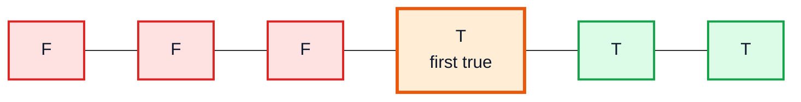

| Problem | Search space | Monotonic condition |
|---|---|---|
| Ceiling | Array indices | `arr[i] >= target` |
| Peak in mountain | Array indices | `arr[i] > arr[i + 1]` |
| Rotated array | Array indices | `arr[i] < arr[0]` (in the rotated-in part) |
| Split array largest sum | **Possible answers** (`max .. sum`) | "Can I split into `<= k` parts with this max?" |

> [!IMPORTANT]
> The search space doesn't have to be an array. In Q11 we binary search over **numbers** (possible answers). This idea, *binary search on the answer*, solves a whole family of hard problems (Koko Eating Bananas, Capacity to Ship Packages, Aggressive Cows, ...).

---

## 3. Q1: Ceiling of a Number (10:25)

### Problem

Given a sorted ascending array and a `target`, return the **ceiling**: the **smallest element `>= target`**. (Return its index; return `-1` if none exists.)

| `arr = [2, 3, 5, 9, 14, 16, 18]` | Ceiling |
|---|---|
| target = `14` | `14` (exists) |
| target = `15` | `16` |
| target = `4` | `5` |
| target = `1` | `2` |
| target = `20` | none → `-1` |

### Approach

Run the normal binary search. If the target exists, return `mid`. If it doesn't, the loop ends with `start = end + 1`, and **`start` points to the next bigger element**.

Why? The loop maintains this invariant:

- everything **left of `start`** is `< target`
- everything **right of `end`** is `> target`

When `start > end`, these two regions meet, so `start` is the first index whose element is bigger than the target, which is exactly the ceiling.

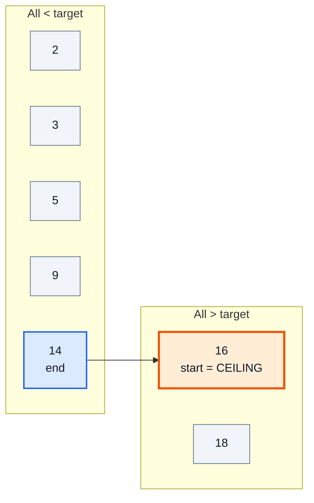

### Code

```java
public class Ceiling {

    // returns the INDEX of the smallest element >= target, or -1
    static int ceiling(int[] arr, int target) {
        // target bigger than the largest element → no ceiling
        if (target > arr[arr.length - 1]) {
            return -1;
        }
        int start = 0;
        int end = arr.length - 1;

        while (start <= end) {
            int mid = start + (end - start) / 2;
            if (target < arr[mid]) {
                end = mid - 1;
            } else if (target > arr[mid]) {
                start = mid + 1;
            } else {
                return mid;          // exact match is its own ceiling
            }
        }
        return start;                // next bigger element
    }

    public static void main(String[] args) {
        int[] arr = {2, 3, 5, 9, 14, 16, 18};
        System.out.println(ceiling(arr, 15));   // 5  (arr[5] = 16)
        System.out.println(ceiling(arr, 14));   // 4
        System.out.println(ceiling(arr, 1));    // 0  (arr[0] = 2)
        System.out.println(ceiling(arr, 20));   // -1
    }
}
```

### Dry Run: target = `15`

| Iteration | `start` | `end` | `mid` | `arr[mid]` | Compare | Action |
|---|---|---|---|---|---|---|
| 1 | 0 | 6 | 3 | 9 | 15 > 9 | `start = 4` |
| 2 | 4 | 6 | 5 | 16 | 15 < 16 | `end = 4` |
| 3 | 4 | 4 | 4 | 14 | 15 > 14 | `start = 5` |
| — | 5 | 4 | — | — | `start > end` | return `start = 5` → **16** ✅ |

### Complexity

| | Value |
|---|---|
| Time | `O(log N)` |
| Space | `O(1)` |

> [!NOTE]
> **LeetCode 35 – Search Insert Position** is exactly this problem without the `-1` check: "return the index where target is, or would be inserted" is just `return start`.

> [!WARNING]
> Without the `target > arr[arr.length - 1]` guard, `start` ends up as `arr.length`, and using it as an index throws `ArrayIndexOutOfBoundsException`.

---

## 4. Q2: Floor of a Number (32:58)

### Problem

Return the **floor**: the **greatest element `<= target`**.

| `arr = [2, 3, 5, 9, 14, 16, 18]` | Floor |
|---|---|
| target = `15` | `14` |
| target = `9` | `9` |
| target = `4` | `3` |
| target = `1` | none → `-1` |

### Approach

Same search, but return **`end`** after the loop. By the invariant, `end` is the last index whose element is **smaller** than the target.

### Code

```java
public class Floor {

    // returns the INDEX of the greatest element <= target, or -1
    static int floor(int[] arr, int target) {
        int start = 0;
        int end = arr.length - 1;

        while (start <= end) {
            int mid = start + (end - start) / 2;
            if (target < arr[mid]) {
                end = mid - 1;
            } else if (target > arr[mid]) {
                start = mid + 1;
            } else {
                return mid;
            }
        }
        return end;      // automatically -1 if target < arr[0]
    }

    public static void main(String[] args) {
        int[] arr = {2, 3, 5, 9, 14, 16, 18};
        System.out.println(floor(arr, 15));   // 4  (arr[4] = 14)
        System.out.println(floor(arr, 4));    // 1  (arr[1] = 3)
        System.out.println(floor(arr, 1));    // -1
        System.out.println(floor(arr, 99));   // 6  (arr[6] = 18)
    }
}
```

### Dry Run: target = `15`

Identical iterations to the ceiling trace; only the return changes:

| After loop | `start` | `end` | Returned | Element |
|---|---|---|---|---|
| Ceiling | **5** | 4 | `start` | 16 |
| Floor | 5 | **4** | `end` | 14 |

> [!TIP]
> Floor doesn't need a guard: if the target is smaller than every element, `end` keeps moving left until it becomes `-1`, which is exactly the "not found" value.

---

## 5. Q1 and Q2 (40:40)

### Side-by-Side

| | **Ceiling** | **Floor** |
|---|---|---|
| Definition | smallest element `>= target` | greatest element `<= target` |
| Return after loop | `start` | `end` |
| Out-of-range case | `target > last element` → `-1` (needs guard) | `target < first element` → `end = -1` (free) |
| LeetCode | 35 (Search Insert Position) | — |
| Library | `TreeSet.ceiling(x)` | `TreeSet.floor(x)` |

### Why It Works: the Final State

When the loop ends, `end` and `start` sit **next to each other**, just either side of where the target would go:

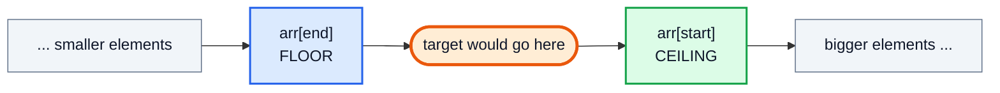

### Library Equivalent (Modern Java)

```java
import java.util.Arrays;
import java.util.TreeSet;

public class CeilFloorLib {
    public static void main(String[] args) {
        int[] arr = {2, 3, 5, 9, 14, 16, 18};

        int r = Arrays.binarySearch(arr, 15);   // -6 → insertion point 5
        int insertion = r >= 0 ? r : -r - 1;
        System.out.println(arr[insertion]);       // 16 (ceiling)
        System.out.println(arr[insertion - 1]);   // 14 (floor)

        TreeSet<Integer> set = new TreeSet<>();
        for (int x : arr) set.add(x);
        System.out.println(set.ceiling(15));      // 16
        System.out.println(set.floor(15));        // 14
    }
}
```

---

## 6. Q3: Smallest Letter (46:55)

### Problem — LeetCode 744: Find Smallest Letter Greater Than Target

Given a sorted array of characters `letters` and a `target`, return the smallest character **strictly greater** than `target`. Letters **wrap around**: if no letter is greater, return `letters[0]`.

| `letters` | `target` | Answer |
|---|---|---|
| `['c', 'f', 'j']` | `'a'` | `'c'` |
| `['c', 'f', 'j']` | `'c'` | `'f'` (strictly greater) |
| `['c', 'f', 'j']` | `'d'` | `'f'` |
| `['c', 'f', 'j']` | `'j'` | `'c'` (wrap-around) |

### Approach

This is **ceiling** with two twists:

1. **Strictly greater**: on equality, keep moving right instead of returning. So we only need two branches: `target < mid` → left, else → right.
2. **Wrap-around**: if `start` runs off the end (`start == letters.length`), return `letters[0]`. `start % letters.length` handles both cases in one expression.

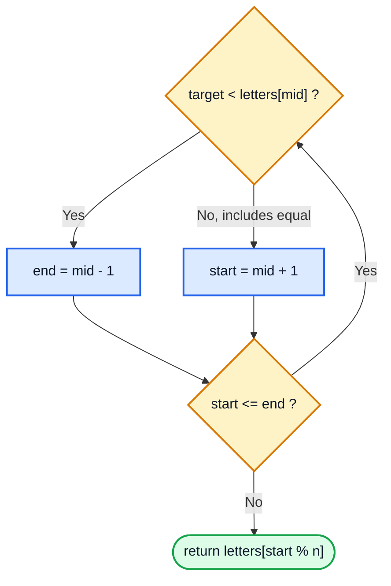

### Code

```java
public class SmallestLetter {

    static char nextGreatestLetter(char[] letters, char target) {
        int start = 0;
        int end = letters.length - 1;

        while (start <= end) {
            int mid = start + (end - start) / 2;
            if (target < letters[mid]) {
                end = mid - 1;
            } else {
                start = mid + 1;     // equal also goes right → strictly greater
            }
        }
        return letters[start % letters.length];
    }

    public static void main(String[] args) {
        char[] letters = {'c', 'f', 'j'};
        System.out.println(nextGreatestLetter(letters, 'a'));  // c
        System.out.println(nextGreatestLetter(letters, 'c'));  // f
        System.out.println(nextGreatestLetter(letters, 'd'));  // f
        System.out.println(nextGreatestLetter(letters, 'j'));  // c
    }
}
```

### Dry Run: target = `'c'`

| Iteration | `start` | `end` | `mid` | `letters[mid]` | Compare | Action |
|---|---|---|---|---|---|---|
| 1 | 0 | 2 | 1 | `f` | `c < f` | `end = 0` |
| 2 | 0 | 0 | 0 | `c` | `c < c`? No | `start = 1` |
| — | 1 | 0 | — | — | loop ends | `letters[1 % 3]` = **`f`** ✅ |

### Dry Run: target = `'j'` (wrap-around)

| Iteration | `start` | `end` | `mid` | `letters[mid]` | Action |
|---|---|---|---|---|---|
| 1 | 0 | 2 | 1 | `f` | `start = 2` |
| 2 | 2 | 2 | 2 | `j` | `start = 3` |
| — | 3 | 2 | — | — | `letters[3 % 3] = letters[0]` = **`c`** ✅ |

### Complexity

| | Value |
|---|---|
| Time | `O(log N)` |
| Space | `O(1)` |

> [!NOTE]
> `char` values compare by their Unicode code points (`'a' = 97`, `'b' = 98`, ...), so `<` and `>` work directly on characters.

---

## 7. Q4: First and Last Position in Sorted Array (1:02:13)

### Problem — LeetCode 34: Find First and Last Position of Element in Sorted Array

Given a sorted array `nums` (may contain duplicates) and a `target`, return `[firstIndex, lastIndex]`, or `[-1, -1]` if absent. Must be `O(log N)`.

| `nums` | `target` | Answer |
|---|---|---|
| `[5, 7, 7, 8, 8, 8, 10]` | `8` | `[3, 5]` |
| `[5, 7, 7, 8, 8, 8, 10]` | `6` | `[-1, -1]` |
| `[]` | `0` | `[-1, -1]` |

### Brute Force (and Why It Fails)

Find any occurrence with binary search, then walk left and right with a linear scan. If the array is `[8, 8, 8, ..., 8]` (N copies), the walk is `O(N)`, which breaks the `O(log N)` requirement.

### Approach: Don't Stop When You Find It

Run binary search **twice**:

- **First occurrence**: when `nums[mid] == target`, record `ans = mid`, then keep searching **left** (`end = mid - 1`), since there might be an earlier one.
- **Last occurrence**: record `ans = mid`, then keep searching **right** (`start = mid + 1`).

One helper with a `boolean findFirst` flag avoids duplicating code.

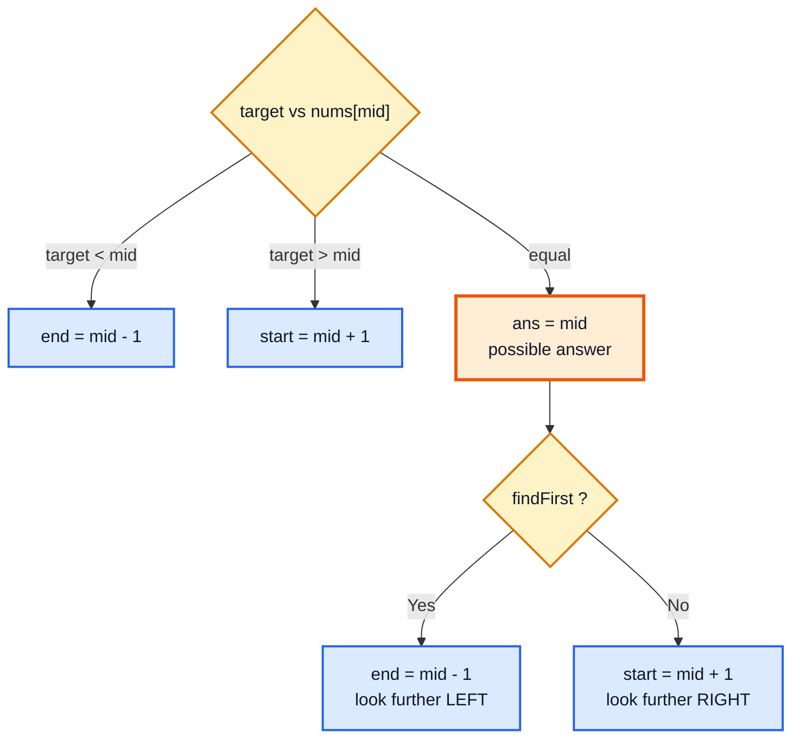

### Code

```java
import java.util.Arrays;

public class FirstLastPosition {

    static int[] searchRange(int[] nums, int target) {
        int first = search(nums, target, true);
        if (first == -1) return new int[]{-1, -1};   // skip 2nd search
        int last = search(nums, target, false);
        return new int[]{first, last};
    }

    static int search(int[] nums, int target, boolean findFirst) {
        int ans = -1;
        int start = 0;
        int end = nums.length - 1;
        while (start <= end) {
            int mid = start + (end - start) / 2;
            if (target < nums[mid]) {
                end = mid - 1;
            } else if (target > nums[mid]) {
                start = mid + 1;
            } else {
                ans = mid;                // potential answer
                if (findFirst) end = mid - 1;
                else start = mid + 1;
            }
        }
        return ans;
    }

    public static void main(String[] args) {
        int[] nums = {5, 7, 7, 8, 8, 8, 10};
        System.out.println(Arrays.toString(searchRange(nums, 8)));        // [3, 5]
        System.out.println(Arrays.toString(searchRange(nums, 6)));        // [-1, -1]
        System.out.println(Arrays.toString(searchRange(new int[]{}, 0))); // [-1, -1]
    }
}
```

### Dry Run: first occurrence of `8`

| Iteration | `start` | `end` | `mid` | `nums[mid]` | Action | `ans` |
|---|---|---|---|---|---|---|
| 1 | 0 | 6 | 3 | 8 | equal → `end = 2` | 3 |
| 2 | 0 | 2 | 1 | 7 | 8 > 7 → `start = 2` | 3 |
| 3 | 2 | 2 | 2 | 7 | 8 > 7 → `start = 3` | 3 |
| — | 3 | 2 | — | — | loop ends | **3** ✅ |

### Dry Run: last occurrence of `8`

| Iteration | `start` | `end` | `mid` | `nums[mid]` | Action | `ans` |
|---|---|---|---|---|---|---|
| 1 | 0 | 6 | 3 | 8 | equal → `start = 4` | 3 |
| 2 | 4 | 6 | 5 | 8 | equal → `start = 6` | 5 |
| 3 | 6 | 6 | 6 | 10 | 8 < 10 → `end = 5` | 5 |
| — | 6 | 5 | — | — | loop ends | **5** ✅ |

### Complexity

| | Value | Reason |
|---|---|---|
| Time | `O(log N)` | Two binary searches = `2 log N` |
| Space | `O(1)` | Result array of size 2 |

### Alternative: Lower Bound Trick

`last(target) = first(target + 1) - 1`. With one "lower bound" function (first index `>= x`), you get both ends:

```java
static int lowerBound(int[] nums, int x) {
    int start = 0, end = nums.length;        // note: end = length (half-open range)
    while (start < end) {
        int mid = start + (end - start) / 2;
        if (nums[mid] < x) start = mid + 1;
        else end = mid;
    }
    return start;
}
// first = lowerBound(nums, t);  last = lowerBound(nums, t + 1) - 1;
// valid only if first < nums.length && nums[first] == t
```

> [!CAUTION]
> `target + 1` overflows if `target == Integer.MAX_VALUE`. The `findFirst` flag version from the video doesn't have that problem.

---

## 8. Q5: Position of an Element in Infinite Sorted Array (1:28:03)

### Problem — related to LeetCode 702: Search in a Sorted Array of Unknown Size

You have a sorted array of **infinite** (or unknown) size. You can't call `arr.length`. Find the index of `target`.

### Approach: Exponentially Growing Window

Binary search needs a `start` and an `end`. Since we don't have an end, we **build** one:

1. Start with a small window: `start = 0`, `end = 1`.
2. While `target > arr[end]`, the target lies beyond this window, so jump to the next window and **double its size**:
   - `newStart = end + 1`
   - `end = end + (windowSize) * 2`, where `windowSize = end - start + 1`
   - `start = newStart`
3. Once `target <= arr[end]`, the target (if present) is in `[start, end]`: run normal binary search there.

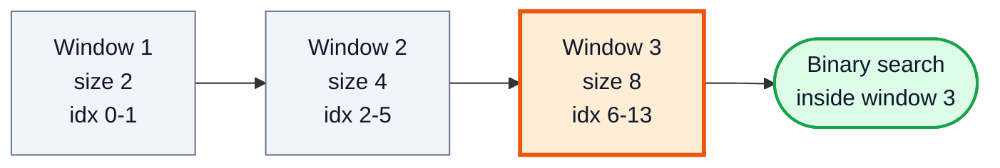

> [!NOTE]
> Why double instead of growing by a fixed step? A fixed step `k` needs `N / k` jumps, which is `O(N)`. Doubling needs only `log N` jumps to pass index `N`, so the whole thing stays `O(log N)`.

### Code

In Java every array has a length, so we simulate the "infinite" array with a normal one and simply **never use `arr.length`**.

```java
public class InfiniteArray {

    static int ans(int[] arr, int target) {
        int start = 0;
        int end = 1;

        // expand the window until target is inside it
        while (target > arr[end]) {
            int newStart = end + 1;
            end = end + (end - start + 1) * 2;   // double the window size
            start = newStart;
        }
        return binarySearch(arr, target, start, end);
    }

    static int binarySearch(int[] arr, int target, int start, int end) {
        while (start <= end) {
            int mid = start + (end - start) / 2;
            if (target < arr[mid]) end = mid - 1;
            else if (target > arr[mid]) start = mid + 1;
            else return mid;
        }
        return -1;
    }

    public static void main(String[] args) {
        int[] arr = {3, 5, 7, 9, 10, 90, 100, 130, 140, 160, 170, 200, 220, 250, 300, 310};
        System.out.println(ans(arr, 170));   // 10
        System.out.println(ans(arr, 10));    // 4
    }
}
```

### Dry Run: target = `170`

| Step | `start` | `end` | `arr[end]` | `target > arr[end]`? | Next window |
|---|---|---|---|---|---|
| 1 | 0 | 1 | 5 | ✅ yes | size 2 → new `start = 2`, `end = 1 + 2·2 = 5` |
| 2 | 2 | 5 | 90 | ✅ yes | size 4 → new `start = 6`, `end = 5 + 4·2 = 13` |
| 3 | 6 | 13 | 250 | ❌ no | stop, search `[6, 13]` |

Binary search in `[6, 13]`: `mid = 9` (160) → right; `mid = 11` (200) → left; `mid = 10` (170) → **found at 10** ✅

### Complexity

| Phase | Time |
|---|---|
| Finding the window | `O(log N)` (window doubles each time) |
| Binary search in window | `O(log N)` (window size ≤ 2N) |
| **Total** | **`O(log N)`**, space `O(1)` |

> [!WARNING]
> With a real finite Java array, `arr[end]` can throw `ArrayIndexOutOfBoundsException` if the target is bigger than everything. LeetCode 702 avoids this with an `ArrayReader` that returns `Integer.MAX_VALUE` for out-of-bounds indices; in your own code, cap `end` with `Math.min(end, arr.length - 1)`.

---

## 9. Q6: Peak Index in Mountain Array (1:58:00)

### Problem — LeetCode 852: Peak Index in a Mountain Array (same code solves LeetCode 162: Find Peak Element)

A **mountain** (bitonic) array strictly increases, then strictly decreases. Return the index of the peak (the maximum).

```text
arr = [1, 2, 3, 5, 6, 4, 3, 2]   →  peak index 4 (value 6)
```

### Approach

The array isn't sorted overall, but each half is. Look at `mid` and its right neighbour:

| Condition | Where are we? | What to do |
|---|---|---|
| `arr[mid] > arr[mid + 1]` | **Descending** part | Peak is `mid` or to its left → `end = mid` (keep `mid`!) |
| `arr[mid] < arr[mid + 1]` | **Ascending** part | Peak is strictly right → `start = mid + 1` |

Loop while `start < end`. When `start == end`, both pointers sit on the peak.

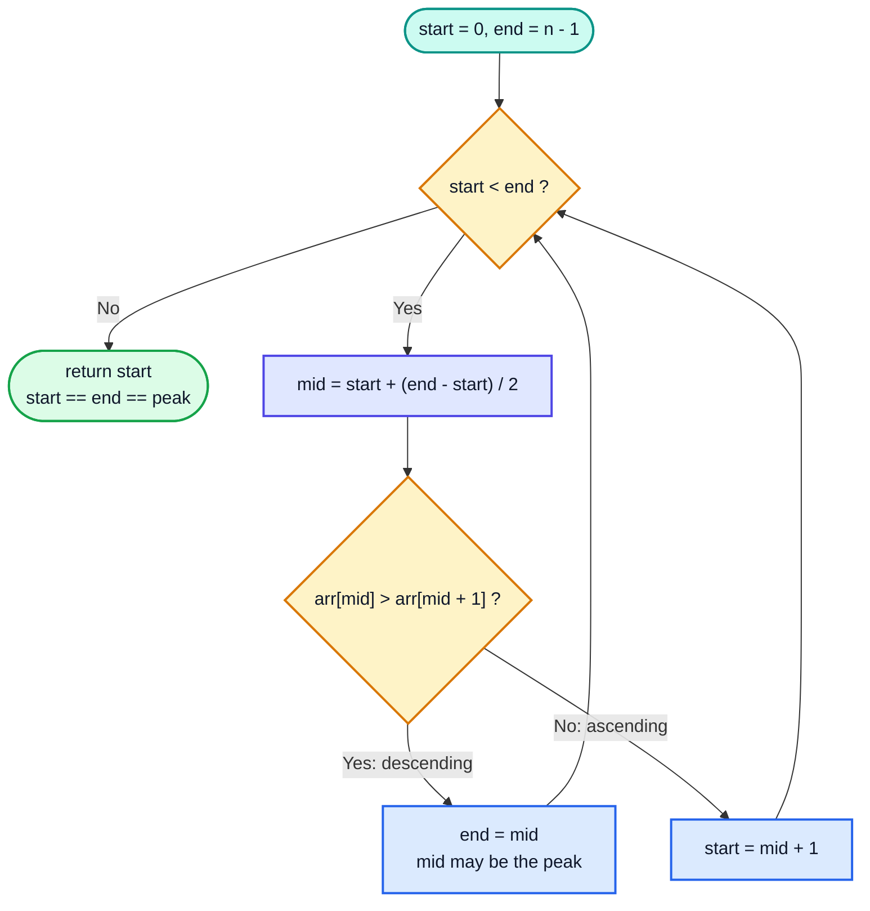

### Code

```java
public class MountainPeak {

    static int peakIndexInMountainArray(int[] arr) {
        int start = 0;
        int end = arr.length - 1;

        while (start < end) {
            int mid = start + (end - start) / 2;
            if (arr[mid] > arr[mid + 1]) {
                end = mid;            // in descending part; mid could be the answer
            } else {
                start = mid + 1;      // in ascending part; mid+1 is bigger than mid
            }
        }
        // start == end, pointing at the largest element
        return start;
    }

    public static void main(String[] args) {
        System.out.println(peakIndexInMountainArray(new int[]{1, 2, 3, 5, 6, 4, 3, 2}));  // 4
        System.out.println(peakIndexInMountainArray(new int[]{0, 10, 5, 2}));            // 1
    }
}
```

### Dry Run: `[1, 2, 3, 5, 6, 4, 3, 2]`

| Iteration | `start` | `end` | `mid` | `arr[mid]` vs `arr[mid+1]` | Part | Action |
|---|---|---|---|---|---|---|
| 1 | 0 | 7 | 3 | 5 < 6 | ascending | `start = 4` |
| 2 | 4 | 7 | 5 | 4 > 3 | descending | `end = 5` |
| 3 | 4 | 5 | 4 | 6 > 4 | descending | `end = 4` |
| — | 4 | 4 | — | — | `start == end` | return **4** ✅ |

### Why `arr[mid + 1]` Never Goes Out of Bounds

The loop runs only while `start < end`, and `mid` rounds down, so `mid < end` and `mid + 1 <= end`. Always safe.

### Complexity

| | Value |
|---|---|
| Time | `O(log N)` |
| Space | `O(1)` |

> [!TIP]
> For **LeetCode 162 (Find Peak Element)** the array can have several peaks. The same code works: following the "uphill" direction always reaches *some* peak.

---

## 10. Why this bootcamp is the best? (2:18:22)

A short break where Kunal explains the course philosophy: questions are taught by building **intuition**, not by memorising solutions, and every problem is shown to be a small change to the same template. The Q1 → Q4 → Q6 → Q7 progression is exactly that: Q7 reuses Q6 and video #14's order-agnostic search directly.

---

## 11. Q7: Find in Mountain Array (2:20:37)

### Problem — LeetCode 1095: Find in Mountain Array (Hard)

Given a mountain array, return the **minimum** index where `arr[index] == target`, or `-1`.

```text
arr = [1, 2, 3, 4, 5, 3, 1], target = 3  →  2  (index 2 and index 5 both hold 3; return the smaller)
```

### Approach: Three Binary Searches

1. **Find the peak** (Q6).
2. **Search the ascending half** `[0, peak]` with order-agnostic binary search (video #14).
3. If not found, **search the descending half** `[peak + 1, n - 1]`.

Searching the ascending half first guarantees the **minimum** index.

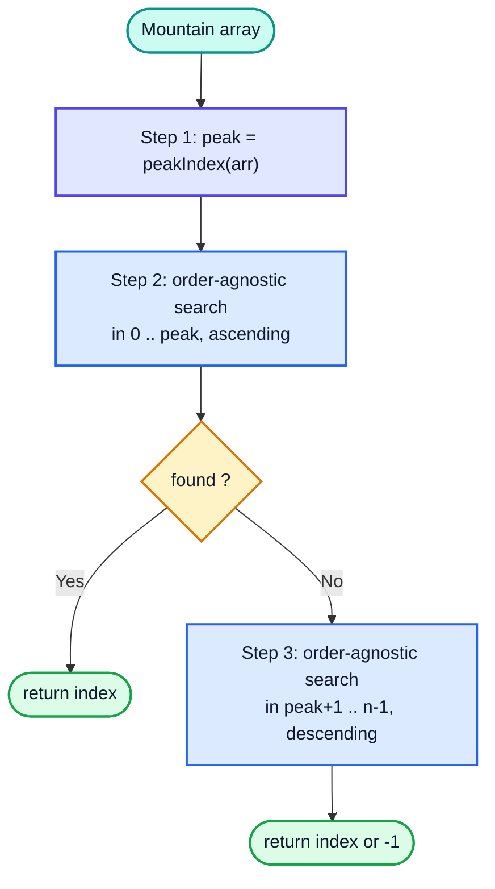

### Code

```java
public class FindInMountain {

    static int search(int[] arr, int target) {
        int peak = peakIndex(arr);
        int firstTry = orderAgnosticBS(arr, target, 0, peak);
        if (firstTry != -1) {
            return firstTry;
        }
        return orderAgnosticBS(arr, target, peak + 1, arr.length - 1);
    }

    static int peakIndex(int[] arr) {
        int start = 0, end = arr.length - 1;
        while (start < end) {
            int mid = start + (end - start) / 2;
            if (arr[mid] > arr[mid + 1]) end = mid;
            else start = mid + 1;
        }
        return start;
    }

    static int orderAgnosticBS(int[] arr, int target, int start, int end) {
        boolean isAsc = arr[start] < arr[end];
        while (start <= end) {
            int mid = start + (end - start) / 2;
            if (arr[mid] == target) return mid;
            if (isAsc) {
                if (target < arr[mid]) end = mid - 1;
                else start = mid + 1;
            } else {
                if (target > arr[mid]) end = mid - 1;
                else start = mid + 1;
            }
        }
        return -1;
    }

    public static void main(String[] args) {
        int[] arr = {1, 2, 3, 5, 6, 4, 3, 2};
        System.out.println(search(arr, 3));   // 2  (not 6)
        System.out.println(search(arr, 4));   // 5
        System.out.println(search(arr, 9));   // -1
    }
}
```

### Dry Run: target = `4` in `[1, 2, 3, 5, 6, 4, 3, 2]`

| Phase | Range | Steps | Result |
|---|---|---|---|
| Peak | `[0, 7]` | (see Q6) | `peak = 4` |
| Ascending search | `[0, 4]` | mid 2 (3) → right; mid 3 (5) → left; range empty | `-1` |
| Descending search | `[5, 7]` | `isAsc = 4 < 2 = false`; mid 6 (3): `4 > 3` → left, `end = 5`; mid 5 (4) ✅ | **5** |

### Complexity

| | Value | Reason |
|---|---|---|
| Time | `O(log N)` | Three binary searches |
| Space | `O(1)` | |

> [!NOTE]
> On LeetCode the array is hidden behind a `MountainArray` interface (`get(i)`, `length()`), and you're allowed only **100** `get` calls. Three `O(log N)` searches on `N ≤ 10⁴` use about 3 × 14 = 42 calls, well within the limit. Replace `arr[i]` with `mountainArr.get(i)` and the code is the same.

---

## 12. Q8: Search in Rotated Sorted Array (2:29:55)

### Problem — LeetCode 33: Search in Rotated Sorted Array

A sorted array of **distinct** values was rotated at an unknown pivot. Find `target` in `O(log N)`.

```text
Original: [0, 1, 2, 4, 5, 6, 7]
Rotated : [4, 5, 6, 7, 0, 1, 2]     target 0 → 4,  target 3 → -1
```

### Understanding the Shape

A rotated sorted array is **two ascending sub-arrays** glued together. The **pivot** is the **largest** element, the point where the next element drops.

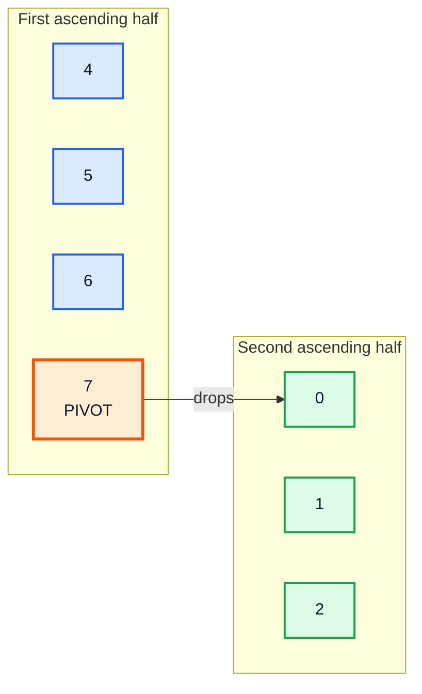

### Approach (Kunal's Method): Pivot First

1. **Find the pivot** (index of the largest element) with binary search.
2. If `arr[pivot] == target`, return `pivot`.
3. If `target >= arr[0]`, it can only be in the **first** half `[0, pivot - 1]`.
4. Otherwise it's in the **second** half `[pivot + 1, n - 1]`.
5. If there's no pivot (array not rotated), do normal binary search on the whole array.

### Finding the Pivot: 4 Cases

| # | Condition | Meaning | Action |
|---|---|---|---|
| 1 | `mid < end && arr[mid] > arr[mid + 1]` | `mid` is the peak right before the drop | return `mid` |
| 2 | `mid > start && arr[mid] < arr[mid - 1]` | `mid` is right after the drop | return `mid - 1` |
| 3 | `arr[mid] <= arr[start]` | `mid` is in the **second** (lower) half, so the pivot is to the left | `end = mid - 1` |
| 4 | otherwise (`arr[mid] > arr[start]`) | `mid` is in the **first** half, so the pivot is to the right | `start = mid + 1` |

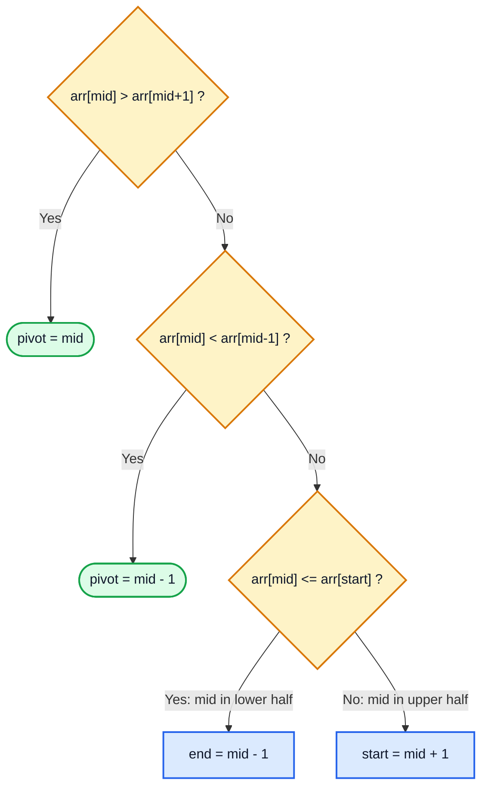

> [!IMPORTANT]
> The `mid < end` and `mid > start` guards stop `mid + 1` and `mid - 1` from going out of bounds. Java evaluates `&&` left to right and short-circuits, so the array access only runs when the guard is true.

---

## 13. Correction: [4 5 6 0 1 2 3] (2:45:03)

### What the Correction Is About

While explaining case 3, the pivot-finding logic needs to be checked on an array where `mid` lands in the **lower** half. Example `[4, 5, 6, 0, 1, 2, 3]`:

| `start` | `end` | `mid` | `arr[mid]` | Case check | Result |
|---|---|---|---|---|---|
| 0 | 6 | 3 | 0 | Case 1: `0 > 1`? ❌ · Case 2: `0 < arr[2] = 6`? ✅ | pivot = `mid - 1` = **2** (value 6) |

Here case 2 catches it right away. The important part is the **reasoning for case 3**: when `arr[mid] <= arr[start]`, every element from `mid` to `end` is **smaller** than `arr[start]`, so `mid` sits in the lower half and the pivot (the largest element) must lie to the left, at an index below `mid`.

### More Traces

`[3, 4, 5, 6, 7, 0, 1, 2]`, where `mid` is in the **upper** half first:

| Iteration | `start` | `end` | `mid` | `arr[mid]` | Case | Action |
|---|---|---|---|---|---|---|
| 1 | 0 | 7 | 3 | 6 | 4: `6 > arr[start] = 3` | `start = 4` |
| 2 | 4 | 7 | 5 | 0 | 2: `0 < arr[4] = 7` | return **4** ✅ |

`[6, 7, 0, 1, 2, 3, 4, 5]`, where `mid` is in the **lower** half first:

| Iteration | `start` | `end` | `mid` | `arr[mid]` | Case | Action |
|---|---|---|---|---|---|---|
| 1 | 0 | 7 | 3 | 1 | 3: `1 <= arr[start] = 6` | `end = 2` |
| 2 | 0 | 2 | 1 | 7 | 1: `7 > arr[2] = 0` | return **1** ✅ |

> [!NOTE]
> Why `<=` and not `<` in case 3? With distinct elements, `arr[mid] == arr[start]` happens only when `mid == start`. At that point cases 1 and 2 have already been checked, so moving `end` left is safe and ends the loop. With **duplicates** this breaks, which is exactly Q9.

---

## 14. Q8: Search in Rotated Sorted Array (2:48:40)

### Code (Pivot Method)

```java
public class RotatedSearch {

    static int search(int[] nums, int target) {
        int pivot = findPivot(nums);

        // not rotated → normal binary search
        if (pivot == -1) {
            return binarySearch(nums, target, 0, nums.length - 1);
        }
        if (nums[pivot] == target) {
            return pivot;
        }
        // first half holds values in [nums[0], nums[pivot]]
        if (target >= nums[0]) {
            return binarySearch(nums, target, 0, pivot - 1);
        }
        // second half holds values in [nums[pivot + 1], nums[0])
        return binarySearch(nums, target, pivot + 1, nums.length - 1);
    }

    static int findPivot(int[] arr) {
        int start = 0;
        int end = arr.length - 1;
        while (start <= end) {
            int mid = start + (end - start) / 2;
            if (mid < end && arr[mid] > arr[mid + 1]) return mid;        // case 1
            if (mid > start && arr[mid] < arr[mid - 1]) return mid - 1;  // case 2
            if (arr[mid] <= arr[start]) end = mid - 1;                   // case 3
            else start = mid + 1;                                        // case 4
        }
        return -1;
    }

    static int binarySearch(int[] arr, int target, int start, int end) {
        while (start <= end) {
            int mid = start + (end - start) / 2;
            if (target < arr[mid]) end = mid - 1;
            else if (target > arr[mid]) start = mid + 1;
            else return mid;
        }
        return -1;
    }

    public static void main(String[] args) {
        int[] nums = {4, 5, 6, 7, 0, 1, 2};
        System.out.println(search(nums, 0));                   // 4
        System.out.println(search(nums, 3));                   // -1
        System.out.println(search(nums, 5));                   // 1
        System.out.println(search(new int[]{1, 3, 5}, 5));     // 2 (not rotated)
    }
}
```

### Dry Run: target = `0` in `[4, 5, 6, 7, 0, 1, 2]`

| Step | Detail | Result |
|---|---|---|
| Find pivot | `mid = 3`, `arr[3] = 7 > arr[4] = 0` (case 1) | `pivot = 3` |
| `nums[3] == 0`? | 7 ≠ 0 | — |
| `0 >= nums[0] = 4`? | ❌ | search second half `[4, 6]` |
| Binary search `[4, 6]` | `mid = 5` (1): `0 < 1` → `end = 4`; `mid = 4` (0) ✅ | **4** |

### Complexity

| | Value |
|---|---|
| Time | `O(log N)`: pivot search + one binary search |
| Space | `O(1)` |

### Alternative: One-Pass Approach

Without finding the pivot: at every `mid`, **at least one half is sorted**. Check whether the target lies inside the sorted half's range.

```java
static int searchOnePass(int[] nums, int target) {
    int start = 0, end = nums.length - 1;
    while (start <= end) {
        int mid = start + (end - start) / 2;
        if (nums[mid] == target) return mid;

        if (nums[start] <= nums[mid]) {                    // left half sorted
            if (target >= nums[start] && target < nums[mid]) end = mid - 1;
            else start = mid + 1;
        } else {                                           // right half sorted
            if (target > nums[mid] && target <= nums[end]) start = mid + 1;
            else end = mid - 1;
        }
    }
    return -1;
}
```

| Approach | Passes | Reusable parts | Interview preference |
|---|---|---|---|
| Pivot + binary search (video) | 2 | `findPivot` is reused in Q9 and Q10 | Easy to explain |
| One-pass sorted-half check | 1 | — | Shorter; the common LeetCode editorial solution |

---

## 15. Q9: Rotated Binary Search in Array with Duplicate Values (3:10:46)

### Problem — LeetCode 81: Search in Rotated Sorted Array II

Same as Q8, but the array **may contain duplicates**.

### Why Q8's Pivot Logic Breaks

Consider `[2, 2, 2, 9, 2]`: `arr[start] = arr[mid] = arr[end] = 2`. Case 3 (`arr[mid] <= arr[start]`) says "pivot is left" and searches `[0, 1]`, but the pivot (`9`) is at index 3. With duplicates, comparing with `start` can no longer tell which half `mid` is in.

### Approach

Keep cases 1 and 2. Then:

- If `arr[start] == arr[mid] == arr[end]`, we can't decide, so **shrink both ends** by one. Before skipping an end, check that it isn't itself the pivot:
  - if `arr[start] > arr[start + 1]` → `start` is the pivot
  - if `arr[end] < arr[end - 1]` → `end - 1` is the pivot
- Else if the left side is sorted (`arr[start] < arr[mid]`, or `arr[start] == arr[mid] && arr[mid] > arr[end]`) → the pivot is to the right: `start = mid + 1`.
- Else → `end = mid - 1`.

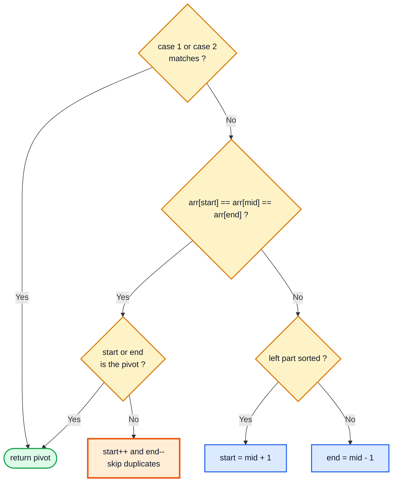

### Code

```java
public class RotatedWithDuplicates {

    static int findPivotWithDuplicates(int[] arr) {
        int start = 0;
        int end = arr.length - 1;
        while (start <= end) {
            int mid = start + (end - start) / 2;
            if (mid < end && arr[mid] > arr[mid + 1]) return mid;
            if (mid > start && arr[mid] < arr[mid - 1]) return mid - 1;

            if (arr[mid] == arr[start] && arr[mid] == arr[end]) {
                // check if start is the pivot before skipping it
                if (start < end && arr[start] > arr[start + 1]) return start;
                start++;
                // check if end - 1 is the pivot before skipping end
                if (end > start && arr[end] < arr[end - 1]) return end - 1;
                end--;
            } else if (arr[start] < arr[mid]
                    || (arr[start] == arr[mid] && arr[mid] > arr[end])) {
                start = mid + 1;      // left side sorted → pivot on the right
            } else {
                end = mid - 1;
            }
        }
        return -1;
    }

    // LeetCode 81 asks for a boolean
    static boolean search(int[] nums, int target) {
        int pivot = findPivotWithDuplicates(nums);
        if (pivot == -1) return bs(nums, target, 0, nums.length - 1) != -1;
        if (nums[pivot] == target) return true;
        if (target >= nums[0]) return bs(nums, target, 0, pivot - 1) != -1;
        return bs(nums, target, pivot + 1, nums.length - 1) != -1;
    }

    static int bs(int[] a, int t, int s, int e) {
        while (s <= e) {
            int m = s + (e - s) / 2;
            if (t < a[m]) e = m - 1;
            else if (t > a[m]) s = m + 1;
            else return m;
        }
        return -1;
    }

    public static void main(String[] args) {
        System.out.println(findPivotWithDuplicates(new int[]{2, 2, 2, 9, 2}));  // 3
        System.out.println(findPivotWithDuplicates(new int[]{2, 9, 2, 2, 2}));  // 1
        System.out.println(search(new int[]{2, 5, 6, 0, 0, 1, 2}, 0));         // true
        System.out.println(search(new int[]{2, 5, 6, 0, 0, 1, 2}, 3));         // false
    }
}
```

### Dry Run: `[2, 2, 2, 9, 2]`

| Iteration | `start` | `end` | `mid` | `arr[mid]` | Check | Action |
|---|---|---|---|---|---|---|
| 1 | 0 | 4 | 2 | 2 | case 1: `2 > 9`? ❌ · case 2: `2 < 2`? ❌ | — |
| | | | | | all three equal ✅ · `arr[0] > arr[1]`? ❌ | `start = 1` |
| | 1 | 4 | | | `arr[4] = 2 < arr[3] = 9`? ✅ | return **3** ✅ |

### Complexity

| Case | Time | Why |
|---|---|---|
| Average | `O(log N)` | Duplicates are rare |
| Worst | `O(N)` | e.g. `[1, 1, 1, 1, 1, 1, 2, 1, 1]`: each step only shrinks the range by 2 |
| Space | `O(1)` | |

> [!WARNING]
> No algorithm can beat `O(N)` in the worst case here: if all elements except one are equal, you have no information about where the odd one is without looking. Interviewers often ask exactly this follow-up.

---

## 16. Q10: Rotation Count (3:20:40)

### Problem — classic GfG question (closely related to LeetCode 153: Find Minimum in Rotated Sorted Array)

How many times was a sorted array **rotated** (right-rotated by 1 each time)?

| Array | Rotations |
|---|---|
| `[0, 1, 2, 4, 5, 6, 7]` | 0 |
| `[7, 0, 1, 2, 4, 5, 6]` | 1 |
| `[4, 5, 6, 7, 0, 1, 2]` | 4 |

### Approach

The rotation count equals the **index of the smallest element**, which is **`pivot + 1`**. If the array isn't rotated, `findPivot` returns `-1`, and `-1 + 1 = 0` works without a special case.

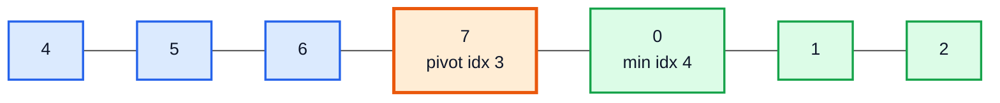

### Code

```java
public class RotationCount {

    static int countRotations(int[] arr) {
        return findPivot(arr) + 1;     // works for the unrotated case too
    }

    static int findPivot(int[] arr) {
        int start = 0, end = arr.length - 1;
        while (start <= end) {
            int mid = start + (end - start) / 2;
            if (mid < end && arr[mid] > arr[mid + 1]) return mid;
            if (mid > start && arr[mid] < arr[mid - 1]) return mid - 1;
            if (arr[mid] <= arr[start]) end = mid - 1;
            else start = mid + 1;
        }
        return -1;
    }

    public static void main(String[] args) {
        System.out.println(countRotations(new int[]{4, 5, 6, 7, 0, 1, 2}));  // 4
        System.out.println(countRotations(new int[]{7, 0, 1, 2, 4, 5, 6}));  // 1
        System.out.println(countRotations(new int[]{0, 1, 2, 4, 5, 6, 7}));  // 0
    }
}
```

### Alternative: Find the Minimum Directly (LeetCode 153)

```java
static int findMinIndex(int[] nums) {
    int start = 0, end = nums.length - 1;
    while (start < end) {
        int mid = start + (end - start) / 2;
        if (nums[mid] > nums[end]) start = mid + 1;   // min is right of mid
        else end = mid;                               // mid could be the min
    }
    return start;   // index of minimum = rotation count
}
```

Same `O(log N)` time, `O(1)` space. Note how it mirrors the Q6 peak template (`start < end`, `end = mid`).

> [!TIP]
> For arrays **with duplicates**, swap in `findPivotWithDuplicates` from Q9 (`O(N)` worst case). That is LeetCode 154.

---

## 17. Q11: Split Array Largest Sum (3:28:48)

### Problem — LeetCode 410: Split Array Largest Sum (Hard)

Split `nums` into `k` non-empty **contiguous** sub-arrays so that the **largest sub-array sum is as small as possible**. Return that minimised largest sum.

```text
nums = [7, 2, 5, 10, 8], k = 2
Splits:  [7] [2,5,10,8] → max 25
         [7,2] [5,10,8] → max 23
         [7,2,5] [10,8] → max 18   ← best
         [7,2,5,10] [8] → max 24
Answer: 18
```

### Basics: What Are the Possible Answers?

| Bound | Value | When |
|---|---|---|
| **Minimum** possible answer | `max(nums)` = 10 | `k = n`: every element alone; the biggest single element sets the max |
| **Maximum** possible answer | `sum(nums)` = 32 | `k = 1`: the whole array is one piece |

The answer lies in `[10, 32]`, a **sorted range of numbers**. So we can binary search over it.

### In Depth: The Monotonic Check

For a candidate `mid` (the max allowed sum per piece), greedily count how many pieces we need: keep adding elements to the current piece until adding the next would exceed `mid`, then start a new piece.

- If `pieces > k` → `mid` is **too small** → `start = mid + 1`.
- If `pieces <= k` → `mid` **works**, but maybe something smaller also works → `end = mid`.

A bigger `mid` never needs **more** pieces, so "feasible" is monotonic: `F F F ... T T T`. We want the **first T**.

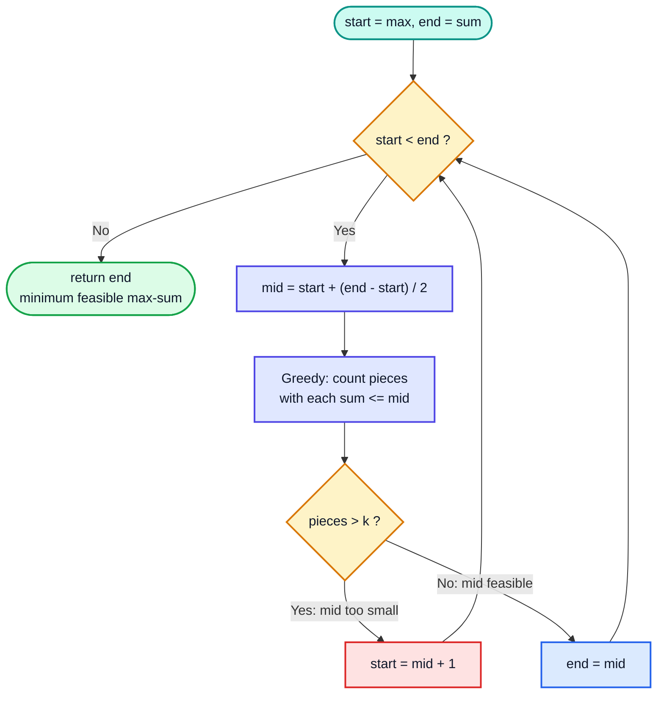

### Code

```java
public class SplitArrayLargestSum {

    static int splitArray(int[] nums, int k) {
        int start = 0;
        int end = 0;
        for (int n : nums) {
            start = Math.max(start, n);   // smallest possible answer
            end += n;                     // largest possible answer
        }

        // binary search on the answer
        while (start < end) {
            int mid = start + (end - start) / 2;

            // how many pieces if each piece's sum must be <= mid?
            int sum = 0;
            int pieces = 1;
            for (int n : nums) {
                if (sum + n > mid) {
                    sum = n;          // start a new piece with n
                    pieces++;
                } else {
                    sum += n;
                }
            }

            if (pieces > k) {
                start = mid + 1;      // too many pieces → allow bigger sums
            } else {
                end = mid;            // feasible → try smaller
            }
        }
        return end;                   // start == end
    }

    public static void main(String[] args) {
        System.out.println(splitArray(new int[]{7, 2, 5, 10, 8}, 2));  // 18
        System.out.println(splitArray(new int[]{1, 2, 3, 4, 5}, 2));   // 9
        System.out.println(splitArray(new int[]{1, 4, 4}, 3));         // 4
    }
}
```

### Dry Run: `nums = [7, 2, 5, 10, 8]`, `k = 2`

| Iteration | `start` | `end` | `mid` | Greedy pieces | Count | Action |
|---|---|---|---|---|---|---|
| 1 | 10 | 32 | 21 | `[7,2,5]` `[10,8]` | 2 ✅ | `end = 21` |
| 2 | 10 | 21 | 15 | `[7,2,5]` `[10]` `[8]` | 3 ❌ | `start = 16` |
| 3 | 16 | 21 | 18 | `[7,2,5]` `[10,8]` | 2 ✅ | `end = 18` |
| 4 | 16 | 18 | 17 | `[7,2,5]` `[10]` `[8]` | 3 ❌ | `start = 18` |
| — | 18 | 18 | — | — | — | return **18** ✅ |

### Complexity

| | Value | Reason |
|---|---|---|
| Time | `O(N · log(sum − max))` | `log(range)` iterations, each an `O(N)` greedy pass |
| Space | `O(1)` | |

### Alternatives

| Approach | Time | Notes |
|---|---|---|
| **Binary search on answer** (video) | `O(N log S)` | Best in practice |
| Dynamic programming `dp[i][j]` | `O(k · N²)` | Classic DP; much slower for large `N` |
| Brute force over all split points | exponential | Only for tiny inputs |

> [!CAUTION]
> If the values or array are large, `sum(nums)` can overflow `int`. LeetCode's limits (`n ≤ 1000`, `nums[i] ≤ 10⁶`) keep the sum under `10⁹`, so `int` is fine there. Use `long` for `start`, `end`, `mid` and `sum` in general code.

> [!IMPORTANT]
> The same template (min/max possible answers → binary search → greedy feasibility check) solves **LC 875 Koko Eating Bananas**, **LC 1011 Capacity to Ship Packages Within D Days**, **LC 1482 Minimum Number of Days to Make m Bouquets** and the **Book Allocation / Painter's Partition** problems. Recognising it is the real takeaway from this question.

---

## 🧩 Complete Example: Everything Together

One program that solves **all 11 questions** from this video on hard-coded inputs:

```java
import java.util.Arrays;

public class Main {

    // ═══════ Q1: CEILING (smallest element >= target) ═══════
    static int ceiling(int[] arr, int target) {
        if (target > arr[arr.length - 1]) return -1;
        int start = 0, end = arr.length - 1;
        while (start <= end) {
            int mid = start + (end - start) / 2;
            if (target < arr[mid]) end = mid - 1;
            else if (target > arr[mid]) start = mid + 1;
            else return mid;
        }
        return start;
    }

    // ═══════ Q2: FLOOR (greatest element <= target) ═══════
    static int floor(int[] arr, int target) {
        int start = 0, end = arr.length - 1;
        while (start <= end) {
            int mid = start + (end - start) / 2;
            if (target < arr[mid]) end = mid - 1;
            else if (target > arr[mid]) start = mid + 1;
            else return mid;
        }
        return end;                       // -1 if target < arr[0]
    }

    // ═══════ Q3: SMALLEST LETTER GREATER THAN TARGET (LC 744) ═══════
    static char nextGreatestLetter(char[] letters, char target) {
        int start = 0, end = letters.length - 1;
        while (start <= end) {
            int mid = start + (end - start) / 2;
            if (target < letters[mid]) end = mid - 1;
            else start = mid + 1;
        }
        return letters[start % letters.length];
    }

    // ═══════ Q4: FIRST AND LAST POSITION (LC 34) ═══════
    static int[] searchRange(int[] nums, int target) {
        return new int[]{search(nums, target, true), search(nums, target, false)};
    }

    static int search(int[] nums, int target, boolean findFirst) {
        int ans = -1, start = 0, end = nums.length - 1;
        while (start <= end) {
            int mid = start + (end - start) / 2;
            if (target < nums[mid]) end = mid - 1;
            else if (target > nums[mid]) start = mid + 1;
            else {
                ans = mid;
                if (findFirst) end = mid - 1;
                else start = mid + 1;
            }
        }
        return ans;
    }

    // ═══════ Q5: INFINITE SORTED ARRAY ═══════
    static int findInInfinite(int[] arr, int target) {
        int start = 0, end = 1;
        while (target > arr[end]) {       // grow window exponentially
            int newStart = end + 1;
            end = end + (end - start + 1) * 2;
            start = newStart;
        }
        return binarySearch(arr, target, start, end);
    }

    static int binarySearch(int[] arr, int target, int start, int end) {
        while (start <= end) {
            int mid = start + (end - start) / 2;
            if (target < arr[mid]) end = mid - 1;
            else if (target > arr[mid]) start = mid + 1;
            else return mid;
        }
        return -1;
    }

    // ═══════ Q6: PEAK INDEX IN MOUNTAIN ARRAY (LC 852 / 162) ═══════
    static int peakIndex(int[] arr) {
        int start = 0, end = arr.length - 1;
        while (start < end) {
            int mid = start + (end - start) / 2;
            if (arr[mid] > arr[mid + 1]) end = mid;    // descending part
            else start = mid + 1;                      // ascending part
        }
        return start;
    }

    // ═══════ Q7: FIND IN MOUNTAIN ARRAY (LC 1095) ═══════
    static int findInMountain(int[] arr, int target) {
        int peak = peakIndex(arr);
        int first = orderAgnosticBS(arr, target, 0, peak);
        if (first != -1) return first;
        return orderAgnosticBS(arr, target, peak + 1, arr.length - 1);
    }

    static int orderAgnosticBS(int[] arr, int target, int start, int end) {
        boolean isAsc = arr[start] < arr[end];
        while (start <= end) {
            int mid = start + (end - start) / 2;
            if (arr[mid] == target) return mid;
            if (isAsc) {
                if (target < arr[mid]) end = mid - 1;
                else start = mid + 1;
            } else {
                if (target > arr[mid]) end = mid - 1;
                else start = mid + 1;
            }
        }
        return -1;
    }

    // ═══════ Q8: SEARCH IN ROTATED SORTED ARRAY (LC 33) ═══════
    static int searchRotated(int[] nums, int target) {
        int pivot = findPivot(nums);
        if (pivot == -1) return binarySearch(nums, target, 0, nums.length - 1);
        if (nums[pivot] == target) return pivot;
        if (target >= nums[0]) return binarySearch(nums, target, 0, pivot - 1);
        return binarySearch(nums, target, pivot + 1, nums.length - 1);
    }

    // index of the largest element; -1 if not rotated
    static int findPivot(int[] arr) {
        int start = 0, end = arr.length - 1;
        while (start <= end) {
            int mid = start + (end - start) / 2;
            if (mid < end && arr[mid] > arr[mid + 1]) return mid;
            if (mid > start && arr[mid] < arr[mid - 1]) return mid - 1;
            if (arr[mid] <= arr[start]) end = mid - 1;
            else start = mid + 1;
        }
        return -1;
    }

    // ═══════ Q9: PIVOT WITH DUPLICATES (LC 81 idea) ═══════
    static int findPivotWithDuplicates(int[] arr) {
        int start = 0, end = arr.length - 1;
        while (start <= end) {
            int mid = start + (end - start) / 2;
            if (mid < end && arr[mid] > arr[mid + 1]) return mid;
            if (mid > start && arr[mid] < arr[mid - 1]) return mid - 1;
            if (arr[mid] == arr[start] && arr[mid] == arr[end]) {
                if (start < end && arr[start] > arr[start + 1]) return start;
                start++;
                if (end > start && arr[end] < arr[end - 1]) return end - 1;
                end--;
            } else if (arr[start] < arr[mid]
                    || (arr[start] == arr[mid] && arr[mid] > arr[end])) {
                start = mid + 1;
            } else {
                end = mid - 1;
            }
        }
        return -1;
    }

    // ═══════ Q10: ROTATION COUNT ═══════
    static int rotationCount(int[] arr) {
        return findPivot(arr) + 1;        // not rotated -> -1 + 1 = 0
    }

    // ═══════ Q11: SPLIT ARRAY LARGEST SUM (LC 410) ═══════
    static int splitArray(int[] nums, int k) {
        int start = 0, end = 0;
        for (int n : nums) {
            start = Math.max(start, n);   // min possible answer
            end += n;                     // max possible answer
        }
        while (start < end) {
            int mid = start + (end - start) / 2;
            int pieces = 1, sum = 0;
            for (int n : nums) {
                if (sum + n > mid) { sum = n; pieces++; }
                else sum += n;
            }
            if (pieces > k) start = mid + 1;
            else end = mid;
        }
        return end;
    }

    public static void main(String[] args) {
        int[] sorted = {2, 3, 5, 9, 14, 16, 18};
        System.out.println("Sorted: " + Arrays.toString(sorted));
        System.out.println("Q1 ceiling(15) -> index " + ceiling(sorted, 15) + " = " + sorted[ceiling(sorted, 15)]);
        System.out.println("Q1 ceiling(20) -> " + ceiling(sorted, 20));
        System.out.println("Q2 floor(15)   -> index " + floor(sorted, 15) + " = " + sorted[floor(sorted, 15)]);
        System.out.println("Q2 floor(1)    -> " + floor(sorted, 1));

        char[] letters = {'c', 'f', 'j'};
        System.out.println("Q3 next letter after 'a' -> " + nextGreatestLetter(letters, 'a'));
        System.out.println("Q3 next letter after 'c' -> " + nextGreatestLetter(letters, 'c'));
        System.out.println("Q3 next letter after 'j' -> " + nextGreatestLetter(letters, 'j'));

        int[] dup = {5, 7, 7, 8, 8, 8, 10};
        System.out.println("Q4 range of 8 -> " + Arrays.toString(searchRange(dup, 8)));
        System.out.println("Q4 range of 6 -> " + Arrays.toString(searchRange(dup, 6)));

        int[] big = {3, 5, 7, 9, 10, 90, 100, 130, 140, 160, 170, 200, 220, 250, 300, 310};
        System.out.println("Q5 infinite search 170 -> " + findInInfinite(big, 170));

        int[] mountain = {1, 2, 3, 5, 6, 4, 3, 2};
        System.out.println("Q6 peak index -> " + peakIndex(mountain));
        System.out.println("Q7 find 3 in mountain -> " + findInMountain(mountain, 3));
        System.out.println("Q7 find 4 in mountain -> " + findInMountain(mountain, 4));

        int[] rotated = {4, 5, 6, 7, 0, 1, 2};
        System.out.println("Q8 pivot -> " + findPivot(rotated)
                + ", search 0 -> " + searchRotated(rotated, 0)
                + ", search 3 -> " + searchRotated(rotated, 3));

        int[] rotDup = {2, 9, 2, 2, 2};
        System.out.println("Q9 pivot with duplicates -> " + findPivotWithDuplicates(rotDup));

        System.out.println("Q10 rotations of [4,5,6,7,0,1,2] -> " + rotationCount(rotated));
        System.out.println("Q10 rotations of [1,2,3,4]       -> " + rotationCount(new int[]{1, 2, 3, 4}));

        System.out.println("Q11 split [7,2,5,10,8] into 2 -> " + splitArray(new int[]{7, 2, 5, 10, 8}, 2));
        System.out.println("Q11 split [1,2,3,4,5] into 2  -> " + splitArray(new int[]{1, 2, 3, 4, 5}, 2));
    }
}
```

**Expected Output:**
```
Sorted: [2, 3, 5, 9, 14, 16, 18]
Q1 ceiling(15) -> index 5 = 16
Q1 ceiling(20) -> -1
Q2 floor(15)   -> index 4 = 14
Q2 floor(1)    -> -1
Q3 next letter after 'a' -> c
Q3 next letter after 'c' -> f
Q3 next letter after 'j' -> c
Q4 range of 8 -> [3, 5]
Q4 range of 6 -> [-1, -1]
Q5 infinite search 170 -> 10
Q6 peak index -> 4
Q7 find 3 in mountain -> 2
Q7 find 4 in mountain -> 5
Q8 pivot -> 3, search 0 -> 4, search 3 -> -1
Q9 pivot with duplicates -> 1
Q10 rotations of [4,5,6,7,0,1,2] -> 4
Q10 rotations of [1,2,3,4]       -> 0
Q11 split [7,2,5,10,8] into 2 -> 18
Q11 split [1,2,3,4,5] into 2  -> 9
```

---

## Quick Reference Cheat Sheet

| Problem | LeetCode | Key Idea | Time |
|---|---|---|---|
| **When to use BS** | — | Sorted / monotonic search space → think binary search | — |
| **Q1 Ceiling** | ~35 | Normal BS; if not found return `start` (guard `target > last`) | `O(log N)` |
| **Q2 Floor** | — | Normal BS; if not found return `end` | `O(log N)` |
| **Q3 Smallest Letter** | 744 | Equal goes right; return `letters[start % n]` | `O(log N)` |
| **Q4 First & Last** | 34 | On match save `ans`, keep going left (first) / right (last) | `O(log N)` |
| **Q5 Infinite Array** | 702 | Double the window until `target <= arr[end]`, then BS | `O(log N)` |
| **Q6 Mountain Peak** | 852 / 162 | `arr[mid] > arr[mid+1]` → `end = mid`, else `start = mid + 1`; `while (start < end)` | `O(log N)` |
| **Q7 Find in Mountain** | 1095 | Peak + order-agnostic BS on ascending half, then descending half | `O(log N)` |
| **Q8 Rotated Search** | 33 | Find pivot (4 cases), pick the half by comparing with `nums[0]` | `O(log N)` |
| **Q9 Rotated + Duplicates** | 81 | If `start == mid == end`, check ends for pivot, then `start++`, `end--` | `O(log N)` avg, `O(N)` worst |
| **Q10 Rotation Count** | 153-related | `pivot + 1` (= index of minimum) | `O(log N)` |
| **Q11 Split Array Largest Sum** | 410 | BS on answer in `[max, sum]`; greedy piece count decides direction | `O(N log S)` |
| **Template: exact match** | — | `while (start <= end)`, `mid ± 1` | — |
| **Template: boundary / peak** | — | `while (start < end)`, `end = mid` (keep candidate) | — |
