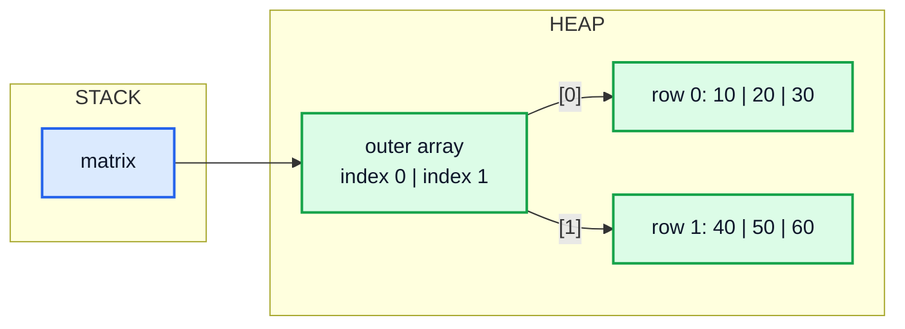
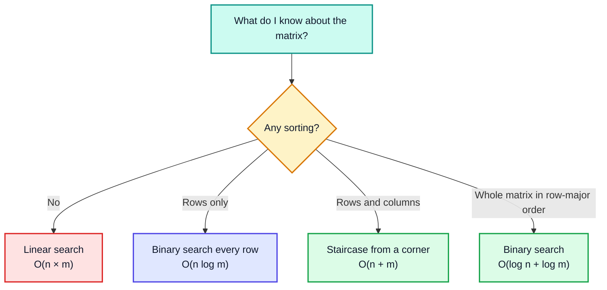
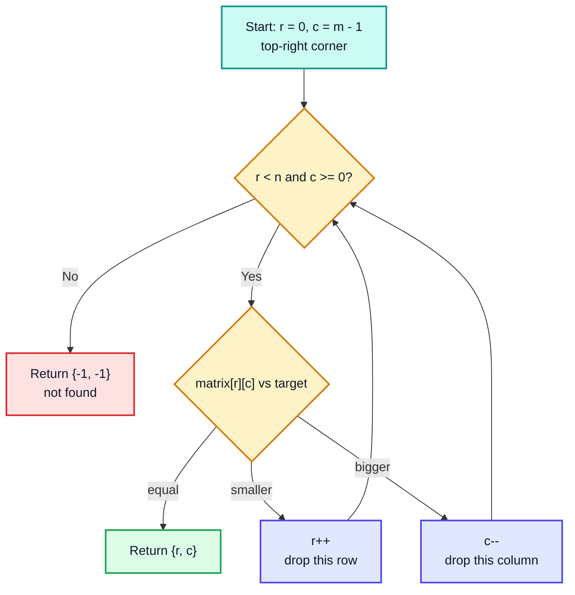
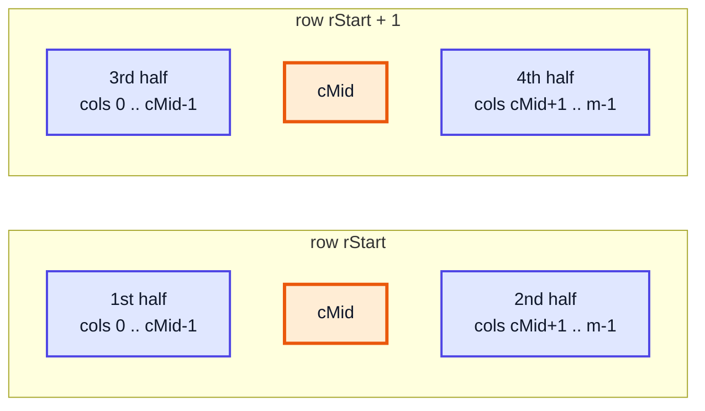
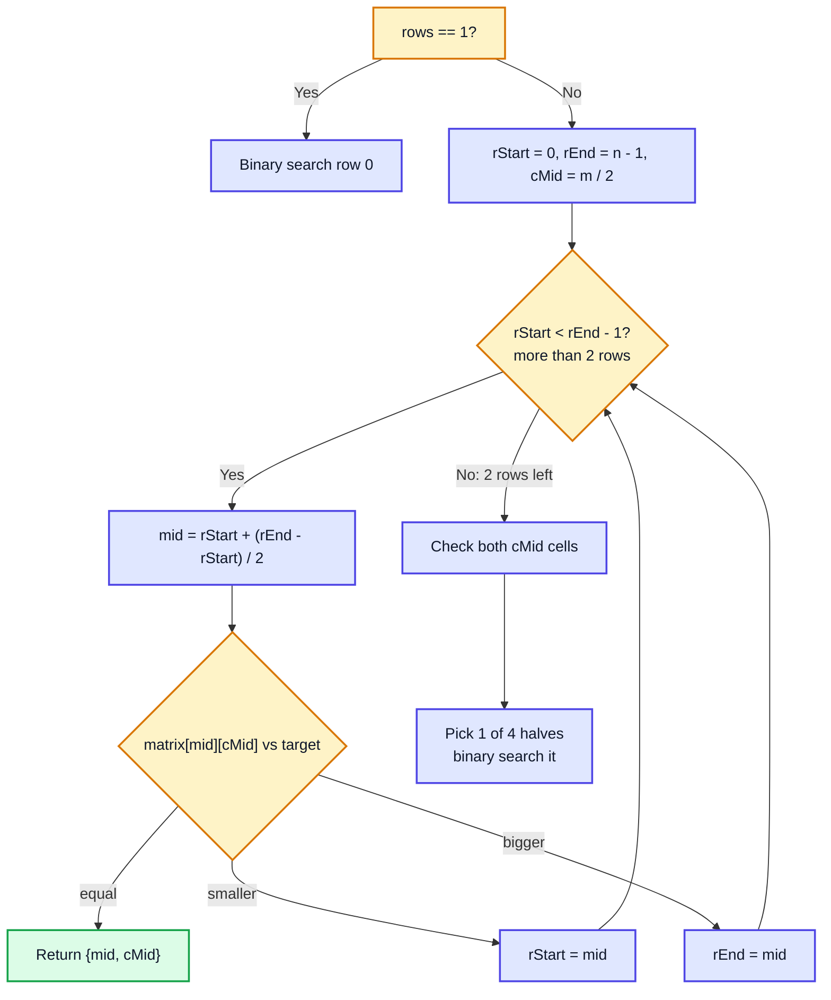
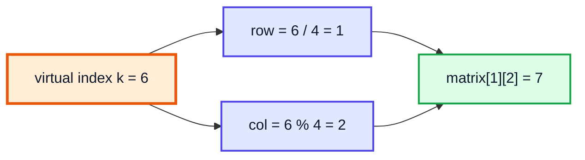

# Binary Search in 2D Arrays — Complete In-Depth Guide

**Video #16 of the Java + DSA playlist:** *Binary Search in 2D Arrays* (58:57)

A deep-dive into searching a matrix: brute-force linear search, the "staircase" search for a matrix sorted by rows and columns (LeetCode 240), and the fully binary-search solution for a strictly sorted matrix (LeetCode 74) — with Mermaid diagrams, dry-run tables, complexity analysis and runnable Java programs.

---

## Table of Contents

| # | Topic | Timestamp |
|---|---|---|
| 0 | [Introduction](#0-introduction-000) | 0:00 |
| 1 | [Searching in Matrices](#1-searching-in-matrices-103) | 1:03 |
| 2 | [Q1: Row Column Matrix](#2-q1-row-column-matrix-506) | 5:06 |
| 3 | [Code for Q1](#3-code-for-q1-1728) | 17:28 |
| 4 | [Q2: Sorted Matrix](#4-q2-sorted-matrix-2241) | 22:41 |
| 5 | [Code for Q2](#5-code-for-q2-3547) | 35:47 |
| 6 | [Outro](#6-outro-5637) | 56:37 |

---

## 0. Introduction (0:00)

The previous videos applied binary search to **1D** sorted arrays: find a target in `O(log n)` by throwing away half of the search space on every step. This video takes the same idea to **2D arrays (matrices)**.

The central question of the whole video is:

> *"What information does the sorting give me, and how much of the matrix can I throw away after one comparison?"*

This video covers:

- How to search **any** matrix (linear search) and why that is the baseline
- **Q1** — a matrix where every row **and** every column is sorted → eliminate a whole row or column per step
- **Q2** — a matrix that is sorted row by row, so that it reads as one long sorted list → real binary search, `O(log n + log m)`

> [!IMPORTANT]
> Binary search is not just "look at the middle". It is a **search-space elimination** technique. If one comparison lets you safely discard part of the input, you can use the binary-search mindset. This video is the first time in the course that the idea is used on something other than a plain sorted 1D array.

---

## 1. Searching in Matrices (1:03)

### Recap: What Is a 2D Array in Java?

A 2D array in Java is an **array of arrays**. The outer array holds references, and each reference points to a row (a separate 1D array on the heap).

```java
int[][] matrix = {
    {10, 20, 30},
    {40, 50, 60}
};
System.out.println(matrix.length);     // 2  (number of rows)
System.out.println(matrix[0].length);  // 3  (number of columns in row 0)
System.out.println(matrix[1][2]);      // 60 (row 1, column 2)
```



> [!NOTE]
> Because each row is its own object, rows can have **different lengths** (a *jagged* array). That is why the safe way to get a row's width is `matrix[r].length`, not one global number. All matrices in this video are rectangular, but the code should not crash on edge cases like an empty matrix.

### Brute Force: Linear Search in a Matrix

If the matrix has **no ordering at all**, there is no shortcut: every cell might be the answer, so you must look at every cell.

```java
public class LinearSearch2D {
    static int[] search(int[][] matrix, int target) {
        for (int r = 0; r < matrix.length; r++) {
            for (int c = 0; c < matrix[r].length; c++) {
                if (matrix[r][c] == target) {
                    return new int[]{r, c};     // found: return the position
                }
            }
        }
        return new int[]{-1, -1};               // not found
    }

    public static void main(String[] args) {
        int[][] m = {
            {23, 4, 1},
            {18, 12, 3, 9},   // jagged row is fine
            {78, 99, 34, 56}
        };
        System.out.println(java.util.Arrays.toString(search(m, 12)));  // [1, 1]
        System.out.println(java.util.Arrays.toString(search(m, 100))); // [-1, -1]
    }
}
```

**Why return an `int[]`?** A cell is identified by **two** numbers (row and column). Returning `{-1, -1}` for "not found" mirrors the `-1` convention from 1D search.

### Complexity of Linear Search

| Measure | Value | Reason |
|---|---|---|
| Time | `O(n × m)` | `n` rows × `m` columns, every cell checked in the worst case |
| Space | `O(1)` | only loop variables (the 2-element result is constant size) |

For an `N × N` matrix that is `O(N²)`. For a 1000 × 1000 matrix that is a million comparisons.

### What Can We Do Better When the Matrix Is Sorted?

There are three common kinds of "sorted" matrix, and each allows a different trick:

| Kind of matrix | Example | Best known search | Video question |
|---|---|---|---|
| Unsorted | `{{23,4},{18,12}}` | `O(n × m)` linear | — |
| Each **row** sorted only | `{{1,9},{2,3}}` | binary search each row: `O(n log m)` | (warm-up idea) |
| Rows **and** columns sorted | `{{10,20},{15,25}}` | staircase: `O(n + m)` | **Q1** |
| Strictly sorted (row-major) | `{{1,2},{3,4}}` | binary search: `O(log(n × m))` | **Q2** |



### Warm-Up: Binary Search on Every Row

If only the rows are sorted, run a normal 1D binary search on each row:

```java
static int[] searchEachRow(int[][] matrix, int target) {
    for (int r = 0; r < matrix.length; r++) {
        int lo = 0, hi = matrix[r].length - 1;
        while (lo <= hi) {
            int mid = lo + (hi - lo) / 2;
            if (matrix[r][mid] == target) return new int[]{r, mid};
            if (matrix[r][mid] < target) lo = mid + 1;
            else hi = mid - 1;
        }
    }
    return new int[]{-1, -1};
}
```

This is `O(n log m)` — better than `O(n × m)`, but it ignores any ordering **between** rows. The two questions below exploit that extra ordering.

> [!TIP]
> Use `mid = lo + (hi - lo) / 2` instead of `(lo + hi) / 2`. When `lo` and `hi` are both large, `lo + hi` can overflow `int`. (In Java you can also use `(lo + hi) >>> 1`.)

---

## 2. Q1: Row Column Matrix (5:06)

### The Problem

> Given an `n × m` matrix in which **every row is sorted** in ascending order (left → right) and **every column is sorted** in ascending order (top → bottom), find the position of `target`, or return `{-1, -1}`.

This is **LeetCode 240 — Search a 2D Matrix II** (LeetCode returns `true`/`false` instead of a position).

```
10  20  30  40
15  25  35  45
28  29  37  49
33  34  38  50
```

Note that this is **not** fully sorted: `28` (row 2) is smaller than `30` and `35` (rows 0 and 1). So you cannot treat it as one long sorted list.

### Why Not Start at the Middle or at (0, 0)?

The trick is choosing a starting cell where **one comparison gives a clear direction**.

| Start cell | Moving right | Moving down | Is the decision unambiguous? |
|---|---|---|---|
| Top-left `(0,0)` = smallest | bigger | bigger | ❌ both directions increase — which way? |
| Bottom-right = largest | — | — | ❌ both directions (left/up) decrease |
| **Top-right** `(0, m-1)` | — | **bigger** (down) | ✅ left = smaller, down = bigger |
| **Bottom-left** `(n-1, 0)` | **bigger** (right) | — | ✅ up = smaller, right = bigger |

From the **top-right** corner:

- Every cell **to the left** in the same row is **smaller**.
- Every cell **below** in the same column is **bigger**.

So one comparison tells you exactly which way to go — like a binary search tree whose root is the top-right corner.

### The Elimination Rule

Let `cur = matrix[r][c]` with `(r, c)` starting at the top-right:

| Case | What it means | Action | What is eliminated |
|---|---|---|---|
| `cur == target` | found | return `{r, c}` | — |
| `cur < target` | `cur` is the **largest** value in row `r` that is still in play, and it's too small | `r++` | the **whole row** `r` |
| `cur > target` | `cur` is the **smallest** value in column `c` that is still in play, and it's too big | `c--` | the **whole column** `c` |

Why can we drop the whole row when `cur < target`? Everything left of `cur` in that row is even smaller, and the columns to the right were already eliminated. So nothing in row `r` can be `target`.

Why can we drop the whole column when `cur > target`? Everything below `cur` in that column is even bigger, and the rows above were already eliminated.



### Dry Run: target = 37

Path on the grid (🟧 = visited, 🟩 = found, ⬜ = never looked at):

| | col 0 | col 1 | col 2 | col 3 |
|---|---|---|---|---|
| **row 0** | ⬜ 10 | ⬜ 20 | 🟧 30 | 🟧 40 |
| **row 1** | ⬜ 15 | ⬜ 25 | 🟧 35 | ⬜ 45 |
| **row 2** | ⬜ 28 | ⬜ 29 | 🟩 37 | ⬜ 49 |
| **row 3** | ⬜ 33 | ⬜ 34 | ⬜ 38 | ⬜ 50 |

| Step | `r` | `c` | `matrix[r][c]` | Compare with 37 | Action |
|---|---|---|---|---|---|
| 1 | 0 | 3 | 40 | 40 > 37 | `c--` (drop column 3) |
| 2 | 0 | 2 | 30 | 30 < 37 | `r++` (drop row 0) |
| 3 | 1 | 2 | 35 | 35 < 37 | `r++` (drop row 1) |
| 4 | 2 | 2 | 37 | equal ✅ | return `{2, 2}` |

Only **4** cells checked instead of up to 16.

### Dry Run: target = 26 (not present)

| Step | `r` | `c` | value | Compare with 26 | Action |
|---|---|---|---|---|---|
| 1 | 0 | 3 | 40 | 40 > 26 | `c--` |
| 2 | 0 | 2 | 30 | 30 > 26 | `c--` |
| 3 | 0 | 1 | 20 | 20 < 26 | `r++` |
| 4 | 1 | 1 | 25 | 25 < 26 | `r++` |
| 5 | 2 | 1 | 29 | 29 > 26 | `c--` |
| 6 | 2 | 0 | 28 | 28 > 26 | `c--` → `c = -1` |
| 7 | 2 | -1 | — | loop ends ❌ | return `{-1, -1}` |

### Complexity

| Measure | Value | Reason |
|---|---|---|
| Time | `O(n + m)` | each step removes one row **or** one column; at most `n + m` steps |
| Space | `O(1)` | just `r` and `c` |

For an `N × N` matrix this is `O(2N) = O(N)`, compared with `O(N²)` for linear search.

> [!NOTE]
> This is technically not "binary search" (we don't halve the space), but it uses the **same principle**: one comparison safely discards part of the search space. Kunal presents it as the first step towards thinking in terms of elimination.

---

## 3. Code for Q1 (17:28)

### Java Solution

```java
import java.util.Arrays;

public class RowColMatrix {

    static int[] search(int[][] matrix, int target) {
        if (matrix.length == 0 || matrix[0].length == 0) {
            return new int[]{-1, -1};               // empty matrix guard
        }
        int r = 0;
        int c = matrix[0].length - 1;               // top-right corner

        while (r < matrix.length && c >= 0) {
            if (matrix[r][c] == target) {
                return new int[]{r, c};
            }
            if (matrix[r][c] < target) {
                r++;                                // everything in this row is too small
            } else {
                c--;                                // everything in this column is too big
            }
        }
        return new int[]{-1, -1};
    }

    public static void main(String[] args) {
        int[][] matrix = {
            {10, 20, 30, 40},
            {15, 25, 35, 45},
            {28, 29, 37, 49},
            {33, 34, 38, 50}
        };
        System.out.println(Arrays.toString(search(matrix, 37))); // [2, 2]
        System.out.println(Arrays.toString(search(matrix, 26))); // [-1, -1]
        System.out.println(Arrays.toString(search(matrix, 10))); // [0, 0]
        System.out.println(Arrays.toString(search(matrix, 50))); // [3, 3]
    }
}
```

> [!WARNING]
> In the video the matrix is square, so the starting column is written as `matrix.length - 1`. That is **wrong for a non-square matrix** (e.g. 2 rows × 5 columns would start at column 1). Always use `matrix[0].length - 1` for the column count.

### Line-by-Line Notes

| Line | Purpose |
|---|---|
| `if (matrix.length == 0 ...)` | `matrix[0]` on an empty matrix throws `ArrayIndexOutOfBoundsException` |
| `int c = matrix[0].length - 1` | start in the last column |
| `r < matrix.length && c >= 0` | stop when we walk off the bottom or off the left edge |
| `r++` / `c--` | each move eliminates one full row / column |

### LeetCode 240 Version (returns boolean)

```java
class Solution {
    public boolean searchMatrix(int[][] matrix, int target) {
        int r = 0, c = matrix[0].length - 1;
        while (r < matrix.length && c >= 0) {
            int v = matrix[r][c];
            if (v == target) return true;
            if (v < target) r++; else c--;
        }
        return false;
    }
}
```

### Alternative: Start From the Bottom-Left

Starting at `(n-1, 0)` works symmetrically: if the value is too big go **up** (`r--`), if too small go **right** (`c++`).

```java
static int[] searchBottomLeft(int[][] matrix, int target) {
    int r = matrix.length - 1, c = 0;
    while (r >= 0 && c < matrix[0].length) {
        if (matrix[r][c] == target) return new int[]{r, c};
        if (matrix[r][c] > target) r--; else c++;
    }
    return new int[]{-1, -1};
}
```

### Comparison of Approaches for Q1

| Approach | Time | Space | Comment |
|---|---|---|---|
| Linear search | `O(n × m)` | `O(1)` | ignores sorting |
| Binary search each row | `O(n log m)` | `O(1)` | uses row sorting only |
| Staircase (top-right / bottom-left) | `O(n + m)` | `O(1)` | ✅ uses both orderings; standard answer |
| Divide & conquer on quadrants | ≈ `O(n^1.58)` | `O(log n)` recursion | interesting but slower than staircase |

---

## 4. Q2: Sorted Matrix (22:41)

### The Problem

> Given an `n × m` matrix that is **strictly sorted**: each row is sorted left → right, and the first element of each row is greater than the last element of the previous row. Find `target`.

This is **LeetCode 74 — Search a 2D Matrix**.

```
 1   2   3   4
 5   6   7   8
 9  10  11  12
13  14  15  16
```

Read row by row, this is one sorted list: `1, 2, 3, ..., 16`. So we should be able to do real `O(log)` binary search.

### Kunal's Idea: Binary Search on the Middle Column

1. Pick the **middle column** `cMid = m / 2`.
2. Binary search **over the rows**, looking only at `matrix[mid][cMid]`:
   - equal → found.
   - `matrix[mid][cMid] < target` → target cannot be in any row **above** `mid` (they are all smaller) → `rStart = mid`.
   - `matrix[mid][cMid] > target` → target cannot be in any row **below** `mid` → `rEnd = mid`.
3. Notice `rStart = mid` and `rEnd = mid` (not `mid ± 1`): row `mid` itself may still hold the target in a different column, so it is kept. Because of this the loop stops when **2 rows remain** (`rStart < rEnd - 1`), otherwise it would loop forever.
4. With 2 candidate rows left, check the two middle cells, then decide which of the **4 halves** to binary search:



Because the matrix is strictly sorted, values grow in the order **1st half → (mid) → 2nd half → 3rd half → (mid) → 4th half**, so a simple chain of range checks picks the right half:

| Check (in order) | Search in |
|---|---|
| `target <= matrix[rStart][cMid-1]` | 1st half |
| `target >= matrix[rStart][cMid+1] && target <= matrix[rStart][m-1]` | 2nd half |
| `target <= matrix[rStart+1][cMid-1]` | 3rd half |
| otherwise | 4th half |

### Full Algorithm Flow



### Dry Run: target = 14 in the 4 × 4 matrix

`cMid = 4 / 2 = 2`. The middle column is `3, 7, 11, 15`.

| Step | `rStart` | `rEnd` | `mid` | `matrix[mid][2]` | Compare with 14 | Action |
|---|---|---|---|---|---|---|
| 1 | 0 | 3 | 1 | 7 | 7 < 14 | `rStart = 1` |
| 2 | 1 | 3 | 2 | 11 | 11 < 14 | `rStart = 2` |
| 3 | 2 | 3 | — | — | `2 < 2` is false 🟧 | stop: rows 2 and 3 remain |

Now the two-row phase (rows 2 and 3):

| Check | Values | Result |
|---|---|---|
| `matrix[2][2] == 14`? | 11 | ❌ |
| `matrix[3][2] == 14`? | 15 | ❌ |
| 1st half: `14 <= matrix[2][1]`? | 10 | ❌ |
| 2nd half: `14 >= matrix[2][3] && 14 <= matrix[2][3]`? | 12, 12 | ❌ |
| 3rd half: `14 <= matrix[3][1]`? | 14 | ✅ binary search row 3, cols 0..1 |
| Binary search `{13, 14}` | mid = 0 → 13 < 14 → lo = 1; mid = 1 → 14 ✅ | return `{3, 1}` |

### Complexity

| Phase | Time |
|---|---|
| Binary search over rows (middle column) | `O(log n)` |
| Binary search inside one half-row | `O(log m)` |
| **Total** | **`O(log n + log m)` = `O(log(n × m))`** |
| Space | `O(1)` |

> [!NOTE]
> `log n + log m = log(n × m)`. So Kunal's two-phase approach and the "flatten into 1D" approach below have the **same** asymptotic complexity.

---

## 5. Code for Q2 (35:47)

### Java Solution (Kunal's Two-Phase Approach)

```java
import java.util.Arrays;

public class SortedMatrix {

    // normal binary search in one row, between columns cStart..cEnd
    static int[] binarySearch(int[][] matrix, int row, int cStart, int cEnd, int target) {
        while (cStart <= cEnd) {
            int mid = cStart + (cEnd - cStart) / 2;
            if (matrix[row][mid] == target) return new int[]{row, mid};
            if (matrix[row][mid] < target) cStart = mid + 1;
            else cEnd = mid - 1;
        }
        return new int[]{-1, -1};
    }

    static int[] search(int[][] matrix, int target) {
        int rows = matrix.length;
        if (rows == 0) return new int[]{-1, -1};
        int cols = matrix[0].length;
        if (cols == 0) return new int[]{-1, -1};

        if (rows == 1) return binarySearch(matrix, 0, 0, cols - 1, target);
        if (cols == 1) {                       // single column: binary search down the column
            int lo = 0, hi = rows - 1;
            while (lo <= hi) {
                int mid = lo + (hi - lo) / 2;
                if (matrix[mid][0] == target) return new int[]{mid, 0};
                if (matrix[mid][0] < target) lo = mid + 1; else hi = mid - 1;
            }
            return new int[]{-1, -1};
        }

        int rStart = 0, rEnd = rows - 1;
        int cMid = cols / 2;

        // phase 1: shrink to 2 candidate rows using the middle column
        while (rStart < rEnd - 1) {
            int mid = rStart + (rEnd - rStart) / 2;
            if (matrix[mid][cMid] == target) return new int[]{mid, cMid};
            if (matrix[mid][cMid] < target) rStart = mid;
            else rEnd = mid;
        }

        // phase 2: two rows left (rStart and rStart + 1)
        if (matrix[rStart][cMid] == target) return new int[]{rStart, cMid};
        if (matrix[rStart + 1][cMid] == target) return new int[]{rStart + 1, cMid};

        if (target <= matrix[rStart][cMid - 1])                                   // 1st half
            return binarySearch(matrix, rStart, 0, cMid - 1, target);
        if (target >= matrix[rStart][cMid + 1] && target <= matrix[rStart][cols - 1]) // 2nd half
            return binarySearch(matrix, rStart, cMid + 1, cols - 1, target);
        if (target <= matrix[rStart + 1][cMid - 1])                               // 3rd half
            return binarySearch(matrix, rStart + 1, 0, cMid - 1, target);
        return binarySearch(matrix, rStart + 1, cMid + 1, cols - 1, target);      // 4th half
    }

    public static void main(String[] args) {
        int[][] matrix = {
            {1, 2, 3, 4},
            {5, 6, 7, 8},
            {9, 10, 11, 12},
            {13, 14, 15, 16}
        };
        System.out.println(Arrays.toString(search(matrix, 14))); // [3, 1]
        System.out.println(Arrays.toString(search(matrix, 7)));  // [1, 2]
        System.out.println(Arrays.toString(search(matrix, 1)));  // [0, 0]
        System.out.println(Arrays.toString(search(matrix, 17))); // [-1, -1]
    }
}
```

> [!CAUTION]
> The version shown in the video handles `rows == 1` but **not** `cols == 1`. With one column, `cMid = 0`, so `matrix[rStart][cMid - 1]` reads index `-1` and throws `ArrayIndexOutOfBoundsException`. The extra `cols == 1` branch above fixes it. Always test your matrix code on `1 × 1`, `1 × m`, `n × 1` and empty inputs.

### Why `rStart = mid` and not `mid + 1`?

| If we wrote... | Problem |
|---|---|
| `rStart = mid + 1` when `matrix[mid][cMid] < target` | target could be in row `mid` to the **right** of `cMid` — we'd skip it ❌ |
| `rEnd = mid - 1` when `matrix[mid][cMid] > target` | target could be in row `mid` to the **left** of `cMid` — we'd skip it ❌ |
| `rStart = mid` / `rEnd = mid` with `while (rStart <= rEnd)` | when 2 rows remain `mid == rStart` forever → infinite loop ❌ |
| `rStart = mid` / `rEnd = mid` with `while (rStart < rEnd - 1)` | ✅ terminates with exactly 2 rows to finish by hand |

### Alternative (Cleaner): Treat the Matrix as One 1D Array

Since the matrix is sorted in row-major order, index `k` of an imaginary 1D array of length `n × m` maps to:

- row = `k / m`
- col = `k % m`



```java
static int[] searchFlat(int[][] matrix, int target) {
    int n = matrix.length;
    if (n == 0 || matrix[0].length == 0) return new int[]{-1, -1};
    int m = matrix[0].length;
    int lo = 0, hi = n * m - 1;
    while (lo <= hi) {
        int mid = lo + (hi - lo) / 2;
        int value = matrix[mid / m][mid % m];
        if (value == target) return new int[]{mid / m, mid % m};
        if (value < target) lo = mid + 1;
        else hi = mid - 1;
    }
    return new int[]{-1, -1};
}
```

Dry run, target = 14 (`m = 4`):

| Step | `lo` | `hi` | `mid` | `(mid/4, mid%4)` | value | Action |
|---|---|---|---|---|---|---|
| 1 | 0 | 15 | 7 | (1, 3) | 8 | 8 < 14 → `lo = 8` |
| 2 | 8 | 15 | 11 | (2, 3) | 12 | 12 < 14 → `lo = 12` |
| 3 | 12 | 15 | 13 | (3, 1) | 14 | ✅ return `{3, 1}` |

> [!TIP]
> In interviews the flattened version is usually preferred: it is shorter, has no special cases for one row or one column, and is easy to prove correct. Watch out for `n * m` overflowing `int` on huge matrices (use `long` if `n × m` can exceed about 2.1 billion).

### Another Alternative: Two Binary Searches

1. Binary search the **first column** (or last column) to find the only row that can contain `target`.
2. Binary search inside that row.

Also `O(log n + log m)`. It is essentially Kunal's idea with the "middle column" replaced by the "last column", which removes the 4-halves case analysis.

### LeetCode 74 Version (returns boolean)

```java
class Solution {
    public boolean searchMatrix(int[][] matrix, int target) {
        int m = matrix[0].length;
        int lo = 0, hi = matrix.length * m - 1;
        while (lo <= hi) {
            int mid = lo + (hi - lo) / 2;
            int v = matrix[mid / m][mid % m];
            if (v == target) return true;
            if (v < target) lo = mid + 1; else hi = mid - 1;
        }
        return false;
    }
}
```

### Q1 vs Q2 — Side by Side

| | **Q1: Row-Column Matrix** | **Q2: Strictly Sorted Matrix** |
|---|---|---|
| LeetCode | 240 — Search a 2D Matrix II | 74 — Search a 2D Matrix |
| Guarantee | rows sorted, columns sorted | row-major order is fully sorted |
| Is it one sorted list? | ❌ no | ✅ yes |
| Best approach | staircase from top-right | binary search (middle column / flatten) |
| Time | `O(n + m)` | `O(log n + log m)` |
| Space | `O(1)` | `O(1)` |
| Does Q2's method work on Q1? | ❌ no — ordering between rows is missing | — |
| Does Q1's method work on Q2? | ✅ yes (but slower, `O(n + m)`) | — |

---

## 6. Outro (56:37)

Key takeaways:

- Start with the brute force (`O(n × m)`) and ask **what the sorting lets you throw away**.
- Rows **and** columns sorted → start at a corner where one direction grows and the other shrinks → eliminate a row or a column per step → `O(n + m)`.
- Fully sorted matrix → it is a 1D sorted array in disguise → `O(log(n × m))`.
- Test edge cases: empty matrix, single row, single column, target smaller than the minimum, larger than the maximum.

> [!TIP]
> Practice: LeetCode 74, 240, 378 (Kth Smallest Element in a Sorted Matrix — binary search on the **value range**), and 1351 (Count Negative Numbers in a Sorted Matrix — the same staircase walk). The next videos start the sorting series with Bubble Sort.

---

## 🧩 Complete Example: Everything Together

One program that runs every technique from the video on fixed inputs and shows how many cells each one inspects.

```java
import java.util.Arrays;

public class MatrixSearchDemo {

    static int checks;   // counts how many cells were inspected

    // ═══════ 1. LINEAR SEARCH: any matrix ═══════
    static int[] linear(int[][] m, int target) {
        for (int r = 0; r < m.length; r++) {
            for (int c = 0; c < m[r].length; c++) {
                checks++;
                if (m[r][c] == target) return new int[]{r, c};
            }
        }
        return new int[]{-1, -1};
    }

    // ═══════ 2. STAIRCASE: rows and columns sorted (LeetCode 240) ═══════
    static int[] staircase(int[][] m, int target) {
        if (m.length == 0 || m[0].length == 0) return new int[]{-1, -1};
        int r = 0, c = m[0].length - 1;
        while (r < m.length && c >= 0) {
            checks++;
            if (m[r][c] == target) return new int[]{r, c};
            if (m[r][c] < target) r++; else c--;
        }
        return new int[]{-1, -1};
    }

    // ═══════ 3. KUNAL'S MIDDLE-COLUMN SEARCH: strictly sorted (LeetCode 74) ═══════
    static int[] rowSearch(int[][] m, int row, int cs, int ce, int target) {
        while (cs <= ce) {
            int mid = cs + (ce - cs) / 2;
            checks++;
            if (m[row][mid] == target) return new int[]{row, mid};
            if (m[row][mid] < target) cs = mid + 1; else ce = mid - 1;
        }
        return new int[]{-1, -1};
    }

    static int[] middleColumn(int[][] m, int target) {
        int rows = m.length;
        if (rows == 0 || m[0].length == 0) return new int[]{-1, -1};
        int cols = m[0].length;
        if (rows == 1) return rowSearch(m, 0, 0, cols - 1, target);
        if (cols == 1) return flat(m, target);            // avoid cMid - 1 == -1

        int rStart = 0, rEnd = rows - 1, cMid = cols / 2;
        while (rStart < rEnd - 1) {
            int mid = rStart + (rEnd - rStart) / 2;
            checks++;
            if (m[mid][cMid] == target) return new int[]{mid, cMid};
            if (m[mid][cMid] < target) rStart = mid; else rEnd = mid;
        }
        checks++;
        if (m[rStart][cMid] == target) return new int[]{rStart, cMid};
        checks++;
        if (m[rStart + 1][cMid] == target) return new int[]{rStart + 1, cMid};

        if (target <= m[rStart][cMid - 1]) return rowSearch(m, rStart, 0, cMid - 1, target);
        if (target >= m[rStart][cMid + 1] && target <= m[rStart][cols - 1])
            return rowSearch(m, rStart, cMid + 1, cols - 1, target);
        if (target <= m[rStart + 1][cMid - 1]) return rowSearch(m, rStart + 1, 0, cMid - 1, target);
        return rowSearch(m, rStart + 1, cMid + 1, cols - 1, target);
    }

    // ═══════ 4. FLATTENED BINARY SEARCH: strictly sorted ═══════
    static int[] flat(int[][] m, int target) {
        if (m.length == 0 || m[0].length == 0) return new int[]{-1, -1};
        int cols = m[0].length;
        int lo = 0, hi = m.length * cols - 1;
        while (lo <= hi) {
            int mid = lo + (hi - lo) / 2;
            checks++;
            int v = m[mid / cols][mid % cols];
            if (v == target) return new int[]{mid / cols, mid % cols};
            if (v < target) lo = mid + 1; else hi = mid - 1;
        }
        return new int[]{-1, -1};
    }

    static void report(String name, int[] pos) {
        System.out.printf("  %-14s -> %-8s (%d checks)%n", name, Arrays.toString(pos), checks);
        checks = 0;
    }

    public static void main(String[] args) {
        int[][] rowCol = {
            {10, 20, 30, 40},
            {15, 25, 35, 45},
            {28, 29, 37, 49},
            {33, 34, 38, 50}
        };
        int[][] sorted = {
            {1, 2, 3, 4},
            {5, 6, 7, 8},
            {9, 10, 11, 12},
            {13, 14, 15, 16}
        };

        System.out.println("=== Q1: row-column matrix ===");
        for (int t : new int[]{37, 26, 33}) {
            System.out.println("target " + t);
            report("linear", linear(rowCol, t));
            report("staircase", staircase(rowCol, t));
        }

        System.out.println("\n=== Q2: strictly sorted matrix ===");
        for (int t : new int[]{14, 7, 1, 16, 17}) {
            System.out.println("target " + t);
            report("linear", linear(sorted, t));
            report("staircase", staircase(sorted, t));
            report("middle column", middleColumn(sorted, t));
            report("flattened", flat(sorted, t));
        }

        System.out.println("\n=== Edge cases ===");
        int[][] oneRow = {{2, 4, 6, 8, 10}};
        int[][] oneCol = {{3}, {6}, {9}};
        int[][] empty = {};
        report("1 row, 8", middleColumn(oneRow, 8));
        report("1 col, 9", middleColumn(oneCol, 9));
        report("empty, 5", flat(empty, 5));
    }
}
```

**Expected Output:**
```
=== Q1: row-column matrix ===
target 37
  linear         -> [2, 2]   (11 checks)
  staircase      -> [2, 2]   (4 checks)
target 26
  linear         -> [-1, -1] (16 checks)
  staircase      -> [-1, -1] (6 checks)
target 33
  linear         -> [3, 0]   (13 checks)
  staircase      -> [3, 0]   (7 checks)

=== Q2: strictly sorted matrix ===
target 14
  linear         -> [3, 1]   (14 checks)
  staircase      -> [3, 1]   (6 checks)
  middle column  -> [3, 1]   (6 checks)
  flattened      -> [3, 1]   (3 checks)
target 7
  linear         -> [1, 2]   (7 checks)
  staircase      -> [1, 2]   (3 checks)
  middle column  -> [1, 2]   (1 checks)
  flattened      -> [1, 2]   (4 checks)
target 1
  linear         -> [0, 0]   (1 checks)
  staircase      -> [0, 0]   (4 checks)
  middle column  -> [0, 0]   (4 checks)
  flattened      -> [0, 0]   (4 checks)
target 16
  linear         -> [3, 3]   (16 checks)
  staircase      -> [3, 3]   (4 checks)
  middle column  -> [3, 3]   (5 checks)
  flattened      -> [3, 3]   (5 checks)
target 17
  linear         -> [-1, -1] (16 checks)
  staircase      -> [-1, -1] (4 checks)
  middle column  -> [-1, -1] (5 checks)
  flattened      -> [-1, -1] (5 checks)

=== Edge cases ===
  1 row, 8       -> [0, 3]   (2 checks)
  1 col, 9       -> [2, 0]   (2 checks)
  empty, 5       -> [-1, -1] (0 checks)
```

---

## Quick Reference Cheat Sheet

| Concept | One-Line Summary |
|---|---|
| **2D array** | Array of arrays; `matrix.length` = rows, `matrix[r].length` = columns of row `r` |
| **Linear search** | Check every cell; `O(n × m)` time, works on any matrix |
| **Binary search per row** | Rows sorted only → `O(n log m)` |
| **Row-column matrix (LC 240)** | Start top-right; `<` target → `r++`, `>` target → `c--`; `O(n + m)` |
| **Why top-right?** | Left is smaller, down is bigger → one comparison gives one direction |
| **Strictly sorted matrix (LC 74)** | Row-major order is one sorted list → `O(log n + log m)` |
| **Kunal's middle-column method** | Binary search rows on `cMid` until 2 rows remain, then search 1 of 4 halves |
| **`rStart = mid` (not `mid + 1`)** | Row `mid` may still contain the target in another column |
| **Flatten trick** | Index `k` → `matrix[k / cols][k % cols]`, then plain binary search |
| **`mid` formula** | `lo + (hi - lo) / 2` avoids `int` overflow |
| **Return value** | `int[]{row, col}`, or `{-1, -1}` when not found |
| **Edge cases** | empty matrix, 1 row, 1 column, target outside `[min, max]` |
