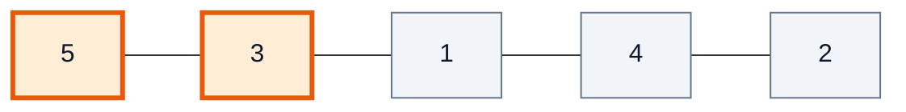
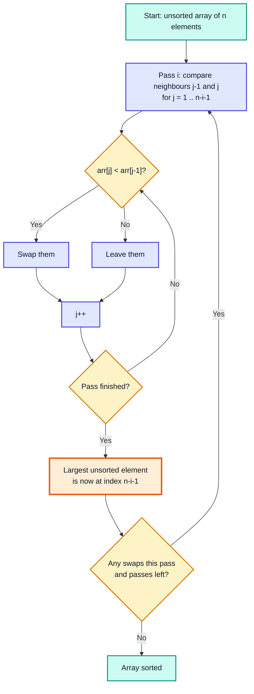
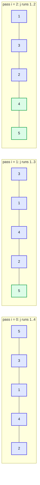
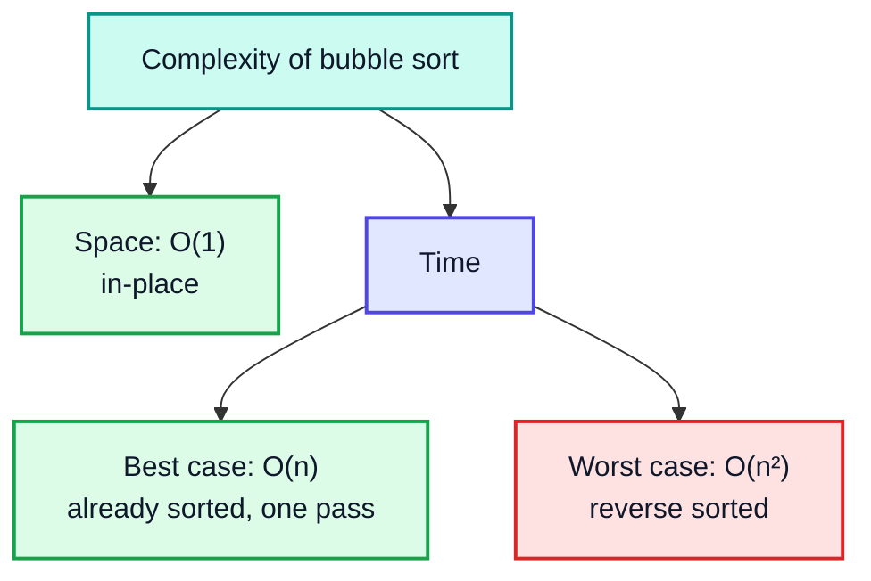
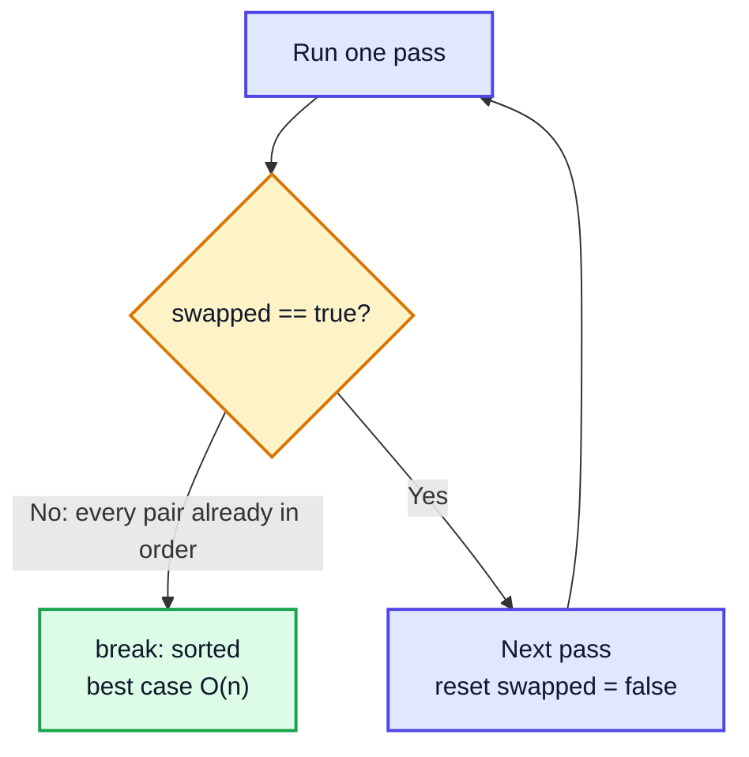
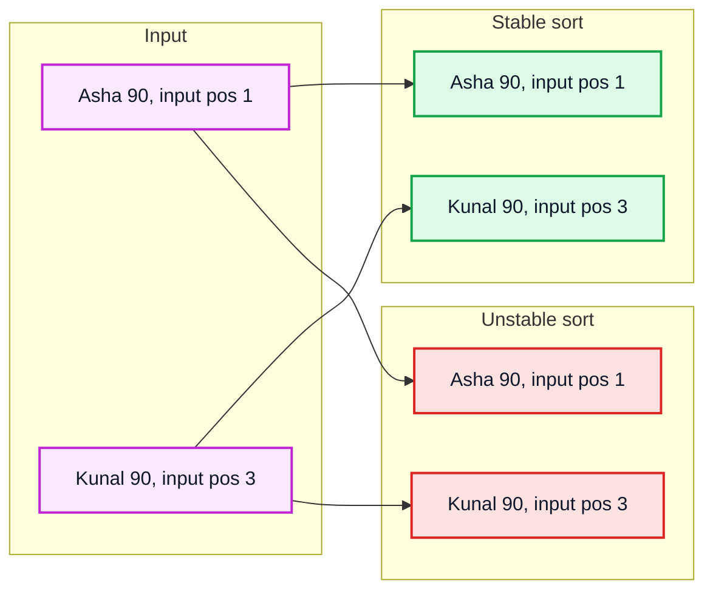

# Bubble Sort — Complete In-Depth Guide

**Video #17 of the Java + DSA playlist:** *Bubble Sort Algorithm - Theory + Code* (46:36)

The first video of the sorting series: how bubble sort works pass by pass, why it is taught first, its other names, best/worst-case time and space complexity, what "stable" sorting means, and an optimised Java implementation — with Mermaid diagrams, dry-run tables and runnable programs.

---

## Table of Contents

| # | Topic | Timestamp |
|---|---|---|
| 0 | [Introduction](#0-introduction-000) | 0:00 |
| 1 | [Bubble Sort](#1-bubble-sort-106) | 1:06 |
| 2 | [Why Bubble Sort?](#2-why-bubble-sort-503) | 5:03 |
| 3 | [Other Names of Bubble Sort](#3-other-names-of-bubble-sort-822) | 8:22 |
| 4 | [Complexity of Bubble Sort](#4-complexity-of-bubble-sort-1714) | 17:14 |
| 5 | [Space Complexity](#5-space-complexity-1804) | 18:04 |
| 6 | [Time Complexity](#6-time-complexity-1910) | 19:10 |
| 7 | [Best Case](#7-best-case-2155) | 21:55 |
| 8 | [Check Time Complexity Video for General Answer](#8-check-time-complexity-video-for-general-answer-2517) | 25:17 |
| 9 | [Stable and Unstable Sorting Algorithm](#9-stable-and-unstable-sorting-algorithm-3212) | 32:12 |
| 10 | [Code for Bubble Sort](#10-code-for-bubble-sort-3603) | 36:03 |
| 11 | [Outro](#11-outro-4606) | 46:06 |

---

## 0. Introduction (0:00)

**Sorting** means arranging elements in a particular order — usually ascending (`1, 2, 3`) or descending (`3, 2, 1`). It is one of the most common operations in programming, and it is the reason binary search (videos #14–#16) is possible at all: binary search only works on sorted data.

This video begins a series on sorting algorithms. Bubble sort comes first because it is the **simplest** to understand, and it introduces vocabulary that every later algorithm uses:

- **passes** and **comparisons**
- **in-place** sorting (no extra array)
- **best / worst case** time complexity
- **stable** vs **unstable** sorting

> [!IMPORTANT]
> You will almost never ship bubble sort in production — Java's `Arrays.sort()` is far faster. But interviewers ask about it all the time ("dry-run bubble sort", "what's its best case?", "is it stable?"), and the reasoning used here is the template for analysing selection sort, insertion sort, merge sort and quick sort later in the course.

---

## 1. Bubble Sort (1:06)

### The Basic Idea

Walk through the array and **compare each pair of adjacent elements**. If they are in the wrong order, **swap** them.

After one full walk (a **pass**), the **largest** element has been pushed all the way to the end — it "bubbles up" to its final position, like a bubble rising to the surface of water. Repeat the pass for the remaining unsorted part.



*Compare `arr[0]` and `arr[1]` (orange). `5 > 3`, so swap. Then move one step right and compare `arr[1]` and `arr[2]`, and so on.*

### Pass 1 in Detail: `{5, 3, 1, 4, 2}`

| Comparison | Pair `(j-1, j)` | Values | Swap? | Array after |
|---|---|---|---|---|
| 1 | (0, 1) | 5, 3 | ✅ | `{3, 5, 1, 4, 2}` |
| 2 | (1, 2) | 5, 1 | ✅ | `{3, 1, 5, 4, 2}` |
| 3 | (2, 3) | 5, 4 | ✅ | `{3, 1, 4, 5, 2}` |
| 4 | (3, 4) | 5, 2 | ✅ | `{3, 1, 4, 2, 5}` 🟩 |

`5` (the maximum) is now at index 4 — **its final position**. It never needs to be compared again.

### The Key Observation

After pass `i` (counting from 0), the last `i + 1` elements are the largest ones, already in their final sorted positions. So each pass can stop **one position earlier** than the previous one.

| After pass | Array | Sorted tail |
|---|---|---|
| start | `{5, 3, 1, 4, 2}` | — |
| 1 | `{3, 1, 4, 2, `🟩`5}` | `5` |
| 2 | `{1, 3, 2, `🟩`4, 5}` | `4, 5` |
| 3 | `{1, 2, `🟩`3, 4, 5}` | `3, 4, 5` |
| 4 | `{1, `🟩`2, 3, 4, 5}` | `2, 3, 4, 5` → `1` is automatically in place |



---

## 2. Why Bubble Sort? (5:03)

Why learn an algorithm that is slow on large inputs? Because it is the cleanest example of several important properties:

| Property | Bubble sort | Why it matters |
|---|---|---|
| **Simple** | ~10 lines, only swaps of neighbours | easy to reason about, easy to prove correct |
| **In-place** | no extra array, `O(1)` space | works when memory is tight |
| **Stable** | equal elements keep their order | needed when sorting records by one field (see section 9) |
| **Adaptive** (with the `swapped` flag) | `O(n)` on an already sorted array | detects "already sorted" in one pass |
| **Comparison-based** | only uses `<` / `>` | works on any comparable data |

### Where It Is Actually Reasonable

- **Tiny arrays** (a handful of elements) where simplicity beats speed.
- **Nearly-sorted data** — e.g. one element out of place near the end — where the optimised version finishes in very few passes.
- **Teaching** and **interviews** — as a baseline to compare better algorithms against.

> [!NOTE]
> In practice, insertion sort beats bubble sort on small and nearly-sorted inputs too (it does fewer writes). That is why real libraries use insertion sort, not bubble sort, for small sub-arrays inside their hybrid algorithms (e.g. Java's TimSort for objects).

---

## 3. Other Names of Bubble Sort (8:22)

| Name | Where the name comes from |
|---|---|
| **Bubble sort** | the large elements "bubble up" to the end of the array, one per pass |
| **Sinking sort** | equivalently, small elements "sink" towards the front (or, in the descending variant, heavy elements sink to the bottom) |
| **Exchange sort** | the only operation is **exchanging** (swapping) adjacent elements |

### The Full Mechanics: Passes and Loop Bounds

This is the part of the video that turns the idea into loop bounds. For an array of length `n`:

- **Outer loop** `i = 0 .. n-1` — counts passes. After pass `i`, the last `i + 1` elements are sorted.
- **Inner loop** `j = 1 .. n-i-1` — compares `arr[j-1]` with `arr[j]`. It stops at `n - i` because everything from index `n - i` onwards is already sorted.



*Blue = still being compared in that pass, green = already in its final place.*

### Full Dry Run: `{5, 3, 1, 4, 2}`

| Pass `i` | `j` | Compare | Swap? | Array |
|---|---|---|---|---|
| 0 | 1 | 5 > 3 | ✅ | `{3, 5, 1, 4, 2}` |
| 0 | 2 | 5 > 1 | ✅ | `{3, 1, 5, 4, 2}` |
| 0 | 3 | 5 > 4 | ✅ | `{3, 1, 4, 5, 2}` |
| 0 | 4 | 5 > 2 | ✅ | `{3, 1, 4, 2, 5}` |
| 1 | 1 | 3 > 1 | ✅ | `{1, 3, 4, 2, 5}` |
| 1 | 2 | 3 < 4 | ❌ | `{1, 3, 4, 2, 5}` |
| 1 | 3 | 4 > 2 | ✅ | `{1, 3, 2, 4, 5}` |
| 2 | 1 | 1 < 3 | ❌ | `{1, 3, 2, 4, 5}` |
| 2 | 2 | 3 > 2 | ✅ | `{1, 2, 3, 4, 5}` |
| 3 | 1 | 1 < 2 | ❌ | no swap in this pass → **stop early** ✅ |

Total: **10 comparisons**, **7 swaps**. Pass 4 (`i = 4`) is never needed.

### How a Swap Works

```java
int temp = arr[j];
arr[j] = arr[j - 1];
arr[j - 1] = temp;
```

| Step | `temp` | `arr[j-1]` | `arr[j]` |
|---|---|---|---|
| before | — | 5 | 3 |
| `temp = arr[j]` | 3 | 5 | 3 |
| `arr[j] = arr[j-1]` | 3 | 5 | 5 |
| `arr[j-1] = temp` | 3 | 3 | 5 ✅ |

> [!WARNING]
> Writing `arr[j] = arr[j-1]; arr[j-1] = arr[j];` without a temp variable **loses** a value: both cells end up equal. Always use a temporary variable (or a helper `swap` method).

---

## 4. Complexity of Bubble Sort (17:14)

Complexity describes how the **cost** of an algorithm grows as the input size `n` grows. We measure two things:

| Kind | Question |
|---|---|
| **Space complexity** | How much **extra** memory does it need, beyond the input? |
| **Time complexity** | How many basic operations (here: comparisons and swaps) does it perform? |

For time we usually look at:

- **Best case** — the input that makes the algorithm do the least work.
- **Worst case** — the input that makes it do the most work (this is what "Big-O" usually refers to).



---

## 5. Space Complexity (18:04)

Bubble sort only ever needs:

- the loop counters `i` and `j`
- one `temp` variable for swapping
- one `boolean swapped` flag

None of these depends on `n`. No copy of the array is made — the input array itself is rearranged.

| | Value |
|---|---|
| Auxiliary space | **`O(1)`** (constant) |
| Kind of algorithm | **in-place** sorting algorithm |

> [!NOTE]
> "In-place" means the algorithm transforms the input using only a constant amount of extra memory. Merge sort (later in the course) is the classic **not** in-place example: it needs `O(n)` extra space for merging.

---

## 6. Time Complexity (19:10)

The work is dominated by **comparisons** in the inner loop. Count them pass by pass when no early stop happens:

| Pass `i` | Comparisons |
|---|---|
| 0 | `n - 1` |
| 1 | `n - 2` |
| 2 | `n - 3` |
| ... | ... |
| `n - 2` | 1 |

Total:

```
(n-1) + (n-2) + ... + 2 + 1  =  n(n-1) / 2  =  (n² - n) / 2
```

Drop constants and lower-order terms → **`O(n²)`**.

| `n` | `n(n-1)/2` comparisons |
|---|---|
| 5 | 10 |
| 10 | 45 |
| 1,000 | 499,500 |
| 100,000 | ≈ 5 × 10⁹ 🟥 (seconds to minutes) |

> [!TIP]
> A quick way to spot `O(n²)`: two nested loops where the inner loop's length depends linearly on `n`. Bubble sort's inner loop shrinks by one each pass, but on average it still runs about `n/2` times, and `n × n/2` is still quadratic.

---

## 7. Best Case (21:55)

### When Is the Best Case?

When the array is **already sorted**, e.g. `{1, 2, 3, 4, 5}`.

### The Optimisation: Stop When No Swap Happens

If a whole pass makes **zero swaps**, every adjacent pair is in order — so the whole array is sorted, and we can stop immediately.

```java
boolean swapped = false;
// ... inner loop sets swapped = true when it swaps ...
if (!swapped) {
    break;   // array is sorted: no need for further passes
}
```

| Input | Passes | Comparisons | Swaps |
|---|---|---|---|
| `{1, 2, 3, 4, 5}` (sorted) | 1 | 4 (`n - 1`) | 0 |

So the best case is **`O(n)`** — one pass of `n - 1` comparisons.

> [!WARNING]
> Without the `swapped` flag, bubble sort does **all** `n(n-1)/2` comparisons even on a sorted array, so its best case is `O(n²)`. The `O(n)` best case only holds for the optimised version. If an interviewer asks "what's bubble sort's best case?", mention the flag.



---

## 8. Check Time Complexity Video for General Answer (25:17)

In this part Kunal works through the **worst case** and says the general rules (why we drop constants, why `n² - n` becomes `n²`) are covered properly in the dedicated time-and-space-complexity video later in the playlist. Here is the worst-case analysis in full.

### When Is the Worst Case?

When the array is sorted in **reverse order**, e.g. `{5, 4, 3, 2, 1}`. Every comparison results in a swap, and the flag never stops us early.

| Pass | Array after pass | Comparisons | Swaps |
|---|---|---|---|
| 0 | `{4, 3, 2, 1, `🟩`5}` | 4 | 4 |
| 1 | `{3, 2, 1, `🟩`4, 5}` | 3 | 3 |
| 2 | `{2, 1, `🟩`3, 4, 5}` | 2 | 2 |
| 3 | `{1, `🟩`2, 3, 4, 5}` | 1 | 1 |
| **Total** | | **10** = 5·4/2 | **10** |

So the worst case does `n(n-1)/2` comparisons **and** `n(n-1)/2` swaps → **`O(n²)`**.

### Why Constants Are Dropped (the "general answer")

| Expression | Big-O | Reason |
|---|---|---|
| `n(n-1)/2` = `0.5n² - 0.5n` | `O(n²)` | for large `n`, `n²` dominates; the `0.5` factor doesn't change the growth rate |
| `n - 1` | `O(n)` | the `-1` is irrelevant for large `n` |
| `2n² + 3n + 7` | `O(n²)` | keep only the fastest-growing term |

### Average Case

On a random array, about half of all pairs are out of order (these are called **inversions**). Bubble sort performs exactly one swap per inversion, so it does about `n(n-1)/4` swaps on average — still **`O(n²)`**.

### Summary Table

| Case | Input | Comparisons | Swaps | Time |
|---|---|---|---|---|
| Best (with flag) | sorted | `n - 1` | 0 | **`O(n)`** |
| Average | random | ≈ `n²/2` | ≈ `n²/4` | **`O(n²)`** |
| Worst | reverse sorted | `n(n-1)/2` | `n(n-1)/2` | **`O(n²)`** |

---

## 9. Stable and Unstable Sorting Algorithm (32:12)

### Definition

A sorting algorithm is **stable** if two elements with **equal keys** appear in the **same relative order** in the output as they did in the input.

With plain integers this is invisible (one `5` looks like any other `5`). It matters when you sort **records by one field**.

### Example

Sort these students by marks:

| Input order | Name | Marks |
|---|---|---|
| 1 | Asha | 90 |
| 2 | Ravi | 75 |
| 3 | Kunal | 90 |
| 4 | Meera | 60 |

| Stable output | Unstable output (possible) |
|---|---|
| Meera 60 | Meera 60 |
| Ravi 75 | Ravi 75 |
| **Asha 90** | **Kunal 90** ❌ order flipped |
| **Kunal 90** | **Asha 90** |



### Why Bubble Sort Is Stable

Bubble sort swaps only when `arr[j] < arr[j-1]` — **strictly** less. Two equal elements are never swapped, so an earlier one can never jump over a later equal one.

> [!CAUTION]
> If you change the condition to `arr[j] <= arr[j-1]`, equal elements **are** swapped and bubble sort becomes **unstable** (and does useless extra swaps). Keep the comparison strict.

### Why Stability Matters: Multi-Key Sorting

Stable sorts let you sort by several keys in steps: sort by the **secondary** key first, then stable-sort by the **primary** key. Equal primary keys keep their secondary order. For example, sort by name, then stable-sort by marks → students with the same marks remain alphabetical.

### Common Algorithms

| Algorithm | Stable? |
|---|---|
| Bubble sort | ✅ |
| Insertion sort | ✅ |
| Merge sort | ✅ |
| Selection sort | ❌ (long-distance swaps) |
| Quick sort (typical) | ❌ |
| Heap sort | ❌ |

> [!NOTE]
> Modern Java: `Arrays.sort(Object[])`, `Collections.sort()` and `List.sort()` use **TimSort**, which is **stable**. `Arrays.sort(int[])` uses dual-pivot quicksort, which is unstable — but for primitives stability can't be observed, so it doesn't matter.

---

## 10. Code for Bubble Sort (36:03)

### Optimised Bubble Sort in Java

```java
import java.util.Arrays;

public class BubbleSort {

    static void bubble(int[] arr) {
        // run the steps n-1 times (one extra outer iteration is harmless)
        for (int i = 0; i < arr.length; i++) {
            boolean swapped = false;
            // after each pass the max of the unsorted part is at index arr.length - i - 1
            for (int j = 1; j < arr.length - i; j++) {
                if (arr[j] < arr[j - 1]) {         // strict < keeps it stable
                    int temp = arr[j];
                    arr[j] = arr[j - 1];
                    arr[j - 1] = temp;
                    swapped = true;
                }
            }
            if (!swapped) {                         // no swap → sorted → stop
                break;
            }
        }
    }

    public static void main(String[] args) {
        int[] a = {5, 3, 1, 4, 2};
        bubble(a);
        System.out.println(Arrays.toString(a));    // [1, 2, 3, 4, 5]

        int[] b = {-3, 10, -3, 0, 7};
        bubble(b);
        System.out.println(Arrays.toString(b));    // [-3, -3, 0, 7, 10]

        int[] c = {};
        bubble(c);
        System.out.println(Arrays.toString(c));    // []
    }
}
```

### Loop Bounds Explained

| Expression | Meaning |
|---|---|
| `i < arr.length` | at most `n` passes; in fact `n - 1` suffice, so `i < arr.length - 1` also works |
| `j = 1` | we compare `arr[j]` with `arr[j - 1]`, so `j` starts at 1 to stay in bounds |
| `j < arr.length - i` | the last `i` elements are already sorted; don't touch them |
| `boolean swapped` declared **inside** the outer loop | resets to `false` at the start of every pass |

> [!TIP]
> A common alternative writes the inner loop as `for (int j = 0; j < n - i - 1; j++)` and compares `arr[j]` with `arr[j + 1]`. It's the same algorithm; just pick one style and get the bounds right. Off-by-one errors here cause `ArrayIndexOutOfBoundsException`.

### Variant: Descending Order

Flip the comparison:

```java
if (arr[j] > arr[j - 1]) { /* swap */ }   // largest values move to the front
```

### Variant: Sorting Objects with a `Comparator` (Modern Java)

Generic bubble sort works on any type. Using a `record` (Java 16+) shows stability in action:

```java
import java.util.Arrays;
import java.util.Comparator;

public class StableBubble {
    record Student(String name, int marks) {}

    static <T> void bubble(T[] arr, Comparator<? super T> cmp) {
        for (int i = 0; i < arr.length - 1; i++) {
            boolean swapped = false;
            for (int j = 1; j < arr.length - i; j++) {
                if (cmp.compare(arr[j], arr[j - 1]) < 0) {   // strictly less → stable
                    T t = arr[j]; arr[j] = arr[j - 1]; arr[j - 1] = t;
                    swapped = true;
                }
            }
            if (!swapped) break;
        }
    }

    public static void main(String[] args) {
        Student[] s = {
            new Student("Asha", 90), new Student("Ravi", 75),
            new Student("Kunal", 90), new Student("Meera", 60)
        };
        bubble(s, Comparator.comparingInt(Student::marks));
        for (Student st : s) System.out.println(st.name() + " " + st.marks());
        // Meera 60
        // Ravi 75
        // Asha 90    ← Asha still before Kunal: stable
        // Kunal 90
    }
}
```

### Practice: LeetCode Problems That Accept Bubble Sort

| Problem | Note |
|---|---|
| LeetCode 912 — Sort an Array | bubble sort is correct but **times out** (`n` up to 5·10⁴) — a good illustration of `O(n²)` |
| LeetCode 75 — Sort Colors | bubble sort works (`n ≤ 300`), but the intended answer is the one-pass Dutch National Flag algorithm |
| LeetCode 283 — Move Zeroes | "bubbling" zeroes to the end is the same idea; the optimal solution is a two-pointer `O(n)` |

---

## 11. Outro (46:06)

Key takeaways:

- Bubble sort repeatedly swaps adjacent out-of-order pairs; after pass `i`, the `i + 1` largest elements are in place.
- Also called **sinking sort** or **exchange sort**.
- Space `O(1)` (in-place). Time `O(n²)` worst/average; `O(n)` best **with** the `swapped` flag.
- It is **stable** because it swaps only on strict `<`.
- Next in the series: selection sort, insertion sort, then the faster `O(n log n)` algorithms.

---

## 🧩 Complete Example: Everything Together

One program that sorts several inputs with counters for passes, comparisons and swaps, prints every pass for the video's example, shows the descending variant, and demonstrates stability with records.

```java
import java.util.Arrays;
import java.util.Comparator;

public class BubbleSortDemo {

    record Student(String name, int marks) {}

    // ═══════ OPTIMISED BUBBLE SORT WITH STATISTICS ═══════
    static void bubble(int[] arr, boolean trace) {
        int passes = 0, comparisons = 0, swaps = 0;
        for (int i = 0; i < arr.length - 1; i++) {
            boolean swapped = false;
            passes++;
            for (int j = 1; j < arr.length - i; j++) {
                comparisons++;
                if (arr[j] < arr[j - 1]) {
                    int temp = arr[j];
                    arr[j] = arr[j - 1];
                    arr[j - 1] = temp;
                    swaps++;
                    swapped = true;
                }
            }
            if (trace) System.out.println("    after pass " + passes + ": " + Arrays.toString(arr));
            if (!swapped) break;           // best-case optimisation
        }
        System.out.printf("    passes=%d comparisons=%d swaps=%d%n", passes, comparisons, swaps);
    }

    // ═══════ DESCENDING VARIANT ═══════
    static void bubbleDesc(int[] arr) {
        for (int i = 0; i < arr.length - 1; i++) {
            boolean swapped = false;
            for (int j = 1; j < arr.length - i; j++) {
                if (arr[j] > arr[j - 1]) {
                    int t = arr[j]; arr[j] = arr[j - 1]; arr[j - 1] = t;
                    swapped = true;
                }
            }
            if (!swapped) break;
        }
    }

    // ═══════ GENERIC, STABLE VERSION ═══════
    static <T> void bubble(T[] arr, Comparator<? super T> cmp) {
        for (int i = 0; i < arr.length - 1; i++) {
            boolean swapped = false;
            for (int j = 1; j < arr.length - i; j++) {
                if (cmp.compare(arr[j], arr[j - 1]) < 0) {
                    T t = arr[j]; arr[j] = arr[j - 1]; arr[j - 1] = t;
                    swapped = true;
                }
            }
            if (!swapped) break;
        }
    }

    public static void main(String[] args) {
        System.out.println("=== Pass-by-pass trace ===");
        int[] example = {5, 3, 1, 4, 2};
        System.out.println("  input: " + Arrays.toString(example));
        bubble(example, true);

        System.out.println("\n=== Best, worst and other cases ===");
        int[][] inputs = {
            {1, 2, 3, 4, 5},        // best case: already sorted
            {5, 4, 3, 2, 1},        // worst case: reverse sorted
            {1, 2, 3, 5, 4},        // nearly sorted
            {-3, 10, -3, 0, 7},     // negatives and duplicates
            {42},                   // single element
            {}                      // empty
        };
        String[] labels = {"sorted", "reverse", "nearly sorted", "duplicates", "single", "empty"};
        for (int k = 0; k < inputs.length; k++) {
            System.out.println("  " + labels[k] + ": " + Arrays.toString(inputs[k]));
            bubble(inputs[k], false);
            System.out.println("    result: " + Arrays.toString(inputs[k]));
        }

        System.out.println("\n=== Descending ===");
        int[] d = {3, 9, 1, 7};
        bubbleDesc(d);
        System.out.println("  " + Arrays.toString(d));

        System.out.println("\n=== Stability with records ===");
        Student[] students = {
            new Student("Asha", 90), new Student("Ravi", 75),
            new Student("Kunal", 90), new Student("Meera", 60)
        };
        bubble(students, Comparator.comparingInt(Student::marks));
        for (Student s : students) System.out.println("  " + s.name() + " " + s.marks());

        System.out.println("\n=== n(n-1)/2 worst-case comparisons ===");
        for (int n : new int[]{5, 10, 1000}) {
            System.out.println("  n=" + n + " -> " + (long) n * (n - 1) / 2);
        }
    }
}
```

**Expected Output:**
```
=== Pass-by-pass trace ===
  input: [5, 3, 1, 4, 2]
    after pass 1: [3, 1, 4, 2, 5]
    after pass 2: [1, 3, 2, 4, 5]
    after pass 3: [1, 2, 3, 4, 5]
    after pass 4: [1, 2, 3, 4, 5]
    passes=4 comparisons=10 swaps=7

=== Best, worst and other cases ===
  sorted: [1, 2, 3, 4, 5]
    passes=1 comparisons=4 swaps=0
    result: [1, 2, 3, 4, 5]
  reverse: [5, 4, 3, 2, 1]
    passes=4 comparisons=10 swaps=10
    result: [1, 2, 3, 4, 5]
  nearly sorted: [1, 2, 3, 5, 4]
    passes=2 comparisons=7 swaps=1
    result: [1, 2, 3, 4, 5]
  duplicates: [-3, 10, -3, 0, 7]
    passes=2 comparisons=7 swaps=3
    result: [-3, -3, 0, 7, 10]
  single: [42]
    passes=0 comparisons=0 swaps=0
    result: [42]
  empty: []
    passes=0 comparisons=0 swaps=0
    result: []

=== Descending ===
  [9, 7, 3, 1]

=== Stability with records ===
  Meera 60
  Ravi 75
  Asha 90
  Kunal 90

=== n(n-1)/2 worst-case comparisons ===
  n=5 -> 10
  n=10 -> 45
  n=1000 -> 499500
```

---

## Quick Reference Cheat Sheet

| Concept | One-Line Summary |
|---|---|
| **Bubble sort** | Repeatedly swap adjacent out-of-order pairs; the max bubbles to the end each pass |
| **Other names** | Sinking sort, exchange sort |
| **Pass `i`** | Inner loop `j = 1 .. n-i-1`; afterwards the last `i + 1` elements are final |
| **Swap** | `temp = a[j]; a[j] = a[j-1]; a[j-1] = temp;` |
| **`swapped` flag** | No swap in a pass → array sorted → `break` |
| **Space** | `O(1)` — in-place |
| **Best case** | `O(n)` on sorted input (needs the flag) |
| **Worst case** | `O(n²)` on reverse-sorted input; `n(n-1)/2` comparisons and swaps |
| **Average case** | `O(n²)` |
| **Stable?** | ✅ Yes — swaps only on strict `<` |
| **Stable sort** | Equal keys keep their original relative order |
| **Java library** | `Arrays.sort(int[])` = dual-pivot quicksort; object sorts = stable TimSort |
