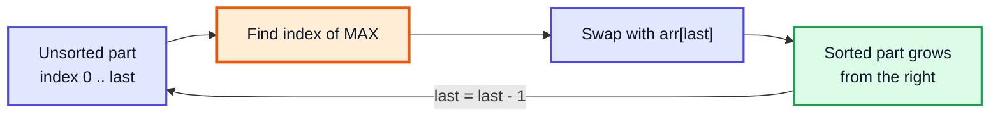
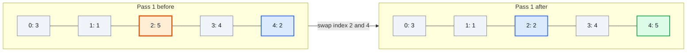
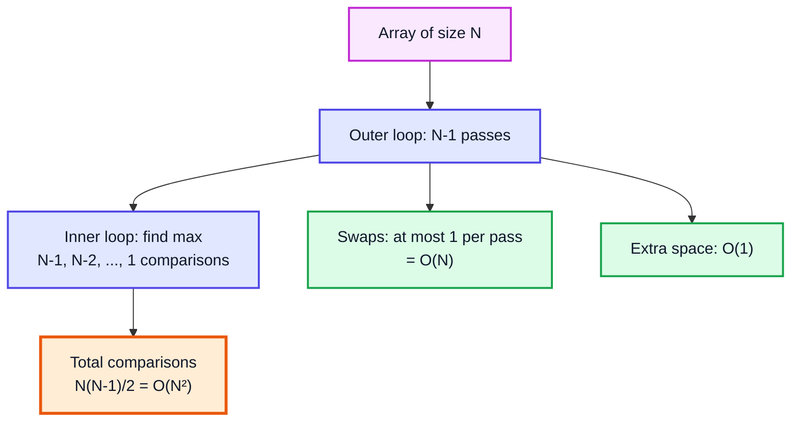
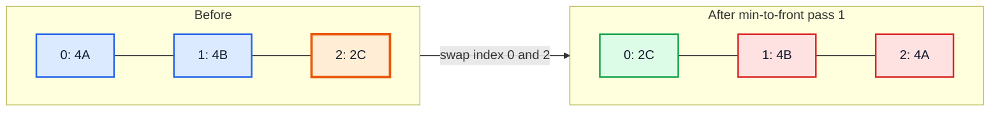
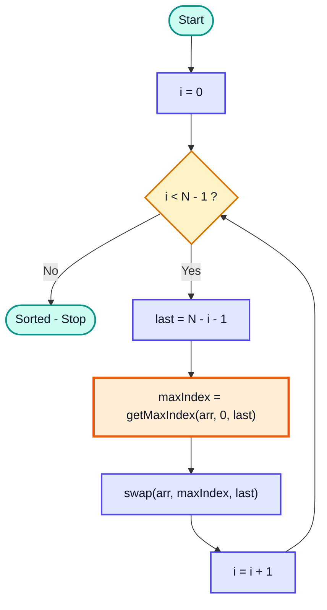
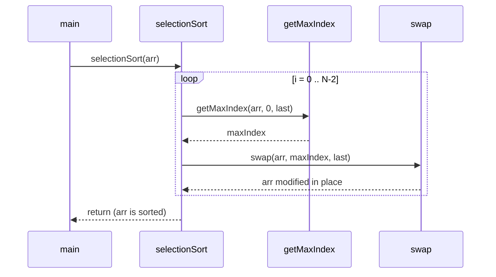

# Selection Sort — Complete In-Depth Guide

**Video #18 of the Java + DSA playlist:** *Selection Sort Algorithm - Theory + Code* (18:49)

The second sorting algorithm in the series: selection sort repeatedly **selects** the largest (or smallest) element of the unsorted part and puts it in its final position. These notes cover how it works, why it is always O(N²), why it is not stable, when it is still useful, and a complete Java implementation with dry runs.

---

## Table of Contents

| # | Topic | Timestamp |
|---|---|---|
| 0 | [Introduction](#0-introduction-000) | 0:00 |
| 1 | [What is Selection Sort?](#1-what-is-selection-sort-038) | 0:38 |
| 2 | [Complexity of Selection Sort](#2-complexity-of-selection-sort-440) | 4:40 |
| 3 | [Worst Case](#3-worst-case-821) | 8:21 |
| 4 | [Best Case](#4-best-case-830) | 8:30 |
| 5 | [Stability](#5-stability-847) | 8:47 |
| 6 | [Use Case](#6-use-case-901) | 9:01 |
| 7 | [Algorithm for Selection Sort](#7-algorithm-for-selection-sort-920) | 9:20 |
| 8 | [Code for Selection Sort](#8-code-for-selection-sort-1115) | 11:15 |
| 9 | [Outro](#9-outro-1836) | 18:36 |

---

## 0. Introduction (0:00)

In the previous video (bubble sort) the largest element "bubbled" to the end through many adjacent swaps. Selection sort reaches the same result in a different way: it **finds** the largest element first and then does **one** swap per pass.

You should already be comfortable with:

1. Arrays and indices (videos on arrays)
2. Swapping two elements with a `temp` variable
3. Finding the maximum element of an array (linear search idea)
4. Big-O notation for loops (from the bubble sort video)

> [!IMPORTANT]
> Selection sort = **"find max + swap"** repeated N−1 times. If you can write `getMaxIndex()` and `swap()`, you can write selection sort.

---

## 1. What is Selection Sort? (0:38)

### The basic idea

**Select** an element and put it at its **correct index**. In Kunal's version:

1. Look at the whole unsorted part of the array.
2. Find the index of the **largest** element.
3. Swap it with the **last** index of the unsorted part. Now that element is in its final place.
4. Shrink the unsorted part by one from the right and repeat.

The textbook version does the mirror image: find the **smallest** and swap it to the **front**. Both are selection sort.



### Worked example: `arr = {3, 1, 5, 4, 2}`

Legend: 🟧 = max found in this pass, 🟦 = position it is swapped into, 🟩 = already sorted.

| Pass | Unsorted range | Array before | Max (index) | Swap | Array after |
|---|---|---|---|---|---|
| 1 | 0..4 | 3 1 🟧5 4 🟦2 | 5 (2) | arr[2] ↔ arr[4] | 3 1 2 4 🟩5 |
| 2 | 0..3 | 3 1 2 🟧🟦4 🟩5 | 4 (3) | none needed (already last) | 3 1 2 🟩4 🟩5 |
| 3 | 0..2 | 🟧3 1 🟦2 🟩4 🟩5 | 3 (0) | arr[0] ↔ arr[2] | 2 1 🟩3 🟩4 🟩5 |
| 4 | 0..1 | 🟧2 🟦1 🟩3 🟩4 🟩5 | 2 (0) | arr[0] ↔ arr[1] | 🟩1 🟩2 🟩3 🟩4 🟩5 |

After 4 passes (N − 1 for N = 5), the array is sorted. The last remaining element is automatically in place.

### Pass 1 as a diagram



### Selection sort vs bubble sort (at a glance)

| | **Bubble Sort** | **Selection Sort** |
|---|---|---|
| How max reaches the end | Many adjacent swaps per pass | Found first, then **one** swap per pass |
| Swaps (worst) | O(N²) | **O(N)** — at most N−1 |
| Comparisons | O(N²) | O(N²) |
| Best case | O(N) with the `swapped` flag | **O(N²)** — no early exit |
| Stable? | ✅ Yes | ❌ No |
| Adaptive (faster on nearly-sorted)? | ✅ Yes | ❌ No |

> [!NOTE]
> "Min to front" and "max to end" have identical complexity. Kunal uses "max to end" so that the code reuses the same `getMaxIndex(arr, start, end)` helper idea from earlier videos.

---

## 2. Complexity of Selection Sort (4:40)

### Counting comparisons

In pass `i` (starting at 0), the unsorted part has `N − i` elements, so finding the max takes `N − i − 1` comparisons.

| Pass | Elements checked | Comparisons |
|---|---|---|
| 1 | N | N − 1 |
| 2 | N − 1 | N − 2 |
| 3 | N − 2 | N − 3 |
| … | … | … |
| N − 1 | 2 | 1 |

Total:

```
(N-1) + (N-2) + ... + 2 + 1  =  N(N-1)/2  =  (N² - N) / 2
```

Drop constants and the lower-order term: **O(N²)**.

For N = 5 that is 5·4/2 = **10** comparisons — and the complete example below prints exactly 10 for sorted, reversed and random input.

### Counting swaps

Exactly one swap (or zero, if the max is already in place) per pass, so **at most N − 1 swaps → O(N)**. This is the single biggest strength of selection sort.

### Space

Only a few variables (`last`, `maxIndex`, `temp`): **O(1) extra space**. Selection sort is **in-place**.



> [!TIP]
> The sum `1 + 2 + ... + (N−1) = N(N−1)/2` shows up in every "nested loop where the inner loop shrinks" — bubble, selection and insertion sort all use it. Memorise it.

---

## 3. Worst Case (8:21)

**Worst case: O(N²).**

Even for a reverse-sorted array, the work is the same `N(N−1)/2` comparisons. The swap count is at most N − 1.

> [!NOTE]
> A reversed array is not even the worst case for *swaps*: for `{5, 4, 3, 2, 1}`, the first swap (5 ↔ 1) also fixes the 1, so only 2 swaps are needed. Swap count depends on the input; comparison count does not.

---

## 4. Best Case (8:30)

**Best case: also O(N²).**

Why doesn't it get faster for an already sorted array? Because to know that `arr[last]` is the maximum, the algorithm **must look at every element** of the unsorted part. There is no shortcut like bubble sort's "no swaps happened → stop" flag.

| Case | Example | Comparisons | Swaps | Time |
|---|---|---|---|---|
| Best | `{1, 2, 3, 4, 5}` | 10 | 0 | O(N²) |
| Average | `{3, 1, 5, 4, 2}` | 10 | 3 | O(N²) |
| Worst | `{5, 4, 3, 2, 1}` | 10 | 2 | O(N²) |

> [!IMPORTANT]
> Selection sort is **not adaptive**: best = average = worst = **Θ(N²)** comparisons. This is the key difference from bubble sort and insertion sort.

---

## 5. Stability (8:47)

### What stability means

A sorting algorithm is **stable** if elements with **equal keys keep their original relative order**.

### Selection sort is NOT stable

The long-distance swap can jump an element over an equal one. Sort these cards by value (the letter is just a label):



`4A` was before `4B`; after sorting, `4B` is before `4A`. Order of equal elements changed → **unstable**.

> [!WARNING]
> Choosing `>=` instead of `>` (or `<=` instead of `<`) when finding the max/min does not make the standard swapping version stable. A stable selection sort exists, but it **shifts** elements instead of swapping (like insertion sort), which costs O(N²) moves and removes selection sort's main advantage.

### Why stability matters

| Situation | Stable needed? |
|---|---|
| Sorting plain `int[]` | No — equal ints are indistinguishable |
| Sorting students by marks, already sorted by name | Yes — keeps names in order within equal marks |
| Multi-key sorts (sort by city, then by age) | Yes |

> [!NOTE]
> In modern Java, `Arrays.sort(int[])` uses Dual-Pivot Quicksort (not stable, but stability is irrelevant for primitives), while `Arrays.sort(Object[])` and `List.sort()` use TimSort, which **is** stable.

---

## 6. Use Case (9:01)

Selection sort is slow for big inputs, but it still has a niche:

| ✅ Good for | ❌ Bad for |
|---|---|
| **Small arrays** (tens of elements) | Large arrays — O(N²) explodes |
| When **writes/swaps are expensive** (e.g., flash memory / EEPROM where each write wears the cell) — only O(N) swaps | Nearly-sorted data (no speed-up, unlike insertion sort) |
| Very simple to write and reason about | When stability is required |
| When you only need the **top k** largest/smallest: stop after k passes → O(N·k) | Production code — use `Arrays.sort()` |

> [!TIP]
> "Find the k-th largest element" can be solved by running only k passes of selection sort. It is O(N·k), fine for small k (LeetCode 215 *Kth Largest Element in an Array* has better O(N log k) heap and O(N) quickselect solutions).

---

## 7. Algorithm for Selection Sort (9:20)

### Pseudocode (max to end)

```
for i from 0 to N-2:
    last     = N - i - 1                 // last index of unsorted part
    maxIndex = index of max in arr[0..last]
    swap(arr[maxIndex], arr[last])
```

### Flowchart



### Breaking the problem into helpers

| Helper | Job | Complexity |
|---|---|---|
| `getMaxIndex(arr, start, end)` | Return the index of the largest element in `arr[start..end]` | O(end − start + 1) |
| `swap(arr, a, b)` | Exchange `arr[a]` and `arr[b]` | O(1) |
| `selectionSort(arr)` | Call the two above N − 1 times | O(N²) |

> [!NOTE]
> Return the **index** of the max, not the max value. You need the index to perform the swap.

---

## 8. Code for Selection Sort (11:15)

### Kunal's version: max to end

```java
import java.util.Arrays;

public class SelectionSort {

    static void selectionSort(int[] arr) {
        for (int i = 0; i < arr.length - 1; i++) {
            // find the max item in the remaining array and swap with correct index
            int last = arr.length - i - 1;
            int maxIndex = getMaxIndex(arr, 0, last);
            swap(arr, maxIndex, last);
        }
    }

    static int getMaxIndex(int[] arr, int start, int end) {
        int max = start;
        for (int i = start; i <= end; i++) {
            if (arr[i] > arr[max]) {
                max = i;
            }
        }
        return max;
    }

    static void swap(int[] arr, int first, int second) {
        int temp = arr[first];
        arr[first] = arr[second];
        arr[second] = temp;
    }

    public static void main(String[] args) {
        int[] arr = {4, 5, 1, 2, 3};
        selectionSort(arr);
        System.out.println(Arrays.toString(arr)); // [1, 2, 3, 4, 5]
    }
}
```

> [!NOTE]
> The video's outer loop runs `i < arr.length` (N passes). The last pass has `last = 0` and does nothing useful, so `i < arr.length - 1` is a harmless micro-optimisation. Both are correct.

### Dry run of `getMaxIndex` for `arr = {4, 5, 1, 2, 3}`, `start = 0`, `end = 4`

| i | arr[i] | arr[max] | arr[i] > arr[max]? | max |
|---|---|---|---|---|
| 0 | 4 | 4 | ❌ | 0 |
| 1 | 5 | 4 | ✅ | 🟧 1 |
| 2 | 1 | 5 | ❌ | 1 |
| 3 | 2 | 5 | ❌ | 1 |
| 4 | 3 | 5 | ❌ | 1 |

Returns `1` → swap `arr[1]` and `arr[4]` → `{4, 3, 1, 2, 5}`.

### Full dry run of `selectionSort({4, 5, 1, 2, 3})`

| i | last | maxIndex | Array after swap |
|---|---|---|---|
| 0 | 4 | 1 (5) | 4 3 1 2 🟩5 |
| 1 | 3 | 0 (4) | 2 3 1 🟩4 🟩5 |
| 2 | 2 | 1 (3) | 2 1 🟩3 🟩4 🟩5 |
| 3 | 1 | 0 (2) | 🟩1 🟩2 🟩3 🟩4 🟩5 |

### Call order



> [!IMPORTANT]
> `selectionSort` returns `void` yet `main` sees a sorted array. That is because the method receives a **copy of the reference** to the same heap array (pass-by-value of references, from video #5). Changes through `arr[i] = ...` are visible to the caller.

### Textbook version: min to front

```java
static void selectionSortMin(int[] arr) {
    for (int i = 0; i < arr.length - 1; i++) {
        int minIndex = i;
        for (int j = i + 1; j < arr.length; j++) {
            if (arr[j] < arr[minIndex]) {
                minIndex = j;
            }
        }
        if (minIndex != i) {          // skip a useless self-swap
            int temp = arr[i];
            arr[i] = arr[minIndex];
            arr[minIndex] = temp;
        }
    }
}
// {64, 25, 12, 22, 11} -> [11, 12, 22, 25, 64]
```

### Variations

| Variation | Change | Notes |
|---|---|---|
| Descending order | Find **min** and put it at the end (or max at the front) | Same O(N²) |
| Top-k largest | Run only k passes of max-to-end | O(N·k) |
| Double selection sort | Find both min and max each pass, place at both ends | ~half the passes, still O(N²) |
| Generic | `<T extends Comparable<T>>` and `compareTo` | Works for `String`, `Integer`, etc. |

```java
// Generic selection sort (Java 17+ friendly)
static <T extends Comparable<T>> void selectionSort(T[] arr) {
    for (int i = 0; i < arr.length - 1; i++) {
        int last = arr.length - i - 1;
        int max = 0;
        for (int j = 1; j <= last; j++) {
            if (arr[j].compareTo(arr[max]) > 0) max = j;
        }
        T temp = arr[max]; arr[max] = arr[last]; arr[last] = temp;
    }
}
// String[] names = {"kunal", "anuj", "rahul"} -> [anuj, kunal, rahul]
```

### Common mistakes

| Mistake | Result | Fix |
|---|---|---|
| `getMaxIndex` loop uses `i < end` | Misses the last element of the range | Use `i <= end` (end is inclusive) |
| Returning `arr[max]` instead of `max` | Can't swap | Return the index |
| Searching `0..arr.length-1` every pass | Max already placed gets found again → wrong | Search `0..last` only |
| Swapping inside the inner loop | Turns into a slow bubble-like sort with O(N²) swaps | Swap once, after the inner loop |

### Practice

- **LeetCode 912 — Sort an Array**: selection sort is correct but O(N²) gets *Time Limit Exceeded* for N = 5·10⁴; it is a good test of correctness on small inputs, and a reason to learn merge/quick sort later in the playlist.

---

## 9. Outro (18:36)

Selection sort is the "find, then place" sort: O(N²) comparisons always, O(N) swaps, O(1) space, unstable. Next in the series is **insertion sort**, which is stable and adaptive — fast on nearly-sorted data.

---

## 🧩 Complete Example: Everything Together

```java
import java.util.Arrays;

public class SelectionSortDemo {

    // Kunal's version: find the MAX in the unsorted part, put it at the END
    static void selectionSort(int[] arr) {
        for (int i = 0; i < arr.length - 1; i++) {
            int last = arr.length - i - 1;          // last index of unsorted part
            int maxIndex = getMaxIndex(arr, 0, last);
            swap(arr, maxIndex, last);
        }
    }

    static int getMaxIndex(int[] arr, int start, int end) {
        int max = start;
        for (int i = start; i <= end; i++) {
            if (arr[i] > arr[max]) {
                max = i;
            }
        }
        return max;
    }

    static void swap(int[] arr, int first, int second) {
        int temp = arr[first];
        arr[first] = arr[second];
        arr[second] = temp;
    }

    // Textbook version: find the MIN in the unsorted part, put it at the FRONT
    static void selectionSortMin(int[] arr) {
        for (int i = 0; i < arr.length - 1; i++) {
            int minIndex = i;
            for (int j = i + 1; j < arr.length; j++) {
                if (arr[j] < arr[minIndex]) minIndex = j;
            }
            if (minIndex != i) swap(arr, i, minIndex);
        }
    }

    // Counts comparisons and swaps to show the complexity is the same for any input
    static long[] countWork(int[] input) {
        int[] arr = input.clone();
        long comparisons = 0, swaps = 0;
        for (int i = 0; i < arr.length - 1; i++) {
            int last = arr.length - i - 1;
            int maxIndex = 0;
            for (int j = 1; j <= last; j++) {
                comparisons++;
                if (arr[j] > arr[maxIndex]) maxIndex = j;
            }
            if (maxIndex != last) { swap(arr, maxIndex, last); swaps++; }
        }
        return new long[]{comparisons, swaps};
    }

    // Stability demo: sort cards by value only, keep suit as a label
    record Card(int value, char suit) {
        public String toString() { return value + "" + suit; }
    }

    static void selectionSortCards(Card[] cards) {
        for (int i = 0; i < cards.length - 1; i++) {
            int minIndex = i;
            for (int j = i + 1; j < cards.length; j++) {
                if (cards[j].value() < cards[minIndex].value()) minIndex = j;
            }
            Card t = cards[i]; cards[i] = cards[minIndex]; cards[minIndex] = t;
        }
    }

    public static void main(String[] args) {
        // 1. Kunal's max-to-end version
        int[] arr = {3, 1, 5, 4, 2};
        selectionSort(arr);
        System.out.println("Max-to-end : " + Arrays.toString(arr));

        // 2. Min-to-front version
        int[] arr2 = {64, 25, 12, 22, 11};
        selectionSortMin(arr2);
        System.out.println("Min-to-front: " + Arrays.toString(arr2));

        // 3. Edge cases
        int[] empty = {};
        int[] single = {7};
        int[] withNegatives = {0, -3, 8, -3, 2};
        selectionSort(empty);
        selectionSort(single);
        selectionSort(withNegatives);
        System.out.println("Empty      : " + Arrays.toString(empty));
        System.out.println("Single     : " + Arrays.toString(single));
        System.out.println("Negatives  : " + Arrays.toString(withNegatives));

        // 4. Same number of comparisons for sorted, reversed and random input
        int[] sorted = {1, 2, 3, 4, 5};
        int[] reversed = {5, 4, 3, 2, 1};
        int[] random = {3, 1, 5, 4, 2};
        for (int[] a : new int[][]{sorted, reversed, random}) {
            long[] w = countWork(a);
            System.out.println(Arrays.toString(a) + " -> comparisons=" + w[0] + ", swaps=" + w[1]);
        }

        // 5. Selection sort is NOT stable
        Card[] cards = {new Card(4, 'A'), new Card(4, 'B'), new Card(2, 'C')};
        System.out.println("Cards before: " + Arrays.toString(cards));
        selectionSortCards(cards);
        System.out.println("Cards after : " + Arrays.toString(cards) + "  (4A and 4B swapped order)");
    }
}
```

**Expected Output:**
```
Max-to-end : [1, 2, 3, 4, 5]
Min-to-front: [11, 12, 22, 25, 64]
Empty      : []
Single     : [7]
Negatives  : [-3, -3, 0, 2, 8]
[1, 2, 3, 4, 5] -> comparisons=10, swaps=0
[5, 4, 3, 2, 1] -> comparisons=10, swaps=2
[3, 1, 5, 4, 2] -> comparisons=10, swaps=3
Cards before: [4A, 4B, 2C]
Cards after : [2C, 4B, 4A]  (4A and 4B swapped order)
```

---

## Quick Reference Cheat Sheet

| Concept | One-Line Summary |
|---|---|
| **Idea** | Select the max of the unsorted part and swap it into the last unsorted index (or min to the front) |
| **Passes** | N − 1; the last element is placed automatically |
| **Unsorted range in pass i** | `0 .. N - i - 1` |
| **Comparisons** | Always N(N−1)/2 → O(N²) |
| **Swaps** | At most N − 1 → O(N) |
| **Best / Average / Worst** | O(N²) / O(N²) / O(N²) — not adaptive |
| **Space** | O(1), in-place |
| **Stable?** | ❌ No — long-distance swaps reorder equal elements |
| **Use case** | Small arrays, expensive writes, top-k with k passes |
| **`getMaxIndex` bound** | `i <= end` — the end index is inclusive |
| **vs Bubble sort** | Same comparisons, far fewer swaps, but no early exit |
| **Real Java** | Use `Arrays.sort()` (Dual-Pivot Quicksort for primitives, TimSort for objects) |
