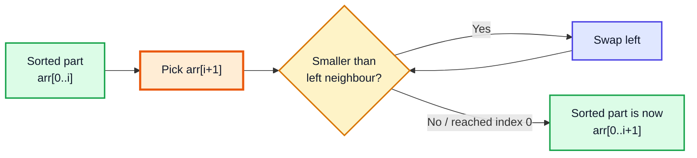
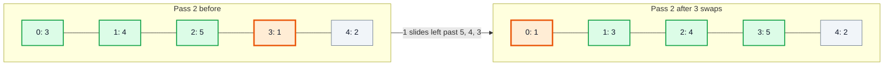
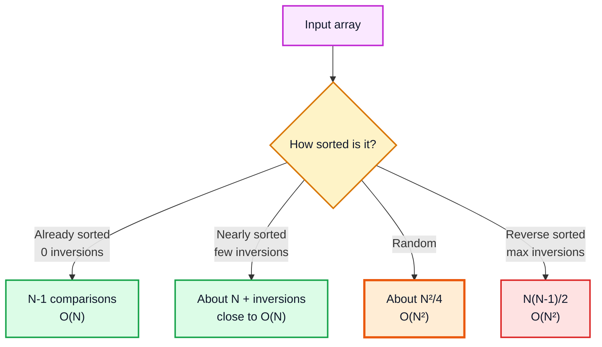
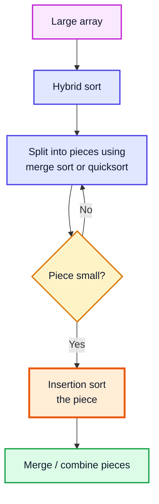
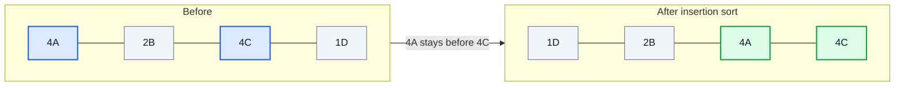
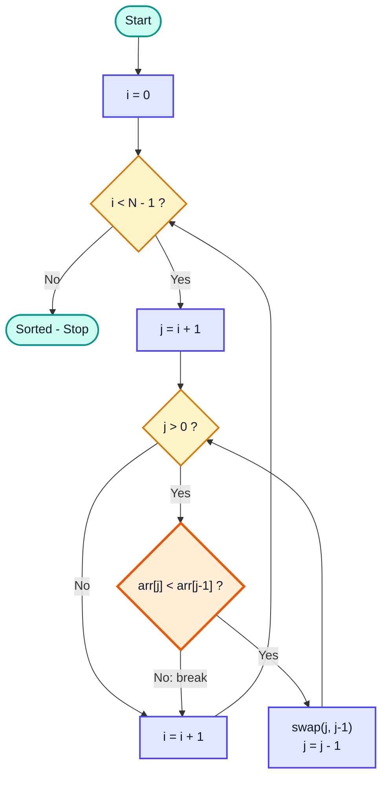

# Insertion Sort — Complete In-Depth Guide

**Video #19 of the Java + DSA playlist:** *Insertion Sort Algorithm - Theory + Code* (30:40)

The third sorting algorithm in the series: insertion sort builds a sorted part on the left and **inserts** each new element into its correct place inside it — exactly how you sort playing cards in your hand. These notes cover the idea, the full complexity analysis, why it is adaptive and stable, why real libraries still use it, and the Java code with dry runs.

---

## Table of Contents

| # | Topic | Timestamp |
|---|---|---|
| 0 | [Introduction](#0-introduction-000) | 0:00 |
| 1 | [Insertion Sort](#1-insertion-sort-040) | 0:40 |
| 2 | [Complexity of Insertion Sort](#2-complexity-of-insertion-sort-1623) | 16:23 |
| 3 | [Worst Case](#3-worst-case-1643) | 16:43 |
| 4 | [Best Case](#4-best-case-1907) | 19:07 |
| 5 | [Why use Insertion Sort?](#5-why-use-insertion-sort-2103) | 21:03 |
| 6 | [Code for Insertion Sort](#6-code-for-insertion-sort-2424) | 24:24 |
| 7 | [Outro](#7-outro-3018) | 30:18 |

---

## 0. Introduction (0:00)

So far in the series:

| Video | Algorithm | Core move |
|---|---|---|
| #17 | Bubble sort | Swap adjacent pairs; the largest bubbles to the end |
| #18 | Selection sort | Find the max; one swap puts it at the end |
| **#19** | **Insertion sort** | Take the next element and slide it left into the sorted part |

Insertion sort has the same O(N²) worst case as the other two, but it is **much faster on nearly-sorted data**, it is **stable**, and it is the algorithm real-world libraries use for small sub-arrays.

> [!IMPORTANT]
> Insertion sort keeps this invariant: **before pass i, the part `arr[0..i]` is already sorted** (sorted among itself, not necessarily in its final positions). Each pass extends the sorted part by one element.

---

## 1. Insertion Sort (0:40)

### The basic idea: sorting cards in your hand

You pick up cards one at a time. Each new card is compared with the cards already in your hand (which are sorted) and **inserted** at the right spot. You never touch cards to the right — you haven't picked them up yet.

For an array:

1. Treat `arr[0]` as a sorted part of size 1.
2. Take the next element, `arr[i + 1]`.
3. Compare it with its left neighbour; while it is smaller, swap it left.
4. Stop as soon as the left neighbour is smaller or equal — everything further left is already sorted, so there is nothing more to check.
5. Repeat until the whole array is the sorted part.



### Worked example: `arr = {5, 3, 4, 1, 2}`

Legend: 🟩 = sorted part, 🟧 = element being inserted, ⬜ = not processed yet.

| Pass (i) | Insert | Before | Steps | After |
|---|---|---|---|---|
| 0 | 3 | 🟩5 🟧3 ⬜4 ⬜1 ⬜2 | 3<5 swap | 🟩3 🟩5 ⬜4 ⬜1 ⬜2 |
| 1 | 4 | 🟩3 🟩5 🟧4 ⬜1 ⬜2 | 4<5 swap; 4<3? no → stop | 🟩3 🟩4 🟩5 ⬜1 ⬜2 |
| 2 | 1 | 🟩3 🟩4 🟩5 🟧1 ⬜2 | 1<5 swap; 1<4 swap; 1<3 swap; at index 0 → stop | 🟩1 🟩3 🟩4 🟩5 ⬜2 |
| 3 | 2 | 🟩1 🟩3 🟩4 🟩5 🟧2 | 2<5 swap; 2<4 swap; 2<3 swap; 2<1? no → stop | 🟩1 🟩2 🟩3 🟩4 🟩5 |

### Pass 2 as a diagram (inserting 1)



### Insertion vs selection: what is "sorted" after each pass?

| | **Selection Sort** | **Insertion Sort** |
|---|---|---|
| Sorted part after pass k | The k largest elements, in their **final** positions | The first k+1 elements, sorted **among themselves** |
| Looks at the unsorted part? | Yes, all of it, every pass | No, only the next element |
| Can stop a pass early? | No | ✅ Yes, at the first element that is not smaller |

> [!NOTE]
> Because insertion sort only needs the elements seen so far, it is an **online** algorithm: it can sort data as it arrives (for example, a stream of numbers) without knowing the rest of the input.

---

## 2. Complexity of Insertion Sort (16:23)

### Counting comparisons

In pass `i`, the new element is compared with **at most** `i + 1` elements on its left (fewer if it stops early).

| Pass | Max comparisons | Min comparisons |
|---|---|---|
| 0 | 1 | 1 |
| 1 | 2 | 1 |
| 2 | 3 | 1 |
| … | … | … |
| N − 2 | N − 1 | 1 |
| **Total** | **N(N−1)/2** | **N − 1** |

### Summary

| Case | Comparisons | Swaps / shifts | Time |
|---|---|---|---|
| Best (already sorted) | N − 1 | 0 | **O(N)** |
| Average (random) | ≈ N²/4 | ≈ N²/4 | O(N²) |
| Worst (reverse sorted) | N(N−1)/2 | N(N−1)/2 | O(N²) |
| Space | — | — | **O(1)**, in-place |

> [!TIP]
> The number of swaps insertion sort does is **exactly the number of inversions** in the array — pairs `(i, j)` with `i < j` and `arr[i] > arr[j]`. A sorted array has 0 inversions, a reversed array has the maximum N(N−1)/2. This is the precise reason it is fast for nearly-sorted input.



---

## 3. Worst Case (16:43)

**Worst case: O(N²) — the array is sorted in reverse order.**

Every new element is smaller than everything in the sorted part, so it must travel all the way to index 0.

`arr = {5, 4, 3, 2, 1}`:

| Pass | Element inserted | Comparisons | Swaps | Array after |
|---|---|---|---|---|
| 0 | 4 | 1 | 1 | 4 5 3 2 1 |
| 1 | 3 | 2 | 2 | 3 4 5 2 1 |
| 2 | 2 | 3 | 3 | 2 3 4 5 1 |
| 3 | 1 | 4 | 4 | 1 2 3 4 5 |
| **Total** | | **10** | **10** | |

`1 + 2 + 3 + 4 = 10 = 5·4/2` → in general `N(N−1)/2` → **O(N²)**.

> [!WARNING]
> In the worst case, insertion sort does O(N²) **swaps**, while selection sort only does O(N). If writes are very expensive, selection sort can be the better choice even though insertion sort is usually faster overall.

---

## 4. Best Case (19:07)

**Best case: O(N) — the array is already sorted.**

Each new element is compared with its left neighbour once, finds it is not smaller, and the inner loop **breaks immediately**.

`arr = {1, 2, 3, 4, 5}`:

| Pass | Comparison | Result |
|---|---|---|
| 0 | 2 < 1? | ❌ break |
| 1 | 3 < 2? | ❌ break |
| 2 | 4 < 3? | ❌ break |
| 3 | 5 < 4? | ❌ break |

4 comparisons = N − 1, 0 swaps → **O(N)**.

> [!IMPORTANT]
> The `break` in the inner loop is what makes the best case O(N). Remove it and the code still sorts correctly, but every pass scans all the way to index 0 — O(N²) even for sorted input.

---

## 5. Why use Insertion Sort? (21:03)

### Strengths

| Property | Why it matters |
|---|---|
| **Adaptive** | Work is proportional to N + number of inversions; nearly-sorted data is sorted in close to O(N) |
| **Stable** | Equal elements are never swapped past each other (the comparison is strict `<`) |
| **In-place** | O(1) extra memory |
| **Online** | Can sort elements as they arrive |
| **Low overhead** | Very simple loops; for small N (≈ 10–50) it beats O(N log N) algorithms in practice |
| **Fewer steps than bubble sort** | Bubble sort keeps scanning the whole unsorted part; insertion sort stops at the right spot |

### Used inside hybrid algorithms

Real sorting libraries combine a fast O(N log N) algorithm with insertion sort for small pieces:



> [!NOTE]
> In modern Java (17/21), `Arrays.sort(int[])` (Dual-Pivot Quicksort) switches to insertion sort for very small ranges, and `Arrays.sort(Object[])` / `List.sort()` use **TimSort**, which sorts small "runs" with *binary* insertion sort before merging them. Python's built-in sort is TimSort too.

### Stability in action



`4C` stops moving left as soon as it meets `4A` because `4 < 4` is false — so equal elements never cross.

> [!CAUTION]
> Change the comparison to `<=` and insertion sort becomes **unstable** (and does extra useless swaps). Always use strict `<` (or `>` in the shift version).

### Comparing the three O(N²) sorts

| | **Bubble** | **Selection** | **Insertion** |
|---|---|---|---|
| Best | O(N) | O(N²) | **O(N)** |
| Worst | O(N²) | O(N²) | O(N²) |
| Swaps (worst) | O(N²) | **O(N)** | O(N²) |
| Stable | ✅ | ❌ | ✅ |
| Adaptive | ✅ | ❌ | ✅ (best of the three) |
| Online | ❌ | ❌ | ✅ |
| Typical use | Teaching | Expensive writes | Small / nearly-sorted arrays, hybrid sorts |

---

## 6. Code for Insertion Sort (24:24)

### Kunal's version: swap leftwards

```java
import java.util.Arrays;

public class InsertionSort {

    static void insertionSort(int[] arr) {
        for (int i = 0; i < arr.length - 1; i++) {
            for (int j = i + 1; j > 0; j--) {
                if (arr[j] < arr[j - 1]) {
                    swap(arr, j, j - 1);
                } else {
                    break;
                }
            }
        }
    }

    static void swap(int[] arr, int first, int second) {
        int temp = arr[first];
        arr[first] = arr[second];
        arr[second] = temp;
    }

    public static void main(String[] args) {
        int[] arr = {5, 3, 4, 1, 2};
        insertionSort(arr);
        System.out.println(Arrays.toString(arr)); // [1, 2, 3, 4, 5]
    }
}
```

### Understanding the loop bounds

| Variable | Range | Meaning |
|---|---|---|
| `i` | `0 .. N-2` | `arr[0..i]` is sorted; we are about to insert `arr[i+1]` |
| `j` | starts at `i + 1`, goes down to `1` | Current position of the element being inserted |
| `j > 0` | — | We compare `arr[j]` with `arr[j-1]`, so `j` must be at least 1 to avoid index −1 |



### Dry run: `insertionSort({5, 3, 4, 1, 2})`

| i | j | arr[j] < arr[j−1]? | Action | Array |
|---|---|---|---|---|
| 0 | 1 | 3 < 5 ✅ | swap | 3 5 4 1 2 |
| 0 | 0 | — | j > 0 false | 3 5 4 1 2 |
| 1 | 2 | 4 < 5 ✅ | swap | 3 4 5 1 2 |
| 1 | 1 | 4 < 3 ❌ | break | 3 4 5 1 2 |
| 2 | 3 | 1 < 5 ✅ | swap | 3 4 1 5 2 |
| 2 | 2 | 1 < 4 ✅ | swap | 3 1 4 5 2 |
| 2 | 1 | 1 < 3 ✅ | swap | 1 3 4 5 2 |
| 2 | 0 | — | j > 0 false | 1 3 4 5 2 |
| 3 | 4 | 2 < 5 ✅ | swap | 1 3 4 2 5 |
| 3 | 3 | 2 < 4 ✅ | swap | 1 3 2 4 5 |
| 3 | 2 | 2 < 3 ✅ | swap | 1 2 3 4 5 |
| 3 | 1 | 2 < 1 ❌ | break | 🟩 1 2 3 4 5 |

### Textbook version: shift instead of swap

Each swap does 3 assignments. Instead, hold the element (`key`), **shift** larger elements one place right, and write `key` once into the gap. Same complexity, about a third of the writes.

```java
static void insertionSortShift(int[] arr) {
    for (int i = 1; i < arr.length; i++) {
        int key = arr[i];
        int j = i - 1;
        while (j >= 0 && arr[j] > key) {
            arr[j + 1] = arr[j];   // shift right
            j--;
        }
        arr[j + 1] = key;          // drop key into the gap
    }
}
// {12, 11, 13, 5, 6} -> [5, 6, 11, 12, 13]
```

Dry run of the last pass (`i = 4`, `key = 6`, array `5 11 12 13 6`):

| j | arr[j] > 6? | Array |
|---|---|---|
| 3 | 13 ✅ shift | 5 11 12 13 13 |
| 2 | 12 ✅ shift | 5 11 12 12 13 |
| 1 | 11 ✅ shift | 5 11 11 12 13 |
| 0 | 5 ❌ stop | write key at j+1 = 1 → 5 6 11 12 13 |

> [!NOTE]
> The condition order `j >= 0 && arr[j] > key` matters: `&&` short-circuits, so `arr[-1]` is never read.

### Variations

| Variation | Idea | Complexity |
|---|---|---|
| Descending | Use `arr[j] > arr[j - 1]` | Same |
| Binary insertion sort | Binary-search the insert position in `arr[0..i]` | O(N log N) comparisons, still O(N²) shifts |
| Generic | `<T extends Comparable<T>>`, `compareTo(...) < 0` | Same |
| Linked list | Insert each node into a sorted list | O(N²), O(1) space — **LeetCode 147 Insertion Sort List** |
| Shell sort | Insertion sort on elements `gap` apart, shrinking gap | Better than O(N²) in practice |

### Common mistakes

| Mistake | Result | Fix |
|---|---|---|
| Inner loop `j >= 0` with `arr[j-1]` | `ArrayIndexOutOfBoundsException` at `arr[-1]` | Use `j > 0` |
| Missing `break` | Still correct, but best case becomes O(N²) | Break when not smaller |
| Using `<=` | Unstable, extra swaps | Use strict `<` |
| Outer loop `i < arr.length` in Kunal's version | `j = arr.length` → out of bounds | `i < arr.length - 1` |

### Practice

- **LeetCode 147 — Insertion Sort List**: apply the same idea to a singly linked list.
- **LeetCode 912 — Sort an Array**: insertion sort is correct but O(N²) times out for large inputs.

---

## 7. Outro (30:18)

Insertion sort: O(N²) worst, **O(N) best**, O(1) space, stable, adaptive and online — the best of the simple sorts and a building block of real hybrid sorting algorithms. The series continues with cycle sort and then the O(N log N) algorithms (merge sort, quick sort) after recursion.

---

## 🧩 Complete Example: Everything Together

```java
import java.util.Arrays;

public class InsertionSortDemo {

    // Kunal's version: swap the new element leftwards until it is in place
    static void insertionSort(int[] arr) {
        for (int i = 0; i < arr.length - 1; i++) {
            for (int j = i + 1; j > 0; j--) {
                if (arr[j] < arr[j - 1]) {
                    swap(arr, j, j - 1);
                } else {
                    break;                     // left part is sorted, stop early
                }
            }
        }
    }

    static void swap(int[] arr, int first, int second) {
        int temp = arr[first];
        arr[first] = arr[second];
        arr[second] = temp;
    }

    // Textbook version: hold the key, SHIFT bigger elements right, drop key in the gap
    static void insertionSortShift(int[] arr) {
        for (int i = 1; i < arr.length; i++) {
            int key = arr[i];
            int j = i - 1;
            while (j >= 0 && arr[j] > key) {
                arr[j + 1] = arr[j];
                j--;
            }
            arr[j + 1] = key;
        }
    }

    // Counts comparisons and moves to show the algorithm is adaptive
    static long[] countWork(int[] input) {
        int[] arr = input.clone();
        long comparisons = 0, swaps = 0;
        for (int i = 0; i < arr.length - 1; i++) {
            for (int j = i + 1; j > 0; j--) {
                comparisons++;
                if (arr[j] < arr[j - 1]) {
                    swap(arr, j, j - 1);
                    swaps++;
                } else {
                    break;
                }
            }
        }
        return new long[]{comparisons, swaps};
    }

    // Stability demo: equal values keep their original order
    record Card(int value, char suit) {
        public String toString() { return value + "" + suit; }
    }

    static void insertionSortCards(Card[] cards) {
        for (int i = 1; i < cards.length; i++) {
            Card key = cards[i];
            int j = i - 1;
            while (j >= 0 && cards[j].value() > key.value()) {   // strict > keeps it stable
                cards[j + 1] = cards[j];
                j--;
            }
            cards[j + 1] = key;
        }
    }

    public static void main(String[] args) {
        // 1. Kunal's swap version
        int[] arr = {5, 3, 4, 1, 2};
        insertionSort(arr);
        System.out.println("Swap version : " + Arrays.toString(arr));

        // 2. Shift version
        int[] arr2 = {12, 11, 13, 5, 6};
        insertionSortShift(arr2);
        System.out.println("Shift version: " + Arrays.toString(arr2));

        // 3. Edge cases
        int[] empty = {};
        int[] single = {9};
        int[] dupes = {3, -1, 3, 0, -1};
        insertionSort(empty);
        insertionSort(single);
        insertionSort(dupes);
        System.out.println("Empty        : " + Arrays.toString(empty));
        System.out.println("Single       : " + Arrays.toString(single));
        System.out.println("Duplicates   : " + Arrays.toString(dupes));

        // 4. Adaptive: work depends on how sorted the input already is
        int[] sorted = {1, 2, 3, 4, 5};
        int[] nearly = {1, 2, 4, 3, 5};
        int[] reversed = {5, 4, 3, 2, 1};
        for (int[] a : new int[][]{sorted, nearly, reversed}) {
            long[] w = countWork(a);
            System.out.println(Arrays.toString(a) + " -> comparisons=" + w[0] + ", swaps=" + w[1]);
        }

        // 5. Insertion sort IS stable
        Card[] cards = {new Card(4, 'A'), new Card(2, 'B'), new Card(4, 'C'), new Card(1, 'D')};
        System.out.println("Cards before : " + Arrays.toString(cards));
        insertionSortCards(cards);
        System.out.println("Cards after  : " + Arrays.toString(cards) + "  (4A still before 4C)");
    }
}
```

**Expected Output:**
```
Swap version : [1, 2, 3, 4, 5]
Shift version: [5, 6, 11, 12, 13]
Empty        : []
Single       : [9]
Duplicates   : [-1, -1, 0, 3, 3]
[1, 2, 3, 4, 5] -> comparisons=4, swaps=0
[1, 2, 4, 3, 5] -> comparisons=5, swaps=1
[5, 4, 3, 2, 1] -> comparisons=10, swaps=10
Cards before : [4A, 2B, 4C, 1D]
Cards after  : [1D, 2B, 4A, 4C]  (4A still before 4C)
```

---

## Quick Reference Cheat Sheet

| Concept | One-Line Summary |
|---|---|
| **Idea** | Take the next element and insert it into the sorted left part, like sorting cards |
| **Invariant** | Before pass i, `arr[0..i]` is sorted among itself |
| **Outer loop** | `i = 0 .. N-2` (Kunal) — inserts `arr[i+1]` |
| **Inner loop** | `j = i+1` down to `1`; swap while `arr[j] < arr[j-1]`, else `break` |
| **Best case** | O(N) — already sorted, one comparison per pass |
| **Worst case** | O(N²) — reverse sorted, N(N−1)/2 comparisons and swaps |
| **Average** | O(N²), about N²/4 swaps |
| **Swaps = inversions** | Number of swaps equals the number of out-of-order pairs |
| **Space** | O(1), in-place |
| **Stable?** | ✅ Yes, with strict `<` |
| **Adaptive / Online** | ✅ / ✅ |
| **Shift version** | Hold `key`, shift bigger elements right, write `key` once |
| **Why use it** | Small or nearly-sorted arrays; used inside TimSort and Java's `Arrays.sort` for small ranges |
| **LeetCode** | 147 Insertion Sort List; 912 Sort an Array (times out with O(N²)) |
