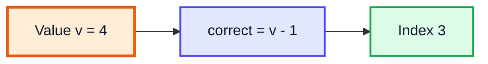
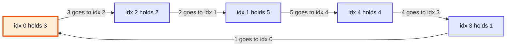
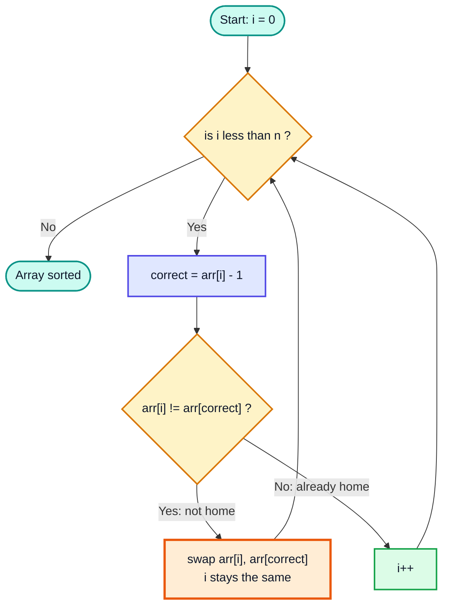
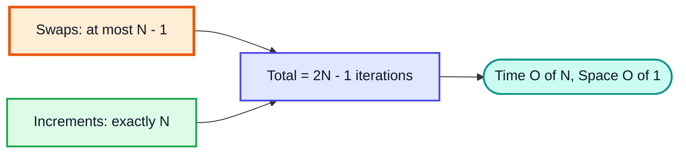
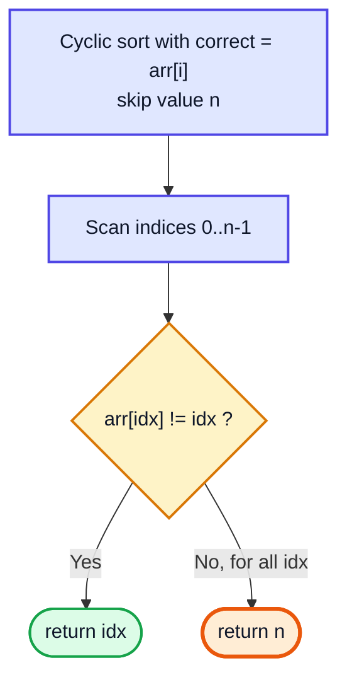
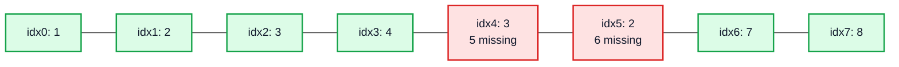
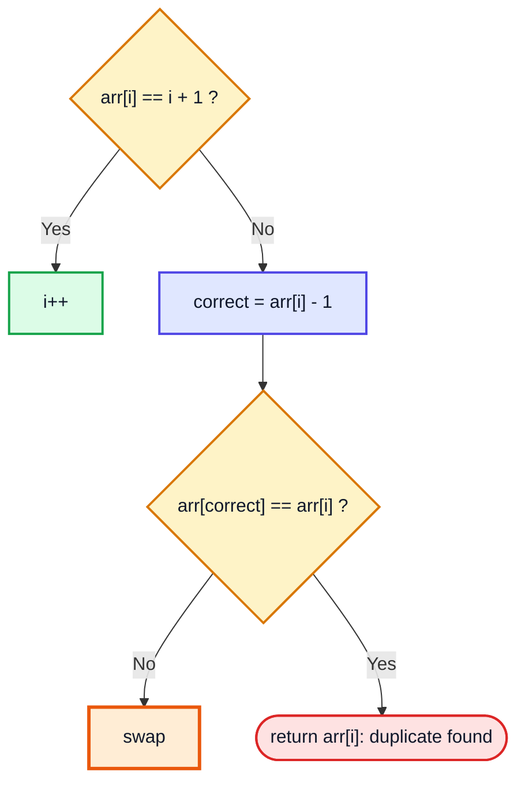
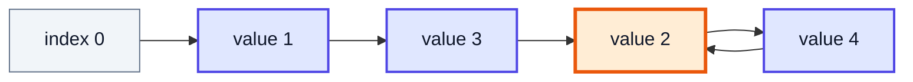
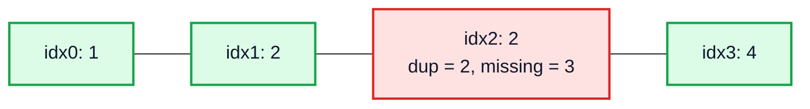
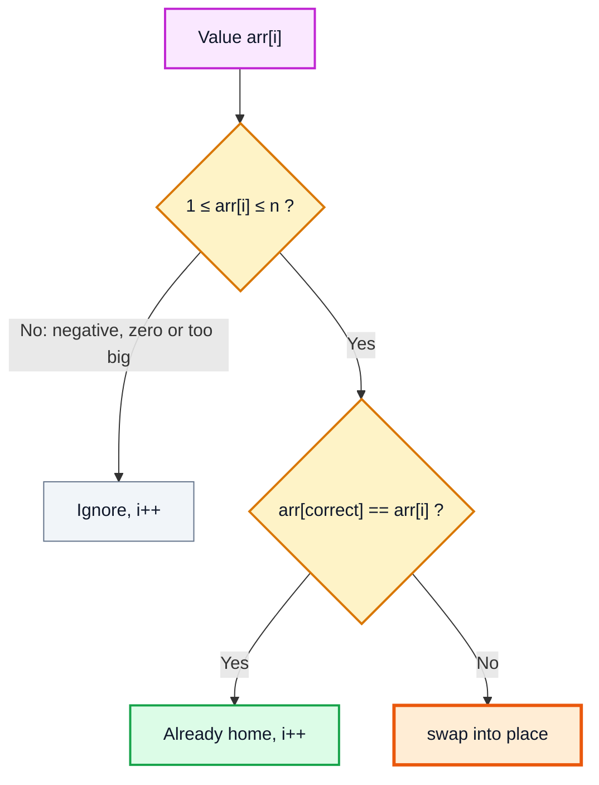

# Cyclic Sort — Complete In-Depth Guide

**Video #20 of the Java + DSA playlist:** *Cycle Sort - Amazon, Google, Microsoft Interview Questions* (1:35:32)

A deep-dive into **Cyclic Sort**, the O(N), in-place pattern for arrays whose values lie in a known range like `1..N` or `0..N`. It is then used to solve six well-known LeetCode problems (missing, disappeared and duplicate numbers, set mismatch, first missing positive), each with an approach, code, dry run, complexity and alternatives.

---

## Table of Contents

| # | Topic | Timestamp |
|---|---|---|
| 0 | [Teaser](#0-teaser-000) | 0:00 |
| 1 | [Introduction](#1-introduction-008) | 0:08 |
| 2 | [Cyclic Sort](#2-cyclic-sort-110) | 1:10 |
| 3 | [Algorithm for Cyclic Sort](#3-algorithm-for-cyclic-sort-426) | 4:26 |
| 4 | [Worst Case](#4-worst-case-1009) | 10:09 |
| 5 | [Code for Cyclic Sort](#5-code-for-cyclic-sort-1436) | 14:36 |
| 6 | [Q1: Missing Number](#6-q1-missing-number-2106) | 21:06 |
| 7 | [Q2: Find All Numbers Disappeared in an Array](#7-q2-find-all-numbers-disappeared-in-an-array-3756) | 37:56 |
| 8 | [Q3: Find the Duplicate Number](#8-q3-find-the-duplicate-number-5130) | 51:30 |
| 9 | [Q4: Find All Duplicates in an Array](#9-q4-find-all-duplicates-in-an-array-10415) | 1:04:15 |
| 10 | [Q5: Set Mismatch](#10-q5-set-mismatch-11140) | 1:11:40 |
| 11 | [Q6: First Missing Positive](#11-q6-first-missing-positive-12103) | 1:21:03 |
| 12 | [Outro](#12-outro-13519) | 1:35:19 |

---

## 0. Teaser (0:00)

A few seconds of preview. The main claim of the video: one simple sorting idea solves a whole family of interview problems, from LeetCode Easy all the way to Hard.

---

## 1. Introduction (0:08)

The earlier sorting videos (bubble, selection, insertion) were **comparison sorts** that take O(N²). Cyclic sort is different. It does not compare elements with each other. It uses the **value of an element to compute its index directly**.

| Previous sorts | Cyclic sort |
|---|---|
| Works on any data | Works only when values are in a known range (`1..N`, `0..N`, ...) |
| O(N²) comparisons | O(N) |
| Comparison-based | Index computed from the value |
| General-purpose | A **pattern** for "missing / duplicate" problems |

> [!IMPORTANT]
> The pattern to remember: **"Given an array of numbers in the range [1, N] (or [0, N])"** → think **cyclic sort** first. This line appears in a huge number of Amazon, Google and Microsoft questions.

---

## 2. Cyclic Sort (1:10)

### The Core Observation

Take an array of size `N` that contains each number from `1` to `N` exactly once, in some order. After sorting, the answer is known in advance:

| Index | 0 | 1 | 2 | 3 | 4 |
|---|---|---|---|---|---|
| Value after sorting | 1 | 2 | 3 | 4 | 5 |

So **value `v` must sit at index `v - 1`**. You don't need to compare anything; each value already tells you where it belongs.

| Range of values | Correct index of value `v` |
|---|---|
| `1..N` | `v - 1` |
| `0..N-1` | `v` |
| `0..N` (one extra value) | `v`, and the value `N` has no slot, so ignore it |



### Why "Cyclic"?

If you keep sending each element "home", the elements form **cycles**: 3 goes to where 2 sat, 2 goes to where 5 sat, and so on until the cycle closes back at the starting index.



> [!NOTE]
> The textbook "Cycle Sort" (the one that minimizes memory **writes** and works on any data) is a slightly different, more general algorithm. In interviews, "cyclic sort" almost always means the range-based swap technique in this video.

---

## 3. Algorithm for Cyclic Sort (4:26)

### Steps

1. Start at `i = 0`.
2. Compute `correct = arr[i] - 1`.
3. If `arr[i]` is **not** at its correct index, **swap** `arr[i]` with `arr[correct]`. **Do not move `i`**, because a new element just arrived at `i` and it also needs checking.
4. If `arr[i]` **is** at its correct index, do `i++`.
5. Stop when `i == N`.



> [!TIP]
> Compare `arr[i] != arr[correct]` instead of `i != correct`. They mean the same thing when there are no duplicates, but the value comparison also **stops infinite loops when duplicates exist** (two equal values would keep swapping forever). Using it from the start means the same code works for every question below.

### Dry Run: `arr = {3, 5, 2, 1, 4}`

| Step | i | arr[i] | correct | arr[correct] | Action | Array after |
|---|---|---|---|---|---|---|
| 1 | 0 | 3 | 2 | 2 | 🟧 swap | `[2, 5, 3, 1, 4]` |
| 2 | 0 | 2 | 1 | 5 | 🟧 swap | `[5, 2, 3, 1, 4]` |
| 3 | 0 | 5 | 4 | 4 | 🟧 swap | `[4, 2, 3, 1, 5]` |
| 4 | 0 | 4 | 3 | 1 | 🟧 swap | `[1, 2, 3, 4, 5]` |
| 5 | 0 | 1 | 0 | 1 | ✅ i++ | `[1, 2, 3, 4, 5]` |
| 6–9 | 1→4 | home | — | — | ✅ i++ ×4 | `[1, 2, 3, 4, 5]` |

Notice that `i` stayed at 0 for four swaps, and **every swap put one element in its final place** (3, then 2, then 5, then 4, and finally 1 lands at index 0 automatically).

---

## 4. Worst Case (10:09)

### Counting the Work

Each loop iteration does exactly one of two things:

| Action | How many times at most? | Why |
|---|---|---|
| **swap** | `N - 1` | Every swap puts one element at its correct index **permanently**. Once only one element is left, it is automatically in place. |
| **i++** | `N` | `i` moves from 0 to N. |
| **Total iterations** | `(N - 1) + N = 2N - 1` | → **O(N)** |



The worst case is the array from the dry run: `{3, 5, 2, 1, 4}` is a single cycle of length 5, so it needs 4 swaps + 5 increments = **9 iterations** = `2·5 − 1`.

> [!IMPORTANT]
> Even though there is a `while` loop that sometimes does not advance `i`, the algorithm is **linear**, not quadratic. Don't confuse "nested-looking" with O(N²). Count the total number of operations instead.

### Comparison with Other Sorts

| Algorithm | Best | Worst | Space | Stable? | Needs value range? |
|---|---|---|---|---|---|
| Bubble | O(N) | O(N²) | O(1) | ✅ | ❌ |
| Selection | O(N²) | O(N²) | O(1) | ❌ | ❌ |
| Insertion | O(N) | O(N²) | O(1) | ✅ | ❌ |
| **Cyclic** | **O(N)** | **O(N)** | **O(1)** | ❌ | ✅ |

---

## 5. Code for Cyclic Sort (14:36)

```java
import java.util.Arrays;

public class CyclicSort {
    static void cyclicSort(int[] arr) {
        int i = 0;
        while (i < arr.length) {
            int correct = arr[i] - 1;           // where arr[i] should be
            if (arr[i] != arr[correct]) {
                swap(arr, i, correct);          // don't increment i
            } else {
                i++;
            }
        }
    }

    static void swap(int[] arr, int first, int second) {
        int temp = arr[first];
        arr[first] = arr[second];
        arr[second] = temp;
    }

    public static void main(String[] args) {
        int[] arr = {3, 5, 2, 1, 4};
        cyclicSort(arr);
        System.out.println(Arrays.toString(arr));   // [1, 2, 3, 4, 5]
    }
}
```

### Common Mistakes

| ❌ Mistake | What happens | ✅ Fix |
|---|---|---|
| Using a `for` loop that always does `i++` | Element swapped into `i` is never checked → array not sorted | Use `while` and only increment in the `else` |
| `if (i != correct)` with duplicates | Two copies keep swapping → infinite loop | `if (arr[i] != arr[correct])` |
| Not guarding the range | `ArrayIndexOutOfBoundsException` for values like `0`, `N`, negatives | Add `arr[i] > 0 && arr[i] <= n` (or `< n`) to the condition |

> [!CAUTION]
> Cyclic sort **modifies the input array**. If a problem says "do not modify the array" (LeetCode 287 does), you need a different approach or must copy the array first.

---

## 6. Q1: Missing Number (21:06)

**LeetCode 268 — Missing Number (Easy, Amazon).** Array of `n` distinct numbers taken from `0..n`. Return the one number in the range that is missing.

Example: `[4, 0, 2, 1]` → `3`.

### Approach

- Values are `0..n`, so **value `v` belongs at index `v`** (`correct = arr[i]`).
- The array has only `n` slots (indices `0..n-1`), so the value `n` **has nowhere to go**. Skip it with `arr[i] < n`.
- After sorting, scan: the first index `idx` where `arr[idx] != idx` is the missing number.
- If every index matches, the missing number is `n` itself.



### Code

```java
public class MissingNumber {
    static int missingNumber(int[] arr) {
        int i = 0;
        while (i < arr.length) {
            int correct = arr[i];
            if (arr[i] < arr.length && arr[i] != arr[correct]) {
                swap(arr, i, correct);
            } else {
                i++;
            }
        }
        // case 1: some index is wrong
        for (int idx = 0; idx < arr.length; idx++) {
            if (arr[idx] != idx) {
                return idx;
            }
        }
        // case 2: 0..n-1 all present → n is missing
        return arr.length;
    }

    static void swap(int[] arr, int a, int b) {
        int t = arr[a]; arr[a] = arr[b]; arr[b] = t;
    }

    public static void main(String[] args) {
        System.out.println(missingNumber(new int[]{4, 0, 2, 1}));   // 3
        System.out.println(missingNumber(new int[]{0, 1}));         // 2
    }
}
```

### Dry Run: `[4, 0, 2, 1]`, n = 4

| i | arr[i] | correct | Condition | Action | Array after |
|---|---|---|---|---|---|
| 0 | 4 | 4 | ❌ `4 < 4` is false | i++ | `[4, 0, 2, 1]` |
| 1 | 0 | 0 | ✅ arr[0]=4 ≠ 0 | 🟧 swap | `[0, 4, 2, 1]` |
| 1 | 4 | 4 | ❌ skip n | i++ | `[0, 4, 2, 1]` |
| 2 | 2 | 2 | ❌ already home | i++ | `[0, 4, 2, 1]` |
| 3 | 1 | 1 | ✅ arr[1]=4 ≠ 1 | 🟧 swap | `[0, 1, 2, 4]` |
| 3 | 4 | 4 | ❌ skip n | i++ | `[0, 1, 2, 4]` |

Scan: index 3 holds 4 ≠ 3 → **answer 3** ✅

### Complexity

| | Value |
|---|---|
| Time | O(N): sort is ≤ 2N − 1 steps, scan is N |
| Space | O(1) |

### Alternative Approaches

| Approach | Idea | Time | Space | Modifies array? |
|---|---|---|---|---|
| **Cyclic sort** | as above | O(N) | O(1) | ✅ |
| **Sum formula** | `n(n+1)/2 − sum(arr)` | O(N) | O(1) | ❌ |
| **XOR** | XOR all indices `0..n` and all values; pairs cancel | O(N) | O(1) | ❌ |
| HashSet | add all, check 0..n | O(N) | O(N) | ❌ |
| Sort + scan | `Arrays.sort` | O(N log N) | O(log N) | ✅ |

```java
static int missingXor(int[] arr) {
    int x = arr.length;                    // include n
    for (int i = 0; i < arr.length; i++) {
        x ^= i ^ arr[i];
    }
    return x;                              // [4,0,2,1] → 3
}
```

> [!TIP]
> In an interview, mention cyclic sort *and* the XOR/sum trick. The sum formula can overflow `int` for huge `n` (use `long`); XOR never overflows.

---

## 7. Q2: Find All Numbers Disappeared in an Array (37:56)

**LeetCode 448 — Find All Numbers Disappeared in an Array (Easy, Google).** Array of `n` integers with values in `1..n`; some appear twice and others are missing. Return all missing numbers.

Example: `[4, 3, 2, 7, 8, 2, 3, 1]` → `[5, 6]`.

### Approach

1. Cyclic sort with `correct = arr[i] - 1`. The `arr[i] != arr[correct]` check makes duplicates stop instead of looping forever: a duplicate just stays in some "free" slot.
2. Scan: wherever `arr[idx] != idx + 1`, the number `idx + 1` is missing.

### Code

```java
import java.util.ArrayList;
import java.util.List;

public class Disappeared {
    static List<Integer> findDisappearedNumbers(int[] arr) {
        int i = 0;
        while (i < arr.length) {
            int correct = arr[i] - 1;
            if (arr[i] != arr[correct]) {
                swap(arr, i, correct);
            } else {
                i++;
            }
        }
        List<Integer> ans = new ArrayList<>();
        for (int idx = 0; idx < arr.length; idx++) {
            if (arr[idx] != idx + 1) {
                ans.add(idx + 1);
            }
        }
        return ans;
    }

    static void swap(int[] arr, int a, int b) {
        int t = arr[a]; arr[a] = arr[b]; arr[b] = t;
    }

    public static void main(String[] args) {
        System.out.println(findDisappearedNumbers(new int[]{4, 3, 2, 7, 8, 2, 3, 1}));  // [5, 6]
    }
}
```

### Dry Run: `[4, 3, 2, 7, 8, 2, 3, 1]`

| i | arr[i] | correct | arr[correct] | Action | Array after |
|---|---|---|---|---|---|
| 0 | 4 | 3 | 7 | 🟧 swap | `[7, 3, 2, 4, 8, 2, 3, 1]` |
| 0 | 7 | 6 | 3 | 🟧 swap | `[3, 3, 2, 4, 8, 2, 7, 1]` |
| 0 | 3 | 2 | 2 | 🟧 swap | `[2, 3, 3, 4, 8, 2, 7, 1]` |
| 0 | 2 | 1 | 3 | 🟧 swap | `[3, 2, 3, 4, 8, 2, 7, 1]` |
| 0 | 3 | 2 | 3 | ✅ equal (duplicate) → i++ | same |
| 1–3 | home | — | — | ✅ i++ | same |
| 4 | 8 | 7 | 1 | 🟧 swap | `[3, 2, 3, 4, 1, 2, 7, 8]` |
| 4 | 1 | 0 | 3 | 🟧 swap | `[1, 2, 3, 4, 3, 2, 7, 8]` |
| 4 | 3 | 2 | 3 | ✅ duplicate → i++ | same |
| 5 | 2 | 1 | 2 | ✅ duplicate → i++ | same |
| 6–7 | home | — | — | ✅ i++ | `[1, 2, 3, 4, 3, 2, 7, 8]` |

Final array with the "wrong" slots marked:



Answer: **[5, 6]** ✅

### Complexity

Time **O(N)**, extra space **O(1)** (the output list is not counted, as LeetCode's follow-up allows).

### Alternative: Negative Marking

For each value `v`, mark index `|v| − 1` as visited by making it negative. Indices that stay positive are missing numbers. Also O(N) / O(1), and the array can be restored afterwards.

```java
static List<Integer> disappearedByMarking(int[] arr) {
    for (int v : arr) {
        int idx = Math.abs(v) - 1;
        if (arr[idx] > 0) arr[idx] = -arr[idx];
    }
    List<Integer> ans = new ArrayList<>();
    for (int i = 0; i < arr.length; i++) {
        if (arr[i] > 0) ans.add(i + 1);
    }
    return ans;
}
```

---

## 8. Q3: Find the Duplicate Number (51:30)

**LeetCode 287 — Find the Duplicate Number (Medium, Amazon/Microsoft).** Array of `n + 1` integers with values in `1..n`. Exactly one value is repeated (possibly many times). Return it.

Example: `[1, 3, 4, 2, 2]` → `2`.

### Approach (Cyclic Sort, Early Return)

While sorting, if `arr[i]` is not at its home **and** its home already holds the same value, then `arr[i]` is the duplicate. Return it immediately.



### Code

```java
public class FindDuplicate {
    static int findDuplicate(int[] arr) {
        int i = 0;
        while (i < arr.length) {
            if (arr[i] != i + 1) {
                int correct = arr[i] - 1;
                if (arr[i] != arr[correct]) {
                    swap(arr, i, correct);
                } else {
                    return arr[i];
                }
            } else {
                i++;
            }
        }
        return -1;
    }

    static void swap(int[] arr, int a, int b) {
        int t = arr[a]; arr[a] = arr[b]; arr[b] = t;
    }

    public static void main(String[] args) {
        System.out.println(findDuplicate(new int[]{1, 3, 4, 2, 2}));   // 2
        System.out.println(findDuplicate(new int[]{3, 1, 3, 4, 2}));   // 3
    }
}
```

### Dry Run: `[1, 3, 4, 2, 2]`

| i | arr[i] | Home? | correct | arr[correct] | Action | Array after |
|---|---|---|---|---|---|---|
| 0 | 1 | ✅ | — | — | i++ | `[1, 3, 4, 2, 2]` |
| 1 | 3 | ❌ | 2 | 4 | 🟧 swap | `[1, 4, 3, 2, 2]` |
| 1 | 4 | ❌ | 3 | 2 | 🟧 swap | `[1, 2, 3, 4, 2]` |
| 1–3 | home | ✅ | — | — | i++ ×3 | same |
| 4 | 2 | ❌ | 1 | 2 | 🟥 equal → **return 2** | — |

### Complexity

Time **O(N)**, space **O(1)**, but it **modifies** the array.

> [!WARNING]
> The actual LeetCode 287 statement says *"You must solve the problem **without modifying** the array"* and with O(1) extra space. Cyclic sort gets accepted on the judge, but it breaks that rule. Expect the interviewer to ask for one of the approaches below.

### Alternative Approaches

| Approach | Idea | Time | Space | Modifies? |
|---|---|---|---|---|
| Cyclic sort | as above | O(N) | O(1) | ✅ |
| **Floyd's cycle detection** | Treat `i → arr[i]` as a linked list; the duplicate is the cycle's entry | O(N) | O(1) | ❌ ✅ intended |
| Binary search on values | Count how many values ≤ mid; if count > mid, duplicate ≤ mid | O(N log N) | O(1) | ❌ |
| HashSet | First value seen twice | O(N) | O(N) | ❌ |

```java
static int findDuplicateFloyd(int[] nums) {
    int slow = nums[0], fast = nums[0];
    do {                                   // phase 1: meet inside the cycle
        slow = nums[slow];
        fast = nums[nums[fast]];
    } while (slow != fast);

    slow = nums[0];                        // phase 2: find cycle entrance
    while (slow != fast) {
        slow = nums[slow];
        fast = nums[fast];
    }
    return slow;                           // [1,3,4,2,2] → 2
}
```



Following `i → nums[i]` for `[1, 3, 4, 2, 2]` gives `0 → 1 → 3 → 2 → 4 → 2 → ...`. Two indices point to node **2**, so 2 is where the cycle starts, and 2 is the duplicate. (Floyd's algorithm is covered properly in the linked list videos.)

---

## 9. Q4: Find All Duplicates in an Array (1:04:15)

**LeetCode 442 — Find All Duplicates in an Array (Medium).** Array of length `n`, values in `1..n`, each value appears **once or twice**. Return all values that appear twice.

Example: `[4, 3, 2, 7, 8, 2, 3, 1]` → `[3, 2]` (any order).

### Approach

This is **Q2 again with a different answer**. Do the same sort; at every wrong slot:
- Q2 returns the **index + 1** (the missing number).
- Q4 returns the **value sitting there** (the duplicate).

| Final array (from Q2's dry run) | idx 4 | idx 5 |
|---|---|---|
| Value present | 🟥 3 | 🟥 2 |
| Q2 answer (missing) `idx + 1` | 5 | 6 |
| Q4 answer (duplicate) `arr[idx]` | **3** | **2** |

### Code

```java
import java.util.ArrayList;
import java.util.List;

public class AllDuplicates {
    static List<Integer> findDuplicates(int[] arr) {
        int i = 0;
        while (i < arr.length) {
            int correct = arr[i] - 1;
            if (arr[i] != arr[correct]) {
                swap(arr, i, correct);
            } else {
                i++;
            }
        }
        List<Integer> ans = new ArrayList<>();
        for (int idx = 0; idx < arr.length; idx++) {
            if (arr[idx] != idx + 1) {
                ans.add(arr[idx]);
            }
        }
        return ans;
    }

    static void swap(int[] arr, int a, int b) {
        int t = arr[a]; arr[a] = arr[b]; arr[b] = t;
    }

    public static void main(String[] args) {
        System.out.println(findDuplicates(new int[]{4, 3, 2, 7, 8, 2, 3, 1}));  // [3, 2]
        System.out.println(findDuplicates(new int[]{1, 1, 2}));                 // [1]
    }
}
```

> [!NOTE]
> Because each value appears **at most twice**, each duplicate occupies exactly one wrong slot, so it's reported only once. If values could appear three times, you'd need extra handling to avoid reporting the same value twice.

### Complexity & Alternative

Time **O(N)**, space **O(1)** extra. Alternative: **negative marking**. For each `v`, look at index `|v| − 1`; if it is already negative, `|v|` is a duplicate; otherwise negate it.

```java
static List<Integer> duplicatesByMarking(int[] arr) {
    List<Integer> ans = new ArrayList<>();
    for (int v : arr) {
        int idx = Math.abs(v) - 1;
        if (arr[idx] < 0) ans.add(Math.abs(v));
        else arr[idx] = -arr[idx];
    }
    return ans;   // [4,3,2,7,8,2,3,1] → [2, 3]
}
```

---

## 10. Q5: Set Mismatch (1:11:40)

**LeetCode 645 — Set Mismatch (Easy, Amazon).** A set originally held `1..n`, but one number was replaced by a copy of another number. Return `[duplicate, missing]`.

Example: `[1, 2, 2, 4]` → `[2, 3]`.

### Approach

It's **Q2 + Q4 combined**. Sort; there is exactly one wrong slot `idx`:
- duplicate = `arr[idx]`
- missing = `idx + 1`



### Code

```java
import java.util.Arrays;

public class SetMismatch {
    static int[] findErrorNums(int[] arr) {
        int i = 0;
        while (i < arr.length) {
            int correct = arr[i] - 1;
            if (arr[i] != arr[correct]) {
                swap(arr, i, correct);
            } else {
                i++;
            }
        }
        for (int idx = 0; idx < arr.length; idx++) {
            if (arr[idx] != idx + 1) {
                return new int[]{arr[idx], idx + 1};
            }
        }
        return new int[]{-1, -1};
    }

    static void swap(int[] arr, int a, int b) {
        int t = arr[a]; arr[a] = arr[b]; arr[b] = t;
    }

    public static void main(String[] args) {
        System.out.println(Arrays.toString(findErrorNums(new int[]{1, 2, 2, 4})));  // [2, 3]
        System.out.println(Arrays.toString(findErrorNums(new int[]{3, 2, 2})));     // [2, 1]
    }
}
```

### Dry Run: `[3, 2, 2]`

| i | arr[i] | correct | arr[correct] | Action | Array after |
|---|---|---|---|---|---|
| 0 | 3 | 2 | 2 | 🟧 swap | `[2, 2, 3]` |
| 0 | 2 | 1 | 2 | ✅ equal → i++ | `[2, 2, 3]` |
| 1 | 2 | 1 | 2 | ✅ home → i++ | same |
| 2 | 3 | 2 | 3 | ✅ home → i++ | same |

Scan: idx 0 holds 2 ≠ 1 → **[2, 1]** ✅

### Complexity & Alternatives

Time **O(N)**, space **O(1)**. Alternatives: a counting array (O(N) space), or math (difference of sums and difference of sums of squares give `dup − miss` and `dup + miss`).

---

## 11. Q6: First Missing Positive (1:21:03)

**LeetCode 41 — First Missing Positive (Hard, Amazon/Google/Microsoft).** Unsorted integer array (negatives, zero, large numbers allowed). Return the smallest **positive** integer not in the array, in O(N) time and O(1) extra space.

Examples: `[3, 4, -1, 1]` → `2`; `[7, 8, 9, 11, 12]` → `1`; `[1, 2, 0]` → `3`.

### Key Insight

For an array of length `n`, the answer is always in **`1..n+1`**. Even in the best case, where the array holds exactly `1..n`, the answer is `n + 1`. So **any value ≤ 0 or > n can be ignored**, and the remaining values fit the cyclic-sort pattern `1..n`.



### Code

```java
public class FirstMissingPositive {
    static int firstMissingPositive(int[] arr) {
        int i = 0;
        while (i < arr.length) {
            int correct = arr[i] - 1;
            if (arr[i] > 0 && arr[i] <= arr.length && arr[i] != arr[correct]) {
                swap(arr, i, correct);
            } else {
                i++;
            }
        }
        for (int idx = 0; idx < arr.length; idx++) {
            if (arr[idx] != idx + 1) {
                return idx + 1;
            }
        }
        return arr.length + 1;
    }

    static void swap(int[] arr, int a, int b) {
        int t = arr[a]; arr[a] = arr[b]; arr[b] = t;
    }

    public static void main(String[] args) {
        System.out.println(firstMissingPositive(new int[]{3, 4, -1, 1}));     // 2
        System.out.println(firstMissingPositive(new int[]{7, 8, 9, 11, 12})); // 1
        System.out.println(firstMissingPositive(new int[]{1, 2, 0}));         // 3
    }
}
```

> [!CAUTION]
> The order of conditions matters. `arr[i] > 0 && arr[i] <= arr.length` must come **before** `arr[correct]`. Thanks to short-circuit `&&`, the risky array access only happens for in-range values. Put it first and `-1` would produce `arr[-2]` → `ArrayIndexOutOfBoundsException`.

### Dry Run: `[3, 4, -1, 1]`, n = 4

| i | arr[i] | In range? | correct | arr[correct] | Action | Array after |
|---|---|---|---|---|---|---|
| 0 | 3 | ✅ | 2 | -1 | 🟧 swap | `[-1, 4, 3, 1]` |
| 0 | -1 | ❌ | — | — | i++ | same |
| 1 | 4 | ✅ | 3 | 1 | 🟧 swap | `[-1, 1, 3, 4]` |
| 1 | 1 | ✅ | 0 | -1 | 🟧 swap | `[1, -1, 3, 4]` |
| 1 | -1 | ❌ | — | — | i++ | same |
| 2 | 3 | ✅ | 2 | 3 | home → i++ | same |
| 3 | 4 | ✅ | 3 | 4 | home → i++ | `[1, -1, 3, 4]` |

Scan: idx 0 ✅, idx 1 holds -1 ≠ 2 → **answer 2** ✅

### Complexity

Time **O(N)**, space **O(1)**. This meets the problem's strict constraints, which is why a Hard problem becomes a short loop once you see the pattern.

### Alternatives

| Approach | Time | Space | Note |
|---|---|---|---|
| **Cyclic sort** | O(N) | O(1) | ✅ meets constraints |
| Negative marking (after replacing out-of-range values with `n+1`) | O(N) | O(1) | ✅ meets constraints |
| HashSet, then check 1, 2, 3 ... | O(N) | O(N) | ❌ space |
| Sort + scan | O(N log N) | O(1) | ❌ time |

---

## 12. Outro (1:35:19)

Practise the cyclic sort assignments in the course's GitHub repository, then re-solve each question above from scratch without looking at the code. The next video (#21) covers **Strings and StringBuilder in Java**.

---

## 🧩 Complete Example: Everything Together

One program with the core algorithm and all six questions:

```java
import java.util.ArrayList;
import java.util.Arrays;
import java.util.List;

public class CyclicSortDemo {

    // ═══════ Core: Cyclic Sort for values 1..N ═══════
    static void cyclicSort(int[] arr) {
        int i = 0;
        while (i < arr.length) {
            int correct = arr[i] - 1;          // value v belongs at index v-1
            if (arr[i] != arr[correct]) {
                swap(arr, i, correct);         // send it home, re-check index i
            } else {
                i++;                           // already home (or a copy is) -> move on
            }
        }
    }

    // ═══════ Q1: Missing Number (LeetCode 268) — values 0..N ═══════
    static int missingNumber(int[] arr) {
        int i = 0;
        while (i < arr.length) {
            int correct = arr[i];              // value v belongs at index v
            if (arr[i] < arr.length && arr[i] != arr[correct]) {
                swap(arr, i, correct);
            } else {
                i++;
            }
        }
        for (int idx = 0; idx < arr.length; idx++) {
            if (arr[idx] != idx) return idx;
        }
        return arr.length;
    }

    // ═══════ Q2: Find All Numbers Disappeared (LeetCode 448) ═══════
    static List<Integer> findDisappearedNumbers(int[] arr) {
        cyclicSort(arr);
        List<Integer> ans = new ArrayList<>();
        for (int idx = 0; idx < arr.length; idx++) {
            if (arr[idx] != idx + 1) ans.add(idx + 1);
        }
        return ans;
    }

    // ═══════ Q3: Find the Duplicate Number (LeetCode 287) ═══════
    static int findDuplicate(int[] arr) {
        int i = 0;
        while (i < arr.length) {
            if (arr[i] != i + 1) {
                int correct = arr[i] - 1;
                if (arr[i] != arr[correct]) {
                    swap(arr, i, correct);
                } else {
                    return arr[i];             // its home is already taken by a copy
                }
            } else {
                i++;
            }
        }
        return -1;
    }

    // ═══════ Q4: Find All Duplicates (LeetCode 442) ═══════
    static List<Integer> findDuplicates(int[] arr) {
        cyclicSort(arr);
        List<Integer> ans = new ArrayList<>();
        for (int idx = 0; idx < arr.length; idx++) {
            if (arr[idx] != idx + 1) ans.add(arr[idx]);
        }
        return ans;
    }

    // ═══════ Q5: Set Mismatch (LeetCode 645) ═══════
    static int[] findErrorNums(int[] arr) {
        cyclicSort(arr);
        for (int idx = 0; idx < arr.length; idx++) {
            if (arr[idx] != idx + 1) return new int[]{arr[idx], idx + 1};
        }
        return new int[]{-1, -1};
    }

    // ═══════ Q6: First Missing Positive (LeetCode 41) ═══════
    static int firstMissingPositive(int[] arr) {
        int i = 0;
        while (i < arr.length) {
            int correct = arr[i] - 1;
            if (arr[i] > 0 && arr[i] <= arr.length && arr[i] != arr[correct]) {
                swap(arr, i, correct);
            } else {
                i++;
            }
        }
        for (int idx = 0; idx < arr.length; idx++) {
            if (arr[idx] != idx + 1) return idx + 1;
        }
        return arr.length + 1;
    }

    static void swap(int[] arr, int a, int b) {
        int temp = arr[a];
        arr[a] = arr[b];
        arr[b] = temp;
    }

    public static void main(String[] args) {
        int[] nums = {3, 5, 2, 1, 4};
        cyclicSort(nums);
        System.out.println("Cyclic sort          : " + Arrays.toString(nums));

        System.out.println("Missing number       : " + missingNumber(new int[]{4, 0, 2, 1}));
        System.out.println("Disappeared numbers  : " + findDisappearedNumbers(new int[]{4, 3, 2, 7, 8, 2, 3, 1}));
        System.out.println("Duplicate number     : " + findDuplicate(new int[]{1, 3, 4, 2, 2}));
        System.out.println("All duplicates       : " + findDuplicates(new int[]{4, 3, 2, 7, 8, 2, 3, 1}));
        System.out.println("Set mismatch         : " + Arrays.toString(findErrorNums(new int[]{1, 2, 2, 4})));
        System.out.println("First missing +ve    : " + firstMissingPositive(new int[]{3, 4, -1, 1}));
        System.out.println("First missing +ve    : " + firstMissingPositive(new int[]{7, 8, 9, 11, 12}));
    }
}
```

**Expected Output:**
```
Cyclic sort          : [1, 2, 3, 4, 5]
Missing number       : 3
Disappeared numbers  : [5, 6]
Duplicate number     : 2
All duplicates       : [3, 2]
Set mismatch         : [2, 3]
First missing +ve    : 2
First missing +ve    : 1
```

---

## Quick Reference Cheat Sheet

| Concept / Problem | One-Line Summary |
|---|---|
| **When to use** | Values in a known range like `1..N` or `0..N`; asked for missing / duplicate numbers |
| **Correct index** | `1..N` → `v - 1`; `0..N` → `v` |
| **Loop rule** | Swap and stay at `i` if not home; `i++` only when home |
| **Duplicate-safe check** | `arr[i] != arr[correct]`, not `i != correct` |
| **Complexity** | ≤ 2N − 1 iterations → O(N) time, O(1) space; not stable; modifies array |
| **LC 268 Missing Number** | `correct = arr[i]`, skip `n`; first `arr[idx] != idx`, else `n` |
| **LC 448 Disappeared** | Sort; every wrong slot → `idx + 1` is missing |
| **LC 287 Find Duplicate** | Return `arr[i]` when its home already holds the same value; Floyd's is the no-modify answer |
| **LC 442 All Duplicates** | Sort; every wrong slot → `arr[idx]` is a duplicate |
| **LC 645 Set Mismatch** | Sort; the one wrong slot gives `[arr[idx], idx + 1]` |
| **LC 41 First Missing Positive** | Ignore `≤ 0` and `> n`; sort; first `arr[idx] != idx + 1`, else `n + 1` |
| **Alternatives** | XOR / sum formula, negative marking, HashSet, Floyd's cycle detection |
